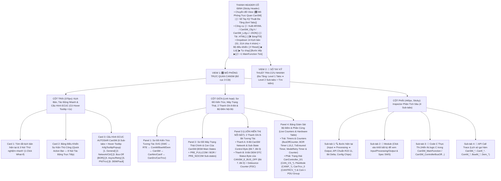
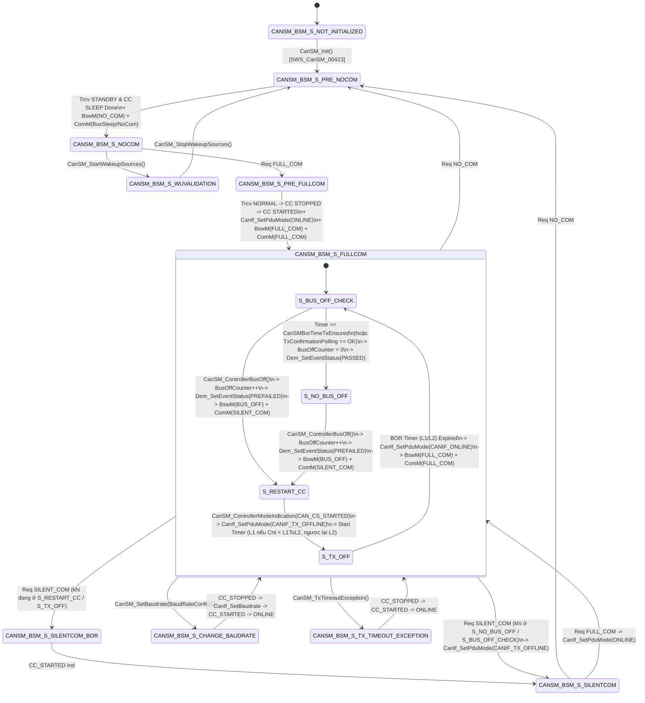

# Tài Liệu Thiết Kế Chi Tiết Trình Mô Phỏng AUTOSAR CanSM (`CanSM_Simulation_design.md`)

> **Trạng thái tài liệu:** Bản thiết kế chi tiết đã cập nhật theo xác nhận `A1`–`A4` của User — Sẵn sàng để User review trước khi triển khai code.  
> **File đích dự kiến xuất bản:** `d:\__Personal\AntiGravity\AUTOSAR_CanSM.html` (Ứng dụng Web Tương tác 1 file HTML độc lập, 100% Offline, Pure CSS, có nút tải `.HTML` kèm cấu hình nhúng & xuất code `ARXML / CanSM_Cfg.h / CanSM_Cfg.c / JSON`).  
> **Chuẩn tham chiếu:** **AUTOSAR Classic Platform R20-11 / R22-11 / R23-11 (`SWS_CanSM`, `SWS_ComM`, `SWS_CanIf`, `SWS_BswM`, `SWS_Dem`, `SWS_CanNm`)**, đính kèm mã requirement chuẩn **`SWS_CanSM_xxxxx`** tại từng bước xử lý, thanh ghi 8-Bit, tooltip cấu hình và sổ tay tra cứu.

---

## 1. Tổng Quan Định Hướng Thiết Kế Đã Chốt (`A1` – `A4`)

| Hạng mục | Nội dung thiết kế đã xác nhận với User |
| :--- | :--- |
| **1. Bố cục giao diện (`A1`)** | Kết hợp tinh hoa của **`AUTOSAR_DEM.html`** và **`AUTOSAR_PduR.html` / `AUTOSAR_RTE.html`**:<br>• **Bố cục 3 cột hiện đại**: Cột trái (`370px`: Kịch bản, Quick Action Bar, 6 Sub-tabs Cấu hình ECUC) — Cột giữa (`Linh hoạt`: Sơ đồ kiến trúc SVG + Sơ đồ State Machine/Timeline + 2 Thanh ghi 8-Bit luôn hiển thị nổi bật + Bảng biến nội bộ) — Cột phải (`440px`: Inspector 4 Sub-tabs).<br>• **Config Hover Tooltip (`> 1s` delay)** giống hệt `AUTOSAR_DEM.html` (`#cfgTooltipPopup` hiển thị tên tham số, đường dẫn ECUC, mã `SWS_CanSM_xxxxx`, mô tả, dải giá trị, giá trị typical và lưu ý kỹ thuật).<br>• **Công cụ xuất mã & chia sẻ**: Xuất `ARXML / CanSM_Cfg.h / CanSM_Lcfg.c / JSON` và nút tải file `.HTML` độc lập chạy offline. |
| **2. Khu vực 2 Thanh ghi 8-Bit (`A2`)** | Đặt **cố định và nổi bật ở Cột Giữa** gồm 2 thanh ghi 8-Bit song song:<br>• **Thanh A — `8-Bit CanSM Network & Sub-State Control Byte`**: Thể hiện trực관 các cờ điều khiển trạng thái mạng (`FULL_COM`, `SILENT_COM`, `ECU_PASSIVE`, `PN_WUF_ACTIVE`, `ASYNC_WAIT_IND`, `BOR_CHECK_ENSURED`, `BOR_TX_OFF_WAIT`, `BOR_L2_SLOW`).<br>• **Thanh B — `8-Bit DEM UDS DTC Status Byte` của lỗi `CANSM_E_BUS_OFF (0xC07388)`**: Hiển thị 8 bit chuẩn ISO 14229-1 (`WIR`, `TNCTOC`, `TFSLC`, `TNCSLC`, `CDTC`, `PDTC`, `TFTOC`, `TF`) kèm thanh `Debounce Counter (FDC)` để thấy rõ sự liên thông giữa `CanSM` Bus-Off Recovery và `DEM`. |
| **3. Hệ thống Kịch bản (`A3`)** | Thiết kế sẵn **14 Kịch bản chạy mẫu (`S1`–`S14`)** chia làm 4 nhóm lớn:<br>• **Nhóm 1 (`S1`–`S4`)**: Vòng đời & Chuyển Mode chuẩn (`Init ➔ PRE_FULLCOM ➔ FULLCOM ➔ SILENTCOM ➔ PRE_NOCOM ➔ NOCOM`, có và không có Partial Networking `PN`, cùng `Wakeup Validation`).<br>• **Nhóm 2 (`S5`–`S8`)**: Bus-Off Recovery (BOR) chuyên sâu (`L1 Fast` ➔ `L2 Slow`, so sánh `CanSMBorTimeTxEnsured` vs `CanSMBorTxConfirmationPolling`, báo lỗi `DEM CANSM_E_BUS_OFF`, và nhận lệnh `SilentCom/NoCom` khi đang kẹt ở BOR).<br>• **Nhóm 3 (`S9`–`S11`)**: Xử lý lỗi bất đồng bộ & Timeout (`CanIf` không phản hồi `ModeIndication` ➔ Retry theo `CanSMModeRequestRepetitionTime` / `RepetitionMax` ➔ `CANSM_E_MODE_REQUEST_TIMEOUT`, và `CanSM_TxTimeoutException`).<br>• **Nhóm 4 (`S12`–`S14`)**: Tính năng nâng cao & Liên thông `SWC` (`CanSM_SetBaudrate`, `CanSM_SetEcuPassive` ➔ `CANIF_TX_OFFLINE_ACTIVE`, Multi-Controller Gang Management, và Luồng End-to-End từ `SWC ➔ RTE ➔ ComM ➔ CanSM ➔ BswM ➔ Com I-PDU Group`). |
| **4. Sổ tay tra cứu đa tầng** | **View 2 (`📖 Sổ Tay Kỹ Thuật CanSM`)** được tổ chức theo cấu trúc **Đa Tầng (Multi-level Tabs)**: **6 Main Sub-tabs (Level 1)** × **3–4 Chủ đề con (Level 2 Pills/Tabs)** trong mỗi mục, tích hợp ô tìm kiếm tức thời (Live Filter). |

---

## 2. Bố Cục Giao Diện 3 Cột & Hệ Thống Sub-Tabs (UI Wireframe)



---

## 3. Thiết Kế Chi Tiết Panel 3 (Cột Giữa): 2 Thanh Ghi 8-Bit Tương Tác Luôn Hiển Thị Nổi Bật

Để người dùng theo dõi trực quan sự biến thiên của các cờ điều khiển nội bộ `CanSM` song hành cùng trạng thái lỗi chẩn đoán `CANSM_E_BUS_OFF` bên trong `DEM`, Panel 3 được cố định ngay dưới sơ đồ kiến trúc và máy trạng thái:

```text
+-------------------------------------------------------------------------------------------------------------------+
| 🔢 BẢNG GIÁM SÁT BITFIELD 8-BIT CANSM & DEM (LIVE 8-BIT INSPECTOR)      [Click vào từng ô Bit để thử nghiệm/giải mã]|
| Bước #5: CanSM_ControllerBusOff(Ctrl_0) ➔ Vào S_TX_OFF (L1) | CanSM Byte: 0x01 ➔ 0x40 | DEM Byte: 0x50 ➔ 0x21     |
+-------------------------------------------------------------------------------------------------------------------+
| A. THANH GHI 8-BIT ĐIỀU KHIỂN MẠNG & TRẠNG THÁI CON CANSM (`CanSM_NetworkControlByte`) — Hex: [0x40] Bin:[01000000]|
|    Trạng thái chính: [ CANSM_BSM_S_FULLCOM ]  |  Trạng thái con (Sub-State): [ S_TX_OFF (Wait BOR L1: 100ms) ]    |
|  +-------------+ +-------------+ +-------------+ +-------------+ +-------------+ +-------------+ +-------+ +-----+|
|  | Bit 7 (0x80)| | Bit 6 (0x40)| | Bit 5 (0x20)| | Bit 4 (0x10)| | Bit 3 (0x08)| | Bit 2 (0x04)| |Bit1(2)| |Bit 0||
|  | BOR_L2_SLOW | | BOR_TX_OFF  | | BOR_ENSURED | | WAIT_INDIC  | | PN_WUF_ACTV | | ECU_PASSIVE | |SILENT | |FULL ||
|  |      0      | |   1 (0➔1🔥) | |      0      | |      0      | |      0      | |      0      | |   0   | |0(1➔0||
|  | L1 Fast Mode| | TxOffline!  | | Not In Check| | Sync/Done   | | Std No-PN   | | Normal Active| |Rx+Tx  | |Offln||
|  +-------------+ +-------------+ +-------------+ +-------------+ +-------------+ +-------------+ +-------+ +-----+|
+-------------------------------------------------------------------------------------------------------------------+
| B. THANH GHI 8-BIT DEM UDS DTC STATUS BYTE (`CANSM_E_BUS_OFF` — DTC `0xC07388`) — Hex: [ 0x21 ]  FDC: [ +64 / 127 ]|
|    Lệnh báo từ CanSM: Dem_SetEventStatus(CanSMConf_DemEvent_BUS_OFF, DEM_EVENT_STATUS_PREFAILED) [`SWS_CanSM_00238`]|
|  +-------------+ +-------------+ +-------------+ +-------------+ +-------------+ +-------------+ +-------+ +-----+|
|  | Bit 7 (0x80)| | Bit 6 (0x40)| | Bit 5 (0x20)| | Bit 4 (0x10)| | Bit 3 (0x08)| | Bit 2 (0x04)| |Bit1(2)| |Bit 0||
|  |     WIR     | |   TNCTOC    | |    TFSLC    | |   TNCSLC    | |    CDTC     | |    PDTC     | | TFTOC | | TF  ||
|  |      0      | |   0 (1➔0✅) | |   1 (0➔1🔥) | |   0 (1➔0✅) | |      0      | |      0      | |   0   | |  1  ||
|  | MIL Off     | | Tested Cycle| | Failed Clear| | Tested Clear| | Not Confirm | | PreFailed...| | Debnc | |Fail!||
|  +-------------+ +-------------+ +-------------+ +-------------+ +-------------+ +-------------+ +-------+ +-----+|
+-------------------------------------------------------------------------------------------------------------------+
```

### 3.1. Giải Mã Chi Tiết Thanh A: `8-Bit CanSM Network & Sub-State Control Byte`

| Bit | Mask | Tên Cờ (`CanSM Bit`) | Ý nghĩa kỹ thuật & Khi nào bật lên `1` (`0 ➔ 1`) | Khi nào hạ về `0` (`1 ➔ 0`) |
| :-: | :-: | :--- | :--- | :--- |
| **Bit 7** | `0x80` | **`BOR_L2_SLOW`** | Bật khi số lần Bus-Off liên tiếp chạm ngưỡng `BusOffCounter >= CanSMBorCounterL1ToL2` (`SWS_CanSM_00226`). Lúc này `CanSM` chuyển sang dùng bộ định thời khôi phục chậm **`CanSMBorTimeL2`** (ví dụ `1000ms`) để tránh làm nhiễu loạn bus CAN. | Hạ về `0` khi mạng vượt qua pha `S_BUS_OFF_CHECK` (`CanSMBorTimeTxEnsured` hết hạn hoặc có `TxConfirmation`) làm `BusOffCounter` được xóa về `0`, hoặc khi thoát về `PRE_NOCOM`. |
| **Bit 6** | `0x40` | **`BOR_TX_OFF_WAIT`** | Bật khi `CanSM` đang ở trạng thái con **`S_TX_OFF`** trong quá trình khôi phục Bus-Off (`SWS_CanSM_00222`): Controller đã được `CAN_CS_STARTED` lại nhưng đường truyền bị khóa ở **`CANIF_TX_OFFLINE`** (cấm phát mọi PDU ra bus) trong suốt thời gian đếm ngược `CanSMBorTimeL1` hoặc `CanSMBorTimeL2`. | Hạ về `0` ngay khi bộ đếm thời gian `CanSMBorTimeL1`/`L2` chạm đích và `CanSM` gọi `CanIf_SetPduMode(CANIF_ONLINE)` chuyển sang `S_BUS_OFF_CHECK`. |
| **Bit 5** | `0x20` | **`BOR_CHECK_ENSURED`** | Bật khi `CanSM` đang ở trạng thái con **`S_BUS_OFF_CHECK`** (`SWS_CanSM_00227`): Đã mở lại `CANIF_ONLINE` để thử phát lại bản tin và đang giám sát trong khoảng thời gian **`CanSMBorTimeTxEnsured`** (hoặc chờ `CanIf_GetTxConfirmationState() == CANIF_TX_RX_NOTIFICATION`) xem có bị Bus-Off tái phát hay không. | Hạ về `0` khi: (1) Hết thời gian `CanSMBorTimeTxEnsured` mà không bị Bus-Off ➔ chuyển sang `S_NO_BUS_OFF` và báo `DEM_EVENT_STATUS_PASSED`; hoặc (2) Bị Bus-Off tái phát ngay trong lúc kiểm tra ➔ quay lại `S_RESTART_CC / S_TX_OFF`. |
| **Bit 4** | `0x10` | **`ASYNC_WAIT_INDIC`** | Bật khi `CanSM` vừa gọi một hàm bất đồng bộ xuống `CanIf` (`CanIf_SetControllerMode`, `CanIf_SetTrcvMode`, `CanIf_ClearTrcvWufFlag`, `CanIf_CheckTrcvWakeFlag`) và đang ở trạng thái con `S_*_WAIT` chờ callback `CanSM_*Indication()` trả về, đồng thời chạy bộ đếm **`CanSMModeRequestRepetitionTime`** (`SWS_CanSM_00602`). | Hạ về `0` khi nhận được callback `CanSM_ControllerModeIndication()` / `CanSM_TransceiverModeIndication()` khớp với chế độ mong đợi, hoặc khi vượt quá `CanSMModeRequestRepetitionMax` gây lỗi timeout. |
| **Bit 3** | `0x08` | **`PN_WUF_ACTIVE`** | Bật khi mạng cấu hình **`CanSMBorPnSupport = TRUE`** (Partial Networking) và `CanSM` đang thực thi chuỗi tắt mạng có hỗ trợ PN (`S_PN_CLEAR_WUF` ➔ xóa cờ WUF ➔ đưa Trcv về `STANDBY` ➔ kiểm tra lại cờ đánh thức `CanIf_CheckTrcvWakeFlag` — `SWS_CanSM_00438`) hoặc gọi `CanNm_ConfirmPnAvailability()`. | Hạ về `0` khi hoàn tất chuỗi `PRE_NOCOM` vào `S_NOCOM` hoặc khi chạy ở chế độ tắt mạng chuẩn không dùng PN (`CanSMBorPnSupport = FALSE`). |
| **Bit 2** | `0x04` | **`ECU_PASSIVE_MODE`** | Bật khi `BswM` / ứng dụng gọi **`CanSM_SetEcuPassive(TRUE)`** (`SWS_CanSM_00644`). Khi cờ này bằng `1`, thay vì đặt `CANIF_ONLINE`, `CanSM` đặt tất cả các CAN Controller sang **`CANIF_TX_OFFLINE_ACTIVE`** (giả lập xác nhận truyền thành công cho tầng trên nhưng không phát sóng ra bus vật lý). | Hạ về `0` khi gọi `CanSM_SetEcuPassive(FALSE)`, trả các CAN Controller đang ở `FULLCOM` về lại `CANIF_ONLINE` (`SWS_CanSM_00646`). |
| **Bit 1** | `0x02` | **`SILENT_COM_ACTIVE`** | Bật khi mạng ở trạng thái **`CANSM_BSM_S_SILENTCOM`** hoặc **`CANSM_BSM_S_SILENTCOM_BOR`** (hoặc khi `CanSM` tạm thời báo `COMM_SILENT_COMMUNICATION` lên `ComM` trong lúc đang chờ `S_TX_OFF` của Bus-Off): Cho phép nhận (`Rx`) nhưng khóa đường truyền đi (`CANIF_TX_OFFLINE`). | Hạ về `0` khi mạng quay lại `FULLCOM` (`CANIF_ONLINE`) hoặc đi xuống `PRE_NOCOM` / `NOCOM`. |
| **Bit 0** | `0x01` | **`FULL_COM_ONLINE`** | Bật khi mạng ở trạng thái **`CANSM_BSM_S_FULLCOM`** (`S_BUS_OFF_CHECK` hoặc `S_NO_BUS_OFF`) và chế độ PDU của `CanIf` đang mở thông suốt (`CANIF_ONLINE` hoặc `CANIF_TX_OFFLINE_ACTIVE`), cho phép truyền/nhận dữ liệu ứng dụng. | Hạ về `0` ngay khi bị ngắt `Bus-Off` (rơi vào `S_TX_OFF`), khi chuyển sang `SILENTCOM`, khi đang đổi Baudrate (`S_CHANGE_BAUDRATE`), hoặc khi về `NOCOM`. |

### 3.2. Giải Mã Chi Tiết Thanh B: `8-Bit DEM UDS DTC Status Byte` của lỗi `CANSM_E_BUS_OFF`

Sự kết hợp giữa Thanh A và Thanh B làm sáng tỏ câu hỏi thực tế rất hay gặp: **"Tại sao CanSM chỉ gọi `DEM_EVENT_STATUS_PREFAILED` và `DEM_EVENT_STATUS_PASSED`, nhưng trên máy chẩn đoán UDS lại thấy DTC Bus-Off chuyển từ `0x50` ➔ `0x21` ➔ `0x27` ➔ `0x2F` ➔ `0x2E`?"**:
1. Khi khởi tạo ECU mới (`ClearDTC`), byte trạng thái DEM của `CANSM_E_BUS_OFF` là **`0x50` (`0101 0000b`: `Bit 6 TNCTOC = 1`, `Bit 4 TNCSLC = 1`)**.
2. Mỗi khi `CanSM_ControllerBusOff()` xảy ra (`SWS_CanSM_00238`), `CanSM` gọi `Dem_SetEventStatus(CANSM_E_BUS_OFF, DEM_EVENT_STATUS_PREFAILED)`.
   - Nếu `Dem` cấu hình **Debounce Counter-Based** (ví dụ `StepUp = +64`, `JumpUp = TRUE`, ngưỡng Failed = `+127`):
     - Lần Bus-Off thứ 1 (ở L1): `FDC` nhảy lên `+64` (đã test xong nên `TNCTOC = 0, TNCSLC = 0`, nếu cấu hình bật `TF` sớm hoặc ở lần Bus-Off thứ 2 chạm `+127` thì bật **`Bit 0 TF = 1`**, **`Bit 1 TFTOC = 1`**, **`Bit 2 PDTC = 1`**, **`Bit 5 TFSLC = 1`** ➔ **`0x27`**).
     - Khi số lần Bus-Off tăng sang bậc **L2 (`BusOffCounter >= CanSMBorCounterL1ToL2`)**, `FDC` giữ ở mức trần `+127`, đủ điều kiện xác nhận lỗi **`Bit 3 CDTC = 1`** (và **`Bit 7 WIR = 1`** nếu bật cảnh báo) ➔ **`0x2F` (hoặc `0xAF`)**!
3. Khi sự cố chập dây CAN được khắc phục, `CanSM` hết thời gian `CanSMBorTimeL1/L2`, mở lại `CANIF_ONLINE` và vượt qua trọn vẹn thời gian thử thách **`CanSMBorTimeTxEnsured`** (`S_BUS_OFF_CHECK ➔ S_NO_BUS_OFF`, `SWS_CanSM_00240`):
   - `CanSM` gọi **`Dem_SetEventStatus(CANSM_E_BUS_OFF, DEM_EVENT_STATUS_PASSED)`**.
   - Ngay lập tức `FDC` trong `DEM` nhảy xuống `-128` (`JumpDown`), kéo **`Bit 0 (TF: 1 ➔ 0)`**, đưa byte DTC từ **`0x2F` về `0x2E`** (lỗi hiện tại đã hết, nhưng lịch sử `TFTOC`, `PDTC`, `CDTC`, `TFSLC` vẫn lưu lại trong bộ nhớ lỗi để kỹ thuật viên đọc qua dịch vụ UDS `0x19`!).

---

## 4. Phân Tích Xử Lý Từng Module: Input Lấy Từ Đâu, Xử Lý Gì, Output Route Đến Đâu

Mọi khối trên sơ đồ kiến trúc SVG đều có thể **click vào để xem giải thích chi tiết** ở cột phải (Tab `🧩 Module`) và được tổng hợp đầy đủ trong **Tab 1 của Sổ tay**:

| # | Module / Phân khối | Lớp AUTOSAR | 📥 Input lấy từ đâu? | ⚙️ Cách xử lý nội bộ (Processing, State & Timers) | 📤 Output route đến đâu & Hàm API chuẩn (R20-11 / R22-11) |
| :-: | :--- | :--- | :--- | :--- | :--- |
| **1** | **`SWC_App` & `SWC_Diag`**<br>*(Application Layer)* | Application Layer | • Sự kiện khởi chạy từ `RTE` (`TimingEvent`, `SwcModeSwitchEvent`, `DataReceivedEvent`).<br>• Quyền thực thi chức năng từ `FiM` (`FiM_GetFunctionPermission`) và thông báo trạng thái DTC từ `Dem`. | • **Không gọi trực tiếp `CanSM`**.<br>• Khi cần truyền thông mạng CAN, `SWC_App` yêu cầu chế độ `COMM_FULL_COMMUNICATION` qua cổng Client-Server nối tới `ComM`.<br>• Chỉ bắt đầu gửi dữ liệu ứng dụng (`Rte_Write`) sau khi nhận được `SwcModeSwitchEvent` báo mạng đã vào `FULL_COMMUNICATION`.<br>• Nếu nhận thông báo lỗi `CANSM_E_BUS_OFF` từ `Dem`/`FiM`, `SWC_App` chuyển sang chế độ dự phòng an toàn (Limp-Home / Degraded Mode). | • Gọi qua **RTE** xuống **ComM**:<br>`Rte_Call_UR_ComMUser_0_RequestComMode(COMM_FULL_COMMUNICATION / COMM_NO_COMMUNICATION)`<br>• Nhận Mode từ **ComM/BswM** qua **RTE**:<br>`Rte_Mode_UM_ComMUser_0_currentMode()`<br>• Kiểm tra quyền từ **FiM**:<br>`Rte_Call_FiM_FID_CanTx_GetFunctionPermission(&Perm)` |
| **2** | **`RTE` & `SchM`**<br>*(Runtime Environment & BSW Scheduler)* | RTE Layer | • Lời gọi từ `SWC` (`Rte_Call`, `Rte_Write`) và thông báo chuyển Mode từ `ComM` / `BswM`.<br>• Xung nhịp định kỳ từ `AUTOSAR OS` (`Task_Bsw_10ms`). | • **RTE**: Chuyển tiếp yêu cầu `RequestComMode` từ `SWC` xuống `ComM`, và phát sự kiện `ModeSwitchEvent` lên `SWC` khi `ComM` báo mạng CAN đã thông.<br>• **SchM**: Định kỳ mỗi chu kỳ `CanSMMainFunctionTimePeriod` (ví dụ `10ms`) gọi hàm `CanSM_MainFunction()` để thực thi các chuyển tiếp trạng thái theo thời gian (BOR Timer, Retry Timer, TxEnsured Timer).<br>• Bảo vệ vùng dữ liệu găng của `CanSM` khi ngắt `CanSM_ControllerBusOff` xảy ra đồng thời với `CanSM_MainFunction`. | • Gọi định kỳ vào **CanSM**:<br>`CanSM_MainFunction()` [`SWS_CanSM_00065`]<br>• Bảo vệ vùng găng **CanSM**:<br>`SchM_Enter_CanSM_CANSM_EXCLUSIVE_AREA_0()`<br>`SchM_Exit_CanSM_CANSM_EXCLUSIVE_AREA_0()` |
| **3** | **`ComM`**<br>*(Communication Manager)* | System / Comm Services | • Yêu cầu từ một hoặc nhiều `SWC Users` (`ComM_RequestComMode`) và từ `Dcm` / `CanNm` (`Nm_NetworkRequest`).<br>• Nhận callback báo trạng thái mạng thực tế từ `CanSM` (`ComM_BusSM_ModeIndication`, `ComM_BusSM_BusSleepMode`). | • Tổng hợp (Arbitrate) tất cả yêu cầu của các User trên cùng kênh CAN: nếu có ít nhất 1 User cần mạng ➔ yêu cầu `COMM_FULL_COMMUNICATION`; nếu tất cả User đều nhả mạng và `CanNm` đã về Bus-Sleep ➔ yêu cầu `COMM_NO_COMMUNICATION`.<br>• Khi `CanSM` đang ở trạng thái `S_TX_OFF` (vừa bị Bus-Off), `ComM` nhận thông báo `COMM_SILENT_COMMUNICATION` từ `CanSM` và cập nhật trạng thái kênh tương ứng. | • Gọi xuống **CanSM**:<br>`CanSM_RequestComMode(network, ComM_Mode)` [`SWS_CanSM_00062`]<br>`CanSM_GetCurrentComMode(network, &ComM_Mode)` [`SWS_CanSM_00063`]<br>• Gọi lên **RTE / SWC**:<br>`Rte_Switch_UM_ComMUser_0_currentMode(Mode)` |
| **4** | **`BswM`**<br>*(BSW Mode Manager)* | System Services | • Nhận thông báo trạng thái mạng trực tiếp từ `CanSM` qua hàm `BswM_CanSM_CurrentState(network, CurrentState)`.<br>• Nhận yêu cầu đổi Baudrate hoặc chế độ Passive từ `Dcm` (`0x87 LinkControl`, `0x28 CommControl`) hoặc `EcuM`. | • Đánh giá các quy tắc phân xử chế độ (`Mode Arbitration Rules`):<br>  - Khi nhận `CANSM_BSWM_FULL_COMMUNICATION`: kích hoạt `ActionList` gọi `Com_IpduGroupStart(TxRx, TRUE)` và bật `Com` Deadline Monitoring.<br>  - Khi nhận `CANSM_BSWM_BUS_OFF` hoặc `CANSM_BSWM_SILENT_COMMUNICATION` hoặc `CANSM_BSWM_NO_COMMUNICATION`: lập tức dừng nhóm `Tx I-PDU Group` trong `AUTOSAR COM` để ngăn tràn buffer truyền.<br>• Ra lệnh cho `CanSM` đổi Baudrate hoặc chuyển sang chế độ ECU Passive khi có yêu cầu chẩn đoán. | • Gọi xuống **CanSM**:<br>`CanSM_SetBaudrate(network, BaudRateConfigID)` [`SWS_CanSM_00561`]<br>`CanSM_SetEcuPassive(CanSM_Passive)` [`SWS_CanSM_00644`]<br>• Gọi sang **AUTOSAR COM**:<br>`Com_IpduGroupStart()` / `Com_IpduGroupStop()` |
| **5** | **`CanSM Core Engine`**<br>*(CAN State Manager)* | Communication Services | • Lệnh điều khiển từ `ComM` (`CanSM_RequestComMode`), `BswM` (`CanSM_SetBaudrate`, `CanSM_SetEcuPassive`), `EcuM` (`CanSM_StartWakeupSources`, `CanSM_StopWakeupSources`).<br>• Callbacks phần cứng từ `CanIf`: `CanSM_ControllerBusOff`, `CanSM_ControllerModeIndication`, `CanSM_TransceiverModeIndication`, `CanSM_ClearTrcvWufFlagIndication`, `CanSM_CheckTransceiverWakeFlagIndication`, `CanSM_ConfirmPnAvailability`, `CanSM_TxTimeoutException`.<br>• Xung nhịp `CanSM_MainFunction()`. | • **1. Main State Machine (`BSM`)**: Điều phối 9 trạng thái lớn (`NOT_INITIALIZED`, `PRE_NOCOM`, `NOCOM`, `WUVALIDATION`, `PRE_FULLCOM`, `FULLCOM`, `SILENTCOM`, `SILENTCOM_BOR`, `CHANGE_BAUDRATE`, `TX_TIMEOUT_EXCEPTION`).<br>• **2. Sub-State Machines**: Điều khiển tuần tự từng bước bất đồng bộ với `CanIf` (`S_TRCV_NORMAL` ➔ `S_CC_STOPPED` ➔ `S_CC_STARTED`...) và giám sát timeout lặp lại qua `CanSMModeRequestRepetitionTime` & `CanSMModeRequestRepetitionMax`.<br>• **3. Bus-Off Recovery (BOR) Engine**: Đếm `BusOffCounter`, chọn tầng khôi phục nhanh **L1 (`CanSMBorTimeL1`)** hay chậm **L2 (`CanSMBorTimeL2`)** dựa trên ngưỡng `CanSMBorCounterL1ToL2`, khóa `CANIF_TX_OFFLINE` trong pha `S_TX_OFF`, mở lại `CANIF_ONLINE` trong pha `S_BUS_OFF_CHECK` và xác nhận hồi phục qua `CanSMBorTimeTxEnsured` hoặc `CanIf_GetTxConfirmationState()`.<br>• **4. Multi-Controller Gang Control**: Nếu 1 Network gồm nhiều CAN Controllers (`CanController_0`, `CanController_1`), `CanSM` đồng bộ trạng thái cho toàn bộ các Controller thuộc mạng đó. | • Gọi xuống **CanIf**:<br>`CanIf_SetControllerMode(CtrlId, CAN_CS_*)`<br>`CanIf_SetPduMode(CtrlId, CANIF_*)`<br>`CanIf_SetTrcvMode(TrcvId, CANTRCV_*)`<br>`CanIf_ClearTrcvWufFlag(TrcvId)`<br>`CanIf_CheckTrcvWakeFlag(TrcvId)`<br>`CanIf_SetTrcvPnAvailability(TrcvId)`<br>`CanIf_GetTxConfirmationState(CtrlId)`<br>`CanIf_SetBaudrate(CtrlId, BaudRateConfigID)`<br>• Báo lên **ComM & BswM**:<br>`ComM_BusSM_ModeIndication()`<br>`ComM_BusSM_BusSleepMode()`<br>`BswM_CanSM_CurrentState()`<br>• Báo sang **Dem, Det & CanNm**:<br>`Dem_SetEventStatus()`<br>`Det_ReportError()` / `Det_ReportRuntimeError()`<br>`CanNm_ConfirmPnAvailability()` |
| **6** | **`CanNm`**<br>*(CAN Network Management)* | Communication Services | • Nhận xác nhận khả dụng Partial Networking từ `CanSM` (`CanNm_ConfirmPnAvailability(network)`).<br>• Phát hiện timeout truyền NM PDU và báo qua `CanIf` / `CanSM`. | • Khi `CanSMBorPnSupport = TRUE` và mạng vào `FULLCOM` (hoặc khôi phục sau `TxTimeoutException`), `CanSM` gọi `CanNm_ConfirmPnAvailability()` để `CanNm` bật bộ lọc bản tin NM đánh thức cục bộ (PN Filter Algorithm). | • Phối hợp với **CanSM & ComM**:<br>Nhận `CanNm_ConfirmPnAvailability(network)` [`SWS_CanSM_00434`]. |
| **7** | **`CanIf`**<br>*(CAN Interface)* | ECU Abstraction Layer | • Nhận các lệnh điều khiển Controller, Transceiver, PDU Mode và Baudrate từ `CanSM`.<br>• Nhận ngắt phần cứng/indication từ `Can Driver` (`Can_MainFunction_Mode`, `CanIf_ControllerBusOff`) và `CanTrcv Driver`. | • Trừu tượng hóa phần cứng: ánh xạ `ControllerId` / `TransceiverId` sang driver MCAL tương ứng (`Can_SetControllerMode`, `CanTrcv_SetOpMode`).<br>• Quản lý cổng trạng thái đường truyền **`CanIf_PduModeType`** cho từng Controller:<br>  - `CANIF_OFFLINE`: Khóa cả Tx và Rx.<br>  - `CANIF_TX_OFFLINE`: Mở Rx, khóa Tx (dùng trong `SILENTCOM` và `BOR S_TX_OFF`).<br>  - `CANIF_TX_OFFLINE_ACTIVE`: Mở Rx, giả lập `TxConfirmation` ảo mà không phát ra bus (dùng khi `CanSM_SetEcuPassive(TRUE)`).<br>  - `CANIF_ONLINE`: Mở toàn bộ Tx và Rx.<br>• Lưu vết cờ `TxConfirmationState` (`CANIF_NO_NOTIFICATION` vs `CANIF_TX_RX_NOTIFICATION`) phục vụ `CanSMBorTxConfirmationPolling`. | • Gọi ngược Callback lên **CanSM** (`CanSM_CanIf.h`):<br>`CanSM_ControllerBusOff(ControllerId)`<br>`CanSM_ControllerModeIndication(ControllerId, ControllerMode)`<br>`CanSM_TransceiverModeIndication(TransceiverId, TransceiverMode)`<br>`CanSM_ClearTrcvWufFlagIndication(TransceiverId)`<br>`CanSM_CheckTransceiverWakeFlagIndication(TransceiverId)`<br>`CanSM_ConfirmPnAvailability(TransceiverId)`<br>`CanSM_TxTimeoutException(Channel)` |
| **8** | **`Can Driver` & `CanTrcv`**<br>*(MCAL & Transceiver Hardware)* | MCAL / Hardware | • Lệnh từ `CanIf` (`Can_SetControllerMode`, `Can_SetBaudrate`, `CanTrcv_SetOpMode`, `CanTrcv_ClearTrcvWufFlag`, `CanTrcv_CheckWakeFlag`).<br>• Tín hiệu điện vật lý trên 2 dây `CAN_H` / `CAN_L`. | • **CAN Controller HW**: Giám sát bộ đếm lỗi phần cứng `TEC` (Transmit Error Counter) và `REC`. Khi chập bus làm `TEC > 255`, phần cứng tự động ngắt khỏi bus (vào trạng thái **Bus-Off**) và kích hoạt ngắt báo `CanIf_ControllerBusOff()`.<br>• **CAN Transceiver HW (có PN)**: Giám sát khung đánh thức chọn lọc (Selective Wakeup Frame - WUF) khi ở chế độ `STANDBY`/`SLEEP` và bật cờ phần cứng `WUF Flag`. | • Báo trạng thái phần cứng lên **CanIf**:<br>Trạng thái `CAN_CS_STOPPED`, `CAN_CS_STARTED`, `CAN_CS_SLEEP` và sự kiện `ControllerBusOff` / `WakeupFlag`. |
| **9** | **`Dem` & `FiM`**<br>*(Diagnostic Event Manager & Function Inhibition)* | Diagnostic Services | • Nhận báo cáo trạng thái sự kiện từ `CanSM`:<br>  - `CANSM_E_BUS_OFF` (`PREFAILED` khi xảy ra Bus-Off, `PASSED` khi hết `CanSMBorTimeTxEnsured`).<br>  - `CANSM_E_MODE_REQUEST_TIMEOUT` (nếu cấu hình Production Error). | • Thực hiện thuật toán Debounce (`Counter-Based` hoặc `Time-Based`), cập nhật thanh ghi **8-Bit UDS DTC Status Byte (`0xC07388`)**.<br>• Khi `Bit 0 (TF)` hoặc `Bit 3 (CDTC)` bật, `FiM` thu hồi quyền `FID_CanTxControl` để thông báo cho `SWC_App` ngưng các tác vụ điều khiển phụ thuộc mạng CAN. | • Cập nhật **8-Bit DTC Status (`0xC07388`)**, lưu `NvM`, báo cho `FiM` và `SWC_Diag`. |
| **10** | **`Det`**<br>*(Default Error Tracer)* | System Services | • Nhận báo cáo lỗi Development Error (`Det_ReportError`) và Runtime Error (`Det_ReportRuntimeError`) từ `CanSM` (`ModuleId = 140 / 0x008C`). | • Ghi nhận mã API (`ServiceId`) và mã lỗi (`CANSM_E_UNINIT = 0x01`, `CANSM_E_PARAM_POINTER = 0x02`, `CANSM_E_INVALID_NETWORK_HANDLE = 0x03`, `CANSM_E_PARAM_CONTROLLER = 0x04`, `CANSM_E_PARAM_TRANSCEIVER = 0x05`, `CANSM_E_NOT_IN_NO_COM = 0x0B`, `CANSM_E_MODE_REQUEST_TIMEOUT = 0x0A`) lên bảng Trace để kỹ sư debug. | • Hiển thị cảnh báo trực tiếp trên **API Call Trace** & **Inspector**. |

---

## 5. Thiết Kế Chi Tiết Máy Trạng Thái Chính & Trạng Thái Con Của `CanSM` (Panel 2)

Trên Panel 2 của Cột Giữa, sơ đồ máy trạng thái của `CanSM` được hiển thị trực quan ở cả 2 cấp độ: **Trạng thái chính (`Main State`)** và **Trạng thái con (`Sub-State`)** theo đúng chuẩn `SWS_CanSM` R22-11:



---

## 6. Danh Mục Đầy Đủ Các Trường Cấu Hình (Checkboxes & Textboxes — 6 Sub-Tabs) & Thiết Kế Hover Tooltip Giống File `DEM`

Ở Cột Trái (Card 3), toàn bộ các tham số cấu hình chuẩn ECUC `CanSM` được bố trí thành **Checkboxes, Textboxes, Number Spinners và Dropdowns** trong **6 Sub-tabs**.  
Đặc biệt, **mọi ô cấu hình đều gắn thuộc tính `data-cfg-key` và hỗ trợ Floating Tooltip on Hover (`> 1s` delay hoặc click icon `ⓘ`) giống hệt `AUTOSAR_DEM.html`**.

### 6.1. Giao Diện & Cấu Trúc Dữ Liệu Của Floating Config Hover Tooltip (`#cfgTooltipPopup`)

Khi người dùng rê chuột giữ trên một ô cấu hình quá `1000ms` (hoặc bấm vào biểu tượng `ⓘ`), hộp thoại nổi `#cfgTooltipPopup` sẽ xuất hiện cạnh ô cấu hình với bố cục chuẩn của `AUTOSAR_DEM.html`:

```text
+----------------------------------------------------------------------------------------------------+
| 📘 Ngưỡng Chuyển Tầng Bus-Off L1 ➔ L2                                [SWS_CanSM_00226 | ECUC_00131]|
| CanSMConfiguration / CanSMManagerNetwork / CanSMBorCounterL1ToL2                                   |
+----------------------------------------------------------------------------------------------------+
| Xác định số lần xảy ra lỗi Bus-Off liên tiếp trước khi CanSM chuyển từ cơ chế khôi phục nhanh      |
| (L1 - CanSMBorTimeL1) sang cơ chế khôi phục chậm (L2 - CanSMBorTimeL2). Nếu BusOffCounter < ngưỡng |
| này thì dùng L1; nếu BusOffCounter >= ngưỡng này thì dùng L2 (Bit 7 BOR_L2_SLOW bật lên 1).        |
+-------------------------------------------------+--------------------------------------------------+
| Dải giá trị cho phép (Range):                   | Giá trị thường dùng (Typical):                   |
| 0 .. 255 (uint8)                                | 5 .. 10 lần (Trong mô phỏng: 2 hoặc 3 để dễ xem) |
+-------------------------------------------------+--------------------------------------------------+
| 💡 Lưu ý kỹ thuật: Bộ đếm BusOffCounter chỉ được reset về 0 khi mạng duy trì trạng thái ONLINE     |
| thành công suốt khoảng thời gian CanSMBorTimeTxEnsured (hoặc nhận được TxConfirmation từ CanIf)    |
| mà không xảy ra thêm bất kỳ ngắt Bus-Off nào.                                                      |
+----------------------------------------------------------------------------------------------------+
```

### 6.2. Danh Sách Chi Tiết Các Trường Cấu Hình Trong 6 Sub-Tabs

#### Sub-tab 1: `1. General` (`CanSMGeneral` — Cấu hình Chung & Chu kỳ MainFunction)
1. **Checkbox ☑️ `CanSMInitialized` (`CanSM_Init()` State)**: Bật/tắt trạng thái đã khởi tạo module `CanSM` (Nếu tắt = `CANSM_BSM_S_NOT_INITIALIZED`, mọi API trả về `E_NOT_OK` và báo `Det_ReportError(CANSM_E_UNINIT)`).
2. **Checkbox ☑️ `CanSMDevErrorDetect` (`ECUC_CanSM_00127`)**: Bật/tắt phát hiện và báo lỗi Development Error qua `Det_ReportError()`.
3. **Checkbox ☑️ `CanSMVersionInfoApi` (`ECUC_CanSM_00129`)**: Cho phép gọi API `CanSM_GetVersionInfo()`.
4. **Checkbox ☑️ `CanSMSetBaudrateApi` (`ECUC_CanSM_00338`)**: Bật/tắt hỗ trợ API đổi tốc độ truyền động `CanSM_SetBaudrate(network, BaudRateConfigID)`.
5. **Checkbox ☑️ `CanSMEcuPassiveModeEnable` (`CanSM_SetEcuPassive` Support)**: Cho phép chuyển ECU sang chế độ thụ động (`CANIF_TX_OFFLINE_ACTIVE`).
6. **Number / Textbox `CanSMMainFunctionTimePeriod` (`ECUC_CanSM_00128`)**: Chu kỳ gọi `CanSM_MainFunction()` tính bằng `ms` (Mặc định: `10 ms`, dải `1 .. 100 ms`).

#### Sub-tab 2: `2. Network/Ctrl` (`CanSMManagerNetwork` & `CanSMController` — Cấu hình Mạng & Đa Controller)
7. **Textbox `CanSMComMNetworkHandleRef` (`ECUC_CanSM_00136`)**: Tên/ID kênh mạng ánh xạ với `ComM` (Mặc định: `0 (CanNetwork_Powertrain)`).
8. **Dropdown `ControllerCount` (Số lượng CAN Controller trong Network — Gang Management)**:
   - `1 Controller (CanController_0)` — Cấu hình đơn chuẩn.
   - `2 Controllers (CanController_0 + CanController_1)` — Minh họa tính năng **Gang Management** (`SWS_CanSM_00281`: `CanSM` phải đợi đủ `ModeIndication` từ cả 2 Controller mới chuyển bước!).
9. **Textbox / Number `ActiveBaudRateConfigID` & `TargetBaudRateConfigID`**: Mã cấu hình Baudrate hiện tại (ví dụ: `0 = 500 kbps`) và đích muốn đổi sang (ví dụ: `1 = 1000 kbps / 2 Mbps`).
10. **Checkbox ☑️ `CanSMEnableBusOffDelay` (`ECUC_CanSM_00360`)**: Bật độ trễ cộng thêm trước khi khởi động lại Controller trong Bus-Off (qua callback `CanSM_GetBusOffDelay`).
11. **Number `CustomBusOffDelayTicks`**: Số chu kỳ `MainFunction` trễ thêm khi `CanSMEnableBusOffDelay = TRUE` (`0 .. 10 ticks`).

#### Sub-tab 3: `3. Bus-Off (BOR)` (`CanSMBor*` — Tham số Khôi Phục Bus-Off L1 / L2 & TxEnsured)
12. **Number / Textbox `CanSMBorTimeL1` (`ECUC_CanSM_00132`)**: Thời gian chờ khóa `CANIF_TX_OFFLINE` ở tầng khôi phục nhanh **L1** (Mặc định: `100 ms` = `10 ticks`, trong chế độ mô phỏng nhanh có thể chỉnh `20 .. 500 ms`).
13. **Number / Textbox `CanSMBorTimeL2` (`ECUC_CanSM_00133`)**: Thời gian chờ khóa `CANIF_TX_OFFLINE` ở tầng khôi phục chậm **L2** (Mặc định: `1000 ms`, có thể chỉnh `50 .. 3000 ms`).
14. **Number / Textbox `CanSMBorCounterL1ToL2` (`ECUC_CanSM_00131`)**: Ngưỡng số lần Bus-Off liên tiếp để chuyển từ **L1 sang L2** (Mặc định: `2` trong mô phỏng để dễ quan sát, dải chuẩn `0 .. 255`).
15. **Checkbox ☑️ `CanSMBorTxConfirmationPolling` (`ECUC_CanSM_00135`)**:
    - `FALSE` (Mặc định): Xác nhận thoát Bus-Off (`S_BUS_OFF_CHECK ➔ S_NO_BUS_OFF`) dựa trên bộ đếm thời gian **`CanSMBorTimeTxEnsured`** (`SWS_CanSM_00227`).
    - `TRUE`: Xác nhận thoát Bus-Off bằng cách hỏi `CanIf_GetTxConfirmationState(CtrlId) == CANIF_TX_RX_NOTIFICATION` (`SWS_CanSM_00228`).
16. **Number / Textbox `CanSMBorTimeTxEnsured` (`ECUC_CanSM_00134`)**: Thời gian duy trì `CANIF_ONLINE` không lỗi trong pha `S_BUS_OFF_CHECK` để khẳng định Bus-Off đã khỏi hẳn, xóa `BusOffCounter = 0` và báo `DEM_EVENT_STATUS_PASSED` (Mặc định: `50 ms`, dải `10 .. 5000 ms`).

#### Sub-tab 4: `4. Async/Retry` (`CanSMModeRequestRepetition*` — Giám sát Bất đồng bộ & Lặp lại lệnh `CanIf`)
17. **Number / Textbox `CanSMModeRequestRepetitionTime` (`ECUC_CanSM_00336`)**: Thời gian chờ phản hồi `CanSM_ControllerModeIndication` / `CanSM_TransceiverModeIndication` từ `CanIf` trước khi gửi lại lệnh (`Retry`) (Mặc định: `30 ms`).
18. **Number / Textbox `CanSMModeRequestRepetitionMax` (`ECUC_CanSM_00335`)**: Số lần gửi lại lệnh (`Retry`) tối đa trước khi `CanSM` kết luận lỗi phần cứng, báo `CANSM_E_MODE_REQUEST_TIMEOUT` và cưỡng bức thoát trạng thái chờ (Mặc định: `3 lần`).
19. **Checkbox ☑️ `SimulateDelayedCanIfInd`**: Giả lập `CanIf` bị trễ, không trả về `ModeIndication` ở lần gọi đầu tiên (để kích hoạt bộ đếm Retry `CanSMModeRequestRepetitionTime`).
20. **Checkbox ☑️ `SimulateStuckHardwareNoInd`**: Giả lập phần cứng `CanController` / `CanTrcv` bị treo hoàn toàn, không bao giờ trả `ModeIndication` (để kích hoạt lỗi vượt ngưỡng `CanSMModeRequestRepetitionMax` ➔ `CANSM_E_MODE_REQUEST_TIMEOUT`).

#### Sub-tab 5: `5. PN/Trcv` (`CanSMTransceiverId` & `CanSMBorPnSupport` — Partial Networking & Transceiver)
21. **Checkbox ☑️ `HasCanTransceiver` (`CanSMTransceiverId` Configured)**: Mạng CAN có cấu hình quản lý chip `CanTrcv` thông qua `CanIf_SetTrcvMode()` hay không.
22. **Checkbox ☑️ `CanSMBorPnSupport` (`ECUC_CanSM_00337` — Partial Networking Support)**:
    - `FALSE`: Khi tắt mạng (`PRE_NOCOM`), chạy nhánh chuẩn không có PN (`S_CC_STOPPED ➔ S_CC_SLEEP ➔ S_TRCV_NORMAL ➔ S_TRCV_STANDBY`).
    - `TRUE`: Khi tắt mạng (`PRE_NOCOM`), chạy nhánh **Partial Networking** (`S_PN_CLEAR_WUF ➔ S_CC_STOPPED ➔ S_TRCV_NORMAL ➔ S_TRCV_STANDBY ➔ S_CC_SLEEP ➔ S_CHECK_WFLAG_IN_NOT_CC_SLEEP`) và gọi `CanNm_ConfirmPnAvailability()` khi vào `FULLCOM`.
23. **Checkbox ☑️ `SimulatePnWufFlagDetected`**: Giả lập có khung đánh thức PN (Wakeup Flag = `TRUE`) xuất hiện ngay trong lúc đang tắt mạng ở bước `CanIf_CheckTrcvWakeFlag()` (để xem `CanSM` tự động khởi động lại từ `S_PN_CLEAR_WUF` theo `SWS_CanSM_00453`!).
24. **Checkbox ☑️ `SimulateCcSleepNotSupported`**: Giả lập phần cứng CAN Controller không hỗ trợ `CAN_CS_SLEEP` (trả về `E_NOT_OK` để đi vào nhánh `S_CHECK_WFLAG_IN_NOT_CC_SLEEP`).

#### Sub-tab 6: `6. DEM/Fault` (`CanSMDemEventParameterRefs` — Liên thông DEM DTC & Bơm Lỗi)
25. **Checkbox ☑️ `EnableDemBusOffReport` (`CANSM_E_BUS_OFF` Configured)**: Bật/tắt gọi `Dem_SetEventStatus(CANSM_E_BUS_OFF, PREFAILED / PASSED)`.
26. **Textbox `DemBusOffDtcCode`**: Mã UDS DTC của lỗi Bus-Off hiển thị trên Thanh ghi 8-Bit B (Mặc định: `0xC07388`).
27. **Number `DemDebounceStepUp` & `DemDebounceStepDown`**: Bước nhảy tăng/giảm của bộ đếm `FDC` trong `DEM` mỗi khi nhận `PREFAILED` (Mặc định: `+64`) và `PASSED` (Mặc định: `-128` JumpDown).
28. **Number `DemConfirmThresholdBusOff`**: Số lần/chu kỳ chạm ngưỡng để `DEM` bật `Bit 3 (CDTC = 1)` (Mặc định: `2 lần Bus-Off` tương ứng khi chạm tầng `L2`).
29. **Checkboxes ☑️ Bơm lỗi trực tiếp vào kịch bản (Fault Injection)**:
    - ☑️ `InjectRecurringBusOffCount` (Số lần chập dây CAN gây Bus-Off liên tiếp: `0 .. 5 lần`).
    - ☑️ `InjectTxTimeoutException` (Bơm sự kiện `CanSM_TxTimeoutException` khi đang ở `FULLCOM`).

---

## 7. Thiết Kế Chi Tiết 14 Kịch Bản Chạy Mẫu (`S1` – `S14`)

Mỗi kịch bản được thiết kế để làm nổi bật rõ **sự thay đổi của các Bit trên 2 Thanh ghi 8-Bit (CanSM + DEM)**, **tác động của các trường Config**, và **luồng gọi hàm API chuẩn AUTOSAR R22-11** giữa các module:

| Mã | Nhóm chủ đề | Tên kịch bản | Luồng xử lý chính, API chuẩn & Các Bit / Config nổi bật | 3 Nút "Thử nghiệm nhanh" (1-Click What-If) |
| :-: | :--- | :--- | :--- | :--- |
| **S1** | **Nhóm 1: Lifecycle & Mode** | **Khởi Tạo `CanSM_Init` & Chuyển Trạng Thái Chuẩn `NOCOM ➔ PRE_FULLCOM ➔ FULLCOM` (Liên thông `SWC ➔ ComM ➔ CanSM ➔ BswM ➔ Com`)** | • **Pha 1**: `CanSM_Init(&CanSM_Config)` [`SWS_CanSM_00423`] đưa mạng từ `NOT_INITIALIZED` vào `PRE_NOCOM` ➔ tắt Controller (`CAN_CS_STOPPED` ➔ `CAN_CS_SLEEP`) và Transceiver (`CANTRCV_TRCVMODE_STANDBY`) ➔ vào `S_NOCOM`, báo `BswM_CanSM_CurrentState(CANSM_BSWM_NO_COMMUNICATION)`.<br>• **Pha 2**: `SWC_App` gọi `Rte_Call_RequestComMode(COMM_FULL_COMMUNICATION)` ➔ `ComM` gọi `CanSM_RequestComMode(0, COMM_FULL_COMMUNICATION)` [`SWS_CanSM_00062`].<br>• **Pha 3 (`PRE_FULLCOM`)**: `CanSM` bật **`Bit 4 (WAIT_INDIC = 1)`**, lần lượt gọi `CanIf_SetTrcvMode(NORMAL)` ➔ nhận `CanSM_TransceiverModeIndication` ➔ `CanIf_SetControllerMode(CAN_CS_STOPPED)` ➔ `CanIf_SetControllerMode(CAN_CS_STARTED)`.<br>• **Pha 4 (`FULLCOM`)**: Mở `CanIf_SetPduMode(CANIF_ONLINE)`, bật **`Bit 0 (FULL_COM = 1)`** và **`Bit 5 (BOR_ENSURED = 1)`** (`S_BUS_OFF_CHECK`), báo `BswM_CanSM_CurrentState(FULL_COM)` (để `BswM` mở `Com_IpduGroupStart`) và `ComM_BusSM_ModeIndication(FULL_COM)` (để `RTE` báo lên `SWC_App`). | 1. **Bật `CanSMBorPnSupport = TRUE`** (thấy `CanSM` gọi thêm `CanNm_ConfirmPnAvailability()` ngay khi vào `FULLCOM`)<br>2. **Đổi sang `2 Controllers (Gang Mode)`** (xem `CanSM` điều khiển đồng bộ cả `Ctrl_0` và `Ctrl_1`)<br>3. **Tắt `HasCanTransceiver`** (bỏ qua bước `S_TRCV_NORMAL`) |
| **S2** | **Nhóm 1: Lifecycle & Mode** | **Chuyển Chế Độ `FULLCOM ➔ SILENTCOM ➔ PRE_NOCOM ➔ NOCOM` Chuẩn (Khi `CanSMBorPnSupport = FALSE`)** | • Khi tất cả `SWC` nhả mạng và `CanNm` chuyển sang pha `Prepare Bus-Sleep`, `ComM` gọi `CanSM_RequestComMode(0, COMM_SILENT_COMMUNICATION)`.<br>• `CanSM` chuyển sang `CANSM_BSM_S_SILENTCOM`, tắt `Bit 0 (FULL_COM = 0)`, bật **`Bit 1 (SILENT_COM = 1)`**, gọi `CanIf_SetPduMode(CANIF_TX_OFFLINE)` (chỉ nghe Rx, khóa Tx), báo `BswM(CANSM_BSWM_SILENT_COMMUNICATION)` và `ComM(SILENT_COM)`.<br>• Khi `CanNm` hết thời gian chờ vào `Bus-Sleep`, `ComM` gọi `CanSM_RequestComMode(0, COMM_NO_COMMUNICATION)`.<br>• Do **`CanSMBorPnSupport = FALSE`**, `CanSM` chạy nhánh `PRE_NOCOM` chuẩn: `CanIf_SetControllerMode(CAN_CS_STOPPED)` ➔ `CanIf_SetControllerMode(CAN_CS_SLEEP)` ➔ `CanIf_SetTrcvMode(NORMAL)` ➔ `CanIf_SetTrcvMode(STANDBY)` ➔ vào `S_NOCOM` (`0x00`) và gọi `ComM_BusSM_BusSleepMode()`. | 1. **Bật `CanSMBorPnSupport = TRUE`** (chuyển sang nhánh tắt mạng có Partial Networking ở kịch bản S3)<br>2. Yêu cầu `NO_COM` trực tiếp từ `FULLCOM` (bỏ qua bước trung gian `SILENTCOM`)<br>3. Chuyển ngược từ `SILENTCOM` về lại `FULLCOM` khi có bản tin NM đánh thức |
| **S3** | **Nhóm 1: Lifecycle & Mode** | **Tắt Mạng Với Partial Networking (`CanSMBorPnSupport = TRUE`) & Tự Động Khởi Động Lại Khi Phát Hiện Cờ WUF (`SWS_CanSM_00438`)** | • Khi **`CanSMBorPnSupport = TRUE`**, quy trình `PRE_NOCOM` khác hẳn nhánh chuẩn để cấu hình chip Transceiver lọc khung đánh thức chọn lọc (WUF), bật **`Bit 3 (PN_WUF_ACTIVE = 1)`**:<br>  1. `S_PN_CLEAR_WUF`: Gọi `CanIf_ClearTrcvWufFlag(Trcv_0)` ➔ chờ `CanSM_ClearTrcvWufFlagIndication()`.<br>  2. `S_CC_STOPPED`: Dừng CAN Controller (`CAN_CS_STOPPED`).<br>  3. `S_TRCV_NORMAL` ➔ `S_TRCV_STANDBY`: Đưa Transceiver về `STANDBY` để bắt đầu giám sát WUF.<br>  4. `S_CC_SLEEP`: Đưa CAN Controller vào `CAN_CS_SLEEP`.<br>  5. `S_CHECK_WFLAG_IN_CC_SLEEP`: Gọi `CanIf_CheckTrcvWakeFlag(Trcv_0)` để kiểm tra xem có bản tin WUF nào vừa lọt vào trong lúc đang chuyển trạng thái hay không!<br>• Nếu **`SimulatePnWufFlagDetected = TRUE`**: `CanSM_CheckTransceiverWakeFlagIndication()` phát hiện cờ WUF ➔ `CanSM` lặp lại quy trình từ `S_PN_CLEAR_WUF` để đánh thức ECU an toàn! | 1. **Bật `SimulatePnWufFlagDetected = TRUE`** (xem `CanSM` phát hiện WUF trong lúc ngủ và quay vòng lại `S_PN_CLEAR_WUF` [`SWS_CanSM_00453`])<br>2. **Bật `SimulateCcSleepNotSupported = TRUE`** (xem nhánh dự phòng `S_CHECK_WFLAG_IN_NOT_CC_SLEEP`)<br>3. **Tắt `CanSMBorPnSupport = FALSE`** để so sánh thứ tự gọi API với S2 |
| **S4** | **Nhóm 1: Lifecycle & Mode** | **Xác Thực Nguồn Đánh Thức (`EcuM` ↔ `CanSM_StartWakeupSources` ➔ `S_WUVALIDATION` ➔ `CanSM_StopWakeupSources`)** | • Khi ECU đang ngủ (`S_NOCOM`) và có xung đánh thức trên đường CAN, `EcuM` cần xác minh xem đó là bản tin CAN hợp lệ hay chỉ là xung nhiễu điện từ.<br>• `EcuM` gọi **`CanSM_StartWakeupSources(network)`** [`SWS_CanSM_00539`] ➔ `CanSM` chuyển từ `S_NOCOM` sang **`CANSM_BSM_S_WUVALIDATION`**: bật Transceiver lên `NORMAL`, đưa Controller về `CAN_CS_STOPPED` rồi `CAN_CS_STARTED` (nhưng **chưa** mở `CANIF_ONLINE` cho ứng dụng).<br>• Sau khi `CanIf` kiểm tra xong frame CAN hợp lệ (hoặc hết hạn Validation Timeout), `EcuM` gọi **`CanSM_StopWakeupSources(network)`** [`SWS_CanSM_00540`] ➔ `CanSM` đưa mạng qua `PRE_NOCOM` về lại `S_NOCOM` để chờ lệnh `FULL_COM` chính thức từ `ComM`. | 1. Sau khi Validation thành công, cho `ComM` gọi tiếp `CanSM_RequestComMode(FULL_COM)`<br>2. Thử gọi `CanSM_StartWakeupSources` khi không ở `S_NOCOM` ➔ xem báo lỗi `CANSM_E_NOT_IN_NO_COM` (`0x0B`)<br>3. Bật trễ phản hồi `CanIf` trong lúc `S_WUVALIDATION` |
| **S5** | **Nhóm 2: Bus-Off Recovery (BOR)** | **Chu Trình Bus-Off Recovery Bậc 1 (`L1 Fast Recovery`) & Hồi Phục Thành Công Sau `CanSMBorTimeTxEnsured` (Liên thông `DEM` `0x50 ➔ 0x21 ➔ 0x20`)** | • Đang ở `FULLCOM (S_NO_BUS_OFF)` (`CanSM Byte = 0x01`, `DEM Byte = 0x50`), hai dây CAN bị nhiễu thoáng qua gây **Bus-Off lần 1**:<br>  1. `CanIf` gọi **`CanSM_ControllerBusOff(Ctrl_0)`** [`SWS_CanSM_00235`].<br>  2. `CanSM` tăng `BusOffCounter = 1` (`< CanSMBorCounterL1ToL2 = 2` ➔ chọn **Tầng L1 Fast**).<br>  3. Gọi **`Dem_SetEventStatus(CANSM_E_BUS_OFF, DEM_EVENT_STATUS_PREFAILED)`** [`SWS_CanSM_00238`] ➔ Thanh ghi 8-Bit DEM đổi **`0x50 ➔ 0x21` (`Bit 0 TF = 1`, `Bit 5 TFSLC = 1`)**.<br>  4. Báo `BswM_CanSM_CurrentState(CANSM_BSWM_BUS_OFF)` (dừng `Com` Tx I-PDU Group) và `ComM_BusSM_ModeIndication(COMM_SILENT_COMMUNICATION)`.<br>  5. Khởi động lại Controller (`CAN_CS_STARTED`), đặt **`CanIf_SetPduMode(CANIF_TX_OFFLINE)`**, vào **`S_TX_OFF`** (bật **`Bit 6 BOR_TX_OFF = 1`**, tắt `Bit 0 FULL_COM = 0`).<br>  6. Chờ hết **`CanSMBorTimeL1 (100ms)`** ➔ mở lại **`CanIf_SetPduMode(CANIF_ONLINE)`**, vào **`S_BUS_OFF_CHECK`** (tắt `Bit 6`, bật **`Bit 5 BOR_ENSURED = 1`** và **`Bit 0 FULL_COM = 1`**), báo `BswM(FULL_COM)` & `ComM(FULL_COM)`.<br>  7. Duy trì truyền thông ổn định suốt **`CanSMBorTimeTxEnsured`** ➔ chuyển sang **`S_NO_BUS_OFF`**, reset **`BusOffCounter = 0`**, gọi **`Dem_SetEventStatus(CANSM_E_BUS_OFF, DEM_EVENT_STATUS_PASSED)`** [`SWS_CanSM_00240`] ➔ Thanh ghi 8-Bit DEM chữa lành **`Bit 0 (TF: 1 ➔ 0)`** (`0x21 ➔ 0x20`)! | 1. **Tăng `InjectRecurringBusOffCount = 3`** để đẩy sang tầng **L2 Slow Recovery** (Kịch bản S6)<br>2. **Bật `CanSMEnableBusOffDelay = TRUE`** (thấy thời gian chờ L1 được cộng thêm `BusOffDelay`)<br>3. **Bật `CanSMBorTxConfirmationPolling = TRUE`** (thoát `S_BUS_OFF_CHECK` ngay khi có `TxConfirmation` không cần đợi hết timer) |
| **S6** | **Nhóm 2: Bus-Off Recovery (BOR)** | **Lỗi Bus-Off Liên Hoàn Chuyển Bậc `L1 Fast ➔ L2 Slow` (`BusOffCounter >= CanSMBorCounterL1ToL2`) & Chốt Lỗi `ConfirmedDTC (0x2F)` Trên `DEM` + Khóa `FiM`** | • Giả lập chập cứng dây `CAN_H` và `CAN_L` trong nhiều chu kỳ:<br>  - **Lần Bus-Off #1**: `BusOffCounter = 1 < 2` ➔ chạy **L1 (`CanSMBorTimeL1 = 100ms`)**. Khi vừa hết 100ms và mở lại `CANIF_ONLINE` (`S_BUS_OFF_CHECK`), vừa phát gói tin đầu tiên ra bus vẫn đang chập nên **lập tức bị Bus-Off lại ngay khi chưa hết `CanSMBorTimeTxEnsured`**!<br>  - **Lần Bus-Off #2**: `BusOffCounter` tăng lên `2 == CanSMBorCounterL1ToL2 (2)` ➔ **`Bit 7 (BOR_L2_SLOW = 1)`** bật sáng! `CanSM` chuyển sang dùng bộ đếm thời gian dài **`CanSMBorTimeL2 (1000ms)`** [`SWS_CanSM_00226`].<br>  - Đồng thời `CanSM` gọi `Dem_SetEventStatus(PREFAILED)` lần thứ 2 ➔ Bộ đếm `FDC` trong `DEM` chạm đỉnh `+127`, bật **`Bit 1 (TFTOC = 1)`**, **`Bit 2 (PDTC = 1)`**, **`Bit 3 (CDTC = 1 — Confirmed DTC)`** ➔ Thanh ghi 8-Bit DEM lên **`0x2F`**! `FiM` lập tức cắt quyền `FID_CanTxControl`, đưa `SWC_App` vào chế độ an toàn.<br>  - **Khắc phục chập dây**: Sau khi hết `CanSMBorTimeL2 (1000ms)`, mở lại `CANIF_ONLINE`, vượt qua `CanSMBorTimeTxEnsured` ➔ `BusOffCounter` về `0`, tắt `Bit 7 (BOR_L2_SLOW = 0)`, báo `DEM_EVENT_STATUS_PASSED` đưa DEM về **`0x2E` (`Bit 0 TF = 0`, giữ lịch sử `CDTC = 1`)**. | 1. **Đổi `CanSMBorCounterL1ToL2` từ `2` lên `4`** (phải bị Bus-Off tới lần thứ 4 mới bật `Bit 7 BOR_L2_SLOW`)<br>2. **Đặt `CanSMBorCounterL1ToL2 = 0`** (vào thẳng `L2 Slow Recovery` ngay từ lần Bus-Off đầu tiên)<br>3. Giữ chập dây vĩnh viễn không tháo ra (xem `CanSM` lặp mãi ở `L2` với `BusOffCounter` tăng tới `255` không bị tràn số [`SWS_CanSM_00221`]) |
| **S7** | **Nhóm 2: Bus-Off Recovery (BOR)** | **So Sánh 2 Cơ Chế Xác Nhận Hồi Phục Bus-Off: `CanSMBorTimeTxEnsured` (Timer) vs `CanSMBorTxConfirmationPolling = TRUE` (`CanIf_GetTxConfirmationState`)** | • Làm rõ sự khác biệt cốt lõi giữa 2 trường cấu hình xác nhận khỏi bệnh Bus-Off trong trạng thái con `S_BUS_OFF_CHECK`:<br>  - **Chế độ A (`CanSMBorTxConfirmationPolling = FALSE` — Mặc định)**: `CanSM` đếm lùi bộ định thời nội bộ `CanSMBorTimeTxEnsured` (ví dụ `50ms` = 5 chu kỳ `MainFunction`). Dù frame CAN đã truyền thành công ở `t = 10ms`, `CanSM` vẫn đợi đủ `50ms` mới kết luận khỏi Bus-Off (`SWS_CanSM_00227`).<br>  - **Chế độ B (`CanSMBorTxConfirmationPolling = TRUE`)**: Trong mỗi chu kỳ `CanSM_MainFunction()`, `CanSM` chủ động gọi **`CanIf_GetTxConfirmationState(ControllerId)`** [`SWS_CanSM_00228`]. Ngay khi `CanIf` trả về **`CANIF_TX_RX_NOTIFICATION`** (tức là đã có ít nhất 1 frame truyền đi thành công sau khi mở lại `CANIF_ONLINE`), `CanSM` lập tức chuyển `S_BUS_OFF_CHECK ➔ S_NO_BUS_OFF`, xóa `BusOffCounter = 0` và báo `DEM_EVENT_STATUS_PASSED` mà không cần chờ bộ đếm thời gian! | 1. **Chuyển đổi `CanSMBorTxConfirmationPolling` giữa `TRUE` và `FALSE`** để so sánh trực tiếp số bước và API gọi xuống `CanIf`<br>2. Khi `Polling = TRUE`, giả lập không có bản tin Tx nào được gửi (`CANIF_NO_NOTIFICATION`) ➔ thấy `CanSM` vẫn giữ nguyên ở `S_BUS_OFF_CHECK`<br>3. Tăng `CanSMBorTimeTxEnsured` lên `200ms` |
| **S8** | **Nhóm 2: Bus-Off Recovery (BOR)** | **Nhận Yêu Cầu `SILENT_COMMUNICATION` Hoặc `NO_COMMUNICATION` Ngay Khi Đang Kẹt Trong Bus-Off Recovery (`S_SILENTCOM_BOR`)** | • Tình huống góc (Corner-case) quan trọng trong `SWS_CanSM_00605`: Đang ở giữa quá trình khôi phục Bus-Off (`S_RESTART_CC` hoặc đang đếm ngược timer `S_TX_OFF`), `ComM` bất ngờ hạ yêu cầu mạng xuống `COMM_SILENT_COMMUNICATION` (hoặc `COMM_NO_COMMUNICATION`).<br>• Nếu yêu cầu là `COMM_SILENT_COMMUNICATION`:<br>  - Khi đang ở `S_RESTART_CC` (chờ Controller khởi động lại): `CanSM` chuyển sang trạng thái đặc biệt **`CANSM_BSM_S_SILENTCOM_BOR`**, đợi `CanSM_ControllerModeIndication(CAN_CS_STARTED)` hoàn tất rồi vào thẳng `CANSM_BSM_S_SILENTCOM` (`CANIF_TX_OFFLINE`), dừng hẳn bộ đếm BOR.<br>  - Khi đang ở `S_TX_OFF` (Controller đã `STARTED`): `CanSM` hủy ngay bộ đếm `CanSMBorTimeL1/L2`, tắt `Bit 6 (BOR_TX_OFF = 0)`, giữ `Bit 1 (SILENT_COM = 1)` và chuyển thẳng sang `CANSM_BSM_S_SILENTCOM`. | 1. Đổi yêu cầu của `ComM` trong lúc đang Bus-Off từ `SILENT_COM` sang `NO_COM` (xem `CanSM` hủy BOR và đi thẳng vào `PRE_NOCOM`)<br>2. Từ `SILENTCOM` (sau khi bị gián đoạn bởi BOR), yêu cầu `FULL_COM` trở lại<br>3. Cho yêu cầu `SILENT_COM` đến đúng lúc đang ở `S_RESTART_CC` vs lúc đang ở `S_TX_OFF` |
| **S9** | **Nhóm 3: Async Retry & Timeout** | **Phần Cứng Phản Hồi Trễ — Cơ Chế Lặp Lại Lệnh (`CanSMModeRequestRepetitionTime`) Thành Công Ở Lần Thử Thứ 2 (`SWS_CanSM_00602`)** | • Trong quá trình `PRE_FULLCOM`, `CanSM` gọi `CanIf_SetControllerMode(Ctrl_0, CAN_CS_STARTED)` và chuyển vào trạng thái con `S_CC_STARTED_WAIT`, bật **`Bit 4 (WAIT_INDIC = 1)`**.<br>• Do bận ngắt hoặc lỗi thoáng qua ở thanh ghi phần cứng, `CanIf` **không trả về** `CanSM_ControllerModeIndication` trong chu kỳ đầu.<br>• Trong `CanSM_MainFunction()`, bộ đếm thời gian chờ chạm ngưỡng **`CanSMModeRequestRepetitionTime (30ms)`** trong khi `RepetitionCounter (1) <= CanSMModeRequestRepetitionMax (3)`.<br>• `CanSM` tự động **gọi lại (Retry)** `CanIf_SetControllerMode(Ctrl_0, CAN_CS_STARTED)` lần thứ 2!<br>• Lần này phần cứng đáp ứng và gọi `CanSM_ControllerModeIndication(Ctrl_0, CAN_CS_STARTED)` ➔ `CanSM` tắt `Bit 4 (WAIT_INDIC = 0)`, reset `RepetitionCounter = 0` và vào `FULLCOM` thành công! | 1. **Tắt `SimulateDelayedCanIfInd = FALSE`** (phản hồi ngay ở lần gọi đầu tiên)<br>2. **Bật `SimulateStuckHardwareNoInd = TRUE`** (treo luôn qua cả 3 lần Retry ➔ nhảy sang kịch bản lỗi S10)<br>3. Thay đổi `CanSMModeRequestRepetitionTime` từ `30ms` sang `10ms` |
| **S10** | **Nhóm 3: Async Retry & Timeout** | **Phần Cứng Treo Hoàn Toàn — Vượt Ngưỡng `CanSMModeRequestRepetitionMax`, Báo Lỗi `CANSM_E_MODE_REQUEST_TIMEOUT` & Cưỡng Bức Về `PRE_NOCOM`** | • Khi `SimulateStuckHardwareNoInd = TRUE`: `CanSM` gọi `CanIf_SetControllerMode(Ctrl_0, CAN_CS_STARTED)` nhưng phần cứng CAN Controller bị hỏng clock nên không bao giờ gọi `CanSM_ControllerModeIndication`.<br>• `CanSM_MainFunction()` lần lượt thực hiện Retry ở lần 1, lần 2, lần 3 (mỗi lần cách nhau `CanSMModeRequestRepetitionTime`).<br>• Khi hết hạn sau lần thử thứ **`CanSMModeRequestRepetitionMax (3)`** (`RepetitionCounter > Max` — `SWS_CanSM_00480`):<br>  1. `CanSM` gọi **`Det_ReportRuntimeError(CANSM_MODULE_ID, 0, CANSM_SID_MAINFUNCTION, CANSM_E_MODE_REQUEST_TIMEOUT)`** (`0x0A`).<br>  2. Để tránh hệ thống bị treo vĩnh viễn ở trạng thái chờ (`Bit 4`), `CanSM` hủy quá trình `PRE_FULLCOM` và cưỡng bức chuyển về **`CANSM_BSM_S_PRE_NOCOM`** để đưa mạng về trạng thái nghỉ an toàn! | 1. Tăng `CanSMModeRequestRepetitionMax` từ `3` lên `5`<br>2. Khôi phục phần cứng (`SimulateStuckHardwareNoInd = FALSE`) để Retry thành công ở lần cuối cùng<br>3. Giả lập treo ở bước `CanIf_SetTrcvMode(NORMAL)` thay vì bước `CAN_CS_STARTED` |
| **S11** | **Nhóm 3: Async Retry & Timeout** | **Xử Lý Ngoại Lệ `CanSM_TxTimeoutException()` (Khôi Phục Bộ Đệm Truyền Bị Kẹt & Thông Báo `CanNm_ConfirmPnAvailability`)** | • Khi mạng đang ở `FULLCOM`, nếu một frame Tx bị kẹt trong phần cứng CAN quá lâu không phát ra được, `CanNm` (hoặc `CanIf`) gọi **`CanSM_TxTimeoutException(network)`** [`SWS_CanSM_00411`].<br>• `CanSM` lập tức rời `FULLCOM` sang trạng thái đặc biệt **`CANSM_BSM_S_TX_TIMEOUT_EXCEPTION`** (`SWS_CanSM_00606`), tắt `Bit 0 (FULL_COM = 0)`, bật **`Bit 4 (WAIT_INDIC = 1)`** và thực thi chuỗi làm tươi phần cứng:<br>  1. `S_TX_TIMEOUT_CC_STOPPED`: Gọi `CanIf_SetControllerMode(Ctrl_0, CAN_CS_STOPPED)` để xóa sạch các mailbox phần cứng bị kẹt ➔ chờ `CanSM_ControllerModeIndication(CAN_CS_STOPPED)`.<br>  2. `S_TX_TIMEOUT_CC_STARTED`: Gọi `CanIf_SetControllerMode(Ctrl_0, CAN_CS_STARTED)` ➔ chờ `CanSM_ControllerModeIndication(CAN_CS_STARTED)`.<br>  3. Gọi `CanIf_SetPduMode(Ctrl_0, CANIF_ONLINE)`, bật lại `Bit 0 (FULL_COM = 1)`, nếu `CanSMBorPnSupport == TRUE` thì gọi thêm **`CanNm_ConfirmPnAvailability(network)`** [`SWS_CanSM_00607`], rồi quay về `CANSM_BSM_S_FULLCOM`! | 1. **Bật/Tắt `CanSMBorPnSupport`** để thấy sự xuất hiện của lệnh `CanNm_ConfirmPnAvailability()` khi kết thúc khôi phục `TxTimeoutException`<br>2. Bật `SimulateDelayedCanIfInd` trong lúc đang khôi phục `TxTimeoutException`<br>3. Đổi sang cấu hình `2 Controllers (Gang Mode)` để xem `CanSM` khởi động lại cả 2 Controller |
| **S12** | **Nhóm 4: Advanced & End-to-End** | **Đổi Tốc Độ Truyền Động `CanSM_SetBaudrate()` (UDS `0x87 LinkControl` ➔ `BswM` ➔ `S_CHANGE_BAUDRATE` ➔ `CanIf_SetBaudrate`)** | • Tester chẩn đoán gửi dịch vụ UDS `0x87 LinkControl` yêu cầu nâng tốc độ CAN từ `500 kbps (ID=0)` lên `1000 kbps (ID=1)` để nạp phần mềm nhanh.<br>• `Dcm` / `BswM` gọi **`CanSM_SetBaudrate(network, BaudRateConfigID = 1)`** [`SWS_CanSM_00561`].<br>• Khi mạng đang ở `FULLCOM`, `CanSM` chuyển sang **`CANSM_BSM_S_CHANGE_BAUDRATE`** (`SWS_CanSM_00566`):<br>  1. Báo `BswM_CanSM_CurrentState(CANSM_BSWM_CHANGE_BAUDRATE)` và `ComM_BusSM_ModeIndication(COMM_SILENT_COMMUNICATION)`, tắt `Bit 0 (FULL_COM = 0)`.<br>  2. `S_BR_CC_STOPPED`: Gọi `CanIf_SetControllerMode(Ctrl_0, CAN_CS_STOPPED)` ➔ chờ `ControllerModeIndication(STOPPED)` (vì phần cứng CAN chỉ cho phép ghi thanh ghi Bit Timing khi Controller đang `STOPPED`!).<br>  3. Gọi **`CanIf_SetBaudrate(Ctrl_0, BaudRateConfigID = 1)`**.<br>  4. `S_BR_CC_STARTED`: Gọi `CanIf_SetControllerMode(Ctrl_0, CAN_CS_STARTED)` ➔ chờ `ControllerModeIndication(STARTED)`.<br>  5. Mở lại `CanIf_SetPduMode(Ctrl_0, CANIF_ONLINE)`, bật `Bit 0 (FULL_COM = 1)`, báo `BswM(FULL_COM)` & `ComM(FULL_COM)` với tốc độ mới `1000 kbps`! | 1. **Tắt `CanSMSetBaudrateApi = FALSE`** (xem lời gọi bị từ chối)<br>2. Thử gọi `CanSM_SetBaudrate()` khi mạng đang ở `NOCOM` hoặc đang ở giữa `CHANGE_BAUDRATE` ➔ trả về `E_NOT_OK` [`SWS_CanSM_00563`]<br>3. Đổi `TargetBaudRateConfigID` sang `2 (2000 kbps CAN-FD)` |
| **S13** | **Nhóm 4: Advanced & End-to-End** | **Chế Độ ECU Thụ Động (`CanSM_SetEcuPassive` ➔ `CANIF_TX_OFFLINE_ACTIVE`) & Quản Lý Đồng Bộ Đa Controller (`Gang Management`)** | • Minh họa 2 tính năng nâng cao trong cùng một kịch bản:<br>  - **1. Multi-Controller Gang Management (`ControllerCount = 2`)**: Mạng `CanNetwork_0` điều khiển đồng thời `CanController_0` và `CanController_1`. Khi vào `PRE_FULLCOM` hoặc khi chỉ `CanController_0` bị `Bus-Off`, `CanSM` phải điều phối **cả 2 Controller** cùng khởi động / cùng khóa `TX_OFFLINE` / cùng mở `ONLINE` đồng bộ!<br>  - **2. ECU Passive Mode (`CanSM_SetEcuPassive`)**: Khi `BswM` gọi **`CanSM_SetEcuPassive(TRUE)`** [`SWS_CanSM_00644`], `CanSM` bật **`Bit 2 (ECU_PASSIVE = 1)`** và gọi **`CanIf_SetPduMode(Ctrl_0 & Ctrl_1, CANIF_TX_OFFLINE_ACTIVE)`**. Ở chế độ này, các `SWC` và `Com` vẫn gửi bản tin và nhận được `TxConfirmation` giả lập bình thường (không báo lỗi Timeout nội bộ), nhưng phần cứng CAN tuyệt đối không phát xung ra bus vật lý (phục vụ chế độ kiểm tra nhà máy / Quiet Mode). Khi gọi **`CanSM_SetEcuPassive(FALSE)`**, cả 2 Controller lập tức trở về `CANIF_ONLINE` (`Bit 2 = 0`). | 1. **Chuyển đổi `CanSM_SetEcuPassive(TRUE / FALSE)`** để xem `PduMode` đổi giữa `CANIF_TX_OFFLINE_ACTIVE` và `CANIF_ONLINE`<br>2. Khi đang ở `ECU Passive (Bit 2 = 1)`, kích hoạt `Bus-Off` rồi xem khi hồi phục `CanSM` tự động trả về `CANIF_TX_OFFLINE_ACTIVE` thay vì `CANIF_ONLINE` [`SWS_CanSM_00647`]!<br>3. So sánh `1 Controller` vs `2 Controllers` |
| **S14** | **Nhóm 4: Advanced & End-to-End** | **Luồng Tổng Hợp Toàn Hệ Thống: `SWC` Yêu Cầu Mạng ➔ `FULLCOM` ➔ Sự Cố Bus-Off `L1 ➔ L2` ➔ `DEM` & `FiM` ➔ Khắc Phục & Heal ➔ `SWC` Nhả Mạng Về `NOCOM`** | • Kịch bản hoàn chỉnh từ đầu đến cuối vòng đời hoạt động của xe:<br>  1. **Khởi động & Yêu cầu mạng**: `SWC_App` ➔ `RTE` ➔ `ComM_RequestComMode(FULL_COM)` ➔ `CanSM` chạy `PRE_FULLCOM ➔ FULLCOM` (`0x01`), `BswM` bật `Com` I-PDU Group, `SWC_App` truyền dữ liệu.<br>  2. **Sự cố trên đường**: Dây CAN bị chập gây Bus-Off liên tiếp ➔ `CanSM` qua `L1 (100ms)` rồi lên `L2 (1000ms)` (`Bit 7 BOR_L2_SLOW = 1, Bit 6 BOR_TX_OFF = 1`). `BswM` ngắt nhóm Tx I-PDU của `Com`; `Dem` nâng byte DTC `0xC07388` từ `0x50 ➔ 0x21 ➔ 0x2F (Confirmed)` và `FiM` khóa chức năng điều khiển của `SWC_App`.<br>  3. **Tự phục hồi (Self-Healing)**: Hết chập dây ➔ hết timer `L2`, `CanSM` mở `CANIF_ONLINE` vào `S_BUS_OFF_CHECK` (`Bit 5 = 1`), vượt qua `CanSMBorTimeTxEnsured` ➔ vào `S_NO_BUS_OFF`, xóa `BusOffCounter = 0`, báo `Dem_SetEventStatus(PASSED)` đưa DEM về `0x2E (Bit 0 TF = 0)`, `FiM` mở lại quyền cho `SWC_App` và `BswM` mở lại `Com` Tx!<br>  4. **Tắt máy**: `SWC_App` nhả mạng ➔ `ComM` yêu cầu `SILENT_COM` rồi `NO_COM` ➔ `CanSM` chạy `PRE_NOCOM` đưa hệ thống về `S_NOCOM (0x00)` ngủ tiết kiệm điện. | 1. Bật `CanSMBorPnSupport = TRUE` cho toàn bộ luồng End-to-End<br>2. Chèn lệnh `ClearDTC (0x14)` ở cuối kịch bản để xóa sạch lịch sử lỗi `0x2E ➔ 0x50` trên Thanh ghi DEM<br>3. Bật `CanSMBorTxConfirmationPolling = TRUE` |

---

## 8. Thiết Kế Bảng Điều Khiển Sự Kiện Thủ Công (Quick Action Bar)

Đặt ở Cột Trái (Card 2), cho phép người dùng đóng vai `ComM`, `CanIf`, `BswM`, `Dcm` để bắn trực tiếp các sự kiện vào `CanSM` bất kỳ lúc nào (giống bảng điều khiển của `AUTOSAR_DEM.html`):

| Nút điều khiển | Tham số / Hành động | Hiệu ứng trực quan trên Sơ đồ, Máy Trạng Thái & 2 Thanh ghi 8-Bit |
| :--- | :--- | :--- |
| **`🟢 Req FULL_COM`** | `CanSM_RequestComMode(FULL_COM)` | Kích hoạt chuyển tiếp từ `NOCOM` (qua `PRE_FULLCOM`) hoặc từ `SILENTCOM` sang `FULLCOM`, bật `Bit 0 (FULL_COM = 1)`, mở `CANIF_ONLINE`. |
| **`🟡 Req SILENT_COM`** | `CanSM_RequestComMode(SILENT_COM)` | Chuyển từ `FULLCOM` sang `SILENTCOM` (hoặc `SILENTCOM_BOR`), tắt `Bit 0`, bật `Bit 1 (SILENT_COM = 1)`, đặt `CANIF_TX_OFFLINE`. |
| **`⚪ Req NO_COM`** | `CanSM_RequestComMode(NO_COM)` | Kích hoạt chuỗi tắt mạng `PRE_NOCOM` (nhánh chuẩn hoặc nhánh PN tùy checkbox `CanSMBorPnSupport`) để đưa mạng về `S_NOCOM`. |
| **`💥 Bắn Sự Kiện Bus-Off!`** | `CanSM_ControllerBusOff(Ctrl_0)` | Tăng `BusOffCounter++`, báo `DEM_EVENT_STATUS_PREFAILED` (tăng `FDC` và bật các bit lỗi trên Thanh B), bật `Bit 6 (BOR_TX_OFF = 1)` (và `Bit 7` nếu `>= L1ToL2`), khóa `CANIF_TX_OFFLINE`. |
| **`⏱ +1 MainFunction Tick`** | `CanSM_MainFunction()` | Tiến thêm 1 chu kỳ định thời (`CanSMMainFunctionTimePeriod`), đếm lùi `BOR Timer L1/L2`, `TxEnsured Timer`, hoặc `ModeRetry Timer`. |
| **`✅ Bắn CanIf TxConfirmation`** | `CanIF_TX_RX_NOTIFICATION` | Khi đang ở `S_BUS_OFF_CHECK` với `CanSMBorTxConfirmationPolling = TRUE`, lập tức xác nhận thoát Bus-Off (`S_NO_BUS_OFF`), xóa `BusOffCounter = 0` và báo `DEM_EVENT_STATUS_PASSED`. |
| **`🔇 Toggle ECU Passive`** | `CanSM_SetEcuPassive(TRUE/FALSE)` | Đảo trạng thái `Bit 2 (ECU_PASSIVE)` và chuyển đổi `CanIf` giữa `CANIF_TX_OFFLINE_ACTIVE` và `CANIF_ONLINE`. |
| **`🧹 Clear DTC (0x14) & Reset`** | Xóa lỗi DEM `0xC07388` & Reset | Gửi lệnh `Dem_ClearDTC(0xC07388)` đưa Thanh ghi 8-Bit DEM về trạng thái sạch `0x50` (`TNCTOC=1, TNCSLC=1`) và xóa `BusOffCounter = 0`. |

---

## 9. Cấu Trúc "Sổ Tay Kỹ Thuật AUTOSAR CanSM" Đa Tầng (`📖 Sổ tay tra cứu` — 2 Levels)

Đáp ứng yêu cầu của User: *"Tạo các mục 'sổ tay' để có thể tra cứu thông tin nhanh. Các topic con có thể chia thành nhiều tabs với nhiều level khác nhau"*, View **`📖 Sổ tay tra cứu`** được thiết kế với **Thanh tìm kiếm tức thời (Live Filter)** và **Hệ thống Tabs 2 Tầng (Level 1: 6 Main Tabs ➔ Level 2: 3–4 Sub-topic Tabs trong mỗi mục)**:

### 9.1. Sơ Đồ Phân Cấp 2 Tầng Của Sổ Tay Tra Cứu

| Tầng 1 (Main Handbook Tabs) | Tầng 2 (Sub-Topic Tabs / Pills bên trong mỗi Tab chính) | Nội dung kỹ thuật trọng tâm được trình bày |
| :--- | :--- | :--- |
| **Tab 1: `1. Kiến Trúc & Liên Thông Module`** | • **`1.1. Tổng quan CanSM & VFB/SWC`**<br>• **`1.2. Bảng I/O 10 Module Liên Quan`**<br>• **`1.3. Chuỗi Phối Hợp ComM ↔ CanSM ↔ BswM ↔ Com`**<br>• **`1.4. Quản Lý Đa Controller (Gang Mode)`** | • Giải thích tại sao `SWC` không gọi trực tiếp `CanSM` mà đi qua 3 con đường (`ComM`, `Dem/FiM`, `Dcm/BswM`).<br>• Bảng phân tích chi tiết 10 module: **Input từ đâu ➔ Xử lý gì ➔ Output đi đâu & API chuẩn**.<br>• Sơ đồ tuần tự bật/tắt nhóm `Com I-PDU Group` qua `BswM`.<br>• Quy tắc gom nhóm nhiều `CanController` trong 1 `CanSMManagerNetwork`. |
| **Tab 2: `2. Máy Trạng Thái Chính & Con (BSM)`** | • **`2.1. Sơ Đồ Tổng Thể 9 Main States`**<br>• **`2.2. Chi Tiết PRE_FULLCOM & WUVALIDATION`**<br>• **`2.3. Chi Tiết PRE_NOCOM (Có PN vs Không PN)`**<br>• **`2.4. Bảng Chuyển Trạng Thái & Điều Kiện Guard`** | • Phân tích toàn bộ các trạng thái chính (`CANSM_BSM_*`) và các trạng thái con (`S_*`).<br>• So sánh từng bước gọi API giữa nhánh tắt mạng thường (`CanSMBorPnSupport = FALSE`) và nhánh Partial Networking (`CanSMBorPnSupport = TRUE`, xử lý cờ WUF).<br>• Cơ chế xác thực đánh thức `CanSM_StartWakeupSources` / `CanSM_StopWakeupSources`. |
| **Tab 3: `3. Bus-Off Recovery (BOR) & Liên Thông DEM`** | • **`3.1. Cơ Chế L1 Fast vs L2 Slow Recovery`**<br>• **`3.2. TxEnsured Timer vs TxConfirmation Polling`**<br>• **`3.3. Liên Thông DEM (8-Bit DTC) & FiM`**<br>• **`3.4. Xử Lý Yêu Cầu Mode Khi Đang BOR`** | • Sơ đồ thời gian (Timing Diagram) của pha `S_RESTART_CC ➔ S_TX_OFF (L1/L2) ➔ S_BUS_OFF_CHECK ➔ S_NO_BUS_OFF`.<br>• Phân tích chi tiết công thức đếm `BusOffCounter`, ngưỡng `CanSMBorCounterL1ToL2`, độ trễ `CanSMEnableBusOffDelay`.<br>• Giải mã mối liên hệ giữa `Dem_SetEventStatus(PREFAILED / PASSED)` của `CanSM` với 8 bit của byte trạng thái UDS DTC (`0xC07388`). |
| **Tab 4: `4. Giải Mã 2 Thanh Ghi 8-Bit & PduMode`** | • **`4.1. Thanh A: 8-Bit CanSM Control Byte`**<br>• **`4.2. Thanh B: 8-Bit DEM DTC Status Byte`**<br>• **`4.3. 4 Chế Độ CanIf_PduModeType`**<br>• **`4.4. Chế Độ ECU Passive & Đổi Baudrate`** | • Bảng tra cứu từng bit (`Bit 7 .. Bit 0`) của cả 2 thanh ghi.<br>• Bảng phân biệt rõ 4 chế độ đường truyền của `CanIf`: `CANIF_OFFLINE`, `CANIF_TX_OFFLINE`, `CANIF_TX_OFFLINE_ACTIVE` (ECU Passive), và `CANIF_ONLINE`.<br>• Quy trình đổi tốc độ Baudrate động (`CanSM_SetBaudrate` ➔ `S_CHANGE_BAUDRATE`). |
| **Tab 5: `5. Xử Lý Bất Đồng Bộ, Retry & Ngoại Lệ`** | • **`5.1. Cơ Chế Wait Indication & Retry Timer`**<br>• **`5.2. Xử Lý Lỗi CANSM_E_MODE_REQUEST_TIMEOUT`**<br>• **`5.3. Khôi Phục CanSM_TxTimeoutException`**<br>• **`5.4. Bảo Vệ Vùng Găng (ExclusiveArea)`** | • Phân tích cặp tham số `CanSMModeRequestRepetitionTime` và `CanSMModeRequestRepetitionMax` khi giao tiếp bất đồng bộ với `CanIf`.<br>• Hành vi bảo vệ hệ thống khi phần cứng CAN Controller / Transceiver không phản hồi.<br>• Luồng xử lý `CanSM_TxTimeoutException` và bảo vệ dữ liệu bằng `SchM_Enter_CanSM_CANSM_EXCLUSIVE_AREA_0()`. |
| **Tab 6: `6. Từ Điển API R22-11, Lỗi DET & ECUC`** | • **`6.1. Bảng API Chuẩn CanSM (Standard APIs)`**<br>• **`6.2. Bảng Callback Từ CanIf (CanSM_Cbk.h)`**<br>• **`6.3. Bảng Mã Lỗi DET / Runtime & BswM State`**<br>• **`6.4. Từ Điển Tham Số Cấu Hình ECUC`** | • Bảng tra cứu đầy đủ toàn bộ API của `CanSM` (kèm chú thích đối chiếu tên hằng số giữa chuẩn mới **R20-11/R22-11 `CAN_CS_*`** và chuẩn cũ **R4.0 `CANIF_CS_*`**).<br>• Bảng mã lỗi `CANSM_E_*` (`0x01 .. 0x0B`), các giá trị `CanSM_BswMCurrentStateType` và từ điển ánh xạ ECUC kèm mã `SWS_CanSM_xxxxx`. |

---

## 10. Kế Hoạch Triển Khai Chi Tiết (Sẵn Sàng Khi User Review & Phê Duyệt)

Sau khi User xem xét tài liệu `CanSM_Simulation_design.md` này và yêu cầu triển khai, quy trình thực hiện sẽ gồm 7 bước chuẩn hóa:

| Mã Task | Tên Task | Nội dung thực hiện chi tiết |
| :-: | :--- | :--- |
| **T1** | **Khung HTML & Hệ Thống CSS Sáng/Tối (`p1_head.html`)** | Thiết kế giao diện 3 cột, Sticky Header, hệ thống Sub-tabs, styling cho 2 Thanh ghi 8-Bit, sơ đồ SVG, State Machine, và hộp thoại nổi `#cfgTooltipPopup` (hỗ trợ cả Dark Mode & Light Mode). |
| **T2** | **Cơ Sở Dữ Liệu Module, Bitfield & Config Tooltip (`p2_constants.js`)** | Xây dựng metadata cho 10 module (`MODULES_INFO`), 2 thanh ghi 8-Bit (`CANSM_CTRL_BITS`, `DEM_DTC_BITS`), và dữ liệu đầy đủ cho **29+ trường cấu hình trong `configTooltipData`** (phục vụ Hover Tooltip `>1s` giống `AUTOSAR_DEM.html`). |
| **T3** | **Engine Mô Phỏng Máy Trạng Thái CanSM & DEM (`p3_engine.js`)** | Lập trình bộ máy trạng thái chính/con của `CanSM`, bộ đếm `BOR L1/L2`, `TxEnsured` vs `Polling`, `Async Retry`, `PN WUF`, `Gang Multi-Controller`, liên thông cập nhật `8-Bit DEM DTC Status Byte (0xC07388)` và bộ sinh code `ARXML / CanSM_Cfg.h / CanSM_Lcfg.c / JSON`. |
| **T4** | **14 Kịch Bản Mẫu (`S1`–`S14`) & 1-Click What-If (`p4_scenarios.js`)** | Xây dựng chi tiết 14 kịch bản thuộc 4 nhóm chủ đề cùng 42 nút "Thử nghiệm nhanh (1-Click What-If)". |
| **T5** | **Bộ Render Sơ Đồ SVG, State Machine, 2 Thanh 8-Bit & Tooltip (`p5_ui.js`)** | Render sơ đồ kiến trúc SVG có animation đường truyền, sơ đồ State Machine của `CanSM`, 2 thanh ghi 8-Bit tương tác, bảng bộ đếm phần cứng, Inspector 4 Sub-tabs và sự kiện hover `>1000ms` cho `#cfgTooltipPopup`. |
| **T6** | **Sổ Tay Kỹ Thuật Đa Tầng 6x4 Sub-Tabs (`p6_handbook.js`)** | Biên soạn đầy đủ 6 Main Tabs × 4 Level-2 Sub-tabs (tổng cộng 24 chuyên đề tra cứu nhanh) kèm bộ lọc tìm kiếm tức thời. |
| **T7** | **Đóng Gói `AUTOSAR_CanSM.html` & Kiểm Thử Tự Động** | Đóng gói thành 1 file độc lập `d:\__Personal\AntiGravity\AUTOSAR_CanSM.html` và kiểm thử toàn bộ 14 kịch bản, các Checkbox/Textbox, Hover Tooltip và Sổ tay đa tầng. |
