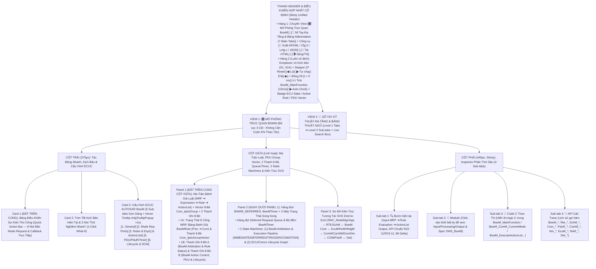
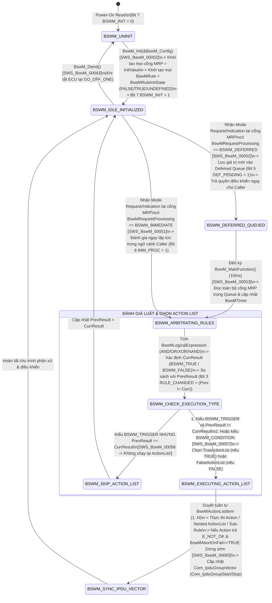
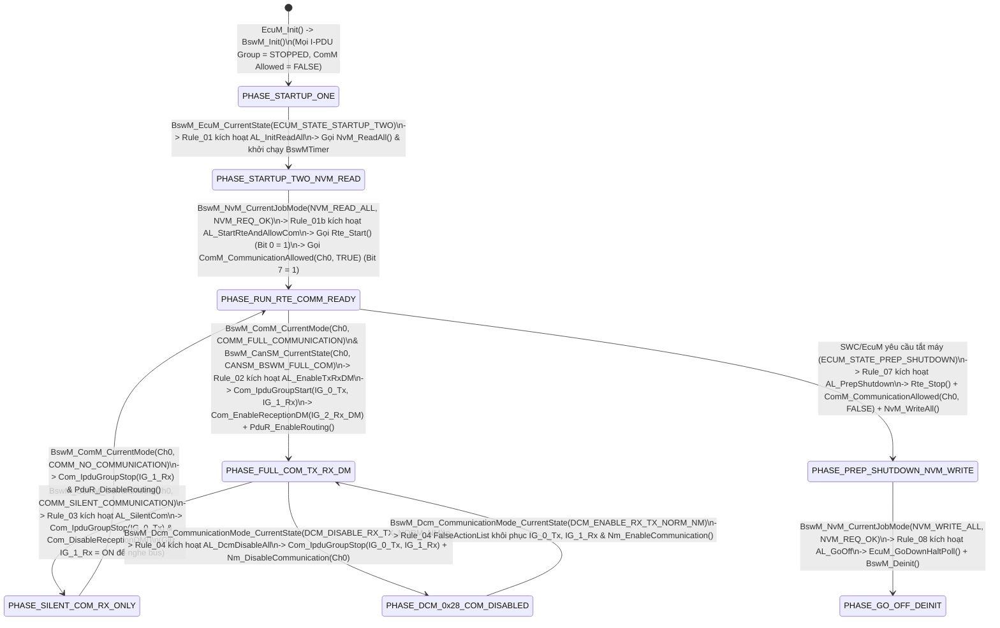

# Tài Liệu Thiết Kế Chi Tiết Trình Mô Phỏng AUTOSAR BswM (`BswM_Simulation_design.md`)

> **Trạng thái tài liệu:** Bản thiết kế chi tiết đã cập nhật theo xác nhận `A1`–`A4` của User — Sẵn sàng để User review trước khi triển khai code.  
> **File đích dự kiến xuất bản:** `d:\__Personal\AntiGravity\Simulation\AUTOSAR_BswM.html` (Ứng dụng Web Tương tác 1 file HTML độc lập, 100% Offline, Pure CSS, có nút tải `.HTML` kèm cấu hình nhúng & xuất code `ARXML / BswM_Cfg.h / BswM_Lcfg.c / JSON`).  
> **Chuẩn tham chiếu:** **AUTOSAR Classic Platform R20-11 / R22-11 / R23-11 (`SWS_BswM`, `SWS_EcuM`, `SWS_ComM`, `SWS_CanSM`, `SWS_COM`, `SWS_PduR`, `SWS_Nm`, `SWS_Dcm`, `SWS_NvM`, `SWS_WdgM`, `SWS_Det`, `SWS_Rte`)**, đính kèm mã requirement chuẩn **`SWS_BswM_xxxxx`** tại từng bước xử lý, Ma trận Đánh giá Luật (`MRP ➔ Logical Expression ➔ BswMRule ➔ BswMActionList`), Vector 8-Bit `Com_IpduGroupVector`, 2 thanh ghi 8-Bit tương tác, tooltip cấu hình và sổ tay tra cứu đa tầng.

---

## 1. Tổng Quan Định Hướng Thiết Kế Đã Chốt (`A1` – `A4`)

| Hạng mục | Nội dung thiết kế đã xác nhận với User |
| :--- | :--- |
| **1. Bố cục giao diện & Ưu tiên Không Cuộn Trang — Zero-Scroll (`A1`)** | Kết hợp tinh hoa của **`AUTOSAR_DEM.html`**, **`AUTOSAR_ComM.html`** và **`AUTOSAR_CanNM.html`**, tối ưu hóa **Above-the-Fold (Zero-Scroll)** để các khối thao tác và giám sát tần suất cao nhất luôn nằm ngay phần đầu mỗi cột trong khung màn hình:<br>• **Thanh Điều Khiển Hợp Nhất Cố Định (Sticky Unified Header)**:<br>  - **Hàng 1**: Chuyển View `[🎛️ Mô Phỏng Trực Quan BswM]` \| `[📖 Sổ Tay Đa Tầng & Bảng Abbreviation (7 Main Tabs)]` + Công cụ `[🧾 Xuất ARXML / BswM_Cfg.h / BswM_Lcfg.c / JSON]` \| `[💾 Tải .HTML]` \| `[🌗 Sáng/Tối]`.<br>  - **Hàng 2 (Luôn cố định)**: Dropdown chọn 14 Kịch bản (`S1`–`S14`), Stepper (`↺ Reset`, `◀ Lùi`, `▶ Tự chạy`, `Tiếp ▶`), Đồng hồ (`t = 0 ms`, `+1 Tick BswM_MainFunction (10ms)`, `▶ Auto Clock`) và Badge Trạng thái ECU / Rule / PDU Groups.<br>• **Bố cục 3 cột hiện đại (Mỗi cột tự cuộn độc lập trong khung Viewport)**:<br>  - **Cột Trái (`375px`)**: Đưa **Card 1: Bảng Điều Khiển Sự Kiện Thủ Công (`Quick Action Bar` — 8 nút bắn Mode Request & Callback trực tiếp)** và **Card 2: Tóm tắt kịch bản & 3 nút 1-Click What-If** lên trên cùng, tiếp theo là **Card 3: 6 Sub-tabs Cấu hình ECUC BswM** (hỗ trợ Floating Hover Tooltip `#cfgTooltipPopup` sau `>1s` giống hệt `AUTOSAR_DEM.html`).<br>  - **Cột Giữa (`Linh hoạt`)**: Đưa **Panel 1: Ma Trận Đánh Giá Luật Hợp Nhất (`MRP ➔ Logical Expression ➔ BswMRule ➔ ActionList`) + Vector 8-Bit `Com_IpduGroupVector` + 2 Thanh Ghi 8-Bit Tương Tác** và **Panel 2: Bảng Hàng Đợi `BSWM_DEFERRED`, `BswMTimer` & 2 Máy Trạng Thái Song Song (`Arbitration Pipeline State Machine` + `ECU & Comm Lifecycle Graph`)** lên ngay đầu cột giữa, bên dưới là **Panel 3: Sơ Đồ Kiến Trúc Tương Tác SVG End-to-End** (`SWC_ModeMgr/SWC_App ↔ RTE/SchM ↔ BswM Core (Mode Arbitration + Mode Control) ↔ EcuM/NvM/WdgM ↔ ComM/CanSM/Dcm/Nm ↔ COM/PduR ↔ Det`).<br>  - **Cột Phải (`440px, Sticky`)**: Inspector 4 Sub-tabs (`🔍 Bước hiện tại`, `🧩 Module`, `📄 Code C Thực Thi`, `📜 API Call Trace`).<br>• **Config Hover Tooltip (`> 1s` delay)** giống hệt `AUTOSAR_DEM.html` (`#cfgTooltipPopup` hiển thị tên tham số, đường dẫn ECUC, mã `SWS_BswM_xxxxx`, mô tả, dải giá trị, giá trị typical và lưu ý kỹ thuật). |
| **2. Khu vực Giám sát Bit-level, Ma trận Luật & PDU Group Vector 2 Tầng (`A2`)** | Đặt **cố định và nổi bật ở đầu Cột Giữa** gồm **2 tầng trực quan hóa**:<br>• **Tầng 1 — Ma Trận Đánh Giá Luật Hợp Nhất (`MRP ➔ Logical Expression ➔ BswMRule ➔ BswMActionList`) & Thanh Giải Phẫu `Com_IpduGroupVector (8-Bit)`**: Hiển thị trực tiếp giá trị hiện tại của 8 cổng **`BswMModeRequestPort (MRP)`** (từ `EcuM`, `NvM`, `ComM`, `CanSM`, `Dcm`, `SWC`, `PNC #16`, `BswMTimer`), biểu thức logic (`AND / OR / XOR / NAND`), trạng thái trước/sau của từng **`BswMRule`** (`BSWM_UNDEFINED / BSWM_FALSE / BSWM_TRUE`), loại thực thi **`BswMActionList`** (`BSWM_TRIGGER` vs `BSWM_CONDITION`), cùng vector 8-bit **`Com_IpduGroupVector`** (`IG_Tx_App`, `IG_Rx_App`, `IG_Rx_DM`, `IG_PNC16_Tx`, `IG_PNC16_Rx`, `IG_Diag`, `IG_Nm`, `RPG_Gateway`).<br>• **Tầng 2 — 2 Thanh ghi 8-Bit tương tác song song**:<br>  1. **Thanh A (`8-Bit BswM Arbitration, Processing & Rule Status Byte` — `BswM_ArbitrationStatusByte`)**: Theo dõi các cờ lõi của bộ phân xử (`BSWM_INITIALIZED`, `IMM_REQ_ACTIVE`, `DEF_REQ_PENDING`, `RULE_EXPR_TRUE`, `RULE_RES_CHANGED`, `ACT_COND_EXEC`, `BSWM_TIMER_RUN`, `RTE_SWC_STARTED`).<br>  2. **Thanh B (`8-Bit BswM Action Control, PDU Group & Lifecycle Status Byte` — `BswM_ActionControlByte`)**: Theo dõi trực quan kết quả điều khiển (`COMM_ALLOW_CH0`, `IPDU_TX_ONLINE`, `IPDU_RX_ONLINE`, `RX_DM_ACTIVE`, `PDUR_ROUTING_EN`, `DCM_COM_DISABLED`, `ABORT_ON_FAIL_ERR`, `SHUTDOWN_SEQ_ACTV`). Cho phép click trực tiếp vào từng bit để giải mã hoặc thử nghiệm! |
| **3. Hệ thống 14 Kịch bản mẫu (`A3`)** | Thiết kế sẵn **14 Kịch bản (`S1`–`S14`)** chia làm 4 nhóm lớn:<br>• **Nhóm 1 (`S1`–`S4`) — Khởi Động ECU (`Startup`), `NvM_ReadAll`, `Rte_Start` & Điều Khiển `Com_IpduGroup` Theo `ComM`/`CanSM`**: Khởi tạo hai pha `STARTUP_ONE ➔ STARTUP_TWO`, đợi `NvM_ReadAll()` hoàn tất để gọi `Rte_Start()` & `ComM_CommunicationAllowed(Ch0, TRUE)`, bật/tắt `Com_IpduGroupStart(Tx/Rx)` + `Com_EnableReceptionDM()` khi lên `FULL_COM`, và ngắt Tx/DM khi xuống `SILENT_COM` / `BUS_OFF` / `NO_COM`.<br>• **Nhóm 2 (`S5`–`S8`) — Cơ Chế Phân Xử Lõi (`IMMEDIATE` vs `DEFERRED`, `TRIGGER` vs `CONDITION`, `True/False ActionList` & `Cascaded ActionList`)**: Đối chiếu xử lý tức thời (`BSWM_IMMEDIATE`) với xử lý hoãn lại tại `BswM_MainFunction()` (`BSWM_DEFERRED`), so sánh `BSWM_TRIGGER` (chỉ chạy khi đổi trạng thái Rule) với `BSWM_CONDITION` (chạy lặp lại mỗi chu kỳ), kích hoạt nhánh `BswMFalseActionList` từ `BSWM_UNDEFINED`, và chuỗi `ActionList` lồng nhau kèm cờ `BswMAbortOnFail = TRUE`.<br>• **Nhóm 3 (`S9`–`S11`) — Tương Tác Với `SWC`, `Partial Networking (PNC)`, `PduR Routing` & `BswMTimer`**: Nhận yêu cầu chuyển mode từ `SWC_ModeMgr` qua `RTE` (`BswMSwcModeRequest` ➔ `Rte_Switch` / `SchM_Switch`), đóng/mở riêng nhóm `I-PDU Group` của `PNC #16` kèm `BswMPduGroupSwitchReinit`, bật/tắt định tuyến `PduR_EnableRouting()`, và điều khiển bộ đếm nội bộ `BswMTimerControl` (`STARTED ➔ EXPIRED`).<br>• **Nhóm 4 (`S12`–`S14`) — Chẩn Đoán `DCM` (`0x28 CommunicationControl`), Chu Trình Tắt Máy (`NvM_WriteAll` ➔ `EcuM_GoDownHaltPoll`) & Báo Lỗi `DET`**: Xử lý lệnh `BswM_Dcm_CommunicationMode_CurrentState(DCM_DISABLE_RX_TX_NORM_NM)` khóa `I-PDU Group` và `Nm_DisableCommunication()`, quy trình tắt ECU an toàn (`PREP_SHUTDOWN ➔ Rte_Stop ➔ NvM_WriteAll ➔ EcuM_GoDownHaltPoll ➔ BswM_Deinit`), và kiểm thử các mã lỗi `DET` (`BSWM_E_NO_INIT`, `BSWM_E_REQ_USER_OUT_OF_RANGE`, `BSWM_E_REQ_MODE_OUT_OF_RANGE`, `BSWM_E_NULL_POINTER`). |
| **4. Sổ tay tra cứu đa tầng & Bảng Abbreviation (`A4`)** | **View 2 (`📖 Sổ Tay Kỹ Thuật BswM & Từ Điển Thuật Ngữ`)** được tổ chức theo cấu trúc **Đa Tầng (Multi-level Tabs)**:<br>• **6 Main Sub-tabs (Level 1) × 4 Chủ đề con (Level 2 Pills/Tabs = 24 chuyên đề)** phân tích sâu kiến trúc 2 nhánh (`Mode Arbitration` & `Mode Control`), cơ chế `MRP` & `IMMEDIATE/DEFERRED`, biểu thức logic & `TRIGGER/CONDITION`, điều khiển `Com_IpduGroup / DM / PduR / Nm`, phối hợp `EcuM / NvM / RTE / SWC` & từ điển API/ECUC.<br>• **Tab 7 chuyên biệt: `🔤 Bảng Thuật Ngữ & Từ Viết Tắt (Abbreviation Table)`** trình bày dưới dạng bảng chuẩn 4 cột, tích hợp **Search Box tìm kiếm tức thời (Live Search + Highlight `<mark>`)** và 5 nút lọc nhanh theo phân nhóm (`BswM Arbitration & Rules`, `ActionLists & Actions`, `PDU Group, PduR & DCM`, `ECU Lifecycle, RTE & BSW`). |

---

## 2. Bố Cục Giao Diện 3 Cột Ưu Tiên Zero-Scroll & Hệ Thống Sub-Tabs (UI Wireframe)

Để đảm bảo **"người dùng không cần cuộn chuột lên xuống mỗi lần thao tác"**, toàn bộ giao diện được thiết kế theo nguyên lý **Viewport-First (Đưa các khối tương tác và giám sát tần suất cao nhất lên ngay phần đầu của mỗi cột, kết hợp hệ thống Sub-tabs gọn gàng)**:



### Điểm Cải Tiến Đột Phá Về Trải Nghiệm "Zero-Scroll" Cho Module `BswM`:
1. **Thanh Điều Khiển Hợp Nhất (`Sticky Unified Header`)**: Gộp chọn kịch bản, nút bấm `Bước tiếp / Lùi / Tự chạy`, và nút nhịp đồng hồ `+1 Tick BswM_MainFunction (10ms)` vào ngay thanh Header cố định. Người dùng ở bất kỳ vị trí nào cũng có thể bấm `+1 Tick BswM_MainFunction (10ms)` để giải phóng các yêu cầu đang nằm chờ trong hàng đợi **`BSWM_DEFERRED`** hoặc quan sát các `ActionList` kiểu **`BSWM_CONDITION`** chạy lặp lại theo chu kỳ!
2. **Đưa `Quick Action Bar` (8 nút bắn Mode Request) lên vị trí Card 1 (Đầu Cột Trái)** và đưa **Ma Trận Đánh Giá Luật (`MRP ➔ Expression ➔ Rule ➔ ActionList`) + Vector 8-Bit `Com_IpduGroupVector` + 2 Thanh Ghi 8-Bit** lên đầu Cột Giữa: Khi bấm `BswM_ComM_CurrentMode(FULL_COM)`, `BswM_Dcm_CommunicationMode_CurrentState(DISABLE_RX_TX)`, hoặc `Rte_Write_MRP_SwcModeRequest(SPORT_MODE)`, mắt người dùng nhìn thấy ngay lập tức cổng `MRP` nào đổi giá trị, biểu thức logic nào chuyển từ `FALSE ➔ TRUE`, `ActionList` nào được kích hoạt, và nhóm `I-PDU Group` nào được bật/tắt mà **không phải cuộn trang**.
3. **Gom 36 tham số ECUC vào 6 Sub-tabs gọn gàng**: Chiều cao Card Cấu hình được giữ gọn cố định (~275px), kèm hộp thoại giải thích nổi `#cfgTooltipPopup` khi hover quá `1000ms` giống hệt `AUTOSAR_DEM.html`.

---

## 3. Thiết Kế Chi Tiết Panel 1 (Đầu Cột Giữa): Ma Trận Đánh Giá Luật (`MRP ➔ Expression ➔ Rule ➔ ActionList`), `Com_IpduGroupVector` & 2 Thanh Ghi 8-Bit Tương Tác

Khác với `ComM` hay `CanSM` có máy trạng thái cố định cứng trong code, **`AUTOSAR BswM` là một Động cơ Luật Cấu hình được (`Configurable Rule-Based Mode Arbitrator & Action Executor`)** gồm hai phần tách biệt:
1. **Mode Arbitration (Phân xử chế độ)**: Thu thập chế độ từ các cổng **`BswMModeRequestPort (MRP)`** (`IMMEDIATE` hoặc `DEFERRED`), đánh giá các biểu thức logic **`BswMLogicalExpression`** trong các luật **`BswMRule`**, và so sánh với kết quả kỳ trước (`PrevState` vs `CurrState`).
2. **Mode Control (Thực thi hành động)**: Dựa trên kết quả `TRUE` hoặc `FALSE` của Rule và cấu hình **`BSWM_TRIGGER`** (chỉ chạy khi đổi trạng thái) hay **`BSWM_CONDITION`** (chạy mỗi lần đánh giá), `BswM` thực thi **`BswMActionList`** để đóng/mở **`Com_IpduGroupVector`**, bật/tắt `Deadline Monitoring`, điều khiển `PduR`, `ComM`, `Nm`, `RTE` và `EcuM`.

Do đó, Panel 1 ở đầu Cột Giữa được thiết kế gồm **2 tầng trực quan hóa liên thông**:

### 3.1. Phần 1A — Ma Trận Đánh Giá Luật Hợp Nhất (`MRP ➔ Logical Expression ➔ BswMRule ➔ ActionList`) & Thanh Giải Phẫu `Com_IpduGroupVector (8-Bit)`

```text
+-------------------------------------------------------------------------------------------------------------------+
| 🧠 MA TRẬN PHÂN XỬ LUẬT BSWM (`MRP ➔ Expression ➔ Rule ➔ ActionList`) & VECTOR 8-BIT `Com_IpduGroupVector`       |
| Chu kỳ MainFunc: [10 ms] | Deferred Queue: [0 Pending] | Active Rule: [Rule_02_ComMFullCom ➔ TRUE (TRIGGERED!)]  |
+-------------------------------------------------------------------------------------------------------------------+
| 1. TRẠNG THÁI LIVE CÁC CỔNG NHẬN CHẾ ĐỘ (`BswMModeRequestPort` — Click để đổi nhanh giá trị cổng MRP):           |
|  • MRP_EcuM_State   [DEFERRED ] : ECU_STATE_RUN          | • MRP_Dcm_ComCtrl [IMMEDIATE] : DCM_ENABLE_RX_TX_NORM  |
|  • MRP_NvM_ReadAll  [DEFERRED ] : NVM_REQ_OK             | • MRP_Swc_AppMode [DEFERRED ] : APP_MODE_NORMAL        |
|  • MRP_ComM_Ch0     [IMMEDIATE] : COMM_FULL_COMMUNICATION| • MRP_Pnc16_Mode  [IMMEDIATE] : COMM_PNC_NO_COM        |
|  • MRP_CanSM_Ch0    [IMMEDIATE] : CANSM_BSWM_FULL_COM    | • MRP_Timer0_State[DEFERRED ] : BSWM_TIMER_STOPPED     |
+-------------------------------------------------------------------------------------------------------------------+
| 2. BẢNG ĐÁNH GIÁ LUẬT (`BswMRule` & `BswMLogicalExpression` — [`SWS_BswM_00055`, `SWS_BswM_00056`]):              |
|  +-----------------------+----------------------------------------+---------------+------------+------------------+
|  | Tên Luật (BswMRule)   | Biểu Thức Logic (Logical Expression)   | Prev ➔ Curr   | Kiểu Chạy  | ActionList Thực Thi|
|  +-----------------------+----------------------------------------+---------------+------------+------------------+
|  | Rule_01_StartupRun    | (EcuM == STARTUP_TWO) && (NvM != PEND) | TRUE  ➔ TRUE  | TRIGGER    | (Skip - Unchanged)|
|  | Rule_02_ComMFullCom ★ | (ComM == FULL_COM) && (CanSM != BUSOFF)| FALSE ➔ TRUE  | TRIGGER    | ▶ AL_EnableTxRxDM |
|  | Rule_03_SilentOrBusOff| (ComM == SILENT) || (CanSM == BUSOFF)  | FALSE ➔ FALSE | TRIGGER    | (Skip - Unchanged)|
|  | Rule_04_DcmComCtrl    | (Dcm_ComCtrl == DISABLE_RX_TX_NORM_NM) | FALSE ➔ FALSE | TRIGGER    | (Skip - Unchanged)|
|  | Rule_05_Pnc16Active   | (Pnc16 == REQUESTED || READY_SLEEP)    | FALSE ➔ FALSE | TRIGGER    | (Skip - Unchanged)|
|  | Rule_06_SwcSportMode  | (Swc_AppMode == SPORT) && (ComM==FULL) | FALSE ➔ FALSE | CONDITION  | (Skip - False)    |
|  +-----------------------+----------------------------------------+---------------+------------+------------------+
| 3. GIẢI PHẪU VECTOR 8-BIT `Com_IpduGroupVector` & `PduR_RoutingPathGroup` (`Com_IpduGroupStart / Stop` — `0x07`): |
|  +---------------+---------------+---------------+---------------+---------------+---------------+-------+-------+|
|  | Bit 7 (0x80)  | Bit 6 (0x40)  | Bit 5 (0x20)  | Bit 4 (0x10)  | Bit 3 (0x08)  | Bit 2 (0x04)  |Bit1(2)|Bit0(1)||
|  | RPG_0_GW      | IG_6_NM_Pdu   | IG_5_Diag_Pdu | IG_4_PNC16_Rx | IG_3_PNC16_Tx | IG_2_Rx_DM    |IG_1_Rx|IG_0_Tx||
|  |   [ 1: ON ]   |   [ 1: ON ]   |   [ 1: ON ]   |   [ 0: OFF]   |   [ 0: OFF]   |   [ 1: DM_ON] | [1:ON]| [1:ON]||
|  +---------------+---------------+---------------+---------------+---------------+---------------+-------+-------+|
+-------------------------------------------------------------------------------------------------------------------+
```

- **Tính năng tương tác trực tiếp trên Phần 1A**:
  - Người dùng nhìn thấy ngay **mối quan hệ nhân - quả toàn diện của `BswM`**: Cổng `MRP` nào vừa thay đổi ➔ Biểu thức logic `BswMLogicalExpression` tính toán ra sao ➔ Tại sao `BswMRule` lại kích hoạt (hoặc bỏ qua do `Prev == Curr` khi cấu hình `BSWM_TRIGGER`) ➔ Và những bit nào trong **`Com_IpduGroupVector`** vừa được bật/tắt thông qua `Com_IpduGroupStart()` / `Com_IpduGroupStop()`!
  - Người dùng có thể **click trực tiếp vào từng ô `IG_0_Tx .. RPG_0_GW`** trên thanh `Com_IpduGroupVector` hoặc click vào cổng `MRP` để thử nghiệm ngay lập tức.

### 3.2. Phần 1B — 2 Thanh Ghi 8-Bit Trạng Thái Tương Tác Luôn Hiển Thị Nổi Bật

Ngay bên dưới Phần 1A là **2 Thanh ghi 8-Bit tương tác** theo đúng phong cách trực quan của `AUTOSAR_DEM.html`, `AUTOSAR_ComM.html` và `AUTOSAR_CanNM.html`:

```text
+-------------------------------------------------------------------------------------------------------------------+
| 🔢 BẢNG GIÁM SÁT BITFIELD 8-BIT BSWM ARBITRATION & ACTION CONTROL (LIVE 8-BIT INSPECTOR) [Click ô Bit để thử]    |
| Bước #3: BswM_ComM_CurrentMode(Ch0, FULL_COM) [IMMEDIATE] ➔ Rule_02: FALSE➔TRUE ➔ AL_EnableTxRxDM | A:0xD9 | B:0xF8|
+-------------------------------------------------------------------------------------------------------------------+
| A. THANH GHI 8-BIT PHÂN XỬ LUẬT & NGỮ CẢNH XỬ LÝ (`BswM_ArbitrationStatusByte`) — Hex: [ 0xD9 ] Bin: [1101 1001b] |
|    Request Processing: [ BSWM_IMMEDIATE ] | Rule_02 Result: [ FALSE ➔ TRUE ] | Execution: [ BSWM_TRIGGER ]        |
|  +-------------+ +-------------+ +-------------+ +-------------+ +-------------+ +-------------+ +-------+ +-----+|
|  | Bit 7 (0x80)| | Bit 6 (0x40)| | Bit 5 (0x20)| | Bit 4 (0x10)| | Bit 3 (0x08)| | Bit 2 (0x04)| |Bit1(2)| |Bit 0||
|  | BSWM_INIT   | | IMM_PROC    | | DEF_PENDING | | RULE_TRUE   | | RULE_CHANGED| | ACT_COND    | |TMR_RUN| |RTE_S||
|  |      1      | |      1      | |      0      | |      1      | |      1      | |      0      | |   0   | |  1  ||
|  | Initialized | | Immediate!  | | Queue Empty | | Expr = TRUE | | F➔T Trigger!| | Mode=TRIGGER| |TmrIdle| |RteOn||
|  +-------------+ +-------------+ +-------------+ +-------------+ +-------------+ +-------------+ +-------+ +-----+|
+-------------------------------------------------------------------------------------------------------------------+
| B. THANH GHI 8-BIT ĐIỀU KHIỂN HÀNH ĐỘNG, PDU GROUP & VÒNG ĐỜI (`BswM_ActionControlByte`) — Hex:[0xF8] Bin:[11111000]|
|    ComM Ch0 Allowed: [ TRUE ] | App Tx/Rx IPduGroups: [ ONLINE ] | Reception DM: [ ENABLED ] | PduR GW: [ ON ]    |
|  +-------------+ +-------------+ +-------------+ +-------------+ +-------------+ +-------------+ +-------+ +-----+|
|  | Bit 7 (0x80)| | Bit 6 (0x40)| | Bit 5 (0x20)| | Bit 4 (0x10)| | Bit 3 (0x08)| | Bit 2 (0x04)| |Bit1(2)| |Bit 0||
|  | COMM_ALLOW  | | IPDU_TX_ON  | | IPDU_RX_ON  | | RX_DM_EN    | | PDUR_RT_EN  | | DCM_COM_DIS | |ABORT_F| |SHUTD||
|  |      1      | |      1      | |      1      | |      1      | |      1      | |      0      | |   0   | |  0  ||
|  | Ch0 Allowed | | IG_Tx Start | | IG_Rx Start | | DM Enabled  | | RPG Enabled | | Normal Comm | |NoError| |RunMd||
|  +-------------+ +-------------+ +-------------+ +-------------+ +-------------+ +-------------+ +-------+ +-----+|
+-------------------------------------------------------------------------------------------------------------------+
```

#### 3.2.1. Giải Mã Chi Tiết Thanh A: `8-Bit BswM Arbitration, Processing & Rule Status Byte` (`BswM_ArbitrationStatusByte`)

| Bit | Mask | Tên Cờ (`BswM Arbitration Bit`) | Ý nghĩa kỹ thuật & Khi nào bật lên `1` (`0 ➔ 1`) | Khi nào hạ về `0` (`1 ➔ 0`) |
| :-: | :-: | :--- | :--- | :--- |
| **Bit 7** | `0x80` | **`BSWM_INITIALIZED`** | Bật lên `1` sau khi `EcuM` gọi **`BswM_Init(&BswM_Config)`** thành công (`SWS_BswM_00002`), khởi tạo toàn bộ các cổng `MRP` về `BswMModeRequestPortInitValue` và các `BswMRule` về `BswMRuleInitState` (`BSWM_FALSE / BSWM_TRUE / BSWM_UNDEFINED`). | Hạ về `0` khi gọi **`BswM_Deinit()`** (`SWS_BswM_00043`) lúc tắt ECU, hoặc khi người dùng tắt Checkbox `BswMInitialized` để kiểm thử báo lỗi `Det_ReportError(BSWM_E_NO_INIT = 0x01)`. |
| **Bit 6** | `0x40` | **`IMM_REQ_ACTIVE`** | Bật lên `1` khi một cổng `MRP` có cấu hình **`BswMRequestProcessing = BSWM_IMMEDIATE`** nhận được thông báo/yêu cầu mode mới: `BswM` thực hiện đánh giá ngay lập tức các `BswMRule` liên quan và chạy `ActionList` ngay trong ngữ cảnh hàm gọi (`Caller Context` — `SWS_BswM_00051`)! | Hạ về `0` khi yêu cầu thuộc loại **`BSWM_DEFERRED`** (chỉ lưu vào hàng đợi chờ `BswM_MainFunction()`) hoặc sau khi chu trình xử lý định kỳ hoàn tất. |
| **Bit 5** | `0x20` | **`DEF_REQ_PENDING`** | Bật lên `1` khi có ít nhất 1 cổng `MRP` cấu hình **`BswMRequestProcessing = BSWM_DEFERRED`** nhận mode mới (hoặc một yêu cầu `IMMEDIATE` bị hoãn lại do đụng độ vùng găng re-entrancy `SWS_BswM_00143`), đang nằm chờ trong hàng đợi `Deferred Request Queue`. | Hạ về `0` ngay khi hàm định kỳ **`BswM_MainFunction()`** (`SWS_BswM_00053`) quét qua hàng đợi, đánh giá toàn bộ các `BswMRule` có cổng `DEFERRED` và thực thi xong các `ActionList`. |
| **Bit 4** | `0x10` | **`RULE_EXPR_TRUE`** | Bật lên `1` khi biểu thức logic **`BswMLogicalExpression`** (`AND / OR / XOR / NAND`) của luật `BswMRule` đang xét cho kết quả **`BSWM_TRUE`** (`SWS_BswM_00055`), hướng luồng điều khiển vào nhánh `BswMTrueActionList`. | Hạ về `0` khi biểu thức logic của `BswMRule` đang xét cho kết quả **`BSWM_FALSE`**, hướng luồng điều khiển vào nhánh `BswMFalseActionList` (nếu có cấu hình). |
| **Bit 3** | `0x08` | **`RULE_RES_CHANGED`** | Bật lên `1` khi kết quả đánh giá mới của `BswMRule` **khác với kết quả kỳ trước (`PrevResult != CurrResult`)**, bao gồm chuyển từ `BSWM_FALSE ➔ BSWM_TRUE`, `BSWM_TRUE ➔ BSWM_FALSE`, hoặc lần đầu tiên đánh giá từ `BSWM_UNDEFINED ➔ TRUE/FALSE` (`SWS_BswM_00056`). Đây là điều kiện bắt buộc để kích hoạt `ActionList` kiểu **`BSWM_TRIGGER`**! | Hạ về `0` khi `BswMRule` được đánh giá lại nhưng kết quả vẫn giữ nguyên (`TRUE ➔ TRUE` hoặc `FALSE ➔ FALSE`). Lúc này nếu `ActionList` cấu hình là `BSWM_TRIGGER` thì sẽ được **bỏ qua (Skip)** để tránh gọi lặp API! |
| **Bit 2** | `0x04` | **`ACT_COND_EXEC`** | Bật lên `1` khi `BswMActionList` đang được chọn có cấu hình **`BswMActionListExecution = BSWM_CONDITION`** (`SWS_BswM_00057`), nghĩa là `ActionList` sẽ chạy **mỗi lần Rule được đánh giá** bất kể trạng thái Rule có thay đổi hay không. | Hạ về `0` khi `BswMActionList` có cấu hình chuẩn **`BSWM_TRIGGER`** (chỉ chạy đúng 1 lần tại sườn chuyển trạng thái của Rule). |
| **Bit 1** | `0x02` | **`BSWM_TIMER_RUN`** | Bật lên `1` khi một hành động `BswMTimerControl` khởi chạy bộ đếm nội bộ của `BswM` (`MRP_Timer = BSWM_TIMER_STARTED`, đếm ngược từ `BswMTimerValue` trong mỗi `BswM_MainFunction()` — `SWS_BswM_00205`). | Hạ về `0` khi bộ đếm chạm `0 ms` (chuyển cổng `MRP_Timer` sang **`BSWM_TIMER_EXPIRED`** để kích hoạt Rule hết giờ) hoặc khi bị dừng bởi `BSWM_TIMER_STOPPED`. |
| **Bit 0** | `0x01` | **`RTE_SWC_STARTED`** | Bật lên `1` sau khi `BswM` thực thi hành động khởi động `RTE` (**`Rte_Start()`** / `BswMRteStart` trong pha `STARTUP_TWO`), mở cổng giao tiếp Mode Request / Mode Switch giữa các `SWC` trên tầng Application và `BswM`. | Hạ về `0` khi chưa chạy `Rte_Start()` hoặc khi `BswM` đã gọi **`Rte_Stop()`** (`BswMRteStop`) trong pha chuẩn bị tắt máy (`PREP_SHUTDOWN`). |

#### 3.2.2. Giải Mã Chi Tiết Thanh B: `8-Bit BswM Action Control, PDU Group & Lifecycle Status Byte` (`BswM_ActionControlByte`)

| Bit | Mask | Tên Cờ (`BswM Control / PDU Bit`) | Ý nghĩa kỹ thuật & Khi nào bật lên `1` (`0 ➔ 1`) | Khi nào hạ về `0` (`1 ➔ 0`) |
| :-: | :-: | :--- | :--- | :--- |
| **Bit 7** | `0x80` | **`COMM_ALLOW_CH0`** | Bật lên `1` khi `BswM` thực thi Action **`BswMComMAllowCom`** gọi **`ComM_CommunicationAllowed(Ch0, TRUE)`** (`SWS_BswM_00120`) sau khi `NvM_ReadAll()` hoàn tất, mở chốt cho phép `ComM` bật truyền thông CAN. | Hạ về `0` khi `BswM` gọi **`ComM_CommunicationAllowed(Ch0, FALSE)`** trong pha chuẩn bị tắt ECU (`PREP_SHUTDOWN`) để khóa không cho kênh thức dậy mới. |
| **Bit 6** | `0x40` | **`IPDU_TX_ONLINE`** | Bật lên `1` khi `BswM` thực thi Action **`BswMPduGroupSwitch`** bật nhóm PDU truyền (`IG_0_Tx_App = 1`) và gọi **`Com_IpduGroupStart(IG_0_Tx_App, Initialize)`** (hoặc `Com_IpduGroupControl` — `SWS_BswM_00119`) khi kênh đạt `COMM_FULL_COMMUNICATION`! | Hạ về `0` khi `BswM` gọi **`Com_IpduGroupStop(IG_0_Tx_App)`** do kênh lùi về `COMM_SILENT_COMMUNICATION`, `COMM_NO_COMMUNICATION`, xảy ra `CANSM_BSWM_BUS_OFF`, hoặc do lệnh `DCM 0x28` khóa truyền! |
| **Bit 5** | `0x20` | **`IPDU_RX_ONLINE`** | Bật lên `1` khi `BswM` thực thi Action **`BswMPduGroupSwitch`** bật nhóm PDU nhận (`IG_1_Rx_App = 1`) qua **`Com_IpduGroupStart(IG_1_Rx_App, TRUE)`** (giữ bật trong cả `FULL_COM` lẫn `SILENT_COM` để ECU vẫn nghe được bus khi chuẩn bị ngủ). | Hạ về `0` khi `BswM` gọi **`Com_IpduGroupStop(IG_1_Rx_App)`** lúc kênh về hẳn `COMM_NO_COMMUNICATION`, khi `BUS_OFF`, hoặc khi `DCM 0x28` yêu cầu `DCM_DISABLE_RX_TX_NORM`! |
| **Bit 4** | `0x10` | **`RX_DM_ACTIVE`** | Bật lên `1` khi `BswM` thực thi Action **`BswMDeadlineMonitoringControl`** gọi **`Com_EnableReceptionDM(IG_2_Rx_DM)`** (`SWS_BswM_00122`), kích hoạt giám sát timeout các gói tin Rx trên `AUTOSAR COM` khi mạng ở `FULL_COM`. | Hạ về `0` khi `BswM` gọi **`Com_DisableReceptionDM()`** lúc vào `SILENT_COM`, `NO_COM`, `BUS_OFF` hoặc phiên chẩn đoán để tránh báo lỗi timeout giả! |
| **Bit 3** | `0x08` | **`PDUR_ROUTING_EN`** | Bật lên `1` khi `BswM` thực thi Action **`BswMPduRouterControl`** gọi **`PduR_EnableRouting(RPG_0_Gateway)`** (`SWS_BswM_00105`), cho phép `PduR` định tuyến các gói tin liên mạng qua Gateway. | Hạ về `0` khi `BswM` gọi **`PduR_DisableRouting(RPG_0_Gateway, Initialize)`** để ngắt luồng định tuyến Gateway. |
| **Bit 2** | `0x04` | **`DCM_COM_DISABLED`** | Bật lên `1` khi `Dcm` nhận dịch vụ UDS `0x28 CommunicationControl` và báo **`BswM_Dcm_CommunicationMode_CurrentState()`** (`SWS_BswM_00048`) yêu cầu tắt truyền/nhận ứng dụng hoặc gọi **`Nm_DisableCommunication(Ch0)`** (`BswMNmControl` — `SWS_BswM_00104`). | Hạ về `0` khi `Dcm` khôi phục lại chế độ **`DCM_ENABLE_RX_TX_NORM_NM`**, kích hoạt Rule mở lại các `I-PDU Group` và `Nm_EnableCommunication(Ch0)`. |
| **Bit 1** | `0x02` | **`ABORT_ON_FAIL_ERR`** | Bật lên `1` khi một mục hành động (`BswMActionListItem`) có cấu hình **`BswMAbortOnFail = TRUE`** trả về mã lỗi **`E_NOT_OK`**, khiến `BswM` **hủy bỏ ngay lập tức các hành động còn lại** trong `ActionList` đó (`SWS_BswM_00065`) và gọi `Det_ReportRuntimeError()` (nếu cấu hình). | Hạ về `0` khi `ActionList` thực thi trôi chảy toàn bộ các bước với kết quả `E_OK`. |
| **Bit 0** | `0x01` | **`SHUTDOWN_SEQ_ACTV`** | Bật lên `1` khi `BswM` bước vào kịch bản tắt hoặc khởi động lại ECU (`PREP_SHUTDOWN ➔ GO_OFF_ONE`): gọi `Rte_Stop()`, `ComM_CommunicationAllowed(FALSE)`, `NvM_WriteAll()`, và sau khi ghi xong Flash thì gọi **`EcuM_GoDownHaltPoll()`** + **`BswM_Deinit()`**! | Hạ về `0` khi ECU đang ở trạng thái khởi động hoặc vận hành bình thường (`ECU_STATE_STARTUP / RUN`). |

---

## 4. Phân Tích Xử Lý Từng Module: Input Lấy Từ Đâu, Xử Lý Gì, Output Route Đến Đâu

Mọi khối trên sơ đồ kiến trúc SVG đều có thể **click vào để xem giải thích chi tiết** ở cột phải (Tab `🧩 Module`) và được tổng hợp đầy đủ trong **Tab 1 của Sổ tay**:

| # | Module / Phân khối | Lớp AUTOSAR | 📥 Input lấy từ đâu? | ⚙️ Cách xử lý nội bộ (Processing, State & Timers) | 📤 Output route đến đâu & Hàm API chuẩn (R20-11 / R22-11 / R23-11) |
| :-: | :--- | :--- | :--- | :--- | :--- |
| **1** | **`SWC_ModeMgr` & `SWC_App`**<br>*(Application Layer)* | Application Layer | • Sự kiện người dùng / logic ứng dụng (chuyển chế độ lái `NORMAL / SPORT / ECO`, yêu cầu tắt máy `App_ShutdownReq`).<br>• Nhận sự kiện chuyển Mode (`SwcModeSwitchEvent`) từ `BswM` qua `RTE` (`Rte_Switch_SwitchPort_currentMode`). | • **Tương tác 2 chiều với `BswM` qua `RTE`**:<br>  1. **Chiều Request (`SWC ➔ BswM`)**: `SWC_ModeMgr` ghi chế độ yêu cầu vào cổng Sender-Receiver (`Rte_Write_MRP_SwcModeRequest_requestedMode`) hoặc thông báo mode hiện tại (`BswMSwcModeNotification`).<br>  2. **Chiều Switch (`BswM ➔ SWC`)**: Sau khi `BswM` phân xử thỏa mãn điều kiện an toàn (ví dụ mạng CAN đã `FULL_COM`, điện áp ổn định), `BswM` thực thi Action `BswMRteSwitch` để kích hoạt các `Runnable` tương ứng bên trong `SWC_App`! | • Gửi yêu cầu xuống **BswM** qua **RTE**:<br>`Rte_Write_MRP_SwcModeReq_requestedMode(Mode)` [`SWS_BswM_00132`]<br>• Nhận thông báo chuyển Mode từ **BswM**:<br>`Rte_Read_MRP_SwcModeReq_requestedMode(&Mode)`<br>Kích hoạt `OnEntry / OnTransition / OnExit Runnable` từ `Rte_Switch()` |
| **2** | **`RTE` & `SchM`**<br>*(Runtime Environment & BSW Scheduler)* | RTE Layer | • Nhận lệnh khởi động/dừng từ `BswM` (`Rte_Start()`, `Rte_Stop()`).<br>• Nhận lệnh chuyển Mode từ `BswM` (`Rte_Switch_*`, `SchM_Switch_*`, `Rte_Write_*`).<br>• Xung nhịp định kỳ từ `AUTOSAR OS` (`Task_Bsw_10ms`). | • **RTE**: Làm cầu nối giữa các cổng `BswMSwcModeRequest` / `BswMSwcModeNotification` của `SWC` với `BswM`, và thực thi chuyển đổi `ModeDeclarationGroup` cho các `SWC` khi `BswM` gọi `Rte_Switch()`.<br>• **SchM**: Gọi định kỳ hàm **`BswM_MainFunction()`** mỗi `BswMMainFunctionPeriod` (ví dụ `10ms`) để xử lý toàn bộ các cổng **`BSWM_DEFERRED`**, đếm ngược `BswMTimer`, và chuyển đổi lịch trình BSW (`SchM_Switch()`). Đồng thời bảo vệ vùng găng `SchM_Enter_BswM_BSWM_EXCLUSIVE_AREA_0()`. | • Gọi định kỳ vào **BswM**:<br>`BswM_MainFunction(void)` [`SWS_BswM_00053`]<br>• Thực thi Action từ **BswM**:<br>`Rte_Start()` / `Rte_Stop()` [`SWS_BswM_00237`]<br>`Rte_Switch_<Port>_<ModeGroup>(Mode)` [`SWS_BswM_00106`]<br>`SchM_Switch_<Port>_<ModeGroup>(Mode)` [`SWS_BswM_00138`] |
| **3** | **`BswM Core Engine`**<br>*(BSW Mode Manager — Mode Arbitration & Mode Control)* | System Services | • Nhận Mode Indications & Mode Requests tại các cổng **`BswMModeRequestPort (MRP)`** từ: `SWC/RTE`, `EcuM`, `ComM`, `CanSM/BusSM`, `Dcm`, `NvM`, `WdgM`, `BswM_RequestMode` (Generic), và `BswMTimer`. | • **Nhánh 1 — Mode Arbitration (`Phân xử luật`)**:<br>  - Phân loại cổng theo **`BswMRequestProcessing`**: Nếu là **`BSWM_IMMEDIATE`**, đánh giá ngay các `BswMRule` phụ thuộc trong ngữ cảnh hàm gọi (`SWS_BswM_00051`). Nếu là **`BSWM_DEFERRED`**, lưu vào hàng đợi chờ `BswM_MainFunction()` (`SWS_BswM_00052`).<br>  - Tính toán biểu thức **`BswMLogicalExpression`** (`AND`, `OR`, `XOR`, `NAND`) cho từng **`BswMRule`** để ra kết quả `BSWM_TRUE` hoặc `BSWM_FALSE`, đồng thời đối chiếu với kết quả kỳ trước (`PrevResult`).<br>• **Nhánh 2 — Mode Control (`Thực thi hành động`)**:<br>  - Chọn `BswMTrueActionList` (nếu `TRUE`) hoặc `BswMFalseActionList` (nếu `FALSE`).<br>  - Kiểm tra **`BswMActionListExecution`**: Nếu là **`BSWM_TRIGGER`**, chỉ chạy khi `PrevResult != CurrResult` (`SWS_BswM_00056`). Nếu là **`BSWM_CONDITION`**, chạy mỗi lần đánh giá (`SWS_BswM_00057`).<br>  - Duyệt tuần tự các `BswMActionListItem` (gồm Atomic Action, Nested ActionList hoặc Sub-Rule), kiểm tra `BswMAbortOnFail` và gom các lệnh `BswMPduGroupSwitch` để cập nhật `Com_IpduGroupVector` cuối chu kỳ! | • Gọi xuống **COM & PduR**:<br>`Com_IpduGroupStart()`, `Com_IpduGroupStop()`, `Com_EnableReceptionDM()`, `Com_DisableReceptionDM()`, `Com_TriggerIPDUSend()`, `PduR_EnableRouting()`, `PduR_DisableRouting()`<br>• Gọi sang **ComM & Nm**:<br>`ComM_CommunicationAllowed()`, `ComM_RequestComMode()`, `ComM_LimitChannelToNoComMode()`, `Nm_DisableCommunication()`, `Nm_EnableCommunication()`<br>• Gọi sang **EcuM, NvM, RTE & Det**:<br>`EcuM_GoDownHaltPoll()`, `EcuM_SelectShutdownTarget()`, `NvM_ReadAll()`, `NvM_WriteAll()`, `Rte_Start()`, `Rte_Stop()`, `Rte_Switch()`, `Det_ReportError()` |
| **4** | **`EcuM`**<br>*(ECU State Manager)* | System Services | • Sự kiện bật/tắt khóa điện IG, sự kiện đánh thức phần cứng (`EcuM_SetWakeupEvent`).<br>• Nhận lệnh chuyển trạng thái tắt/ngủ từ `BswM` (`EcuM_GoDownHaltPoll`, `EcuM_SelectShutdownTarget`, `EcuM_SetState`). | • Khi khởi động ECU, `EcuM_StartupTwo()` gọi **`BswM_Init(&BswM_Config)`** [`SWS_BswM_00002`], sau đó thông báo trạng thái ECU (`BswM_EcuM_CurrentState`) và nguồn đánh thức (`BswM_EcuM_CurrentWakeup`) sang `BswM`.<br>• Trong kiến trúc **AUTOSAR R4.x / R22-11 (EcuM Flexible)**, `EcuM` bàn giao quyền điều phối chi tiết các pha `RUN`, `POST_RUN`, `PREP_SHUTDOWN`, `SLEEP`, `OFF` cho các Rule của `BswM`! | • Gọi vào **BswM** (`BswM_EcuM.h`):<br>`BswM_Init(ConfigPtr)` [`SWS_BswM_00002`]<br>`BswM_Deinit()` [`SWS_BswM_00043`]<br>`BswM_EcuM_CurrentState(CurrentState)` [`SWS_BswM_00050`]<br>`BswM_EcuM_CurrentWakeup(source, state)` [`SWS_BswM_00110`]<br>`BswM_EcuM_RequestedState(State, CurrentStatus)` [`SWS_BswM_00232`] |
| **5** | **`ComM` & `Nm`**<br>*(Communication Manager & Network Management)* | Communication Services | • `ComM`: Nhận lệnh mở khóa `ComM_CommunicationAllowed()`, yêu cầu chuyển mode `ComM_RequestComMode()` hoặc giới hạn `ComM_LimitChannelToNoComMode()` từ `BswM`.<br>• `Nm`: Nhận lệnh khóa/mở phát gói NM từ `BswM`. | • Khi kênh `ComM` hoặc cụm `PNC` chuyển trạng thái thực tế (sau khi `CanSM` xác nhận), `ComM` gọi **`BswM_ComM_CurrentMode(Channel, RequestedMode)`** và **`BswM_ComM_CurrentPNCMode(PNC, CurrentPncMode)`** báo cho `BswM`.<br>• Dựa vào thông báo này, `BswM` quyết định lúc nào được phép mở nhóm `I-PDU Group` truyền/nhận trên `AUTOSAR COM`! | • Gọi vào **BswM** (`BswM_ComM.h`):<br>`BswM_ComM_CurrentMode(Network, RequestedMode)` [`SWS_BswM_00047`]<br>`BswM_ComM_CurrentPNCMode(PNC, CurrentPncMode)` [`SWS_BswM_00148`]<br>`BswM_ComM_InitiateReset()` [`SWS_BswM_00217`] |
| **6** | **`CanSM / BusSM`**<br>*(CAN State Manager)* | Communication Services | • Trạng thái phần cứng CAN Controller / Transceiver và bộ đếm lỗi `Bus-Off` từ `CanIf`. | • Mỗi khi kênh CAN chuyển trạng thái (`CANSM_BSWM_NO_COMMUNICATION`, `SILENT_COMMUNICATION`, `FULL_COMMUNICATION`, `BUS_OFF`, `CHANGE_BAUDRATE`), `CanSM` gọi ngay **`BswM_CanSM_CurrentState(Network, CurrentState)`**.<br>• Nhờ cổng này, ngay khi xảy ra **`CANSM_BSWM_BUS_OFF`**, `BswM` lập tức chạy Rule khẩn cấp để dừng truyền (`Com_IpduGroupStop(Tx)`) và tắt giám sát `Deadline Monitoring` (`Com_DisableReceptionDM`) trước cả khi `ComM` kịp đổi trạng thái! | • Gọi vào **BswM** (`BswM_CanSM.h`):<br>`BswM_CanSM_CurrentState(Network, CurrentState)` [`SWS_BswM_00049`] |
| **7** | **`AUTOSAR COM` & `PduR`**<br>*(Interaction Layer & PDU Router)* | Communication Services | • **COM**: Nhận các lệnh điều khiển Vector nhóm PDU (`Com_IpduGroupStart / Stop`, `Com_EnableReceptionDM / DisableReceptionDM`, `Com_TriggerIPDUSend`) từ `BswM`.<br>• **PduR**: Nhận lệnh bật/tắt `RoutingPathGroup` từ `BswM`. | • **AUTOSAR COM** hoàn toàn không tự biết lúc nào mạng CAN đã sẵn sàng hay đang `Bus-Off`: Mọi nhóm `I-PDU Group` (`IG_0_Tx_App`, `IG_1_Rx_App`, `IG_3_PNC16_Tx`...) đều mặc định ở trạng thái `STOPPED` và **chỉ được mở/khóa bởi các `ActionList` của `BswM`**!<br>• Tương tự, **PduR** bật/tắt các bảng định tuyến Gateway (`RoutingPathGroupId`) theo lệnh trực tiếp từ `BswMPduRouterControl`. | • Nhận lệnh điều khiển từ **BswM**:<br>`Com_IpduGroupStart(IpduGroupId, initialize)` [`SWS_BswM_00119`]<br>`Com_IpduGroupStop(IpduGroupId)`<br>`Com_EnableReceptionDM(IpduGroupId)` [`SWS_BswM_00122`]<br>`Com_DisableReceptionDM(IpduGroupId)`<br>`Com_TriggerIPDUSend(PduId)` [`SWS_BswM_00121`]<br>`PduR_EnableRouting(id)` / `PduR_DisableRouting(id, init)` [`SWS_BswM_00105`] |
| **8** | **`Dcm`**<br>*(Diagnostic Communication Manager)* | Diagnostic Services | • Nhận bản tin chẩn đoán UDS `0x28 CommunicationControl` (Sub-function `0x00..0x03`), `0x10 DiagnosticSessionControl`, `0x11 ECUReset` hoặc cập nhật phần mềm từ Tester. | • Khi Tester gửi lệnh UDS **`0x28 CommunicationControl`** (ví dụ yêu cầu tắt toàn bộ bản tin ứng dụng `Normal Messages` và/hoặc `NM Messages` trước khi nạp Flash), `Dcm` không tự gọi vào `COM` hay `Nm` mà báo **`BswM_Dcm_CommunicationMode_CurrentState(Network, RequestedMode)`** sang `BswM` (`SWS_BswM_00048`).<br>• `BswM` phân xử cổng `MRP_Dcm_ComCtrl` và thực thi `ActionList` tương ứng để gọi `Com_IpduGroupStop(IG_0_Tx_App)` và `Nm_DisableCommunication(Ch0)`! | • Gọi vào **BswM** (`BswM_Dcm.h`):<br>`BswM_Dcm_CommunicationMode_CurrentState(Network, RequestedMode)` [`SWS_BswM_00048`]<br>`BswM_Dcm_ApplicationUpdated(void)` [`SWS_BswM_00158`] |
| **9** | **`NvM` & `WdgM`**<br>*(Non-Volatile Memory & Watchdog Manager)* | Memory / Safety Services | • **NvM**: Nhận lệnh `NvM_ReadAll()` (khi Startup) và `NvM_WriteAll()` (khi Shutdown) từ `BswM UserCallout`.<br>• **WdgM**: Phát hiện vi phạm Alive/Deadline Supervision của một Partition. | • **NvM**: Khi hoàn tất đọc hoặc ghi toàn bộ các khối bộ nhớ Flash/EEPROM (`NVM_READ_ALL` / `NVM_WRITE_ALL`), `NvM` gọi **`BswM_NvM_CurrentJobMode(ServiceId, CurrentJobMode)`** (`NVM_REQ_OK / NVM_REQ_NOT_OK`) sang `BswM` (`SWS_BswM_00109`). Đây là tín hiệu then chốt để `BswM` mở khóa `Rte_Start()` lúc bật máy hoặc cho phép `EcuM_GoDownHaltPoll()` sập nguồn lúc tắt máy!<br>• **WdgM**: Gọi `BswM_WdgM_RequestPartitionReset()` khi cần khởi động lại phân vùng bị treo. | • Gọi vào **BswM** (`BswM_NvM.h` & `BswM_WdgM.h`):<br>`BswM_NvM_CurrentJobMode(MultiBlockRequest, CurrentJobMode)` [`SWS_BswM_00109`]<br>`BswM_NvM_CurrentBlockMode(Block, CurrentBlockMode)` [`SWS_BswM_00108`]<br>`BswM_WdgM_RequestPartitionReset(Application)` [`SWS_BswM_00156`] |
| **10** | **`Det`**<br>*(Default Error Tracer)* | System Services | • Nhận báo cáo lỗi phát triển (`Det_ReportError`) và lỗi runtime (`Det_ReportRuntimeError`) từ `BswM` (`ModuleId = 42 / 0x002A`). | • Ghi nhận mã API (`ServiceId`) và mã lỗi chuẩn AUTOSAR R22-11/R23-11 (`SWS_BswM_00029`):<br>  - `BSWM_E_NO_INIT (0x01)`: Gọi API khi `BswM` chưa chạy `BswM_Init()`.<br>  - `BSWM_E_NULL_POINTER (0x02)`: Truyền `NULL_PTR` vào `BswM_GetVersionInfo()`.<br>  - `BSWM_E_INVALID_PAR (0x03)`: Tham số không hợp lệ.<br>  - `BSWM_E_REQ_USER_OUT_OF_RANGE (0x04)`: Mã `Requesting_user` hoặc `Network/Channel/PNC` vượt ngoài cấu hình.<br>  - `BSWM_E_REQ_MODE_OUT_OF_RANGE (0x05)`: Giá trị `requested_mode` không nằm trong tập enum cho phép.<br>  - `BSWM_E_PARAM_CONFIG (0x06)`: Cấu hình truyền vào `BswM_Init()` bị lỗi. | • Hiển thị cảnh báo trực tiếp trên **API Call Trace** & **Inspector**. |

---

## 5. Thiết Kế Chi Tiết 2 Máy Trạng Thái Của `BswM`: `Arbitration Pipeline State Machine` & `ECU/Comm Lifecycle Graph` (Panel 2)

Trên Panel 2 của Cột Giữa, luồng hoạt động của `BswM` được hiển thị trực quan đồng thời qua **2 sơ đồ trạng thái liên kết chặt chẽ**:

### 5.1. Máy Trạng Thái Luồng Phân Xử & Thực Thi Luật `BswM` (`Arbitration & Execution Pipeline State Machine` — `SWS_BswM_00051`, `SWS_BswM_00056`)



### 5.2. Sơ Đồ Điều Phối Vòng Đời ECU & Truyền Thông Do `BswM` Làm Nhạc Trưởng (`ECU & Comm Lifecycle Orchestration Graph`)



---

## 6. Danh Mục Đầy Đủ 36 Trường Cấu Hình (Checkboxes, Textboxes & Dropdowns — 6 Sub-Tabs) & Thiết Kế Hover Tooltip Giống File `DEM`

Ở Cột Trái (Card 3), toàn bộ 36 tham số cấu hình chuẩn ECUC `BswM` được bố trí thành **Checkboxes, Textboxes, Number Spinners và Dropdowns** chia gọn vào **6 Sub-tabs**.  
Đặc biệt, **mọi ô cấu hình đều gắn thuộc tính `data-cfg-key` và hỗ trợ Floating Tooltip on Hover (`> 1s` delay hoặc click icon `ⓘ`) giống hệt `AUTOSAR_DEM.html`**.

### 6.1. Giao Diện & Cấu Trúc Dữ Liệu Của Floating Config Hover Tooltip (`#cfgTooltipPopup`)

Khi người dùng rê chuột giữ trên một ô cấu hình quá `1000ms` (hoặc bấm vào biểu tượng `ⓘ`), hộp thoại nổi `#cfgTooltipPopup` sẽ xuất hiện cạnh ô cấu hình với bố cục chuẩn của `AUTOSAR_DEM.html`:

```text
+----------------------------------------------------------------------------------------------------+
| 📘 Ngữ Cảnh Phân Xử Yêu Cầu Chế Độ (Immediate vs Deferred)          [SWS_BswM_00051 | ECUC_00815]|
| BswMConfig / BswMArbitration / BswMModeRequestPort / BswMRequestProcessing                         |
+----------------------------------------------------------------------------------------------------+
| Quy định thời điểm BswM đánh giá các luật (BswMRule) liên quan khi cổng Mode Request Port (MRP)    |
| này nhận được thông báo hoặc yêu cầu chế độ mới:                                                   |
| • BSWM_IMMEDIATE: Đánh giá Rule và chạy ActionList ngay lập tức trong ngữ cảnh hàm gọi BswM_*().   |
| • BSWM_DEFERRED : Chỉ ghi nhận giá trị mới vào hàng đợi và hoãn việc đánh giá Rule cho đến chu kỳ  |
|   BswM_MainFunction() tiếp theo để giảm tải thời gian ngắt/callback.                               |
+-------------------------------------------------+--------------------------------------------------+
| Dải giá trị cho phép (Range):                   | Giá trị thường dùng (Typical):                   |
| BSWM_IMMEDIATE | BSWM_DEFERRED                  | IMMEDIATE cho ComM/CanSM/DCM; DEFERRED cho SWC   |
+-------------------------------------------------+--------------------------------------------------+
| 💡 Lưu ý kỹ thuật: Các sự kiện cần phản ứng khẩn cấp (như CANSM_BSWM_BUS_OFF để ngắt Tx I-PDU Group|
| ngay lập tức) bắt buộc nên cấu hình là BSWM_IMMEDIATE!                                             |
+----------------------------------------------------------------------------------------------------+
```

### 6.2. Danh Sách Chi Tiết 36 Trường Cấu Hình Trong 6 Sub-Tabs

#### Sub-tab 1: `1. General` (`BswMGeneral` — Khởi Tạo, Chu Kỳ & Bật/Tắt Nguồn Tích Hợp)
1. **Checkbox ☑️ `BswMInitialized` (`BswM_Init()` State)**: Bật/tắt trạng thái đã khởi tạo module `BswM` (`BSWM_INIT` vs `BSWM_UNINIT` — `SWS_BswM_00002`; nếu tắt, mọi lời gọi API đều bị từ chối và báo `Det_ReportError(BSWM_E_NO_INIT = 0x01)`).
2. **Checkbox ☑️ `BswMDevErrorDetect` (`ECUC_BswM_00802`)**: Bật/tắt phát hiện và báo lỗi Development Error & Runtime Error qua `Det_ReportError()` / `Det_ReportRuntimeError()`.
3. **Checkbox ☑️ `BswMVersionInfoApi` (`ECUC_BswM_00803`)**: Cho phép gọi hàm `BswM_GetVersionInfo(&VersionInfo)`.
4. **Number / Textbox `BswMMainFunctionPeriod` (`ECUC_BswM_00804`)**: Chu kỳ gọi `BswM_MainFunction()` từ `SchM` tính bằng `ms` (Mặc định: `10 ms`, dải `1 .. 100 ms`).
5. **Checkbox ☑️ `BswMComMEnabled` (`ECUC_BswM_00805`)**: Bật/tắt tích hợp các cổng `MRP` và `Action` làm việc với module `AUTOSAR ComM` (gồm cả `BswMComMPncEnabled`).
6. **Checkbox ☑️ `BswMDcmEnabled` & `BswMEcuMEnabled` (`ECUC_BswM_00807`, `ECUC_BswM_00808`)**: Bật/tắt tích hợp giao diện thông báo trạng thái từ `Dcm` (`0x28 CommunicationControl`) và `EcuM` (`Startup / Shutdown`).

#### Sub-tab 2: `2. Mode Req Ports` (`BswMModeRequestPort` — Cấu Hình `IMMEDIATE / DEFERRED` & Giá Trị Khởi Tạo)
7. **Dropdown `MRP_ComM_Ch0_Processing` (`ECUC_BswM_00815`)**: Chọn kiểu xử lý cho cổng `BswM_ComM_CurrentMode(Ch0)` (`BSWM_IMMEDIATE` — mặc định, hoặc `BSWM_DEFERRED`).
8. **Dropdown `MRP_CanSM_Ch0_Processing` (`ECUC_BswM_00815`)**: Chọn kiểu xử lý cho cổng `BswM_CanSM_CurrentState(Ch0)` (`BSWM_IMMEDIATE` — mặc định để cắt Tx tức thì khi `BUS_OFF`, hoặc `BSWM_DEFERRED`).
9. **Dropdown `MRP_Dcm_ComCtrl_Processing` (`ECUC_BswM_00815`)**: Chọn kiểu xử lý cho cổng `BswM_Dcm_CommunicationMode_CurrentState(Ch0)` (`BSWM_IMMEDIATE` — mặc định, hoặc `BSWM_DEFERRED`).
10. **Dropdown `MRP_EcuM_State_Processing` (`ECUC_BswM_00815`)**: Chọn kiểu xử lý cho cổng `BswM_EcuM_CurrentState()` (`BSWM_DEFERRED` — mặc định, hoặc `BSWM_IMMEDIATE`).
11. **Dropdown `MRP_NvM_Job_Processing` (`ECUC_BswM_00815`)**: Chọn kiểu xử lý cho cổng `BswM_NvM_CurrentJobMode()` (`BSWM_DEFERRED` — mặc định, hoặc `BSWM_IMMEDIATE`).
12. **Dropdown `MRP_Swc_AppMode_Processing` & `InitValue` (`ECUC_BswM_00816`)**: Chọn kiểu xử lý cho cổng `SWC Mode Request` từ `RTE` (`BSWM_DEFERRED` — mặc định, hoặc `BSWM_IMMEDIATE`) kèm giá trị khởi tạo `BswMModeRequestPortInitValue` (`APP_MODE_NORMAL`).

#### Sub-tab 3: `3. Rules & Expr` (`BswMRule` & `BswMLogicalExpression` — Toán Tử Logic & Trạng Thái Khởi Đầu)
13. **Dropdown `Rule02_ComMFull_InitState` (`ECUC_BswM_00822` — `BswMRuleInitState`)**: Trạng thái khởi tạo của `Rule_02_ComMFullCom` sau khi chạy `BswM_Init()` (`BSWM_FALSE` — mặc định, `BSWM_TRUE`, hoặc `BSWM_UNDEFINED`).
14. **Dropdown `Rule02_LogicalOperator` (`ECUC_BswM_00825` — `BswMLogicalOperator`)**: Chọn toán tử kết hợp giữa điều kiện `ComM == FULL_COM` và `CanSM == FULL_COM` (`BSWM_AND` — mặc định, `BSWM_OR`, `BSWM_XOR`, `BSWM_NAND`).
15. **Checkbox ☑️ `Rule02_EnableFalseActionList` (`ECUC_BswM_00824` — `BswMFalseActionList`)**: Cho phép `Rule_02` tự động kích hoạt `AL_DisableTxRxDM` (nhánh `FalseActionList`) ngay khi biểu thức chuyển từ `TRUE ➔ FALSE` (hoặc từ `BSWM_UNDEFINED ➔ FALSE`!).
16. **Dropdown `Rule06_SwcSport_InitState` (`ECUC_BswM_00822`)**: Trạng thái khởi tạo của `Rule_06_SwcSportMode` (`BSWM_FALSE` / `BSWM_UNDEFINED`).
17. **Checkbox ☑️ `EnableIndependentRuleEvaluation` (`ECUC_BswM_00950`)**: Chỉ đánh giá các `BswMRule` có liên kết trực tiếp với cổng `MRP` vừa thay đổi (tối ưu hiệu năng CPU) thay vì quét toàn bộ bảng Rule.
18. **Textbox `GenericReq_UserId_And_MaxMode` (`ECUC_BswM_00845` — `BswMGenericRequest`)**: Cấu hình `BswMModeRequesterId` (Mặc định: `UserId = 1`) và `BswMRequestedModeMax` (Mặc định: `3`) cho hàm đa năng `BswM_RequestMode(UserId, Mode)`.

#### Sub-tab 4: `4. ActionLists` (`BswMActionList` — Kiểu Thực Thi `TRIGGER / CONDITION`, Lồng Nhau & `AbortOnFail`)
19. **Dropdown `AL_EnableTxRxDM_Execution` (`ECUC_BswM_00830` — `BswMActionListExecution`)**: Chọn chế độ thực thi cho `AL_EnableTxRxDM` (`BSWM_TRIGGER` — chỉ chạy 1 lần khi Rule chuyển sang `TRUE`, hoặc `BSWM_CONDITION` — chạy lặp lại mỗi khi Rule được đánh giá là `TRUE`).
20. **Dropdown `AL_SwcSportMode_Execution` (`ECUC_BswM_00830`)**: Chọn chế độ thực thi cho `AL_SwcSportMode` (`BSWM_CONDITION` — mặc định để minh họa hành động lặp chu kỳ, hoặc `BSWM_TRIGGER`).
21. **Number `BswMActionListPriority` (`ECUC_BswM_00912`)**: Thứ tự ưu tiên thực thi khi nhiều `ActionList` cùng được kích hoạt trong một chu kỳ `BswM_MainFunction()` (Mặc định: `0` = cao nhất).
22. **Checkbox ☑️ `BswMAbortOnFail` (`ECUC_BswM_00833`)**: Khi bật `TRUE`, nếu một `BswMActionListItem` trả về `E_NOT_OK`, `BswM` hủy bỏ ngay lập tức các bước hành động phía sau trong `ActionList` đó (`SWS_BswM_00065`)!
23. **Checkbox ☑️ `InjectActionItemFailure` (Test Fault Injection)**: Giả lập bước hành động số 2 trong `ActionList` trả về `E_NOT_OK` để kiểm chứng trực quan cơ chế `BswMAbortOnFail` và báo lỗi Runtime Error.
24. **Checkbox ☑️ `EnableCascadedActionList` (`Nested BswMActionList / Sub-Rule`)**: Cho phép `ActionList` cha gọi lồng sang `ActionList` con (`AL_Sub_EnablePduRAndTriggerSend`) và đánh giá `Sub-Rule` theo chuẩn `SWS_BswM_00060`.

#### Sub-tab 5: `5. PDU/PduR/Timer` (`BswMPduGroupSwitch`, `DeadlineMonitoring`, `PduR` & `BswMTimer`)
25. **Checkbox ☑️ `BswMPduGroupSwitchReinit` (`ECUC_BswM_00861`)**: Tham số `initialize` truyền vào `Com_IpduGroupStart(IpduGroupId, initialize)` (`TRUE` = yêu cầu `COM` khởi tạo lại giá trị mặc định của các I-PDU và đặt lại bộ đếm; `FALSE` = giữ nguyên dữ liệu cũ).
26. **Checkbox ☑️ `EnableReceptionDmControl` (`BswMDeadlineMonitoringControl` — `ECUC_BswM_00865`)**: Tự động gọi `Com_EnableReceptionDM(IG_2_Rx_DM)` khi vào `FULL_COM` và `Com_DisableReceptionDM()` khi vào `SILENT_COM / NO_COM / BUS_OFF`.
27. **Checkbox ☑️ `EnableTriggerIpduSendAction` (`BswMTriggerIPduSend` — `ECUC_BswM_00870`)**: Gọi `Com_TriggerIPDUSend(PduId_StatusBroadcast)` ngay khi mở nhóm PDU truyền hoặc chuyển sang `SPORT_MODE`.
28. **Checkbox ☑️ `EnablePduRouterControl` (`BswMPduRouterControl` — `ECUC_BswM_00875`)**: Điều khiển bật/tắt nhóm định tuyến `RPG_0_Gateway` qua `PduR_EnableRouting(0)` / `PduR_DisableRouting(0, FALSE)`.
29. **Checkbox ☑️ `BswMComMPncEnabled` (`ECUC_BswM_00806`)**: Cho phép `BswM` nhận `BswM_ComM_CurrentPNCMode(PNC_16)` và đóng/mở riêng nhóm `IG_3_PNC16_Tx` & `IG_4_PNC16_Rx`.
30. **Number / Textbox `BswMTimerValue` (`ECUC_BswM_00940` — `BswMTimerControl`)**: Thời gian đếm ngược của bộ đếm nội bộ `BswMTimer_0` tính bằng `ms` (Mặc định: `300 ms`, tức `30 ticks` của `BswM_MainFunction`).

#### Sub-tab 6: `6. Lifecycle & DCM` (`EcuM`, `NvM`, `DCM 0x28` & `WdgM`)
31. **Dropdown `EcuMShutdownTarget` (`BswMEcuMSelectShutdownTarget` — `ECUC_BswM_00890`)**: Chọn đích tắt máy khi thực thi `ActionList` tắt nguồn (`ECUM_STATE_OFF` — mặc định, `ECUM_STATE_SLEEP`, hoặc `ECUM_STATE_RESET`).
32. **Checkbox ☑️ `RequireNvMReadAllBeforeRteStart`**: Bắt buộc phải nhận `BswM_NvM_CurrentJobMode(NVM_READ_ALL, NVM_REQ_OK)` (hoặc hết hạn `BswMTimer` dự phòng) mới cho phép gọi `Rte_Start()` và `ComM_CommunicationAllowed(Ch0, TRUE)`.
33. **Checkbox ☑️ `RequireNvMWriteAllBeforeGoOff`**: Khi tắt ECU, bắt buộc đợi `BswM_NvM_CurrentJobMode(NVM_WRITE_ALL, NVM_REQ_OK)` hoàn tất ghi Flash mới gọi `EcuM_GoDownHaltPoll()` và `BswM_Deinit()`.
34. **Dropdown `DcmCommunicationControlMode` (`BswMDcmComModeRequest`)**: Chế độ điều khiển truyền thông từ dịch vụ UDS `0x28` (`DCM_ENABLE_RX_TX_NORM_NM` — mặc định, `DCM_DISABLE_RX_ENABLE_TX_NORM`, `DCM_ENABLE_RX_DISABLE_TX_NORM`, `DCM_DISABLE_RX_TX_NORM`, `DCM_DISABLE_RX_TX_NM`, `DCM_DISABLE_RX_TX_NORM_NM`).
35. **Checkbox ☑️ `EnableNmControlOnDcm0x28` (`BswMNmControl` — `ECUC_BswM_00880`)**: Tự động gọi `Nm_DisableCommunication(Ch0)` / `Nm_EnableCommunication(Ch0)` khi lệnh `DCM 0x28` tác động đến nhánh `NM`.
36. **Checkbox ☑️ `EnableWdgMPartitionResetRule` (`BswMWdgMRequestPartitionReset` — `ECUC_BswM_00898`)**: Kích hoạt `ActionList` khẩn cấp (ngắt PDU Group + `SchM_Switch` + Reset Partition) khi nhận `BswM_WdgM_RequestPartitionReset()`.

---

## 7. Thiết Kế Chi Tiết 14 Kịch Bản Chạy Mẫu (`S1` – `S14`)

Mỗi kịch bản được thiết kế để làm nổi bật rõ **sự thay đổi của từng Bit trên 2 Thanh ghi 8-Bit (`BswM_ArbitrationStatusByte` & `BswM_ActionControlByte`)**, **Ma Trận Đánh Giá Luật (`MRP ➔ Expression ➔ Rule ➔ ActionList`)**, **Vector 8-Bit `Com_IpduGroupVector`**, **tác động của các trường Config**, và **luồng gọi hàm API chuẩn AUTOSAR R22-11 / R23-11** giữa các module:

| Mã | Nhóm chủ đề | Tên kịch bản | Luồng xử lý chính, API chuẩn & Các Bit / Config nổi bật | 3 Nút "Thử nghiệm nhanh" (1-Click What-If) |
| :-: | :--- | :--- | :--- | :--- |
| **S1** | **Nhóm 1: Khởi Động ECU, NvM, RTE & Điều Khiển I-PDU Group** | **Khởi Động ECU 2 Pha (`STARTUP_ONE ➔ STARTUP_TWO`), Đợi `NvM_ReadAll()` Hoàn Tất Mới Mở Khóa `Rte_Start()` & `ComM_CommunicationAllowed(TRUE)`** | • **Pha 1 (`BswM_Init`)**: `EcuM` gọi **`BswM_Init(&BswM_Config)`** [`SWS_BswM_00002`] ➔ Bật **`Bit 7 (BSWM_INIT = 1)`** trên Thanh A. Mọi `I-PDU Group` đều `STOPPED` (`0x00`), `ComM_CommunicationAllowed = FALSE`.<br>• **Pha 2 (`STARTUP_TWO` — Deferred)**: `EcuM` gọi **`BswM_EcuM_CurrentState(ECUM_STATE_STARTUP_TWO)`** [`SWS_BswM_00050`]. Vì `MRP_EcuM_State` cấu hình `BSWM_DEFERRED`, `BswM` bật **`Bit 5 (DEF_PENDING = 1)`**.<br>• **Pha 3 (`BswM_MainFunction` ➔ `NvM_ReadAll`)**: Tại `BswM_MainFunction()`, `Rule_01a_StartNvMRead` chuyển `FALSE ➔ TRUE` (`Bit 4 = 1, Bit 3 = 1`), kích hoạt `AL_StartNvMReadAll` gọi **`NvM_ReadAll()`** và khởi chạy `BswMTimer_0` (`Bit 1 = 1`).<br>• **Pha 4 (`NvM_ReadAll OK` ➔ `Rte_Start` + `AllowCom`)**: `NvM` báo **`BswM_NvM_CurrentJobMode(NVM_READ_ALL, NVM_REQ_OK)`** [`SWS_BswM_00109`]. Trong `BswM_MainFunction()`, `Rule_01b_RunReady` chuyển `FALSE ➔ TRUE`, kích hoạt `AL_EnterRunMode`: gọi **`Rte_Start()`** (`Bit 0 RTE_SWC_STARTED = 1`), **`ComM_CommunicationAllowed(Ch0, TRUE)`** [`SWS_BswM_00120`] (`Bit 7 COMM_ALLOW = 1` trên Thanh B), và **`EcuM_SetState(ECUM_STATE_RUN)`**! | 1. **Giả lập `NvM_ReadAll` đang `NVM_REQ_PENDING`** (xem `BswM` giữ chặt chưa gọi `Rte_Start()` & `ComM_CommunicationAllowed`)<br>2. **Đổi `MRP_NvM_Job_Processing` sang `BSWM_IMMEDIATE`** (xem `Rte_Start()` chạy ngay trong callback `BswM_NvM_CurrentJobMode` không cần chờ `MainFunction`)<br>3. **Cho `NvM_ReadAll` bị treo để `BswMTimer_0 (300ms)` hết hạn cứu hộ** |
| **S2** | **Nhóm 1: Khởi Động ECU, NvM, RTE & Điều Khiển I-PDU Group** | **Kích Hoạt Truyền Thông Toàn Phần (`BswM_ComM_CurrentMode(FULL_COM)` + `CanSM FULL_COM` ➔ Mở `Com_IpduGroupStart(Tx/Rx)`, `EnableReceptionDM` & `PduR_EnableRouting`)** | • **Pha 1 (`ComM` báo `FULL_COM`)**: Khi `ComM` và `CanSM` hoàn tất bật phần cứng CAN, `CanSM` gọi **`BswM_CanSM_CurrentState(0, CANSM_BSWM_FULL_COMMUNICATION)`** [`SWS_BswM_00049`] và `ComM` gọi **`BswM_ComM_CurrentMode(0, COMM_FULL_COMMUNICATION)`** [`SWS_BswM_00047`].<br>• **Pha 2 (Phân xử `IMMEDIATE`)**: Vì cả hai cổng đều cấu hình **`BSWM_IMMEDIATE`**, `BswM` bật **`Bit 6 (IMM_PROC = 1)`**, tính biểu thức `Rule_02_ComMFullCom = (ComM == FULL_COM) && (CanSM == FULL_COM)` ➔ Kết quả chuyển từ **`BSWM_FALSE ➔ BSWM_TRUE`** (`Bit 4 = 1`, `Bit 3 RULE_CHANGED = 1`).<br>• **Pha 3 (Thực thi `AL_EnableTxRxDM`)**: `BswM` chạy `BswMTrueActionList`:<br>  1. `BswMPduGroupSwitch`: Bật bit `IG_0_Tx_App = 1`, `IG_1_Rx_App = 1`, `IG_5_Diag = 1`, `IG_6_NM = 1` trong `Com_IpduGroupVector` và gọi **`Com_IpduGroupStart(IG_0_Tx_App, TRUE)`**, **`Com_IpduGroupStart(IG_1_Rx_App, TRUE)`** [`SWS_BswM_00119`] (Bật **`Bit 6 IPDU_TX_ON = 1`** & **`Bit 5 IPDU_RX_ON = 1`** trên Thanh B).<br>  2. `BswMDeadlineMonitoringControl`: Gọi **`Com_EnableReceptionDM(IG_2_Rx_DM)`** [`SWS_BswM_00122`] (Bật **`Bit 4 RX_DM_EN = 1`**).<br>  3. `BswMPduRouterControl`: Gọi **`PduR_EnableRouting(RPG_0_Gateway)`** [`SWS_BswM_00105`] (Bật **`Bit 3 PDUR_RT_EN = 1`**). | 1. **Tắt `BswMPduGroupSwitchReinit = FALSE`** (xem tham số `initialize = FALSE` trong `Com_IpduGroupStart`)<br>2. **Bật `EnableTriggerIpduSendAction = TRUE`** (xem `BswM` gọi thêm `Com_TriggerIPDUSend` ngay khi mở nhóm Tx)<br>3. **Đổi `Rule02_LogicalOperator` sang `BSWM_OR`** (thử nghiệm toán tử logic) |
| **S3** | **Nhóm 1: Khởi Động ECU, NvM, RTE & Điều Khiển I-PDU Group** | **Chuyển Sang `COMM_SILENT_COMMUNICATION` & `NO_COMMUNICATION` (Ngắt Riêng `Tx I-PDU Group` & `Reception DM`, Giữ `Rx I-PDU Group` Ở `SILENT_COM`)** | • Minh họa vai trò sống còn của `BswM` khi mạng CAN chuẩn bị ngủ:<br>  1. **Khi vào `SILENT_COM`**: `ComM` gọi **`BswM_ComM_CurrentMode(0, COMM_SILENT_COMMUNICATION)`** (khi `CanNm` vào `Prepare Bus-Sleep`). `Rule_02_ComMFullCom` chuyển `TRUE ➔ FALSE` và `Rule_03_SilentCom` chuyển `FALSE ➔ TRUE`.<br>  2. **Hành động tại `SILENT_COM`**: `BswM` gọi **`Com_IpduGroupStop(IG_0_Tx_App)`** (`Bit 6 IPDU_TX_ON: 1 ➔ 0` — cấm tuyệt đối ứng dụng phát thêm gói tin làm thức bus!) và gọi **`Com_DisableReceptionDM(IG_2_Rx_DM)`** (`Bit 4 RX_DM_EN: 1 ➔ 0` — tắt báo lỗi timeout vì các ECU khác cũng đã ngừng phát), **NHƯNG VẪN GIỮ `IG_1_Rx_App = 1` (`Bit 5 = 1`)** để ECU vẫn nhận được gói tin nếu bus thức dậy lại!<br>  3. **Khi về `NO_COM`**: `ComM` gọi **`BswM_ComM_CurrentMode(0, COMM_NO_COMMUNICATION)`** ➔ `BswM` gọi nốt **`Com_IpduGroupStop(IG_1_Rx_App)`** (`Bit 5: 1 ➔ 0`) và **`PduR_DisableRouting(RPG_0_Gateway, FALSE)`** (`Bit 3: 1 ➔ 0`), đưa `Com_IpduGroupVector` về `0x00`! | 1. **So sánh trực tiếp Vector `Com_IpduGroupVector` giữa `FULL_COM (0xE7)`, `SILENT_COM (0xE2)` và `NO_COM (0x00)`**<br>2. **Từ `SILENT_COM` bắn lại `BswM_ComM_CurrentMode(FULL_COM)`** (xem `IG_0_Tx` và `Rx_DM` bật lại tức thì)<br>3. **Tắt `Rule02_EnableFalseActionList`** để xem sự khác biệt giữa dùng `FalseActionList` và dùng `Rule_03` riêng |
| **S4** | **Nhóm 1: Khởi Động ECU, NvM, RTE & Điều Khiển I-PDU Group** | **Phản Ứng Tức Thì Khi Xảy Ra Sự Cố `CANSM_BSWM_BUS_OFF` (`BswM_CanSM_CurrentState` Cắt Khẩn Cấp `Tx I-PDU Group` & `Reception DM`)** | • Giải thích tại sao `BswM` phải lắng nghe trực tiếp `CanSM` bên cạnh `ComM`:<br>  1. Đang ở `FULL_COM`, bus CAN bị chập dây ➔ `CanSM` báo ngay **`BswM_CanSM_CurrentState(0, CANSM_BSWM_BUS_OFF)`** [`SWS_BswM_00049`] với chế độ **`BSWM_IMMEDIATE`**.<br>  2. Dù `ComM` vẫn đang ở `FULL_COM` (trong lúc `CanSM` thử khôi phục `L1/L2 Recovery`), biểu thức `Rule_02_ComMFullCom = (ComM == FULL) && (CanSM != BUS_OFF)` lập tức rơi từ **`TRUE ➔ FALSE`**, đồng thời `Rule_03b_BusOffHandling` bật **`FALSE ➔ TRUE`**!<br>  3. Ngay trong ngữ cảnh hàm `BswM_CanSM_CurrentState()`, `BswM` gọi **`Com_IpduGroupStop(IG_0_Tx_App)`** (`Bit 6 = 0` — xóa sạch hàng đợi Tx và ngăn `COM` đẩy thêm PDU xuống `CanIf`), gọi **`Com_DisableReceptionDM(IG_2_Rx_DM)`** (`Bit 4 = 0`), và gọi **`Rte_Switch_BusOffState(BUS_OFF_ACTIVE)`** báo cho `SWC`.<br>  4. Khi `CanSM` khôi phục thành công và báo lại **`BswM_CanSM_CurrentState(0, CANSM_BSWM_FULL_COMMUNICATION)`**, `Rule_02` chuyển lại `FALSE ➔ TRUE` và mở lại `Com_IpduGroupStart(IG_0_Tx_App, TRUE)`! | 1. **Đổi `MRP_CanSM_Ch0_Processing` sang `BSWM_DEFERRED`** (thấy độ trễ nguy hiểm: phải đợi đến `BswM_MainFunction` mới cắt được Tx!)<br>2. **Bắn `CANSM_BSWM_FULL_COMMUNICATION` sau khi `BUS_OFF`** (quan sát tự động phục hồi `IG_0_Tx` và `Rx_DM`)<br>3. **Bắn `CANSM_BSWM_CHANGE_BAUDRATE`** để xem `BswM` tạm ngắt Tx trong lúc đổi tốc độ baud |
| **S5** | **Nhóm 2: Phân Xử Lõi (IMMEDIATE vs DEFERRED, TRIGGER vs CONDITION, Cascade)** | **Đối Chiếu Trực Quan `BSWM_IMMEDIATE` (Xử Lý Ngay Trong Hàm Gọi) Với `BSWM_DEFERRED` (Xếp Hàng Đợi `BswM_MainFunction`) & Chống Đụng Độ Re-entrancy** | • Kịch bản chuyên sâu giúp nắm vững cơ chế thời gian thực của `BswM` (`SWS_BswM_00051`, `SWS_BswM_00052`, `SWS_BswM_00143`):<br>  1. **Nhánh A (`BSWM_DEFERRED`)**: `SWC_ModeMgr` gọi `Rte_Write_MRP_SwcModeReq(APP_MODE_SPORT)`. Vì cổng `MRP_Swc_AppMode` cấu hình `BSWM_DEFERRED`, `BswM` **chưa đánh giá `Rule_06` ngay**, chỉ bật **`Bit 5 (DEF_PENDING = 1)`** và đưa yêu cầu vào `Deferred Request Queue`. Chỉ khi người dùng bấm **`+1 Tick BswM_MainFunction (10ms)`**, `BswM` mới lấy yêu cầu ra, đánh giá `Rule_06` và chạy `ActionList`!<br>  2. **Nhánh B (`BSWM_IMMEDIATE`)**: `ComM` gọi `BswM_ComM_CurrentMode(0, FULL_COM)`. Vì cấu hình `BSWM_IMMEDIATE`, `BswM` bật **`Bit 6 (IMM_PROC = 1)`**, đánh giá `Rule_02` và chạy `Com_IpduGroupStart()` **ngay trước khi hàm `BswM_ComM_CurrentMode()` kịp return**!<br>  3. **Nhánh C (Bảo vệ Re-entrancy — `SWS_BswM_00143`)**: Nếu trong lúc `BswM` đang thực thi một `ActionList` mà có một yêu cầu mới gọi lồng vào cùng 1 Rule, `BswM` tự động hoãn yêu cầu thứ 2 sang chu kỳ tiếp theo để đảm bảo tính toàn vẹn dữ liệu! | 1. **Gửi 3 yêu cầu `DEFERRED` liên tiếp trước khi bấm `+1 Tick BswM_MainFunction`** (xem cả 3 gom lại xử lý trong 1 chu kỳ `MainFunction`)<br>2. **Chuyển `MRP_Swc_AppMode_Processing` từ `DEFERRED` sang `IMMEDIATE`** (so sánh ngay tốc độ phản hồi)<br>3. **Kích hoạt `Re-entrancy Conflict Test`** để xem `BswM` bảo vệ vùng găng `EXCLUSIVE_AREA_0` |
| **S6** | **Nhóm 2: Phân Xử Lõi (IMMEDIATE vs DEFERRED, TRIGGER vs CONDITION, Cascade)** | **Đối Chiếu Kiểu Thực Thi `BSWM_TRIGGER` (Chỉ Chạy Khi Đổi Trạng Thái Rule) Với `BSWM_CONDITION` (Chạy Lặp Lại Mỗi Chu Kỳ Đánh Giá)** | • Giải thích sự khác biệt cốt lõi nhất trong cấu hình `BswMActionListExecution` (`SWS_BswM_00056` vs `SWS_BswM_00057`):<br>  1. **Với `BSWM_TRIGGER` (`Bit 2 ACT_COND = 0`)**: Khi `Rule_02` chuyển từ `FALSE ➔ TRUE` ở Tick #1, `Bit 3 (RULE_CHANGED)` bật bằng `1` ➔ `AL_EnableTxRxDM` được thực thi. Sang Tick #2 và Tick #3 (`BswM_MainFunction`), `Rule_02` vẫn là `TRUE` (`PrevResult == CurrResult == TRUE` ➔ `Bit 3 = 0`) nên `BswM` **bỏ qua (Skip)**, không gọi lại `Com_IpduGroupStart()`!<br>  2. **Với `BSWM_CONDITION` (`Bit 2 ACT_COND = 1`)**: Khi cấu hình `AL_SwcSportMode` là `BSWM_CONDITION`, hễ `Rule_06_SwcSportMode` còn giữ kết quả `BSWM_TRUE`, mỗi lần `BswM_MainFunction()` chạy qua là `BswM` **lại thực thi `AL_SwcSportMode` một lần nữa** (ví dụ gọi lặp `Com_TriggerIPDUSend()` hoặc làm mới Watchdog/Timer)! | 1. **Chuyển `AL_EnableTxRxDM_Execution` từ `BSWM_TRIGGER` sang `BSWM_CONDITION`** rồi bấm `+1 Tick` 3 lần (xem `Com_IpduGroupStart` bị gọi lặp lại mỗi tick!)<br>2. **Chuyển ngược về `BSWM_TRIGGER`** (thấy `ActionList` chỉ chạy đúng 1 lần tại sườn lên)<br>3. **Bắn lại cùng giá trị `BswM_ComM_CurrentMode(FULL_COM)` lần 2** (xem `TRIGGER` tự động chặn gọi thừa) |
| **S7** | **Nhóm 2: Phân Xử Lõi (IMMEDIATE vs DEFERRED, TRIGGER vs CONDITION, Cascade)** | **Vai Trò Của `BswMRuleInitState = BSWM_UNDEFINED` Và Cơ Chế Kích Hoạt Cả 2 Nhánh `BswMTrueActionList` & `BswMFalseActionList`** | • Giải bài toán kinh điển khi thiết kế `BswMRule` (`SWS_BswM_00056`, `ECUC_BswM_00822`):<br>  1. Nếu một Rule có `BswMRuleInitState = BSWM_FALSE`, và ở lần đánh giá đầu tiên sau khi khởi động kết quả tính ra là `BSWM_FALSE`, thì vì `Prev (FALSE) == Curr (FALSE)` nên nhánh **`BswMFalseActionList` (kiểu `TRIGGER`) sẽ KHÔNG được chạy**!<br>  2. Ngược lại, khi đặt **`BswMRuleInitState = BSWM_UNDEFINED`**, ở lần đánh giá đầu tiên: dù kết quả ra `BSWM_TRUE` (`UNDEFINED ➔ TRUE`) hay `BSWM_FALSE` (`UNDEFINED ➔ FALSE`), `BswM` đều coi là **có sự thay đổi trạng thái (`Bit 3 RULE_CHANGED = 1`)** và kích hoạt ngay `TrueActionList` hoặc `FalseActionList` tương ứng!<br>  3. Sau đó, khi Rule lật qua lại `TRUE ➔ FALSE` và `FALSE ➔ TRUE`, hai danh sách `TrueActionList` và `FalseActionList` thay phiên nhau bật/tắt đối xứng hoàn hảo. | 1. **Đặt `Rule02_ComMFull_InitState = BSWM_UNDEFINED`** khi `ComM == NO_COM` (xem `FalseActionList` chạy ngay ở chu kỳ đầu tiên!)<br>2. **Đặt `Rule02_ComMFull_InitState = BSWM_FALSE`** khi `ComM == NO_COM` (xem `FalseActionList` bị bỏ qua ở chu kỳ đầu)<br>3. **Lật trạng thái `ComM` `FULL_COM ➔ NO_COM ➔ FULL_COM`** để quan sát cặp `True/False ActionList` |
| **S8** | **Nhóm 2: Phân Xử Lõi (IMMEDIATE vs DEFERRED, TRIGGER vs CONDITION, Cascade)** | **Chuỗi `Cascaded ActionList` Đa Tầng (`ActionList ➔ Sub-ActionList ➔ Sub-Rule`) & Cơ Chế Cắt Lỗi Sớm `BswMAbortOnFail = TRUE` (`SWS_BswM_00065`)** | • Minh họa cấu trúc phân cấp bên trong một `BswMActionList`:<br>  1. **Chế độ bình thường (`InjectActionItemFailure = FALSE`)**: Khi `Rule_02` kích hoạt `AL_Parent_FullCom`, `BswM` duyệt tuần tự: `Item #1 (Atomic Action: Com_IpduGroupStart)` ➔ `Item #2 (Action: Rte_Call_CheckPower() trả E_OK)` ➔ `Item #3 (Nested ActionList: AL_Sub_EnablePduRAndTriggerSend)` ➔ `Item #4 (Sub-Rule: Rule_Sub_PncCheck)`.<br>  2. **Khi xảy ra lỗi (`InjectActionItemFailure = TRUE` & `BswMAbortOnFail = TRUE`)**: Tại `Item #2`, hàm hành động trả về **`E_NOT_OK`**. Ngay lập tức `BswM` bật **`Bit 1 (ABORT_ON_FAIL_ERR = 1)`** trên Thanh B, **hủy bỏ toàn bộ `Item #3` và `Item #4` còn lại** trong danh sách (`SWS_BswM_00065`) và báo `Det_ReportRuntimeError()`! | 1. **Bật `InjectActionItemFailure = TRUE` với `BswMAbortOnFail = TRUE`** (xem `Item #3` và `Item #4` bị hủy ngay lập tức!)<br>2. **Tắt `BswMAbortOnFail = FALSE` trong khi vẫn giữ lỗi ở `Item #2`** (xem `BswM` bỏ qua lỗi và vẫn chạy tiếp `Item #3`, `Item #4`)<br>3. **Thay đổi `BswMActionListPriority`** để xem thứ tự ưu tiên giữa 2 ActionList |
| **S9** | **Nhóm 3: Tương Tác SWC, PNC, PduR & BswMTimer** | **Phối Hợp 2 Chiều Với `SWC` Qua `RTE` (`BswMSwcModeRequest` ➔ Phân Xử Với `ComM` ➔ `Rte_Switch()` & `SchM_Switch()` + `BswM_RequestMode` Đa Năng)** | • Minh họa rõ cách `BswM` giao tiếp với các `Software Components (SWC)` trên tầng Application:<br>  1. `SWC_ModeMgr` yêu cầu chuyển sang chế độ thể thao bằng cách gọi **`Rte_Write_MRP_SwcModeReq_requestedMode(APP_MODE_SPORT)`** [`SWS_BswM_00132`] (hoặc Complex Driver gọi hàm đa năng **`BswM_RequestMode(User_1, MODE_SPORT)`** [`SWS_BswM_00046`]).<br>  2. Trong `BswM_MainFunction()`, `BswM` đọc cổng `MRP_Swc_AppMode` qua `Rte_Read` và đánh giá `Rule_06_SwcSportMode = (Swc_AppMode == APP_MODE_SPORT) && (ComM_Ch0 == COMM_FULL_COMMUNICATION)`.<br>  3. Khi cả 2 điều kiện thỏa mãn, `BswM` thực thi `AL_SwcSportMode`:<br>     - Gọi **`Rte_Switch_BsWM_SwitchPort_AppMode(RTE_MODE_AppMode_SPORT)`** [`SWS_BswM_00106`] để kích hoạt `Runnable_OnEntry_SportMode()` trong các `SWC_App`!<br>     - Gọi **`SchM_Switch_BswM_SchMSwitchPort_BswSchedule(SCHM_MODE_FAST_5MS)`** [`SWS_BswM_00138`] để tăng tốc chu kỳ lập lịch BSW!<br>     - Gọi **`Com_TriggerIPDUSend(PduId_SportStatus)`** [`SWS_BswM_00121`] phát ngay bản tin báo chế độ mới lên CAN bus! | 1. **Gửi yêu cầu `APP_MODE_SPORT` khi `ComM` đang ở `NO_COM`** (xem `BswM` từ chối chuyển mode cho đến khi `ComM` lên `FULL_COM`!)<br>2. **Gọi hàm đa năng `BswM_RequestMode(1, 2)`** từ Complex Driver để kích hoạt Rule<br>3. **Chuyển `SWC` về lại `APP_MODE_NORMAL`** (xem `FalseActionList` gọi `Rte_Switch(NORMAL)`) |
| **S10** | **Nhóm 3: Tương Tác SWC, PNC, PduR & BswMTimer** | **Điều Khiển Mạng Con `Partial Networking (PNC #16)` (`BswM_ComM_CurrentPNCMode` ➔ Đóng/Mở Riêng `IG_3_PNC16_Tx` & `IG_4_PNC16_Rx`)** | • Minh họa sự phối hợp chặt chẽ giữa `ComM` và `BswM` khi chạy Partial Networking (`SWS_BswM_00148`):<br>  1. Kênh `Ch0` đang ở `FULL_COM` (`IG_0_Tx` và `IG_1_Rx` đang bật), nhưng cụm `PNC #16` đang ở `COMM_PNC_NO_COMMUNICATION` nên 2 nhóm PDU riêng của `PNC #16` là **`IG_3_PNC16_Tx = 0`** và **`IG_4_PNC16_Rx = 0`** vẫn đang tắt.<br>  2. Khi `ComM` chuyển `PNC #16` sang `REQUESTED` (hoặc `READY_SLEEP`) và gọi **`BswM_ComM_CurrentPNCMode(PNC_16, COMM_PNC_REQUESTED)`** [`SWS_BswM_00148`]: `Rule_05_Pnc16Active` chuyển `FALSE ➔ TRUE`, kích hoạt `AL_EnablePnc16PduGroups` gọi **`Com_IpduGroupStart(IG_3_PNC16_Tx, TRUE)`** và **`Com_IpduGroupStart(IG_4_PNC16_Rx, TRUE)`**!<br>  3. Khi `PNC #16` lùi sang **`COMM_PNC_PREPARE_SLEEP`** (hoặc `PNC_NO_COMMUNICATION`), `BswM` lập tức gọi **`Com_IpduGroupStop(IG_3_PNC16_Tx)`** để ngắt truyền các tín hiệu thuộc `PNC #16`, giúp bộ đếm `PnResetTime` không bị giữ lại, cho phép cụm `PNC #16` đi ngủ êm ái! | 1. **Chuyển `PNC #16` từ `PNC_REQUESTED` sang `PNC_READY_SLEEP`** (xem `Rule_05` vẫn giữ `TRUE` để duy trì giao tiếp cụm PNC)<br>2. **Chuyển `PNC #16` sang `PNC_PREPARE_SLEEP`** (xem `IG_3_PNC16_Tx` bị ngắt ngay lập tức)<br>3. **Chuyển `PNC #16` về `PNC_NO_COMMUNICATION`** (xem cả `IG_3_PNC16_Tx` và `IG_4_PNC16_Rx` đều về `0`) |
| **S11** | **Nhóm 3: Tương Tác SWC, PNC, PduR & BswMTimer** | **Bộ Đếm Thời Gian Nội Bộ `BswMTimerControl` (`BSWM_TIMER_STARTED ➔ BSWM_TIMER_EXPIRED`) & Điều Khiển Định Tuyến `PduR_EnableRouting / DisableRouting`** | • Minh họa cách `BswM` tự quản lý các khoảng trễ thời gian (ví dụ giữ nguồn sau khi tắt khóa điện hoặc timeout chờ xác nhận) thông qua **`BswMTimer`** (`SWS_BswM_00205`):<br>  1. Khi nhận sự kiện kích hoạt, `ActionList` thực thi `BswMTimerControl(Timer_0, BSWM_TIMER_START, 300ms)` ➔ Cổng **`MRP_Timer0_State`** chuyển sang **`BSWM_TIMER_STARTED`**, bật **`Bit 1 (BSWM_TIMER_RUN = 1)`** trên Thanh A.<br>  2. Qua mỗi nhịp `+1 Tick BswM_MainFunction (10ms)`, bộ đếm `BswMTimer_0` giảm đi `10ms` (`300 ➔ 290 ... ➔ 0 ms`).<br>  3. Ngay khi chạm `0 ms`, `BswM` tự động đổi cổng **`MRP_Timer0_State = BSWM_TIMER_EXPIRED`** (`Bit 1 = 0`), làm `Rule_06b_TimerExpired` chuyển `FALSE ➔ TRUE` và tự động gọi **`PduR_DisableRouting(RPG_0_Gateway, TRUE)`** (`Bit 3: 1 ➔ 0`) cùng `ComM_RequestComMode(NO_COM)`! | 1. **Đổi `BswMTimerValue` thành `50 ms` (5 ticks)** rồi bấm `+1 Tick` để quan sát nhanh `STARTED ➔ EXPIRED`<br>2. **Kích hoạt `BswMTimerControl(BSWM_TIMER_STOP)` giữa chừng** (xem timer dừng ở `BSWM_TIMER_STOPPED` và không kích hoạt Rule hết giờ)<br>3. **Bật/Tắt `EnablePduRouterControl`** để quan sát trạng thái `RPG_0_Gateway` |
| **S12** | **Nhóm 4: Chẩn Đoán DCM 0x28, Tắt Máy ECU & Báo Lỗi DET** | **Dịch Vụ Chẩn Đoán UDS `0x28 CommunicationControl` (`BswM_Dcm_CommunicationMode_CurrentState` Khóa/Mở Nhóm `Normal PDU` & `Nm_DisableCommunication`)** | • Minh họa luồng xử lý chuẩn AUTOSAR khi máy chẩn đoán gửi dịch vụ **`0x28 CommunicationControl`** trước khi lập trình lại ECU (`SWS_BswM_00048`, `SWS_BswM_00104`):<br>  1. Tester gửi `28 03 03` (`Disable Rx and Tx for Normal and NM Communication`). `Dcm` gọi **`BswM_Dcm_CommunicationMode_CurrentState(0, DCM_DISABLE_RX_TX_NORM_NM)`** [`SWS_BswM_00048`].<br>  2. Cổng `MRP_Dcm_ComCtrl` cập nhật ngay (`BSWM_IMMEDIATE`), bật **`Bit 2 (DCM_COM_DISABLED = 1)`** trên Thanh B, làm `Rule_04_DcmComCtrl` chuyển `FALSE ➔ TRUE`.<br>  3. `BswM` thực thi `AL_DcmDisableNormAndNm`:<br>     - Gọi **`Com_IpduGroupStop(IG_0_Tx_App)`**, **`Com_IpduGroupStop(IG_1_Rx_App)`** và **`Com_DisableReceptionDM(IG_2_Rx_DM)`** (`Bit 6 = 0, Bit 5 = 0, Bit 4 = 0`), **nhưng vẫn giữ `IG_5_Diag_Pdu = 1`** để duy trì kết nối UDS với Tester!<br>     - Gọi **`Nm_DisableCommunication(Ch0)`** [`SWS_BswM_00104`] để ngừng phát bản tin `CanNm`!<br>  4. Khi Tester gửi `28 00 03` (`DCM_ENABLE_RX_TX_NORM_NM`), `FalseActionList` của `Rule_04` lập tức mở lại `IG_0_Tx_App`, `IG_1_Rx_App`, `Rx_DM` và gọi **`Nm_EnableCommunication(Ch0)`**! | 1. **Chọn chế độ `DCM_ENABLE_RX_DISABLE_TX_NORM` (`28 01 01`)** (xem chỉ riêng `IG_0_Tx_App` bị tắt, còn `IG_1_Rx_App` và `Nm` vẫn bật!)<br>2. **Chọn chế độ `DCM_DISABLE_RX_TX_NM` (`28 03 02`)** (xem chỉ gọi `Nm_DisableCommunication`, giữ nguyên `IG_0_Tx` / `IG_1_Rx`)<br>3. **Khôi phục `DCM_ENABLE_RX_TX_NORM_NM` (`28 00 03`)** (xem toàn bộ PDU Group & NM hoạt động trở lại) |
| **S13** | **Nhóm 4: Chẩn Đoán DCM 0x28, Tắt Máy ECU & Báo Lỗi DET** | **Chu Trình Tắt Máy An Toàn (`PREP_SHUTDOWN ➔ Rte_Stop ➔ NvM_WriteAll ➔ EcuM_GoDownHaltPoll ➔ BswM_Deinit`)** | • Minh họa vai trò điều phối tắt nguồn tuần tự của `BswM` để không bao giờ làm hỏng dữ liệu Flash/EEPROM:<br>  1. **Pha 1 (`PREP_SHUTDOWN`)**: Khi khóa điện IG tắt và `ComM` đã về `NO_COM`, `EcuM` báo **`BswM_EcuM_CurrentState(ECUM_STATE_PREP_SHUTDOWN)`**. `Rule_07_PrepShutdown` chuyển `FALSE ➔ TRUE`, bật **`Bit 0 (SHUTDOWN_SEQ_ACTV = 1)`** trên Thanh B.<br>  2. **Pha 2 (`Rte_Stop` + `NvM_WriteAll`)**: `BswM` thực thi `AL_PrepShutdown`: gọi **`ComM_CommunicationAllowed(Ch0, FALSE)`** (`Bit 7 COMM_ALLOW: 1 ➔ 0` — khóa cửa không cho bus đánh thức lại), gọi **`Rte_Stop()`** (`Bit 0 RTE_SWC_STARTED: 1 ➔ 0` — dừng mọi `SWC`), và gọi **`NvM_WriteAll()`** để lưu dữ liệu xuống Flash!<br>  3. **Pha 3 (`NvM_WriteAll OK` ➔ `GoDownHaltPoll`)**: Đợi đến khi `NvM` báo **`BswM_NvM_CurrentJobMode(NVM_WRITE_ALL, NVM_REQ_OK)`**, `Rule_08_GoOff` mới chuyển `FALSE ➔ TRUE`, gọi **`EcuM_SelectShutdownTarget(ECUM_STATE_OFF, 0)`**, **`EcuM_GoDownHaltPoll(42)`** và kết thúc bằng **`BswM_Deinit()`** [`SWS_BswM_00043`] (`Bit 7 BSWM_INIT: 1 ➔ 0`)! | 1. **Giữ `NvM_WriteAll` ở trạng thái `NVM_REQ_PENDING`** (chứng minh `BswM` kiên quyết chờ ghi xong Flash mới cho phép gọi `EcuM_GoDownHaltPoll`!)<br>2. **Đổi `EcuMShutdownTarget` sang `ECUM_STATE_RESET`** (mô phỏng kịch bản `0x11 ECUReset` hoặc `BswM_ComM_InitiateReset`)<br>3. **Kích hoạt `BswM_WdgM_RequestPartitionReset()`** để xem luồng khôi phục lỗi phần mềm |
| **S14** | **Nhóm 4: Chẩn Đoán DCM 0x28, Tắt Máy ECU & Báo Lỗi DET** | **Kiểm Thử Bảo Vệ Tham Số & Báo Cáo Lỗi `DET` (`BSWM_E_NO_INIT`, `BSWM_E_REQ_USER_OUT_OF_RANGE`, `BSWM_E_REQ_MODE_OUT_OF_RANGE`, `BSWM_E_NULL_POINTER`)** | • Kiểm chứng cơ chế phòng vệ của `BswM` (`BswMDevErrorDetect = TRUE`, `ModuleId = 42 / 0x002A` — `SWS_BswM_00029`):<br>  1. **`BSWM_E_NO_INIT (0x01)`**: Tắt `BswMInitialized = FALSE` (`Bit 7 = 0` trên Thanh A) rồi gọi `BswM_ComM_CurrentMode()` hoặc `BswM_RequestMode()` ➔ `BswM` từ chối thực thi và gọi `Det_ReportError(42, 0, ServiceId, 0x01)`.<br>  2. **`BSWM_E_REQ_USER_OUT_OF_RANGE (0x04)`**: Truyền `requesting_user = 99` vào `BswM_RequestMode(99, 1)` hoặc `Network = 99` vượt ngoài cấu hình ➔ báo `Det_ReportError(42, 0, 0x02, 0x04)`.<br>  3. **`BSWM_E_REQ_MODE_OUT_OF_RANGE (0x05)`**: Truyền `requested_mode = 255` vượt quá `BswMRequestedModeMax` ➔ báo `Det_ReportError(42, 0, ServiceId, 0x05)`.<br>  4. **`BSWM_E_NULL_POINTER (0x02)` / `BSWM_E_PARAM_CONFIG (0x06)`**: Truyền `NULL_PTR` vào `BswM_GetVersionInfo(NULL_PTR)` hoặc `BswM_Init(NULL_PTR)` ➔ báo `Det_ReportError(42, 0, ServiceId, 0x02 / 0x06)`. | 1. **Tắt `BswMInitialized = FALSE` rồi bấm `BswM_ComM_CurrentMode`** ➔ xem `BSWM_E_NO_INIT (0x01)` trên Trace!<br>2. **Bắn `BswM_RequestMode(User=99, Mode=1)`** ➔ xem `BSWM_E_REQ_USER_OUT_OF_RANGE (0x04)`<br>3. **Bắn `BswM_RequestMode(User=1, Mode=255)`** ➔ xem `BSWM_E_REQ_MODE_OUT_OF_RANGE (0x05)` |

---

## 8. Thiết Kế Bảng Điều Khiển Sự Kiện Thủ Công (`Quick Action Bar` — Đặt Ngay Đầu Cột Trái)

Đặt ở **Card 1 (Đầu Cột Trái)** để người dùng có thể bấm thao tác bất kỳ lúc nào mà không cần cuộn trang, đóng vai `ComM`, `CanSM`, `EcuM / NvM`, `Dcm`, `SWC / RTE` hoặc `Generic User` để bắn trực tiếp các Mode Indications / Mode Requests vào `BswM`:

| Nút điều khiển | Tham số / Hành động | Hiệu ứng trực quan trên Ma Trận Luật, `Com_IpduGroupVector`, 2 Thanh ghi 8-Bit & State Machines |
| :--- | :--- | :--- |
| **`🟢 1. ComM Mode Indication`** | Kèm chọn `FULL_COM` / `SILENT_COM` / `NO_COM` gọi `BswM_ComM_CurrentMode(Ch0, Mode)` | Cập nhật cổng `MRP_ComM_Ch0` (`IMMEDIATE`), đánh giá ngay `Rule_02` & `Rule_03`, đóng/mở `IG_0_Tx_App`, `IG_1_Rx_App`, `IG_2_Rx_DM` trên thanh `Com_IpduGroupVector` và cập nhật `Bit 6, 5, 4, 3` trên Thanh B! |
| **`⚡ 2. CanSM State / Bus-Off`** | Chọn `CANSM_BSWM_FULL_COM` hoặc `CANSM_BSWM_BUS_OFF` gọi `BswM_CanSM_CurrentState()` | Cập nhật cổng `MRP_CanSM_Ch0`. Khi chọn `BUS_OFF`, lập tức làm `Rule_02` rơi về `FALSE` và `Rule_03b` lên `TRUE`, cắt khẩn cấp `IG_0_Tx_App` (`Bit 6 = 0`) và `Rx_DM` (`Bit 4 = 0`)! |
| **`🚗 3. SWC Mode Req (RTE)`** | Chọn `NORMAL` / `SPORT` / `ECO` gọi `Rte_Write_MRP_SwcModeReq()` hoặc `BswM_RequestMode()` | Đưa yêu cầu vào cổng `MRP_Swc_AppMode` (`DEFERRED` — bật `Bit 5 DEF_PENDING = 1` chờ `MainFunction`, hoặc chạy ngay nếu đổi sang `IMMEDIATE`), kích hoạt `Rte_Switch()` và `SchM_Switch()`! |
| **`🌐 4. PNC #16 Mode Switch`** | Chọn `PNC_REQUESTED` / `PNC_PREPARE_SLEEP` / `PNC_NO_COM` gọi `BswM_ComM_CurrentPNCMode(16, Mode)` | Đánh giá `Rule_05_Pnc16Active`, bật/tắt riêng cặp bit `IG_3_PNC16_Tx (0x08)` và `IG_4_PNC16_Rx (0x10)` trên `Com_IpduGroupVector`! |
| **`🩺 5. DCM 0x28 CommControl`** | Chọn `DISABLE_RX_TX_NORM_NM` / `ENABLE_RX_DISABLE_TX` / `ENABLE_ALL` gọi `BswM_Dcm_CommunicationMode_CurrentState()` | Bật/tắt `Bit 2 (DCM_COM_DISABLED)` trên Thanh B, đóng/mở các nhóm `I-PDU Group` ứng dụng và gọi `Nm_DisableCommunication(Ch0)` / `Nm_EnableCommunication(Ch0)`. |
| **`💾 6. EcuM & NvM Lifecycle`** | Nút chuyển pha `STARTUP_TWO` ➔ `NvM_ReadAll OK` ➔ `PREP_SHUTDOWN` ➔ `NvM_WriteAll OK` | Điều khiển trọn vẹn chu trình khởi động (`Rte_Start` + `ComM_CommunicationAllowed(TRUE)`) và tắt máy an toàn (`Rte_Stop` + `NvM_WriteAll` + `EcuM_GoDownHaltPoll`). |
| **`⏱ 7. +1 Tick BswM_MainFunction`** | Tiến đồng hồ thêm `+10ms` (`BswM_MainFunction()`) | Xử lý toàn bộ các cổng đang nằm chờ trong `Deferred Request Queue` (`Bit 5: 1 ➔ 0`), đếm ngược `BswMTimer_0`, và chạy lặp các `ActionList` kiểu `BSWM_CONDITION`! |
| **`🧹 8. Reset Về Mặc Định`** | `BswM_Init(&BswM_Config)` | Đưa toàn bộ các cổng `MRP`, bảng `BswMRule`, `Com_IpduGroupVector` và 2 Thanh ghi 8-Bit về trạng thái khởi tạo sạch sẽ. |

---

## 9. Cấu Trúc "Sổ Tay Kỹ Thuật AUTOSAR BswM" Đa Tầng (`📖 Sổ tay tra cứu` — 2 Levels) & Bảng Giải Thích Thuật Ngữ (`Abbreviation Table` + `Search Box`)

Đáp ứng trọn vẹn yêu cầu của User:
- *"Tạo các mục 'sổ tay' để có thể tra cứu thông tin nhanh. Các topic con có thể chia thành nhiều tabs với nhiều level khác nhau."*
- *"Thêm mục abbreviation để giải thích các thuật ngữ dưới dạng bảng, thêm search box để thuận tiện cho việc tìm kiếm thuật ngữ."*

View **`📖 Sổ tay tra cứu & Thuật ngữ`** được thiết kế với **Hệ thống Tabs 2 Tầng (Level 1: 7 Main Tabs ➔ Level 2: 4 Sub-topic Tabs trong mỗi mục = 24 chuyên đề kỹ thuật + Tab 7 Bảng Thuật Ngữ có Live Search Box riêng)**:

### 9.1. Sơ Đồ Phân Cấp 2 Tầng Của 6 Main Tabs Sổ Tay Kỹ Thuật (`Tab 1` – `Tab 6`)

| Tầng 1 (Main Handbook Tabs) | Tầng 2 (Sub-Topic Tabs / Pills bên trong mỗi Tab chính) | Nội dung kỹ thuật trọng tâm được trình bày |
| :--- | :--- | :--- |
| **Tab 1: `1. Kiến Trúc BswM & Hai Trụ Cột Arbitration / Control`** | • **`1.1. Tại Sao AUTOSAR Cần BswM? (Tách Biệt Logic Chính Sách Khỏi Cơ Chế)`**<br>• **`1.2. Kiến Trúc 2 Trụ Cột: Mode Arbitration (Phân Xử) & Mode Control (Thực Thi)`**<br>• **`1.3. Bảng Phân Tích I/O Chi Tiết 10 Module Tương Tác Với BswM`**<br>• **`1.4. Phân Biệt Rạch Ròi: BswM vs EcuM vs ComM vs CanSM`** | • Giải thích tại sao trong AUTOSAR Classic, các module như `COM`, `PduR`, `RTE` không tự quyết định khi nào bật/tắt mà giao toàn bộ "luật chơi (Policy)" của từng hãng xe (OEM) về tập trung tại `BswM`.<br>• Sơ đồ luồng dữ liệu nội bộ từ `Mode Request Ports (MRP)` ➔ `Rules` ➔ `ActionLists`.<br>• Bảng 10 module: **Input từ đâu ➔ Xử lý gì ➔ Output đi đâu & API chuẩn R22-11/R23-11**. |
| **Tab 2: `2. Mode Request Ports (MRP) & Cơ Chế IMMEDIATE vs DEFERRED`** | • **`2.1. Phân Loại Mode Request vs Mode Indication (SWC & BSW Sources)`**<br>• **`2.2. Đối Chiếu Sâu: BSWM_IMMEDIATE vs BSWM_DEFERRED (Khi Nào Dùng Gì?)`**<br>• **`2.3. Quản Lý Vùng Găng & Chống Đụng Độ Re-entrancy (SWS_BswM_00143)`**<br>• **`2.4. Cổng Đa Năng BswM_RequestMode (Generic Request) & BswMTimer`** | • Phân tích từng loại cổng `MRP` (`BswMComMIndication`, `BswMCanSMIndication`, `BswMDcmComModeRequest`, `BswMEcuMIndication`, `BswMNvMJobModeIndication`, `BswMSwcModeRequest`).<br>• Tại sao `CanSM Bus-Off` và `ComM Mode` cần `BSWM_IMMEDIATE`, còn `SWC Request` và `EcuM/NvM` thường dùng `BSWM_DEFERRED` trong `BswM_MainFunction()`. |
| **Tab 3: `3. BswMRule, Biểu Thức Logic & TRIGGER vs CONDITION`** | • **`3.1. Cấu Trúc BswMRule, BswMLogicalExpression (AND/OR/XOR/NAND) & ModeCondition`**<br>• **`3.2. Ý Nghĩa Sống Còn Của BswMRuleInitState (FALSE, TRUE, UNDEFINED)`**<br>• **`3.3. Đối Chiếu BSWM_TRIGGER (Edge-Triggered) vs BSWM_CONDITION (Level-Triggered)`**<br>• **`3.4. Thiết Kế Cặp Nhánh BswMTrueActionList & BswMFalseActionList`** | • Phân tích bảng chân trị và cách `BswM` lưu trữ trạng thái kỳ trước (`PrevResult`) của mỗi Rule.<br>• Giải thích lỗi thiết kế phổ biến khi quên đặt `BSWM_UNDEFINED` khiến `FalseActionList` không chạy lúc khởi động.<br>• Khi nào dùng `BSWM_TRIGGER` (95% trường hợp: bật/tắt PDU Group, RTE) và khi nào dùng `BSWM_CONDITION`. |
| **Tab 4: `4. BswMActionList, Điều Khiển I-PDU Group, PduR & DCM 0x28`** | • **`4.1. Cấu Trúc BswMActionList, Cascaded ActionList & BswMAbortOnFail`**<br>• **`4.2. Cơ Chế Gom Vector Com_IpduGroupVector & Reception Deadline Monitoring`**<br>• **`4.3. Điều Khiển Định Tuyến PduR, Partial Networking (PNC) & NmControl`**<br>• **`4.4. Xử Lý Dịch Vụ Chẩn Đoán UDS 0x28 (CommunicationControl) Qua BswM`** | • Giải thích cách `BswM` thao tác trên vector bit `Com_IpduGroupVector` để bật/tắt các nhóm `IG_Tx`, `IG_Rx`, `IG_PNC` và `Com_EnableReceptionDM()` mà không gây xung đột.<br>• Bảng ánh xạ đầy đủ 12 chế độ `Dcm_CommunicationModeType` của dịch vụ UDS `0x28` sang hành động đóng/mở `COM` và `Nm`. |
| **Tab 5: `5. Điều Phối Vòng Đời ECU (EcuM / NvM) & Tương Tác SWC / RTE`** | • **`5.1. Phối Hợp BswM ↔ EcuM ↔ NvM Trong Pha Khởi Động (Startup Sequence)`**<br>• **`5.2. Phối Hợp BswM ↔ RTE ↔ NvM ↔ EcuM Trong Pha Tắt Máy (Shutdown / GoDown)`**<br>• **`5.3. Giao Tiếp 2 Chiều Giữa SWC Và BswM Qua RTE & SchM_Switch`**<br>• **`5.4. Xử Lý Khẩn Cấp Khi WdgM Báo Lỗi Partition Reset & ComM InitiateReset`** | • Sequence Diagram chi tiết từ lúc `EcuM_Init()` ➔ `BswM_Init()` ➔ `NvM_ReadAll()` ➔ `Rte_Start()` ➔ `ComM_CommunicationAllowed(TRUE)`.<br>• Sequence Diagram tắt máy an toàn: `PREP_SHUTDOWN` ➔ `Rte_Stop()` ➔ `NvM_WriteAll()` ➔ `EcuM_GoDownHaltPoll()` ➔ `BswM_Deinit()`.<br>• Cách cấu hình `ModeDeclarationGroup` trong `ARXML` để nối `SWC` với `BswM`. |
| **Tab 6: `6. Từ Điển API Chuẩn R23-11, Lỗi DET & 36 Tham Số ECUC`** | • **`6.1. Bảng API Khởi Tạo, Chu Kỳ & Yêu Cầu Đa Năng (Lifecycle & Generic APIs)`**<br>• **`6.2. Bảng API Mode Indication & Request Từ Các Module BSW (ComM, CanSM, Dcm, EcuM, NvM)`**<br>• **`6.3. Bảng Mã Lỗi DET & Runtime Errors (BSWM_E_* — ModuleId = 42)`**<br>• **`6.4. Từ Điển Đầy Đủ 36 Tham Số Cấu Hình ECUC BswM`** | • Bảng tra cứu đầy đủ chữ ký hàm (Function Prototype), `ServiceId`, tham số vào/ra và mã `SWS_BswM_xxxxx` của tất cả API chuẩn R22-11/R23-11.<br>• Bảng mã lỗi `BSWM_E_NO_INIT (0x01)` .. `BSWM_E_PARAM_POINTER (0x07)`.<br>• Bảng tổng hợp toàn bộ container ECUC (`BswMGeneral`, `BswMArbitration`, `BswMModeControl`, `BswMConfig`). |

---

### 9.2. Thiết Kế Chi Tiết Tab 7: `🔤 Bảng Giải Thích Thuật Ngữ & Từ Viết Tắt (Abbreviation Table + Live Search Box)`

Đáp ứng yêu cầu: *"Thêm mục abbreviation để giải thích các thuật ngữ dưới dạng bảng, thêm search box để thuận tiện cho việc tìm kiếm thuật ngữ"*, **Tab 7 (`🔤 Thuật Ngữ / Abbreviation`)** được thiết kế với giao diện tra cứu chuyên nghiệp:

```text
+-------------------------------------------------------------------------------------------------------------------+
| 🔤 TỪ ĐIỂN THUẬT NGỮ & TỪ VIẾT TẮT AUTOSAR BSWM (ABBREVIATION & GLOSSARY TABLE)                                   |
+-------------------------------------------------------------------------------------------------------------------+
| [ 🔍 Nhập từ viết tắt, tên thuật ngữ tiếng Anh/Việt hoặc mã SWS để tìm kiếm nhanh... (VD: MRP, TRIGGER, IPDU, DM)]|
| Bộ lọc nhanh: [ Tất cả (50) ] [ 🧠 Arbitration & Rules (14) ] [ ⚡ ActionLists & Actions (12) ] [ 📡 PDU, PduR & DCM (12) ] [ 🔄 Lifecycle, RTE & BSW (12) ]|
+------------+----------------------------------+-----------------------+-------------------------------------------+
| Từ viết tắt| Tên đầy đủ (English Term)        | Phân nhóm             | Giải thích chi tiết & Vai trò trong BswM  |
+------------+----------------------------------+-----------------------+-------------------------------------------+
| BswM       | Basic Software Mode Manager      | 🧠 Arbitration & Rules| Module thuộc tầng System Services đóng vai|
|            |                                  |                       | trò "bộ não chính sách (Policy Engine)"   |
|            |                                  |                       | phân xử các yêu cầu chế độ từ SWC & BSW   |
|            |                                  |                       | để thực thi các danh sách hành động.      |
+------------+----------------------------------+-----------------------+-------------------------------------------+
| MRP        | Mode Request Port                | 🧠 Arbitration & Rules| Cổng đầu vào của BswM nhận thông báo trạng|
|            | (BswMModeRequestPort)            |                       | thái (Mode Indication) từ BSW hoặc yêu cầu|
|            |                                  |                       | chế độ (Mode Request) từ SWC qua RTE.     |
+------------+----------------------------------+-----------------------+-------------------------------------------+
| IMMEDIATE /| Immediate vs Deferred            | 🧠 Arbitration & Rules| Hai cơ chế xử lý của cổng MRP: IMMEDIATE  |
| DEFERRED   | Request Processing               |                       | đánh giá Rule ngay trong hàm gọi; DEFERRED|
|            |                                  |                       | xếp hàng đợi đến kỳ BswM_MainFunction().  |
+------------+----------------------------------+-----------------------+-------------------------------------------+
| BswMRule   | BSW Mode Arbitration Rule        | 🧠 Arbitration & Rules| Đơn vị luật cấu hình gồm 1 biểu thức logic|
|            |                                  |                       | (BswMLogicalExpression), trạng thái khởi  |
|            |                                  |                       | tạo và liên kết tới True/False ActionList.|
+------------+----------------------------------+-----------------------+-------------------------------------------+
| TRIGGER /  | Triggered vs Conditional         | ⚡ ActionLists &      | Hai chế độ chạy BswMActionList: TRIGGER   |
| CONDITION  | ActionList Execution             |    Actions            | chỉ chạy khi kết quả Rule thay đổi;       |
|            |                                  |                       | CONDITION chạy lặp lại mỗi lần đánh giá.  |
+------------+----------------------------------+-----------------------+-------------------------------------------+
| AbortOnFail| Abort ActionList On Failure      | ⚡ ActionLists &      | Thuộc tính của BswMActionListItem: nếu bật|
|            | (BswMAbortOnFail)                |    Actions            | TRUE và hàm hành động trả về E_NOT_OK thì |
|            |                                  |                       | dừng ngay các bước còn lại trong danh sách|
+------------+----------------------------------+-----------------------+-------------------------------------------+
| IPduGroup  | Interaction Layer PDU Group      | 📡 PDU, PduR & DCM    | Nhóm các gói tin I-PDU trong AUTOSAR COM  |
|            | (Com_IpduGroupVector)            |                       | (Tx, Rx, PNC) được BswM bật/tắt tập trung |
|            |                                  |                       | qua Com_IpduGroupStart() / Stop().        |
+------------+----------------------------------+-----------------------+-------------------------------------------+
| Reception  | Reception Deadline Monitoring    | 📡 PDU, PduR & DCM    | Cơ chế giám sát timeout gói tin nhận trên |
| DM         | (Com_EnableReceptionDM)          |                       | COM; được BswM bật khi FULL_COM và tắt khi|
|            |                                  |                       | SILENT_COM / BUS_OFF để tránh báo lỗi giả.|
+------------+----------------------------------+-----------------------+-------------------------------------------+
| RPG        | Routing Path Group               | 📡 PDU, PduR & DCM    | Nhóm đường định tuyến trong PduR được BswM|
|            | (PduR_RoutingPathGroupIdType)    |                       | đóng/mở qua PduR_EnableRouting() /        |
|            |                                  |                       | PduR_DisableRouting().                    |
+------------+----------------------------------+-----------------------+-------------------------------------------+
| UDS 0x28   | Diagnostic CommunicationControl  | 📡 PDU, PduR & DCM    | Dịch vụ chẩn đoán UDS cho phép Tester yêu |
|            | (BswM_Dcm_CommunicationMode_*)   |                       | cầu BswM tắt/bật truyền nhận gói Normal   |
|            |                                  |                       | và/hoặc gói NM trên từng kênh mạng.       |
+------------+----------------------------------+-----------------------+-------------------------------------------+
```

Danh sách đầy đủ trong Bảng Abbreviation sẽ bao gồm **50+ thuật ngữ chuyên ngành** (`BswM`, `Mode Arbitration`, `Mode Control`, `MRP (BswMModeRequestPort)`, `Mode Request`, `Mode Indication`, `BSWM_IMMEDIATE`, `BSWM_DEFERRED`, `BswMRule`, `BswMLogicalExpression`, `BswMModeCondition`, `BSWM_TRUE`, `BSWM_FALSE`, `BSWM_UNDEFINED`, `BswMRuleInitState`, `BswMActionList`, `BswMActionListItem`, `BswMAction`, `BswMTrueActionList`, `BswMFalseActionList`, `BSWM_TRIGGER`, `BSWM_CONDITION`, `Cascaded ActionList`, `BswMAbortOnFail`, `BswMPduGroupSwitch`, `BswMPduGroupSwitchReinit`, `Com_IpduGroupVector`, `BswMDeadlineMonitoringControl`, `Reception DM`, `BswMTriggerIPduSend`, `BswMPduRouterControl`, `RPG (Routing Path Group)`, `BswMComMAllowCom`, `BswMNmControl`, `BswMTimer`, `BswMTimerControl`, `BSWM_TIMER_STARTED / EXPIRED / STOPPED`, `BswMGenericRequest`, `BswM_RequestMode`, `BswMUserCallout`, `UDS 0x28 (CommunicationControl)`, `DCM_ENABLE_RX_TX_NORM_NM`, `DCM_DISABLE_RX_TX_NORM_NM`, `EcuM Flexible`, `STARTUP_ONE / STARTUP_TWO`, `PREP_SHUTDOWN / GO_OFF_ONE`, `NvM_ReadAll / NvM_WriteAll`, `Rte_Start / Rte_Stop`, `Rte_Switch / SchM_Switch`, `PNC (Partial Network Cluster)`, `WdgM Partition Reset`, `DET (ModuleId = 42)`), hỗ trợ:
1. **Tìm kiếm tức thời (`Live Search Box`)**: Gõ bất kỳ ký tự nào sẽ lọc ngay các hàng khớp trong bảng và tô sáng (`<mark>`) từ khóa tìm thấy.
2. **Lọc theo nhóm chủ đề (`Category Filter Pills`)**: Giúp lọc nhanh theo 4 nhóm kiến thức chuyên sâu.

---

## 10. Kế Hoạch Triển Khai Chi Tiết (Sẵn Sàng Khi User Review & Phê Duyệt)

Sau khi User xem xét tài liệu thiết kế `BswM_Simulation_design.md` này và yêu cầu triển khai, quy trình thực hiện sẽ gồm 7 bước chuẩn hóa:

| Mã Task | Tên Task | Nội dung thực hiện chi tiết |
| :-: | :--- | :--- |
| **T1** | **Khung HTML & Hệ Thống CSS Sáng/Tối Zero-Scroll (`part1_head_and_styles.html` & `part2_body_structure.html`)** | Thiết kế giao diện 3 cột tối ưu không cần cuộn trang, Sticky Unified Header, hệ thống Sub-tabs, styling cho Ma trận Đánh giá Luật (`MRP ➔ Expression ➔ Rule ➔ ActionList`) & Vector 8-Bit `Com_IpduGroupVector`, 2 Thanh ghi 8-Bit, hàng đợi `BSWM_DEFERRED` & `BswMTimer`, sơ đồ SVG, 2 State Machines song song, Bảng Abbreviation và hộp thoại nổi `#cfgTooltipPopup` (Dark Mode & Light Mode, 100% Pure CSS Offline). |
| **T2** | **Cơ Sở Dữ Liệu Module, Bitfield & Config Tooltip (`part3_constants_and_cfg.js`)** | Xây dựng metadata cho 10 module (`MODULES_INFO`), 2 thanh ghi 8-Bit (`BSWM_ARB_BITS`, `BSWM_ACT_BITS`), vector 8-bit `IPDU_GROUP_BITS`, và dữ liệu đầy đủ cho **36 trường cấu hình trong `configTooltipData`** (phục vụ Hover Tooltip `>1s` giống `AUTOSAR_DEM.html`). |
| **T3** | **Engine Mô Phỏng BswM Arbitration, Rules, ActionLists & Code Gen (`part4_engine.js`)** | Lập trình bộ phân xử `MRP` (`BSWM_IMMEDIATE` vs `BSWM_DEFERRED`), bộ tính toán `BswMLogicalExpression` (`AND / OR / XOR / NAND`), bộ đánh giá `BswMRule` (`PrevResult` vs `CurrResult`, `BSWM_UNDEFINED`), bộ thực thi `BswMActionList` (`BSWM_TRIGGER` vs `BSWM_CONDITION`, `Cascaded ActionList`, `BswMAbortOnFail`), đồng bộ `Com_IpduGroupVector`, `BswMTimer`, và bộ sinh code `ARXML / BswM_Cfg.h / BswM_Lcfg.c / JSON`. |
| **T4** | **14 Kịch Bản Mẫu (`S1`–`S14`) & 1-Click What-If (`part4_scenarios.js`)** | Xây dựng chi tiết 14 kịch bản thuộc 4 nhóm chủ đề cùng 42 nút "Thử nghiệm nhanh (1-Click What-If)". |
| **T5** | **Bộ Render Sơ Đồ SVG, Ma Trận Luật, 2 Thanh 8-Bit & Tooltip (`part5_ui_and_exports.js`)** | Render sơ đồ kiến trúc End-to-End SVG có hiệu ứng gói lệnh/callback, 2 State Machines song song (`Arbitration Pipeline` & `ECU/Comm Lifecycle`), Ma trận `MRP ➔ Expression ➔ Rule ➔ ActionList` & Vector `Com_IpduGroupVector`, 2 thanh ghi 8-Bit tương tác, bảng hàng đợi `Deferred Queue` & `BswMTimer`, Inspector 4 Sub-tabs và sự kiện hover `>1000ms` cho `#cfgTooltipPopup`. |
| **T6** | **Sổ Tay Đa Tầng (6×4 Sub-Tabs) & Bảng Abbreviation + Search Box (`part6_handbook.js`)** | Biên soạn đầy đủ 6 Main Tabs × 4 Level-2 Sub-tabs (24 chuyên đề kỹ thuật chuyên sâu kèm sơ đồ SVG trực quan) + Tab 7 Bảng Thuật Ngữ (`Abbreviation Table` 50+ mục) kèm ô tìm kiếm tức thời (`Live Search Box`) và bộ lọc phân nhóm. |
| **T7** | **Đóng Gói `Simulation/AUTOSAR_BswM.html` & Kiểm Thử Tự Động** | Đóng gói thành 1 file độc lập `d:\__Personal\AntiGravity\Simulation\AUTOSAR_BswM.html` và kiểm thử tự động toàn bộ 14 kịch bản, các Checkbox/Textbox/Dropdown, Hover Tooltip, Sổ tay đa tầng và Bảng Abbreviation. |
