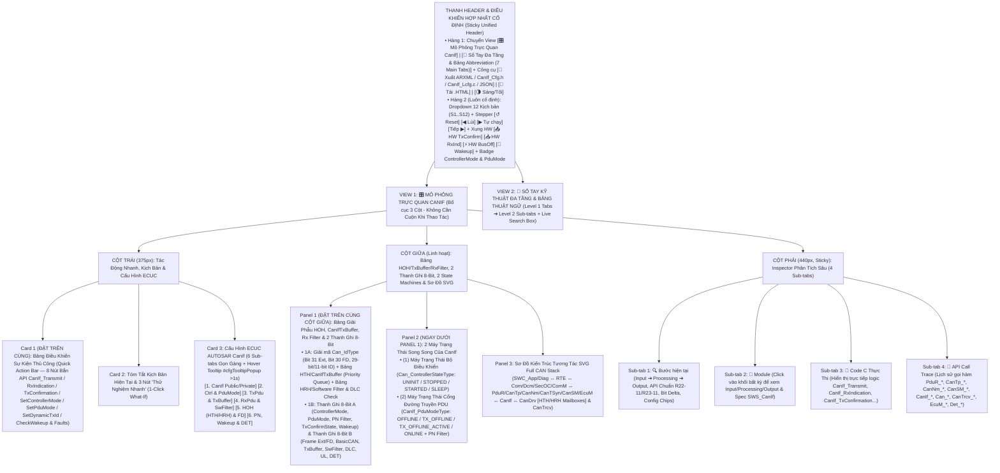
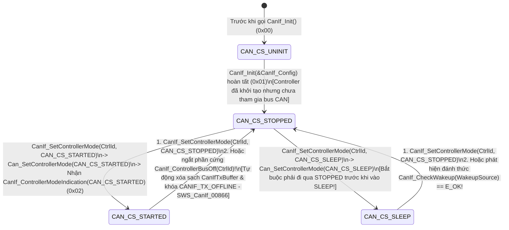
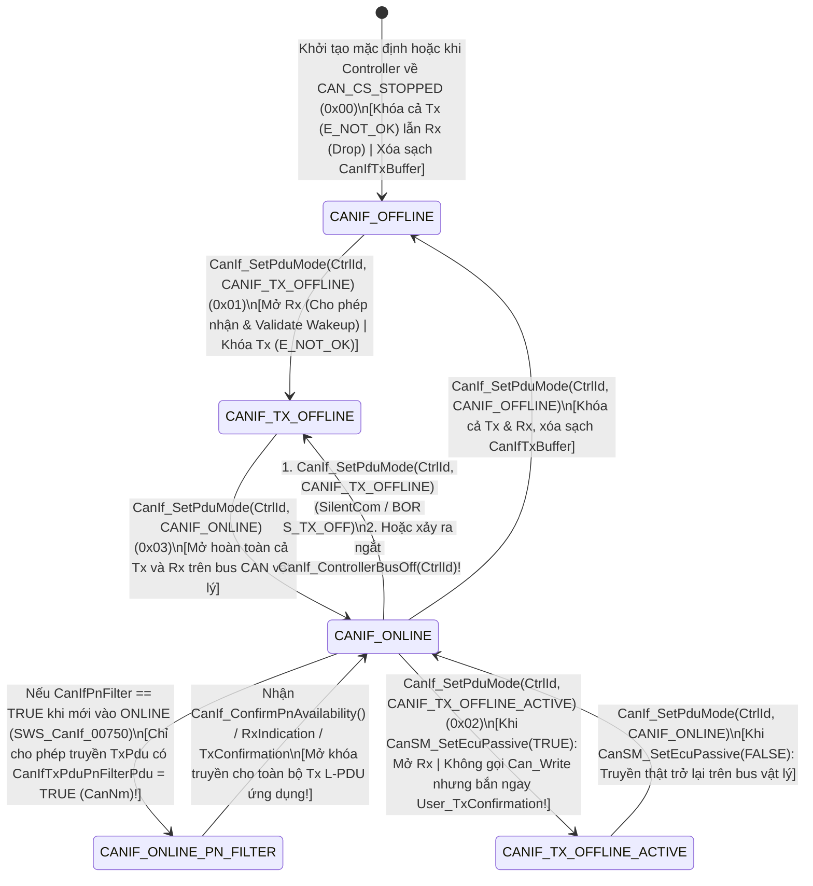

# Tài Liệu Thiết Kế Chi Tiết Trình Mô Phỏng AUTOSAR CanIf (`CanIf_Simulation_design.md`)

> **Trạng thái tài liệu:** Bản thiết kế chi tiết đã cập nhật theo xác nhận `A1`–`A4` của User — Sẵn sàng để User review trước khi triển khai code.  
> **File đích dự kiến xuất bản:** `d:\__Personal\AntiGravity\Simulation\04_ECU_Abstraction\AUTOSAR_CanIf.html` (Ứng dụng Web Tương tác 1 file HTML độc lập, 100% Offline, Pure CSS, có nút tải `.HTML` kèm cấu hình nhúng & xuất code `ARXML / CanIf_Cfg.h / CanIf_Lcfg.c / JSON`).  
> **Chuẩn tham chiếu:** **AUTOSAR Classic Platform R20-11 / R22-11 / R23-11 (`SWS_CanIf`, `SWS_Can`, `SWS_CanTrcv`, `SWS_CanSM`, `SWS_PduR`, `SWS_CanTp`, `SWS_CanNm`, `SWS_CanTSyn`, `SWS_EcuM`, `SWS_Det`, `SWS_IdsM`)**, đính kèm mã requirement chuẩn **`SWS_CanIf_xxxxx`** tại từng bước xử lý, Bảng Giải Phẫu `HOH (FullCAN vs BasicCAN)` & Hàng Đợi Ưu Tiên `CanIfTxBuffer` & Bộ Lọc Phần Mềm `Rx Software Filter`, 2 thanh ghi 8-Bit tương tác, tooltip cấu hình và sổ tay tra cứu đa tầng.

---

## 1. Tổng Quan Định Hướng Thiết Kế Đã Chốt (`A1` – `A4`)

| Hạng mục | Nội dung thiết kế đã xác nhận với User |
| :--- | :--- |
| **1. Bố cục giao diện & Ưu tiên Không Cuộn Trang — Zero-Scroll (`A1`)** | Kế thừa tinh hoa của **`AUTOSAR_DEM.html`**, **`AUTOSAR_MemIf.html`** và **`AUTOSAR_CanSM.html`**, tối ưu hóa **Above-the-Fold (Zero-Scroll)** để các khối thao tác và giám sát tần suất cao nhất luôn nằm ngay phần đầu mỗi cột trong khung màn hình:<br>• **Thanh Điều Khiển Hợp Nhất Cố Định (Sticky Unified Header)**:<br>  - **Hàng 1**: Chuyển View `[🎛️ Mô Phỏng Trực Quan CanIf]` \| `[📖 Sổ Tay Đa Tầng & Bảng Abbreviation (7 Main Tabs)]` + Công cụ `[🧾 Xuất ARXML / CanIf_Cfg.h / CanIf_Lcfg.c / JSON]` \| `[💾 Tải .HTML]` \| `[🌗 Sáng/Tối]`.<br>  - **Hàng 2 (Luôn cố định)**: Dropdown chọn 12 Kịch bản (`S1`–`S12`), Stepper (`↺ Reset`, `◀ Lùi`, `▶ Tự chạy`, `Tiếp ▶`), Bộ kích hoạt phần cứng CAN (`📤 Trigger CanIf_TxConfirmation`, `📥 Inject CanIf_RxIndication`, `⚡ Trigger Bus-Off ISR`, `🔔 Wakeup Pulse`) và Badge Trạng thái `ControllerMode (CAN_CS_*)` & `PduMode (CANIF_*)`.<br>• **Bố cục 3 cột hiện đại (Mỗi cột tự cuộn độc lập trong khung Viewport)**:<br>  - **Cột Trái (`375px`)**: Đưa **Card 1: Bảng Điều Khiển Sự Kiện Thủ Công (`Quick Action Bar` — 8 nút bắn trực tiếp các API cốt lõi của `CanIf`: `CanIf_Transmit`, `CanIf_RxIndication`, `CanIf_TxConfirmation`, `CanIf_SetControllerMode`, `CanIf_SetPduMode`, `CanIf_SetDynamicTxId`, `CanIf_CheckWakeup/Validation` & `Inject Fault/BusBusy`)** và **Card 2: Tóm tắt kịch bản & 3 nút 1-Click What-If** lên trên cùng, tiếp theo là **Card 3: 6 Sub-tabs Cấu hình ECUC CanIf** (hỗ trợ Floating Hover Tooltip `#cfgTooltipPopup` sau `>1s` giống hệt `AUTOSAR_DEM.html`).<br>  - **Cột Giữa (`Linh hoạt`)**: Đưa **Panel 1: Bảng Giải Phẫu `HOH (FullCAN vs BasicCAN)`, Hàng Đợi Ưu Tiên `CanIfTxBuffer`, Bộ Lọc `Rx Software Filter` + Giải Mã `Can_IdType (Bit 31..30)` + 2 Thanh Ghi 8-Bit Tương Tác** và **Panel 2: 2 Máy Trạng Thái Song Song (`Can_ControllerStateType` & `CanIf_PduModeType`)** lên ngay đầu cột giữa; bên dưới là **Panel 3: Sơ Đồ Kiến Trúc Tương Tác SVG Full CAN Stack** (`SWC_App/Diag ↔ RTE ↔ Com/Dcm/SecOC/ComM ↔ PduR/CanTp/CanNm/CanTSyn/CanSM/EcuM ↔ CanIf ↔ CanDrv [Ctrl 0/1, HTH/HRH] & CanTrcv`).<br>  - **Cột Phải (`440px, Sticky`)**: Inspector 4 Sub-tabs (`🔍 Bước hiện tại`, `🧩 Module`, `📄 Code C Thực Thi (CanIf.c / CanIf_Lcfg.c)`, `📜 API Call Trace`). |
| **2. Khu vực Giám sát Bit-level & Giải phẫu HOH / TxBuffer / RxFilter 2 Tầng (`A2`)** | Đặt **cố định và nổi bật ở đầu Cột Giữa** gồm **2 tầng trực quan hóa**:<br>• **Tầng 1 — Bảng Giải Phẫu Trực Quan `HOH (HTH/HRH)`, Hàng Đợi Ưu Tiên `CanIfTxBuffer`, Bộ Lọc `Rx Software Acceptance Filter` & Giải Mã `Can_IdType`**:<br>  - **Giải mã cấu trúc 32-bit `Can_IdType` (`SWS_Can_00416` / `SWS_CanIf`)**: Tách rõ 2 bit cao nhất **`Bit 31 (EXT_ID: 0=11-bit Standard, 1=29-bit Extended)`** và **`Bit 30 (FD_BIT: 0=Classical CAN 2.0B, 1=CAN FD 64B + BRS)`** cùng trường `CAN ID (Bit 28..0)`.<br>  - **Chiều Truyền (`Tx Path — HTH & CanIfTxBuffer`)**: Đối chiếu trực tiếp **`FullCAN HTH` (Mailbox riêng 1:1)** vs **`BasicCAN HTH` (Mailbox dùng chung M:1)**. Khi `Can_Write()` trả về `CAN_BUSY`, hiển thị trực tiếp các L-PDU xếp hàng trong **`CanIfTxBuffer`** được sắp xếp tự động theo **mức ưu tiên CAN ID** (`ID nhỏ hơn nằm đầu hàng đợi`) và tự động xả ra khi có `CanIf_TxConfirmation()`!<br>  - **Chiều Nhận (`Rx Path — HRH, Software Filter & DLC Check`)**: Hiển thị phép toán lọc phần mềm `(CanId & CanIfRxPduCanIdMask) == (CanIfRxPduCanId & Mask)` (hoặc Binary Search), kiểm tra độ dài **`CanDlc >= CanIfRxPduDataLength`** (`CanIfPrivateDlcCheck`), và định tuyến con trỏ hàm `<User_RxIndication>` lên đúng `PduR`, `CanTp`, `CanNm`, `CanTSyn` hoặc `CDD`.<br>• **Tầng 2 — 2 Thanh ghi 8-Bit tương tác song song**:<br>  1. **Thanh A (`8-Bit CanIf Controller, PduMode, PN & Wakeup Status Byte` — `CanIf_CtrlPduStatusByte`)**: Theo dõi trạng thái Controller (`CS_STARTED`, `CS_SLEEP`), chế độ cổng PDU (`PDU_ONLINE`, `TX_OFFLINE_ACTV` [Passive Mode], `TX_OFFLINE`), bộ lọc truyền Partial Networking (`PN_TX_FILTER`), cờ xác nhận truyền (`TX_RX_NOTIF`) và cờ xác thực đánh thức (`WKUP_VALIDATED`).<br>  2. **Thanh B (`8-Bit CanIf L-PDU Frame, HOH, Buffer & Filter Status Byte` — `CanIf_FrameBufferByte`)**: Theo dõi trực tiếp đặc tính khung truyền và xử lý nội bộ của `CanIf` (`ID_EXT_BIT31`, `FD_MODE_BIT30`, `BASIC_CAN_HOH`, `TX_BUF_QUEUED`, `SW_FILTER_PASS`, `DLC_CHECK_PASS`, `UL_IND_DISPATCH`, `DET_ERR_FLAG`). Cho phép click trực tiếp vào từng bit để giải mã hoặc thử nghiệm! |
| **3. Hệ thống 12 Kịch bản mẫu (`A3`)** | Thiết kế sẵn **12 Kịch bản (`S1`–`S12`)** chia làm 4 nhóm lớn:<br>• **Nhóm 1 (`S1`–`S3`) — Truyền L-PDU (`CanIf_Transmit`), `FullCAN` vs `BasicCAN` Buffering, `TriggerTransmit` & `DynamicTxId`**: Truyền chuẩn qua `FullCAN HTH` (`S1`); Tranh chấp Mailbox trên `BasicCAN HTH` (`Can_Write == CAN_BUSY`) ➔ Xếp hàng ưu tiên theo CAN ID trong `CanIfTxBuffer` & tự động phát tiếp trong `CanIf_TxConfirmation()` (`S2`); Cơ chế kéo dữ liệu `CanIf_TriggerTransmit()` & đổi CAN ID động bằng `CanIf_SetDynamicTxId()` (`S3`).<br>• **Nhóm 2 (`S4`–`S6`) — Nhận L-PDU (`CanIf_RxIndication`), Lọc Phần Mềm `BasicCAN`, `DLC Check`, `CAN FD 64B` & Điều Phối Đa Đích (`Multi-UL`)**: Nhận qua `BasicCAN HRH`, lọc phần mềm (`Software Acceptance Filter`) & bắt lỗi `DLC Check` (`CANIF_E_INVALID_DATA_LENGTH = 0x32`) (`S4`); Truyền nhận khung **CAN FD 64 Bytes + BRS (`Bit 30 = 1`)** & kiểm tra cắt ngắn/vượt độ dài (`S5`); Điều phối đa tầng trên (`PduR/Com`, `CanTp/Dcm`, `CanNm`, `CanTSyn`, `CDD`) & chế độ đọc Polling `CanIf_ReadRxPduData()` / `CanIf_ReadRxNotifStatus()` (`S6`).<br>• **Nhóm 3 (`S7`–`S9`) — Quản Lý `ControllerMode`, Cổng `PduMode` (`CANIF_TX_OFFLINE_ACTIVE`) & Bộ Lọc `Partial Networking (PN)`**: Chuyển đổi `ControllerMode` (`STOPPED ➔ STARTED ➔ SLEEP`) phối hợp với `CanSM` & `CanDrv` (`S7`); So sánh 4 chế độ cổng `CanIf_PduModeType` (`OFFLINE`, `TX_OFFLINE`, `ONLINE`, và đặc biệt là `CANIF_TX_OFFLINE_ACTIVE` giả lập `TxConfirmation` khi ECU Passive) (`S8`); Bộ lọc truyền Partial Networking `CanIfPnFilter` chặn PDU thường và chỉ mở khóa khi nhận `CanIf_ConfirmPnAvailability()` (`S9`).<br>• **Nhóm 4 (`S10`–`S12`) — Xử Lý Ngắt `Bus-Off`, Xác Thực Đánh Thức (`Wakeup Validation`), `SetBaudrate` & Hàng Rào `DET`**: Xử lý ngắt `CanIf_ControllerBusOff()` (tự động khóa `CANIF_TX_OFFLINE`, xóa sạch `CanIfTxBuffer`, báo `CanSM_ControllerBusOff`) (`S10`); Chu trình đánh thức & xác thực đánh thức với `EcuM` (`CanIf_CheckWakeup` ➔ `CanIf_RxIndication` đầu tiên ➔ `CanIf_CheckValidation` ➔ `EcuM_ValidateWakeupEvent`) (`S11`); Đổi tốc độ `CanIf_SetBaudrate()`, `CanIf_GetTxConfirmationState()` & kiểm thử toàn diện hàng rào lỗi `DET` (`S12`). |
| **4. Sổ tay tra cứu đa tầng & Bảng Abbreviation (`A4`)** | **View 2 (`📖 Sổ Tay Kỹ Thuật CanIf & Từ Điển Thuật Ngữ`)** được tổ chức theo cấu trúc **Đa Tầng (Multi-level Tabs)**:<br>• **6 Main Sub-tabs (Level 1) × 4 Chủ đề con (Level 2 Pills/Tabs = 24 chuyên đề)** phân tích sâu kiến trúc CAN Stack, cơ chế `HOH (HTH/HRH) FullCAN vs BasicCAN`, thuật toán hàng đợi ưu tiên `CanIfTxBuffer`, bộ lọc phần mềm `Rx Software Filter` & `DLC Check`, giải mã 2 bit MSB `Can_IdType`, 2 máy trạng thái (`ControllerMode` & `PduMode`), Partial Networking, Wakeup Validation và ECUC.<br>• **Tab 7 chuyên biệt: `🔤 Bảng Thuật Ngữ & Từ Viết Tắt (Abbreviation Table)`** trình bày dưới dạng bảng chuẩn 4 cột, tích hợp **Search Box tìm kiếm tức thời (Live Search + Highlight `<mark>`)** và 5 nút lọc nhanh theo phân nhóm (`CanIf Core & HOH`, `Tx Buffering & PduMode`, `Rx Filtering, CAN-FD & UL`, `Mode, Bus-Off, PN & Wakeup`, `APIs, ECUC & DET/IdsM`). |

---

## 2. Bố Cục Giao Diện 3 Cột Ưu Tiên Zero-Scroll & Hệ Thống Sub-Tabs (UI Wireframe)

Để đáp ứng triệt để yêu cầu **"đưa các khối được dùng thường xuyên hơn lên phía trên để người dùng không cần cuộn chuột lên xuống mỗi lần thao tác"**, giao diện được thiết kế theo nguyên lý **Viewport-First (Toàn bộ 8 nút gọi nhanh API `CanIf`, các nút kích hoạt ngắt phần cứng `TxConfirmation / RxIndication / BusOff`, Bảng Giải Phẫu `HOH / CanIfTxBuffer / Rx Software Filter`, 2 Thanh Ghi 8-Bit và 2 Máy Trạng Thái đều nằm ngay trong tầm mắt đầu trang)**:



### Điểm Cải Tiến Đột Phá Về Trải Nghiệm "Zero-Scroll" Cho Module `CanIf`:
1. **Thanh Điều Khiển Hợp Nhất (`Sticky Unified Header`) Với Các Nút Kích Hoạt Sự Kiện Phần Cứng (`HW Interrupt Triggers`)**:
   - Trong thực tế, `CanIf` nằm kẹp giữa các lời gọi đồng bộ từ tầng trên (`CanIf_Transmit`, `CanIf_SetControllerMode`, `CanIf_SetPduMode`) và các ngắt phần cứng bất đồng bộ từ tầng dưới (`CanIf_TxConfirmation`, `CanIf_RxIndication`, `CanIf_ControllerBusOff`). Việc đặt các nút kích hoạt ngắt phần cứng ngay trên thanh Header cố định giúp người dùng vừa bấm `CanIf_Transmit()` làm đầy Mailbox/TxBuffer, vừa bấm ngay `📤 HW TxConfirm` để thấy `CanIf` tự động lấy gói tin tiếp theo trong `CanIfTxBuffer` nạp xuống `Can_Write()` mà không phải cuộn chuột!
2. **Đưa `Quick Action Bar` (8 nút tác động nhanh) lên vị trí Card 1 (Đầu Cột Trái)** và đưa **Bảng Giải Phẫu `HOH / CanIfTxBuffer / Rx Software Filter` + 2 Thanh Ghi 8-Bit** lên đầu Cột Giữa: Mọi thao tác đổi `PduMode`, đổi `Can_IdType` (`Standard` ↔ `Extended`, `CAN 2.0` ↔ `CAN FD`), hoặc bắn bản tin qua `BasicCAN` đều phản hồi tức thời ngay trước mắt.
3. **Gom 36 tham số ECUC vào 6 Sub-tabs gọn gàng**: Chiều cao Card Cấu hình được giữ gọn cố định (~275px), kèm hộp thoại giải thích nổi `#cfgTooltipPopup` khi hover quá `1000ms` giống hệt file `AUTOSAR_DEM.html`.

---

## 3. Thiết Kế Chi Tiết Panel 1 (Đầu Cột Giữa): Bảng Giải Phẫu `HOH`, Hàng Đợi `CanIfTxBuffer`, Bộ Lọc `Rx Software Filter` & 2 Thanh Ghi 8-Bit Tương Tác

Trong `AUTOSAR Classic`, giá trị kỹ thuật cốt lõi của `CanIf` (`SWS_CanIf`) nằm ở **4 cơ chế phần cứng trừu tượng hóa**:
1. **Giải mã khung truyền qua 2 Bit MSB của `Can_IdType` (`SWS_Can_00416` / `SWS_CanIf`)**: Dùng `Bit 31` để phân biệt Standard (11-bit) vs Extended (29-bit) và `Bit 30` để phân biệt Classical CAN 2.0B (tối đa 8 bytes) vs CAN FD (tối đa 64 bytes + BRS).
2. **Quản lý `HTH` (`FullCAN` vs `BasicCAN`) và Hàng đợi ưu tiên `CanIfTxBuffer` (`SWS_CanIf_00381`, `00068`, `00835`)**: Khi một `BasicCAN HTH` đang bận truyền khung trước đó (`Can_Write()` trả về `CAN_BUSY`), `CanIf` không làm mất gói tin mà lưu vào `CanIfTxBuffer` sắp xếp theo độ ưu tiên CAN ID, rồi tự động phát tiếp ngay trong ngắt `CanIf_TxConfirmation()`.
3. **Lọc phần mềm `Rx Software Acceptance Filtering` & Kiểm tra `DLC Check` (`SWS_CanIf_00030`, `00026`)**: Khi nhận khung từ một `BasicCAN HRH` (chấp nhận cả một dải CAN ID phần cứng), `CanIf` tra bảng lọc phần mềm để tìm đúng `RxPduId`, kiểm tra `CanDlc >= CanIfRxPduDataLength`, rồi mới gọi `<User_RxIndication>` của tầng trên tương ứng (`PduR`, `CanTp`, `CanNm`, `CanTSyn`, `CDD`).
4. **Kiểm soát cổng đường truyền bằng `CanIf_PduModeType` (`OFFLINE`, `TX_OFFLINE`, `TX_OFFLINE_ACTIVE`, `ONLINE`) kết hợp `CanIfPnFilter`**: Quyết định cho phép truyền thật, chặn truyền, hay giả lập truyền thành công (`CANIF_TX_OFFLINE_ACTIVE`).

Do đó, Panel 1 ở đầu Cột Giữa được thiết kế gồm **2 phần trực quan hóa liên thông**:

### 3.1. Phần 1A — Bảng Giải Phẫu Trực Quan `Can_IdType (32-Bit)`, Hàng Đợi `CanIfTxBuffer` & Bộ Lọc `Rx Software Filter`

```text
+-------------------------------------------------------------------------------------------------------------------+
| 🔀 BẢNG GIẢI PHẪU HOH (FULLCAN/BASICCAN), HÀNG ĐỢI CANIFTXBUFFER & BỘ LỌC RX (`SWS_CanIf_00381`, `00030`, `00026`)|
| Controller 0: [ CAN_CS_STARTED ] | PduMode: [ CANIF_ONLINE ] | HTH_1 (BasicCAN) Mailbox: [ 🔴 BUSY (Tx ID 0x100) ]|
+-------------------------------------------------------------------------------------------------------------------+
| 1. GIẢI MÃ TRƯỜNG 32-BIT `Can_IdType` ĐANG XỬ LÝ (`0x40000120` — Click để đổi Standard/Extended hoặc CAN 2.0/FD): |
|  • [ Bit 31 (0x80000000): EXT_ID = 0 (11-bit Standard) ] | [ Bit 30 (0x40000000): FD_MODE = 1 (CAN FD 64B + BRS) ]|
|  • [ Bit 29: RSVD = 0 ]                                  | [ Bit 28..0 (CAN ID): 0x00000120 (ID = 0x120, Prio #2) ]|
+-------------------------------------------------------------------------------------------------------------------+
| 2. CHIỀU TRUYỀN (TX PATH: HTH MAILBOX & HÀNG ĐỢI ƯU TIÊN `CanIfTxBuffer` KHI `Can_Write() == CAN_BUSY`):          |
|  +--------------------+--------------------------+--------------------------+-----------------------------------+ |
|  | HTH / Buffer Slot  | L-PDU & Tầng Trên (UL)   | CAN ID & Định Dạng       | Trạng Thái Mailbox / Hàng Đợi     | |
|  +--------------------+--------------------------+--------------------------+-----------------------------------+ |
|  | HTH_0 (FullCAN)    | TxPdu_0 (CanNm_Pdu)      | 0x00000500 (Std CAN 8B)  | [ 🟢 FREE ] (Dedicated 1:1 HW Box)| |
|  | HTH_1 (BasicCAN)   | TxPdu_1 (Com_BrakeTorque)| 0x00000100 (Std CAN 8B)  | [ 🔴 HW TRANSMITTING ON BUS...  ] | |
|  |  ↳ TxBuf Slot #1   | TxPdu_2 (Com_SteerAngle) | 0x40000120 (Std FD  32B) | [ ⏳ QUEUED #1 (High Prio 0x120)] | |
|  |  ↳ TxBuf Slot #2   | TxPdu_3 (CanTp_DiagResp) | 0x000007E8 (Std CAN 8B)  | [ ⏳ QUEUED #2 (Low Prio  0x7E8)] | |
|  +--------------------+--------------------------+--------------------------+-----------------------------------+ |
| 3. CHIỀU NHẬN (RX PATH: HRH, LỌC PHẦN MỀM `Software Filter`, KIỂM TRA `DLC Check` & ĐIỀU PHỐI `UL`):              |
|  • Khung vừa nhận tại HRH_1 (BasicCAN): CanId = 0x120 | CanDlc = 32B | Filter: (0x120 & 0x7FF)==0x120 ➔ [ PASS ]  |
|  • Kiểm tra DLC (`CanIfPrivateDlcCheck`): Nhận 32B >= Cấu hình Min 16B ➔ [ PASS ] ➔ Gọi: `PduR_CanIfRxIndication` |
+-------------------------------------------------------------------------------------------------------------------+
```

- **Tính năng tương tác trực tiếp trên Phần 1A**:
  - Người dùng có thể click trực tiếp vào ô **`Bit 31 (EXT_ID)`** hoặc **`Bit 30 (FD_MODE)`** để chuyển đổi khung truyền giữa `Standard 11-bit`, `Extended 29-bit`, `Classical CAN 8B` và `CAN FD 64B`, đồng thời thấy giá trị Hex của `Can_IdType` (`0x00000120` ↔ `0x40000120` ↔ `0x80000120` ↔ `0xC0000120`) cập nhật tức thời.
  - Có nút gạt nhanh **`[HTH_1 Mailbox: FREE ↔ BUSY]`** ngay trên bảng để người dùng thử nghiệm trực tiếp việc gọi `CanIf_Transmit()` khi Mailbox rảnh (gọi thẳng xuống bus) so với khi Mailbox bận (tự động sắp xếp vào `CanIfTxBuffer` theo thứ tự ưu tiên CAN ID).

### 3.2. Phần 1B — 2 Thanh Ghi 8-Bit Trạng Thái Tương Tác Luôn Hiển Thị Nổi Bật

Ngay bên dưới Phần 1A là **2 Thanh ghi 8-Bit tương tác** theo đúng phong cách chuẩn của `AUTOSAR_DEM.html`, `AUTOSAR_MemIf.html` và `AUTOSAR_CanSM.html`:

```text
+-------------------------------------------------------------------------------------------------------------------+
| 🔢 BẢNG GIÁM SÁT BITFIELD 8-BIT CANIF CONTROLLER/PDUMODE & FRAME/BUFFER (LIVE 8-BIT INSPECTOR) [Click Bit để thử] |
| Bước #3: CanIf_Transmit(TxPdu_2, ID=0x40000120) gặp CAN_BUSY ➔ Xếp vào CanIfTxBuffer | A: 0xA2 | B: 0x70          |
+-------------------------------------------------------------------------------------------------------------------+
| A. THANH GHI 8-BIT TRẠNG THÁI CONTROLLER, PDUMODE, PN & WAKEUP (`CanIf_CtrlPduStatusByte`) — Hex:[0xA2] [10100010]|
|    Controller 0: [ CAN_CS_STARTED (0x02) ] | PduMode: [ CANIF_ONLINE (0x03) ] | TxConfirmState: [ NOTIFICATION ]  |
|  +-------------+ +-------------+ +-------------+ +-------------+ +-------------+ +-------------+ +-------+ +-----+|
|  | Bit 7 (0x80)| | Bit 6 (0x40)| | Bit 5 (0x20)| | Bit 4 (0x10)| | Bit 3 (0x08)| | Bit 2 (0x04)| |Bit1(2)| |Bit 0||
|  | CS_STARTED  | |  CS_SLEEP   | | PDU_ONLINE  | | TX_OFF_ACTV | | TX_OFFLINE  | | PN_TX_FILT  | |TX_NOTF| |WKUP ||
|  |      1      | |      0      | |      1      | |      0      | |      0      | |      0      | |   1   | |  0  ||
|  | Ctrl Started| | Not Sleep   | | Online TxRx | | Real Bus Tx | | Tx Enabled  | | PN Unlocked | |Conf OK| |NoWk ||
|  +-------------+ +-------------+ +-------------+ +-------------+ +-------------+ +-------------+ +-------+ +-----+|
+-------------------------------------------------------------------------------------------------------------------+
| B. THANH GHI 8-BIT KHUNG TRUYỀN, HOH, TX BUFFER, RX FILTER & LỖI (`CanIf_FrameBufferByte`) — Hex:[0x70] [01110000]|
|    Can_IdType: [ 0x40000120 (Std CAN-FD) ] | HOH: [ BasicCAN ] | TxBuffer: [ 2 Queued ] | DLC Check: [ Enabled ]  |
|  +-------------+ +-------------+ +-------------+ +-------------+ +-------------+ +-------------+ +-------+ +-----+|
|  | Bit 7 (0x80)| | Bit 6 (0x40)| | Bit 5 (0x20)| | Bit 4 (0x10)| | Bit 3 (0x08)| | Bit 2 (0x04)| |Bit1(2)| |Bit 0||
|  | ID_EXT_B31  | | FD_MODE_B30 | | BASIC_HOH   | | TX_BUFFERED | | SW_FLT_PASS | | DLC_CHK_OK  | |UL_IND | |DET_E||
|  |      0      | |   1 (0➔1🔥) | |   1 (0➔1🔥) | |   1 (0➔1🔥) | |      0      | |      0      | |   0   | |  0  ||
|  | 11-bit Std  | | CAN-FD Frame| | BasicCAN Mux| | In TxQueue! | | Idle RxFlt  | | Idle DLC    | |No UL  | |NoErr||
|  +-------------+ +-------------+ +-------------+ +-------------+ +-------------+ +-------------+ +-------+ +-----+|
+-------------------------------------------------------------------------------------------------------------------+
```

#### 3.2.1. Giải Mã Chi Tiết Thanh A: `8-Bit CanIf Controller, PduMode, PN & Wakeup Status Byte` (`CanIf_CtrlPduStatusByte`)

| Bit | Mask | Tên Cờ (`CanIf Ctrl/Pdu Bit`) | Ý nghĩa kỹ thuật & Khi nào bật lên `1` (`0 ➔ 1`) | Khi nào hạ về `0` (`1 ➔ 0`) |
| :-: | :-: | :--- | :--- | :--- |
| **Bit 7** | `0x80` | **`CS_STARTED`** | Bật lên `1` khi CAN Controller hiện tại ở trạng thái **`CAN_CS_STARTED (0x02)`** (sau khi `CanIf_SetControllerMode(CtrlId, CAN_CS_STARTED)` hoàn tất và nhận `CanIf_ControllerModeIndication` — `SWS_CanIf_00308`). Đây là điều kiện tiên quyết số 1 để `CanIf` có thể giao tiếp với bus CAN vật lý. | Hạ về `0` khi Controller chuyển về **`CAN_CS_STOPPED (0x01)`** (do lệnh từ `CanSM` hoặc do xảy ra ngắt **`CanIf_ControllerBusOff()`** — `SWS_CanIf_00014`) hoặc **`CAN_CS_SLEEP (0x03)`**. |
| **Bit 6** | `0x40` | **`CS_SLEEP`** | Bật lên `1` khi CAN Controller đang ở chế độ ngủ tiết kiệm năng lượng **`CAN_CS_SLEEP (0x03)`** (`CanIf_SetControllerMode(CtrlId, CAN_CS_SLEEP)`). *(Lưu ý: Khi cả `Bit 7 = 0` và `Bit 6 = 0`, Controller đang ở trạng thái **`CAN_CS_STOPPED (0x01)`** hoặc `UNINIT`)*. | Hạ về `0` khi có xung đánh thức trên bus hoặc khi `CanSM`/`EcuM` đánh thức Controller chuyển về `CAN_CS_STOPPED` (`SWS_CanIf_00480`). |
| **Bit 5** | `0x20` | **`PDU_ONLINE`** | Bật lên `1` khi chế độ cổng đường truyền PDU của Controller là **`CANIF_ONLINE (0x03)`** (`CanIf_SetPduMode(CtrlId, CANIF_ONLINE)` — `SWS_CanIf_00008`): Mở thông suốt cả đường truyền đi (`Tx`) lẫn đường nhận về (`Rx`). | Hạ về `0` khi chuyển sang `CANIF_OFFLINE`, `CANIF_TX_OFFLINE` hoặc `CANIF_TX_OFFLINE_ACTIVE`. |
| **Bit 4** | `0x10` | **`TX_OFF_ACTV`** | Bật lên `1` khi cổng PDU ở chế độ **`CANIF_TX_OFFLINE_ACTIVE (0x02)`** (`SWS_CanIf_00072` — kích hoạt khi `CanSM_SetEcuPassive(TRUE)`): Đường nhận `Rx` vẫn mở, còn khi tầng trên gọi `CanIf_Transmit()`, `CanIf` **KHÔNG gọi `Can_Write()` ra bus vật lý** nhưng lại **lập tức gọi `<User_TxConfirmation>()`** báo truyền thành công ảo cho tầng trên! | Hạ về `0` khi chuyển sang `CANIF_ONLINE`, `CANIF_TX_OFFLINE` hoặc `CANIF_OFFLINE`. |
| **Bit 3** | `0x08` | **`TX_OFFLINE`** | Bật lên `1` khi đường truyền `Tx` ra bus vật lý bị khóa bởi **`CANIF_TX_OFFLINE (0x01)`** hoặc **`CANIF_OFFLINE (0x00)`** (ví dụ: trong pha chờ `S_TX_OFF` của Bus-Off Recovery, trong chế độ `SILENT_COMMUNICATION`, hoặc khi vừa khởi động để xác thực Wakeup). Mọi lời gọi `CanIf_Transmit()` lúc này đều bị từ chối trả về `E_NOT_OK`! | Hạ về `0` khi `CanSM` mở lại cổng `CANIF_ONLINE` (`Bit 5 = 1`). |
| **Bit 2** | `0x04` | **`PN_TX_FILT`** | Bật lên `1` khi bộ lọc truyền **Partial Networking (`CanIfPnFilter`)** đang được kích hoạt trên Controller (`SWS_CanIf_00750`): Ngay cả khi đang ở `CANIF_ONLINE`, `CanIf` vẫn **chặn tất cả các Tx L-PDU thông thường**, và chỉ cho phép duy nhất các L-PDU có cấu hình **`CanIfTxPduPnFilterPdu == TRUE`** (thường là bản tin `CanNm`) được truyền đi! | Hạ về `0` (mở khóa cho toàn bộ Tx L-PDU) ngay khi nhận được `CanIf_RxIndication()` hoặc `CanIf_TxConfirmation()` đầu tiên, hoặc khi `CanSM` tắt PN Filter (`SWS_CanIf_00751`, `00752`). |
| **Bit 1** | `0x02` | **`TX_NOTF`** | Biểu diễn trạng thái **`CanIf_NotifStatusType`** của Controller trả về bởi hàm `CanIf_GetTxConfirmationState(CtrlId)` (`SWS_CanIf_00734`): Bật lên `1` (**`CANIF_TX_RX_NOTIFICATION`**) ngay khi có ít nhất 1 L-PDU truyền thành công (`CanIf_TxConfirmation`) kể từ lần khởi động gần nhất (giúp `CanSM` biết bus CAN đã hồi phục thật sự sau Bus-Off!). | Hạ về `0` (**`CANIF_NO_NOTIFICATION`**) khi Controller chuyển sang `CAN_CS_STOPPED` hoặc khi xảy ra sự cố `CanIf_ControllerBusOff()`. |
| **Bit 0** | `0x01` | **`WKUP_VALID`** | Bật lên `1` khi sau một sự kiện đánh thức phần cứng (`CanIf_CheckWakeup` trả về `E_OK`), `CanIf` nhận được thành công ít nhất 1 khung CAN hợp lệ qua **`CanIf_RxIndication()`** (vượt qua cả lọc CAN ID và kiểm tra DLC), làm cho `CanIf_CheckValidation()` xác nhận **`EcuM_ValidateWakeupEvent()`** (`SWS_CanIf_00179`, `00286`)! | Hạ về `0` khi Controller đi ngủ lại (`CAN_CS_SLEEP`) hoặc khi Reset chu trình đánh thức. |

#### 3.2.2. Giải Mã Chi Tiết Thanh B: `8-Bit CanIf L-PDU Frame, HOH, Buffer & Filter Status Byte` (`CanIf_FrameBufferByte`)

| Bit | Mask | Tên Cờ (`CanIf Frame/Buf Bit`) | Ý nghĩa kỹ thuật & Khi nào bật lên `1` (`0 ➔ 1`) | Khi nào hạ về `0` (`1 ➔ 0`) |
| :-: | :-: | :--- | :--- | :--- |
| **Bit 7** | `0x80` | **`ID_EXT_B31`** | Đại diện cho **Bit 31 (MSB)** của kiểu **`Can_IdType`** (`SWS_Can_00416`): Bật lên `1` (`CanId & 0x80000000 != 0`) khi khung đang xử lý sử dụng **Extended 29-bit CAN ID** (`CANIF_TX_EXTENDED_CAN` / `CANIF_TX_EXTENDED_FD_CAN`, ví dụ J1939 hoặc ISO-TP Normal Fixed `0x98DAxxxx`). | Hạ về `0` khi khung sử dụng **Standard 11-bit CAN ID** (`0x000 .. 0x7FF`). |
| **Bit 6** | `0x40` | **`FD_MODE_B30`** | Đại diện cho **Bit 30** của kiểu **`Can_IdType`** (`SWS_Can_00416`): Bật lên `1` (`CanId & 0x40000000 != 0`) khi khung đang xử lý là **CAN FD Frame** (`CANIF_TX_STANDARD_FD_CAN` / `CANIF_TX_EXTENDED_FD_CAN`, cho phép Payload lên tới **64 Bytes** và bật tốc độ cao **BRS — Bit Rate Switch**). | Hạ về `0` khi khung là **Classical CAN 2.0B Frame** (Payload tối đa **8 Bytes**). |
| **Bit 5** | `0x20` | **`BASIC_HOH`** | Bật lên `1` khi L-PDU hiện tại đi qua một **`BasicCAN` Hardware Object Handle (`CanHandleType = BASIC`)**: Nhiều L-PDU với các CAN ID khác nhau dùng chung 1 Mailbox phần cứng (`HTH` hoặc `HRH`), kích hoạt cơ chế **Tx Buffering** (chiều truyền) hoặc **Software Acceptance Filtering** (chiều nhận). | Hạ về `0` khi L-PDU đi qua **`FullCAN` HOH (`CanHandleType = FULL`)**: 1 Mailbox phần cứng chỉ phục vụ độc quyền 1 CAN ID duy nhất (không cần lọc phần mềm và không cần `CanIfTxBuffer`). |
| **Bit 4** | `0x10` | **`TX_BUFFERED`** | Bật lên `1` khi có ít nhất 1 L-PDU đang nằm chờ trong hàng đợi ưu tiên **`CanIfTxBuffer`** (`SWS_CanIf_00381`) do `Can_Write()` trả về `CAN_BUSY` (hoặc khi L-PDU vừa được ghi đè/xếp hàng vào `CanIfTxBuffer`). | Hạ về `0` khi `CanIf_TxConfirmation()` đã xả hết toàn bộ các L-PDU trong `CanIfTxBuffer` ra bus, hoặc khi `CanIfTxBuffer` bị xóa sạch do `CAN_CS_STOPPED` / `CANIF_OFFLINE` / `Bus-Off` (`SWS_CanIf_00073`). |
| **Bit 3** | `0x08` | **`SW_FLT_PASS`** | Bật lên `1` trong luồng `CanIf_RxIndication()` khi CAN ID của khung nhận được **vượt qua thành công** bộ lọc phần mềm của `CanIf` (`Binary Search` / `Linear Search` / `(CanId & Mask) == (Code & Mask)` — `SWS_CanIf_00030`) hoặc khớp trực tiếp với `FullCAN HRH`. | Hạ về `0` nếu CAN ID không khớp với bất kỳ `CanIfRxPduCfg` nào (khung tin bị `CanIf` loại bỏ âm thầm tại tầng lọc phần mềm). |
| **Bit 2** | `0x04` | **`DLC_CHK_OK`** | Bật lên `1` trong luồng `CanIf_RxIndication()` khi độ dài dữ liệu thực tế nhận được thỏa mãn điều kiện **`CanDlc >= CanIfRxPduDataLength`** (`CanIfPrivateDlcCheck = TRUE` — `SWS_CanIf_00026`). | Hạ về `0` (đồng thời bật `Bit 0 DET_E = 1`) khi khung nhận được có `CanDlc < CanIfRxPduDataLength` ➔ `CanIf` hủy khung tin và báo lỗi Runtime **`CANIF_E_INVALID_DATA_LENGTH (0x32)`**! |
| **Bit 1** | `0x02` | **`UL_IND`** | Bật lên `1` khi `CanIf` thực hiện thành công việc định tuyến thông báo lên tầng trên (`Upper Layer — UL`): gọi `<User_RxIndication>(RxPduId, &PduInfo)` (chiều nhận) hoặc `<User_TxConfirmation>(TxPduId, result)` / `<User_TriggerTransmit>` (chiều truyền). | Hạ về `0` khi khung bị chặn bởi `PduMode`, trượt `Software Filter`, trượt `DLC Check`, hoặc chỉ lưu vào `CanIfTxBuffer` mà chưa hoàn tất truyền. |
| **Bit 0** | `0x01` | **`DET_ERR`** | Bật lên `1` ngay khi `CanIf` phát hiện lỗi Development Error hoặc Runtime Error và gọi **`Det_ReportError()`** / **`Det_ReportRuntimeError()`** (ví dụ: `CANIF_E_INVALID_DATA_LENGTH = 0x32`, `CANIF_E_TXPDU_LENGTH_EXCEEDED = 0x33`, `CANIF_E_UNINIT = 0x1E`, `CANIF_E_INVALID_TXPDUID = 0x32`, `CANIF_E_PARAM_CANID = 0x0A`, `CANIF_E_PARAM_HOH = 0x0C`). | Hạ về `0` khi thực hiện một thao tác hợp lệ mới hoặc bấm Reset. |

---

## 4. Phân Tích Xử Lý Từng Module: Input Lấy Từ Đâu, Xử Lý Gì, Output Route Đến Đâu

Mọi khối trên sơ đồ kiến trúc SVG đều có thể **click vào để xem giải thích chi tiết** ở cột phải (Tab `🧩 Module`) và được tổng hợp đầy đủ trong **Tab 1 của Sổ tay**:

| # | Module / Phân khối | Lớp AUTOSAR | 📥 Input lấy từ đâu? | ⚙️ Cách xử lý nội bộ (Processing, State, Buffers & Filtering) | 📤 Output route đến đâu & Hàm API chuẩn (R20-11 / R22-11 / R23-11) |
| :-: | :--- | :--- | :--- | :--- | :--- |
| **1** | **`SWC_App` & `SWC_Diag`**<br>*(Application Layer)* | Application Layer (`01_Application`) | • Dữ liệu tín hiệu nhận được từ `RTE` (`Rte_Read`) hoặc yêu cầu dịch vụ chẩn đoán UDS từ `Dcm`.<br>• Trạng thái chế độ mạng từ `ComM` (`Rte_Mode`). | • **Lưu ý kiến trúc quan trọng**: Không có bất kỳ `SWC` nào gọi trực tiếp `CanIf`!<br>• **Luồng dữ liệu (Data Path)**: `SWC_App` ghi tín hiệu qua `Rte_Write` xuống `AUTOSAR COM` (tạo I-PDU ➔ qua `PduR` xuống `CanIf`); `SWC_Diag` trả lời dịch vụ UDS qua `Dcm` (➔ `PduR` ➔ `CanTp` chia cắt gói tin ➔ `CanIf`).<br>• **Luồng điều khiển (Control Path)**: `SWC` yêu cầu mở mạng CAN qua `Rte_Call_ComM_UserRequest` (➔ `ComM` ➔ `CanSM` ➔ `CanIf`). | • Qua **RTE** xuống **COM / DCM**:<br>`Rte_Write_PP_SteerAngle_Val(val)`<br>`Rte_Read_RP_VehicleSpeed_Val(&val)`<br>• Qua **RTE** xuống **ComM**:<br>`Rte_Call_UR_ComMUser_0_RequestComMode(COMM_FULL_COMMUNICATION)` |
| **2** | **`RTE` & `SchM`**<br>*(Runtime Environment & BSW Scheduler)* | RTE Layer (`02_RTE`) | • Lời gọi từ `SWC` và thông báo tín hiệu từ `AUTOSAR COM` (`Com_RxIndication`).<br>• Yêu cầu khóa vùng găng từ `CanIf`. | • **RTE**: Chuyển tiếp tín hiệu giữa `SWC` và `COM`/`DCM`/`ComM`.<br>• **SchM (`Exclusive Area`)**: Vì hàm `CanIf_Transmit()` (gọi từ Task ứng dụng/COM) và hàm ngắt `CanIf_TxConfirmation()` / `CanIf_ControllerBusOff()` (gọi từ CAN ISR) cùng truy cập vào hàng đợi **`CanIfTxBuffer`** và biến trạng thái `PduMode`, `CanIf` bắt buộc phải gọi `SchM_Enter_CanIf_EXCLUSIVE_AREA_0()` để chống xung đột dữ liệu (Race Condition)! | • Bảo vệ vùng dữ liệu găng của **CanIf**:<br>`SchM_Enter_CanIf_EXCLUSIVE_AREA_0()`<br>`SchM_Exit_CanIf_EXCLUSIVE_AREA_0()` |
| **3** | **`PduR` (kèm `Com` / `SecOC`), `CanTp` (kèm `Dcm`), `CanNm`, `CanTSyn` & `CDD`**<br>*(Upper Layer Data Modules)* | Communication Services (`03_Services`) & CDD | • Nhận yêu cầu truyền I-PDU từ `COM` (`PduR_ComTransmit`), `SecOC`, `DCM` (`PduR_DcmTransmit` ➔ `CanTp_Transmit`), hoặc tự phát sinh gói tin quản lý mạng (`CanNm`), đồng bộ thời gian (`CanTSyn`).<br>• Nhận callbacks `RxIndication`, `TxConfirmation`, `TriggerTransmit` từ `CanIf`. | • **Chiều truyền (Tx)**: Đóng gói payload (tín hiệu `COM`, khung bảo mật `SecOC`, phân mảnh ISO 15765-2 `SF/FF/CF/FC` của `CanTp`, hoặc NM PDU của `CanNm`) vào cấu trúc `PduInfoType { SduDataPtr, MetaDataPtr, SduLength }` và gọi **`CanIf_Transmit(CanIfTxSduId, &PduInfo)`**.<br>• Nếu cấu hình **TriggerTransmit** (`SduDataPtr == NULL_PTR`), tầng trên cung cấp hàm `<User_TriggerTransmit>()` để `CanIf` kéo dữ liệu mới nhất ngay lúc Mailbox sẵn sàng.<br>• **Chiều nhận (Rx)**: Nhận L-PDU đã được `CanIf` lọc sạch và phân phối đúng đích qua bảng con trỏ hàm `CanIfRxPduUserRxIndicationName`. | • Gọi xuống **CanIf**:<br>`CanIf_Transmit(TxPduId, &PduInfo)` [`SWS_CanIf_00005`]<br>`CanIf_SetDynamicTxId(TxPduId, CanId)` [`SWS_CanIf_00189`]<br>`CanIf_ReadRxPduData(RxPduId, &PduInfo)` [`SWS_CanIf_00194`]<br>`CanIf_ReadRxNotifStatus(RxPduId)` [`SWS_CanIf_00202`]<br>• Nhận Callback từ **CanIf**:<br>`PduR_CanIfRxIndication()` / `PduR_CanIfTxConfirmation()` / `PduR_CanIfTriggerTransmit()`<br>`CanTp_RxIndication()` / `CanTp_TxConfirmation()`<br>`CanNm_RxIndication()` / `CanNm_TxConfirmation()` / `CanNm_TriggerTransmit()`<br>`CanTSyn_RxIndication()` / `CDD_CanIfRxIndication()` |
| **4** | **`CanSM` (kèm `ComM` & `BswM`)**<br>*(CAN State Manager)* | Communication Services (`03_Services`) | • Nhận yêu cầu chế độ truyền thông từ `ComM` (`CanSM_RequestComMode`) và lệnh từ `BswM` (`CanSM_SetBaudrate`, `CanSM_SetEcuPassive`).<br>• Nhận các callback báo trạng thái Controller, Transceiver, Bus-Off, PN từ `CanIf`. | • Là **"Nhạc trưởng điều khiển trạng thái"** của `CanIf`:<br>  - Điều khiển tuần tự `CanIf_SetTrcvMode()` và `CanIf_SetControllerMode()` khi mở/tắt mạng CAN.<br>  - Điều khiển cổng **`CanIf_SetPduMode()`**: Đặt `CANIF_ONLINE` khi vào `FULLCOM`; đặt `CANIF_TX_OFFLINE_ACTIVE` khi `ECU Passive`; đặt `CANIF_TX_OFFLINE` khi `SILENTCOM` hoặc khi đang chờ khôi phục `Bus-Off (S_TX_OFF)`.<br>  - Thăm dò `CanIf_GetTxConfirmationState()` để xác nhận đã thoát khỏi lỗi Bus-Off bền vững. | • Gọi xuống **CanIf**:<br>`CanIf_SetControllerMode(CtrlId, Mode)` [`SWS_CanIf_00003`]<br>`CanIf_GetControllerMode(CtrlId, &Mode)` [`SWS_CanIf_00229`]<br>`CanIf_SetPduMode(CtrlId, PduModeRequest)` [`SWS_CanIf_00008`]<br>`CanIf_GetPduMode(CtrlId, &PduModePtr)` [`SWS_CanIf_00009`]<br>`CanIf_SetTrcvMode(TrcvId, TransceiverMode)` [`SWS_CanIf_00287`]<br>`CanIf_ClearTrcvWufFlag(TrcvId)` / `CanIf_CheckTrcvWakeFlag(TrcvId)`<br>`CanIf_SetBaudrate(CtrlId, BaudRateConfigID)` [`SWS_CanIf_00867`]<br>`CanIf_GetTxConfirmationState(CtrlId)` [`SWS_CanIf_00734`] |
| **5** | **`EcuM`**<br>*(ECU State Manager)* | System Services (`03_Services`) | • Ngắt đánh thức phần cứng (Pin IRQ / Transceiver INH) khi ECU đang ngủ.<br>• Gọi xuống `CanIf` để kiểm tra và xác thực nguồn đánh thức (`EcuM_WakeupSourceType`). | • Để tránh ECU bị đánh thức giả do nhiễu điện từ (Glitch) trên dây CAN:<br>  1. Khi có xung trên bus, `EcuM` gọi **`CanIf_CheckWakeup(WakeupSource)`**.<br>  2. Nếu đúng là xung đánh thức phần cứng, `EcuM` bật tạm Controller lên nhưng khóa Tx (`CANIF_TX_OFFLINE`), và chờ trong thời gian `Validation Timeout`.<br>  3. `EcuM` gọi **`CanIf_CheckValidation(WakeupSource)`**: chỉ khi `CanIf` đã nhận được ít nhất 1 khung CAN hợp lệ qua `CanIf_RxIndication()`, `CanIf` mới gọi **`EcuM_ValidateWakeupEvent()`** để ECU khởi động hoàn toàn! | • Gọi xuống **CanIf**:<br>`CanIf_CheckWakeup(WakeupSource)` [`SWS_CanIf_00219`]<br>`CanIf_CheckValidation(WakeupSource)` [`SWS_CanIf_00226`]<br>• Nhận Callback từ **CanIf**:<br>`EcuM_ValidateWakeupEvent(sources)` [`SWS_CanIf_00179`] |
| **6** | **`CanIf Core Engine`**<br>*(CAN Interface — Trọng tâm mô phỏng)* | ECU Abstraction Layer (`04_ECU_Abstraction`) | • Lệnh truyền dữ liệu và điều khiển từ `PduR`, `CanTp`, `CanNm`, `CanTSyn`, `CDD`, `CanSM`, `EcuM`.<br>• Ngắt nhận/truyền/lỗi từ `CanDrv` & `CanTrcv`. | • **1. Cổng kiểm soát trạng thái (`ControllerMode` & `PduMode` Gatekeeper)**: Kiểm tra `ControllerMode == CAN_CS_STARTED` và đánh giá `PduMode` (`OFFLINE`, `TX_OFFLINE`, `TX_OFFLINE_ACTIVE`, `ONLINE`) + `CanIfPnFilter` trước khi cho phép truyền/nhận.<br>• **2. Quản lý `HTH` & Hàng đợi ưu tiên `CanIfTxBuffer`**: Ánh xạ `CanIfTxSduId` sang `HTH`, gắn 2 bit MSB `Can_IdType` (`Bit 31 Ext`, `Bit 30 FD`). Nếu `Can_Write()` trả về `CAN_BUSY` trên `BasicCAN HTH`, lưu vào `CanIfTxBuffer` theo thứ tự ưu tiên CAN ID và tự động phát tiếp trong `CanIf_TxConfirmation()`.<br>• **3. Lọc phần mềm `Rx Software Filter` & `DLC Check`**: Trong `CanIf_RxIndication()`, kiểm tra `HRH`, lọc CAN ID bằng Mask/Binary Search cho `BasicCAN HRH`, kiểm tra `CanDlc >= CanIfRxPduDataLength`, lưu cờ `WakeupValidation` và gọi `<User_RxIndication>()` lên đúng tầng trên. | • Gọi xuống **CanDrv** & **CanTrcv**:<br>`Can_Write(Hth, &PduInfo)`<br>`Can_SetControllerMode(Controller, Transition)`<br>`Can_SetBaudrate(Controller, BaudRateConfigID)`<br>`CanTrcv_SetOpMode()` / `CanTrcv_CheckWakeup()` / `CanTrcv_ClearTrcvWufFlag()` / `CanTrcv_CheckWakeFlag()`<br>• Gọi Callback lên **CanSM, EcuM, PduR, CanTp, CanNm, CanTSyn, CDD, Det, IdsM**. |
| **7** | **`CanDrv` (`Can_0 / Can_1`)**<br>*(MCAL CAN Controller Driver)* | MCAL Layer (`05_MCAL`) | • Lệnh từ `CanIf` (`Can_Write`, `Can_SetControllerMode`, `Can_SetBaudrate`, `Can_CheckWakeup`).<br>• Khung tín hiệu vật lý từ bộ thu phát CAN (`TXD` / `RXD`). | • Quản lý các thanh ghi phần cứng của bộ điều khiển CAN / CAN FD trên vi điều khiển (`M_CAN` / `FlexCAN` / `MCMCAN`):<br>  - Quản lý hệ thống **Hardware Objects (`HOH`)** gồm các Mailbox truyền (**`HTH`**) và các Mailbox nhận kèm bộ lọc phần cứng (**`HRH`** — `FullCAN` lọc 1 ID chính xác, `BasicCAN` lọc theo Mask rộng).<br>  - Khi `HTH` đang bận truyền khung trước, `Can_Write()` lập tức trả về **`CAN_BUSY`**.<br>  - Khi truyền xong 1 khung trên bus, phát ngắt gọi **`CanIf_TxConfirmation(CanTxPduId)`**.<br>  - Khi nhận xong 1 khung hợp lệ CRC, phát ngắt gọi **`CanIf_RxIndication(&Mailbox, &PduInfo)`**.<br>  - Khi bộ đếm lỗi `TEC > 255`, ngắt khỏi bus và gọi **`CanIf_ControllerBusOff(ControllerId)`**. | • Gọi Callback ngược lên **CanIf** (`CanIf_Can.h`):<br>`CanIf_TxConfirmation(CanTxPduId)` [`SWS_CanIf_00007`]<br>`CanIf_RxIndication(&Mailbox, &PduInfo)` [`SWS_CanIf_00006`]<br>`CanIf_TriggerTransmit(TxPduId, &PduInfo)` [`SWS_CanIf_00883`]<br>`CanIf_ControllerBusOff(ControllerId)` [`SWS_CanIf_00218`]<br>`CanIf_ControllerModeIndication(ControllerId, ControllerMode)` [`SWS_CanIf_00699`] |
| **8** | **`CanTrcv` (`CanTrcv_0`)**<br>*(CAN Transceiver Driver)* | ECU Abstraction Layer (`04_ECU_Abstraction`) | • Lệnh điều khiển từ `CanIf` (`CanTrcv_SetOpMode`, `CanTrcv_ClearTrcvWufFlag`, `CanTrcv_CheckWakeFlag`).<br>• Tín hiệu vi sai `CAN_H` / `CAN_L` trên dây bus vật lý. | • Điều khiển IC thu phát CAN ngoại vi (ví dụ TJA1145 có hỗ trợ Partial Networking qua SPI):<br>  - Chuyển đổi giữa 3 chế độ phần cứng: `CANTRCV_TRCVMODE_NORMAL`, `CANTRCV_TRCVMODE_STANDBY`, `CANTRCV_TRCVMODE_SLEEP`.<br>  - Khi ở chế độ `STANDBY`/`SLEEP` có bật PN, bộ giải mã khung phần cứng trong Transceiver đối chiếu từng khung trên bus với mẫu **WUF (Wake-Up Frame)**; nếu khớp mới đánh thức MCU! | • Gọi Callback lên **CanIf** (`CanIf_CanTrcv.h`):<br>`CanIf_TransceiverModeIndication(TrcvId, Mode)` [`SWS_CanIf_00764`]<br>`CanIf_ClearTrcvWufFlagIndication(TrcvId)` [`SWS_CanIf_00757`]<br>`CanIf_CheckTrcvWakeFlagIndication(TrcvId)` [`SWS_CanIf_00758`]<br>`CanIf_ConfirmPnAvailability(TrcvId)` [`SWS_CanIf_00815`] |
| **9** | **`Det` & `IdsM`**<br>*(Error Tracer & Intrusion Detection)* | System & Security Services (`03_Services`) | • Nhận báo cáo lỗi Development / Runtime từ `CanIf`.<br>• Nhận sự kiện an ninh (`Security Event`) từ `CanIf` (nếu bật `IdsM` hỗ trợ). | • **`Det` (`ModuleId = 60 / 0x003C`)**:<br>  - Bắt lỗi lập trình (`Det_ReportError`): `CANIF_E_UNINIT`, `CANIF_E_INVALID_TXPDUID`, `CANIF_E_INVALID_RXPDUID`, `CANIF_E_PARAM_CANID`, `CANIF_E_PARAM_HOH`, `CANIF_E_PARAM_CONTROLLERID`, `CANIF_E_PARAM_POINTER`.<br>  - Bắt lỗi lúc chạy (`Det_ReportRuntimeError`): `CANIF_E_INVALID_DATA_LENGTH (0x32)` (khi `Rx DLC < Configured DLC`), `CANIF_E_TXPDU_LENGTH_EXCEEDED (0x33)`. | • Hiển thị cảnh báo trực tiếp trên **API Call Trace**, **Thanh ghi 8-Bit B (`Bit 0 DET_ERR`)** & **Inspector**. |

---

## 5. Thiết Kế Chi Tiết 2 Máy Trạng Thái Của `CanIf`: `Can_ControllerStateType` & `CanIf_PduModeType` (Panel 2)

Trên Panel 2 của Cột Giữa, 2 sơ đồ máy trạng thái độc lập nhưng ràng buộc chặt chẽ với nhau trên mỗi CAN Controller của `CanIf` được hiển thị trực quan song song:

### 5.1. Máy Trạng Thái Bộ Điều Khiển (`Can_ControllerStateType` — `SWS_CanIf_00308`..`00316`, `00866`)

> **Quy tắc ràng buộc sống còn giữa `ControllerMode` và `PduMode` / `CanIfTxBuffer`**:
> - Chỉ khi `ControllerMode == CAN_CS_STARTED (0x02)` thì `CanIf` mới cho phép truyền/nhận dữ liệu trên bus.
> - Ngay khi Controller rời khỏi `CAN_CS_STARTED` để chuyển về **`CAN_CS_STOPPED (0x01)`** (do `CanSM` gọi `CanIf_SetControllerMode(STOPPED)` hoặc do xảy ra ngắt phần cứng **`CanIf_ControllerBusOff()`**), `CanIf` **TỰ ĐỘNG** thực hiện 3 việc (`SWS_CanIf_00866`, `SWS_CanIf_00073`):
>   1. Chuyển `PduMode` về khóa truyền (**`CANIF_TX_OFFLINE`** khi Bus-Off, hoặc **`CANIF_OFFLINE`** khi Stop).
>   2. **Xóa sạch toàn bộ hàng đợi `CanIfTxBuffer`** của Controller đó (tránh phát lại các gói tin cũ đã lỗi thời khi bus khôi phục!).
>   3. Reset cờ `TxConfirmationState` về **`CANIF_NO_NOTIFICATION`**.



### 5.2. Máy Trạng Thái Cổng Đường Truyền PDU (`CanIf_PduModeType` — `SWS_CanIf_00008`, `00072`, `00750`)

> **Điểm đặc sắc nhất của `CanIf_PduModeType` cần làm nổi bật trên giao diện**:
> - Sự khác biệt giữa **`CANIF_TX_OFFLINE (0x01)`** và **`CANIF_TX_OFFLINE_ACTIVE (0x02)`**:
>   - Ở **`CANIF_TX_OFFLINE`**: Khi tầng trên gọi `CanIf_Transmit()`, `CanIf` chặn lại và trả về `E_NOT_OK` (không truyền ra bus và cũng không báo `TxConfirmation`).
>   - Ở **`CANIF_TX_OFFLINE_ACTIVE`** (Passive / Simulation Mode): Khi tầng trên gọi `CanIf_Transmit()`, `CanIf` **không gọi `Can_Write()` ra dây bus vật lý**, nhưng lại trả về **`E_OK`** và **gọi ngay `<User_TxConfirmation>(TxPduId, E_OK)`** lên tầng trên! Nhờ vậy toàn bộ `AUTOSAR COM`, `CanNm`, `SWC` vẫn hoạt động trơn tru mà không báo lỗi Deadline Monitoring Timeout dù ECU không phát bất kỳ xung điện nào ra bus CAN!



---

## 6. Danh Mục Đầy Đủ 36 Trường Cấu Hình (Checkboxes & Textboxes — 6 Sub-Tabs) & Thiết Kế Hover Tooltip Giống File `DEM`

Ở Cột Trái (Card 3), toàn bộ 36 tham số cấu hình chuẩn ECUC `CanIf` (`CanIfPublicCfg`, `CanIfPrivateCfg`, `CanIfCtrlCfg`, `CanIfTxPduCfg`, `CanIfRxPduCfg`, `CanIfBufferCfg`, `CanIfHthCfg`, `CanIfHrhCfg`, `CanIfTrcvCfg`) được bố trí thành **Checkboxes, Textboxes, Number Spinners và Dropdowns** chia gọn vào **6 Sub-tabs**.  
Đặc biệt, **mọi ô cấu hình đều gắn thuộc tính `data-cfg-key` và hỗ trợ Floating Tooltip on Hover (`> 1s` delay hoặc click icon `ⓘ`) giống hệt `AUTOSAR_DEM.html`**.

### 6.1. Giao Diện & Cấu Trúc Dữ Liệu Của Floating Config Hover Tooltip (`#cfgTooltipPopup`)

Khi người dùng rê chuột giữ trên một ô cấu hình quá `1000ms` (hoặc bấm vào biểu tượng `ⓘ`), hộp thoại nổi `#cfgTooltipPopup` sẽ xuất hiện cạnh ô cấu hình với bố cục chuẩn của `AUTOSAR_DEM.html`:

```text
+----------------------------------------------------------------------------------------------------+
| 📘 Cho Phép Đệm Truyền L-PDU Tại CanIf (Public Tx Buffering)        [SWS_CanIf_00381 | ECUC_00618] |
| CanIf / CanIfPublicCfg / CanIfPublicTxBuffering                                                    |
+----------------------------------------------------------------------------------------------------+
| Bật hoặc tắt cơ chế lưu đệm các L-PDU truyền đi (Tx L-PDUs) bên trong bộ nhớ RAM của CanIf         |
| (CanIfTxBuffer) khi Hardware Transmit Handle (BasicCAN HTH) của tầng MCAL CanDrv đang bận truyền   |
| khung tin trước đó (Can_Write trả về CAN_BUSY).                                                    |
+-------------------------------------------------+--------------------------------------------------+
| Dải giá trị cho phép (Range):                   | Giá trị thường dùng (Typical):                   |
| Boolean: TRUE (Bật đệm Tx) / FALSE (Tắt đệm Tx) | TRUE (Bắt buộc bật khi dùng BasicCAN Multiplex)  |
+-------------------------------------------------+--------------------------------------------------+
| 💡 Lưu ý kỹ thuật:                                                                                  |
| • Khi CanIfPublicTxBuffering == TRUE: Nếu Can_Write() trả về CAN_BUSY, CanIf lưu L-PDU vào         |
|   CanIfTxBuffer sắp xếp theo độ ưu tiên CAN ID (ID nhỏ hơn ưu tiên cao hơn) và trả về E_OK cho     |
|   PduR. Khi nhận ngắt CanIf_TxConfirmation(), CanIf tự động lấy L-PDU ưu tiên cao nhất phát tiếp!  |
| • Khi FALSE: Nếu Can_Write() trả về CAN_BUSY, CanIf_Transmit() trả về ngay E_NOT_OK.               |
+----------------------------------------------------------------------------------------------------+
```

### 6.2. Danh Sách Chi Tiết 36 Trường Cấu Hình Trong 6 Sub-Tabs

#### Sub-tab 1: `1. CanIf Public & Private` (`CanIfPublicCfg` & `CanIfPrivateCfg` — Tính Năng Toàn Cục)
1. **Checkbox ☑️ `CanIfDevErrorDetect` (`ECUC_CanIf_00614`)**: Bật/tắt kiểm tra và báo lỗi Development Error qua `Det_ReportError()` (`CANIF_E_UNINIT`, `CANIF_E_INVALID_TXPDUID`, `CANIF_E_PARAM_CANID`, `CANIF_E_PARAM_HOH`...).
2. **Checkbox ☑️ `CanIfPublicTxBuffering` (`ECUC_CanIf_00618` — `SWS_CanIf_00381`)**: Bật/tắt hàng đợi ưu tiên `CanIfTxBuffer` trong RAM để lưu các L-PDU khi `Can_Write()` trả về `CAN_BUSY` trên `BasicCAN HTH`.
3. **Checkbox ☑️ `CanIfPrivateDlcCheck` (`ECUC_CanIf_00617` — `SWS_CanIf_00026`)**: Bật/tắt bộ kiểm tra độ dài dữ liệu chiều nhận (`CanDlc >= CanIfRxPduDataLength`). Nếu tắt, `CanIf` chấp nhận cả các khung ngắn hơn cấu hình mà không báo lỗi `CANIF_E_INVALID_DATA_LENGTH (0x32)`.
4. **Dropdown `CanIfPrivateSoftwareFilterType` (`ECUC_CanIf_00619` — `SWS_CanIf_00030`)**: Chọn thuật toán lọc CAN ID bằng phần mềm cho các `BasicCAN HRH`:
   - `MASK (Bitwise Mask & Code: (CanId & Mask) == (Code & Mask))`
   - `BINARY_SEARCH (Tìm kiếm nhị phân O(log N) trên bảng CAN ID đã sắp xếp)`
   - `LINEAR (Quét tuần tự từ đầu đến cuối bảng HRH)`
   - `TABLE (Tra bảng băm trực tiếp)`
5. **Checkbox ☑️ `CanIfSetDynamicTxIdApi` (`ECUC_CanIf_00616` — `SWS_CanIf_00189`)**: Cho phép gọi hàm `CanIf_SetDynamicTxId(CanIfTxSduId, CanId)` để thay đổi CAN ID của một `DYNAMIC` Tx L-PDU ngay trong lúc hệ thống đang chạy.
6. **Checkbox ☑️ `CanIfTriggerTransmitSupport` (`ECUC_CanIf_00841` — `SWS_CanIf_00883`)**: Bật hỗ trợ cơ chế `CanIf_TriggerTransmit()` để kéo dữ liệu đúng thời điểm từ `PduR` / `CanNm` khi phần cứng CAN yêu cầu.

#### Sub-tab 2: `2. Ctrl & PduMode` (`CanIfCtrlCfg` — Trạng Thái Bộ Điều Khiển & Cổng Đường Truyền)
7. **Dropdown `SelectedControllerId` (`CanIfCtrlId` — `ECUC_CanIf_00647`)**: Chọn bộ điều khiển CAN đang thao tác (`Controller 0: Chassis_CAN_FD [500kbps / 2Mbps]` hoặc `Controller 1: Body_CAN_HS [500kbps]`).
8. **Dropdown `ActiveControllerMode` (`Can_ControllerStateType` — `SWS_CanIf_00308`)**: Trạng thái hiện tại của CAN Controller (`CAN_CS_UNINIT (0x00)`, `CAN_CS_STOPPED (0x01)`, `CAN_CS_STARTED (0x02)`, `CAN_CS_SLEEP (0x03)`).
9. **Dropdown `ActivePduMode` (`CanIf_PduModeType` — `SWS_CanIf_00008`)**: Chế độ cổng đường truyền PDU hiện tại của Controller:
   - `CANIF_OFFLINE (0x00)`: Khóa cả Tx và Rx.
   - `CANIF_TX_OFFLINE (0x01)`: Mở Rx, khóa Tx (`CanIf_Transmit` trả về `E_NOT_OK`).
   - `CANIF_TX_OFFLINE_ACTIVE (0x02)`: Mở Rx, giả lập `TxConfirmation` ảo mà không phát ra bus vật lý (`ECU Passive`).
   - `CANIF_ONLINE (0x03)`: Mở hoàn toàn cả Tx và Rx.
10. **Checkbox ☑️ `CanIfCtrlWakeupSupport` (`ECUC_CanIf_00637`)**: Cho phép Controller hỗ trợ phát hiện và xác thực đánh thức qua `CanIf_CheckWakeup()` / `CanIf_CheckValidation()`.
11. **Checkbox ☑️ `CanIfPnFilterEnabled` (`Active PN Tx Filter State` — `SWS_CanIf_00750`)**: Bật/tắt bộ lọc truyền Partial Networking trên Controller hiện tại (chỉ cho phép L-PDU có `CanIfTxPduPnFilterPdu = TRUE` đi qua).
12. **Number `ActiveBaudRateConfigID` (`CanIfSetBaudrateApi` — `uint16`)**: Mã cấu hình tốc độ Baudrate hiện tại (ví dụ: `0 = 500 kbps / 2 Mbps FD`, `1 = 250 kbps`, `2 = 1000 kbps`).

#### Sub-tab 3: `3. TxPdu & TxBuffer` (`CanIfTxPduCfg` & `CanIfBufferCfg` — Cấu Hình Gói Tin Truyền & Hàng Đợi)
13. **Dropdown `SelectedTxPduId` (`CanIfTxPduId` — `ECUC_CanIf_00591`)**: Chọn L-PDU mẫu để truyền khi bấm `CanIf_Transmit()`:
    - `TxPdu_0 (ID 0x500, Std CAN 8B, FullCAN HTH_0, UL=CANNM, PnFilterPdu=TRUE)`
    - `TxPdu_1 (ID 0x100, Std CAN 8B, BasicCAN HTH_1, UL=PDUR [Com_BrakeTorque], Prio #1)`
    - `TxPdu_2 (ID 0x40000120, Std CAN-FD 32B, BasicCAN HTH_1, UL=PDUR [Com_SteerFD], Prio #2)`
    - `TxPdu_3 (ID 0x7E8, Std CAN 8B, BasicCAN HTH_1, UL=CANTP [Dcm_DiagResp], Prio #3)`
    - `TxPdu_4 (ID 0x800018FF, Ext 29-bit CAN 8B, BasicCAN HTH_1, UL=PDUR [DynamicTxId], DYNAMIC)`
    - `TxPdu_5 (ID 0x280, Std CAN 8B, BasicCAN HTH_1, UL=PDUR [TriggerTransmit=TRUE])`
14. **Dropdown `CanIfTxPduCanIdType` (`ECUC_CanIf_00590` — Định dạng 2 Bit MSB của `Can_IdType`)**:
    - `STANDARD_CAN (Bit31=0, Bit30=0: 11-bit Classical CAN)`
    - `STANDARD_FD_CAN (Bit31=0, Bit30=1: 11-bit CAN FD — 0x40000000)`
    - `EXTENDED_CAN (Bit31=1, Bit30=0: 29-bit Classical CAN — 0x80000000)`
    - `EXTENDED_FD_CAN (Bit31=1, Bit30=1: 29-bit CAN FD — 0xC0000000)`
15. **Textbox `CustomDynamicCanIdHex` (`CanIfTxPduCanId` / `DynamicTxId`)**: Giá trị CAN ID (Hex) dùng khi gọi `CanIf_SetDynamicTxId()` hoặc truyền thử nghiệm (Mặc định: `0x18FEF100`).
16. **Number `CanIfTxBufferSize` (`ECUC_CanIf_00835` — Số ô nhớ tối đa trong `CanIfTxBuffer`)**: Dung lượng hàng đợi ưu tiên gắn với `BasicCAN HTH_1` (Mặc định: `4` slots; nếu `CanIfTxBufferSize == 0`, `BasicCAN HTH` đó không được lưu đệm).
17. **Checkbox ☑️ `CanIfTxPduPnFilterPdu` (`ECUC_CanIf_00773`)**: Đánh dấu Tx L-PDU hiện tại được phép đi xuyên qua bộ lọc Partial Networking (`CanIfPnFilter`) khi mạng mới thức dậy.
18. **Checkbox ☑️ `CanIfTxPduTruncation` (`ECUC_CanIf_00892` — `SWS_CanIf_00893`)**: Nếu bật `TRUE`, khi tầng trên truyền xuống một PDU dài hơn `CanIfTxPduBufferRef` / `MaxLength`, `CanIf` sẽ cắt bớt (Truncate) và cảnh báo `CANIF_E_TXPDU_LENGTH_EXCEEDED (0x33)` nhưng vẫn truyền; nếu `FALSE`, `CanIf` từ chối truyền và trả về `E_NOT_OK`!

#### Sub-tab 4: `4. RxPdu & SwFilter` (`CanIfRxPduCfg` — Cấu Hình Gói Tin Nhận, Lọc Phần Mềm & DLC)
19. **Dropdown `SelectedRxPduProfile` (Khung CAN giả lập bơm vào `CanIf_RxIndication`)**:
    - `Frame A: CanId=0x120 (Std FD, 32B) @ BasicCAN HRH_1 ➔ Khớp RxPdu_0 (UL = PDUR -> Com)`
    - `Frame B: CanId=0x7E0 (Std CAN, 8B) @ BasicCAN HRH_1 ➔ Khớp RxPdu_1 (UL = CANTP -> Dcm)`
    - `Frame C: CanId=0x501 (Std CAN, 8B) @ FullCAN HRH_0 ➔ Khớp RxPdu_2 (UL = CANNM)`
    - `Frame D: CanId=0x190 (Std CAN, 8B) @ BasicCAN HRH_1 ➔ Khớp RxPdu_3 (UL = CAN_TSYN)`
    - `Frame E: CanId=0x3FF (Unknown ID, 8B) @ BasicCAN HRH_1 ➔ Trượt Software Filter (Bị loại bỏ!)`
    - `Frame F: CanId=0x120 (Short DLC = 4B < Min 16B) @ HRH_1 ➔ Lỗi DLC Check (CANIF_E_INVALID_DATA_LENGTH!)`
20. **Textbox `CanIfRxPduCanIdMaskHex` (`ECUC_CanIf_00799`)**: Mặt nạ lọc bit (`Bitmask`) dùng trong bộ lọc phần mềm của `CanIf` (Mặc định: `0x7FF` cho Standard ID khớp chính xác, hoặc `0x7F0` để nhận cả dải `0x500..0x50F` cho `CanNm`).
21. **Number `CanIfRxPduDataLength` (`ECUC_CanIf_00599` — `Min Expected DLC Bytes`)**: Độ dài dữ liệu tối thiểu yêu cầu của Rx L-PDU phục vụ kiểm tra `CanIfPrivateDlcCheck` (Mặc định: `16` bytes cho `RxPdu_0`, `8` bytes cho các PDU chuẩn).
22. **Number `InjectedRxDlcLength` (`Actual Received CanDlc Bytes`)**: Độ dài thực tế của khung CAN vừa nhận từ bus (Mặc định: `32` bytes; thử giảm xuống `4` bytes để kích hoạt ngay lỗi `CANIF_E_INVALID_DATA_LENGTH = 0x32`!).
23. **Dropdown `CanIfRxPduUserRxIndicationUL` (`ECUC_CanIf_00529` — Đích điều phối tầng trên)**: Chọn module tầng trên nhận callback `<User_RxIndication>`: `PDUR` (`PduR_CanIfRxIndication`), `CANTP` (`CanTp_RxIndication`), `CANNM` (`CanNm_RxIndication`), `CAN_TSYN` (`CanTSyn_RxIndication`), hoặc `CDD` (`CDD_CanIfRxIndication`).
24. **Checkbox ☑️ `CanIfRxPduReadDataAndNotif` (`CanIfRxPduReadData` & `CanIfRxPduReadNotifyStatus` — `ECUC_CanIf_00600`, `00601`)**: Cho phép `CanIf` lưu bản sao dữ liệu và cờ thông báo nhận vào RAM nội bộ để tầng trên có thể đọc theo kiểu Polling qua `CanIf_ReadRxPduData()` và `CanIf_ReadRxNotifStatus()`.

#### Sub-tab 5: `5. HOH (HTH/HRH) & FD` (`CanIfHthCfg`, `CanIfHrhCfg` & Trạng Thái Mailbox Phần Cứng)
25. **Dropdown `CanIfHthHandleType` (`FullCAN vs BasicCAN HTH` — `ECUC_CanIf_00625`)**: Kiểu Hardware Transmit Handle đang sử dụng (`BASIC: Multiplexed Mailbox có hỗ trợ CanIfTxBuffer` vs `FULL: Dedicated 1:1 Mailbox`).
26. **Checkbox ☑️ `SimulateHthMailboxBusy` (`Force Can_Write() == CAN_BUSY`)**: Khi bật `TRUE`, giả lập Mailbox phần cứng `HTH_1` đang bận truyền khung trước đó, khiến `Can_Write()` trả về `CAN_BUSY` để kích hoạt việc xếp hàng ưu tiên vào `CanIfTxBuffer`!
27. **Dropdown `CanIfHrhHandleType` (`FullCAN vs BasicCAN HRH` — `ECUC_CanIf_00632`)**: Kiểu Hardware Receive Handle (`BASIC: Cần chạy CanIfHrhSoftwareFilter = TRUE` vs `FULL: Lọc cứng 1:1 tại MCAL, bỏ qua lọc phần mềm`).
28. **Checkbox ☑️ `CanIfHrhSoftwareFilter` (`ECUC_CanIf_00633`)**: Bật/tắt bước chạy thuật toán lọc phần mềm trong `CanIf_RxIndication()` đối với `HRH` hiện tại.
29. **Textbox `TxRxPayloadPreviewHex` (`SduDataPtr` Payload Preview)**: Chuỗi byte dữ liệu Hex truyền/nhận trên bus CAN / CAN FD (Mặc định: `11 22 33 44 55 66 77 88`).
30. **Checkbox ☑️ `CanFdBitRateSwitchBrs` (`Enable CAN FD BRS 500kbps ➔ 2Mbps`)**: Đánh dấu khung CAN FD bật cờ chuyển tốc độ bit cao ở vùng dữ liệu (`Bit Rate Switch`).

#### Sub-tab 6: `6. PN, Wakeup & DET` (`CanIfTrcvCfg`, `EcuM Wakeup Validation` & Giả Lập Lỗi)
31. **Dropdown `ActiveTransceiverMode` (`CanTrcv_TrcvModeType` — `SWS_CanIf_00287`)**: Trạng thái hiện tại của IC thu phát CAN (`CANTRCV_TRCVMODE_NORMAL (0x00)`, `CANTRCV_TRCVMODE_SLEEP (0x01)`, `CANTRCV_TRCVMODE_STANDBY (0x02)`).
32. **Checkbox ☑️ `CanIfPublicPnSupport` (`ECUC_CanIf_00772`)**: Bật hỗ trợ quản lý Partial Networking toàn cục trong `CanIf` (`CanIf_ClearTrcvWufFlag`, `CanIf_CheckTrcvWakeFlag`, `CanIf_ConfirmPnAvailability`).
33. **Checkbox ☑️ `CanIfPublicWakeupCheckValidSupport` (`ECUC_CanIf_00611` — `SWS_CanIf_00226`)**: Bật hỗ trợ kiểm tra xác thực đánh thức (`CanIf_CheckValidation`), yêu cầu phải có ít nhất 1 khung CAN hợp lệ qua `CanIf_RxIndication()` mới xác nhận `EcuM_ValidateWakeupEvent()`.
34. **Checkbox ☑️ `CanIfWakeupCheckValidByNM` (`ECUC_CanIf_00742` — `SWS_CanIf_00286`)**: Khi bật `TRUE`, không phải khung CAN bất kỳ nào cũng xác thực được Wakeup, mà **chỉ những Rx L-PDU thuộc về `CanNm` (`UL = CANNM`)** mới được phép bật cờ `WakeupValidation`!
35. **Checkbox ☑️ `PassInvalidPduOrCanIdTest` (`Inject Invalid PduId / HOH / NULL_PTR for DET`)**: Cố tình truyền `TxPduId = 999`, `ControllerId = 99` hoặc `PduInfoPtr = NULL_PTR` để kiểm thử hàng rào bắt lỗi của `DET`.
36. **Checkbox ☑️ `EnableIdsMSecurityEvents` (`AUTOSAR R20-11+ IdsM Security Event Reporting`)**: Khi bật, các khung CAN vi phạm độ dài DLC hoặc CAN ID bất thường sẽ được `CanIf` báo cáo thêm sự kiện an ninh `IdsM_SetSecurityEvent()` lên hệ thống phát hiện xâm nhập `IdsM`!

---

## 7. Thiết Kế Chi Tiết 12 Kịch Bản Chạy Mẫu (`S1` – `S12`)

Mỗi kịch bản được thiết kế để làm nổi bật rõ **sự thay đổi của từng Bit trên 2 Thanh ghi 8-Bit (`CanIf_CtrlPduStatusByte` & `CanIf_FrameBufferByte`)**, **Bảng Giải Phẫu `HOH / CanIfTxBuffer / Rx Software Filter`**, **tác động của các trường Config**, và **luồng gọi hàm API chuẩn AUTOSAR R20-11 / R22-11 / R23-11** xuyên suốt CAN Stack:

| Mã | Nhóm chủ đề | Tên kịch bản | Luồng xử lý chính, API chuẩn & Các Bit / Config nổi bật | 3 Nút "Thử nghiệm nhanh" (1-Click What-If) |
| :-: | :--- | :--- | :--- | :--- |
| **S1** | **Nhóm 1: Truyền L-PDU, `FullCAN` vs `BasicCAN` & `CanIfTxBuffer`** | **Luồng Truyền L-PDU Chuẩn Qua `FullCAN` & `BasicCAN HTH` Khi Mailbox Rảnh (`SWC ➔ RTE ➔ Com ➔ PduR ➔ CanIf_Transmit ➔ Can_Write ➔ CanIf_TxConfirmation`)** | • **Pha 1 (Từ SWC xuống CanIf)**: `SWC_App` cập nhật mô-men phanh qua `Rte_Write` ➔ `AUTOSAR COM` đóng gói I-PDU và gọi `PduR_ComTransmit()` ➔ định tuyến xuống **`CanIf_Transmit(CanIfTxSduId = 1, &PduInfo)`** [`SWS_CanIf_00005`].<br>• **Pha 2 (Kiểm tra cổng trạng thái tại `CanIf`)**: `CanIf` kiểm tra Controller 0 đang ở `CAN_CS_STARTED` (**`Bit 7 CS_STARTED = 1`** trên Thanh A) và `PduMode == CANIF_ONLINE` (**`Bit 5 PDU_ONLINE = 1`**).<br>• **Pha 3 (Ánh xạ `HTH` & Gọi `Can_Write`)**: `CanIf` tra bảng `CanIfTxPduCfg[1]`: lấy `CanId = 0x100` (11-bit Standard Classical CAN ➔ `Bit 7 = 0, Bit 6 = 0` trên Thanh B), `HTH = HTH_1 (BasicCAN)` (**`Bit 5 BASIC_HOH = 1`**), đóng gói `Can_PduType { swPduHandle=1, length=8, id=0x100, sdu=Ptr }` và gọi **`Can_Write(HTH_1, &CanPdu)`** [`SWS_CanIf_00318`]. Vì Mailbox đang rảnh (`FREE`), `Can_Write()` nạp khung vào thanh ghi phần cứng và trả về **`CAN_OK`**!<br>• **Pha 4 (Ngắt `CanIf_TxConfirmation` & Báo ngược lên `PduR/Com`)**: Khi khung `0x100` phát xong trên dây bus, `CanDrv` phát ngắt gọi **`CanIf_TxConfirmation(CanTxPduId = 1)`** [`SWS_CanIf_00007`]. `CanIf` bật **`Bit 1 (TX_NOTF = 1: CANIF_TX_RX_NOTIFICATION)`** trên Thanh A, bật **`Bit 1 (UL_IND = 1)`** trên Thanh B và gọi **`PduR_CanIfTxConfirmation(1, E_OK)` ➔ `Com_TxConfirmation()`**! | 1. **Đổi sang truyền `TxPdu_0 (CanNm)` qua `FullCAN HTH_0`** (quan sát `Bit 5 BASIC_HOH` hạ về `0`, Mailbox 1:1 chuyên biệt!)<br>2. **Bật `SimulateHthMailboxBusy = TRUE` rồi bấm `CanIf_Transmit`** (thấy gói tin chuyển ngay vào `CanIfTxBuffer`!)<br>3. **Đổi `ActivePduMode` sang `CANIF_TX_OFFLINE`** (xem `CanIf_Transmit` bị chặn ngay tại cổng và trả về `E_NOT_OK`) |
| **S2** | **Nhóm 1: Truyền L-PDU, `FullCAN` vs `BasicCAN` & `CanIfTxBuffer`** | **Tranh Chấp Mailbox Trên `BasicCAN HTH` (`Can_Write == CAN_BUSY`): Xếp Hàng Ưu Tiên Theo CAN ID Trong `CanIfTxBuffer` & Tự Động Xả Hàng Đợi Trong `CanIf_TxConfirmation()`** | • Minh họa cơ chế đắt giá nhất của `CanIf` ở chiều truyền (`CanIfPublicTxBuffering = TRUE` — **`SWS_CanIf_00381`**, **`SWS_CanIf_00068`**):<br>  1. **Bước 1 (`HTH_1` đang bận truyền `TxPdu_1` [ID `0x100`])**: Mailbox phần cứng `BasicCAN HTH_1` đang ở trạng thái **`BUSY`**.<br>  2. **Bước 2 (`CanTp` gửi `TxPdu_3` [ID `0x7E8` — Ưu tiên thấp])**: `CanTp` gọi `CanIf_Transmit(TxPdu_3 [ID=0x7E8])` ➔ `CanIf` gọi `Can_Write(HTH_1, ...)` nhưng nhận về **`CAN_BUSY`**! Vì `CanIfPublicTxBuffering == TRUE`, `CanIf` vào vùng găng `SchM_Enter_CanIf_EXCLUSIVE_AREA_0()`, lưu `TxPdu_3 (0x7E8)` vào **`CanIfTxBuffer`**, bật **`Bit 4 (TX_BUFFERED = 1)`** trên Thanh B và vẫn trả về **`E_OK`** cho `CanTp`!<br>  3. **Bước 3 (`COM` gửi `TxPdu_2` [ID `0x120` — Ưu tiên cao hơn `0x7E8`]!)**: Ngay lúc `HTH_1` vẫn chưa xong, `COM` gọi tiếp `CanIf_Transmit(TxPdu_2 [ID=0x120])` ➔ `Can_Write()` lại trả về `CAN_BUSY`. `CanIf` đưa `TxPdu_2 (0x120)` vào `CanIfTxBuffer` và **tự động sắp xếp lại hàng đợi theo độ ưu tiên CAN ID**: **`Slot #1 = 0x120`** đứng trước **`Slot #2 = 0x7E8`** (chống hiện tượng Priority Inversion trên bus CAN!) [`SWS_CanIf_00033`].<br>  4. **Bước 4 (Ngắt `CanIf_TxConfirmation` tự động xả hàng đợi!)**: Khi khung `0x100` vừa truyền xong, `CanDrv` gọi **`CanIf_TxConfirmation(TxPdu_1)`**. Ngay bên trong hàm ngắt này, `CanIf` kiểm tra `CanIfTxBuffer`: lấy ngay gói ưu tiên số 1 là **`TxPdu_2 (0x120)`** gọi **`Can_Write(HTH_1, &Pdu_0x120)`** phát nối tiếp ra bus, đồng thời báo `PduR_CanIfTxConfirmation(TxPdu_1)`! Ở nhịp `TxConfirmation` tiếp theo, gói `0x7E8` được xả nốt, đưa `CanIfTxBuffer` về rỗng (`Bit 4 = 0`)! | 1. **Gửi tiếp thêm 1 bản tin cùng `TxPdu_2 (0x120)` khi nó vẫn đang nằm trong `CanIfTxBuffer`** (xem `CanIf` ghi đè cập nhật Payload mới nhất tại chỗ — `Overwrite in place` theo `SWS_CanIf_00068`!)<br>2. **Tắt `CanIfPublicTxBuffering = FALSE` khi `HTH_1` đang `BUSY`** (xem `CanIf_Transmit` trả về ngay `E_NOT_OK`!)<br>3. **Kích hoạt `Bus-Off` khi `CanIfTxBuffer` đang chứa 2 gói tin** (xem toàn bộ hàng đợi bị xóa sạch tức khắc!) |
| **S3** | **Nhóm 1: Truyền L-PDU, `FullCAN` vs `BasicCAN` & `CanIfTxBuffer`** | **Cơ Chế Kéo Dữ Liệu Tức Thời `CanIf_TriggerTransmit()` (`SWS_CanIf_00883`) & Đổi CAN ID Động Lúc Chạy Bằng `CanIf_SetDynamicTxId()` (`SWS_CanIf_00189`)** | • Khám phá 2 tính năng nâng cao của chiều truyền:<br>  - **Pha 1 (`TriggerTransmit` — Dữ liệu tươi mới nhất ngay sát giờ lên sóng)**: Với các bản tin như `CanNm` hoặc tín hiệu điều khiển thời gian thực (`TxPdu_5`, `CanIfTxPduTriggerTransmit = TRUE`), tầng trên gọi `CanIf_Transmit(TxPdu_5, &PduInfo)` với `SduDataPtr = NULL_PTR` (hoặc khi đến lịch truyền của phần cứng/TxBuffer). Ngay khi Mailbox sẵn sàng truyền, `CanDrv`/`CanIf` gọi ngược **`CanIf_TriggerTransmit(TxPdu_5, &BufferInfo)`** ➔ `CanIf` định tuyến lên **`PduR_CanIfTriggerTransmit()` / `CanNm_TriggerTransmit()`** để sao chép byte dữ liệu mới nhất ngay tại micro-giây đó rồi mới đẩy ra bus!<br>  - **Pha 2 (`CanIf_SetDynamicTxId` — Thay đổi CAN ID lúc Runtime)**: Với `TxPdu_4` được cấu hình `CanIfTxPduType = DYNAMIC` (dùng trong J1939 địa chỉ động hoặc XCP/Diagnostic đa nút), ứng dụng/CDD gọi **`CanIf_SetDynamicTxId(TxPdu_4, NewCanId = 0x98FEF125)`** [`SWS_CanIf_00189`]. `CanIf` kiểm tra `Bit 31 (EXT_ID = 1)` hợp lệ, cập nhật bảng `DynamicTxId[TxPdu_4]` trong RAM, và ở lần gọi `CanIf_Transmit(TxPdu_4)` kế tiếp, khung CAN được phát ra bus với ID mới `0x18FEF125`! | 1. **Nhập một CAN ID bất kỳ vào ô `CustomDynamicCanIdHex` rồi bấm `CanIf_SetDynamicTxId`** (xem khung truyền trên bus đổi sang CAN ID mới ngay lập tức!)<br>2. **Thử gọi `CanIf_SetDynamicTxId` cho một PDU tĩnh (`STATIC`)** (xem `DET` bắt lỗi `CANIF_E_INVALID_TXPDUID`!)<br>3. **Xem trường hợp `User_TriggerTransmit` trả về `E_NOT_OK`** (xem `CanIf` hủy lệnh `Can_Write` an toàn) |
| **S4** | **Nhóm 2: Nhận L-PDU, Lọc Phần Mềm `BasicCAN`, `DLC Check`, `CAN FD` & `Multi-UL`** | **Giải Phẫu Luồng Nhận `CanIf_RxIndication()`: Lọc Phần Mềm `BasicCAN HRH` (`Software Acceptance Filter`) & Bắt Lỗi Độ Dài `DLC Check` (`CANIF_E_INVALID_DATA_LENGTH = 0x32`)** | • Theo dõi từng bước xử lý bên trong hàm ngắt **`CanIf_RxIndication(const Can_HwType* Mailbox, const PduInfoType* PduInfoPtr)`** [`SWS_CanIf_00006`]:<br>  1. **Bước 1 (Kiểm tra `HRH` & `PduMode`)**: `CanDrv` báo vừa nhận được khung tin tại `Mailbox->Hoh = HRH_1 (BasicCAN)`, `Mailbox->CanId = 0x120`. `CanIf` kiểm tra Controller đang ở `CAN_CS_STARTED` và `PduMode` cho phép nhận (`CANIF_ONLINE` / `CANIF_TX_OFFLINE` / `CANIF_TX_OFFLINE_ACTIVE`).<br>  2. **Bước 2 (Chạy Bộ Lọc Phần Mềm `Software Acceptance Filter` — `SWS_CanIf_00030`)**: Vì `HRH_1` là **`BasicCAN`** (`Bit 5 BASIC_HOH = 1`, `CanIfHrhSoftwareFilter = TRUE`), `CanIf` chạy thuật toán **`Binary Search` / `Bitwise Mask`**: kiểm tra `(0x120 & 0x7FF) == (0x120 & 0x7FF)` ➔ **KHỚP `RxPdu_0`**! Bật **`Bit 3 (SW_FLT_PASS = 1)`** trên Thanh B. *(Ngược lại, nếu nhận khung lạ `CanId = 0x3FF`, bộ lọc trả về `NO MATCH`, hạ `Bit 3 = 0` và loại bỏ khung tin ngay!)*.<br>  3. **Bước 3 (Kiểm tra độ dài dữ liệu `CanIfPrivateDlcCheck` — `SWS_CanIf_00026`)**:<br>     - **Trường hợp Hợp lệ (`CanDlc = 32B >= Configured 16B`)**: Bật **`Bit 2 (DLC_CHK_OK = 1)`** và **`Bit 1 (UL_IND = 1)`** trên Thanh B ➔ gọi **`PduR_CanIfRxIndication(RxPdu_0, &PduInfo)`** đưa dữ liệu lên `AUTOSAR COM`!<br>     - **Trường hợp Lỗi DLC Ngắn (`CanDlc = 4B < Configured 16B`)**: Nếu kẻ tấn công hoặc lỗi cấu hình gửi khung `0x120` chỉ có `4 bytes` (nhỏ hơn `16 bytes` mà `COM` mong đợi, nếu đọc tràn sẽ đọc phải vùng nhớ rác!), `CanIf` lập tức **chặn đứng khung tin**, hạ `Bit 2 = 0`, bật **`Bit 0 (DET_ERR = 1)`** và gọi **`Det_ReportRuntimeError(60, 0, 0x14, CANIF_E_INVALID_DATA_LENGTH = 0x32)`** [`SWS_CanIf_00168`]! | 1. **Giảm `InjectedRxDlcLength` xuống `4 Bytes` (< Min `16B`) rồi bấm `📥 Inject RxIndication`** (quan sát `CanIf` chặn gói tin và bắn lỗi Runtime `CANIF_E_INVALID_DATA_LENGTH = 0x32`!)<br>2. **Tắt `CanIfPrivateDlcCheck = FALSE` rồi gửi lại khung `4 Bytes`** (thấy khung ngắn đi lọt thẳng lên `PduR`!)<br>3. **Bơm khung lạ `Frame E (CanId = 0x3FF)`** (quan sát `Software Filter` chặn gói tin với `Bit 3 SW_FLT_PASS = 0`) |
| **S5** | **Nhóm 2: Nhận L-PDU, Lọc Phần Mềm `BasicCAN`, `DLC Check`, `CAN FD` & `Multi-UL`** | **Truyền & Nhận Khung `CAN FD 64 Bytes + BRS` (Giải Mã 2 Bit MSB `Can_IdType`: `Bit 31 EXT` & `Bit 30 FD`) & Kiểm Tra Cắt Ngắn `CanIfTxPduTruncation`** | • Làm rõ cách `CanIf` phân biệt và xử lý đồng thời cả 4 định dạng khung CAN trên cùng một Controller thông qua **2 bit cao nhất (`Bit 31..30`) của `Can_IdType`** (`SWS_Can_00416`, `SWS_CanIf_00243`):<br>  1. **`0x00000100` (`Bit 31=0, Bit 30=0`)**: Standard 11-bit Classical CAN (Tối đa 8 bytes).<br>  2. **`0x40000120` (`Bit 31=0, Bit 30=1`)**: **Standard 11-bit CAN FD** (Bật **`Bit 6 FD_MODE_B30 = 1`** trên Thanh B, cho phép truyền Payload `12, 16, 20, 24, 32, 48, 64 bytes` kèm chuyển tốc độ `BRS 2 Mbps`).<br>  3. **`0x800018FF` (`Bit 31=1, Bit 30=0`)**: **Extended 29-bit Classical CAN** (Bật **`Bit 7 ID_EXT_B31 = 1`** trên Thanh B).<br>  4. **`0xC00018FF` (`Bit 31=1, Bit 30=1`)**: **Extended 29-bit CAN FD** (Bật đồng thời cả **`Bit 7 = 1` và `Bit 6 = 1`** trên Thanh B!).<br>• **Kiểm tra vượt độ dài & Cắt ngắn (`CanIfTxPduTruncation` — `SWS_CanIf_00893`)**: Khi tầng trên vô tình gửi một PDU dài `64 bytes` vào một L-PDU chỉ cấu hình tối đa `8 bytes` (Classical CAN):<br>  - Nếu `CanIfTxPduTruncation == TRUE`: `CanIf` báo `Det_ReportRuntimeError(..., CANIF_E_TXPDU_LENGTH_EXCEEDED = 0x33)`, cắt gọn xuống `8 bytes` đầu tiên và vẫn gọi `Can_Write()`.<br>  - Nếu `CanIfTxPduTruncation == FALSE`: `CanIf` báo lỗi Runtime `0x33`, hủy truyền và trả về `E_NOT_OK`! | 1. **Chuyển đổi `CanIfTxPduCanIdType` qua lại giữa 4 chế độ (`Std CAN`, `Std FD`, `Ext CAN`, `Ext FD`)** (quan sát `Bit 7` & `Bit 6` trên Thanh B và mã Hex `0x00..` / `0x40..` / `0x80..` / `0xC0..` đổi tức thời!)<br>2. **Thử truyền gói 64 Bytes trên khung Classical CAN với `CanIfTxPduTruncation = TRUE` vs `FALSE`**<br>3. **So sánh bộ lọc phần mềm khi 2 khung có cùng số ID `0x120` nhưng 1 khung là `CAN 2.0 (Bit 30=0)` và 1 khung là `CAN FD (Bit 30=1)`** |
| **S6** | **Nhóm 2: Nhận L-PDU, Lọc Phần Mềm `BasicCAN`, `DLC Check`, `CAN FD` & `Multi-UL`** | **Bộ Điều Phối Đa Tầng Trên (`Multi-Upper-Layer Dispatcher`: `PduR`, `CanTp`, `CanNm`, `CanTSyn`, `CDD`) & Chế Độ Đọc Polling (`CanIf_ReadRxPduData` / `CanIf_ReadRxNotifStatus`)** | • Chứng minh vai trò **"Trạm phân loại bưu kiện trung tâm"** của `CanIf` khi các khung CAN khác nhau từ bus đi vào:<br>  1. Nhận **`CanId = 0x120` (Tín hiệu ứng dụng)** ➔ `CanIf` tra `CanIfRxPduUserRxIndicationUL = PDUR` ➔ gọi **`PduR_CanIfRxIndication()`** (lên `AUTOSAR COM` / `SecOC` ➔ `RTE` ➔ `SWC_App`).<br>  2. Nhận **`CanId = 0x7E0` (Yêu cầu chẩn đoán UDS ISO-TP)** ➔ `UL = CANTP` ➔ gọi **`CanTp_RxIndication()`** (tái hợp gói đa khung lên `DCM` ➔ `SWC_Diag`).<br>  3. Nhận **`CanId = 0x501` (Quản lý mạng trong dải `0x500..0x5FF` với `Mask = 0x700`)** ➔ `UL = CANNM` ➔ gọi **`CanNm_RxIndication()`** (reset NM Timeout Timer).<br>  4. Nhận **`CanId = 0x190` (Bản tin đồng bộ thời gian PTP over CAN)** ➔ `UL = CAN_TSYN` ➔ gọi **`CanTSyn_RxIndication()`**.<br>  5. **Chế độ Đọc Polling Không Dùng Callback (`CanIfRxPduReadData = TRUE` — `SWS_CanIf_00194`, `00202`)**: Khi bật cờ này, `CanIf_RxIndication()` lưu dữ liệu mới nhất vào bộ đệm Rx nội bộ và bật cờ thông báo. Sau đó tầng trên chủ động gọi **`CanIf_ReadRxNotifStatus(RxPduId)`** (nhận về `CANIF_TX_RX_NOTIFICATION` và tự xóa cờ) rồi gọi **`CanIf_ReadRxPduData(RxPduId, &PduInfo)`** để lấy dữ liệu mà không cần chịu tải ngắt! | 1. **Lần lượt bấm bơm 4 khung `Frame A (0x120 -> PduR)`, `Frame B (0x7E0 -> CanTp)`, `Frame C (0x501 -> CanNm)`, `Frame D (0x190 -> CanTSyn)`** (quan sát luồng sáng trên sơ đồ SVG rẽ nhánh tới đúng từng module!)<br>2. **Bật `CanIfRxPduReadDataAndNotif = TRUE` rồi gọi `CanIf_ReadRxPduData()`**<br>3. **Đổi `CanIfRxPduCanIdMaskHex` sang `0x700`** (để 1 `RxPduId` của `CanNm` bắt được toàn bộ 256 nút mạng `0x500..0x5FF`!) |
| **S7** | **Nhóm 3: Quản Lý `ControllerMode`, Cổng `PduMode` & `Partial Networking`** | **Điều Phối Chuyển Đổi `ControllerMode` (`STOPPED ➔ STARTED ➔ STOPPED ➔ SLEEP`) & `TransceiverMode` Giữa `CanSM` – `CanIf` – `CanDrv` – `CanTrcv`** | • Minh họa luồng điều khiển phần cứng bất đồng bộ qua `CanIf`:<br>  1. **Bước 1 (Đánh thức Transceiver)**: `CanSM` gọi **`CanIf_SetTrcvMode(Trcv_0, CANTRCV_TRCVMODE_NORMAL)`** [`SWS_CanIf_00287`] ➔ `CanIf` gọi `CanTrcv_SetOpMode()`. Khi phần cứng ổn định, `CanTrcv` gọi callback **`CanIf_TransceiverModeIndication(Trcv_0, NORMAL)`** ➔ `CanIf` chuyển tiếp lên **`CanSM_TransceiverModeIndication()`**.<br>  2. **Bước 2 (Khởi chạy Controller `STOPPED ➔ STARTED`)**: `CanSM` gọi **`CanIf_SetControllerMode(Ctrl_0, CAN_CS_STARTED)`** [`SWS_CanIf_00003`] ➔ `CanIf` gọi `Can_SetControllerMode(Ctrl_0, CAN_CS_STARTED)`. Khi đồng bộ xong 11 bit lặn trên bus CAN, `CanDrv` báo **`CanIf_ControllerModeIndication(Ctrl_0, CAN_CS_STARTED)`** [`SWS_CanIf_00699`] ➔ `CanIf` bật **`Bit 7 (CS_STARTED = 1)`** trên Thanh A và báo **`CanSM_ControllerModeIndication()`**!<br>  3. **Bước 3 (Mở cổng `CANIF_ONLINE`)**: `CanSM` gọi **`CanIf_SetPduMode(Ctrl_0, CANIF_ONLINE)`** (bật **`Bit 5 PDU_ONLINE = 1`**).<br>  4. **Bước 4 (Chu trình tắt mạng về `SLEEP`)**: Khi tắt máy, `CanSM` khóa cổng `CANIF_OFFLINE` ➔ đưa Controller về **`CAN_CS_STOPPED`** (`Bit 7 = 0`, tự động xóa sạch `CanIfTxBuffer`) ➔ rồi mới chuyển sang **`CAN_CS_SLEEP`** (bật **`Bit 6 CS_SLEEP = 1`**) và đưa Transceiver về `STANDBY`! | 1. **Thử gọi trực tiếp `CanIf_SetControllerMode(CAN_CS_SLEEP)` khi đang ở `CAN_CS_STARTED` (không qua `STOPPED`)** (xem `CanIf` từ chối trả về `E_NOT_OK` theo chuẩn AUTOSAR!)<br>2. **Truy vấn `CanIf_GetControllerMode(Ctrl_0, &Mode)` & `CanIf_GetTrcvMode()`**<br>3. **Xem `CanIfTxBuffer` tự động được dọn sạch ngay khi Controller chuyển từ `STARTED` về `STOPPED`** |
| **S8** | **Nhóm 3: Quản Lý `ControllerMode`, Cổng `PduMode` & `Partial Networking`** | **Giải Phẫu 4 Chế Độ Cổng `CanIf_PduModeType`: So Sánh Trực Tiếp `OFFLINE`, `TX_OFFLINE`, `ONLINE` & Cơ Chế Giả Lập Truyền `CANIF_TX_OFFLINE_ACTIVE` (`SWS_CanIf_00072`)** | • Kịch bản thực nghiệm giúp hiểu thấu đáo từng chế độ của **`CanIf_SetPduMode(CtrlId, PduModeRequest)`** [`SWS_CanIf_00008`]:<br>  1. **Chế độ 1 — `CANIF_OFFLINE (0x00)` (`Bit 5=0, Bit 4=0, Bit 3=1`)**: Cả đường truyền `Tx` lẫn đường nhận `Rx` đều bị khóa cứng. Gọi `CanIf_Transmit()` trả về `E_NOT_OK`; ngắt `CanIf_RxIndication()` bị bỏ qua hoàn toàn.<br>  2. **Chế độ 2 — `CANIF_TX_OFFLINE (0x01)` (`Bit 3 TX_OFFLINE = 1`)**: Dùng trong `SILENT_COMMUNICATION` hoặc trong pha chờ `S_TX_OFF` của Bus-Off Recovery. Đường nhận **`Rx` mở hoàn toàn** (vẫn đẩy `RxIndication` lên `PduR/COM`), nhưng đường truyền **`Tx` bị khóa** (`CanIf_Transmit()` trả về `E_NOT_OK`).<br>  3. **Chế độ 3 — `CANIF_TX_OFFLINE_ACTIVE (0x02)` (`Bit 4 TX_OFF_ACTV = 1` — `SWS_CanIf_00072`)**: Kích hoạt khi `BswM / CanSM` gọi `CanSM_SetEcuPassive(TRUE)` (ví dụ trên băng thử nghiệm hoặc khi chẩn đoán im lặng). Khi `PduR` gọi **`CanIf_Transmit(TxPdu_1, &PduInfo)`**, `CanIf` **KHÔNG gọi `Can_Write()` xuống MCAL** (giữ im lặng tuyệt đối trên dây bus vật lý!), nhưng lại trả về **`E_OK`** và **lập tức gọi `<User_TxConfirmation>(TxPdu_1, E_OK)`** (`PduR_CanIfTxConfirmation`) ngay lập tức!<br>  4. **Chế độ 4 — `CANIF_ONLINE (0x03)` (`Bit 5 PDU_ONLINE = 1`)**: Hoạt động truyền nhận vật lý đầy đủ. | 1. **Đặt `ActivePduMode = CANIF_TX_OFFLINE_ACTIVE` rồi bấm `CanIf_Transmit`** (quan sát sơ đồ SVG: mũi tên không hề đi xuống `CanDrv`, nhưng mũi tên xanh lá `TxConfirmation` lại bắn ngược ngay lên `PduR`!)<br>2. **Đặt `ActivePduMode = CANIF_TX_OFFLINE` rồi thử cả `CanIf_Transmit` (Bị chặn) và `CanIf_RxIndication` (Đi qua bình thường!)**<br>3. **Chuyển từ `ONLINE` về `OFFLINE`** (xem `CanIfTxBuffer` bị xóa sạch ngay lập tức) |
| **S9** | **Nhóm 3: Quản Lý `ControllerMode`, Cổng `PduMode` & `Partial Networking`** | **Bộ Lọc Truyền Partial Networking (`CanIfPnFilter` — `SWS_CanIf_00750`): Chặn Toàn Bộ L-PDU Ứng Dụng Khi Mới Thức Dậy Cho Đến Khi Nhận `CanIf_ConfirmPnAvailability()`** | • Giải thích cơ chế bảo vệ mạng CAN có hỗ trợ **Partial Networking (`CanIfPublicPnSupport = TRUE`)** theo **`SWS_CanIf_00750`**, **`00751`**, **`00752`**:<br>  1. **Bối cảnh**: Khi ECU vừa thức dậy từ chế độ ngủ PN, trước khi chắc chắn các nút khác trên cụm Partial Network đã sẵn sàng, ECU **không được phép phát ồ ạt các bản tin ứng dụng (`COM`)** ra bus, mà chỉ được phép phát trước bản tin quản lý mạng **`CanNm` (`TxPdu_0`, có cấu hình `CanIfTxPduPnFilterPdu = TRUE`)**!<br>  2. **Pha 1 (Bật khóa `PN_TX_FILT = 1` khi vào `ONLINE`)**: Khi `CanSM` gọi `CanIf_SetPduMode(Ctrl_0, CANIF_ONLINE)` trên một kênh có cấu hình PN, `CanIf` bật cả **`Bit 5 (PDU_ONLINE = 1)`** lẫn **`Bit 2 (PN_TX_FILT = 1)`** trên Thanh A.<br>  3. **Pha 2 (Chặn L-PDU thường, Cho qua L-PDU `CanNm`)**:<br>     - Khi `COM/PduR` gọi `CanIf_Transmit(TxPdu_1 [Com_BrakeTorque, PnFilterPdu = FALSE])` ➔ Vì `Bit 2 PN_TX_FILT == 1`, `CanIf` **CHẶN LẠI và trả về `E_NOT_OK`**!<br>     - Khi `CanNm` gọi `CanIf_Transmit(TxPdu_0 [CanNm_Pdu, PnFilterPdu = TRUE])` ➔ `CanIf` **CHO PHÉP đi qua** xuống `Can_Write()`!<br>  4. **Pha 3 (Mở khóa tự động khi có phản hồi trên bus)**: Ngay khi khung `CanNm` truyền thành công (`CanIf_TxConfirmation`) hoặc nhận được khung từ bus (`CanIf_RxIndication`) / `CanIf_ConfirmPnAvailability()`, `CanIf` tự động **hạ `Bit 2 (PN_TX_FILT: 1 ➔ 0)`**, mở toang cánh cửa cho toàn bộ các L-PDU của `COM` truyền bình thường! | 1. **Khi `Bit 2 PN_TX_FILT = 1`, thử bấm truyền `TxPdu_1 (COM)` (Bị chặn `E_NOT_OK`) rồi bấm truyền `TxPdu_0 (CanNm)` (Đi qua `E_OK`!)**<br>2. **Bấm `📤 HW TxConfirm` cho gói `CanNm`** (xem `Bit 2 PN_TX_FILT` tự động hạ về `0` và truyền lại `TxPdu_1` thành công!)<br>3. **Thử gọi `CanIf_ClearTrcvWufFlag()` & `CanIf_CheckTrcvWakeFlag()` với `CanTrcv`** |
| **S10** | **Nhóm 4: Xử Lý `Bus-Off`, `Wakeup Validation`, `SetBaudrate` & Hàng Rào `DET`** | **Xử Lý Sự Cố Ngắt `CanIf_ControllerBusOff(ControllerId)`: Tự Động Về `CAN_CS_STOPPED`, Khóa `CANIF_TX_OFFLINE`, Xóa Sạch `CanIfTxBuffer` & Phối Hợp Khôi Phục Với `CanSM`** | • Theo dõi chuỗi phản ứng dây chuyền cực nhanh của `CanIf` khi dây bus CAN bị chập gây lỗi **Bus-Off (`TEC > 255`)** theo **`SWS_CanIf_00218`**, **`SWS_CanIf_00866`**, **`SWS_CanIf_00734`**:<br>  1. **Pha 1 (Trước khi Bus-Off)**: Controller 0 đang ở `CAN_CS_STARTED` (`Bit 7 = 1`), `CANIF_ONLINE` (`Bit 5 = 1`), `TxConfirmationState = NOTIFICATION` (`Bit 1 = 1`), và trong `CanIfTxBuffer` đang có 2 gói tin chờ sẵn (`Bit 4 TX_BUFFERED = 1` trên Thanh B).<br>  2. **Pha 2 (Xảy ra ngắt `CanIf_ControllerBusOff(0)`)**: Phần cứng MCAL phát hiện Bus-Off và gọi **`CanIf_ControllerBusOff(0)`**. Ngay lập tức, `CanIf` tự động thực hiện 4 hành động bảo vệ nội bộ:<br>     - Đổi trạng thái nội bộ của Controller 0 về **`CAN_CS_STOPPED`** (hạ **`Bit 7 CS_STARTED: 1 ➔ 0`** trên Thanh A).<br>     - Khóa đường truyền sang **`CANIF_TX_OFFLINE`** (hạ `Bit 5 = 0`, bật **`Bit 3 TX_OFFLINE = 1`**).<br>     - **Xóa sạch toàn bộ `CanIfTxBuffer`** (hạ **`Bit 4 TX_BUFFERED: 1 ➔ 0`** trên Thanh B) để không phát lại dữ liệu cũ khi mở lại bus.<br>     - Xóa cờ xác nhận truyền về **`CANIF_NO_NOTIFICATION`** (hạ **`Bit 1 TX_NOTF: 1 ➔ 0`**).<br>     - Gọi thông báo **`CanSM_ControllerBusOff(0)`** lên `CanSM`!<br>  3. **Pha 3 (Khôi phục cùng `CanSM` & Kiểm chứng bằng `CanIf_GetTxConfirmationState`)**: `CanSM` gọi `CanIf_SetControllerMode(0, CAN_CS_STARTED)` và giữ ở `CANIF_TX_OFFLINE` suốt thời gian `CanSMBorTimeL1`. Khi hết thời gian chờ, `CanSM` mở lại `CanIf_SetPduMode(0, CANIF_ONLINE)`. Ngay khi khung đầu tiên truyền thành công qua `CanIf_TxConfirmation()`, **`Bit 1 (TX_NOTF = 1)`** bật sáng lại, giúp `CanSM` gọi **`CanIf_GetTxConfirmationState(0)`** xác nhận bus đã lành hẳn! | 1. **Chất đầy 3 gói tin vào `CanIfTxBuffer` rồi bấm nút `⚡ HW BusOff`** (quan sát cả 3 gói tin trong hàng đợi bị xóa sạch và `Bit 7`, `Bit 5`, `Bit 1` trên Thanh A hạ về `0` cùng lúc!)<br>2. **Gọi `CanIf_GetTxConfirmationState(0)` trước và sau khi có `CanIf_TxConfirmation` đầu tiên sau Bus-Off**<br>3. **Thử gọi `CanIf_Transmit()` trong lúc đang kẹt ở `CANIF_TX_OFFLINE` của Bus-Off** |
| **S11** | **Nhóm 4: Xử Lý `Bus-Off`, `Wakeup Validation`, `SetBaudrate` & Hàng Rào `DET`** | **Chu Trình Đánh Thức & Xác Thực Đánh Thức Chống Nhiễu (`EcuM` ↔ `CanIf_CheckWakeup` ➔ `CanIf_RxIndication` ➔ `CanIf_CheckValidation` ➔ `EcuM_ValidateWakeupEvent`)** | • Giải thích tại sao AUTOSAR tách biệt giữa **Phát hiện đánh thức (`CheckWakeup`)** và **Xác thực đánh thức (`CheckValidation`)** trong `CanIf` (`SWS_CanIf_00219`, `00226`, `00179`, `00286`):<br>  1. **Bước 1 (`CanIf_CheckWakeup` — Phát hiện xung điện vật lý)**: Khi ECU đang ngủ (`CAN_CS_SLEEP`, `Bit 6 = 1`), có một xung điện trên dây CAN đánh thức MCU. `EcuM` gọi **`CanIf_CheckWakeup(WakeupSource)`** ➔ `CanIf` hỏi `CanTrcv_CheckWakeup()` / `Can_CheckWakeup()`, nhận về `E_OK` và báo `EcuM_SetWakeupEvent()`.<br>  2. **Bước 2 (Mở tạm chế độ lắng nghe `CANIF_TX_OFFLINE` để kiểm tra xung thật hay nhiễu)**: `EcuM` khởi động Controller lên `CAN_CS_STARTED` (`Bit 7 = 1`) nhưng chỉ mở cổng nhận **`CANIF_TX_OFFLINE`** (`Bit 3 = 1`). Lúc này **`Bit 0 (WKUP_VALID)`** trên Thanh A vẫn bằng **`0`**. Nếu `EcuM` gọi `CanIf_CheckValidation()` ngay lúc này (khi chưa nhận được khung CAN nào hoặc mới chỉ nhận phải xung nhiễu/khung sai DLC), `CanIf` **KHÔNG xác nhận**!<br>  3. **Bước 3 (Nhận khung CAN hợp lệ đầu tiên qua `CanIf_RxIndication`)**: Khi một khung CAN thực sự trên bus đi vào `CanIf_RxIndication()`, vượt qua bộ lọc CAN ID và `DLC Check` (và thuộc về `CanNm` nếu bật `CanIfWakeupCheckValidByNM == TRUE`), `CanIf` lập tức ghi nhận cờ nội bộ `FirstValidRxIndication = TRUE` và bật **`Bit 0 (WKUP_VALID = 1)`** trên Thanh A!<br>  4. **Bước 4 (`CanIf_CheckValidation` xác nhận với `EcuM`)**: Khi `EcuM` gọi **`CanIf_CheckValidation(WakeupSource)`**, `CanIf` thấy cờ đã bật nên gọi ngay **`EcuM_ValidateWakeupEvent(WakeupSource)`** để đưa toàn bộ ECU vào trạng thái `RUN`! | 1. **Gọi `CanIf_CheckValidation()` TRƯỚC khi có `CanIf_RxIndication()`** (xem `CanIf` từ chối gọi `EcuM_ValidateWakeupEvent`, giúp ECU ngủ lại nếu chỉ là nhiễu điện!)<br>2. **Bật `CanIfWakeupCheckValidByNM = TRUE`, rồi bơm khung `COM (0x120)` vs khung `CanNm (0x501)`** (thấy chỉ có khung `CanNm` mới bật được `Bit 0 WKUP_VALID = 1`!)<br>3. **Bơm một khung bị lỗi `DLC Check` trong lúc chờ Validate Wakeup** (xem khung lỗi DLC không được tính là hợp lệ!) |
| **S12** | **Nhóm 4: Xử Lý `Bus-Off`, `Wakeup Validation`, `SetBaudrate` & Hàng Rào `DET`** | **Đổi Tốc Độ Truyền `CanIf_SetBaudrate()`, Kiểm Thử Toàn Diện Hàng Rào Lỗi `DET` (`CANIF_E_*`) & Báo Cáo Sự Kiện An Ninh `IdsM` (AUTOSAR R20-11 / R22-11 / R23-11)** | • Kiểm chứng dịch vụ đổi tốc độ Baudrate và toàn bộ cơ chế phòng vệ lỗi của `CanIf` (`ModuleId = 60 / 0x003C`):<br>  1. **Đổi tốc độ truyền (`CanIf_SetBaudrate(Ctrl_0, BaudRateConfigID = 1)` — `SWS_CanIf_00867`)**: Khi `DCM ($87 LinkControl) ➔ BswM ➔ CanSM` yêu cầu đổi Baudrate (sau khi đã đưa Controller về `CAN_CS_STOPPED`), `CanIf` kiểm tra `CtrlId` hợp lệ và gọi **`Can_SetBaudrate(0, 1)`** để chuyển tốc độ phần cứng sang cấu hình mới.<br>  2. **Kiểm thử hệ thống mã lỗi `DET` của `CanIf` (`CanIfDevErrorDetect = TRUE`)**:<br>     - Gọi API khi chưa khởi tạo (`Can_ControllerState == UNINIT`) ➔ Báo **`CANIF_E_UNINIT (0x1E)`**.<br>     - Gọi `CanIf_Transmit(TxPduId = 999)` vượt quá số lượng PDU ➔ Báo **`CANIF_E_INVALID_TXPDUID (0x32)`**.<br>     - Gọi `CanIf_RxIndication()` với `Mailbox->Hoh = 99` không tồn tại ➔ Báo **`CANIF_E_PARAM_HOH (0x0C)`**.<br>     - Gọi `CanIf_RxIndication()` với `Mailbox->CanId` sai định dạng ➔ Báo **`CANIF_E_PARAM_CANID (0x0A)`**.<br>     - Gọi `CanIf_SetControllerMode(CtrlId = 99)` hoặc truyền `NULL_PTR` ➔ Báo **`CANIF_E_PARAM_CONTROLLERID (0x0F)`** / **`CANIF_E_PARAM_POINTER (0x14)`**.<br>  3. **Tích hợp `IdsM` (`IdsM_SetSecurityEvent` trong R20-11+)**: Khi bật `EnableIdsMSecurityEvents = TRUE` và phát hiện khung CAN trên bus vi phạm DLC hoặc tần suất/ID bất thường, `CanIf` phát cảnh báo an ninh lên `IdsM`! | 1. **Bật `PassInvalidPduOrCanIdTest = TRUE` rồi bấm `CanIf_Transmit` / `CanIf_RxIndication`** (quan sát `Bit 0 DET_ERR = 1` trên Thanh B và mã lỗi chi tiết trên Call Trace)<br>2. **Bật `EnableIdsMSecurityEvents = TRUE` rồi bơm khung lỗi DLC** (xem cả `Det_ReportRuntimeError` và `IdsM_SetSecurityEvent` cùng kích hoạt!)<br>3. **Gọi `CanIf_GetVersionInfo(&VerInfo)` để đọc thông tin phiên bản `ModuleId = 60 (0x003C)`** |

---

## 8. Thiết Kế Bảng Điều Khiển Sự Kiện Thủ Công (Quick Action Bar — Đặt Ngay Đầu Cột Trái)

Đặt ở **Card 1 (Đầu Cột Trái)** để người dùng có thể bấm thao tác bất kỳ lúc nào mà không cần cuộn trang, đóng vai `PduR / CanTp / CanNm / CanSM / EcuM` và phần cứng `CanDrv` để bắn trực tiếp các hàm API chuẩn của `CanIf`:

| Nút điều khiển | Tham số / Hành động | Hiệu ứng trực quan trên Bảng HOH/TxBuffer/RxFilter, 2 Thanh ghi 8-Bit & 2 Máy Trạng Thái |
| :--- | :--- | :--- |
| **`📤 1. Gọi CanIf_Transmit(TxPduId)`** | `CanIf_Transmit(SelectedTxPduId, &PduInfo)` (`0x49`) | Kiểm tra `ControllerMode` & `PduMode`/`PN Filter`; nếu `HTH` rảnh thì gọi `Can_Write()`, nếu `HTH` đang `BUSY` trên `BasicCAN` thì xếp vào `CanIfTxBuffer` theo độ ưu tiên CAN ID (`Bit 4 TX_BUFFERED = 1`)! |
| **`✅ 2. Ngắt CanIf_TxConfirmation`** | `CanIf_TxConfirmation(ActiveTxPduId)` (`0x13`) | Giải phóng Mailbox `HTH`; nếu `CanIfTxBuffer` còn gói tin chờ thì **tự động lấy gói ưu tiên cao nhất gọi `Can_Write()` phát tiếp**, đồng thời bật `Bit 1 TX_NOTF = 1` và báo `<User_TxConfirmation>()` lên tầng trên! |
| **`📥 3. Ngắt CanIf_RxIndication`** | `CanIf_RxIndication(&Mailbox, &PduInfo)` (`0x14`) | Giải mã `Bit 31 (Ext)` & `Bit 30 (FD)`, chạy bộ lọc phần mềm `Software Acceptance Filter` (`Bit 3`), kiểm tra `DLC Check` (`Bit 2`), cập nhật cờ `WakeupValidation` (`Bit 0` Thanh A) và định tuyến `<User_RxIndication>()` lên đúng `PduR / CanTp / CanNm / CanTSyn / CDD`! |
| **`🎛️ 4. Đổi CanIf_SetControllerMode`** | Chuyển giữa `STOPPED (0x01)`, `STARTED (0x02)`, `SLEEP (0x03)` (`0x03`) | Gọi `Can_SetControllerMode()` và phát `CanIf_ControllerModeIndication()`; nếu chuyển về `STOPPED` thì tự động xóa sạch `CanIfTxBuffer`! |
| **`🚦 5. Đổi CanIf_SetPduMode`** | Xoay vòng 4 chế độ: `ONLINE` ➔ `TX_OFFLINE_ACTIVE` ➔ `TX_OFFLINE` ➔ `OFFLINE` (`0x09`) | Cập nhật `Bit 5`, `Bit 4`, `Bit 3` trên Thanh A và Máy trạng thái `PduMode`; cho phép thử nghiệm ngay chế độ giả lập truyền `CANIF_TX_OFFLINE_ACTIVE`! |
| **`🏷️ 6. Gọi CanIf_SetDynamicTxId`** | `CanIf_SetDynamicTxId(TxPdu_4, CustomCanId)` (`0x0C`) | Đổi nóng CAN ID của `TxPdu_4 (DYNAMIC)` ngay lúc chạy và cập nhật trực tiếp trên Bảng Giải Phẫu! |
| **`🔔 7. CheckWakeup & Validation`** | `CanIf_CheckWakeup()` & `CanIf_CheckValidation()` (`0x11`, `0x12`) | Kiểm tra nguồn đánh thức phần cứng và đối chiếu cờ `FirstValidRxIndication` (`Bit 0 WKUP_VALID`) để gọi `EcuM_ValidateWakeupEvent()`! |
| **`💥 8. Bơm Bus-Off / Lỗi DLC / Busy`** | Menu nhanh: `[⚡ Trigger CanIf_ControllerBusOff]`, `[🔴 Toggle HTH Mailbox BUSY]`, `[⚠️ Inject Short DLC Error]`, `[🔒 Toggle PN Tx Filter]` | Cho phép tạo ngay sự cố Bus-Off, làm bận Mailbox để test hàng đợi `CanIfTxBuffer`, bơm khung lỗi DLC hoặc bật khóa Partial Networking chỉ với 1 cú click! |

---

## 9. Cấu Trúc "Sổ Tay Kỹ Thuật AUTOSAR CanIf" Đa Tầng (`📖 Sổ tay tra cứu` — 2 Levels) & Bảng Giải Thích Thuật Ngữ (`Abbreviation Table` + `Search Box`)

Đáp ứng trọn vẹn yêu cầu của User:
- *"Tạo các mục 'sổ tay' để có thể tra cứu thông tin nhanh. Các topic con có thể chia thành nhiều tabs với nhiều level khác nhau."*
- *"Thêm mục abbreviation để giải thích các thuật ngữ dưới dạng bảng, thêm search box để thuận tiện cho việc tìm kiếm thuật ngữ."*

View **`📖 Sổ tay tra cứu & Thuật ngữ`** được thiết kế với **Hệ thống Tabs 2 Tầng (Level 1: 7 Main Tabs ➔ Level 2: 4 Sub-topic Tabs trong mỗi mục = 24 chuyên đề kỹ thuật + Tab 7 Bảng Thuật Ngữ có Live Search Box riêng)**:

### 9.1. Sơ Đồ Phân Cấp 2 Tầng Của 6 Main Tabs Sổ Tay Kỹ Thuật (`Tab 1` – `Tab 6`)

| Tầng 1 (Main Handbook Tabs) | Tầng 2 (Sub-Topic Tabs / Pills bên trong mỗi Tab chính) | Nội dung kỹ thuật trọng tâm được trình bày |
| :--- | :--- | :--- |
| **Tab 1: `1. Kiến Trúc CAN Stack & Vai Trò Trừu Tượng Hóa Của CanIf`** | • **`1.1. Vị Trí Của CanIf Trong Kiến Trúc AUTOSAR Classic (ECU Abstraction Layer)`**<br>• **`1.2. Cách SWC Tương Tác Gián Tiếp Với CanIf Qua 2 Nhánh: Data Path (COM/DCM) & Control Path (ComM/CanSM)`**<br>• **`1.3. Trừu Tượng Hóa Đa Bộ Điều Khiển (Multi-Controller) & Đa Bộ Thu Phát (Multi-Transceiver)`**<br>• **`1.4. Bảng Phân Tích I/O Chi Tiết 9 Module Trong CAN Stack (Input ➔ Processing ➔ Output)`** | • Giải thích tại sao `PduR`, `CanTp`, `CanNm`, `CanSM` không bao giờ gọi trực tiếp `Can_Write()` của MCAL mà phải đi qua `CanIf` (giúp các tầng Services độc lập 100% khỏi số lượng Mailbox phần cứng và thanh ghi của từng hãng MCU).<br>• Phân biệt rõ ràng giữa **I-PDU** (tầng `COM`/`PduR`) và **L-PDU** (tầng `CanIf`/`CanDrv`).<br>• Bảng 9 module: **Input từ đâu ➔ Xử lý gì ➔ Output đi đâu & API chuẩn R22-11/R23-11**. |
| **Tab 2: `2. Giải Phẫu HOH (FullCAN vs BasicCAN), CanIfTxBuffer & TriggerTransmit`** | • **`2.1. Phân Biệt HOH, HTH (Transmit) & HRH (Receive): Khi Nào Dùng FullCAN vs BasicCAN?`**<br>• **`2.2. Kiến Trúc Hàng Đợi Ưu Tiên CanIfTxBuffer Khi Can_Write() Trả Về CAN_BUSY (SWS_CanIf_00381)`**<br>• **`2.3. Quy Tắc Ghi Đè Tại Chỗ (Overwrite) & Tự Động Xả Hàng Đợi Trong CanIf_TxConfirmation()`**<br>• **`2.4. Cơ Chế Kéo Dữ Liệu Tức Thời CanIf_TriggerTransmit() & Đổi CAN ID Động CanIf_SetDynamicTxId()`** | • Phân tích bài toán kinh điển: Một chip MCU chỉ có 32 hay 64 Hardware Mailboxes nhưng ECU lại phải truyền/nhận 150 bản tin CAN khác nhau ➔ Các bản tin chu kỳ nhanh/quan trọng được cấp **`FullCAN` (1:1)**, còn hàng chục bản tin chu kỳ chậm được gom chung vào **`BasicCAN` (M:1)**.<br>• Giải thích chi tiết cách `CanIfTxBuffer` sắp xếp các gói chờ theo **CAN ID Priority** để chống hiện tượng **Inner Priority Inversion**.<br>• Sơ đồ tuần tự của `TriggerTransmit` và `SetDynamicTxId`. |
| **Tab 3: `3. Luồng Nhận CanIf_RxIndication, Lọc Phần Mềm, DLC Check & CAN FD`** | • **`3.1. Giải Mã Cấu Trúc 32-Bit Can_IdType: Ý Nghĩa Của Bit 31 (EXT_ID) & Bit 30 (FD_MODE)`**<br>• **`3.2. Các Thuật Toán Lọc Phần Mềm (Software Acceptance Filtering): Mask, Binary Search, Linear & Table`**<br>• **`3.3. Cơ Chế Bảo Vệ Bộ Nhớ Với Kiểm Tra Độ Dài DLC (CanIfPrivateDlcCheck & CANIF_E_INVALID_DATA_LENGTH)`**<br>• **`3.4. Điều Phối Đa Đích (<User_RxIndication> Dispatcher) & Chế Độ Đọc Polling (ReadRxPduData)`** | • Minh họa bằng bảng bit trực quan cách AUTOSAR mã hóa 4 kiểu khung (`Standard CAN`, `Standard CAN FD`, `Extended CAN`, `Extended CAN FD`) chỉ trong 1 biến `Can_IdType` 32-bit.<br>• Giải thích công thức lọc `(ReceivedCanId & Mask) == (ConfigCanId & Mask)` trên `BasicCAN HRH`.<br>• Tại sao lỗi `DLC Check` (`CanDlc < ConfiguredDlc`) lại được chuyển sang **Runtime Error (`Det_ReportRuntimeError`)** trong các bản AUTOSAR mới (vì nó có thể xảy ra do tác động từ bên ngoài bus CAN chứ không phải lỗi code nội bộ!). |
| **Tab 4: `4. Máy Trạng Thái Kép (ControllerMode & PduMode), Bus-Off & Partial Networking`** | • **`4.1. Máy Trạng Thái Bộ Điều Khiển (CAN_CS_UNINIT / STOPPED / STARTED / SLEEP)`**<br>• **`4.2. Giải Phẫu 4 Chế Độ Cổng PDU: OFFLINE, TX_OFFLINE, ONLINE & Đặc Biệt Là TX_OFFLINE_ACTIVE`**<br>• **`4.3. Bộ Lọc Truyền Partial Networking (CanIfPnFilter) & Cơ Chế Mở Khóa Tự Động (SWS_CanIf_00750)`**<br>• **`4.4. Chuỗi Phản Ứng Nội Bộ Khi Xảy Ra Ngắt CanIf_ControllerBusOff() & Cờ TxConfirmationState`** | • Phân tích ma trận kết hợp giữa `ControllerMode` và `PduMode`.<br>• Giải thích ứng dụng thực tế của **`CANIF_TX_OFFLINE_ACTIVE`** (khi chạy `CanSM_SetEcuPassive(TRUE)`): làm sao để lừa toàn bộ tầng trên rằng bản tin vẫn đang được gửi đi đều đặn trong khi bus vật lý hoàn toàn im lặng.<br>• Quy trình khôi phục Bus-Off và cách `CanSM` dùng `CanIf_GetTxConfirmationState()` để biết chắc chắn bus đã truyền thông trở lại. |
| **Tab 5: `5. Quản Lý Đánh Thức (Wakeup Detection vs Wakeup Validation) & CanTrcv`** | • **`5.1. Sự Khác Biệt Giữa Phát Hiện Đánh Thức (CanIf_CheckWakeup) Và Xác Thực Đánh Thức (CanIf_CheckValidation)`**<br>• **`5.2. Sơ Đồ Tuần Tự Chống Đánh Thức Giả Giữa EcuM – CanIf – CanTrcv – CanDrv – CanSM`**<br>• **`5.3. Tùy Chọn Khắt Khe CanIfWakeupCheckValidByNM: Chỉ Chấp Nhận Bản Tin CanNm Làm Bằng Chứng Đánh Thức`**<br>• **`5.4. Phối Hợp Điều Khiển IC Thu Phát CAN Có Hỗ Trợ PN (ClearTrcvWufFlag & CheckTrcvWakeFlag)`** | • Giải thích bài toán thực tế trên xe: Khi xe đang đỗ tắt máy, một tia lửa điện hoặc xung nhiễu trên dây CAN có thể tạo ra 1 sườn xuống đánh thức Transceiver. Nhờ cơ chế `CanIf_CheckValidation()`, ECU chỉ bật tạm bộ nhận `Rx` trong vài trăm mili-giây; nếu không có khung CAN hợp lệ nào đi qua `CanIf_RxIndication()`, ECU lập tức quay lại ngủ tiếp để không làm cạn bình ắc-quy 12V! |
| **Tab 6: `6. Từ Điển API Chuẩn R23-11, Cấu Hình ECUC, Mã Lỗi DET & Kinh Nghiệm Thực Chiến`** | • **`6.1. Bảng Tra Cứu Đầy Đủ Các Hàm API & Callbacks Của CanIf Theo Chuẩn R20-11 / R22-11 / R23-11`**<br>• **`6.2. Bảng Tham Số Cấu Hình ECUC Cốt Lõi (CanIfPublicCfg, PrivateCfg, TxPduCfg, RxPduCfg, BufferCfg, HOH)`**<br>• **`6.3. Bảng Mã Lỗi DET (Development & Runtime Errors) & Sự Kiện An Ninh IdsM`**<br>• **`6.4. 6 Bẫy Lỗi Cấu Hình Thực Tế Thường Gặp Khi Tích Hợp CanIf – CanDrv – PduR`** | • Tổng hợp các lỗi kinh điển khi làm dự án AUTOSAR: quên bật bit `0x40000000` trong `Can_IdType` khiến khung CAN FD bị truyền thành CAN 2.0 8 bytes; gán nhầm nhiều TxPdu vào cùng 1 `FullCAN HTH` hoặc quên cấp `CanIfBufferCfg` cho `BasicCAN HTH` khiến mất gói tin khi tải bus cao; lệch `CanIfRxPduDataLength` và độ dài I-PDU trên `COM` làm toàn bộ khung tin bị `DLC Check` đánh rơi! |

---

### 9.2. Thiết Kế Chi Tiết Tab 7: `🔤 Bảng Giải Thích Thuật Ngữ & Từ Viết Tắt (Abbreviation Table + Live Search Box)`

Đáp ứng yêu cầu: *"Thêm mục abbreviation để giải thích các thuật ngữ dưới dạng bảng, thêm search box để thuận tiện cho việc tìm kiếm thuật ngữ"*, **Tab 7 (`🔤 Thuật Ngữ / Abbreviation`)** được thiết kế với giao diện tra cứu chuyên nghiệp:

```text
+-------------------------------------------------------------------------------------------------------------------+
| 🔤 TỪ ĐIỂN THUẬT NGỮ & TỪ VIẾT TẮT AUTOSAR CANIF & CAN STACK (ABBREVIATION & GLOSSARY TABLE)                      |
+-------------------------------------------------------------------------------------------------------------------+
| [ 🔍 Nhập từ viết tắt, tên hàm API, thuật ngữ Anh/Việt hoặc mã SWS để tìm nhanh... (VD: HOH, HTH, BasicCAN, FD) ] |
| Bộ lọc nhanh: [ Tất cả (56) ] [ 🔀 CanIf Core & HOH (12) ] [ 📤 Tx Buffer & PduMode (12) ] [ 📥 Rx Filter & CAN-FD (12) ] [ ⚡ Mode, Bus-Off, PN & Wakeup (10) ] [ 📜 APIs, ECUC & DET (10) ]|
+------------------+----------------------------------+-----------------------+-------------------------------------+
| Từ viết tắt      | Tên đầy đủ (English Term)        | Phân nhóm             | Giải thích chi tiết & Vai trò       |
+------------------+----------------------------------+-----------------------+-------------------------------------+
| CanIf            | CAN Interface                    | 🔀 CanIf Core & HOH   | Module thuộc tầng ECU Abstraction   |
|                  |                                  |                       | nằm giữa các module dịch vụ truyền  |
|                  |                                  |                       | thông (PduR, CanTp, CanNm, CanSM)   |
|                  |                                  |                       | và các driver phần cứng (Can, Trcv).|
+------------------+----------------------------------+-----------------------+-------------------------------------+
| HOH              | Hardware Object Handle           | 🔀 CanIf Core & HOH   | Định danh trừu tượng cho một vùng   |
|                  |                                  |                       | bộ đệm phần cứng (Mailbox / Message |
|                  |                                  |                       | RAM) trên bộ điều khiển CAN, gồm    |
|                  |                                  |                       | hai loại là HTH (Tx) và HRH (Rx).   |
+------------------+----------------------------------+-----------------------+-------------------------------------+
| HTH              | Hardware Transmit Handle         | 🔀 CanIf Core & HOH   | Đối tượng phần cứng chuyên dùng để  |
|                  |                                  |                       | truyền khung CAN ra bus (truyền vào |
|                  |                                  |                       | tham số đầu tiên của Can_Write).    |
+------------------+----------------------------------+-----------------------+-------------------------------------+
| HRH              | Hardware Receive Handle          | 🔀 CanIf Core & HOH   | Đối tượng phần cứng chuyên dùng để  |
|                  |                                  |                       | nhận khung CAN từ bus (kèm bộ lọc   |
|                  |                                  |                       | chấp nhận phần cứng tại MCAL).      |
+------------------+----------------------------------+-----------------------+-------------------------------------+
| FullCAN          | Full CAN Hardware Object         | 🔀 CanIf Core & HOH   | Cơ chế gán độc quyền 1 Mailbox phần |
|                  |                                  |                       | cứng cho đúng 1 CAN ID duy nhất     |
|                  |                                  |                       | (không cần lọc phần mềm hay đệm Tx).|
+------------------+----------------------------------+-----------------------+-------------------------------------+
| BasicCAN         | Basic CAN Hardware Object        | 🔀 CanIf Core & HOH   | Cơ chế dùng chung 1 Mailbox phần    |
|                  |                                  |                       | cứng cho nhiều CAN ID khác nhau     |
|                  |                                  |                       | (cần CanIfTxBuffer & Sw Filter).    |
+------------------+----------------------------------+-----------------------+-------------------------------------+
| CANIF_TX_        | Transmit Offline Active PduMode  | 📤 Tx Buffer & Mode   | Chế độ cổng PDU giả lập truyền:     |
| OFFLINE_ACTIVE   | (0x02)                           |                       | không phát sóng ra bus vật lý nhưng |
|                  |                                  |                       | gọi ngay TxConfirmation lên tầng trên.|
+------------------+----------------------------------+-----------------------+-------------------------------------+
| Can_IdType       | 32-Bit CAN Identifier Type       | 📥 Rx Filter & CAN-FD | Kiểu dữ liệu 32-bit chứa CAN ID cùng|
|                  | (Bit 31: Ext, Bit 30: FD)        |                       | 2 bit MSB định danh Extended (Bit31)|
|                  |                                  |                       | và CAN FD (Bit30) theo SWS_Can.     |
+------------------+----------------------------------+-----------------------+-------------------------------------+
```

Danh sách đầy đủ trong Bảng Abbreviation sẽ bao gồm **56+ thuật ngữ chuyên ngành** (`CanIf`, `CanDrv`, `CanTrcv`, `CanSM`, `PduR`, `CanTp`, `CanNm`, `CanTSyn`, `EcuM`, `IdsM`, `L-PDU (Data Link Layer PDU)`, `I-PDU (Interaction Layer PDU)`, `SDU (Service Data Unit)`, `HOH (Hardware Object Handle)`, `HTH (Hardware Transmit Handle)`, `HRH (Hardware Receive Handle)`, `FullCAN`, `BasicCAN`, `CanIfTxBuffer (Priority Queue)`, `Inner Priority Inversion`, `Can_IdType (Bit 31 EXT & Bit 30 FD)`, `CAN FD (Flexible Data-Rate)`, `BRS (Bit Rate Switch)`, `DLC (Data Length Code)`, `CanIfPrivateDlcCheck`, `Software Acceptance Filter (Mask / Binary Search)`, `Can_ControllerStateType (UNINIT / STOPPED / STARTED / SLEEP)`, `CanIf_PduModeType`, `CANIF_OFFLINE`, `CANIF_TX_OFFLINE`, `CANIF_TX_OFFLINE_ACTIVE`, `CANIF_ONLINE`, `CanIfPnFilter (Partial Networking Tx Filter)`, `WUF (Wake-Up Frame)`, `CanIfTxPduPnFilterPdu`, `Wakeup Detection (CanIf_CheckWakeup)`, `Wakeup Validation (CanIf_CheckValidation)`, `CanIfWakeupCheckValidByNM`, `TriggerTransmit (CanIf_TriggerTransmit)`, `Dynamic Tx CAN ID (CanIf_SetDynamicTxId)`, `CanIfTxPduTruncation`, `CanIf_NotifStatusType (CANIF_TX_RX_NOTIFICATION)`, `Bus-Off (TEC > 255)`, `UL (Upper Layer Dispatcher)`, `CANIF_E_INVALID_DATA_LENGTH (0x32)`, `CANIF_E_TXPDU_LENGTH_EXCEEDED (0x33)`, `CANIF_E_PARAM_CANID`, `CANIF_E_PARAM_HOH`), hỗ trợ:
1. **Tìm kiếm tức thời (`Live Search Box`)**: Gõ bất kỳ ký tự nào sẽ lọc ngay các hàng khớp trong bảng và tô sáng (`<mark>`) từ khóa tìm thấy.
2. **Lọc theo nhóm chủ đề (`Category Filter Pills`)**: Giúp lọc nhanh theo 5 nhóm kiến thức chuyên sâu.

---

## 10. Kế Hoạch Triển Khai Chi Tiết (Sẵn Sàng Khi User Review & Phê Duyệt)

Sau khi User xem xét tài liệu thiết kế `CanIf_Simulation_design.md` này và yêu cầu triển khai, quy trình thực hiện sẽ gồm 7 bước chuẩn hóa:

| Mã Task | Tên Task | Nội dung thực hiện chi tiết |
| :-: | :--- | :--- |
| **T1** | **Khung HTML & Hệ Thống CSS Sáng/Tối Zero-Scroll (`part1_head.html` & `part2_body.html`)** | Thiết kế giao diện 3 cột tối ưu không cần cuộn trang, Sticky Unified Header (có các nút kích hoạt ngắt phần cứng `📤 HW TxConfirm`, `📥 HW RxInd`, `⚡ HW BusOff`, `🔔 Wakeup`), hệ thống Sub-tabs, styling cho Bảng Giải Phẫu `HOH / CanIfTxBuffer / Rx Software Filter & Can_IdType`, 2 Thanh ghi 8-Bit, 2 State Machines song song (`ControllerMode` & `PduMode`), sơ đồ SVG Full CAN Stack, Bảng Abbreviation và hộp thoại nổi `#cfgTooltipPopup` (Dark Mode & Light Mode, 100% Pure CSS Offline). |
| **T2** | **Cơ Sở Dữ Liệu Module, Bitfield & Config Tooltip (`part3_constants_and_cfg.js`)** | Xây dựng metadata cho 9 module trong CAN Stack (`MODULES_INFO`), 2 thanh ghi 8-Bit (`CANIF_CTRL_PDU_BITS`, `CANIF_FRAME_BUF_BITS`), danh mục các `TxPduCfg`, `RxPduCfg`, `HTH`, `HRH` mẫu, và dữ liệu đầy đủ cho **36 trường cấu hình trong `configTooltipData`** (phục vụ Hover Tooltip `>1s` giống `AUTOSAR_DEM.html`). |
| **T3** | **Engine Mô Phỏng CanIf, HOH, Priority TxBuffer, Rx Software Filter & Code Generator (`part4_engine.js`)** | Lập trình đầy đủ các API chuẩn của `CanIf` (`CanIf_Transmit`, `CanIf_TxConfirmation`, `CanIf_RxIndication`, `CanIf_TriggerTransmit`, `CanIf_SetControllerMode`, `CanIf_SetPduMode`, `CanIf_SetDynamicTxId`, `CanIf_ControllerBusOff`, `CanIf_CheckWakeup`, `CanIf_CheckValidation`, `CanIf_SetBaudrate`, `CanIf_GetTxConfirmationState`, `CanIf_ReadRxPduData`, `CanIf_ReadRxNotifStatus`), hàng đợi ưu tiên `CanIfTxBuffer`, bộ lọc phần mềm `Rx Software Filter`, kiểm tra `DLC Check`, kiểm tra lỗi `DET` và bộ sinh code `ARXML / CanIf_Cfg.h / CanIf_Lcfg.c / JSON`. |
| **T4** | **12 Kịch Bản Mẫu (`S1`–`S12`) & 1-Click What-If (`part4_scenarios.js`)** | Xây dựng chi tiết 12 kịch bản thuộc 4 nhóm chủ đề cùng 36 nút "Thử nghiệm nhanh (1-Click What-If)". |
| **T5** | **Bộ Render Sơ Đồ SVG, Bảng HOH/TxBuffer/RxFilter, 2 Thanh 8-Bit & Tooltip (`part5_ui_and_exports.js`)** | Render sơ đồ kiến trúc End-to-End SVG Full CAN Stack có hiệu ứng xung đường đi truyền/nhận đa đích (`PduR`, `CanTp`, `CanNm`, `CanTSyn`, `CDD`, `CanSM`, `EcuM`), 2 State Machines song song (`ControllerMode` & `PduMode`), Bảng Giải Phẫu `HOH / CanIfTxBuffer / Rx Software Filter` tương tác, 2 thanh ghi 8-Bit, Inspector 4 Sub-tabs và sự kiện hover `>1000ms` cho `#cfgTooltipPopup`. |
| **T6** | **Sổ Tay Đa Tầng (6×4 Sub-Tabs) & Bảng Abbreviation + Search Box (`part6_handbook.js`)** | Biên soạn đầy đủ 6 Main Tabs × 4 Level-2 Sub-tabs (24 chuyên đề kỹ thuật chuyên sâu có sơ đồ minh họa) + Tab 7 Bảng Thuật Ngữ (`Abbreviation Table` 56+ mục) kèm ô tìm kiếm tức thời (`Live Search Box`) và bộ lọc phân nhóm. |
| **T7** | **Đóng Gói `Simulation/04_ECU_Abstraction/AUTOSAR_CanIf.html` & Cập Nhật Hub** | Đóng gói thành 1 file độc lập `d:\__Personal\AntiGravity\Simulation\04_ECU_Abstraction\AUTOSAR_CanIf.html`, liên kết vào `autosar_modules.json` / `AUTOSAR.html` và kiểm thử toàn bộ 12 kịch bản, các Checkbox/Textbox/Dropdown, Hover Tooltip, Sổ tay đa tầng và Bảng Abbreviation. |
