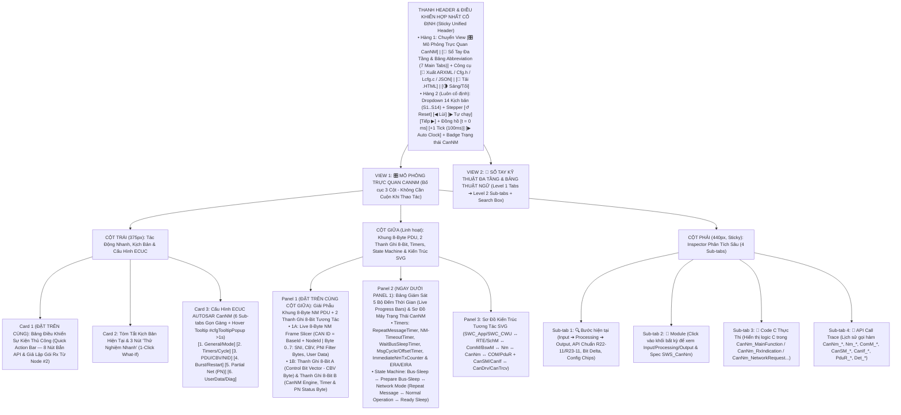
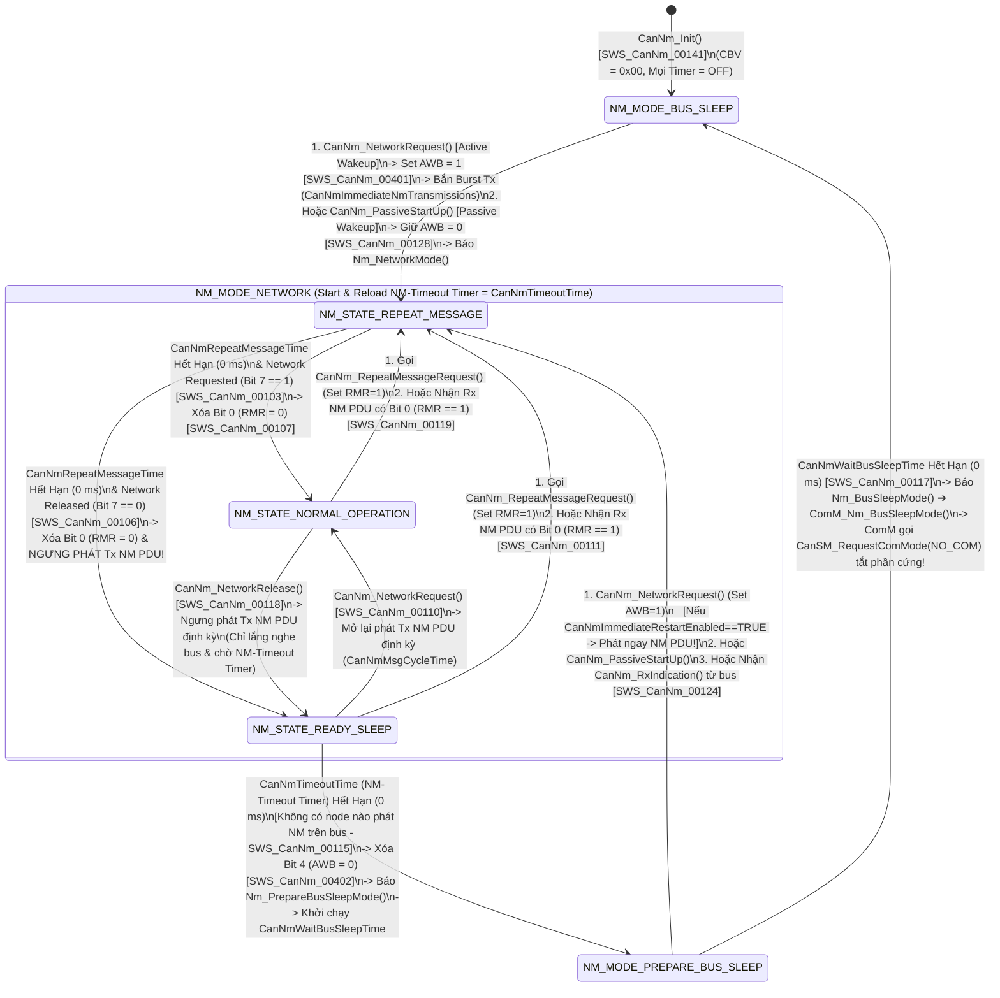

# Tài Liệu Thiết Kế Chi Tiết Trình Mô Phỏng AUTOSAR CanNM (`CanNM_Simulation_design.md`)

> **Trạng thái tài liệu:** Bản thiết kế chi tiết đã cập nhật theo xác nhận `A1`–`A4` của User — Sẵn sàng để User review trước khi triển khai code.  
> **File đích dự kiến xuất bản:** `d:\__Personal\AntiGravity\Simulation\AUTOSAR_CanNM.html` (File cũ `AUTOSAR_CanNM_old.html` được giữ lại để tham khảo; bản mới là Ứng dụng Web Tương tác 1 file HTML độc lập, 100% Offline, Pure CSS, có nút tải `.HTML` kèm cấu hình nhúng & xuất code `ARXML / CanNm_Cfg.h / CanNm_Lcfg.c / JSON`).  
> **Chuẩn tham chiếu:** **AUTOSAR Classic Platform R20-11 / R22-11 / R23-11 (`SWS_CanNm`, `SWS_Nm`, `SWS_ComM`, `SWS_CanSM`, `SWS_CanIf`, `SWS_PduR`, `SWS_COM`, `SWS_BswM`, `SWS_Dem`)**, đính kèm mã requirement chuẩn **`SWS_CanNm_xxxxx`** tại từng bước xử lý, khung 8-Byte NM PDU, 2 thanh ghi 8-Bit, tooltip cấu hình và sổ tay tra cứu đa tầng.

---

## 1. Tổng Quan Định Hướng Thiết Kế Đã Chốt (`A1` – `A4`)

| Hạng mục | Nội dung thiết kế đã xác nhận với User |
| :--- | :--- |
| **1. Bố cục giao diện & Ưu tiên Không Cuộn Trang — Zero-Scroll (`A1`)** | Kết hợp tinh hoa của **`AUTOSAR_DEM.html`**, **`AUTOSAR_CanSM.html`** và **`AUTOSAR_SecOC.html`**, đồng thời tối ưu hóa **Above-the-Fold (Zero-Scroll)** để các khối thao tác/quan sát thường xuyên nhất luôn nằm ngay nửa trên màn hình:<br>• **Thanh Điều Khiển Hợp Nhất Cố Định (Sticky Top Control Bar)**: Tích hợp chọn 14 Kịch bản (`S1`–`S14`), nút điều khiển từng bước (`Reset`, `Lùi`, `Tự chạy`, `Bước tiếp`), nút nhịp đồng hồ (`+1 Tick MainFunction`, `+100ms`, `Auto Clock`), và dải **Quick Action Pills** ngay trên đầu trang.<br>• **Bố cục 3 cột hiện đại (Mỗi cột tự cuộn độc lập trong khung Viewport)**:<br>  - **Cột Trái (`375px`)**: Đưa **Bảng Điều Khiển Sự Kiện Thủ Công (Quick Action Bar)** và **Tóm tắt Kịch bản + 3 Nút 1-Click What-If** lên trên cùng, tiếp theo là **6 Sub-tabs Cấu hình ECUC** (giúp chuyển tab gọn gàng không phải cuộn dài).<br>  - **Cột Giữa (`Linh hoạt`)**: Đưa **Thanh Giải Phẫu Khung 8-Byte NM PDU & 2 Thanh Ghi 8-Bit** + **Sơ Đồ Máy Trạng Thái CanNM & Bộ Đếm Timers** lên vị trí trung tâm dễ nhìn nhất, kế tiếp là **Sơ Đồ Kiến Trúc Tương Tác SVG** (`SWC ↔ RTE ↔ ComM/BswM ↔ Nm ↔ CanNm ↔ CanSM/CanIf/PduR/COM/Dem/Det`).<br>  - **Cột Phải (`440px, Sticky`)**: Inspector 4 Sub-tabs (`🔍 Bước hiện tại`, `🧩 Module`, `📄 Code C Thực Thi`, `📜 API Call Trace`).<br>• **Config Hover Tooltip (`> 1s` delay)** giống hệt `AUTOSAR_DEM.html` (`#cfgTooltipPopup` hiển thị tên tham số, đường dẫn ECUC, mã `SWS_CanNm_xxxxx`, mô tả, dải giá trị, giá trị typical và lưu ý kỹ thuật).<br>• **Công cụ xuất mã & chia sẻ**: Xuất `ARXML / CanNm_Cfg.h / CanNm_Lcfg.c / JSON` và nút tải file `.HTML` độc lập chạy offline. |
| **2. Khu vực Giám sát Bit-level & 2 Thanh ghi 8-Bit (`A2`)** | Đặt **cố định và nổi bật ở Cột Giữa** gồm **2 tầng trực quan hóa Bit**:<br>• **Tầng 1 — Thanh Giải Phẫu Khung `8-Byte CanNM PDU` (`Live 8-Byte NM Frame & PNI/UserData Slicer`)**: Minh họa trực quan cấu trúc từng Byte (`Byte 0..Byte 7`) trên CAN Bus theo cấu hình **`CanNmPduNidPosition`** (`BYTE_0`, `BYTE_1`, `OFF`) và **`CanNmPduCbvPosition`** (`BYTE_0`, `BYTE_1`, `OFF`), vùng **Partial Network Info (`PNI` Filter Mask Bytes)** và vùng **User Data (`Com_TriggerTransmit` qua `PduR`)**.<br>• **Tầng 2 — 2 Thanh ghi 8-Bit tương tác song song**:<br>  1. **Thanh A (`8-Bit Control Bit Vector — CBV Byte`)**: Giải mã chuẩn AUTOSAR `SWS_CanNm_00045` gồm `Bit 0 (RMR - Repeat Message Request)`, `Bit 3 (CSR - Car Wakeup Bit)`, `Bit 4 (AWB - Active Wakeup Bit)`, `Bit 6 (PNI - Partial Network Information Bit)` và các bit Reserved (`Bit 1, 2, 5, 7`). Cho phép click trực tiếp vào từng bit để thử nghiệm!<br>  2. **Thanh B (`8-Bit CanNM Engine, Timer & PN Status Byte`)**: Theo dõi trực quan các cờ điều khiển nội bộ của `CanNM` (`NET_REQ_ACTIVE`, `IMM_BURST_ACTIVE`, `RPT_MSG_TIMER_RUN`, `NM_TIMEOUT_TIMER_RUN`, `WAIT_SLEEP_TIMER_RUN`, `PN_FILTER_RELEVANT`, `MSG_TX_ENABLED`, `CANNM_INITIALIZED`). |
| **3. Hệ thống Kịch bản (`A3`)** | Thiết kế sẵn **14 Kịch bản chạy mẫu (`S1`–`S14`)** chia làm 4 nhóm lớn:<br>• **Nhóm 1 (`S1`–`S4`)**: Khởi động Mạng Chủ động vs Thụ động (`Active Wakeup AWB=1 & Immediate Burst Tx` vs `Passive Startup AWB=0`), Chu trình Ngủ Đồng Bộ 4 Pha (`Normal ➔ Ready Sleep ➔ Prepare Bus-Sleep ➔ Bus-Sleep`), và Đánh thức Khẩn cấp tại `Prepare Bus-Sleep` (`CanNmImmediateRestartEnabled`).<br>• **Nhóm 2 (`S5`–`S7`)**: Điểm danh Node & Yêu cầu Lặp Bản Tin (`CanNm_RepeatMessageRequest` bật `Bit 0 RMR=1` ➔ kéo toàn mạng về `Repeat Message State`), Giảm tải đường truyền (`CanNmBusLoadReductionEnabled`), và Theo dõi Định danh Node (`CanNmNodeIdEnabled` & `CanNm_GetNodeIdentifier` / `CanNm_GetLocalNodeIdentifier`).<br>• **Nhóm 3 (`S8`–`S10`)**: Partial Networking (`CanNmPnEnabled`, `Bit 6 PNI=1`, bộ lọc `CanNmPnFilterMaskByte`, `CanNm_ConfirmPnAvailability`, quản lý bộ đếm `ERA / EIRA Timer` báo lên `ComM`), Đồng bộ tắt PNC (`CanNmSynchronizedPncShutdownEnabled` & `NM_STATE_SYNCHRONIZE`), và Đánh thức Toàn Xe (`Car Wakeup Bit 3 CSR=1` ➔ `Nm_CarWakeUpIndication`).<br>• **Nhóm 4 (`S11`–`S14`)**: Truyền nhận `User Data` tự động qua `COM / PduR` (`CanNmComUserDataSupport` & `PduR_CanNmTriggerTransmit` / `PduR_CanNmRxIndication`), Kiểm soát truyền thông chẩn đoán UDS `0x28` (`CanNm_DisableCommunication` / `CanNm_EnableCommunication`), Phát hiện ngủ bên thứ ba (`CanNmRemoteSleepIndEnabled`), và Xử lý lỗi `CanNm_TxTimeoutException` / Phối hợp `CanSM` Bus-Off. |
| **4. Sổ tay tra cứu đa tầng & Bảng Abbreviation (`A4`)** | **View 2 (`📖 Sổ Tay Kỹ Thuật CanNM & Từ Điển Thuật Ngữ`)** được tổ chức theo cấu trúc **Đa Tầng (Multi-level Tabs)**:<br>• **6 Main Sub-tabs (Level 1) × 4 Chủ đề con (Level 2 Pills/Tabs = 24 chuyên đề)**, tích hợp hình ảnh và giải thích chi tiết sơ đồ thuật toán chuẩn **`Figure 7-1: CanNM Algorithm (AUTOSAR SWS_CanNm)`**.<br>• **Tab 7 chuyên biệt: `🔤 Bảng Thuật Ngữ & Từ Viết Tắt (Abbreviation Table)`** trình bày dưới dạng bảng chuẩn, tích hợp **Search Box tìm kiếm tức thời (Live Search)** và các nút lọc nhanh theo phân nhóm (`CanNM Core & States`, `CBV Bits & Timers`, `Partial Networking (PN)`, `AUTOSAR Comm Stack`). |

---

## 2. Bố Cục Giao Diện 3 Cột Ưu Tiên Zero-Scroll & Hệ Thống Sub-Tabs (UI Wireframe)

Để giải quyết triệt để vấn đề **"người dùng không cần cuộn chuột lên xuống mỗi lần thao tác"**, giao diện được thiết kế theo nguyên lý **Viewport-First (Đưa các khối tương tác và giám sát tần suất cao nhất lên ngay phần đầu của mỗi cột, kết hợp cơ chế Sub-tabs gọn gàng)**:



### Điểm Cải Tiến Đột Phá Về Trải Nghiệm "Zero-Scroll" So Với File Cũ:
1. **Thanh Điều Khiển Hợp Nhất (`Sticky Top Bar`)**: Gộp chọn kịch bản, nút bấm `Bước tiếp / Lùi / Tự chạy`, và nút bấm đồng hồ `+1 Tick (MainFunction)` vào ngay thanh Header cố định. Dù người dùng đang nhìn vào bất kỳ đâu cũng bấm chuyển bước hoặc tick đồng hồ được ngay.
2. **Đưa `Quick Action Bar` (8 nút kích hoạt API & bắn gói Rx giả lập) lên vị trí Card 1 (Đầu Cột Trái)** và đưa **Khung 8-Byte NM PDU + 2 Thanh Ghi 8-Bit + 5 Thanh Tiến Trình Timer + Máy Trạng Thái** lên đầu Cột Giữa: Khi bấm `CanNm_NetworkRequest()`, `CanNm_RepeatMessageRequest()` hoặc `Bắn CanNm_RxIndication()`, mắt người dùng nhìn thấy ngay lập tức sự thay đổi của từng Bit trong `CBV`, khung `8-Byte PDU`, bộ đếm `Timer` và `State Machine` ngay ngang tầm mắt mà **không phải cuộn trang một milimet nào**!
3. **Chia 28+ tham số ECUC thành 6 Sub-tabs gọn gàng**: Thay vì trải dài một danh sách dọc khiến cột trái bị dài lê thê như file cũ, việc gom vào 6 Sub-tabs giúp chiều cao của Card Cấu hình chỉ chiếm đúng ~260px.

---

## 3. Thiết Kế Chi Tiết Panel 1 (Đầu Cột Giữa): Giải Phẫu Khung `8-Byte NM PDU` & 2 Thanh Ghi 8-Bit Tương Tác

Trong `AUTOSAR CanNM`, toàn bộ trí tuệ điều phối mạng nằm ở **Khung 8-Byte NM PDU truyền trên CAN Bus** và **Byte Điều Khiển `CBV` (Control Bit Vector)**. Do đó, Panel 1 ở đầu Cột Giữa được thiết kế gồm **2 phần trực quan hóa liên thông**:

### 3.1. Phần 1A — Thanh Giải Phẫu Khung `8-Byte CanNM PDU` (`Live 8-Byte NM Frame & PNI/UserData Inspector`)

```text
+-------------------------------------------------------------------------------------------------------------------+
| 🧬 GIẢI PHẪU KHUNG BẢN TIN 8-BYTE CANNM PDU TRÊN BUS (`CanIf_Transmit` / `CanNm_RxIndication` — [`SWS_CanNm_00013`])|
| CAN ID: [ 0x51A ] (= BaseId 0x500 + NodeId 0x1A) | DLC: [ 8 Bytes ] | NidPos: [ BYTE_0 ] | CbvPos: [ BYTE_1 ]     |
+-------------------------------------------------------------------------------------------------------------------+
|  +---------------+---------------+---------------+---------------+---------------+---------------+-------+-------+ |
|  |    BYTE 0     |    BYTE 1     |    BYTE 2     |    BYTE 3     |    BYTE 4     |    BYTE 5     | BYTE 6| BYTE 7| |
|  |  SNI (NodeId) |   CBV Byte    |  PNI Mask #0  |  PNI Mask #1  |  User Data 0  |  User Data 1  | UDat 2| UDat 3| |
|  |   [ 0x1A ]    |   [ 0x51 ]    |   [ 0x05 ]    |   [ 0x00 ]    |   [ 0x11 ]    |   [ 0x22 ]    | [0x33]| [0x44]| |
|  |  ECU Node #26 | AWB|PNI|RMR=1 | PNC #16, #18  |  PNC #24..31  | Từ PduR / COM | Từ PduR / COM |  COM  |  COM  | |
|  +---------------+---------------+---------------+---------------+---------------+---------------+-------+-------+ |
|  💡 Chú thích động: Khi `CanNmPnEnabled = TRUE` (Offset=2, Len=2), Byte 2..3 chứa mặt nạ Partial Network (PNI);    |
|     Byte 4..7 chứa User Data lấy tự động qua `PduR_CanNmTriggerTransmit()` hoặc `CanNm_SetUserData()`.            |
+-------------------------------------------------------------------------------------------------------------------+
```

- **Tính năng tương tác trực tiếp trên Thanh Giải Phẫu `8-Byte NM PDU`**:
  - Khi người dùng đổi cấu hình **`CanNmPduNidPosition`** (`CANNM_PDU_BYTE_0` ➔ `CANNM_PDU_BYTE_1` ➔ `CANNM_PDU_OFF`) và **`CanNmPduCbvPosition`** (`CANNM_PDU_BYTE_1` ➔ `CANNM_PDU_BYTE_0` ➔ `CANNM_PDU_OFF`), vị trí các ô `SNI (Source Node Identifier)` và `CBV (Control Bit Vector)` trên thanh 8-Byte tự động hoán đổi hoặc nhường chỗ cho `User Data` theo đúng chuẩn `SWS_CanNm_00074` & `SWS_CanNm_00075`!
  - Khi bật **`CanNmPnEnabled = TRUE`** với `CanNmPnInfoOffset = 2` và `CanNmPnInfoLength = 2`, các ô `Byte 2..3` tự động chuyển sang màu tím hiển thị mặt nạ bit **`PN Info Range (PNC Bit Vector)`** để đối chiếu trực tiếp với `CanNmPnFilterMaskByte`!

### 3.2. Phần 1B — 2 Thanh Ghi 8-Bit Trạng Thái Tương Tác Luôn Hiển Thị Nổi Bật

Ngay bên dưới thanh 8-Byte NM PDU là **2 Thanh ghi 8-Bit tương tác** theo đúng phong cách của `AUTOSAR_DEM.html`, `AUTOSAR_CanSM.html` và `AUTOSAR_SecOC.html`:

```text
+-------------------------------------------------------------------------------------------------------------------+
| 🔢 BẢNG GIÁM SÁT BITFIELD 8-BIT CBV & CANNM ENGINE (LIVE 8-BIT INSPECTOR)    [Click vào từng ô Bit để thử nghiệm] |
| Bước #3: CanNm_RepeatMessageRequest() ➔ Bật Bit 0 (RMR=1) | CBV Byte: 0x10 ➔ 0x11 | Engine Byte: 0xB3 ➔ 0xB3      |
+-------------------------------------------------------------------------------------------------------------------+
| A. THANH GHI 8-BIT CONTROL BIT VECTOR (`CBV Byte` — Chuẩn `SWS_CanNm_00045`) — Hex: [ 0x11 ]  Bin: [ 0001 0001b ] |
|    Vị trí trong NM PDU: [ CANNM_PDU_BYTE_1 ] | Nguồn đánh thức: [ Active Wakeup (AWB=1) ] | Điểm danh: [ RMR=1 ]  |
|  +-------------+ +-------------+ +-------------+ +-------------+ +-------------+ +-------------+ +-------+ +-----+|
|  | Bit 7 (0x80)| | Bit 6 (0x40)| | Bit 5 (0x20)| | Bit 4 (0x10)| | Bit 3 (0x08)| | Bit 2 (0x04)| |Bit1(2)| |Bit 0||
|  |  RESERVED   | |  PNI (PNet) | |  RESERVED   | | AWB (Active)| | CSR (CarWUp)| |  RESERVED   | |RESRVD | | RMR ||
|  |      0      | |      0      | |      0      | |      1      | |      0      | |      0      | |   0   | |1(0➔1||
|  | Luôn bằng 0 | | No PN Filter| | Luôn bằng 0 | | Active Wake!| | CarWake Off | | Luôn bằng 0 | |  0    | |Req! ||
|  +-------------+ +-------------+ +-------------+ +-------------+ +-------------+ +-------------+ +-------+ +-----+|
+-------------------------------------------------------------------------------------------------------------------+
| B. THANH GHI 8-BIT TRẠNG THÁI ĐỘNG CƠ & BỘ ĐẾM CANNM (`CanNm_EngineStatusByte`) — Hex: [ 0xB3 ] Bin: [1011 0011b]|
|    CanNM Mode: [ NM_MODE_NETWORK ] | Sub-State: [ NM_STATE_REPEAT_MESSAGE ] | Burst Tx: [ 2 / 3 Frames Left ]     |
|  +-------------+ +-------------+ +-------------+ +-------------+ +-------------+ +-------------+ +-------+ +-----+|
|  | Bit 7 (0x80)| | Bit 6 (0x40)| | Bit 5 (0x20)| | Bit 4 (0x10)| | Bit 3 (0x08)| | Bit 2 (0x04)| |Bit1(2)| |Bit 0||
|  | NET_REQUEST | | IMM_BURST   | | RPT_MSG_TMR | | TIMEOUT_TMR | | WAIT_SLP_TM | | PN_RELEVANT | |TX_ENBL| |INIT ||
|  |      1      | |      0      | |      1      | |      1      | |      0      | |      0      | |   1   | |  1  ||
|  | ComM Hold=1 | | Normal Cycle| | Counting... | | 2000ms Run  | | Not In Prep | | All Rx Pass | |Tx Open| |Ready||
|  +-------------+ +-------------+ +-------------+ +-------------+ +-------------+ +-------------+ +-------+ +-----+|
+-------------------------------------------------------------------------------------------------------------------+
```

#### 3.2.1. Giải Mã Chi Tiết Thanh A: `8-Bit Control Bit Vector — CBV Byte` (`SWS_CanNm_00045`)

| Bit | Mask | Tên Cờ Chuẩn AUTOSAR | Ý nghĩa kỹ thuật & Khi nào bật lên `1` (`0 ➔ 1`) | Khi nào hạ về `0` (`1 ➔ 0`) |
| :-: | :-: | :--- | :--- | :--- |
| **Bit 7** | `0x80` | **`RESERVED_BIT_7`** | Bit dự trữ theo chuẩn AUTOSAR (`Reserved for future extensions` — `SWS_CanNm_00045`). Khi khởi tạo `CanNm_Init()`, bit này luôn được đặt bằng `0`. | Luôn giữ bằng `0`. |
| **Bit 6** | `0x40` | **`PNI` *(Partial Network Information Bit)*** | Bật lên `1` khi cấu hình **`CanNmPnEnabled = TRUE`** (`SWS_CanNm_00413`): Báo cho các ECU nhận trên bus biết rằng gói tin NM PDU này **có chứa thông tin yêu cầu cụm mạng con (`Partial Network Request Info`)** trong vùng `Byte [Offset .. Offset+Len-1]`. Khi `Rx PNI = 1`, bộ lọc `CanNmPnFilterAlgorithm` ở đầu nhận sẽ thực hiện phép `AND` bit giữa `Rx PNI Bytes` và `CanNmPnFilterMaskByte`! | Hạ về `0` khi `CanNmPnEnabled = FALSE` (gói tin NM tiêu chuẩn đánh thức toàn bộ kênh CAN mà không lọc theo PNC). |
| **Bit 5** | `0x20` | **`RESERVED_BIT_5`** | Bit dự trữ theo chuẩn AUTOSAR (`SWS_CanNm_00045`). Luôn gửi bằng `0`. *(Lưu ý: Trong R20-11/R22-11 có thể dùng nội bộ cho `Synchronized PNC Shutdown Request` nếu cấu hình chuyên biệt, mặc định bằng `0`)*. | Luôn giữ bằng `0`. |
| **Bit 4** | `0x10` | **`AWB` *(Active Wakeup Bit)*** | Bật lên `1` khi cấu hình **`CanNmActiveWakeupBitEnabled = TRUE`** và ECU thức dậy **chủ động** do yêu cầu từ ứng dụng nội bộ (`CanNm_NetworkRequest()` khi đang ở `Bus-Sleep Mode` hoặc `Prepare Bus-Sleep Mode` — `SWS_CanNm_00401`). Bit này giúp kỹ sư chẩn đoán biết chính xác **ECU nào là nguyên nhân gốc đánh thức mạng CAN (Wakeup Master)**! | Giữ nguyên bằng `1` trong suốt thời gian ở `Network Mode` và **chỉ hạ về `0` khi `CanNM` rời khỏi `Network Mode`** (chuyển sang `Prepare Bus-Sleep Mode` hoặc `Bus-Sleep Mode` — `SWS_CanNm_00402`). Nếu thức dậy thụ động qua `CanNm_PassiveStartUp()`, `AWB` luôn bằng `0`! |
| **Bit 3** | `0x08` | **`CSR / CWU` *(Car Wakeup Bit)*** | Bật lên `1` khi ứng dụng gọi `CanNm_SetUserData` / `COM Signal` đặt bit Car Wakeup tại vị trí `CanNmCarWakeUpBytePosition` / `BitPosition` (hoặc bit 3 CBV tùy cấu hình OEM). Khi một ECU khác trên bus nhận được gói tin NM có `Car Wakeup Bit = 1` (và thỏa mãn `CanNmCarWakeUpFilterEnabled`), `CanNM` gọi ngay **`Nm_CarWakeUpIndication()`** (`SWS_CanNm_00406`) lên `Nm` ➔ `ComM` để đánh thức toàn bộ các liên mạng khác trên xe! | Hạ về `0` khi ứng dụng xóa yêu cầu đánh thức toàn xe (`Car Wakeup Release`). |
| **Bit 2** | `0x04` | **`RESERVED_BIT_2`** | Bit dự trữ theo chuẩn AUTOSAR (`SWS_CanNm_00045`). Luôn bằng `0`. | Luôn giữ bằng `0`. |
| **Bit 1** | `0x02` | **`RESERVED_BIT_1`** | Bit dự trữ theo chuẩn AUTOSAR (`SWS_CanNm_00045`). Luôn bằng `0`. | Luôn giữ bằng `0`. |
| **Bit 0** | `0x01` | **`RMR` *(Repeat Message Request Bit)*** | Bật lên `1` khi cấu hình **`CanNmNodeDetectionEnabled = TRUE`** và ứng dụng/chẩn đoán gọi **`CanNm_RepeatMessageRequest()`** (`SWS_CanNm_00113`). Khi gói tin có `Bit 0 (RMR = 1)` phát ra bus, tất cả các ECU khác nhận được sẽ **lập tức nhảy về trạng thái `NM_STATE_REPEAT_MESSAGE`** và phát bản tin NM của chúng để điểm danh sự hiện diện trên bus (`SWS_CanNm_00119`)! | Giữ bằng `1` trong suốt trạng thái `Repeat Message State` và **tự động hạ về `0` ngay khi `CanNmRepeatMessageTime` hết hạn** (khi node thoát khỏi `Repeat Message State` sang `Normal Operation` hoặc `Ready Sleep` — `SWS_CanNm_00107`). |

#### 3.2.2. Giải Mã Chi Tiết Thanh B: `8-Bit CanNM Engine, Timer & PN Status Byte` (`CanNm_EngineStatusByte`)

| Bit | Mask | Tên Cờ (`CanNM Engine Bit`) | Ý nghĩa kỹ thuật & Khi nào bật lên `1` (`0 ➔ 1`) | Khi nào hạ về `0` (`1 ➔ 0`) |
| :-: | :-: | :--- | :--- | :--- |
| **Bit 7** | `0x80` | **`NET_REQUEST_ACTIVE`** | Bật khi ứng dụng cục bộ (`SWC` ➔ `ComM` ➔ `Nm`) đã gọi **`CanNm_NetworkRequest()`** (`SWS_CanNm_00104`), nghĩa là bản thân ECU này đang cần giữ mạng CAN thức (`Network Requested`). | Hạ về `0` khi `ComM` gọi **`CanNm_NetworkRelease()`** (`SWS_CanNm_00105`) hoặc khi khởi động thụ động bằng `CanNm_PassiveStartUp()` (`Network Released`). |
| **Bit 6** | `0x40` | **`IMM_BURST_ACTIVE`** | Bật khi node vừa thức dậy chủ động (`Active Wakeup`) và cấu hình **`CanNmImmediateNmTransmissions > 0`** (`SWS_CanNm_00334`): `CanNM` đang ở chế độ bắn chùm tốc độ cao (**Immediate Burst Tx**) với chu kỳ ngắn `CanNmImmediateNmCycleTime` (ví dụ `100ms` × `3 gói`) để đánh thức nhanh toàn mạng! | Hạ về `0` ngay khi đã phát đủ `CanNmImmediateNmTransmissions` gói tin và chuyển về chu kỳ phát bình thường `CanNmMsgCycleTime` (ví dụ `1000ms`). |
| **Bit 5** | `0x20` | **`RPT_MSG_TIMER_RUN`** | Bật khi node đang ở trạng thái **`NM_STATE_REPEAT_MESSAGE`** và bộ đếm **`CanNmRepeatMessageTime`** đang chạy đếm ngược (`SWS_CanNm_00102`). | Hạ về `0` khi `CanNmRepeatMessageTime` chạm `0 ms`, đưa node rẽ nhánh sang `Normal Operation` (nếu `Bit 7 = 1`) hoặc `Ready Sleep` (nếu `Bit 7 = 0`). |
| **Bit 4** | `0x10` | **`TIMEOUT_TIMER_RUN`** | Bật trong suốt thời gian node nằm trong **`NM_MODE_NETWORK`** (`Repeat Message`, `Normal Operation`, `Ready Sleep`): Bộ đếm sinh tử **`CanNmTimeoutTime` (`NM-Timeout Timer`)** đang chạy và được nạp lại (reload) mỗi khi có `CanNm_TxConfirmation` hoặc `CanNm_RxIndication` (`SWS_CanNm_00096`, `SWS_CanNm_00098`, `SWS_CanNm_00099`). | Hạ về `0` khi `CanNmTimeoutTime` đếm lùi về `0 ms` tại `Ready Sleep State` (kéo node rơi xuống `Prepare Bus-Sleep Mode`), hoặc khi rời khỏi `Network Mode`. |
| **Bit 3** | `0x08` | **`WAIT_SLEEP_TIMER_RUN`** | Bật khi node đang ở trạng thái đệm **`NM_MODE_PREPARE_BUS_SLEEP`** và bộ đếm **`CanNmWaitBusSleepTime`** đang đếm ngược trước khi tắt hẳn phần cứng CAN (`SWS_CanNm_00115`). | Hạ về `0` khi `WaitBusSleepTime` chạm `0 ms` (chuyển hẳn về `Bus-Sleep Mode` và báo `Nm_BusSleepMode()`) hoặc khi có đánh thức khẩn cấp quay lại `Repeat Message State`. |
| **Bit 2** | `0x04` | **`PN_FILTER_RELEVANT`** | Bật khi `CanNmPnEnabled = TRUE` (và đã nhận `CanNm_ConfirmPnAvailability`) và gói tin NM vừa nhận/phát có `(RxPdu.PNI_Bytes & CanNmPnFilterMaskByte) != 0` — nghĩa là yêu cầu cụm mạng con (`PNC`) **có liên quan đến ECU này**, đồng thời kích hoạt bộ đếm `CanNmPnResetTime` cho `ERA / EIRA` (`SWS_CanNm_00409`). | Hạ về `0` khi gói tin Rx NM có `PNI=1` nhưng không trùng bất kỳ bit nào trong `CanNmPnFilterMaskByte` (gói tin bị bộ lọc PN của `CanNM` bỏ qua hoàn toàn!), hoặc khi `CanNmPnResetTime` hết hạn. |
| **Bit 1** | `0x02` | **`MSG_TX_ENABLED`** | Bật (`1`) khi đường phát bản tin NM định kỳ đang mở (`CanNmPassiveModeEnabled == FALSE` và chưa bị khóa bởi `CanNm_DisableCommunication()`). | Hạ về `0` khi `Dcm` (UDS `0x28 CommunicationControl`) gọi **`CanNm_DisableCommunication()`** (`SWS_CanNm_00170`) hoặc khi cấu hình `CanNmPassiveModeEnabled = TRUE`. |
| **Bit 0** | `0x01` | **`CANNM_INITIALIZED`** | Bật (`1`) sau khi `CanNm_Init(&CanNm_Config)` đã chạy thành công (`SWS_CanNm_00060`). Nếu bằng `0`, mọi lời gọi API đều bị từ chối và báo lỗi `Det_ReportError(CANNM_E_UNINIT = 0x01)`. | Hạ về `0` khi người dùng tắt Checkbox `CanNmInitialized` để kiểm thử lỗi `CANNM_E_UNINIT`. |

---

## 4. Phân Tích Xử Lý Từng Module: Input Lấy Từ Đâu, Xử Lý Gì, Output Route Đến Đâu

Mọi khối trên sơ đồ kiến trúc SVG đều có thể **click vào để xem giải thích chi tiết** ở cột phải (Tab `🧩 Module`) và được tổng hợp đầy đủ trong **Tab 1 của Sổ tay**:

| # | Module / Phân khối | Lớp AUTOSAR | 📥 Input lấy từ đâu? | ⚙️ Cách xử lý nội bộ (Processing, State & Timers) | 📤 Output route đến đâu & Hàm API chuẩn (R20-11 / R22-11 / R23-11) |
| :-: | :--- | :--- | :--- | :--- | :--- |
| **1** | **`SWC_App`, `SWC_PncUser` & `SWC_CarWakeup`**<br>*(Application Layer)* | Application Layer | • Sự kiện người dùng (bật khóa điện IG, mở cửa xe, đạp phanh) hoặc sự kiện từ `RTE` (`SwcModeSwitchEvent`, `DataReceivedEvent`).<br>• Nhận dữ liệu `NM User Data` hoặc trạng thái `PNC` từ `COM` qua `RTE`. | • **Tương tác gián tiếp (Chuẩn AUTOSAR)**: `SWC` không gọi trực tiếp các hàm `CanNm_NetworkRequest()`. Thay vào đó, `SWC` yêu cầu truyền thông qua cổng `UR_ComMUser` của `ComM` (`COMM_FULL_COMMUNICATION` / `COMM_NO_COMMUNICATION`).<br>• **Truyền User Data / PNI qua COM**: Khi `CanNmComUserDataSupport = TRUE`, `SWC` chỉ cần gọi `Rte_Write` để cập nhật Signal trong I-PDU của `COM` (ví dụ: mã nguyên nhân đánh thức `WakeupReason`, cờ `CarWakeUp`, hoặc bit `PNC`); `CanNM` sẽ tự động kéo dữ liệu này xuống khi phát bản tin NM!<br>• **Chẩn đoán / Giám sát**: `SWC_Diag` có thể đọc trạng thái mạng hoặc yêu cầu điểm danh node qua `Nm_RepeatMessageRequest`. | • Gọi qua **RTE** xuống **ComM**:<br>`Rte_Call_UR_ComMUser_0_RequestComMode(COMM_FULL_COMMUNICATION / COMM_NO_COMMUNICATION)`<br>• Ghi dữ liệu **NM User Data / CarWakeup** qua **RTE ➔ COM**:<br>`Rte_Write_PP_NmUserData_WakeupReason(val)` |
| **2** | **`RTE` & `SchM`**<br>*(Runtime Environment & BSW Scheduler)* | RTE Layer | • Lời gọi từ `SWC` (`Rte_Call`, `Rte_Write`) và thông báo chuyển Mode từ `ComM` / `BswM`.<br>• Xung nhịp định kỳ từ `AUTOSAR OS` (`Task_Bsw_10ms` / `100ms`). | • **RTE**: Chuyển tiếp yêu cầu `RequestComMode` từ `SWC` (hoặc yêu cầu PNC) xuống `ComM`, và thông báo ngược lên `SWC` khi mạng CAN đã sẵn sàng.<br>• **SchM**: Định kỳ mỗi chu kỳ `CanNmMainFunctionPeriod` gọi hàm **`CanNm_MainFunction()`** để giảm tất cả các bộ đếm thời gian (`RepeatMessageTimer`, `TimeoutTimer`, `WaitBusSleepTimer`, `MsgCycleTimer`, `ImmediateNmCycleTimer`, `PnResetTimer`) và kích hoạt các chuyển tiếp trạng thái.<br>• Bảo vệ vùng dữ liệu găng (`ExclusiveArea`) của `CanNM` khi ngắt `CanNm_RxIndication` / `CanNm_TxConfirmation` xảy ra đồng thời với `CanNm_MainFunction`. | • Gọi định kỳ vào **CanNm**:<br>`CanNm_MainFunction()` [`SWS_CanNm_00234`]<br>• Bảo vệ vùng găng **CanNm**:<br>`SchM_Enter_CanNm_EA_0()` / `SchM_Exit_CanNm_EA_0()` |
| **3** | **`ComM` & `BswM`**<br>*(Communication Manager & BSW Mode Manager)* | System / Comm Services | • Nhận yêu cầu mạng từ các `SWC Users` (`ComM_RequestComMode`), từ `Dcm` (chẩn đoán UDS), và từ `EcuM` (`ComM_CommunicationAllowed`).<br>• Nhận các callback báo trạng thái mạng từ `Nm` (`ComM_Nm_NetworkStartIndication`, `ComM_Nm_NetworkMode`, `ComM_Nm_PrepareBusSleepMode`, `ComM_Nm_BusSleepMode`, `ComM_Nm_RestartIndication`) và nhận tín hiệu `ERA/EIRA` qua `Com_RxIndication`. | • **`ComM`**: Là nhạc trưởng kết nối giữa `CanSM` (quản lý phần cứng CAN) và `Nm`/`CanNm` (quản lý đồng bộ ngủ/thức trên bus):<br>  - Khi `SWC` yêu cầu `FULL_COM`: `ComM` ra lệnh cho `CanSM_RequestComMode(FULL_COM)` để bật CAN Controller/Transceiver, đồng thời gọi **`Nm_NetworkRequest()`** ➔ **`CanNm_NetworkRequest()`**.<br>  - Khi nhận `ComM_Nm_NetworkStartIndication()` (do nhận được gói NM từ node khác khi đang ngủ): `ComM` gọi **`Nm_PassiveStartUp()`** ➔ **`CanNm_PassiveStartUp()`**.<br>  - Khi tất cả `SWC` đã nhả mạng (`NO_COM`): `ComM` gọi **`Nm_NetworkRelease()`** ➔ **`CanNm_NetworkRelease()`**, nhưng **vẫn giữ `CanSM` ở `FULL_COM`** cho đến khi `CanNM` hoàn tất chu trình `Ready Sleep ➔ Prepare Bus-Sleep ➔ Bus-Sleep` và báo `ComM_Nm_BusSleepMode()` thì `ComM` mới ra lệnh cho `CanSM` tắt phần cứng về `NO_COM`!<br>• **`BswM`**: Nhận trạng thái từ `Nm`/`CanSM`/`Dcm` để bật/tắt `Com I-PDU Groups` hoặc gọi `Nm_DisableCommunication()` / `Nm_EnableCommunication()`. | • Gọi xuống **Nm ➔ CanNm**:<br>`Nm_PassiveStartUp(NetworkHandle)`<br>`Nm_NetworkRequest(NetworkHandle)`<br>`Nm_NetworkRelease(NetworkHandle)`<br>• Gọi sang **CanSM**:<br>`CanSM_RequestComMode(network, FULL_COM / NO_COM)` |
| **4** | **`Nm`**<br>*(Generic Network Management Interface)* | Communication Services | • Nhận các lệnh điều khiển mạng trừu tượng từ `ComM`, `BswM` hoặc `SWC_Diag`.<br>• Nhận toàn bộ các hàm Callback thông báo sự kiện từ `CanNm` (`Nm_NetworkStartIndication`, `Nm_NetworkMode`, `Nm_PrepareBusSleepMode`, `Nm_BusSleepMode`, `Nm_StateChangeNotification`, `Nm_RepeatMessageIndication`, `Nm_PduRxIndication`, `Nm_TxTimeoutException`, `Nm_CarWakeUpIndication`, `Nm_RemoteSleepIndication`). | • Đóng vai trò lớp trừu tượng hóa độc lập với đường truyền vật lý (Bus-Independent NM Interface, kết nối với `CanNm`, `FrNm`, `UdpNm`, `LinNm`).<br>• Nếu bật tính năng **NM Coordinator** (trên ECU Gateway), `Nm` đồng bộ hóa việc tắt mạng đồng thời giữa nhiều nhánh CAN / Ethernet / LIN khác nhau.<br>• Chuyển tiếp trong suốt (1-to-1 Mapping) các lệnh từ `ComM` xuống `CanNm` và chuyển tiếp các Indications từ `CanNm` lên `ComM` / `BswM`. | • Gọi xuống **CanNm** (`CanNm.h`):<br>`CanNm_PassiveStartUp()`, `CanNm_NetworkRequest()`, `CanNm_NetworkRelease()`, `CanNm_DisableCommunication()`, `CanNm_EnableCommunication()`, `CanNm_RepeatMessageRequest()`, `CanNm_GetNodeIdentifier()`, `CanNm_GetLocalNodeIdentifier()`, `CanNm_GetState()`, `CanNm_SetUserData()`, `CanNm_GetUserData()`<br>• Báo ngược lên **ComM**:<br>`ComM_Nm_NetworkStartIndication()`, `ComM_Nm_NetworkMode()`, `ComM_Nm_PrepareBusSleepMode()`, `ComM_Nm_BusSleepMode()`, `ComM_Nm_RestartIndication()` |
| **5** | **`CanNm Core Engine`**<br>*(CAN Network Management)* | Communication Services | • Nhận các lệnh điều khiển từ `Nm` (`CanNm_NetworkRequest`, `CanNm_NetworkRelease`, `CanNm_PassiveStartUp`, `CanNm_RepeatMessageRequest`, `CanNm_DisableCommunication`, `CanNm_EnableCommunication`, `CanNm_RequestSynchronizedPncShutdown`).<br>• Nhận xác nhận PN từ `CanSM` (`CanNm_ConfirmPnAvailability`).<br>• Nhận callbacks truyền/nhận từ `CanIf` (`CanNm_RxIndication`, `CanNm_TxConfirmation`, `CanNm_TriggerTransmit`).<br>• Xung nhịp `CanNm_MainFunction()`. | • **1. Máy Trạng Thái 2 Cấp (`Operational Modes` & `Network States`)**: Điều phối 3 Mode lớn (`BUS_SLEEP`, `PREPARE_BUS_SLEEP`, `NETWORK_MODE`) và 3 State con bên trong `NETWORK_MODE` (`REPEAT_MESSAGE`, `NORMAL_OPERATION`, `READY_SLEEP`) + `SYNCHRONIZE` State.<br>• **2. Quản lý 5 Bộ Đếm Thời Gian Đồng Bộ Mạng**:<br>  - `CanNmRepeatMessageTime`: Giữ node ở `Repeat Message State` trước khi rẽ nhánh.<br>  - `CanNmTimeoutTime` (`NM-Timeout Timer`): Đồng hồ sinh tử của mạng CAN; hễ có bất kỳ node nào phát/nhận NM PDU là được nạp lại đầy; chỉ khi toàn mạng im lặng tại `Ready Sleep` suốt khoảng thời gian này thì mới chuyển sang `Prepare Bus-Sleep`.<br>  - `CanNmWaitBusSleepTime`: Khoảng đệm an toàn tại `Prepare Bus-Sleep` trước khi rơi hẳn vào `Bus-Sleep`.<br>  - `CanNmMsgCycleTime` & `CanNmMsgCycleOffset`: Điều khiển nhịp phát NM PDU định kỳ (hỗ trợ giảm tải `CanNmBusLoadReductionReducedTime`).<br>  - `CanNmImmediateNmCycleTime` & `CanNmImmediateNmTransmissions`: Bắn chùm tốc độ cao khi Active Wakeup.<br>• **3. Đóng gói & Giải mã Khung 8-Byte NM PDU (`SNI`, `CBV`, `PNI`, `User Data`)**: Tự động quản lý các bit `RMR (Bit 0)`, `CSR (Bit 3)`, `AWB (Bit 4)`, `PNI (Bit 6)` và kéo `User Data` từ `PduR_CanNmTriggerTransmit()`.<br>• **4. Bộ lọc Partial Networking (`CanNmPnFilterAlgorithm`) & `ERA/EIRA`**: Kiểm tra `(RxPdu.PNI & CanNmPnFilterMaskByte)`, bỏ qua các gói NM không thuộc PNC của mình và cập nhật vector `ERA/EIRA` lên `PduR_CanNmRxIndication()`. | • Gọi xuống **CanIf**:<br>`CanIf_Transmit(CanNmTxPduId, &PduInfo)` [`SWS_CanNm_00032`]<br>• Gọi sang **PduR (COM User Data & ERA/EIRA)**:<br>`PduR_CanNmTriggerTransmit(TxPduId, &PduInfo)` [`SWS_CanNm_00328`]<br>`PduR_CanNmRxIndication(RxPduId, &PduInfo)` [`SWS_CanNm_00409`]<br>`PduR_CanNmTxConfirmation(TxPduId)`<br>• Gọi Callback lên **Nm** (`Nm_Cbk.h`):<br>`Nm_NetworkStartIndication()`, `Nm_NetworkMode()`, `Nm_PrepareBusSleepMode()`, `Nm_BusSleepMode()`, `Nm_StateChangeNotification()`, `Nm_RepeatMessageIndication()`, `Nm_TxTimeoutException()`, `Nm_CarWakeUpIndication()`, `Nm_RemoteSleepIndication()`, `Nm_RemoteSleepCancellation()`<br>• Báo sang **CanSM & Det**:<br>`CanSM_TxTimeoutException()`, `Det_ReportError()`, `Det_ReportRuntimeError()` |
| **6** | **`CanSM`**<br>*(CAN State Manager)* | Communication Services | • Nhận yêu cầu `CanSM_RequestComMode` từ `ComM`.<br>• Nhận thông báo `CanSM_TxTimeoutException` từ `CanNm` / `Nm`.<br>• Nhận callback trạng thái phần cứng từ `CanIf`. | • Khởi động CAN Controller (`CAN_CS_STARTED`), CAN Transceiver (`CANTRCV_TRCVMODE_NORMAL`) và mở cổng `CanIf_SetPduMode(CANIF_ONLINE)`.<br>• **Phối hợp Partial Networking với `CanNm`**: Ngay khi vào `FULLCOM` trên kênh có hỗ trợ PN, `CanSM` gọi **`CanNm_ConfirmPnAvailability(network)`** (`SWS_CanNm_00404`) để bật bộ lọc PN trong `CanNm`.<br>• Khi xảy ra lỗi **Bus-Off**, `CanSM` khóa đường truyền (`CANIF_TX_OFFLINE` trong pha `S_TX_OFF`) làm `CanIf_Transmit` của `CanNm` bị chặn tạm thời cho đến khi khôi phục xong; nếu `CanNmMsgTimeoutTime` hết hạn trước khi phát xong, `CanNm` báo `Nm_TxTimeoutException()` & `CanSM_TxTimeoutException()` để khởi động lại Controller. | • Gọi sang **CanNm**:<br>`CanNm_ConfirmPnAvailability(nmChannelHandle)` [`SWS_CanNm_00404`]<br>• Nhận từ **CanNm / Nm**:<br>`CanSM_TxTimeoutException(network)` |
| **7** | **`PduR` & `AUTOSAR COM`**<br>*(PDU Router & Interaction Layer)* | Communication Services | • **`COM`**: Nhận các tín hiệu `NM User Data` từ `SWC` (chiều Tx) và nhận vector `ERA/EIRA` hoặc `Rx NM User Data` từ `CanNm` qua `PduR` (chiều Rx).<br>• **`PduR`**: Nhận lệnh `PduR_CanNmTriggerTransmit`, `PduR_CanNmRxIndication`, `PduR_CanNmTxConfirmation` từ `CanNm`. | • **Cơ chế `CanNmComUserDataSupport = TRUE`**: Thay vì bắt ứng dụng gọi API thủ công `CanNm_SetUserData()`, mỗi khi `CanNm` chuẩn bị phát gói NM PDU ra bus, `CanNm` gọi **`PduR_CanNmTriggerTransmit()`** ➔ **`Com_TriggerTransmit()`** để lấy 4..6 bytes `User Data` mới nhất từ bộ đệm I-PDU của `COM` đính kèm vào gói NM PDU (`SWS_CanNm_00328`)!<br>• **Báo cáo trạng thái `ERA / EIRA` (Partial Networking)**: Khi `CanNm` tính toán xong mảng bit các cụm mạng con (`PNC`) đang hoạt động (`EIRA` = Nội bộ + Ngoại vi; `ERA` = Ngoại vi), `CanNm` đẩy mảng byte này qua **`PduR_CanNmRxIndication()`** ➔ **`Com_RxIndication()`** để báo cho `ComM` biết PNC nào đang thức! | • Giao tiếp hai chiều **CanNm ↔ PduR ↔ COM**:<br>`PduR_CanNmTriggerTransmit()` ➔ `Com_TriggerTransmit()`<br>`PduR_CanNmRxIndication()` ➔ `Com_RxIndication()`<br>`PduR_CanNmTxConfirmation()` ➔ `Com_TxConfirmation()`<br>`CanNm_Transmit(CanNmTxPduId, &PduInfo)` [`SWS_CanNm_00330`] |
| **8** | **`CanIf`**<br>*(CAN Interface)* | ECU Abstraction Layer | • Nhận yêu cầu phát gói tin NM PDU từ `CanNm` (`CanIf_Transmit`).<br>• Nhận ngắt nhận gói tin CAN (`CanIf_RxIndication`) và ngắt hoàn tất phát (`CanIf_TxConfirmation`) từ `Can Driver`. | • Kiểm tra chế độ `PduMode` hiện tại của Controller (`CANIF_ONLINE` / `CANIF_TX_OFFLINE_ACTIVE`) và bộ lọc dải CAN ID dành cho Network Management (ví dụ dải `0x500 .. 0x57F`).<br>• Khi nhận được khung CAN nằm trong dải NM CAN ID từ một ECU khác trên bus, `CanIf` gọi ngay callback **`CanNm_RxIndication(RxPduId, &PduInfo)`**.<br>• Khi khung NM của chính ECU này phát thành công lên bus, `CanIf` gọi ngược **`CanNm_TxConfirmation(TxPduId, E_OK)`**. | • Gọi ngược Callback lên **CanNm** (`CanNm_Cbk.h`):<br>`CanNm_RxIndication(RxPduId, &PduInfo)` [`SWS_CanNm_00035`]<br>`CanNm_TxConfirmation(TxPduId, result)` [`SWS_CanNm_00037`]<br>`CanNm_TriggerTransmit(TxPduId, &PduInfo)` |
| **9** | **`Can Driver` & `CanTrcv (PN HW)`**<br>*(MCAL & Transceiver Hardware)* | MCAL / Hardware | • Nhận lệnh truyền khung CAN từ `CanIf` (`Can_Write`).<br>• Lắng nghe tín hiệu vật lý trên 2 dây `CAN_H` / `CAN_L` (nhận khung NM từ `Remote ECU Node #2 / Node #3`). | • **CAN Transceiver có hỗ trợ Partial Networking (ISO 11898-6)**: Ngay cả khi ECU đang ngủ ở `Bus-Sleep Mode` (`STANDBY`), mạch giải mã phần cứng bên trong Transceiver vẫn so sánh từng khung CAN đi qua bus với `PN Frame Mask` (CAN ID, DLC, `Byte 1 CBV Bit 6 PNI == 1`, và `PNI Mask Bytes`). Chỉ khi khớp đúng PNC của ECU này thì Transceiver mới kích hoạt xung đánh thức phần cứng (`WUF`)! | • Đẩy khung NM nhận được từ Bus lên **CanIf ➔ CanNm**:<br>Kích hoạt `CanIf_RxIndication` (hoặc `EcuM_CheckWakeup` khi đang ngủ). |
| **10** | **`Dem` & `Det`**<br>*(Diagnostic & Error Tracer)* | System / Diag Services | • Nhận báo cáo lỗi Development Error (`Det_ReportError`) và Runtime Error (`Det_ReportRuntimeError`) từ `CanNm` (`ModuleId = 31 / 0x001F`). | • Ghi nhận mã API (`ServiceId`) và các mã lỗi chuẩn AUTOSAR R22-11/R23-11:<br>  - **Development Errors**: `CANNM_E_UNINIT (0x01)`, `CANNM_E_INVALID_CHANNEL (0x02)`, `CANNM_E_INVALID_PDUID (0x03)`, `CANNM_E_INIT_FAILED (0x05)`, `CANNM_E_PARAM_POINTER (0x12)`.<br>  - **Runtime Errors**: `CANNM_E_NET_START_IND (0x04)` (nhận được gói tin NM bất ngờ khi đang ở `Bus-Sleep Mode`), `CANNM_E_WAIT_BUS_SLEEP (0x06)`. | • Hiển thị cảnh báo trực tiếp trên **API Call Trace** & **Inspector**. |

---

## 5. Thiết Kế Chi Tiết Máy Trạng Thái Chính & Trạng Thái Con Của `CanNM` (Panel 2)

Trên Panel 2 của Cột Giữa, sơ đồ máy trạng thái của `CanNM` được hiển thị trực quan ở cả 2 cấp độ: **3 Chế độ vận hành lớn (`Operational Modes`)** và **3+1 Trạng thái con bên trong `Network Mode` (`Sub-States`)** theo đúng chuẩn `SWS_CanNm` R22-11 / R23-11:



---

## 6. Danh Mục Đầy Đủ 34 Trường Cấu Hình (Checkboxes & Textboxes — 6 Sub-Tabs) & Thiết Kế Hover Tooltip Giống File `DEM`

Ở Cột Trái (Card 3), toàn bộ các tham số cấu hình chuẩn ECUC `CanNm` được bố trí thành **Checkboxes, Textboxes, Number Spinners và Dropdowns** chia gọn vào **6 Sub-tabs**.  
Đặc biệt, **mọi ô cấu hình đều gắn thuộc tính `data-cfg-key` và hỗ trợ Floating Tooltip on Hover (`> 1s` delay hoặc click icon `ⓘ`) giống hệt `AUTOSAR_DEM.html`**, đồng thời tích hợp **Bộ Kiểm Tra Quy Tắc Timing Tự Động (`AUTOSAR Timing Constraint Validator`)**.

### 6.1. Giao Diện & Cấu Trúc Dữ Liệu Của Floating Config Hover Tooltip (`#cfgTooltipPopup`)

Khi người dùng rê chuột giữ trên một ô cấu hình quá `1000ms` (hoặc bấm vào biểu tượng `ⓘ`), hộp thoại nổi `#cfgTooltipPopup` sẽ xuất hiện cạnh ô cấu hình với bố cục chuẩn của `AUTOSAR_DEM.html`:

```text
+----------------------------------------------------------------------------------------------------+
| 📘 Bật/Tắt Bit Đánh Thức Chủ Động (AWB - Bit 4 CBV)                  [SWS_CanNm_00401 | ECUC_00084]|
| CanNmGlobalConfig / CanNmChannelConfig / CanNmActiveWakeupBitEnabled                               |
+----------------------------------------------------------------------------------------------------+
| Cho phép CanNM tự động bật Bit 4 (Active Wakeup Bit - AWB = 1) trong byte Control Bit Vector (CBV) |
| khi node chuyển từ Bus-Sleep Mode hoặc Prepare Bus-Sleep Mode vào Network Mode do lời gọi chủ động |
| CanNm_NetworkRequest(). Nếu thức dậy thụ động qua CanNm_PassiveStartUp(), bit AWB giữ bằng 0.      |
+-------------------------------------------------+--------------------------------------------------+
| Dải giá trị cho phép (Range):                   | Giá trị thường dùng (Typical):                   |
| Boolean (TRUE / FALSE)                          | TRUE (Bật trên mọi ECU có khả năng đánh thức bus)|
+-------------------------------------------------+--------------------------------------------------+
| 💡 Lưu ý kỹ thuật: Theo SWS_CanNm_00402, cờ AWB=1 sẽ được duy trì trong suốt thời gian node nằm ở  |
| Network Mode (kể cả khi chuyển qua lại giữa Repeat Message, Normal Operation và Ready Sleep) và    |
| chỉ được xóa về 0 khi node thoát khỏi Network Mode sang Prepare Bus-Sleep Mode.                    |
+----------------------------------------------------------------------------------------------------+
```

### 6.2. Danh Sách Chi Tiết 34 Trường Cấu Hình Trong 6 Sub-Tabs

#### Sub-tab 1: `1. General/Mode` (`CanNmGlobalConfig` — Cấu hình Chung, Chế độ Thụ động & Khởi tạo)
1. **Checkbox ☑️ `CanNmInitialized` (`CanNm_Init()` State)**: Bật/tắt trạng thái đã khởi tạo module `CanNM` (`Bit 0 CANNM_INITIALIZED` trên Thanh B). Nếu tắt (`FALSE`), mọi API trả về `E_NOT_OK` và gọi `Det_ReportError(CANNM_E_UNINIT = 0x01)`.
2. **Checkbox ☑️ `CanNmDevErrorDetect` (`ECUC_CanNm_00002`)**: Bật/tắt kiểm tra và báo lỗi Development Error qua `Det_ReportError()`.
3. **Checkbox ☑️ `CanNmPassiveModeEnabled` (`ECUC_CanNm_00010`)**:
   - `FALSE` (Mặc định): Node hoạt động đầy đủ (vừa phát vừa nhận NM PDU).
   - `TRUE`: Chế độ **Chỉ Lắng Nghe (Passive Node)** — khóa hoàn toàn việc phát gói tin NM PDU và từ chối `CanNm_NetworkRequest()` (`SWS_CanNm_00130`).
4. **Checkbox ☑️ `CanNmActiveWakeupBitEnabled` (`ECUC_CanNm_00084`)**: Tự động bật **`Bit 4 (AWB = 1)`** trong `CBV` khi thức dậy chủ động qua `CanNm_NetworkRequest()` (`SWS_CanNm_00401`).
5. **Checkbox ☑️ `CanNmStateChangeIndEnabled` (`ECUC_CanNm_00009`)**: Bật/tắt việc gọi callback `Nm_StateChangeNotification(nmNetworkHandle, nmPreviousState, nmCurrentState)` mỗi khi `CanNM` đổi trạng thái (`SWS_CanNm_00166`).
6. **Checkbox ☑️ `CanNmComControlEnabled` (`ECUC_CanNm_00013`)**: Cho phép sử dụng cặp API chẩn đoán `CanNm_DisableCommunication()` và `CanNm_EnableCommunication()` (phục vụ dịch vụ UDS `0x28 CommunicationControl`).

#### Sub-tab 2: `2. Timers/Cycle` (`CanNmChannelConfig` — Các Bộ Định Thời Đồng Bộ Mạng & Chu Kỳ Phát)
7. **Number `CanNmMainFunctionPeriod` (`ECUC_CanNm_00032`)**: Chu kỳ gọi hàm `CanNm_MainFunction()` từ `SchM` tính bằng `ms` (Mặc định: `100 ms`, dải `10 .. 200 ms`).
8. **Number `CanNmMsgCycleTime` (`ECUC_CanNm_00028`)**: Chu kỳ phát bản tin NM PDU định kỳ trong `Repeat Message` và `Normal Operation` (Mặc định: `1000 ms`).
9. **Number `CanNmMsgCycleOffset` (`ECUC_CanNm_00029`)**: Độ trễ lệch pha (`Offset`) trước khi phát gói NM PDU đầu tiên khi khởi động thụ động hoặc vào `Normal Operation` nhằm tránh va chạm khung trên CAN bus (Mặc định: `100 ms`).
10. **Number `CanNmRepeatMessageTime` (`ECUC_CanNm_00022`)**: Thời gian lưu lại ở trạng thái `NM_STATE_REPEAT_MESSAGE` trước khi chuyển sang `Normal Operation` hoặc `Ready Sleep` (Mặc định: `1500 ms`).
11. **Number `CanNmTimeoutTime` (`ECUC_CanNm_00020` — `NM-Timeout Timer`)**: Thời gian chờ tối đa không có bản tin NM nào trên bus trước khi rời `Ready Sleep` sang `Prepare Bus-Sleep` (Mặc định: `2000 ms`; quy tắc AUTOSAR yêu cầu `CanNmTimeoutTime > CanNmMsgCycleTime`).
12. **Number `CanNmWaitBusSleepTime` (`ECUC_CanNm_00021`)**: Thời gian đếm ngược tại pha đệm `NM_MODE_PREPARE_BUS_SLEEP` trước khi tắt hẳn phần cứng về `Bus-Sleep Mode` (Mặc định: `1500 ms`).
13. **Number `CanNmMsgTimeoutTime` (`ECUC_CanNm_00030` — `Tx Timeout Timer`)**: Thời gian chờ xác nhận `CanNm_TxConfirmation()` sau khi gọi `CanIf_Transmit()`. Nếu hết hạn mà chưa phát được lên bus, `CanNM` gọi `Nm_TxTimeoutException()` và `CanSM_TxTimeoutException()` (Mặc định: `500 ms`).

#### Sub-tab 3: `3. PDU/CBV/NID` (Cấu trúc Khung 8-Byte NM PDU, Node ID & Điểm Danh Node)
14. **Textbox `CanNmNodeId` (`ECUC_CanNm_00031`)**: Mã định danh duy nhất 8-bit của ECU này (`0x00 .. 0xFE`, mặc định: `0x1A` = Node #26). Được tự động chèn vào byte `SNI` của gói tin NM PDU.
15. **Textbox `CanNmBaseCanId` (Base CAN Identifier của dải NM)**: CAN ID cơ sở của kênh NM (Mặc định: `0x500` ➔ CAN ID truyền thực tế của ECU là `0x500 + 0x1A = 0x51A`).
16. **Dropdown `CanNmPduNidPosition` (`ECUC_CanNm_00025` — Vị trí Byte chứa `Source Node ID`)**:
    - `CANNM_PDU_BYTE_0` (Mặc định: Byte 0 chứa `SNI`)
    - `CANNM_PDU_BYTE_1` (Byte 1 chứa `SNI`)
    - `CANNM_PDU_OFF` (Không gửi `SNI` trong payload).
17. **Dropdown `CanNmPduCbvPosition` (`ECUC_CanNm_00026` — Vị trí Byte chứa `Control Bit Vector`)**:
    - `CANNM_PDU_BYTE_1` (Mặc định: Byte 1 chứa `CBV`)
    - `CANNM_PDU_BYTE_0` (Byte 0 chứa `CBV`)
    - `CANNM_PDU_OFF` (Không gửi `CBV` trong payload).
18. **Checkbox ☑️ `CanNmNodeIdEnabled` (`ECUC_CanNm_00003`)**: Cho phép đọc `Node ID` của gói tin vừa nhận qua `CanNm_GetNodeIdentifier()` và đọc `Node ID` cục bộ qua `CanNm_GetLocalNodeIdentifier()`.
19. **Checkbox ☑️ `CanNmNodeDetectionEnabled` (`ECUC_CanNm_00004`)**: Bật tính năng điểm danh toàn mạng qua **`Bit 0 (RMR - Repeat Message Request)`** và cho phép gọi API `CanNm_RepeatMessageRequest()` (`SWS_CanNm_00113`).
20. **Checkbox ☑️ `CanNmRepeatMsgIndEnabled` (`ECUC_CanNm_00005`)**: Khi nhận được gói tin có `Bit 0 (RMR = 1)`, ngoài việc chuyển về `Repeat Message State`, `CanNM` còn gọi callback `Nm_RepeatMessageIndication()` báo lên `Nm` (`SWS_CanNm_00014`).

#### Sub-tab 4: `4. Burst/Restart` (Truyền Chùm Khởi Động Nhanh, Đánh Thức Khẩn Cấp & Giảm Tải Bus)
21. **Number `CanNmImmediateNmTransmissions` (`ECUC_CanNm_00056`)**: Số lượng gói tin NM PDU được bắn liên thanh tốc độ cao (**Immediate Burst Tx**) ngay khi ECU thức dậy chủ động bằng `CanNm_NetworkRequest()` (Mặc định: `3 gói`; nếu đặt `= 0`, tắt chế độ bắn chùm và dùng chu kỳ chuẩn `CanNmMsgCycleTime`).
22. **Number `CanNmImmediateNmCycleTime` (`ECUC_CanNm_00057`)**: Chu kỳ cực ngắn giữa các gói tin trong chùm `Immediate Burst Tx` (Mặc định: `100 ms`).
23. **Checkbox ☑️ `CanNmImmediateRestartEnabled` (`ECUC_CanNm_00008`)**: Khi đang đếm ngược ở `NM_MODE_PREPARE_BUS_SLEEP` mà bất ngờ có `CanNm_NetworkRequest()`, nếu bật `TRUE`, `CanNM` lập tức bắn ngay 1 gói NM PDU tại `t = 0 ms` để kéo toàn bộ các ECU khác trên bus thức dậy kịp thời (`SWS_CanNm_00122`).
24. **Checkbox ☑️ `CanNmBusLoadReductionEnabled` (`ECUC_CanNm_00006`)**: Bật cơ chế giảm tải đường truyền CAN khi ở `NM_STATE_NORMAL_OPERATION` (`SWS_CanNm_00052`).
25. **Number `CanNmMsgReducedTime` (`ECUC_CanNm_00027`)**: Chu kỳ phát thu gọn / điều chỉnh khi bật `CanNmBusLoadReductionEnabled` (Mặc định: `500 ms` / nhân đôi chu kỳ khi có gói tin khác trên bus).

#### Sub-tab 5: `5. Partial Net (PN)` (`CanNmPnInfo` — Mạng Cục Bộ Từng Phần, Mặt Nạ Lọc PNC & `ERA/EIRA`)
26. **Checkbox ☑️ `CanNmPnEnabled` (`ECUC_CanNm_00060`)**: Kích hoạt tính năng **Partial Networking (PN)**: Tự động bật **`Bit 6 (PNI = 1)`** trong `CBV` và kích hoạt thuật toán lọc gói tin NM theo mặt nạ cụm mạng con (`CanNmPnFilterAlgorithm` — `SWS_CanNm_00409`).
27. **Checkbox ☑️ `CanNmAllNmMessagesKeepAwake` (`ECUC_CanNm_00068`)**:
    - `FALSE` (Mặc định khi bật PN): Chỉ những gói tin NM có `PNI=1` và khớp mặt nạ `CanNmPnFilterMaskByte` mới giữ cho ECU này thức!
    - `TRUE`: Bất kỳ gói tin NM nào trên bus (dù không trùng PNC) cũng giữ ECU thức, nhưng vẫn tính toán `ERA/EIRA` bình thường.
28. **Number `CanNmPnInfoOffset` & `CanNmPnInfoLength` (`ECUC_CanNm_00061/00062`)**: Vị trí byte bắt đầu (Mặc định: `Offset = 2`, tức `Byte 2`) và độ dài số byte (Mặc định: `Length = 2 bytes`, tức `Byte 2..3` = 16 PNCs) chứa vector yêu cầu Partial Network trong gói 8-Byte NM PDU.
29. **Textbox `CanNmPnFilterMaskHex` (`CanNmPnFilterMaskByte` — `ECUC_CanNm_00065`)**: Mặt nạ bit các cụm mạng con (`PNC`) mà ECU này tham gia (Mặc định: `05 00` — nghĩa là ECU này quan tâm tới `PNC #16 (Bit 0 Byte 2)` và `PNC #18 (Bit 2 Byte 2)`).
30. **Checkbox ☑️ `CanNmPnEiraCalcEnabled` & `CanNmPnEraCalcEnabled` (`ECUC_CanNm_00063/00067`)** kèm **`CanNmPnResetTime` (`ECUC_CanNm_00064`, mặc định `1500 ms`)**: Bật tính toán mảng trạng thái PNC tổng hợp nội bộ + ngoại vi (**`EIRA`**) và ngoại vi (**`ERA`**) kèm bộ đếm tự xóa bit PNC khi không còn node nào yêu cầu, đẩy lên `ComM` qua `PduR_CanNmRxIndication()`.
31. **Checkbox ☑️ `CanNmSynchronizedPncShutdownEnabled` (`ECUC_CanNm_00095` — R20-11/R22-11)**: Cho phép Gateway gọi `CanNm_RequestSynchronizedPncShutdown()` đưa kênh qua `NM_STATE_SYNCHRONIZE` để tắt đồng bộ cụm PNC.

#### Sub-tab 6: `6. UserData/Diag` (`User Data`, `COM TriggerTransmit`, `Car Wakeup CSR` & `Remote Sleep`)
32. **Checkbox ☑️ `CanNmUserDataEnabled` (`ECUC_CanNm_00007`) & `CanNmComUserDataSupport` (`ECUC_CanNm_00055`)** kèm **Textbox `UserDataBytesHex` (`11 22 33 44 55 66`)**:
    - Cho phép truyền dữ liệu ứng dụng trong các byte còn trống của khung 8-Byte NM PDU và tự động lấy dữ liệu từ `COM` qua `PduR_CanNmTriggerTransmit()` (`SWS_CanNm_00328`).
33. **Checkbox ☑️ `CanNmCarWakeUpRxEnabled` (`ECUC_CanNm_00074`) & `CanNmCarWakeUpFilterEnabled` (`ECUC_CanNm_00075`)** kèm `CanNmCarWakeUpFilterNodeId` (`0x2B`):
    - Khi nhận gói tin NM có **`Bit 3 (CSR / Car Wakeup Bit = 1)`** (và từ đúng `NodeId` được phép nếu bật Filter), `CanNM` gọi ngay `Nm_CarWakeUpIndication()` để đánh thức toàn bộ kiến trúc điện của xe (`SWS_CanNm_00406`).
34. **Checkbox ☑️ `CanNmRemoteSleepIndEnabled` (`ECUC_CanNm_00011`)** kèm **Number `CanNmRemoteSleepIndTime` (`ECUC_CanNm_00023`, mặc định `1500 ms`)**:
    - Dùng cho ECU Gateway: Khi bản thân Gateway đang ở `Normal Operation` mà không nhận được bất kỳ gói NM nào từ các node khác suốt khoảng thời gian `CanNmRemoteSleepIndTime`, `CanNM` gọi **`Nm_RemoteSleepIndication()`** báo rằng toàn bộ các node con trên nhánh CAN này đều đã ở `Ready Sleep` và sẵn sàng ngủ (`SWS_CanNm_00150`)!

---

## 7. Thiết Kế Chi Tiết 14 Kịch Bản Chạy Mẫu (`S1` – `S14`)

Mỗi kịch bản được thiết kế để làm nổi bật rõ **sự thay đổi của từng Byte/Bit trên Khung `8-Byte NM PDU` + 2 Thanh ghi 8-Bit (`CBV Byte` & `CanNM Engine Byte`)**, **sự vận động của 5 Bộ Đếm Thời Gian**, **tác động của các trường Config**, và **luồng gọi hàm API chuẩn AUTOSAR R22-11 / R23-11** giữa các module:

| Mã | Nhóm chủ đề | Tên kịch bản | Luồng xử lý chính, API chuẩn & Các Bit / Config nổi bật | 3 Nút "Thử nghiệm nhanh" (1-Click What-If) |
| :-: | :--- | :--- | :--- | :--- |
| **S1** | **Nhóm 1: Khởi Động & Chu Trình Ngủ 4 Pha** | **Đánh Thức Chủ Động Từ `SWC_App` (`Active Wakeup`: Bật `Bit 4 AWB = 1`, Bắn Chùm Tốc Độ Cao `Immediate Burst Tx` & Chuyển Vào `Normal Operation`)** | • **Pha 1 (App Request)**: `SWC_App` gọi `Rte_Call_UR_ComMUser_0_RequestComMode(COMM_FULL_COMMUNICATION)` ➔ `ComM` gọi `CanSM_RequestComMode(FULL_COM)` và gọi **`Nm_NetworkRequest()`** ➔ **`CanNm_NetworkRequest(nmChannelHandle)`** [`SWS_CanNm_00104`].<br>• **Pha 2 (Active Wakeup & AWB=1)**: Từ `NM_MODE_BUS_SLEEP`, `CanNM` nhảy vào `NM_MODE_NETWORK` (`NM_STATE_REPEAT_MESSAGE`), bật **`Bit 7 (NET_REQUEST = 1)`** trên Thanh B và bật **`Bit 4 (AWB = 1 — Active Wakeup Bit)`** trên Thanh A (`CBV = 0x10`) [`SWS_CanNm_00401`]. Gọi `Nm_NetworkMode()` ➔ `ComM_Nm_NetworkMode()`.<br>• **Pha 3 (Immediate Burst Tx)**: Vì `CanNmImmediateNmTransmissions = 3` (`CanNmImmediateNmCycleTime = 100ms`), `CanNM` bật **`Bit 6 (IMM_BURST = 1)`**, gọi ngay **`CanIf_Transmit(ID=0x51A, Data=[1A 10 11 22 33 44 55 66])`** 3 lần liên tiếp ở `t = 0ms, 100ms, 200ms` [`SWS_CanNm_00334`] để đánh thức nhanh toàn mạng!<br>• **Pha 4 (Sang Normal Operation)**: Khi `CanNmRepeatMessageTime (1500ms)` hết hạn và `NET_REQUEST == 1`, `CanNM` chuyển sang **`NM_STATE_NORMAL_OPERATION`** [`SWS_CanNm_00103`], duy trì phát định kỳ mỗi `CanNmMsgCycleTime (1000ms)`. | 1. **Đặt `CanNmImmediateNmTransmissions = 0`** (tắt bắn chùm Burst Tx, xem gói đầu tiên trễ theo `CanNmMsgCycleOffset`)<br>2. **Tắt `CanNmActiveWakeupBitEnabled = FALSE`** (xem `Bit 4 AWB` giữ bằng `0` dù khởi động chủ động)<br>3. **Bật `CanNmPassiveModeEnabled = TRUE`** (xem `CanNm_NetworkRequest` bị từ chối với `E_NOT_OK`) |
| **S2** | **Nhóm 1: Khởi Động & Chu Trình Ngủ 4 Pha** | **Đánh Thức Thụ Động Từ Bus (`Passive Startup`: Nhận Gói NM Từ Node #2 ➔ `CanNm_PassiveStartUp`, Giữ `AWB = 0` & Rơi Về `Ready Sleep`)** | • **Pha 1 (Bus Wakeup)**: Khi ECU đang ngủ ở `NM_MODE_BUS_SLEEP`, `Remote ECU Node #2 (0x2B)` phát bản tin NM trên bus ➔ `CanIf` gọi **`CanNm_RxIndication()`** ➔ `CanNM` gọi **`Nm_NetworkStartIndication()`** ➔ `ComM_Nm_NetworkStartIndication()` [`SWS_CanNm_00127`].<br>• **Pha 2 (Passive Startup — AWB=0)**: `ComM` gọi **`Nm_PassiveStartUp()`** ➔ **`CanNm_PassiveStartUp(nmChannelHandle)`** [`SWS_CanNm_00128`]. `CanNM` vào `NM_STATE_REPEAT_MESSAGE` nhưng **`Bit 7 (NET_REQUEST = 0)`** và **`Bit 4 (AWB = 0)`** (`CBV = 0x00` vì ECU này bị đánh thức thụ động chứ không phải nguyên nhân gây thức!).<br>• **Pha 3 (Offset Tx)**: Gói NM đầu tiên không bắn ngay ở `t = 0ms` mà chờ hết độ lệch pha **`CanNmMsgCycleOffset (100ms)`** mới gọi `CanIf_Transmit()` để tránh đụng độ khung với các ECU khác cùng thức dậy.<br>• **Pha 4 (Rẽ sang Ready Sleep)**: Khi `CanNmRepeatMessageTime (1500ms)` hết hạn, vì `NET_REQUEST == 0`, `CanNM` rẽ sang **`NM_STATE_READY_SLEEP`** [`SWS_CanNm_00106`] và **ngưng hoàn toàn việc phát gói NM PDU**, chỉ lắng nghe bus! | 1. **Đổi `CanNmMsgCycleOffset` từ `100ms` lên `300ms`** (quan sát thời điểm phát gói đầu tiên dịch chuyển)<br>2. **Gọi `CanNm_NetworkRequest()` ngay khi đang ở `Ready Sleep`** (xem node nhảy sang `Normal Operation` và phát lại NM PDU)<br>3. **Bắn thêm gói `CanNm_RxIndication` từ Node #2** (xem `NM-Timeout Timer` được nạp lại đầy `2000ms`) |
| **S3** | **Nhóm 1: Khởi Động & Chu Trình Ngủ 4 Pha** | **Chu Trình Ngủ Mạng Đồng Bộ 4 Pha Chuẩn AUTOSAR (`Normal Operation ➔ Ready Sleep ➔ Prepare Bus-Sleep ➔ Bus-Sleep`)** | • Minh họa cơ chế **"Tất cả cùng đồng ý thì mới được ngủ"** của AUTOSAR CanNM:<br>  1. **Pha 1 (`Normal Operation ➔ Ready Sleep`)**: `SWC_App` hoàn tất công việc, gọi `ComM_RequestComMode(NO_COM)` ➔ `Nm_NetworkRelease()` ➔ **`CanNm_NetworkRelease()`** [`SWS_CanNm_00105`]. `Bit 7 (NET_REQUEST)` hạ `1 ➔ 0`. Node chuyển ngay sang **`NM_STATE_READY_SLEEP`** [`SWS_CanNm_00118`] và **dừng phát bản tin NM**.<br>  2. **Pha 2 (`Ready Sleep ➔ Prepare Bus-Sleep`)**: Bộ đếm **`CanNmTimeoutTime (2000ms)`** (`Bit 4 TIMEOUT_TMR = 1`) đếm lùi. Khi không còn bất kỳ node nào trên bus phát NM PDU làm `CanNmTimeoutTime` chạm `0 ms`:<br>     - `CanNM` chuyển sang **`NM_MODE_PREPARE_BUS_SLEEP`** [`SWS_CanNm_00115`].<br>     - **Xóa cờ `Bit 4 (AWB: 1 ➔ 0)`** trong `CBV` [`SWS_CanNm_00402`].<br>     - Gọi **`Nm_PrepareBusSleepMode()`** ➔ `ComM_Nm_PrepareBusSleepMode()` và bật bộ đếm **`CanNmWaitBusSleepTime (1500ms)`** (`Bit 3 WAIT_SLP_TM = 1`).<br>  3. **Pha 3 (`Prepare Bus-Sleep ➔ Bus-Sleep`)**: Hết `1500ms` yên ắng tuyệt đối, `CanNM` vào **`NM_MODE_BUS_SLEEP`** [`SWS_CanNm_00117`], gọi **`Nm_BusSleepMode()`** ➔ `ComM` gọi `CanSM_RequestComMode(NO_COM)` tắt CAN Controller & Transceiver về chế độ ngủ tiết kiệm điện! | 1. **Bắn 1 gói `CanNm_RxIndication` từ Node #2 khi đang ở `Ready Sleep`** (xem `NM-Timeout Timer` lập tức nạp lại `2000ms`, ngăn mạng đi ngủ!)<br>2. **Vi phạm quy tắc cấu hình: Đặt `CanNmTimeoutTime (800ms) < CanNmMsgCycleTime (1000ms)`** (xem hộp cảnh báo Timing Validator bật sáng)<br>3. **Thay đổi `CanNmWaitBusSleepTime`** để quan sát độ dài pha đệm |
| **S4** | **Nhóm 1: Khởi Động & Chu Trình Ngủ 4 Pha** | **Đánh Thức Khẩn Cấp Tại Pha Đệm `Prepare Bus-Sleep Mode` (`CanNmImmediateRestartEnabled = TRUE` vs `FALSE` — `SWS_CanNm_00122`)** | • Khi ECU đang đếm ngược những mili-giây cuối cùng ở **`NM_MODE_PREPARE_BUS_SLEEP`** (ví dụ còn `500ms` trước khi sập nguồn CAN), bất ngờ xảy ra 1 trong 2 sự kiện:<br>  - **Trường hợp A (`SWC_App` gọi `CanNm_NetworkRequest()` tại `Prepare Bus-Sleep`)**:<br>    - `CanNM` lập tức hủy `WaitBusSleepTimer`, quay ngược lên `NM_MODE_NETWORK` (`NM_STATE_REPEAT_MESSAGE`), bật lại **`Bit 4 (AWB = 1)`** và gọi `Nm_NetworkMode()` [`SWS_CanNm_00123`].<br>    - Nếu **`CanNmImmediateRestartEnabled = TRUE`**: `CanNM` bắn khẩn cấp 1 gói `CanIf_Transmit()` ngay tại `t = 0 ms` [`SWS_CanNm_00122`] để kéo tất cả các ECU khác (vốn cũng đang ở `Prepare Bus-Sleep`) thức dậy ngay lập tức!<br>  - **Trường hợp B (Nhận được gói `CanNm_RxIndication()` từ một ECU khác khi đang ở `Prepare Bus-Sleep`)**:<br>    - `CanNM` hủy ngay `WaitBusSleepTimer`, quay lại `NM_STATE_REPEAT_MESSAGE` (với `AWB = 0`) để đồng bộ lại với mạng [`SWS_CanNm_00124`]. | 1. **So sánh trực tiếp `CanNmImmediateRestartEnabled = TRUE` vs `FALSE`** khi gọi `CanNm_NetworkRequest()` tại `Prepare Bus-Sleep`<br>2. **Bắn gói `CanNm_RxIndication()` từ Node #2 tại `Prepare Bus-Sleep`** (xem node quay về `Repeat Message` với `AWB = 0`)<br>3. **Gọi `CanNm_PassiveStartUp()` tại `Prepare Bus-Sleep`** |
| **S5** | **Nhóm 2: Node Detection, Burst & Bus Load** | **Điểm Danh Toàn Mạng & Yêu Cầu Lặp Bản Tin (`CanNm_RepeatMessageRequest`: Bật `Bit 0 RMR = 1` ➔ Kéo Toàn Mạng Về `Repeat Message` — `SWS_CanNm_00113`)** | • Khi ECU Tester hoặc Gateway cần kiểm tra xem hiện tại trên mạng CAN có những ECU nào đang còn sống (kể cả những ECU đang im lặng ở `Ready Sleep State`!):<br>  1. **Trường hợp 1 (ECU cục bộ phát lệnh điểm danh)**: Khi đang ở `Normal Operation` hoặc `Ready Sleep`, ứng dụng gọi **`CanNm_RepeatMessageRequest(nmChannelHandle)`** [`SWS_CanNm_00113`].<br>     - `CanNM` lập tức chuyển về **`NM_STATE_REPEAT_MESSAGE`**, khởi chạy `CanNmRepeatMessageTime (1500ms)`, và **bật `Bit 0 (RMR = 1)` trong byte `CBV` (`0x11`)** [`SWS_CanNm_00121`].<br>     - Gói tin NM phát ra bus mang `CBV Bit 0 = 1` sẽ ép toàn bộ các ECU khác trên bus nhảy vào `Repeat Message State` và phát bản tin điểm danh!<br>  2. **Trường hợp 2 (ECU cục bộ nhận gói Rx có `Bit 0 RMR = 1` từ Node #2)**:<br>     - Dù ECU cục bộ đang nằm im ở `Ready Sleep`, khi nhận `CanNm_RxIndication` có `Rx CBV Bit 0 (RMR) == 1`, `CanNM` lập tức nhảy về **`NM_STATE_REPEAT_MESSAGE`** [`SWS_CanNm_00111`], gọi `Nm_RepeatMessageIndication()` (nếu bật `CanNmRepeatMsgIndEnabled`) và phát bản tin NM của mình lên bus!<br>  3. **Tự động xóa `RMR`**: Ngay khi hết `CanNmRepeatMessageTime (1500ms)`, `CanNM` tự động **xóa `Bit 0 (RMR: 1 ➔ 0)`** [`SWS_CanNm_00107`] để tránh lặp vô tận! | 1. **Tắt `CanNmNodeDetectionEnabled = FALSE`** (xem `CanNm_RepeatMessageRequest()` bị từ chối và phớt lờ bit `Rx RMR=1`)<br>2. **Bật/Tắt `CanNmRepeatMsgIndEnabled`** để xem callback `Nm_RepeatMessageIndication()` trên bảng Trace<br>3. **Bắn gói `Rx RMR=1` khi ECU đang ở `Ready Sleep`** để xem ECU bị ép lên tiếng điểm danh |
| **S6** | **Nhóm 2: Node Detection, Burst & Bus Load** | **Cơ Chế Giảm Tải Đường Truyền CAN Trong `Normal Operation` (`CanNmBusLoadReductionEnabled = TRUE` & `CanNmMsgReducedTime` — `SWS_CanNm_00052`)** | • Trên mạng CAN có hàng chục ECU, nếu tất cả đều phát bản tin NM định kỳ mỗi `CanNmMsgCycleTime` ở `Normal Operation` thì sẽ tốn băng thông không cần thiết (vì chỉ cần 2 node luân phiên phát là đủ giữ `NM-Timeout Timer` của toàn mạng không bao giờ hết hạn!):<br>  - Khi bật **`CanNmBusLoadReductionEnabled = TRUE`** và node đang ở **`NM_STATE_NORMAL_OPERATION`** (không áp dụng trong `Repeat Message State`!):<br>  - Bình thường bộ đếm chu kỳ phát của node đếm lùi từ `CanNmMsgCycleTime (1000ms)`.<br>  - Nhưng mỗi khi nhận được bản tin `CanNm_RxIndication()` từ một ECU khác trên bus, `CanNM` **nạp lại bộ đếm phát `MsgCycleTimer` của chính mình về `CanNmMsgCycleTime (1000ms)`**, trong khi khi tự phát thành công (`CanNm_TxConfirmation`) thì nạp bộ đếm về **`CanNmMsgReducedTime (ví dụ 600ms)`** [`SWS_CanNm_00069`]!<br>  - Nhờ đó, trên bus chỉ có tối đa 2 node có `CanNmMsgReducedTime` nhỏ nhất thay phiên nhau phát bản tin NM, còn các node khác được lùi lịch phát liên tục, giảm tới 70–80% tải bản tin NM trên bus! | 1. **So sánh số lượng gói `CanIf_Transmit` khi `CanNmBusLoadReductionEnabled = TRUE` vs `FALSE`** khi có Node #2 cùng phát trên bus<br>2. **Chuyển node về `Repeat Message State`** (xem cơ chế Bus Load Reduction tự động tạm ngưng trong `Repeat Message` theo `SWS_CanNm_00052`)<br>3. **Điều chỉnh giá trị `CanNmMsgReducedTime`** |
| **S7** | **Nhóm 2: Node Detection, Burst & Bus Load** | **Cấu Hình Vị Trí Byte `SNI / CBV` Linh Hoạt (`CanNmPduNidPosition` / `CanNmPduCbvPosition`) & Truy Vấn Định Danh Node (`CanNm_GetNodeIdentifier`)** | • Minh họa cách `CanNM` đóng gói và bóc tách khung 8-Byte NM PDU theo từng kiến trúc OEM:<br>  - **Kiểu 1 (Chuẩn phổ biến nhất)**: `NidPos = CANNM_PDU_BYTE_0` (`SNI = 0x1A`), `CbvPos = CANNM_PDU_BYTE_1` (`CBV`), `Byte 2..7 = User Data` (6 bytes).<br>  - **Kiểu 2 (Đảo vị trí)**: `CbvPos = CANNM_PDU_BYTE_0`, `NidPos = CANNM_PDU_BYTE_1`, `Byte 2..7 = User Data` (6 bytes).<br>  - **Kiểu 3 (Tối ưu thêm User Data)**: `NidPos = CANNM_PDU_OFF` (vì Node ID đã nằm ở 7 bit thấp của CAN ID `0x51A`!), `CbvPos = CANNM_PDU_BYTE_0`, dành trọn **`Byte 1..7` (7 bytes)** cho `User Data`!<br>• Khi nhận gói tin từ `Remote Node #2 (0x2B)` và bật `CanNmNodeIdEnabled = TRUE`, ứng dụng gọi **`CanNm_GetNodeIdentifier(nmChannelHandle, &nodeId)`** [`SWS_CanNm_00132`] lấy về `0x2B`, và gọi **`CanNm_GetLocalNodeIdentifier()`** [`SWS_CanNm_00133`] lấy về `0x1A`. | 1. **Đổi sang Kiểu 2 (`CBV ở Byte 0`, `SNI ở Byte 1`)** và xem Thanh Giải Phẫu 8-Byte tự động hoán đổi vị trí<br>2. **Đổi sang Kiểu 3 (`NidPos = OFF`, `CbvPos = BYTE_0`)** để mở rộng vùng `User Data` lên 7 Bytes<br>3. **Gọi `CanNm_GetNodeIdentifier()` và `CanNm_GetPduData()`** để đọc toàn bộ 8 bytes vừa nhận |
| **S8** | **Nhóm 3: Partial Networking (PN) & Car Wakeup** | **Thuật Toán Lọc Partial Networking (`CanNmPnEnabled = TRUE`, `Bit 6 PNI = 1` & `CanNmPnFilterMaskByte`): Lọc Bỏ Gói Tin Không Thuộc Cụm Mạng Con (`SWS_CanNm_00409`)** | • Kịch bản cốt lõi nhất của kiến trúc xe hiện đại (chỉ đánh thức những ECU thực sự cần thiết cho tính năng đang chạy, ví dụ khi sạc xe chỉ đánh thức cụm `OBC + BMS`, giữ cụm `Infotainment + Seat` ngủ):<br>  1. `CanSM` vào `FULLCOM` và gọi **`CanNm_ConfirmPnAvailability(nmChannelHandle)`** [`SWS_CanNm_00404`] để kích hoạt bộ lọc PN trong `CanNM`.<br>  2. ECU của chúng ta cấu hình `CanNmPnInfoOffset = 2`, `CanNmPnInfoLength = 2` (`Byte 2..3`) và mặt nạ **`CanNmPnFilterMaskByte = [0x05, 0x00]`** (chỉ quan tâm tới **`PNC #16` [Bit 0] và `PNC #18` [Bit 2]**).<br>  3. **Bước kiểm thử A (Nhận gói NM từ Node #2 yêu cầu `PNC #17` = `[0x02, 0x00]`, `CBV Bit 6 PNI = 1`)**:<br>     - `CanNM` thực hiện phép `AND`: `(RxPNI [0x02, 0x00] & FilterMask [0x05, 0x00]) == [0x00, 0x00]` (**Không khớp!**).<br>     - `Bit 2 (PN_RELEVANT)` trên Thanh B bằng `0` ➔ **`CanNM` phớt lờ hoàn toàn gói tin này** (`NM-Timeout Timer` KHÔNG được reset, nếu ECU đang ở `Ready Sleep` thì tiếp tục đếm lùi để đi ngủ!).<br>  4. **Bước kiểm thử B (Nhận gói NM từ Node #2 yêu cầu `PNC #16` = `[0x01, 0x00]`, `CBV Bit 6 PNI = 1`)**:<br>     - Phép `AND`: `(0x01 & 0x05) == 0x01 != 0` (**Khớp PNC #16!**).<br>     - `CanNM` bật **`Bit 2 (PN_RELEVANT = 1)`**, nạp lại `NM-Timeout Timer = 2000ms` để giữ ECU thức phục vụ `PNC #16`! | 1. **Bắn gói Rx có `PNI = [0x02, 0x00]` (PNC #17 — Không thuộc Mask `0x05`)** ➔ xem gói tin bị bộ lọc PN chặn bỏ!<br>2. **Bắn gói Rx có `PNI = [0x04, 0x00]` (PNC #18 — Thuộc Mask `0x05`)** ➔ xem gói tin được chấp nhận và reset `NM-Timeout Timer`!<br>3. **Bật `CanNmAllNmMessagesKeepAwake = TRUE`** (xem mọi gói NM đều giữ ECU thức bất kể Mask) |
| **S9** | **Nhóm 3: Partial Networking (PN) & Car Wakeup** | **Quản Lý Bộ Đếm `ERA / EIRA` (`CanNmPnEiraCalcEnabled` & `CanNmPnResetTime`) Và Đồng Bộ Tắt Cụm Mạng Con (`CanNm_RequestSynchronizedPncShutdown` — R22-11)** | • Giải thích cách `CanNM` báo cho `ComM` biết cụm mạng con (`PNC`) nào đang được yêu cầu và khi nào được phép tắt:<br>  1. **Cập nhật `EIRA / ERA` & `CanNmPnResetTime`**: Khi `CanNM` phát hoặc nhận một gói NM có bit `PNC #16 = 1` (khớp `CanNmPnFilterMaskByte`), `CanNM` bật bit tương ứng trong mảng **`EIRA` (External and Internal Request Array)** / **`ERA`**, khởi động bộ đếm **`CanNmPnResetTime (1500ms)`** cho riêng `PNC #16`, và gọi ngay **`PduR_CanNmRxIndication(PnEiraRxPduId, &EiraBytes)`** ➔ `Com_RxIndication()` để báo lên `ComM` [`SWS_CanNm_00431`]!<br>  2. Khi không còn node nào gửi bit `PNC #16 = 1` suốt `1500ms`, bộ đếm `PnResetTimer` của `PNC #16` chạm `0 ms` ➔ `CanNM` xóa bit `PNC #16` về `0` trong `EIRA` và gọi `PduR_CanNmRxIndication()` báo cho `ComM` tắt `PNC #16`.<br>  3. **Đồng bộ tắt PNC (`CanNmSynchronizedPncShutdownEnabled = TRUE`)**: Khi Gateway gọi **`CanNm_RequestSynchronizedPncShutdown(nmChannelHandle, pncId)`** [`SWS_CanNm_91003`], `CanNM` tổng hợp yêu cầu tắt đồng bộ và phát gói NM thông báo để tất cả các node con cùng giải phóng `PNC` một lượt, tránh hiện tượng "Wakeup Ping-Pong"! | 1. **Cho `CanNmPnResetTime (1500ms)` đếm hết hạn** để xem bit `PNC #16` trong `EIRA` tự động hạ `1 ➔ 0` và báo lên `PduR_CanNmRxIndication`<br>2. **Kích hoạt `CanNm_RequestSynchronizedPncShutdown(PNC #16)`**<br>3. **Bật đồng thời cả `PNC #16` và `PNC #18` (`0x05`)** với thời điểm hết hạn `PnResetTimer` lệch nhau |
| **S10** | **Nhóm 3: Partial Networking (PN) & Car Wakeup** | **Đánh Thức Toàn Xe Qua `Car Wakeup Bit` (`Bit 3 CSR / CWU = 1` ➔ `Nm_CarWakeUpIndication` & Bộ Lọc `CanNmCarWakeUpFilterNodeId` — `SWS_CanNm_00406`)** | • Khi một node ngoại vi (ví dụ ECU Cửa xe `Node 0x2B` phát hiện người lái mở cửa hoặc bấm chìa khóa thông minh) cần đánh thức **toàn bộ hệ thống điện trên xe** (vượt qua ranh giới của một cụm PNC đơn lẻ):<br>  1. Node `0x2B` phát bản tin NM có **`Bit 3 (CSR / Car Wakeup Bit = 1)`** (`CBV = 0x08` hoặc `0x18`).<br>  2. Khi `CanNm_RxIndication()` nhận gói tin này và **`CanNmCarWakeUpRxEnabled = TRUE`**:<br>     - Nếu **`CanNmCarWakeUpFilterEnabled = TRUE`**: `CanNM` kiểm tra xem `Rx SNI (Node ID)` có đúng bằng **`CanNmCarWakeUpFilterNodeId (0x2B)`** hay không [`SWS_CanNm_00408`].<br>     - Khi hợp lệ, `CanNM` gọi ngay lập tức **`Nm_CarWakeUpIndication(nmChannelHandle)`** [`SWS_CanNm_00406`] lên `Nm` ➔ `ComM` / `BswM` để kích hoạt đánh thức toàn bộ các nhánh mạng trên xe! | 1. **Bắn gói `Rx CSR = 1` từ `Node 0x2B` (Khớp `CanNmCarWakeUpFilterNodeId`)** ➔ xem `Nm_CarWakeUpIndication()` được kích hoạt!<br>2. **Bắn gói `Rx CSR = 1` từ `Node 0x99` (Sai Node ID khi bật `CanNmCarWakeUpFilterEnabled = TRUE`)** ➔ xem yêu cầu Car Wakeup bị chặn!<br>3. **Tắt `CanNmCarWakeUpFilterEnabled = FALSE`** để chấp nhận `CSR = 1` từ mọi Node |
| **S11** | **Nhóm 4: COM User Data, Diag & Fault Handling** | **Truyền Nhận `NM User Data` Tự Động Qua `AUTOSAR COM` & `PduR` (`CanNmComUserDataSupport = TRUE` ➔ `PduR_CanNmTriggerTransmit` — `SWS_CanNm_00328`)** | • So sánh 2 phương pháp truyền dữ liệu ứng dụng (6 bytes `User Data`, ví dụ mã nguyên nhân thức `WakeupReason`, điện áp ắc-quy, trạng thái khóa điện) bên trong gói tin 8-Byte NM PDU:<br>  - **Phương pháp 1 (Hiện đại — `CanNmComUserDataSupport = TRUE`)**:<br>    1. `SWC_App` gọi `Rte_Write` cập nhật các Signals trong `COM`.<br>    2. Đến chu kỳ phát NM PDU trong `CanNm_MainFunction()` (hoặc khi gọi `CanNm_Transmit()`), trước khi gọi `CanIf_Transmit()`, `CanNM` tự động gọi ngược lên **`PduR_CanNmTriggerTransmit(TxUserDataPduId, &PduInfo)`** ➔ **`Com_TriggerTransmit()`** [`SWS_CanNm_00328`].<br>    3. `CanNM` ghép `SNI (Byte 0)` + `CBV (Byte 1)` + `6 Bytes từ COM (Byte 2..7)` thành khung 8-Byte hoàn chỉnh và gửi xuống `CanIf_Transmit()`!<br>  - **Phương pháp 2 (Thủ công — `CanNmUserDataEnabled = TRUE`)**: Gọi trực tiếp `CanNm_SetUserData()` và `CanNm_GetUserData()` [`SWS_CanNm_00159`]. | 1. **Cập nhật giá trị Signal trong `COM` (`DE AD BE EF CA FE`)** và xem `PduR_CanNmTriggerTransmit()` tự động kéo vào `Byte 2..7` của khung NM!<br>2. **Chuyển sang gọi API thủ công `CanNm_SetUserData()`** (chú ý: khi `CanNmComUserDataSupport = TRUE` thì `CanNm_SetUserData` không khả dụng theo `SWS_CanNm_00327`)<br>3. **Gọi `CanNm_GetUserData()` sau khi nhận gói Rx từ Node #2** |
| **S12** | **Nhóm 4: COM User Data, Diag & Fault Handling** | **Kiểm Soát Truyền Thông Chẩn Đoán UDS `0x28` (`CanNm_DisableCommunication` & `CanNm_EnableCommunication` — `SWS_CanNm_00170`)** | • Khi kỹ thuật viên cắm máy chẩn đoán chạy dịch vụ **UDS `0x28 CommunicationControl (DisableRxAndTx / DisableNmTx)`** trước khi nạp phần mềm (Flash Bootloader):<br>  1. `Dcm` / `BswM` gọi **`Nm_DisableCommunication()`** ➔ **`CanNm_DisableCommunication(nmChannelHandle)`** [`SWS_CanNm_00170`].<br>  2. `CanNM` hạ **`Bit 1 (MSG_TX_ENABLED: 1 ➔ 0)`** trên Thanh B, lập tức **dừng bộ đếm phát định kỳ `MsgCycleTimer`** và **tạm dừng bộ đếm `NM-Timeout Timer`** (`SWS_CanNm_00173`, `SWS_CanNm_00174`) để giữ kênh đứng yên trong `Network Mode` mà không phát bất kỳ gói NM nào làm nhiễu quá trình Flash!<br>  3. Sau khi chẩn đoán xong, `Dcm` gọi **`CanNm_EnableCommunication()`** [`SWS_CanNm_00176`] ➔ `CanNM` bật lại **`Bit 1 (MSG_TX_ENABLED = 1)`**, khởi động lại việc phát bản tin NM sau `CanNmMsgCycleOffset` và chạy lại `NM-Timeout Timer` [`SWS_CanNm_00178`]! | 1. **Gọi `CanNm_DisableCommunication()` khi đang ở `Normal Operation`** ➔ xem `Bit 1 (TX_ENBL)` tắt về `0` và ngưng phát `CanIf_Transmit`<br>2. **Gọi `CanNm_EnableCommunication()`** ➔ xem đường truyền NM hoạt động trở lại<br>3. **Thử gọi `CanNm_DisableCommunication()` khi đang ở `Bus-Sleep Mode`** ➔ xem hàm trả về `E_NOT_OK` (`SWS_CanNm_00172`) |
| **S13** | **Nhóm 4: COM User Data, Diag & Fault Handling** | **Giám Sát Ngủ Từ Xa Cho ECU Gateway (`CanNmRemoteSleepIndEnabled = TRUE`: `Nm_RemoteSleepIndication` & `Nm_RemoteSleepCancellation` — `SWS_CanNm_00150`)** | • Trên ECU Gateway điều phối nhiều nhánh mạng (`NM Coordinator`): Bản thân Gateway đang ở `NM_STATE_NORMAL_OPERATION` (vì nhánh mạng khác vẫn đang cần Gateway thức), làm sao Gateway biết toàn bộ các node con trên nhánh CAN này đã sẵn sàng ngủ?<br>  1. Khi Gateway ở `Normal Operation` và bật `CanNmRemoteSleepIndEnabled = TRUE`, `CanNM` chạy bộ đếm **`CanNmRemoteSleepIndTime (1500ms)`**.<br>  2. Nếu suốt `1500ms` không nhận được bất kỳ gói `CanNm_RxIndication()` nào từ các node khác trên nhánh CAN (tức là mọi node con đều đã vào `Ready Sleep` và ngưng phát!), `CanNM` bật cờ `RemoteSleepInd = TRUE` và gọi **`Nm_RemoteSleepIndication(nmChannelHandle)`** [`SWS_CanNm_00150`] báo cho `Nm Coordinator` biết nhánh này đã sẵn sàng đóng!<br>  3. Nếu ngay sau đó Node #2 bất ngờ thức dậy phát lại bản tin NM (hoặc khi nhảy về `Repeat Message`), `CanNM` lập tức hủy trạng thái và gọi **`Nm_RemoteSleepCancellation(nmChannelHandle)`** [`SWS_CanNm_00151`]! | 1. **Để nhánh mạng yên ắng đủ `CanNmRemoteSleepIndTime (1500ms)` tại `Normal Operation`** ➔ xem `Nm_RemoteSleepIndication()` được gọi!<br>2. **Bắn ngay 1 gói `CanNm_RxIndication` từ Node #2 sau khi đã báo Remote Sleep** ➔ xem `Nm_RemoteSleepCancellation()` kích hoạt lập tức!<br>3. **Gọi `CanNm_CheckRemoteSleepIndication()`** để đọc trạng thái cờ hiện tại |
| **S14** | **Nhóm 4: COM User Data, Diag & Fault Handling** | **Xử Lý Lỗi `CanNm_TxTimeoutException` Khi Chập Bus / `CanSM` Bus-Off & Kiểm Thử Các Mã Lỗi `DET` (`CANNM_E_UNINIT`, `CANNM_E_NET_START_IND`)** | • Minh họa sự phối hợp xử lý lỗi giữa `CanNM`, `CanSM`, `Nm` và `Det`:<br>  1. **Lỗi Timeout Truyền Bản Tin NM (`CanNmMsgTimeoutTime`)**: Khi `CanNM` gọi `CanIf_Transmit()` và khởi chạy bộ đếm **`CanNmMsgTimeoutTime (500ms)`** [`SWS_CanNm_00064`], nhưng do đường truyền bị lỗi / `CanSM` kẹt nên không nhận được `CanNm_TxConfirmation()` trước khi `500ms` kết thúc:<br>     - `CanNM` lập tức gọi **`Nm_TxTimeoutException(nmChannelHandle)`** và **`CanSM_TxTimeoutException(nmChannelHandle)`** [`SWS_CanNm_00066`] để yêu cầu `CanSM` khởi động lại CAN Controller (và gọi `CanNm_ConfirmPnAvailability` lại sau khi phục hồi)!<br>  2. **Lỗi Runtime `CANNM_E_NET_START_IND (0x04)`**: Khi ECU đang ở `NM_MODE_BUS_SLEEP` mà nhận được gói `CanNm_RxIndication()` bất ngờ (trong khi đáng lẽ phải được đánh thức trước qua `EcuM`), `CanNM` vừa gọi `Nm_NetworkStartIndication()` vừa báo **`Det_ReportRuntimeError(CANNM_E_NET_START_IND = 0x04)`** [`SWS_CanNm_00336`]. | 1. **Giả lập mất `CanNm_TxConfirmation` làm hết hạn `CanNmMsgTimeoutTime (500ms)`** ➔ xem `Nm_TxTimeoutException()` & `CanSM_TxTimeoutException()`!<br>2. **Bắn `CanNm_RxIndication` khi đang ở `Bus-Sleep Mode`** ➔ xem lỗi Runtime `CANNM_E_NET_START_IND (0x04)` trên bảng Trace<br>3. **Tắt `CanNmInitialized = FALSE` rồi gọi `CanNm_NetworkRequest()`** ➔ xem lỗi `Det_ReportError(CANNM_E_UNINIT = 0x01)` |

---

## 8. Thiết Kế Bảng Điều Khiển Sự Kiện Thủ Công (Quick Action Bar — Đặt Ngay Đầu Cột Trái)

Đặt ở **Card 1 (Đầu Cột Trái)** để người dùng có thể bấm thao tác bất kỳ lúc nào mà không cần cuộn trang, đóng vai `SWC / ComM`, `Nm`, `Dcm` hoặc `Remote ECU Node #2 (0x2B)` để bắn trực tiếp các sự kiện vào `CanNM`:

| Nút điều khiển | Tham số / Hành động | Hiệu ứng trực quan trên Khung 8-Byte PDU, 2 Thanh ghi 8-Bit & Máy Trạng Thái |
| :--- | :--- | :--- |
| **`🟢 1. CanNm_NetworkRequest()`** | Từ `SWC` ➔ `ComM` ➔ `Nm` (`FULL_COM`) | Bật `Bit 7 (NET_REQUEST = 1)`. Nếu đang ở `Bus-Sleep` / `Prepare Bus-Sleep`, nhảy vào `Repeat Message`, bật **`Bit 4 (AWB = 1)`** trên `CBV Byte` và bắn chùm `Immediate Burst Tx`! |
| **`🟡 2. CanNm_NetworkRelease()`** | Từ `SWC` ➔ `ComM` ➔ `Nm` (`NO_COM`) | Hạ `Bit 7 (NET_REQUEST: 1 ➔ 0)`. Nếu đang ở `Normal Operation`, chuyển ngay sang `Ready Sleep State` và ngưng phát bản tin NM định kỳ. |
| **`🔵 3. CanNm_PassiveStartUp()`** | Từ `EcuM` / `ComM` (Đánh thức thụ động) | Đưa `CanNM` từ `Bus-Sleep` vào `Repeat Message State` nhưng giữ **`Bit 4 (AWB = 0)`** và `Bit 7 (NET_REQUEST = 0)` (sẽ tự rơi về `Ready Sleep` sau khi hết `RepeatMessageTime`). |
| **`🟣 4. CanNm_RepeatMessageRequest()`** | Điểm danh toàn mạng (`Node Detection`) | Bật **`Bit 0 (RMR = 1)`** trong `CBV Byte`, nhảy ngay về `Repeat Message State` và phát gói NM có `RMR = 1` ra bus để kéo các node khác cùng điểm danh. |
| **`📡 5. Bắn CanNm_RxIndication() (Node 0x2B)`** | Kèm 4 Checkboxes chọn nhanh ngay trên nút: `[Rx RMR=1]` `[Rx AWB=1]` `[Rx PNI=1]` `[Rx CSR=1]` + Ô nhập `Rx PNI Bytes (05 00)` | Giả lập `Remote ECU #2 (Node 0x2B)` gửi gói tin NM trên CAN Bus vào `CanNM` của chúng ta: kiểm tra bộ lọc `PN Filter Mask`, nạp lại `NM-Timeout Timer`, hoặc kích hoạt `Repeat Message` / `Car Wakeup`! |
| **`⏱ 6. +1 Tick CanNm_MainFunction()`** | Tiến đồng hồ thêm `+100ms` (`MainFunction`) | Giảm đồng loạt các bộ đếm `RepeatMessageTimer`, `TimeoutTimer`, `WaitBusSleepTimer`, `MsgCycleTimer`, `PnResetTimer` và kích hoạt chuyển trạng thái tự động khi chạm `0 ms`. |
| **`🔇 7. Toggle Disable / Enable Comm`** | `CanNm_DisableCommunication()` / `Enable` | Bật/tắt chế độ khóa truyền thông chẩn đoán UDS `0x28` (`Bit 1 MSG_TX_ENABLED` chuyển `1 ↔ 0`), đóng băng việc phát NM PDU và `NM-Timeout Timer`. |
| **`🧹 8. Reset Về Bus-Sleep Mặc Định`** | `CanNm_Init(&CanNm_Config)` | Đưa toàn bộ trạng thái về `NM_MODE_BUS_SLEEP`, xóa sạch `CBV = 0x00`, reset các bộ đếm Timer và làm mới bảng Trace. |

---

## 9. Cấu Trúc "Sổ Tay Kỹ Thuật AUTOSAR CanNM" Đa Tầng (`📖 Sổ tay tra cứu` — 2 Levels) & Bảng Giải Thích Thuật Ngữ (`Abbreviation Table` + `Search Box`)

Đáp ứng trọn vẹn yêu cầu của User:
- *"Tạo các mục 'sổ tay' để có thể tra cứu thông tin nhanh. Các topic con có thể chia thành nhiều tabs với nhiều level khác nhau."*
- *"Thêm mục abbreviation để giải thích các thuật ngữ dưới dạng bảng, thêm search box để thuận tiện cho việc tìm kiếm thuật ngữ."*

View **`📖 Sổ tay tra cứu & Thuật ngữ`** được thiết kế với **Hệ thống Tabs 2 Tầng (Level 1: 7 Main Tabs ➔ Level 2: 4 Sub-topic Tabs trong mỗi mục = 24 chuyên đề kỹ thuật + Tab 7 Bảng Thuật Ngữ có Search Box riêng)**:

### 9.1. Sơ Đồ Phân Cấp 2 Tầng Của 6 Main Tabs Sổ Tay Kỹ Thuật (`Tab 1` – `Tab 6`)

| Tầng 1 (Main Handbook Tabs) | Tầng 2 (Sub-Topic Tabs / Pills bên trong mỗi Tab chính) | Nội dung kỹ thuật trọng tâm được trình bày |
| :--- | :--- | :--- |
| **Tab 1: `1. Kiến Trúc CanNM & Tương Tác Hệ Sinh Thái`** | • **`1.1. Nguyên Lý Quản Lý Mạng Phân Tán (Decentralized Direct NM)`**<br>• **`1.2. Chuỗi Tương Tác SWC ↔ RTE ↔ ComM ↔ Nm ↔ CanNm ↔ CanSM`**<br>• **`1.3. Bảng Phân Tích I/O Chi Tiết 10 Module Liên Quan`**<br>• **`1.4. Phân Biệt Vai Trò Của ComM vs CanSM vs CanNm`** | • Giải thích tại sao trên ô tô không dùng 1 Master cố định tắt/bật mạng mà dùng cơ chế đồng thuận phân tán qua vòng đời bản tin NM.<br>• Phân tích chi tiết tại sao `SWC` gọi `ComM` chứ không gọi thẳng `CanNm`, và tại sao `ComM` phải đợi `CanNm` báo `Nm_BusSleepMode()` mới cho phép `CanSM` tắt phần cứng CAN.<br>• Bảng 10 module: **Input từ đâu ➔ Xử lý gì ➔ Output đi đâu & API chuẩn R22-11/R23-11**. |
| **Tab 2: `2. Máy Trạng Thái CanNM (3 Modes & 3+1 Sub-States)`** | • **`2.1. Tổng Quan 3 Chế Độ Lớn (Bus-Sleep, Prepare Bus-Sleep, Network Mode)`**<br>• **`2.2. Chi Tiết 3 Trạng Thái Con (Repeat Message, Normal Operation, Ready Sleep)`**<br>• **`2.3. Bảng Ma Trận Chuyển Trạng Thái Đầy Đủ Theo Sự Kiện (State Transition Matrix)`**<br>• **`2.4. Active Wakeup vs Passive Wakeup & Immediate Restart`** | • Phân tích chuyên sâu từng trạng thái: Ở trạng thái nào `CanNM` có phát bản tin (`Repeat Message`, `Normal Operation`), ở trạng thái nào `CanNM` chỉ nghe mà không phát (`Ready Sleep`, `Prepare Bus-Sleep`).<br>• Bảng đối chiếu sự khác biệt giữa **Active Wakeup** (`CanNm_NetworkRequest` ➔ `AWB=1`, `Immediate Burst Tx`, rẽ sang `Normal Operation`) và **Passive Wakeup** (`CanNm_PassiveStartUp` ➔ `AWB=0`, `MsgCycleOffset`, rẽ sang `Ready Sleep`). |
| **Tab 3: `3. Giải Phẫu 8-Byte NM PDU & Thanh Ghi CBV`** | • **`3.1. Cấu Trúc Khung 8-Byte NM PDU & Quy Tắc Định Địa Chỉ CAN ID`**<br>• **`3.2. Giải Mã Từng Bit Trong Thanh Ghi CBV (RMR, CSR, AWB, PNI)`**<br>• **`3.3. Cấu Hình Vị Trí Động SNI / CBV (BYTE_0, BYTE_1, OFF)`**<br>• **`3.4. Cơ Chế Truyền User Data Tự Động Qua PduR & AUTOSAR COM`** | • Quy tắc tính `CAN ID = Base ID + Node ID (SNI)` và cách chọn dải CAN ID cho Network Management.<br>• Bảng phân tích từng bit (`Bit 7..Bit 0`) của **Control Bit Vector (`CBV`)**: Khi nào bật `1`, khi nào hạ `0`, và tác động lên các ECU khác trên bus.<br>• So sánh `CanNmComUserDataSupport = TRUE` (`PduR_CanNmTriggerTransmit`) với `CanNm_SetUserData()`. |
| **Tab 4: `4. Sơ Đồ Thuật Toán Figure 7-1 & 5 Bộ Định Thời`** | • **`4.1. Sơ Đồ Thuật Toán Chuẩn Figure 7-1 (AUTOSAR SWS_CanNm) & Giải Thích`**<br>• **`4.2. Phân Tích 5 Bộ Định Thời Cốt Lõi & Điều Kiện Nạp Lại (Reload)`**<br>• **`4.3. Quy Tắc Ràng Buộc Timing Bắt Buộc Trong Thực Tế Dự Án`**<br>• **`4.4. Cơ Chế Immediate Burst Tx & Bus Load Reduction`** | • **Tích hợp trực tiếp hình ảnh sơ đồ gốc `Figure 7-1: CanNM Algorithm` từ tài liệu chuẩn AUTOSAR** (kèm chế độ phóng to / tải ảnh và chú giải tiếng Việt từng nhánh lưu đồ).<br>• Công thức thiết kế Timing chuẩn OEM: Tại sao `CanNmTimeoutTime` phải bằng bội số (`2x .. 4x`) của `CanNmMsgCycleTime`, và tại sao mọi node trên cùng 1 kênh CAN **bắt buộc phải cấu hình `CanNmTimeoutTime` và `CanNmWaitBusSleepTime` giống hệt nhau** (`SWS_CanNm_00246`, `SWS_CanNm_00247`)! |
| **Tab 5: `5. Partial Networking (PN), ERA/EIRA & Car Wakeup`** | • **`5.1. Nguyên Lý Partial Networking (ISO 11898-6) & Bộ Lọc PN Mask`**<br>• **`5.2. Cơ Chế Tính Toán ERA / EIRA & Bộ Đếm CanNmPnResetTime`**<br>• **`5.3. Đồng Bộ Tắt PNC (Synchronized PNC Shutdown — R20-11/R22-11)`**<br>• **`5.4. Đánh Thức Toàn Xe (Car Wakeup CSR) & Remote Sleep Indication`** | • Lưu đồ thuật toán `CanNmPnFilterAlgorithm`: Khi nào gói NM bị lọc bỏ, vai trò của `CanNm_ConfirmPnAvailability` từ `CanSM`.<br>• Phân biệt rõ **`EIRA`** (External + Internal Request Array, dùng cho PNC cục bộ) và **`ERA`** (External Request Array, dùng cho Gateway định tuyến PNC giữa các nhánh mạng).<br>• Cách cấu hình `Car Wakeup Bit (CSR)` và `Remote Sleep Indication` cho Gateway. |
| **Tab 6: `6. Từ Điển API Chuẩn R23-11, Lỗi DET & ECUC`** | • **`6.1. Bảng API Chuẩn CanNM (Standard & Control APIs)`**<br>• **`6.2. Bảng Callback & Callout (CanIf, PduR, Nm, CanSM)`**<br>• **`6.3. Bảng Mã Lỗi DET & Runtime Errors (CANNM_E_*)`**<br>• **`6.4. Từ Điển Đầy Đủ 34 Tham Số Cấu Hình ECUC CanNM`** | • Bảng tra cứu đầy đủ chữ ký hàm (Function Prototype), `ServiceId`, tham số vào/ra và mã `SWS_CanNm_xxxxx` của tất cả API chuẩn R22-11/R23-11.<br>• Bảng mã lỗi `CANNM_E_UNINIT (0x01)` .. `CANNM_E_PARAM_POINTER (0x12)`.<br>• Bảng tổng hợp toàn bộ các container cấu hình ECUC (`CanNmGlobalConfig`, `CanNmChannelConfig`, `CanNmRxPdu`, `CanNmTxPdu`, `CanNmUserDataTxPdu`, `CanNmPnInfo`, `CanNmPnFilterMaskByte`). |

---

### 9.2. Thiết Kế Chi Tiết Tab 7: `🔤 Bảng Giải Thích Thuật Ngữ & Từ Viết Tắt (Abbreviation Table + Live Search Box)`

Đáp ứng yêu cầu: *"Thêm mục abbreviation để giải thích các thuật ngữ dưới dạng bảng, thêm search box để thuận tiện cho việc tìm kiếm thuật ngữ"*, **Tab 7 (`🔤 Thuật Ngữ / Abbreviation`)** được thiết kế với giao diện tra cứu chuyên nghiệp:

```text
+-------------------------------------------------------------------------------------------------------------------+
| 🔤 TỪ ĐIỂN THUẬT NGỮ & TỪ VIẾT TẮT AUTOSAR CANNM (ABBREVIATION & GLOSSARY TABLE)                                  |
+-------------------------------------------------------------------------------------------------------------------+
| [ 🔍 Nhập từ viết tắt, tên thuật ngữ tiếng Anh/Việt hoặc mã SWS để tìm kiếm nhanh... (VD: CBV, AWB, RMR, EIRA, PN)]|
| Bộ lọc nhanh: [ Tất cả (48) ] [ 🎛️ CanNM Core & States (14) ] [ 🔢 CBV Bits & Timers (12) ] [ 🌐 Partial Net (10) ] [ 🧩 AUTOSAR Stack (12) ]|
+------------+----------------------------------+-----------------------+-------------------------------------------+
| Từ viết tắt| Tên đầy đủ (English Term)        | Phân nhóm             | Giải thích chi tiết & Vai trò trong CanNM |
+------------+----------------------------------+-----------------------+-------------------------------------------+
| CanNM /    | CAN Network Management           | 🎛️ CanNM Core & States| Module BSW thuộc tầng Communication       |
| CanNm      |                                  |                       | Services quản lý việc đánh thức và đưa    |
|            |                                  |                       | mạng CAN về trạng thái ngủ đồng bộ nhằm   |
|            |                                  |                       | tiết kiệm năng lượng ắc-quy 12V.          |
+------------+----------------------------------+-----------------------+-------------------------------------------+
| CBV        | Control Bit Vector               | 🔢 CBV Bits & Timers  | Byte điều khiển 8-bit nằm trong gói tin   |
|            |                                  |                       | NM PDU (thường ở Byte 1), chứa các cờ     |
|            |                                  |                       | điều phối mạng: Bit 0 (RMR), Bit 3 (CSR), |
|            |                                  |                       | Bit 4 (AWB) và Bit 6 (PNI).               |
+------------+----------------------------------+-----------------------+-------------------------------------------+
| SNI / NID  | Source Node Identifier /         | 🔢 CBV Bits & Timers  | Mã định danh 8-bit duy nhất của ECU phát  |
|            | Node Identifier                  |                       | bản tin NM (thường nằm ở Byte 0 của gói   |
|            |                                  |                       | NM PDU, cấu hình qua CanNmNodeId).        |
+------------+----------------------------------+-----------------------+-------------------------------------------+
| RMR        | Repeat Message Request Bit       | 🔢 CBV Bits & Timers  | Bit 0 (0x01) của byte CBV. Khi bật bằng 1,|
|            | (CBV Bit 0)                      |                       | yêu cầu tất cả các node trên mạng chuyển  |
|            |                                  |                       | về Repeat Message State để điểm danh.     |
+------------+----------------------------------+-----------------------+-------------------------------------------+
| CSR / CWU  | Car Wakeup Bit /                 | 🔢 CBV Bits & Timers  | Bit 3 (0x08) của byte CBV (hoặc trong     |
|            | Car WakeUp Request               |                       | User Data). Khi bằng 1, kích hoạt         |
|            |                                  |                       | Nm_CarWakeUpIndication() đánh thức toàn xe|
+------------+----------------------------------+-----------------------+-------------------------------------------+
| AWB        | Active Wakeup Bit                | 🔢 CBV Bits & Timers  | Bit 4 (0x10) của byte CBV. Bật bằng 1 khi |
|            | (CBV Bit 4)                      |                       | node thức dậy chủ động do CanNm_Network   |
|            |                                  |                       | Request(); bằng 0 nếu thức dậy thụ động.  |
+------------+----------------------------------+-----------------------+-------------------------------------------+
| PNI        | Partial Network Information Bit  | 🌐 Partial Net        | Bit 6 (0x40) của byte CBV. Khi bằng 1,    |
|            | (CBV Bit 6)                      |                       | báo hiệu gói NM PDU có mang mặt nạ yêu    |
|            |                                  |                       | cầu cụm mạng con (PNC Bit Vector).        |
+------------+----------------------------------+-----------------------+-------------------------------------------+
| PNC        | Partial Network Cluster          | 🌐 Partial Net        | Cụm mạng con logic gồm một nhóm các ECU   |
|            |                                  |                       | cùng phối hợp thực hiện một chức năng     |
|            |                                  |                       | (có thể thức/ngủ độc lập với phần còn lại)|
+------------+----------------------------------+-----------------------+-------------------------------------------+
| EIRA       | External and Internal            | 🌐 Partial Net        | Vector bit tổng hợp trạng thái yêu cầu    |
|            | Request Array                    |                       | PNC từ cả nội bộ ECU (Tx) và từ các ECU   |
|            |                                  |                       | khác trên bus (Rx), báo lên ComM qua PduR.|
+------------+----------------------------------+-----------------------+-------------------------------------------+
| ERA        | External Request Array           | 🌐 Partial Net        | Vector bit chỉ tổng hợp các yêu cầu PNC   |
|            |                                  |                       | nhận được từ bên ngoài trên một kênh CAN  |
|            |                                  |                       | (dùng cho ECU Gateway để định tuyến PNC). |
+------------+----------------------------------+-----------------------+-------------------------------------------+
| WUF        | Wake-Up Frame (ISO 11898-6)      | 🌐 Partial Net        | Khung CAN đánh thức chọn lọc được giải mã |
|            |                                  |                       | bởi phần cứng CAN Transceiver hỗ trợ PN.  |
+------------+----------------------------------+-----------------------+-------------------------------------------+
| BSM /      | Bus-Sleep Mode &                 | 🎛️ CanNM Core & States| 2 chế độ ngoài Network Mode: Prepare Bus- |
| PBSM       | Prepare Bus-Sleep Mode           |                       | Sleep là pha đệm chờ WaitBusSleepTime     |
|            |                                  |                       | trước khi tắt phần cứng ở Bus-Sleep Mode. |
+------------+----------------------------------+-----------------------+-------------------------------------------+
```

Danh sách đầy đủ trong Bảng Abbreviation sẽ bao gồm **48+ thuật ngữ chuyên ngành** (`CanNM`, `Nm`, `ComM`, `CanSM`, `CanIf`, `CanTrcv`, `PduR`, `COM`, `RTE`, `SWC`, `BswM`, `EcuM`, `Dcm`, `DEM`, `DET`, `NM PDU`, `CBV`, `SNI`, `NID`, `RMR`, `CSR`, `CWU`, `AWB`, `PNI`, `PN`, `PNC`, `EIRA`, `ERA`, `WUF`, `RMS (Repeat Message State)`, `NOS (Normal Operation State)`, `RSS (Ready Sleep State)`, `PBSM (Prepare Bus-Sleep Mode)`, `BSM (Bus-Sleep Mode)`, `Active Wakeup`, `Passive Wakeup`, `Immediate Burst Tx`, `Immediate Restart`, `Bus Load Reduction`, `Remote Sleep Indication`, `NM Coordinator`, `Synchronized PNC Shutdown`, `MsgCycleTime`, `MsgCycleOffset`, `RepeatMessageTime`, `TimeoutTime`, `WaitBusSleepTime`, `PnResetTime`, `ECUC`, `ARXML`...), hỗ trợ:
1. **Tìm kiếm tức thời (`Live Search Box`)**: Gõ bất kỳ ký tự nào sẽ lọc ngay các hàng khớp trong bảng và tô sáng (`<mark>`) từ khóa tìm thấy.
2. **Lọc theo nhóm chủ đề (`Category Filter Pills`)**: Giúp lọc nhanh theo 4 nhóm kiến thức.

---

## 10. Kế Hoạch Triển Khai Chi Tiết (Sẵn Sàng Khi User Review & Phê Duyệt)

Sau khi User xem xét tài liệu thiết kế `CanNM_Simulation_design.md` này và yêu cầu triển khai, quy trình thực hiện sẽ gồm 7 bước chuẩn hóa:

| Mã Task | Tên Task | Nội dung thực hiện chi tiết |
| :-: | :--- | :--- |
| **T1** | **Khung HTML & Hệ Thống CSS Sáng/Tối Zero-Scroll (`p1_head.html`)** | Thiết kế giao diện 3 cột tối ưu không cần cuộn trang, Sticky Unified Header, hệ thống Sub-tabs, styling cho Thanh Giải Phẫu 8-Byte NM PDU, 2 Thanh ghi 8-Bit, 5 thanh tiến trình Timer, sơ đồ SVG, State Machine, Bảng Abbreviation và hộp thoại nổi `#cfgTooltipPopup` (Dark Mode & Light Mode, 100% Pure CSS Offline). |
| **T2** | **Cơ Sở Dữ Liệu Module, Bitfield & Config Tooltip (`p2_constants.js`)** | Xây dựng metadata cho 10 module (`MODULES_INFO`), 2 thanh ghi 8-Bit (`CANNM_CBV_BITS`, `CANNM_ENGINE_BITS`), và dữ liệu đầy đủ cho **34 trường cấu hình trong `configTooltipData`** (phục vụ Hover Tooltip `>1s` giống `AUTOSAR_DEM.html`). |
| **T3** | **Engine Mô Phỏng CanNM, 8-Byte PDU, Timers & PN/EIRA (`p3_engine.js`)** | Lập trình bộ máy trạng thái `CanNM` (3 Modes + 4 Sub-states), 5 bộ đếm thời gian (`RepeatMessage`, `Timeout`, `WaitBusSleep`, `MsgCycle/Offset/Reduced`, `ImmediateBurst`, `PnResetTime`, `RemoteSleepIndTime`), thuật toán đóng gói 8-Byte NM PDU (`NidPos`, `CbvPos`), bộ lọc `CanNmPnFilterAlgorithm`, tính toán `ERA/EIRA`, `COM User Data TriggerTransmit`, và bộ sinh code `ARXML / CanNm_Cfg.h / CanNm_Lcfg.c / JSON`. |
| **T4** | **14 Kịch Bản Mẫu (`S1`–`S14`) & 1-Click What-If (`p4_scenarios.js`)** | Xây dựng chi tiết 14 kịch bản thuộc 4 nhóm chủ đề cùng 42 nút "Thử nghiệm nhanh (1-Click What-If)". |
| **T5** | **Bộ Render Sơ Đồ SVG, 8-Byte Frame, 2 Thanh 8-Bit & Tooltip (`p5_ui.js`)** | Render sơ đồ kiến trúc End-to-End SVG có hiệu ứng gói tin truyền/nhận, sơ đồ State Machine CanNM, Thanh Giải Phẫu 8-Byte NM PDU, 2 thanh ghi 8-Bit tương tác, bảng tiến trình Timers & `ERA/EIRA`, Inspector 4 Sub-tabs và sự kiện hover `>1000ms` cho `#cfgTooltipPopup`. |
| **T6** | **Sổ Tay Đa Tầng (6x4 Sub-Tabs + Figure 7-1) & Bảng Abbreviation + Search Box (`p6_handbook.js`)** | Biên soạn đầy đủ 6 Main Tabs × 4 Level-2 Sub-tabs (24 chuyên đề + tích hợp ảnh sơ đồ thuật toán chuẩn `Figure 7-1 SWS_CanNm`) + Tab 7 Bảng Thuật Ngữ (`Abbreviation Table` 48+ mục) kèm ô tìm kiếm tức thời (`Search Box`) và bộ lọc phân nhóm. |
| **T7** | **Đóng Gói `Simulation/AUTOSAR_CanNM.html` & Kiểm Thử Tự Động** | Đóng gói thành 1 file độc lập `d:\__Personal\AntiGravity\Simulation\AUTOSAR_CanNM.html` (giữ nguyên `AUTOSAR_CanNM_old.html` để tham khảo) và kiểm thử toàn bộ 14 kịch bản, các Checkbox/Textbox, Hover Tooltip, Sổ tay đa tầng và Bảng Abbreviation. |
