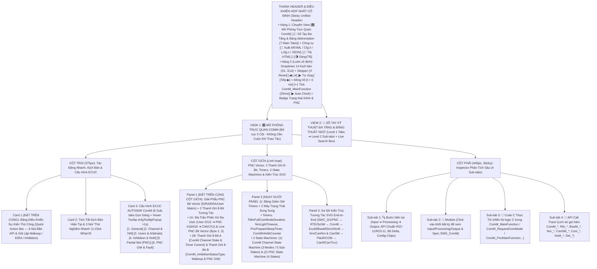
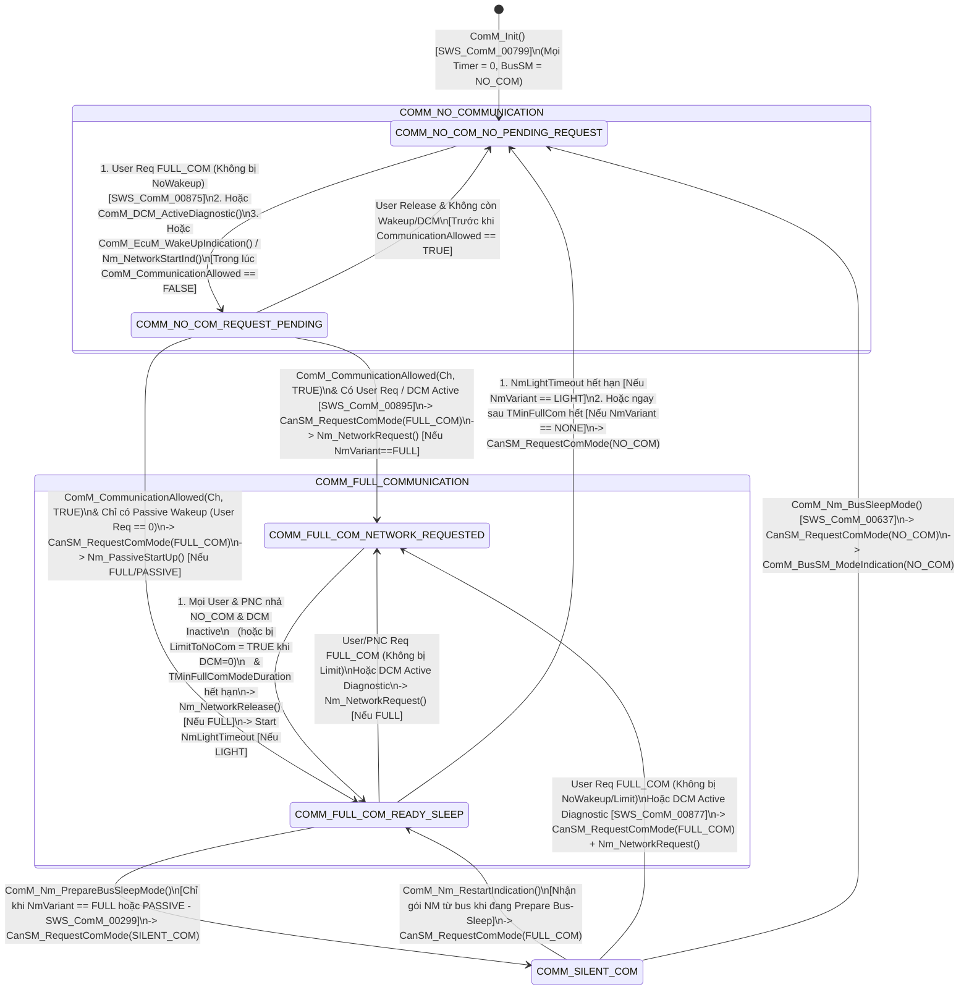
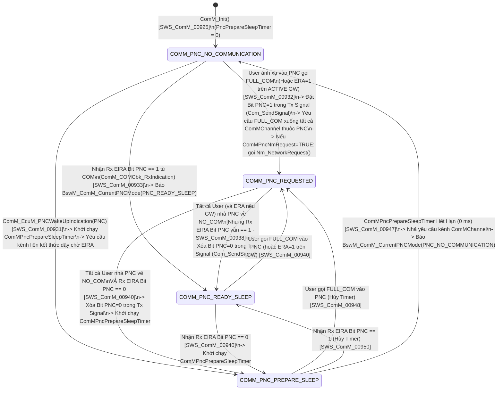

# Tài Liệu Thiết Kế Chi Tiết Trình Mô Phỏng AUTOSAR ComM (`ComM_Simulation_design.md`)

> **Trạng thái tài liệu:** Bản thiết kế chi tiết đã cập nhật theo xác nhận `A1`–`A4` của User — Sẵn sàng để User review trước khi triển khai code.  
> **File đích dự kiến xuất bản:** `d:\__Personal\AntiGravity\Simulation\AUTOSAR_ComM.html` (Ứng dụng Web Tương tác 1 file HTML độc lập, 100% Offline, Pure CSS, có nút tải `.HTML` kèm cấu hình nhúng & xuất code `ARXML / ComM_Cfg.h / ComM_Lcfg.c / JSON`).  
> **Chuẩn tham chiếu:** **AUTOSAR Classic Platform R20-11 / R22-11 / R23-11 (`SWS_ComM`, `SWS_Nm`, `SWS_CanNm`, `SWS_CanSM`, `SWS_BswM`, `SWS_EcuM`, `SWS_Dcm`, `SWS_COM`, `SWS_NvM`, `SWS_Det`, `SWS_Rte`)**, đính kèm mã requirement chuẩn **`SWS_ComM_xxxxx`** tại từng bước xử lý, thanh giải phẫu PNC Bit Vector (`EIRA / ERA / User Matrix`), 2 thanh ghi 8-Bit, tooltip cấu hình và sổ tay tra cứu đa tầng.

---

## 1. Tổng Quan Định Hướng Thiết Kế Đã Chốt (`A1` – `A4`)

| Hạng mục | Nội dung thiết kế đã xác nhận với User |
| :--- | :--- |
| **1. Bố cục giao diện & Ưu tiên Không Cuộn Trang — Zero-Scroll (`A1`)** | Kết hợp tinh hoa của **`AUTOSAR_DEM.html`**, **`AUTOSAR_CanNM.html`** và **`AUTOSAR_CanSM.html`**, tối ưu hóa **Above-the-Fold (Zero-Scroll)** để các khối thao tác và giám sát tần suất cao nhất luôn nằm ngay phần đầu mỗi cột trong khung màn hình:<br>• **Thanh Điều Khiển Hợp Nhất Cố Định (Sticky Unified Header)**:<br>  - **Hàng 1**: Chuyển View `[🎛️ Mô Phỏng Trực Quan ComM]` \| `[📖 Sổ Tay Đa Tầng & Bảng Abbreviation (7 Main Tabs)]` + Công cụ `[🧾 Xuất ARXML / ComM_Cfg.h / ComM_Lcfg.c / JSON]` \| `[💾 Tải .HTML]` \| `[🌗 Sáng/Tối]`.<br>  - **Hàng 2 (Luôn cố định)**: Dropdown chọn 14 Kịch bản (`S1`–`S14`), Stepper (`↺ Reset`, `◀ Lùi`, `▶ Tự chạy`, `Tiếp ▶`), Đồng hồ (`t = 0 ms`, `+1 Tick ComM_MainFunction (20ms)`, `▶ Auto Clock`) và Badge Trạng thái Kênh & PNC.<br>• **Bố cục 3 cột hiện đại (Mỗi cột tự cuộn độc lập trong khung Viewport)**:<br>  - **Cột Trái (`375px`)**: Đưa **Card 1: Bảng Điều Khiển Sự Kiện Thủ Công (`Quick Action Bar` — 8 nút tác động trực tiếp)** và **Card 2: Tóm tắt kịch bản & 3 nút 1-Click What-If** lên trên cùng, tiếp theo là **Card 3: 6 Sub-tabs Cấu hình ECUC ComM** (hỗ trợ Floating Hover Tooltip `#cfgTooltipPopup` sau `>1s` giống hệt `AUTOSAR_DEM.html`).<br>  - **Cột Giữa (`Linh hoạt`)**: Đưa **Panel 1: Thanh Giải Phẫu Mạng Con `PNC Bit Vector (EIRA / ERA / User Matrix)` + 2 Thanh Ghi 8-Bit Tương Tác** và **Panel 2: Bảng Timers & 2 Máy Trạng Thái Song Song (`ComM Channel State Machine` + `PNC State Machine`)** lên ngay đầu cột giữa, bên dưới là **Panel 3: Sơ Đồ Kiến Trúc Tương Tác SVG End-to-End** (`SWC_0/1/PNC ↔ RTE/SchM ↔ ComM ↔ EcuM/BswM/Dcm/NvM ↔ Nm/CanNm & CanSM ↔ PduR/COM ↔ CanIf/CanTrcv`).<br>  - **Cột Phải (`440px, Sticky`)**: Inspector 4 Sub-tabs (`🔍 Bước hiện tại`, `🧩 Module`, `📄 Code C Thực Thi`, `📜 API Call Trace`).<br>• **Config Hover Tooltip (`> 1s` delay)** giống hệt `AUTOSAR_DEM.html` (`#cfgTooltipPopup` hiển thị tên tham số, đường dẫn ECUC, mã `SWS_ComM_xxxxx`, mô tả, dải giá trị, giá trị typical và lưu ý kỹ thuật). |
| **2. Khu vực Giám sát Bit-level & PNC Bit Vector 2 Tầng (`A2`)** | Đặt **cố định và nổi bật ở đầu Cột Giữa** gồm **2 tầng trực quan hóa Bit**:<br>• **Tầng 1 — Thanh Giải Phẫu `PNC Bit Vector (EIRA / ERA / User Matrix)`**: Hiển thị ma trận phân xử đa User (`ComMUser_0`, `ComMUser_1`, `ComMUser_2_PNC` ➔ `PNC #16/#18` ➔ `ComMChannel_0 / ComMChannel_1`) cùng 4 hàng byte giải phẫu `PNC Bit Vector` (`Byte 2..3` cho `PNC #16..#31`): `Internal User Req`, `Rx EIRA Signal`, `Rx ERA Signal (GW)`, `Tx Com Signal (Com_SendSignal)`.<br>• **Tầng 2 — 2 Thanh ghi 8-Bit tương tác song song**:<br>  1. **Thanh A (`8-Bit ComM Channel State, Request & Timer Control Byte` — `ComM_ChannelStatusByte`)**: Theo dõi các cờ lõi (`USER_FULL_REQ`, `DCM_DIAG_ACTIVE`, `WAKEUP_PENDING`, `COMM_ALLOWED`, `T_MIN_FULL_RUN`, `NM_LIGHT_TMR_RUN`, `BUSSM_FULL_IND`, `NM_NET_REQ_ACTIVE`).<br>  2. **Thanh B (`8-Bit ComM Inhibition, Wakeup & PNC Gateway Status Byte` — chuẩn `ComM_InhibitionStatusType` `SWS_ComM_00669` + cờ PNC/NvM)**: Theo dõi trực quan các cờ cấm và PNC (`COMM_INITIALIZED`, `INHIBIT_CNT_INC`, `PNC_PREP_SLEEP_RUN`, `PNC_GW_ROUTING`, `ECU_LIMIT_NOCOM`, `SYNC_WAKEUP_ACTV`, `CH_LIMIT_NOCOM`, `CH_NO_WAKEUP`). Cho phép click trực tiếp vào từng bit để giải mã hoặc thử nghiệm! |
| **3. Hệ thống 14 Kịch bản mẫu (`A3`)** | Thiết kế sẵn **14 Kịch bản (`S1`–`S14`)** chia làm 4 nhóm lớn:<br>• **Nhóm 1 (`S1`–`S4`)**: Phân Xử Đa User, Đánh Thức Chủ Động/Thụ Động (`Synchronous WakeUp`), Chu Trình Ngủ Đồng Bộ 4 Bước với `Nm` (`ComMNmVariant = FULL`), và Khôi Phục Khẩn Cấp từ `SILENT_COM`.<br>• **Nhóm 2 (`S5`–`S7`)**: Các Biến Thể Quản Lý Mạng (`LIGHT`, `PASSIVE`, `NONE`) với `TMinFullComModeDuration` & `NmLightTimeout`, và Phiên Chẩn Đoán `DCM` (`ComM_DCM_ActiveDiagnostic` vượt qua Mode Inhibition).<br>• **Nhóm 3 (`S8`–`S10`)**: Cơ Chế Cấm Truyền Thông (`Mode Inhibition`: `ComM_PreventWakeUp` / `NoWakeup`, `ComM_LimitChannelToNoComMode`, `ComM_LimitECUToNoComMode`, `ComMEcuGroupClassification`, `ComMInhibitCounter` & `NvM`).<br>• **Nhóm 4 (`S11`–`S14`)**: Partial Networking (`PNC State Machine`: `PNC_REQUESTED ➔ PNC_READY_SLEEP ➔ PNC_PREPARE_SLEEP ➔ PNC_NO_COM`, `EIRA/ERA`, `ComMPncNmRequest`, `PNC Gateway ACTIVE/PASSIVE`, `Synchronized PNC Shutdown` R22-11) & Báo Cáo Lỗi `DET` (`COMM_E_UNINIT`, `COMM_E_WRONG_PARAMETERS`, `COMM_E_PARAM_POINTER`). |
| **4. Sổ tay tra cứu đa tầng & Bảng Abbreviation (`A4`)** | **View 2 (`📖 Sổ Tay Kỹ Thuật ComM & Từ Điển Thuật Ngữ`)** được tổ chức theo cấu trúc **Đa Tầng (Multi-level Tabs)**:<br>• **6 Main Sub-tabs (Level 1) × 4 Chủ đề con (Level 2 Pills/Tabs = 24 chuyên đề)** phân tích sâu kiến trúc phân xử, máy trạng thái kênh & PNC, 4 biến thể NM, Mode Inhibition, Partial Networking & API/ECUC.<br>• **Tab 7 chuyên biệt: `🔤 Bảng Thuật Ngữ & Từ Viết Tắt (Abbreviation Table)`** trình bày dưới dạng bảng chuẩn 4 cột, tích hợp **Search Box tìm kiếm tức thời (Live Search + Highlight `<mark>`)** và 5 nút lọc nhanh theo phân nhóm (`ComM Core & Modes`, `Inhibition & DCM/NvM`, `Partial Net & PNC`, `AUTOSAR Comm Stack`). |

---

## 2. Bố Cục Giao Diện 3 Cột Ưu Tiên Zero-Scroll & Hệ Thống Sub-Tabs (UI Wireframe)

Để giải quyết triệt để vấn đề **"người dùng không cần cuộn chuột lên xuống mỗi lần thao tác"**, giao diện được thiết kế theo nguyên lý **Viewport-First (Đưa các khối tương tác và giám sát tần suất cao nhất lên ngay phần đầu của mỗi cột, kết hợp cơ chế Sub-tabs gọn gàng)**:



### Điểm Cải Tiến Đột Phá Về Trải Nghiệm "Zero-Scroll" Cho Module `ComM`:
1. **Thanh Điều Khiển Hợp Nhất (`Sticky Unified Header`)**: Gộp chọn kịch bản, nút bấm `Bước tiếp / Lùi / Tự chạy`, và nút nhịp đồng hồ `+1 Tick ComM_MainFunction (20ms)` vào ngay thanh Header cố định. Người dùng ở bất kỳ vị trí nào cũng có thể tiến đồng hồ để xem các bộ đếm `TMinFullComModeDuration`, `NmLightTimeout`, `PncPrepareSleepTimer` đếm lùi.
2. **Đưa `Quick Action Bar` (8 nút tác động nhanh) lên vị trí Card 1 (Đầu Cột Trái)** và đưa **Ma Trận Đa User + Thanh Giải Phẫu PNC Bit Vector + 2 Thanh Ghi 8-Bit + 2 Máy Trạng Thái** lên đầu Cột Giữa: Khi bấm `ComM_RequestComMode(User_0, FULL_COM)`, `ComM_PreventWakeUp(TRUE)`, hoặc `ComM_DCM_ActiveDiagnostic()`, mắt người dùng nhìn thấy ngay lập tức sự phân xử đa User, sự dịch chuyển của từng Bit trên Thanh A/B, vector `EIRA/ERA` và sự chuyển trạng thái của cả Kênh lẫn PNC mà **không phải cuộn trang**.
3. **Gom 34 tham số ECUC vào 6 Sub-tabs gọn gàng**: Thay vì trải dài danh sách dọc gây quá tải, chiều cao Card Cấu hình được giữ gọn cố định (~270px), kèm hộp thoại giải thích nổi `#cfgTooltipPopup` khi hover quá `1000ms`.

---

## 3. Thiết Kế Chi Tiết Panel 1 (Đầu Cột Giữa): Giải Phẫu `PNC Bit Vector (EIRA / ERA)` + Ma Trận Đa User & 2 Thanh Ghi 8-Bit Tương Tác

Trong `AUTOSAR ComM`, bản chất hoạt động nằm ở **hai trụ cột song song**: (1) **Phân xử yêu cầu từ nhiều `ComMUser` / `DCM` / `PNC` thành trạng thái Kênh (`Channel State`) có xét đến `Mode Inhibition`**, và (2) **Đồng bộ vector bit `PNC (EIRA / ERA / Tx Signal)` thông qua `AUTOSAR COM`**. Do đó, Panel 1 ở đầu Cột Giữa được thiết kế gồm **2 phần trực quan hóa liên thông**:

### 3.1. Phần 1A — Ma Trận Phân Xử Đa User (`ComMUser Arbitration Matrix`) & Thanh Giải Phẫu `PNC Bit Vector (EIRA / ERA / Tx)`

```text
+-------------------------------------------------------------------------------------------------------------------+
| 🧬 MA TRẬN PHÂN XỬ ĐA USER & GIẢI PHẪU PNC BIT VECTOR (`ComMPncSupport` / `EIRA` / `ERA` — [`SWS_ComM_00909`])     |
| Ch0 GW: [ACTIVE] | Ch1 GW: [PASSIVE] | NM Variant: [FULL] | Effective Ch0 Req: [FULL_COM] (User_0=FULL, DCM=OFF)  |
+-------------------------------------------------------------------------------------------------------------------+
| 1. MA TRẬN PHÂN XỬ (ARBITRATION):                                                                                 |
|    • ComMUser_0 (SWC_Powertrain) : [ FULL_COM ] ──► Kênh trực tiếp Ch0 (CAN_Primary)                              |
|    • ComMUser_1 (SWC_BodyCtrl)   : [ NO_COM   ] ──► Kênh trực tiếp Ch0 (CAN_Primary)                              |
|    • ComMUser_2 (SWC_OBC_PNC16)  : [ FULL_COM ] ──► PNC #16 (0x01) ──► Ch0 (ACTIVE) & Ch1 (PASSIVE)               |
+-------------------------------------------------------------------------------------------------------------------+
| 2. GIẢI PHẪU PNC BIT VECTOR (`Byte 2..3` trong 8-Byte NM PDU — `ComMPncInfoOffset = 2`, `Length = 2 Bytes`):      |
|  +------------------------+-----------+-----------+-----------+-----------+-----------+-----------+-----------+--+  |
|  | Nguồn Vector (16 PNCs) | PNC #16   | PNC #17   | PNC #18   | PNC #19   | PNC #20..23 | Byte 2  | Byte 3    |  |
|  |                        | (B0 / 01) | (B1 / 02) | (B2 / 04) | (B3 / 08) | (B4..7)   | (Hex)   | (Hex)     |  |
|  +------------------------+-----------+-----------+-----------+-----------+-----------+---------+-----------+--+  |
|  | Internal User PNC Req  |  [ 1 ]    |  [ 0 ]    |  [ 0 ]    |  [ 0 ]    |   0000    |  0x01   |   0x00    |  |
|  | Rx EIRA (COM Callback) |  [ 1 ]    |  [ 0 ]    |  [ 0 ]    |  [ 0 ]    |   0000    |  0x01   |   0x00    |  |
|  | Rx ERA (Ch0 / Ch1 GW)  |  [ 0 ]    |  [ 0 ]    |  [ 1 ]    |  [ 0 ]    |   0000    |  0x04   |   0x00    |  |
|  | Tx Signal (Com_Send)   |  [ 1 ]    |  [ 0 ]    |  [ 1 ]    |  [ 0 ]    |   0000    |  0x05   |   0x00    |  |
|  +------------------------+-----------+-----------+-----------+-----------+-----------+---------+-----------+--+  |
|  💡 Trạng thái PNC Live:  PNC #16: [COMM_PNC_REQUESTED] (User_2=1) | PNC #18: [COMM_PNC_READY_SLEEP] (GW ERA=1)   |
+-------------------------------------------------------------------------------------------------------------------+
```

- **Tính năng tương tác trực tiếp trên Phần 1A**:
  - Người dùng nhìn thấy ngay **tại sao một kênh vẫn giữ `FULL_COM`** (ví dụ `User_0` đã gọi `NO_COM`, nhưng `User_2` vẫn giữ `PNC #16 = COMM_PNC_REQUESTED`, hoặc `DCM` đang `ACTIVE`).
  - Mỗi ô bit `PNC #16 .. PNC #19` cho phép click nhanh để giả lập bật/tắt bit tương ứng trong `Rx EIRA` / `Rx ERA`, quan sát ngay sự hợp nhất bit `Tx Signal = Internal_Req | ERA_GW_Routing` gửi xuống `Com_SendSignal()` theo chuẩn `SWS_ComM_00964`.

### 3.2. Phần 1B — 2 Thanh Ghi 8-Bit Trạng Thái Tương Tác Luôn Hiển Thị Nổi Bật

Ngay bên dưới Phần 1A là **2 Thanh ghi 8-Bit tương tác** theo đúng phong cách của `AUTOSAR_DEM.html`, `AUTOSAR_CanNM.html` và `AUTOSAR_CanSM.html`:

```text
+-------------------------------------------------------------------------------------------------------------------+
| 🔢 BẢNG GIÁM SÁT BITFIELD 8-BIT COMM CHANNEL & INHIBITION (LIVE 8-BIT INSPECTOR) [Click vào từng ô Bit để thử nghiệm]|
| Bước #3: ComM_RequestComMode(User_0, FULL_COM) ➔ Kênh Ch0 vào FULL_COM_NETWORK_REQUESTED | Byte A: 0x93 | Byte B: 0x80|
+-------------------------------------------------------------------------------------------------------------------+
| A. THANH GHI 8-BIT TRẠNG THÁI KÊNH, YÊU CẦU & TIMER (`ComM_ChannelStatusByte`) — Hex: [ 0x93 ] Bin: [1001 0011b] |
|    Ch0 Mode: [ COMM_FULL_COMMUNICATION ] | Sub-State: [ COMM_FULL_COM_NETWORK_REQUESTED ] | NmVariant: [ FULL ]  |
|  +-------------+ +-------------+ +-------------+ +-------------+ +-------------+ +-------------+ +-------+ +-----+|
|  | Bit 7 (0x80)| | Bit 6 (0x40)| | Bit 5 (0x20)| | Bit 4 (0x10)| | Bit 3 (0x08)| | Bit 2 (0x04)| |Bit1(2)| |Bit 0||
|  | USER_FULL   | | DCM_DIAG    | | WAKEUP_PEND | | COMM_ALLOW  | | T_MIN_FULL  | | NM_LIGHT_TM | |BUSSM  | |NMREQ||
|  |      1      | |      0      | |      0      | |      1      | |      0      | |      0      | |   1   | |  1  ||
|  | User0=FULL  | | Diag Off    | | No Pending  | | Allowed=TRUE| | Variant=FULL| | Variant=FULL| |FullInd| |NmReq||
|  +-------------+ +-------------+ +-------------+ +-------------+ +-------------+ +-------------+ +-------+ +-----+|
+-------------------------------------------------------------------------------------------------------------------+
| B. THANH GHI 8-BIT CẤM TRUYỀN THÔNG, WAKEUP & PNC GW (`ComM_InhibitionStatusByte`) — Hex: [ 0x80 ] Bin: [1000 0000]|
|    InhibitStatus (SWS_ComM_00669): [ 0x00 ] | EcuGroupClass: [ 0x03 ] | InhibitCounter: [ 0 ] | PNC GW: [ OFF ]   |
|  +-------------+ +-------------+ +-------------+ +-------------+ +-------------+ +-------------+ +-------+ +-----+|
|  | Bit 7 (0x80)| | Bit 6 (0x40)| | Bit 5 (0x20)| | Bit 4 (0x10)| | Bit 3 (0x08)| | Bit 2 (0x04)| |Bit1(2)| |Bit 0||
|  | COMM_INIT   | | INHIB_CNT   | | PNC_PREP_TM | | PNC_GW_ACTV | | ECU_LIM_NC  | | SYNC_WAKEUP | |CH_LIM | |CH_NW||
|  |      1      | |      0      | |      0      | |      0      | |      0      | |      0      | |   0   | |  0  ||
|  | Initialized | | Count = 0   | | PncTmr Idle | | GW Disabled | | ECU Unlim   | | Single Ch   | |Unlimit| |Allow||
|  +-------------+ +-------------+ +-------------+ +-------------+ +-------------+ +-------------+ +-------+ +-----+|
+-------------------------------------------------------------------------------------------------------------------+
```

#### 3.2.1. Giải Mã Chi Tiết Thanh A: `8-Bit ComM Channel State, Request & Timer Control Byte` (`ComM_ChannelStatusByte`)

| Bit | Mask | Tên Cờ (`ComM Channel Bit`) | Ý nghĩa kỹ thuật & Khi nào bật lên `1` (`0 ➔ 1`) | Khi nào hạ về `0` (`1 ➔ 0`) |
| :-: | :-: | :--- | :--- | :--- |
| **Bit 7** | `0x80` | **`USER_FULL_REQ`** | Bật lên `1` khi có ít nhất 1 `ComMUser` trực tiếp hoặc 1 `PNC` (`COMM_PNC_REQUESTED`) ánh xạ vào kênh đang yêu cầu `COMM_FULL_COMMUNICATION` (`SWS_ComM_00092`, `SWS_ComM_00869`). | Hạ về `0` khi tất cả các `ComMUser` và `PNC` liên kết đều đã gọi `ComM_RequestComMode(COMM_NO_COMMUNICATION)`. |
| **Bit 6** | `0x40` | **`DCM_DIAG_ACTIVE`** | Bật lên `1` khi `Dcm` gọi **`ComM_DCM_ActiveDiagnostic(Channel)`** (`SWS_ComM_00346`) để phục vụ giao tiếp chẩn đoán UDS (`0x10`, `0x28`, `0x31`). **Đặc quyền tối cao**: giữ kênh ở `FULL_COM_NETWORK_REQUESTED` và **bỏ qua mọi lệnh cấm Mode Inhibition** (`SWS_ComM_00182`)! | Hạ về `0` khi `Dcm` gọi **`ComM_DCM_InactiveDiagnostic(Channel)`** (`SWS_ComM_00347`). Lúc này kênh mới đánh giá lại yêu cầu của các `User` và `Inhibition`. |
| **Bit 5** | `0x20` | **`WAKEUP_PENDING`** | Bật lên `1` khi kênh đang ở `NO_COM` và nhận xung đánh thức thụ động từ `ComM_EcuM_WakeUpIndication()`, `ComM_EcuM_PNCWakeUpIndication()` hoặc `ComM_Nm_NetworkStartIndication()` (`SWS_ComM_00275`, `SWS_ComM_00383`), hoặc có `User Request` trong lúc `ComM_CommunicationAllowed == FALSE` (`NO_COM_REQUEST_PENDING`). | Hạ về `0` ngay khi kênh được `ComM_CommunicationAllowed(Channel, TRUE)` mở khóa đi vào `COMM_FULL_COMMUNICATION`, hoặc khi hết điều kiện chờ về lại `NO_COM_NO_PENDING_REQUEST`. |
| **Bit 4** | `0x10` | **`COMM_ALLOWED`** | Bật lên `1` khi `BswM` / `EcuM` gọi **`ComM_CommunicationAllowed(Channel, TRUE)`** (`SWS_ComM_00875`), mở chốt an toàn cho phép `ComM` ra lệnh cho `BusSM` / `Nm` chuyển kênh sang `FULL_COM`. | Hạ về `0` khi gọi `ComM_CommunicationAllowed(Channel, FALSE)` (`SWS_ComM_00876`) để khóa kênh không cho bật truyền thông mới khi ECU đang chuẩn bị tắt nguồn. |
| **Bit 3** | `0x08` | **`T_MIN_FULL_RUN`** | Bật lên `1` khi kênh cấu hình `ComMNmVariant = LIGHT` hoặc `NONE` vừa bước vào `COMM_FULL_COM_NETWORK_REQUESTED` và bộ đếm **`ComMTMinFullComModeDuration`** đang đếm ngược (`SWS_ComM_00886`), ngăn việc tắt kênh quá đột ngột khi `User` nhả mạng ngay sau khi vừa bật. | Hạ về `0` khi bộ đếm `ComMTMinFullComModeDuration` chạm `0 ms` (cho phép kênh chuyển sang `READY_SLEEP` hoặc `NO_COM` nếu không còn User nào yêu cầu). |
| **Bit 2** | `0x04` | **`NM_LIGHT_TMR_RUN`** | Bật lên `1` khi kênh cấu hình `ComMNmVariant = LIGHT` không còn `User` nào giữ mạng (và hết `TMinFullComModeDuration`), chuyển sang `COMM_FULL_COM_READY_SLEEP` và khởi chạy bộ đếm **`ComMNmLightTimeout`** (`SWS_ComM_00610`). | Hạ về `0` khi `ComMNmLightTimeout` chạm `0 ms` (kéo kênh về `COMM_NO_COMMUNICATION` qua `CanSM_RequestComMode(NO_COM)`), hoặc khi có User/DCM yêu cầu lại `FULL_COM`. |
| **Bit 1** | `0x02` | **`BUSSM_FULL_IND`** | Bật lên `1` khi `CanSM` (hoặc `BusSM`) hoàn tất khởi động phần cứng CAN Controller/Transceiver và gọi ngược callback **`ComM_BusSM_ModeIndication(Channel, COMM_FULL_COMMUNICATION)`** (`SWS_ComM_00675`). Chỉ khi cờ này bật thì `ComM` mới báo `Rte_Switch(FULL_COM)` lên `SWC` và `BswM_ComM_CurrentMode(FULL_COM)`! | Hạ về `0` khi `CanSM` báo callback `ComM_BusSM_ModeIndication(SILENT_COM)` hoặc `ComM_BusSM_ModeIndication(NO_COM)` / `ComM_BusSM_BusSleepMode()`. |
| **Bit 0** | `0x01` | **`NM_NET_REQ_ACTIVE`** | Bật lên `1` khi kênh đang ở trạng thái con **`COMM_FULL_COM_NETWORK_REQUESTED`** (với `ComMNmVariant = FULL`, `ComM` đã gọi **`Nm_NetworkRequest(Channel)`** xuống `Nm ➔ CanNm` [`SWS_ComM_00869`]). | Hạ về `0` khi chuyển sang **`COMM_FULL_COM_READY_SLEEP`** (gọi **`Nm_NetworkRelease(Channel)`** [`SWS_ComM_00133`]), hoặc khi vào `FULL_COM` bằng con đường thụ động (`Nm_PassiveStartUp()`). |

#### 3.2.2. Giải Mã Chi Tiết Thanh B: `8-Bit ComM Inhibition, Wakeup & PNC Gateway Status Byte` (`ComM_InhibitionStatusByte`)

> **Lưu ý chuẩn AUTOSAR (`SWS_ComM_00669`)**: Hai bit thấp nhất (**`Bit 0` và `Bit 1`**) của Thanh B ánh xạ chính xác 1-1 với kiểu dữ liệu bitmask chuẩn **`ComM_InhibitionStatusType`** trả về bởi hàm `ComM_GetInhibitionStatus(Channel, &Status)`!

| Bit | Mask | Tên Cờ (`ComM Inhibition / PNC Bit`) | Ý nghĩa kỹ thuật & Khi nào bật lên `1` (`0 ➔ 1`) | Khi nào hạ về `0` (`1 ➔ 0`) |
| :-: | :-: | :--- | :--- | :--- |
| **Bit 7** | `0x80` | **`COMM_INITIALIZED`** | Bật lên `1` sau khi `ComM_Init(&ComM_Config)` chạy thành công (`COMM_INIT` [`SWS_ComM_00799`]). | Hạ về `0` (`COMM_UNINIT`) khi tắt Checkbox `ComMInitialized` để kiểm thử báo lỗi `Det_ReportError(COMM_E_UNINIT = 0x01)`. |
| **Bit 6** | `0x40` | **`INHIBIT_CNT_INC`** | Bật lên `1` mỗi khi có một lời gọi `ComM_RequestComMode(User, COMM_FULL_COMMUNICATION)` bị từ chối do đang bật `WakeUp Inhibition` hoặc `Limit to NO_COM`, làm tăng bộ đếm 16-bit **`ComMInhibitCounter`** (`+1`, bão hòa ở `65535`) và đánh dấu `NvM_SetRamBlockStatus(TRUE)` (`SWS_ComM_00302`). | Hạ về `0` khi gọi **`ComM_ResetInhibitCounter()`** (`SWS_ComM_00108`) đưa bộ đếm về `0`. |
| **Bit 5** | `0x20` | **`PNC_PREP_SLEEP_RUN`** | Bật lên `1` khi cụm mạng con `PNC` rời `COMM_PNC_READY_SLEEP` sang **`COMM_PNC_PREPARE_SLEEP`** (khi cả `User` và `Rx EIRA` đều bằng `0`) và khởi chạy bộ đếm **`ComMPncPrepareSleepTimer`** (`SWS_ComM_00907`). | Hạ về `0` khi `ComMPncPrepareSleepTimer` chạm `0 ms` (chuyển về `COMM_PNC_NO_COMMUNICATION` và nhả yêu cầu kênh), hoặc khi có yêu cầu `PNC` mới. |
| **Bit 4** | `0x10` | **`PNC_GW_ROUTING`** | Bật lên `1` khi **`ComMPncGatewayEnabled = TRUE`** và `ComM` đang định tuyến trạng thái `PNC` dựa trên mảng `ERA` giữa kênh `ACTIVE` và kênh `PASSIVE` (`SWS_ComM_00964`, `SWS_ComM_00966`). | Hạ về `0` khi tắt `ComMPncGatewayEnabled` hoặc tất cả các `PNC` đều ở `COMM_PNC_NO_COMMUNICATION`. |
| **Bit 3** | `0x08` | **`ECU_LIMIT_NOCOM`** | Bật lên `1` khi gọi **`ComM_LimitECUToNoComMode(TRUE)`** (`SWS_ComM_00163`), áp đặt lệnh cưỡng bức về `NO_COM` lên toàn bộ các kênh trên ECU (nếu `Bit 1` của `ComMEcuGroupClassification` cho phép). | Hạ về `0` khi gọi `ComM_LimitECUToNoComMode(FALSE)`. |
| **Bit 2** | `0x04` | **`SYNC_WAKEUP_ACTV`** | Bật lên `1` khi cấu hình **`ComMSynchronousWakeUp = TRUE`** (`ECUC_ComM_00695`) và một sự kiện đánh thức trên 1 kênh (hoặc 1 PNC) khiến `ComM` tự động đánh thức đồng loạt tất cả các kênh còn lại trên ECU (`SWS_ComM_00694`). | Hạ về `0` khi tất cả các kênh đã hoàn tất khởi động hoặc khi tắt `ComMSynchronousWakeUp`. |
| **Bit 1** | `0x02` | **`CH_LIMIT_NOCOM`**<br>*(Chuẩn `SWS_ComM_00669`)* | Bật lên `1` khi gọi **`ComM_LimitChannelToNoComMode(Channel, TRUE)`** (hoặc `LimitECUToNoComMode(TRUE)`) VÀ `ComMEcuGroupClassification` có bật `Bit 1 (0x02)`: Nếu kênh đang ở `FULL_COM_NETWORK_REQUESTED` (và không có `DCM Active`), `ComM` lập tức nhả mạng (`Nm_NetworkRelease()` ➔ `READY_SLEEP` ➔ `SILENT_COM` ➔ `NO_COM`) bất chấp `SWC User` vẫn đang giữ `FULL_COM` (`SWS_ComM_00303`, `SWS_ComM_00219`)! | Hạ về `0` khi gọi `ComM_LimitChannelToNoComMode(Channel, FALSE)` (hoặc bị `ComMEcuGroupClassification` vô hiệu hóa). |
| **Bit 0** | `0x01` | **`CH_NO_WAKEUP`**<br>*(Chuẩn `SWS_ComM_00669`)* | Bật lên `1` khi cấu hình `ComMNoWakeup = TRUE` hoặc gọi **`ComM_PreventWakeUp(Channel, TRUE)`** VÀ `ComMEcuGroupClassification` có bật `Bit 0 (0x01)`: Chặn mọi yêu cầu `ComM_RequestComMode(FULL_COM)` từ `SWC User` khi kênh đang ở `NO_COM` hoặc `SILENT_COM` (`SWS_ComM_00215`), nhưng **vẫn cho phép Passive Wakeup từ bus và vẫn cho phép `DCM` đánh thức**! | Hạ về `0` khi gọi `ComM_PreventWakeUp(Channel, FALSE)`. |

---

## 4. Phân Tích Xử Lý Từng Module: Input Lấy Từ Đâu, Xử Lý Gì, Output Route Đến Đâu

Mọi khối trên sơ đồ kiến trúc SVG đều có thể **click vào để xem giải thích chi tiết** ở cột phải (Tab `🧩 Module`) và được tổng hợp đầy đủ trong **Tab 1 của Sổ tay**:

| # | Module / Phân khối | Lớp AUTOSAR | 📥 Input lấy từ đâu? | ⚙️ Cách xử lý nội bộ (Processing, State & Timers) | 📤 Output route đến đâu & Hàm API chuẩn (R20-11 / R22-11 / R23-11) |
| :-: | :--- | :--- | :--- | :--- | :--- |
| **1** | **`SWC_App_0`, `SWC_App_1` & `SWC_PncUser`**<br>*(Application Layer)* | Application Layer | • Sự kiện người dùng / logic ứng dụng (bật IG, yêu cầu sạc OBC, khóa cửa).<br>• Nhận thông báo chuyển chế độ mạng (`SwcModeSwitchEvent`) từ `ComM` qua `RTE` (`Rte_Switch_UM_ComMUser_x_currentMode`). | • **Phân tách vai trò**: Các `SWC` hoàn toàn không biết đến CAN Controller, `CanSM` hay `CanNm`. Mỗi `SWC` chỉ làm việc với cổng logic **`ComMUser`** riêng của mình (`ComMUser_0`, `ComMUser_1`, `ComMUser_2_PNC`).<br>• Khi cần gửi/nhận tín hiệu, `SWC` gọi `RequestComMode(COMM_FULL_COMMUNICATION)` và chỉ bắt đầu gọi `Rte_Write` sau khi `ComM` (thông qua `BusSM_ModeIndication`) báo ngược lại rằng kênh đã thực sự vào `COMM_FULL_COMMUNICATION`! | • Gọi qua **RTE** xuống **ComM**:<br>`Rte_Call_UR_ComMUser_x_RequestComMode(COMM_FULL_COMMUNICATION / COMM_NO_COMMUNICATION)`<br>`Rte_Call_UR_ComMUser_x_GetCurrentComMode(&ComMode)`<br>`Rte_Call_UR_ComMUser_x_GetMaxComMode(&ComMode)` |
| **2** | **`RTE` & `SchM`**<br>*(Runtime Environment & BSW Scheduler)* | RTE Layer | • Lời gọi `Rte_Call` từ nhiều `SWC Users` và thông báo chuyển Mode từ `ComM` (`Rte_Switch`).<br>• Xung nhịp định kỳ từ `AUTOSAR OS` (`Task_Bsw_20ms`). | • **RTE**: Định tuyến lời gọi từ các `SWC` vào `ComM_RequestComMode(User, ComMode)` và phát sự kiện `SwcModeSwitchEvent` lên đúng các `SWC` khi `ComM` cập nhật mode thực tế.<br>• Nếu bật `ComMFullCommRequestNotificationEnabled`, `RTE` cập nhật danh sách các `User` đang yêu cầu `FULL_COM` (`Rte_Write_fullComRequestors`).<br>• **SchM**: Gọi định kỳ hàm **`ComM_MainFunction_<ChannelId>()`** mỗi `ComMMainFunctionPeriod` (ví dụ `20ms`) để xử lý phân xử, đếm timer (`TMinFull`, `NmLightTimeout`, `PncPrepareSleepTimer`) và đồng bộ hóa chuyển trạng thái; đồng thời bảo vệ vùng găng (`ExclusiveArea`) giữa các ngắt wakeup và `MainFunction`. | • Gọi định kỳ vào **ComM**:<br>`ComM_MainFunction_<ChannelId>()` [`SWS_ComM_00429`]<br>• Bảo vệ vùng găng **ComM**:<br>`SchM_Enter_ComM_COMM_EXCLUSIVE_AREA_0()` / `SchM_Exit_ComM_COMM_EXCLUSIVE_AREA_0()`<br>• Thông báo lên **SWC**:<br>`Rte_Switch_UM_ComMUser_x_currentMode(Mode)` |
| **3** | **`ComM Core Engine`**<br>*(Communication Manager)* | System / Comm Services | • Yêu cầu từ nhiều `SWC Users` (`ComM_RequestComMode`), từ `Dcm` (`ComM_DCM_ActiveDiagnostic`), từ `EcuM` (`ComM_EcuM_WakeUpIndication`, `PNCWakeUpIndication`), từ `BswM` (`ComM_CommunicationAllowed`).<br>• Lệnh cấm từ ứng dụng/chẩn đoán (`ComM_PreventWakeUp`, `ComM_LimitChannelToNoComMode`, `ComM_LimitECUToNoComMode`).<br>• Callbacks từ `Nm` (`ComM_Nm_*`), `BusSM/CanSM` (`ComM_BusSM_*`) và `COM` (`ComM_COMCbk_RxIndication`). | • **1. Bộ Phân Xử Đa User (`Mode Arbitration`)**: Tổng hợp yêu cầu của mọi `ComMUser`, `PNC` và `Dcm` ánh xạ vào cùng 1 kênh (`OR` logic). Chỉ cần 1 đối tượng yêu cầu `FULL_COM` thì kênh giữ `FULL_COM`.<br>• **2. Máy Trạng Thái Kênh 2 Cấp (`Channel State Machine`)**: Điều phối 3 Main Modes (`NO_COM`, `SILENT_COM`, `FULL_COM`) và 5 Sub-States (`NO_COM_NO_PENDING`, `NO_COM_REQ_PENDING`, `FULL_COM_NET_REQ`, `FULL_COM_READY_SLEEP`, `SILENT_COM`) cho 4 biến thể **`ComMNmVariant`** (`FULL`, `LIGHT`, `PASSIVE`, `NONE`).<br>• **3. Động Cơ `Mode Inhibition`**: Kiểm tra bit `ComMEcuGroupClassification`, áp dụng `NoWakeup` (chặn User thức dậy tại `NO_COM`/`SILENT_COM`), `Limit to NO_COM` (cưỡng bức nhả mạng), tăng `ComMInhibitCounter` và **luôn nhường quyền tối thượng cho `DCM`**.<br>• **4. Động Cơ `Partial Networking (PNC)` & `PNC Gateway`**: Quản lý máy trạng thái 4 bước của từng `PNC` (`NO_COM`, `REQUESTED`, `READY_SLEEP`, `PREPARE_SLEEP`), bộ đếm `ComMPncPrepareSleepTimer`, hợp nhất vector bit `EIRA`/`ERA` và định tuyến `ACTIVE`/`PASSIVE` Gateway. | • Gọi xuống **Nm ➔ CanNm**:<br>`Nm_NetworkRequest()`, `Nm_NetworkRelease()`, `Nm_PassiveStartUp()`, `Nm_RequestSynchronizedPncShutdown()`<br>• Gọi xuống **CanSM / BusSM**:<br>`CanSM_RequestComMode(Channel, ComMode)` [`SWS_ComM_00073`]<br>• Gọi sang **BswM & RTE**:<br>`BswM_ComM_CurrentMode()`, `BswM_ComM_CurrentPNCMode()`, `Rte_Switch_UM_ComMUser_x_currentMode()`<br>• Gọi sang **COM, NvM & Det**:<br>`Com_SendSignal()`, `Com_ReceiveSignal()`, `NvM_SetRamBlockStatus()`, `Det_ReportError()` |
| **4** | **`EcuM` & `BswM`**<br>*(ECU State & BSW Mode Manager)* | System Services | • **`EcuM`**: Nhận sự kiện đánh thức phần cứng từ `CanTrcv`/`Icu` (`EcuM_SetWakeupEvent`) khi ECU đang ngủ.<br>• **`BswM`**: Nhận trạng thái kênh & PNC thực tế từ `ComM` (`BswM_ComM_CurrentMode`, `BswM_ComM_CurrentPNCMode`) và yêu cầu khởi tạo/tắt ECU từ `EcuM`. | • **`EcuM`**: Sau khi xác thực nguồn đánh thức (`Wakeup Validation`), gọi **`ComM_EcuM_WakeUpIndication(Channel)`** (hoặc `ComM_EcuM_PNCWakeUpIndication(PNCid)` nếu bật PN) để đưa kênh từ `NO_COM_NO_PENDING_REQUEST` sang `NO_COM_REQUEST_PENDING`.<br>• **`BswM`**:<br>  - Mở chốt cho phép truyền thông tại pha Startup bằng **`ComM_CommunicationAllowed(Channel, TRUE)`** [`SWS_ComM_00871`].<br>  - Khi nhận `BswM_ComM_CurrentMode(FULL_COM)` hoặc `BswM_ComM_CurrentPNCMode(PNC_REQUESTED / PNC_READY_SLEEP)`, `BswM` thực thi `ActionList` để gọi `Com_IpduGroupStart()` / `Com_IpduGroupStop()` mở/khóa luồng dữ liệu ứng dụng trên bus! | • Gọi vào **ComM**:<br>`ComM_EcuM_WakeUpIndication(Channel)` [`SWS_ComM_00275`]<br>`ComM_EcuM_PNCWakeUpIndication(PNCid)` [`SWS_ComM_00902`]<br>`ComM_CommunicationAllowed(Channel, Allowed)` [`SWS_ComM_00871`]<br>• Nhận từ **ComM**:<br>`BswM_ComM_CurrentMode(Channel, RequestedMode)`<br>`BswM_ComM_CurrentPNCMode(PNC, CurrentPncMode)` |
| **5** | **`Dcm`**<br>*(Diagnostic Communication Manager)* | Communication / Diag Services | • Nhận bản tin chẩn đoán UDS (`0x10 DiagnosticSessionControl`, `0x28 CommunicationControl`, `0x19 ReadDTC`) từ máy chẩn đoán qua `PduR`. | • Ngay khi bắt đầu phiên chẩn đoán (`Extended/Programming Session`) hoặc cần giữ mạng để xử lý yêu cầu UDS, `Dcm` gọi **`ComM_DCM_ActiveDiagnostic(Channel)`** [`SWS_ComM_00873`].<br>• Đặc quyền theo chuẩn AUTOSAR: Kênh bị `DCM` đánh dấu Active sẽ **bỏ qua cả `WakeUp Inhibition` lẫn `Limit to NO_COM`** để đảm bảo máy chẩn đoán luôn kết nối được với xe trong mọi tình huống! | • Gọi vào **ComM** (`ComM_Dcm.h`):<br>`ComM_DCM_ActiveDiagnostic(Channel)` [`SWS_ComM_00873`]<br>`ComM_DCM_InactiveDiagnostic(Channel)` [`SWS_ComM_00874`] |
| **6** | **`Nm` & `CanNm`**<br>*(Network Management Stack)* | Communication Services | • Nhận lệnh từ `ComM`: `Nm_NetworkRequest()`, `Nm_NetworkRelease()`, `Nm_PassiveStartUp()`, `Nm_RequestSynchronizedPncShutdown()`.<br>• Nhận gói NM PDU từ bus (`CanIf ➔ CanNm_RxIndication`). | • Khi cấu hình `ComMNmVariant = FULL` hoặc `PASSIVE`: `ComM` **không tự tính giờ ngủ của bus** mà ủy thác toàn bộ quá trình đồng bộ ngủ/thức trên mạng CAN cho `Nm`/`CanNm`.<br>• `CanNm` chuyển qua các trạng thái `Repeat Message ➔ Normal Operation ➔ Ready Sleep ➔ Prepare Bus-Sleep ➔ Bus-Sleep` và gọi các callback `ComM_Nm_*` lên `ComM` để `ComM` điều phối chuyển từ `FULL_COM ➔ SILENT_COM ➔ NO_COM`. | • Gọi ngược Callback lên **ComM** (`ComM_Nm.h`):<br>`ComM_Nm_NetworkStartIndication(Channel)` [`SWS_ComM_00383`]<br>`ComM_Nm_NetworkMode(Channel)` [`SWS_ComM_00390`]<br>`ComM_Nm_PrepareBusSleepMode(Channel)` [`SWS_ComM_00391`]<br>`ComM_Nm_BusSleepMode(Channel)` [`SWS_ComM_00392`]<br>`ComM_Nm_RestartIndication(Channel)` [`SWS_ComM_00792`]<br>`ComM_Nm_ForwardSynchronizedPncShutdown(Channel, PncBitVectorPtr)` [`SWS_ComM_91015`] |
| **7** | **`CanSM / BusSM`**<br>*(Bus State Manager)* | Communication Services | • Nhận lệnh chuyển chế độ phần cứng từ `ComM`: `CanSM_RequestComMode(Channel, ComMode)`. | • Nhận yêu cầu `COMM_FULL_COMMUNICATION`, `COMM_SILENT_COMMUNICATION` hoặc `COMM_NO_COMMUNICATION` từ `ComM` và thực hiện chuỗi lệnh phần cứng (`CanTrcv` ➔ `CanController` ➔ `CanIf_SetPduMode`).<br>• Do quá trình bật Transceiver/Controller có thể mất vài chu kỳ `MainFunction`, `ComM` **chờ đến khi `CanSM` gọi ngược `ComM_BusSM_ModeIndication()`** mới cập nhật mode chính thức lên `RTE` và `BswM` (`SWS_ComM_00675`)! | • Gọi ngược Callback lên **ComM** (`ComM_BusSM.h`):<br>`ComM_BusSM_ModeIndication(Channel, ComMode)` [`SWS_ComM_00675`]<br>`ComM_BusSM_BusSleepMode(Channel)` [`SWS_ComM_91000`] |
| **8** | **`AUTOSAR COM` & `PduR`**<br>*(Interaction Layer & PDU Router)* | Communication Services | • **Chiều Rx (`EIRA / ERA`)**: `CanNm` tính toán mảng bit `EIRA`/`ERA`, đẩy lên `PduR_CanNmRxIndication()` ➔ `Com_RxIndication()`.<br>• **Chiều Tx (`PNC Request`)**: `ComM` gọi `Com_SendSignal()` ghi mảng bit `PNC` đang yêu cầu. | • **Chiều Rx**: Khi `COM` nhận được tín hiệu `EIRA` hoặc `ERA` mới, `COM` kích hoạt callback **`ComM_COMCbk_RxIndication(SignalId)`** để `ComM` gọi **`Com_ReceiveSignal()`** đọc vector bit `PNC` và cập nhật máy trạng thái `PNC` (`PNC_READY_SLEEP` / `PNC_PREPARE_SLEEP`).<br>• **Chiều Tx**: Khi `PNC` vào `COMM_PNC_REQUESTED`, `ComM` đặt bit tương ứng bằng `1` trong vector Tx và gọi **`Com_SendSignal()`** để `CanNm` lấy xuống qua `PduR_CanNmTriggerTransmit()` trong gói 8-byte NM PDU! | • Giao tiếp hai chiều **ComM ↔ COM**:<br>`Com_SendSignal(SignalId, SignalDataPtr)`<br>`Com_ReceiveSignal(SignalId, SignalDataPtr)`<br>`ComM_COMCbk_RxIndication()` [`SWS_ComM_00985`]<br>`ComM_COMCbk_RxTOut()` / `ComM_COMCbk_TxErr()` |
| **9** | **`NvM`**<br>*(Non-Volatile Memory Manager)* | Memory Services | • Nhận thông báo RAM Block thay đổi từ `ComM` (`NvM_SetRamBlockStatus(BlockId, TRUE)`).<br>• Được `EcuM / NvM_ReadAll()` đọc lại khi ECU bật nguồn. | • Lưu trữ bền vững 3 thông tin qua các chu kỳ tắt/bật khóa điện:<br>  1. Bộ đếm 16-bit **`ComMInhibitCounter`** (để kỹ sư đọc lại lịch sử số lần yêu cầu bị chặn).<br>  2. Biến **`ComMEcuGroupClassification`** (phân quyền bật/tắt cơ chế Inhibition).<br>  3. Mảng cờ **`ComMNoWakeup`** của các kênh có bật `ComMNoWakeupNvMStorage = TRUE` (`SWS_ComM_00864`). | • Phối hợp lưu trữ bền vững:<br>`NvM_SetRamBlockStatus(ComMGlobalNvMBlockDescriptor, TRUE)` [`SWS_ComM_00864`] |
| **10** | **`Det`**<br>*(Default Error Tracer)* | System Services | • Nhận báo cáo lỗi phát triển (`Det_ReportError`) và lỗi runtime (`Det_ReportRuntimeError`) từ `ComM` (`ModuleId = 12 / 0x000C`). | • Ghi nhận mã API (`ServiceId`) và mã lỗi chuẩn AUTOSAR R22-11/R23-11:<br>  - `COMM_E_UNINIT (0x01)`: Gọi API khi `ComM` chưa chạy `ComM_Init()`.<br>  - `COMM_E_WRONG_PARAMETERS (0x02)`: Tham số `User`, `Channel`, `PNC` hoặc `ComMode` vượt ngoài dải hợp lệ.<br>  - `COMM_E_PARAM_POINTER (0x03)`: Truyền con trỏ `NULL_PTR` vào API đọc trạng thái/version.<br>  - `COMM_E_INIT_FAILED (0x04)`: Cấu hình truyền vào `ComM_Init()` bị lỗi (`NULL_PTR`). | • Hiển thị cảnh báo trực tiếp trên **API Call Trace** & **Inspector**. |

---

## 5. Thiết Kế Chi Tiết 2 Máy Trạng Thái Của `ComM`: `Channel State Machine` & `PNC State Machine` (Panel 2)

Trên Panel 2 của Cột Giữa, sơ đồ máy trạng thái của `ComM` được hiển thị trực quan đồng thời ở cả **2 máy trạng thái độc lập nhưng liên kết chặt chẽ**:

### 5.1. Máy Trạng Thái Kênh `ComM` (`3 Main Modes` & `5 Sub-States` — `SWS_ComM_00298`)



### 5.2. Máy Trạng Thái Cụm Mạng Con `PNC` (`PNC State Machine` — `SWS_ComM_00909`)



---

## 6. Danh Mục Đầy Đủ 34 Trường Cấu Hình (Checkboxes & Textboxes — 6 Sub-Tabs) & Thiết Kế Hover Tooltip Giống File `DEM`

Ở Cột Trái (Card 3), toàn bộ 34 tham số cấu hình chuẩn ECUC `ComM` được bố trí thành **Checkboxes, Textboxes, Number Spinners và Dropdowns** chia gọn vào **6 Sub-tabs**.  
Đặc biệt, **mọi ô cấu hình đều gắn thuộc tính `data-cfg-key` và hỗ trợ Floating Tooltip on Hover (`> 1s` delay hoặc click icon `ⓘ`) giống hệt `AUTOSAR_DEM.html`**.

### 6.1. Giao Diện & Cấu Trúc Dữ Liệu Của Floating Config Hover Tooltip (`#cfgTooltipPopup`)

Khi người dùng rê chuột giữ trên một ô cấu hình quá `1000ms` (hoặc bấm vào biểu tượng `ⓘ`), hộp thoại nổi `#cfgTooltipPopup` sẽ xuất hiện cạnh ô cấu hình với bố cục chuẩn của `AUTOSAR_DEM.html`:

```text
+----------------------------------------------------------------------------------------------------+
| 📘 Thời Gian Duy Trì Tối Thiểu Chế Độ FULL_COM                       [SWS_ComM_00886 | ECUC_00561]|
| ComMConfigSet / ComMGeneral / ComMTMinFullComModeDuration                                          |
+----------------------------------------------------------------------------------------------------+
| Xác định khoảng thời gian tối thiểu mà một kênh ComM phải duy trì trạng thái COMM_FULL_COM_NETWORK_|
| REQUESTED sau khi vừa chuyển vào từ NO_COM hoặc SILENT_COM (chỉ áp dụng cho biến thể LIGHT & NONE).|
| Nhờ bộ đếm này, kênh không bị bật/tắt chập chờn khi SWC User nhả mạng quá nhanh ngay sau khi gọi.  |
+-------------------------------------------------+--------------------------------------------------+
| Dải giá trị cho phép (Range):                   | Giá trị thường dùng (Typical):                   |
| 0.001 .. 65.0 s (float / ms)                    | 5.0 s (Trong mô phỏng: 500 ms để dễ quan sát)    |
+-------------------------------------------------+--------------------------------------------------+
| 💡 Lưu ý kỹ thuật: Với kênh cấu hình ComMNmVariant = FULL hoặc PASSIVE, việc giữ mạng an toàn được |
| đảm nhận bởi CanNmRepeatMessageTime và CanNmTimeoutTime của CanNm, không dùng TMinFullComMode!    |
+----------------------------------------------------------------------------------------------------+
```

### 6.2. Danh Sách Chi Tiết 34 Trường Cấu Hình Trong 6 Sub-Tabs

#### Sub-tab 1: `1. General` (`ComMGeneral` — Cấu hình Chung, Chống Chập Chờn & Đồng Bộ Wakeup)
1. **Checkbox ☑️ `ComMInitialized` (`ComM_Init()` State)**: Bật/tắt trạng thái đã khởi tạo module `ComM` (`COMM_INIT` vs `COMM_UNINIT` — `SWS_ComM_00799`; nếu tắt, mọi lời gọi API đều bị từ chối và báo `Det_ReportError(COMM_E_UNINIT = 0x01)`).
2. **Checkbox ☑️ `ComMDevErrorDetect` (`ECUC_ComM_00555`)**: Bật/tắt phát hiện và báo lỗi Development Error qua `Det_ReportError()`.
3. **Checkbox ☑️ `ComMVersionInfoApi` (`ECUC_ComM_00562`)**: Cho phép gọi hàm `ComM_GetVersionInfo(&versioninfo)`.
4. **Checkbox ☑️ `ComMModeLimitationEnabled` (`ECUC_ComM_00558`)**: Bật/tắt tính năng cưỡng bức giới hạn truyền thông về `NO_COM` (`ComM_LimitChannelToNoComMode` & `ComM_LimitECUToNoComMode`).
5. **Checkbox ☑️ `ComMWakeupInhibitionEnabled` (`ECUC_ComM_00563`)**: Bật/tắt tính năng cấm đánh thức chủ động từ `SWC User` (`ComM_PreventWakeUp`).
6. **Checkbox ☑️ `ComMSynchronousWakeUp` (`ECUC_ComM_00695`)**: Khi bật `TRUE`, hễ có bất kỳ 1 kênh nào nhận sự kiện đánh thức (`ComM_EcuM_WakeUpIndication` hoặc `ComM_Nm_NetworkStartIndication`), `ComM` tự động đánh thức đồng loạt tất cả các kênh khác trên cùng ECU (`SWS_ComM_00694`)!
7. **Number / Textbox `ComMTMinFullComModeDuration` (`ECUC_ComM_00561`)**: Thời gian giữ `COMM_FULL_COM_NETWORK_REQUESTED` tối thiểu cho biến thể `LIGHT` & `NONE` tính bằng `ms` (Mặc định trong mô phỏng: `500 ms`, đại diện cho `5.0 s` thực tế).

#### Sub-tab 2: `2. Channel & NM` (`ComMChannel` & `ComMNetworkManagement` — Biến Thể NM & Chu Kỳ)
8. **Textbox `ComMChannelId` (`ECUC_ComM_00565`)**: Tên/ID kênh mạng chính đang thao tác (Mặc định: `0 - CanNetwork_Ch0`, có kênh phụ `1 - CanNetwork_Ch1` cho mô phỏng PNC Gateway & Sync Wakeup).
9. **Dropdown `ComMBusType` (`ECUC_ComM_00567`)**: Loại bus vật lý của kênh (`COMM_BUS_TYPE_CAN`, `COMM_BUS_TYPE_FR`, `COMM_BUS_TYPE_ETH`, `COMM_BUS_TYPE_LIN`, `COMM_BUS_TYPE_INTERNAL`).
10. **Number `ComMMainFunctionPeriod` (`ECUC_ComM_00556`)**: Chu kỳ gọi `ComM_MainFunction_<Ch>()` từ `SchM` tính bằng `ms` (Mặc định: `20 ms`, dải `1 .. 100 ms`).
11. **Dropdown `ComMNmVariant` (`ECUC_ComM_00568`)**: Chọn 1 trong 4 chiến lược quản lý mạng của kênh:
    - `FULL` (Có `Nm` + `CanNm` đầy đủ: đi qua `SILENT_COM` khi ngủ).
    - `LIGHT` (Không có `CanNm`: dùng `TMinFullComModeDuration` + `NmLightTimeout` rồi về thẳng `NO_COM`).
    - `PASSIVE` (Chỉ thức thụ động qua `Nm_PassiveStartUp`, từ chối `SWC User` gọi `FULL_COM`).
    - `NONE` (Không có NM: hết `TMinFullComModeDuration` là tắt thẳng về `NO_COM`).
12. **Number / Textbox `ComMNmLightTimeout` (`ECUC_ComM_00606`)**: Thời gian đếm ngược tại trạng thái `COMM_FULL_COM_READY_SLEEP` trước khi kênh `LIGHT` rơi về `NO_COM` (Mặc định trong mô phỏng: `1000 ms`, đại diện cho `10.0 s`).
13. **Checkbox ☑️ `ComMPncNmRequest` (`ECUC_ComM_00682`)**: Nếu bật `TRUE`, mỗi khi một `PNC` ánh xạ vào kênh này chuyển sang `COMM_PNC_REQUESTED`, `ComM` gọi ngay `Nm_NetworkRequest()` để thúc đẩy `CanNm` phát gói NM ngay cả khi kênh đang ở `FULL_COM` (`SWS_ComM_00980`).
14. **Checkbox ☑️ `ComMFullCommRequestNotificationEnabled` (`ECUC_ComM_00843`)**: Tự động cập nhật mảng danh sách các `ComMUser` đang yêu cầu `FULL_COM` ra cổng `RTE` (`fullComRequestors`).

#### Sub-tab 3: `3. Users & Arbitrate` (`ComMUser` — Phân Xử Đa User, `CommunicationAllowed` & `DCM`)
15. **Dropdown `User0_RequestMode` (`ComMUser_0 — SWC_Powertrain`)**: Trạng thái yêu cầu hiện tại của `User_0` (`COMM_NO_COMMUNICATION` / `COMM_FULL_COMMUNICATION`), ánh xạ trực tiếp vào `Ch0`.
16. **Dropdown `User1_RequestMode` (`ComMUser_1 — SWC_BodyControl`)**: Trạng thái yêu cầu hiện tại của `User_1` (`COMM_NO_COMMUNICATION` / `COMM_FULL_COMMUNICATION`), ánh xạ trực tiếp vào `Ch0`.
17. **Dropdown `User2_Pnc16RequestMode` (`ComMUser_2 — SWC_OBC_PNC16`)**: Trạng thái yêu cầu hiện tại của `User_2` (`COMM_NO_COMMUNICATION` / `COMM_FULL_COMMUNICATION`), ánh xạ vào **`PNC #16`**.
18. **Checkbox ☑️ `ComMCommunicationAllowedFlag` (`ComM_CommunicationAllowed(Ch0)`)**: Bật/tắt chốt chặn `CommunicationAllowed` từ `BswM` (`TRUE` = cho phép kênh vào `FULL_COM`; `FALSE` = giữ kênh ở `NO_COM_REQUEST_PENDING`).
19. **Checkbox ☑️ `ComMDcmDiagnosticActiveFlag` (`ComM_DCM_ActiveDiagnostic(Ch0)`)**: Bật/tắt cờ phiên chẩn đoán UDS đang hoạt động từ `Dcm` (quyền ưu tiên cao nhất, bỏ qua mọi `Mode Inhibition`).
20. **Checkbox ☑️ `SimulateBusSmIndicationDelay`**: Giả lập `CanSM` trả về callback `ComM_BusSM_ModeIndication()` chậm sau `2 ticks` để quan sát sự khác biệt giữa trạng thái nội bộ `ComM` và trạng thái thực tế đã báo lên `RTE/BswM`.

#### Sub-tab 4: `4. Inhibition & NvM` (`Mode Inhibition`, Phân Quyền ECU & Bộ Đếm `NvM`)
21. **Checkbox ☑️ `ComMNoWakeup` (`ECUC_ComM_00571` — `Bit 0 CH_NO_WAKEUP`)**: Cấm các `SWC User` đánh thức kênh khi kênh đang ở `NO_COM` hoặc `SILENT_COM` (`ComM_PreventWakeUp()`).
22. **Checkbox ☑️ `ComMNoCom` (`ECUC_ComM_00570` — `Bit 1 CH_LIMIT_NOCOM`)**: Cưỡng bức kênh nhả mạng về `NO_COM` bất chấp `SWC User` đang giữ `FULL_COM` (`ComM_LimitChannelToNoComMode()`).
23. **Checkbox ☑️ `GlobalLimitEcuToNoCom` (`ComM_LimitECUToNoComMode`)**: Áp đặt lệnh `Limit to NO_COM` trên phạm vi toàn bộ các kênh của ECU (`Bit 3 ECU_LIMIT_NOCOM`).
24. **Dropdown `ComMEcuGroupClassification` (`ECUC_ComM_00557`)**: Mặt nạ 2-bit phân quyền toàn cục cho phép `Mode Inhibition` hoạt động hay bị vô hiệu hóa (`0x00`: Cấm cả hai; `0x01`: Chỉ cho phép `WakeUp Inhibition`; `0x02`: Chỉ cho phép `Limit to NO_COM`; `0x03`: Cho phép cả hai — mặc định).
25. **Number `ComMInhibitCounterValue`**: Bộ đếm 16-bit (`0 .. 65535`) ghi nhận số lần yêu cầu `FULL_COM` bị từ chối bởi cơ chế Inhibition (lưu trong `NvM`).
26. **Checkbox ☑️ `ComMNoWakeupNvMStorage` (`ECUC_ComM_00791`)**: Bật/tắt việc lưu trữ trạng thái `ComMNoWakeup` vào bộ nhớ bền vững `NvM`.

#### Sub-tab 5: `5. Partial Net (PNC)` (`ComMPnc` — Máy Trạng Thái PNC & Tín Hiệu `EIRA`)
27. **Checkbox ☑️ `ComMPncSupport` (`ECUC_ComM_00685`)**: Bật/tắt toàn bộ tính năng Partial Networking (`PNC State Machine`) trong `ComM`.
28. **Number / Textbox `ComMPncPrepareSleepTimer` (`ECUC_ComM_00684`)**: Thời gian chờ ở trạng thái `COMM_PNC_PREPARE_SLEEP` trước khi tắt hẳn PNC về `COMM_PNC_NO_COMMUNICATION` (Mặc định trong mô phỏng: `400 ms`).
29. **Checkbox ☑️ `Pnc16_Enabled_And_Mask` (`ComMPncId = 16`, `Bit 0 Byte 2 = 0x01`)**: Bật cấu hình `PNC #16` (liên kết `ComMUser_2` ➔ `ComMChannel_0` & `ComMChannel_1`).
30. **Checkbox ☑️ `Pnc18_Enabled_And_Mask` (`ComMPncId = 18`, `Bit 2 Byte 2 = 0x04`)**: Bật cấu hình `PNC #18` (liên kết `ComMChannel_0` & `ComMChannel_1` cho kịch bản định tuyến Gateway).
31. **Textbox `RxEiraSignalHex` (`Com_ReceiveSignal EIRA`)**: Chuỗi Hex 2-byte giả lập vector `EIRA` nhận từ `AUTOSAR COM` qua `ComM_COMCbk_RxIndication()` (Mặc định: `00 00`; ví dụ `01 00` = `PNC #16`, `04 00` = `PNC #18`, `05 00` = cả hai).
32. **Checkbox ☑️ `ComMPncWakeupSleepRequestEnabled` (`ECUC_ComM_00988` — R22-11)**: Cho phép `ComM` thông báo chi tiết trạng thái `COMM_PNC_REQUESTED_NO_RESET` / `PREPARE_SLEEP` qua `BswM_ComM_CurrentPNCMode()`.

#### Sub-tab 6: `6. PNC GW & Fault` (`ComMPncGateway`, `Synchronized PNC Shutdown` & `DET`)
33. **Checkbox ☑️ `ComMPncGatewayEnabled` (`ECUC_ComM_00683`)** kèm **Dropdown `Ch0_GatewayType = ACTIVE` / `Ch1_GatewayType = PASSIVE` (`ECUC_ComM_00681`)** và **Textbox `RxEraCh0Hex` / `RxEraCh1Hex`**:
    - Bật chức năng **PNC Gateway** định tuyến yêu cầu cụm mạng con giữa nhánh `ACTIVE` (gửi sang mọi kênh khác) và nhánh `PASSIVE` (chỉ nhận từ `ACTIVE` hoặc chuyển về `ACTIVE` mà không phản hồi ngược lại `PASSIVE` khác — tránh vòng lặp wakeup!).
34. **Checkbox ☑️ `ComMSynchronizedPncShutdownEnabled` (`ECUC_ComM_00991` — R20-11/R22-11)**: Bật tính năng tắt đồng bộ PNC giữa `ComM Coordinator` và `Nm/CanNm` qua API `Nm_RequestSynchronizedPncShutdown()` & `ComM_Nm_ForwardSynchronizedPncShutdown()`.

---

## 7. Thiết Kế Chi Tiết 14 Kịch Bản Chạy Mẫu (`S1` – `S14`)

Mỗi kịch bản được thiết kế để làm nổi bật rõ **sự thay đổi của từng Bit trên 2 Thanh ghi 8-Bit (`ComM Channel Byte` & `ComM Inhibition/PNC Byte`)**, **Thanh Giải Phẫu `PNC Bit Vector (EIRA / ERA / User Matrix)`**, **tác động của các trường Config**, và **luồng gọi hàm API chuẩn AUTOSAR R22-11 / R23-11** giữa các module:

| Mã | Nhóm chủ đề | Tên kịch bản | Luồng xử lý chính, API chuẩn & Các Bit / Config nổi bật | 3 Nút "Thử nghiệm nhanh" (1-Click What-If) |
| :-: | :--- | :--- | :--- | :--- |
| **S1** | **Nhóm 1: Đa User, Wakeup & FULL NM** | **Đánh Thức Chủ Động Từ `SWC_App_0` & Chốt Chặn `ComM_CommunicationAllowed` (`FULL NM`: `NO_COM ➔ REQ_PENDING ➔ FULL_COM`)** | • **Pha 1 (User Request khi chưa Allowed)**: `SWC_App_0` gọi `Rte_Call_UR_ComMUser_0_RequestComMode(COMM_FULL_COMMUNICATION)` ➔ `ComM_RequestComMode(0, FULL_COM)` [`SWS_ComM_00110`]. Bật **`Bit 7 (USER_FULL = 1)`** và **`Bit 5 (WAKEUP_PEND = 1)`**. Vì `ComM_CommunicationAllowed(Ch0)` đang bằng `FALSE` (`Bit 4 = 0`), kênh dừng lại ở **`COMM_NO_COM_REQUEST_PENDING`** [`SWS_ComM_00895`].<br>• **Pha 2 (BswM mở khóa)**: `BswM` gọi **`ComM_CommunicationAllowed(Ch0, TRUE)`** [`SWS_ComM_00871`] ➔ Bật **`Bit 4 (COMM_ALLOW = 1)`**, hạ `Bit 5 (WAKEUP_PEND = 0)`.<br>• **Pha 3 (Kích hoạt BusSM & Nm)**: Trong `ComM_MainFunction_0()`, kênh chuyển sang **`COMM_FULL_COM_NETWORK_REQUESTED`**, bật **`Bit 0 (NM_NET_REQ = 1)`**, gọi **`CanSM_RequestComMode(Ch0, FULL_COM)`** và **`Nm_NetworkRequest(Ch0)`** [`SWS_ComM_00869`].<br>• **Pha 4 (BusSM ModeIndication)**: Khi `CanSM` hoàn tất bật phần cứng và gọi **`ComM_BusSM_ModeIndication(Ch0, FULL_COM)`** [`SWS_ComM_00675`], `ComM` bật **`Bit 1 (BUSSM_FULL_IND = 1)`**, gọi `BswM_ComM_CurrentMode(Ch0, FULL_COM)` và `Rte_Switch_UM_ComMUser_0_currentMode(FULL_COM)` để `SWC_App_0` bắt đầu gửi tín hiệu! | 1. **Tắt `ComM_CommunicationAllowed = FALSE` trước khi User gọi `FULL_COM`** (quan sát kênh dừng tại `NO_COM_REQUEST_PENDING`)<br>2. **Bật `SimulateBusSmIndicationDelay = TRUE`** (thấy `Rte_Switch` chỉ bắn sau khi `CanSM` trả callback)<br>3. **Chuyển `ComMNmVariant = PASSIVE`** (xem `ComM_RequestComMode(FULL_COM)` bị từ chối!) |
| **S2** | **Nhóm 1: Đa User, Wakeup & FULL NM** | **Đánh Thức Thụ Động Từ `EcuM` / `Nm` (`Passive Wakeup` ➔ `READY_SLEEP`) & Đánh Thức Đồng Bộ Toàn ECU (`ComMSynchronousWakeUp = TRUE`)** | • **Pha 1 (Passive Wakeup)**: ECU đang ngủ ở `COMM_NO_COM_NO_PENDING_REQUEST`. `EcuM` phát hiện xung đánh thức CAN và gọi **`ComM_EcuM_WakeUpIndication(Ch0)`** (hoặc `CanNm` gọi **`ComM_Nm_NetworkStartIndication(Ch0)`**) [`SWS_ComM_00275`, `SWS_ComM_00383`].<br>• **Pha 2 (Đánh thức đồng bộ `ComMSynchronousWakeUp`)**: Vì `ComMSynchronousWakeUp = TRUE`, `ComM` bật **`Bit 2 (SYNC_WAKEUP = 1)`** trên Thanh B, tự động đưa cả `Ch0` lẫn `Ch1` vào `NO_COM_REQUEST_PENDING` (`Bit 5 WAKEUP_PEND = 1`) [`SWS_ComM_00694`]!<br>• **Pha 3 (Vào `READY_SLEEP` không phát NM chủ động)**: Khi `CommunicationAllowed = TRUE`, vì `Bit 7 (USER_FULL) == 0`, kênh nhảy thẳng vào **`COMM_FULL_COM_READY_SLEEP`** (`Bit 0 NM_NET_REQ = 0`), gọi `CanSM_RequestComMode(FULL_COM)` và **`Nm_PassiveStartUp(Ch0)`** [`SWS_ComM_00870`]. | 1. **Tắt `ComMSynchronousWakeUp = FALSE`** (xem chỉ mình `Ch0` thức dậy, `Ch1` vẫn giữ `NO_COM`)<br>2. **Gọi `ComM_RequestComMode(User_0, FULL_COM)` ngay khi đang ở `READY_SLEEP`** (xem kênh chuyển lên `FULL_COM_NETWORK_REQUESTED` & gọi `Nm_NetworkRequest()`)<br>3. **Cho `Nm` báo `PrepareBusSleepMode` nếu không có User nào cần mạng** |
| **S3** | **Nhóm 1: Đa User, Wakeup & FULL NM** | **Phân Xử Đa User (`User_0` + `User_1`) & Chu Trình Ngủ Đồng Bộ 4 Bước Qua `Nm` (`FULL_COM ➔ READY_SLEEP ➔ SILENT_COM ➔ NO_COM`)** | • **Pha 1 (2 Users cùng giữ mạng)**: Cả `User_0` và `User_1` đều gọi `FULL_COM`. `ComM` thực hiện phép `OR` phân xử ➔ Kênh giữ `FULL_COM_NETWORK_REQUESTED`. Khi `User_0` gọi `ComM_RequestComMode(0, NO_COM)`, `User_1` vẫn giữ `FULL_COM` nên `Bit 7 (USER_FULL)` vẫn bằng `1` và `ComM` **CHƯA gọi `Nm_NetworkRelease()`**!<br>• **Pha 2 (Tất cả User nhả mạng)**: `User_1` gọi `ComM_RequestComMode(1, NO_COM)`. Lúc này mọi User = `NO_COM` ➔ hạ `Bit 7 (1 ➔ 0)` và `Bit 0 (NM_NET_REQ: 1 ➔ 0)`, kênh lùi sang **`COMM_FULL_COM_READY_SLEEP`** và gọi **`Nm_NetworkRelease(Ch0)`** [`SWS_ComM_00133`].<br>• **Pha 3 (`SILENT_COM`)**: Khi `CanNm` đếm hết `NM-Timeout`, `Nm` gọi **`ComM_Nm_PrepareBusSleepMode(Ch0)`** [`SWS_ComM_00391`] ➔ `ComM` chuyển sang **`COMM_SILENT_COM`**, gọi **`CanSM_RequestComMode(Ch0, SILENT_COM)`** và báo `BswM_ComM_CurrentMode(SILENT_COM)`.<br>• **Pha 4 (`NO_COM`)**: Khi `CanNm` đếm hết `WaitBusSleepTime`, `Nm` gọi **`ComM_Nm_BusSleepMode(Ch0)`** [`SWS_ComM_00392`] ➔ `ComM` về **`COMM_NO_COM_NO_PENDING_REQUEST`** và gọi **`CanSM_RequestComMode(Ch0, NO_COM)`** tắt hẳn phần cứng! | 1. **Giữ `User_1 = FULL_COM` trong khi `User_0` nhả `NO_COM`** (kiểm chứng `ComM` không gọi `Nm_NetworkRelease`)<br>2. **Bật `ComMFullCommRequestNotificationEnabled = TRUE`** (xem danh sách `fullComRequestors` cập nhật từng User)<br>3. **Thử tắt `ComM_CommunicationAllowed` giữa chừng** |
| **S4** | **Nhóm 1: Đa User, Wakeup & FULL NM** | **Khôi Phục Khẩn Cấp Tại `COMM_SILENT_COM` (`ComM_Nm_RestartIndication()` vs `User Request FULL_COM` — `SWS_ComM_00792`)** | • Khi kênh đang ở **`COMM_SILENT_COM`** (tức `CanNm` đang ở `Prepare Bus-Sleep` chuẩn bị sập nguồn), có 2 con đường đánh thức khẩn cấp:<br>  - **Nhánh A (Từ Bus)**: Nhận được gói tin NM từ ECU khác ➔ `Nm` gọi **`ComM_Nm_RestartIndication(Ch0)`** [`SWS_ComM_00792`]. `ComM` lập tức chuyển kênh từ `SILENT_COM` lên **`COMM_FULL_COM_READY_SLEEP`** và gọi `CanSM_RequestComMode(FULL_COM)` để mở lại `CANIF_ONLINE`!<br>  - **Nhánh B (Từ Nội Bộ)**: `SWC_App_0` gọi `ComM_RequestComMode(0, FULL_COM)` [`SWS_ComM_00877`]. Nếu không bị `NoWakeup`/`LimitToNoCom`, `ComM` lập tức chuyển kênh từ `SILENT_COM` lên **`COMM_FULL_COM_NETWORK_REQUESTED`**, gọi `CanSM_RequestComMode(FULL_COM)` + `Nm_NetworkRequest()`! | 1. **Kích hoạt `ComM_Nm_RestartIndication()` khi đang ở `SILENT_COM`** (vào `READY_SLEEP`)<br>2. **Bật `ComMNoWakeup = TRUE` rồi gọi `User_0 FULL_COM` tại `SILENT_COM`** (xem bị chặn, tăng `InhibitCounter`)<br>3. **Kích hoạt `DCM Active` tại `SILENT_COM`** (vượt mọi Inhibition quay lại `FULL_COM`) |
| **S5** | **Nhóm 2: Biến Thể NM & Chẩn Đoán DCM** | **Biến Thể `ComMNmVariant = LIGHT` (Không Dùng `CanNm`: Cơ Chế 2 Timer `TMinFullComModeDuration` & `NmLightTimeout`)** | • Minh họa cấu hình mạng tiết kiệm tài nguyên (ví dụ mạng CAN nội bộ không chạy `CanNm`):<br>  1. `User_0` gọi `FULL_COM` ➔ Kênh vào `FULL_COM_NETWORK_REQUESTED`, gọi `CanSM_RequestComMode(FULL_COM)` (KHÔNG gọi `Nm_NetworkRequest()`!) và khởi chạy bộ đếm **`ComMTMinFullComModeDuration (500ms)`** (`Bit 3 T_MIN_FULL_RUN = 1`) [`SWS_ComM_00886`].<br>  2. Dù `User_0` gọi ngay `NO_COM` tại `t = 100ms`, `ComM` vẫn **giữ chặt kênh ở `FULL_COM_NETWORK_REQUESTED`** cho đến khi `TMinFullComModeDuration` chạm `0 ms` để chống bật/tắt phần cứng liên tục!<br>  3. Khi `TMin` hết hạn (`Bit 3 = 0`) và `User_0 == NO_COM`, kênh chuyển sang `FULL_COM_READY_SLEEP` và khởi chạy bộ đếm **`ComMNmLightTimeout (1000ms)`** (`Bit 2 NM_LIGHT_TMR_RUN = 1`) [`SWS_ComM_00610`].<br>  4. Khi `NmLightTimeout` chạm `0 ms`, kênh **bỏ qua `SILENT_COM`** và rơi thẳng về `COMM_NO_COM_NO_PENDING_REQUEST`, gọi `CanSM_RequestComMode(NO_COM)`! | 1. **Để `User_0` nhả `NO_COM` sớm lúc `t = 100ms`** (quan sát `TMinFullComModeDuration` giữ kênh chống chập chờn)<br>2. **Gọi lại `User_0 FULL_COM` trong lúc `NmLightTimeout` đang đếm** (xem timer hủy và quay lại `NETWORK_REQUESTED`)<br>3. **So sánh trực tiếp với `ComMNmVariant = FULL`** |
| **S6** | **Nhóm 2: Biến Thể NM & Chẩn Đoán DCM** | **Đối Chiếu Biến Thể `ComMNmVariant = PASSIVE` (Chỉ Nghe & Thức Thụ Động) Và `ComMNmVariant = NONE` (Tắt Thẳng Không Cần NM)** | • So sánh 2 biến thể đặc thù:<br>  - **Biến thể `PASSIVE`**: ECU đóng vai trò nút lắng nghe thụ động trên bus. Mọi lời gọi `ComM_RequestComMode(User, FULL_COM)` đều không được phép đánh thức mạng (`Nm_NetworkRequest` bị cấm); ECU chỉ có thể vào `FULL_COM_READY_SLEEP` thông qua `ComM_EcuM_WakeUpIndication()` / `ComM_Nm_NetworkStartIndication()` ➔ `Nm_PassiveStartUp()`, và đi ngủ theo `CanNm` (`SILENT_COM ➔ NO_COM`).<br>  - **Biến thể `NONE`**: Thường dùng cho mạng LIN Slave hoặc bus nội bộ (`COMM_BUS_TYPE_INTERNAL`). Không có `Nm` và không có `NmLightTimeout`: ngay khi `User` nhả mạng và `ComMTMinFullComModeDuration` hết hạn, kênh rơi thẳng từ `FULL_COM_NETWORK_REQUESTED` về `COMM_NO_COM_NO_PENDING_REQUEST`! | 1. **Chuyển `ComMNmVariant` sang `PASSIVE` và bấm `User_0 FULL_COM`** (xem yêu cầu bị chặn)<br>2. **Bắn `ComM_Nm_NetworkStartIndication()` khi đang ở `PASSIVE`** (xem kênh vào `READY_SLEEP`)<br>3. **Chuyển sang `NONE` và xem chu trình tắt tức thì sau `TMin`** |
| **S7** | **Nhóm 2: Biến Thể NM & Chẩn Đoán DCM** | **Đặc Quyền Phiên Chẩn Đoán `DCM` (`ComM_DCM_ActiveDiagnostic` & `ComM_DCM_InactiveDiagnostic` — Vượt Qua Mọi Mode Inhibition)** | • Khi kỹ thuật viên cắm máy chẩn đoán OBD/UDS:<br>  1. `Dcm` gọi **`ComM_DCM_ActiveDiagnostic(Ch0)`** [`SWS_ComM_00873`] ➔ Bật **`Bit 6 (DCM_DIAG_ACTIVE = 1)`** trên Thanh A.<br>  2. Ngay cả khi **`Bit 0 (CH_NO_WAKEUP = 1)`** hoặc **`Bit 1 (CH_LIMIT_NOCOM = 1)`** đang bật (cấm toàn bộ `SWC Users`), `ComM` vẫn **ưu tiên tuyệt đối cho `DCM`**, ép kênh đi vào `COMM_FULL_COM_NETWORK_REQUESTED` và giữ mạng thức suốt phiên chẩn đoán [`SWS_ComM_00182`]!<br>  3. Chỉ khi `Dcm` hoàn tất dịch vụ và gọi **`ComM_DCM_InactiveDiagnostic(Ch0)`** (`Bit 6: 1 ➔ 0`) [`SWS_ComM_00874`], `ComM` mới đánh giá lại lệnh cấm `LimitToNoCom` / trạng thái `User` để đưa mạng về `READY_SLEEP ➔ SILENT_COM ➔ NO_COM`. | 1. **Bật sẵn cả `NoWakeup=TRUE` và `LimitToNoCom=TRUE` rồi gọi `ComM_DCM_ActiveDiagnostic()`** (chứng minh quyền ưu tiên tối cao của DCM)<br>2. **Nhả `User_0 = NO_COM` trong khi `DCM Active = TRUE`** (kênh vẫn giữ `NETWORK_REQUESTED`)<br>3. **Gọi `ComM_DCM_InactiveDiagnostic()`** để xem kênh tự động nhả mạng ngay lập tức |
| **S8** | **Nhóm 3: Mode Inhibition & NvM** | **Chế Độ Cấm Đánh Thức (`WakeUp Inhibition`: `ComM_PreventWakeUp(Ch0, TRUE)` — `Bit 0 CH_NO_WAKEUP = 1`) & Bộ Đếm `ComMInhibitCounter`** | • Dùng khi ECU cần tiết kiệm pin (ví dụ chế độ `Transport Mode` hoặc ắc-quy yếu) — cấm các ứng dụng nội bộ tự ý đánh thức bus:<br>  1. Gọi **`ComM_PreventWakeUp(Ch0, TRUE)`** [`SWS_ComM_00156`] (với `ComMEcuGroupClassification` Bit 0 = 1) ➔ Bật **`Bit 0 (CH_NO_WAKEUP = 1)`** trên Thanh B (`InhibitionStatus = 0x01`).<br>  2. `SWC_App_0` gọi `ComM_RequestComMode(0, FULL_COM)` khi kênh đang ở `NO_COM` (hoặc `SILENT_COM`): **Yêu cầu bị chặn** (kênh vẫn giữ `NO_COM`), bật **`Bit 6 (INHIBIT_CNT_INC = 1)`** và tăng `ComMInhibitCounter` (`0 ➔ 1`) [`SWS_ComM_00302`], gọi `NvM_SetRamBlockStatus(TRUE)`.<br>  3. **Điểm khác biệt quan trọng**: Nếu lúc này `Remote ECU #2` gửi gói tin đánh thức từ ngoài bus (`ComM_EcuM_WakeUpIndication`), `ComM` **VẪN cho phép kênh thức dậy vào `FULL_COM_READY_SLEEP`** (vì `PreventWakeUp` chỉ cấm đánh thức từ User nội bộ, không cấm nghe thụ động từ bus — `SWS_ComM_00215`)! | 1. **Gọi `User_0 FULL_COM` 3 lần liên tiếp khi đang bật `PreventWakeUp`** (xem `InhibitCounter` tăng lên `3`)<br>2. **Bắn `ComM_EcuM_WakeUpIndication()` khi đang bật `PreventWakeUp`** (chứng minh Passive Wakeup vẫn hoạt động)<br>3. **Gọi `ComM_PreventWakeUp(FALSE)`** trong khi `User_0` vẫn giữ yêu cầu (kênh thức dậy ngay lập tức!) |
| **S9** | **Nhóm 3: Mode Inhibition & NvM** | **Chế Độ Cưỡng Bức Về `NO_COM` (`ComM_LimitChannelToNoComMode` & `ComM_LimitECUToNoComMode` — `Bit 1 CH_LIMIT_NOCOM = 1`)** | • Dùng khi cần ép tắt truyền thông khẩn cấp (ví dụ quá áp/sụt áp hoặc vào `Factory Mode`):<br>  1. Khi `Ch0` đang ở `COMM_FULL_COM_NETWORK_REQUESTED` do `User_0` đang giữ `FULL_COM`.<br>  2. Hệ thống gọi **`ComM_LimitChannelToNoComMode(Ch0, TRUE)`** [`SWS_ComM_00163`] (hoặc `ComM_LimitECUToNoComMode(TRUE)` bật cả `Bit 3 ECU_LIMIT_NOCOM`) ➔ Bật **`Bit 1 (CH_LIMIT_NOCOM = 1)`** trên Thanh B (`InhibitionStatus = 0x02`).<br>  3. Ngay lập tức trong `ComM_MainFunction_0()`, bất chấp `User_0` vẫn giữ `FULL_COM`, `ComM` bỏ qua yêu cầu của User, gọi **`Nm_NetworkRelease()`** và ép kênh lùi về **`COMM_FULL_COM_READY_SLEEP`** ➔ `SILENT_COM` ➔ **`COMM_NO_COM_NO_PENDING_REQUEST`** [`SWS_ComM_00303`]!<br>  4. Chú ý: Nếu trước đó đang có `User_0 = FULL_COM` bị ép cắt, hoặc có `User_1` gọi mới `FULL_COM` lúc đang bị Limit, `ComMInhibitCounter` cũng tăng lên! | 1. **So sánh `ComM_LimitChannelToNoComMode(Ch0, TRUE)` vs `ComM_LimitECUToNoComMode(TRUE)`** (xem tác động lên cả `Ch0` và `Ch1`)<br>2. **Bật `ComMDcmDiagnosticActive = TRUE` khi đang bị Limit** (xem kênh lập tức thoát Limit để phục vụ chẩn đoán)<br>3. **Gọi `ComM_LimitChannelToNoComMode(Ch0, FALSE)`** (kênh tự động phục hồi `FULL_COM` nếu `User_0` chưa nhả!) |
| **S10** | **Nhóm 3: Mode Inhibition & NvM** | **Phân Quyền Nhóm ECU (`ComM_SetECUGroupClassification`), Đọc/Xóa Bộ Đếm `ComM_ReadInhibitCounter()` & Lưu Trữ `NvM`** | • Giải thích cơ chế "cầu dao tổng" phân quyền Inhibition chuẩn OEM:<br>  1. Biến `ComMEcuGroupClassification` (kiểu `ComM_InhibitionStatusType`) quy định ECU có tôn trọng lệnh `NoWakeup (Bit 0)` và `LimitToNoCom (Bit 1)` hay không.<br>  2. Gọi **`ComM_SetECUGroupClassification(0x00)`** [`SWS_ComM_00552`]: Ngay cả khi `ComMNoWakeup` hoặc `ComMNoCom` đang đặt `TRUE`, `ComM` **vô hiệu hóa hoàn toàn tác dụng chặn** của chúng (`SWS_ComM_00669`), cho phép `User_0` đánh thức mạng bình thường!<br>  3. Kiểm thử đọc trạng thái qua **`ComM_GetInhibitionStatus(Ch0, &Status)`**, đọc bộ đếm qua **`ComM_ReadInhibitCounter(&Counter)`** [`SWS_ComM_00224`], xóa bộ đếm qua **`ComM_ResetInhibitCounter()`** [`SWS_ComM_00108`] và ghi nhận `NvM_SetRamBlockStatus(TRUE)` [`SWS_ComM_00864`]. | 1. **Đặt `ComMEcuGroupClassification = 0x00`** khi `PreventWakeUp` đang bật (xem `User_0` thức dậy bình thường)<br>2. **Đặt `ComMEcuGroupClassification = 0x01`** (chỉ cho phép `NoWakeup`, bỏ qua `LimitToNoCom`)<br>3. **Bấm `ComM_ResetInhibitCounter()`** (xem `Bit 6` tắt và bộ đếm về `0` kèm cập nhật `NvM`) |
| **S11** | **Nhóm 4: Partial Networking (PNC) & DET** | **Vòng Đời Máy Trạng Thái Cụm Mạng Con `PNC #16` (`PNC_NO_COM ➔ PNC_REQUESTED ➔ PNC_READY_SLEEP ➔ PNC_PREPARE_SLEEP` & `EIRA`)** | • Kịch bản trọng tâm của Partial Networking trên `ComM`:<br>  1. `User_2 (SWC_OBC_PNC16)` gọi `ComM_RequestComMode(2, FULL_COM)` ➔ `PNC #16` chuyển sang **`COMM_PNC_REQUESTED`** [`SWS_ComM_00932`]. `ComM` bật bit `0x01` (`PNC #16`) trong vector Tx và gọi **`Com_SendSignal(TxPncSig, [01 00])`** để `CanNm` phát lên bus, đồng thời đẩy yêu cầu `FULL_COM` xuống `ComMChannel_0` và báo `BswM_ComM_CurrentPNCMode(16, PNC_REQUESTED)`.<br>  2. Khi `User_2` nhả mạng (`NO_COM`), nhưng ECU khác trên bus vẫn đang yêu cầu `PNC #16` (nên **`Rx EIRA Signal` từ `COM` vẫn có bit `0x01`** [`SWS_ComM_00938`]): `PNC #16` lùi về **`COMM_PNC_READY_SLEEP`**, xóa bit Tx `0x01 ➔ 0x00`, nhưng **vẫn giữ kênh hoạt động** cho cụm `PNC #16`.<br>  3. Khi ECU kia cũng dừng phát `PNC #16` (`CanNm` hết `PnResetTime` ➔ `COM` báo `ComM_COMCbk_RxIndication` với `Rx EIRA = 00 00`): `PNC #16` chuyển sang **`COMM_PNC_PREPARE_SLEEP`** [`SWS_ComM_00940`], bật **`Bit 5 (PNC_PREP_SLEEP_RUN = 1)`** và đếm ngược `ComMPncPrepareSleepTimer (400ms)`.<br>  4. Hết `400ms`, `PNC #16` về **`COMM_PNC_NO_COMMUNICATION`** [`SWS_ComM_00947`], nhả yêu cầu trên `Ch0` để mạng đi ngủ! | 1. **Click trực tiếp vào bit `PNC #16` trên hàng `Rx EIRA`** về `0` khi đang ở `PNC_READY_SLEEP` (xem chuyển sang `PNC_PREPARE_SLEEP`)<br>2. **Bật lại `Rx EIRA PNC #16 = 1` trong lúc `PncPrepareSleepTimer` đang đếm** (xem timer hủy và quay lại `PNC_READY_SLEEP`)<br>3. **Cho `PncPrepareSleepTimer` đếm hết `400ms`** (quan sát `BswM_ComM_CurrentPNCMode(PNC_NO_COM)`) |
| **S12** | **Nhóm 4: Partial Networking (PNC) & DET** | **Đánh Thức Cụm Mạng Con Từ Phần Cứng (`ComM_EcuM_PNCWakeUpIndication`) & Tự Động Phát Lại NM (`ComMPncNmRequest = TRUE`)** | • Minh họa 2 cơ chế đặc biệt khi chạy Partial Networking:<br>  1. **Hardware PNC Wakeup**: Khi ECU đang ngủ, Transceiver giải mã được khung `WUF` dành cho `PNC #16`, `EcuM` gọi **`ComM_EcuM_PNCWakeUpIndication(16)`** [`SWS_ComM_00902`]. Thay vì vào `REQUESTED`, `PNC #16` vào thẳng **`COMM_PNC_PREPARE_SLEEP`** (`Bit 5 = 1`), khởi chạy `ComMPncPrepareSleepTimer (400ms)` và đánh thức `Ch0` ở chế độ thụ động để kịp lắng nghe gói NM xác nhận `EIRA` trên bus! (Nếu `400ms` trôi qua mà không thấy `Rx EIRA` hợp lệ ➔ đánh thức giả ➔ tự động ngủ lại!).<br>  2. **Cơ chế `ComMPncNmRequest = TRUE`**: Khi `Ch0` vốn đã ở `FULL_COM` vì một lý do khác, nay `User_2` bật thêm `PNC #16` (`PNC_REQUESTED`). Nhờ `ComMPncNmRequest = TRUE`, `ComM` gọi ngay **`Nm_NetworkRequest(Ch0)`** [`SWS_ComM_00980`] ép `CanNm` phát tức thời gói NM mang bit `PNC #16 = 1` mà không phải đợi hết chu kỳ `MsgCycleTime`! | 1. **Gọi `ComM_EcuM_PNCWakeUpIndication(16)` và KHÔNG gửi `Rx EIRA`** (quan sát chống đánh thức giả: hết `400ms` tự tắt!)<br>2. **Gọi `ComM_EcuM_PNCWakeUpIndication(16)` rồi bắn `Rx EIRA = 01 00` sau `100ms`** (xem `PNC #16` chuyển sang `PNC_READY_SLEEP`)<br>3. **Bật/Tắt `ComMPncNmRequest`** khi kích hoạt `PNC #16` trên kênh đang chạy |
| **S13** | **Nhóm 4: Partial Networking (PNC) & DET** | **Định Tuyến `PNC Gateway` (`ACTIVE` ↔ `PASSIVE` qua Mảng `ERA`) & Đồng Bộ Tắt PNC (`Synchronized PNC Shutdown` — R22-11)** | • Kịch bản dành cho ECU Gateway kết nối 2 nhánh CAN (`Ch0 = ACTIVE Gateway`, `Ch1 = PASSIVE Gateway`), cùng tham gia `PNC #18 (0x04)`:<br>  1. Bật **`Bit 4 (PNC_GW_ROUTING = 1)`** (`ComMPncGatewayEnabled = TRUE`).<br>  2. Khi nhận yêu cầu `PNC #18 = 1` từ nhánh `Ch1 (PASSIVE)` qua **`Rx ERA Ch1 = [04 00]`**, Gateway định tuyến yêu cầu này vào `PNC #18` (`COMM_PNC_REQUESTED`), gọi `Com_SendSignal` phát **`Tx PNC #18 = 1` sang nhánh `Ch0 (ACTIVE)`** (đánh thức các ECU trên nhánh chính)!<br>  3. Ngược lại, khi yêu cầu xuất phát từ nhánh `Ch0 (ACTIVE)` (`Rx ERA Ch0 = [04 00]`), Gateway định tuyến `PNC #18` sang cả nhánh `Ch1 (PASSIVE)` [`SWS_ComM_00964`]. *(Lưu ý: Gateway KHÔNG bao giờ phản hồi ngược lại chính kênh vừa phát `ERA`, và nếu có 2 kênh `PASSIVE` thì không route trực tiếp giữa `PASSIVE ↔ PASSIVE`)*!<br>  4. **Đồng bộ tắt PNC (R22-11)**: Khi `ComMSynchronizedPncShutdownEnabled = TRUE`, Gateway nhận `ComM_Nm_ForwardSynchronizedPncShutdown()` và gọi **`Nm_RequestSynchronizedPncShutdown(Ch0, Pnc18)`** [`SWS_ComM_91015`] để tắt đồng bộ các nhánh mạng. | 1. **Bắn `Rx ERA Ch1 (PASSIVE) = 04 00`** ➔ xem `PNC #18` bật và route sang `Ch0 (ACTIVE)`!<br>2. **Bắn `Rx ERA Ch0 (ACTIVE) = 04 00`** ➔ xem `PNC #18` route sang `Ch1 (PASSIVE)`!<br>3. **Kích hoạt `Synchronized PNC Shutdown (PNC #18)`** (quan sát chuỗi gọi `Nm_RequestSynchronizedPncShutdown`) |
| **S14** | **Nhóm 4: Partial Networking (PNC) & DET** | **Kiểm Thử Bảo Vệ Tham Số & Báo Cáo Lỗi `DET` (`COMM_E_UNINIT`, `COMM_E_WRONG_PARAMETERS`, `COMM_E_PARAM_POINTER`, `COMM_E_INIT_FAILED`)** | • Kiểm chứng cơ chế phòng vệ của `ComM` (`ComMDevErrorDetect = TRUE`, `ModuleId = 12`):<br>  1. **`COMM_E_UNINIT (0x01)`**: Tắt `ComMInitialized = FALSE` (`Bit 7 = 0` trên Thanh B) rồi gọi `ComM_RequestComMode()` ➔ `ComM` từ chối thực thi (`E_NOT_OK`) và gọi `Det_ReportError(12, 0, 0x05, 0x01)`.<br>  2. **`COMM_E_WRONG_PARAMETERS (0x02)`**: Truyền `User = 255` hoặc `Channel = 99` không tồn tại ➔ báo `Det_ReportError(12, 0, ServiceId, 0x02)`.<br>  3. **`COMM_E_PARAM_POINTER (0x03)`**: Truyền `NULL_PTR` vào `ComM_GetCurrentComMode(0, NULL_PTR)` hoặc `ComM_GetVersionInfo(NULL_PTR)` ➔ báo `Det_ReportError(12, 0, ServiceId, 0x03)`.<br>  4. **`COMM_E_INIT_FAILED (0x04)`**: Gọi `ComM_Init(NULL_PTR)` ➔ báo `Det_ReportError(12, 0, 0x01, 0x04)`. | 1. **Tắt `ComMInitialized = FALSE` rồi bấm `User_0 FULL_COM`** ➔ xem `COMM_E_UNINIT (0x01)` trên Trace!<br>2. **Bắn thử `Channel = 99` không hợp lệ** ➔ xem `COMM_E_WRONG_PARAMETERS (0x02)`<br>3. **Gọi `ComM_GetCurrentComMode(0, NULL_PTR)`** ➔ xem `COMM_E_PARAM_POINTER (0x03)` |

---

## 8. Thiết Kế Bảng Điều Khiển Sự Kiện Thủ Công (Quick Action Bar — Đặt Ngay Đầu Cột Trái)

Đặt ở **Card 1 (Đầu Cột Trái)** để người dùng có thể bấm thao tác bất kỳ lúc nào mà không cần cuộn trang, đóng vai `SWC Users`, `EcuM / BswM`, `Dcm`, `Nm / CanSM` hoặc `AUTOSAR COM` để bắn trực tiếp các sự kiện vào `ComM`:

| Nút điều khiển | Tham số / Hành động | Hiệu ứng trực quan trên PNC Bit Vector, 2 Thanh ghi 8-Bit & 2 Máy Trạng Thái |
| :--- | :--- | :--- |
| **`🟢 1. User_0 / User_1 FULL_COM`** | Kèm Toggle chọn `User_0`, `User_1` hoặc `User_2 (PNC #16)` gọi `ComM_RequestComMode(FULL_COM)` | Bật `Bit 7 (USER_FULL = 1)` (hoặc kích hoạt `PNC #16 = PNC_REQUESTED`). Kiểm tra `NoWakeup`, `LimitToNoCom` và `CommunicationAllowed` để chuyển kênh lên `FULL_COM_NETWORK_REQUESTED`! |
| **`🟡 2. Release User NO_COM`** | Gọi `ComM_RequestComMode(User, NO_COM)` cho User đang chọn | Thực hiện phép `OR` phân xử lại các Users/PNC/DCM còn lại: chỉ khi tất cả đều nhả mạng mới hạ `Bit 7 (1 ➔ 0)` và chuyển kênh sang `FULL_COM_READY_SLEEP` (`Nm_NetworkRelease()`). |
| **`📡 3. Wakeup (EcuM / Nm Start)`** | `ComM_EcuM_WakeUpIndication(Ch0)` / `ComM_Nm_NetworkStartIndication()` | Bật `Bit 5 (WAKEUP_PEND = 1)` (và `Bit 2 SYNC_WAKEUP` nếu bật Sync), đưa kênh vào `NO_COM_REQUEST_PENDING` hoặc `FULL_COM_READY_SLEEP` (hoạt động ngay cả khi bật `PreventWakeUp`!). |
| **`🩺 4. Toggle DCM Active Diag`** | `ComM_DCM_ActiveDiagnostic(Ch0)` / `InactiveDiagnostic` | Bật/tắt `Bit 6 (DCM_DIAG_ACTIVE)`. Khi bật, lập tức vượt qua mọi lệnh `NoWakeup` và `LimitToNoCom` để kéo kênh về `FULL_COM_NETWORK_REQUESTED`. |
| **`🚫 5. Toggle Inhibition (NW / NC)`** | 2 Nút nhanh: `[PreventWakeUp]` & `[LimitToNoCom]` | Bật/tắt `Bit 0 (CH_NO_WAKEUP)` và `Bit 1 (CH_LIMIT_NOCOM)` trong `ComM_InhibitionStatusType`; thử bấm nút 1 khi đang bật để xem `Bit 6 (INHIBIT_CNT_INC)` tăng bộ đếm `NvM`! |
| **`🌐 6. Bắn Rx EIRA / ERA Signal`** | Kèm ô nhập Hex nhanh (`01 00` / `04 00` / `00 00`) & chọn `EIRA` hoặc `ERA (GW)` | Giả lập `COM` gọi `ComM_COMCbk_RxIndication()` cập nhật hàng `Rx EIRA` / `Rx ERA` trên Thanh Giải Phẫu PNC Vector, chuyển đổi trạng thái `PNC` (`READY_SLEEP` ↔ `PREPARE_SLEEP`) và định tuyến Gateway! |
| **`⏱ 7. +1 Tick ComM_MainFunction`** | Tiến đồng hồ thêm `+20ms` (`ComM_MainFunction_0()`) | Giảm đồng loạt các bộ đếm `TMinFullComModeDuration`, `NmLightTimeout`, `PncPrepareSleepTimer`, xử lý `CommunicationAllowed` và kích hoạt chuyển trạng thái tự động khi chạm `0 ms`. |
| **`🧹 8. Reset Về NO_COM Mặc Định`** | `ComM_Init(&ComM_Config)` | Đưa toàn bộ Kênh và PNC về `NO_COM`, xóa các bộ đếm Timer, giữ hoặc reset `InhibitCounter` và làm mới bảng Trace. |

---

## 9. Cấu Trúc "Sổ Tay Kỹ Thuật AUTOSAR ComM" Đa Tầng (`📖 Sổ tay tra cứu` — 2 Levels) & Bảng Giải Thích Thuật Ngữ (`Abbreviation Table` + `Search Box`)

Đáp ứng trọn vẹn yêu cầu của User:
- *"Tạo các mục 'sổ tay' để có thể tra cứu thông tin nhanh. Các topic con có thể chia thành nhiều tabs với nhiều level khác nhau."*
- *"Thêm mục abbreviation để giải thích các thuật ngữ dưới dạng bảng, thêm search box để thuận tiện cho việc tìm kiếm thuật ngữ."*

View **`📖 Sổ tay tra cứu & Thuật ngữ`** được thiết kế với **Hệ thống Tabs 2 Tầng (Level 1: 7 Main Tabs ➔ Level 2: 4 Sub-topic Tabs trong mỗi mục = 24 chuyên đề kỹ thuật + Tab 7 Bảng Thuật Ngữ có Live Search Box riêng)**:

### 9.1. Sơ Đồ Phân Cấp 2 Tầng Của 6 Main Tabs Sổ Tay Kỹ Thuật (`Tab 1` – `Tab 6`)

| Tầng 1 (Main Handbook Tabs) | Tầng 2 (Sub-Topic Tabs / Pills bên trong mỗi Tab chính) | Nội dung kỹ thuật trọng tâm được trình bày |
| :--- | :--- | :--- |
| **Tab 1: `1. Kiến Trúc ComM & Phân Xử Đa User`** | • **`1.1. Vai Trò "Nhạc Trưởng" Của ComM Trong Comm Stack`**<br>• **`1.2. Cơ Chế Phân Xử Đa User (ComMUser ➔ PNC ➔ Channel)`**<br>• **`1.3. Bảng Phân Tích I/O Chi Tiết 10 Module Liên Quan`**<br>• **`1.4. Phân Biệt Rạch Ròi: ComM vs BswM vs CanSM vs CanNm`** | • Giải thích tại sao `SWC` không được phép gọi thẳng `CanSM` hay `CanNm`, mà phải xin phép qua cổng `ComMUser` của `ComM`.<br>• Cách `ComM` phân tách giữa **trạng thái nội bộ (`Requested`)** và **trạng thái phần cứng xác nhận (`ComM_BusSM_ModeIndication`)** trước khi báo `Rte_Switch` lên `SWC`.<br>• Bảng 10 module: **Input từ đâu ➔ Xử lý gì ➔ Output đi đâu & API chuẩn R22-11/R23-11**. |
| **Tab 2: `2. Máy Trạng Thái Kênh ComM (3 Modes & 5 Sub-States)`** | • **`2.1. Tổng Quan 3 Chế Độ Lớn (NO_COM, SILENT_COM, FULL_COM)`**<br>• **`2.2. Chi Tiết 5 Trạng Thái Con (Sub-States) & Điều Kiện Chuyển`**<br>• **`2.3. Vai Trò Chốt Chặn ComM_CommunicationAllowed & Synchronous Wakeup`**<br>• **`2.4. Ma Trận Chuyển Trạng Thái Theo Sự Kiện (State Transition Matrix)`** | • Giải thích tại sao `NO_COMMUNICATION` chia làm 2 sub-states (`NO_COM_NO_PENDING_REQUEST` & `NO_COM_REQUEST_PENDING`) để đợi `BswM` gọi `ComM_CommunicationAllowed(TRUE)` khi khởi động ECU.<br>• Phân tích chi tiết luồng đi qua `SILENT_COM` khi `CanNm` vào `Prepare Bus-Sleep`, và cơ chế `ComMSynchronousWakeUp` đánh thức toàn bộ ECU. |
| **Tab 3: `3. 4 Biến Thể Quản Lý Mạng (FULL, LIGHT, PASSIVE, NONE)`** | • **`3.1. Biến Thể FULL (Phối Hợp Trọn Vẹn Với Nm / CanNm)`**<br>• **`3.2. Biến Thể LIGHT (TMinFullComModeDuration & NmLightTimeout)`**<br>• **`3.3. Biến Thể PASSIVE (Chỉ Lắng Nghe, Cấm Đánh Thức Chủ Động)`**<br>• **`3.4. Biến Thể NONE & Bảng So Sánh Chọn Biến Thể Thực Tế`** | • Bảng so sánh toàn diện 4 giá trị `ComMNmVariant`: Kênh nào dùng cho CAN có NM (`FULL`), CAN nội bộ tiết kiệm (`LIGHT`), node phụ chỉ nghe (`PASSIVE`), và LIN Slave / bus nội bộ (`NONE`).<br>• Phân tích cách `ComMTMinFullComModeDuration` chống bật/tắt phần cứng chập chờn. |
| **Tab 4: `4. Mode Inhibition, NvM & Đặc Quyền DCM`** | • **`4.1. WakeUp Inhibition (ComM_PreventWakeUp / NoWakeup)`**<br>• **`4.2. Limit to NO_COM (Channel & ECU Limit)`**<br>• **`4.3. ComMEcuGroupClassification, InhibitCounter & Lưu Trữ NvM`**<br>• **`4.4. Tại Sao DCM Có Đặc Quyền Vượt Qua Mọi Mode Inhibition?`** | • Phân biệt rạch ròi: `PreventWakeUp` **chỉ chặn User đánh thức từ `NO_COM`/`SILENT_COM`** (vẫn cho phép nghe bus thức dậy thụ động); còn `LimitToNoCom` **cưỡng bức nhả mạng ngay cả khi đang ở `FULL_COM`**!<br>• Giải thích byte `ComM_InhibitionStatusType` (`Bit 0` & `Bit 1`), cơ chế lưu `ComMInhibitCounter` vào `NvM`, và lý do an toàn chẩn đoán bắt buộc `ComM_DCM_ActiveDiagnostic()` phải vượt qua mọi lệnh cấm. |
| **Tab 5: `5. Partial Networking (PNC), EIRA/ERA & Gateway`** | • **`5.1. Kiến Trúc PNC State Machine (4 Trạng Thái & PncPrepareSleepTimer)`**<br>• **`5.2. Cơ Chế Trao Đổi Tín Hiệu Com_SendSignal & Rx EIRA Qua COM`**<br>• **`5.3. Kiến Trúc PNC Gateway (ACTIVE vs PASSIVE) & Mảng ERA`**<br>• **`5.4. Synchronized PNC Shutdown (R20-11 / R22-11) & ComMPncNmRequest`** | • Phân tích từng bước chuyển của `PNC` từ `PNC_NO_COMMUNICATION` ➔ `PNC_REQUESTED` ➔ `PNC_READY_SLEEP` ➔ `PNC_PREPARE_SLEEP`.<br>• Phân biệt `EIRA` (dùng cho ECU thường và `PNC` cục bộ) với `ERA` (dùng riêng cho ECU Gateway để phân biệt yêu cầu đến từ kênh ngoài nào).<br>• Quy tắc vàng của `ACTIVE` vs `PASSIVE` Gateway để tránh hiện tượng "Wakeup Loop" và cơ chế `Synchronized PNC Shutdown`. |
| **Tab 6: `6. Từ Điển API Chuẩn R23-11, Lỗi DET & 34 Tham Số ECUC`** | • **`6.1. Bảng API Chuẩn ComM (Control, Mode, Inhibition & Query APIs)`**<br>• **`6.2. Bảng Callback & Callout (BusSM, Nm, EcuM, Dcm, COM)`**<br>• **`6.3. Bảng Mã Lỗi DET & Runtime Errors (COMM_E_*)`**<br>• **`6.4. Từ Điển Đầy Đủ 34 Tham Số Cấu Hình ECUC ComM`** | • Bảng tra cứu đầy đủ chữ ký hàm (Function Prototype), `ServiceId`, tham số vào/ra và mã `SWS_ComM_xxxxx` của tất cả API chuẩn R22-11/R23-11.<br>• Bảng mã lỗi `COMM_E_UNINIT (0x01)` .. `COMM_E_INIT_FAILED (0x04)`.<br>• Bảng tổng hợp toàn bộ container ECUC (`ComMGeneral`, `ComMChannel`, `ComMUser`, `ComMPnc`, `ComMNetworkManagement`). |

---

### 9.2. Thiết Kế Chi Tiết Tab 7: `🔤 Bảng Giải Thích Thuật Ngữ & Từ Viết Tắt (Abbreviation Table + Live Search Box)`

Đáp ứng yêu cầu: *"Thêm mục abbreviation để giải thích các thuật ngữ dưới dạng bảng, thêm search box để thuận tiện cho việc tìm kiếm thuật ngữ"*, **Tab 7 (`🔤 Thuật Ngữ / Abbreviation`)** được thiết kế với giao diện tra cứu chuyên nghiệp:

```text
+-------------------------------------------------------------------------------------------------------------------+
| 🔤 TỪ ĐIỂN THUẬT NGỮ & TỪ VIẾT TẮT AUTOSAR COMM (ABBREVIATION & GLOSSARY TABLE)                                   |
+-------------------------------------------------------------------------------------------------------------------+
| [ 🔍 Nhập từ viết tắt, tên thuật ngữ tiếng Anh/Việt hoặc mã SWS để tìm kiếm nhanh... (VD: PNC, EIRA, ERA, DCM)]    |
| Bộ lọc nhanh: [ Tất cả (48) ] [ 🎛️ ComM Core & Modes (14) ] [ 🚫 Inhibition & DCM/NvM (10) ] [ 🌐 Partial Net & PNC (12) ] [ 🧩 AUTOSAR Stack (12) ]|
+------------+----------------------------------+-----------------------+-------------------------------------------+
| Từ viết tắt| Tên đầy đủ (English Term)        | Phân nhóm             | Giải thích chi tiết & Vai trò trong ComM  |
+------------+----------------------------------+-----------------------+-------------------------------------------+
| ComM       | Communication Manager            | 🎛️ ComM Core & Modes  | Module BSW thuộc tầng System/Comm         |
|            |                                  |                       | Services làm nhạc trưởng phân xử yêu cầu  |
|            |                                  |                       | truyền thông từ đa User/PNC/DCM xuống     |
|            |                                  |                       | BusSM (CanSM) và Network Management (Nm). |
+------------+----------------------------------+-----------------------+-------------------------------------------+
| ComMUser   | Communication Manager User       | 🎛️ ComM Core & Modes  | Đại diện logic cho một SWC (hoặc nhóm SWC)|
|            |                                  |                       | gửi yêu cầu FULL_COM/NO_COM vào ComM mà   |
|            |                                  |                       | không cần biết kênh vật lý bên dưới.      |
+------------+----------------------------------+-----------------------+-------------------------------------------+
| FULL_COM / | Full Communication /             | 🎛️ ComM Core & Modes  | 3 chế độ lớn của kênh ComM: FULL_COM (gửi |
| SILENT_COM/| Silent Communication /           |                       | & nhận bình thường), SILENT_COM (chỉ nghe |
| NO_COM     | No Communication                 |                       | khi CanNm chuẩn bị ngủ), NO_COM (tắt hẳn).|
+------------+----------------------------------+-----------------------+-------------------------------------------+
| NoWakeup   | Wake-up Inhibition               | 🚫 Inhibition & DCM   | Bit 0 (0x01) của ComM_InhibitionStatusType|
| (Bit 0)    | (ComM_PreventWakeUp)             |                       | Cấm SWC User đánh thức kênh đang ở NO_COM |
|            |                                  |                       | hoặc SILENT_COM (vẫn cho Passive Wakeup). |
+------------+----------------------------------+-----------------------+-------------------------------------------+
| LimitTo    | Limit Channel/ECU to NO_COM Mode | 🚫 Inhibition & DCM   | Bit 1 (0x02) của ComM_InhibitionStatusType|
| NoCom      | (ComM_LimitChannelToNoComMode)   |                       | Cưỡng bức kênh nhả mạng về NO_COM bất chấp|
| (Bit 1)    |                                  |                       | SWC User vẫn đang giữ yêu cầu FULL_COM.   |
+------------+----------------------------------+-----------------------+-------------------------------------------+
| DCM        | Diagnostic Communication Manager | 🚫 Inhibition & DCM   | Module xử lý dịch vụ chẩn đoán UDS; có    |
|            | (ComM_DCM_ActiveDiagnostic)      |                       | quyền tối cao đánh thức & giữ mạng bất    |
|            |                                  |                       | chấp mọi lệnh Mode Inhibition.            |
+------------+----------------------------------+-----------------------+-------------------------------------------+
| PNC        | Partial Network Cluster          | 🌐 Partial Net & PNC  | Cụm mạng con logic gồm một nhóm ECU/chức  |
|            |                                  |                       | năng được điều phối thức/ngủ độc lập qua  |
|            |                                  |                       | máy trạng thái 4 bước trong ComM.         |
+------------+----------------------------------+-----------------------+-------------------------------------------+
| EIRA       | External and Internal            | 🌐 Partial Net & PNC  | Mảng bit tổng hợp yêu cầu PNC từ cả nội bộ|
|            | Request Array                    |                       | và bên ngoài bus, nhận về ComM qua COM để |
|            |                                  |                       | giữ PNC ở PNC_READY_SLEEP.                |
+------------+----------------------------------+-----------------------+-------------------------------------------+
| ERA        | External Request Array           | 🌐 Partial Net & PNC  | Mảng bit chỉ chứa yêu cầu PNC đến từ bên  |
|            |                                  |                       | ngoài trên từng kênh riêng lẻ, dùng cho   |
|            |                                  |                       | PNC Gateway (ACTIVE / PASSIVE) định tuyến.|
+------------+----------------------------------+-----------------------+-------------------------------------------+
| BusSM      | Bus State Manager (CanSM, FrSM,  | 🧩 AUTOSAR Comm Stack | Nhóm module quản lý trạng thái phần cứng  |
|            | EthSM, LinSM)                    |                       | từng loại bus; nhận lệnh từ ComM và báo   |
|            |                                  |                       | ngược ComM_BusSM_ModeIndication().        |
+------------+----------------------------------+-----------------------+-------------------------------------------+
```

Danh sách đầy đủ trong Bảng Abbreviation sẽ bao gồm **48+ thuật ngữ chuyên ngành** (`ComM`, `ComMUser`, `ComMChannel`, `FULL_COM`, `SILENT_COM`, `NO_COM`, `NO_COM_NO_PENDING_REQUEST`, `NO_COM_REQUEST_PENDING`, `FULL_COM_NETWORK_REQUESTED`, `FULL_COM_READY_SLEEP`, `ComMNmVariant`, `FULL`, `LIGHT`, `PASSIVE`, `NONE`, `TMinFullComModeDuration`, `NmLightTimeout`, `Mode Arbitration`, `CommunicationAllowed`, `Synchronous WakeUp`, `Mode Inhibition`, `WakeUp Inhibition (NoWakeup)`, `Limit to NO_COM (NoCom)`, `ComM_InhibitionStatusType`, `ECU Group Classification`, `InhibitCounter`, `DCM`, `ActiveDiagnostic`, `EcuM`, `BswM`, `BusSM / CanSM`, `Nm / CanNm`, `PNC`, `PNC_NO_COMMUNICATION`, `PNC_REQUESTED`, `PNC_READY_SLEEP`, `PNC_PREPARE_SLEEP`, `PncPrepareSleepTimer`, `EIRA`, `ERA`, `PNC Gateway`, `ACTIVE Gateway`, `PASSIVE Gateway`, `Synchronized PNC Shutdown`, `AUTOSAR COM`, `NvM`, `RTE / SchM`, `DET`), hỗ trợ:
1. **Tìm kiếm tức thời (`Live Search Box`)**: Gõ bất kỳ ký tự nào sẽ lọc ngay các hàng khớp trong bảng và tô sáng (`<mark>`) từ khóa tìm thấy.
2. **Lọc theo nhóm chủ đề (`Category Filter Pills`)**: Giúp lọc nhanh theo 4 nhóm kiến thức chuyên sâu.

---

## 10. Kế Hoạch Triển Khai Chi Tiết (Sẵn Sàng Khi User Review & Phê Duyệt)

Sau khi User xem xét tài liệu thiết kế `ComM_Simulation_design.md` này và yêu cầu triển khai, quy trình thực hiện sẽ gồm 7 bước chuẩn hóa:

| Mã Task | Tên Task | Nội dung thực hiện chi tiết |
| :-: | :--- | :--- |
| **T1** | **Khung HTML & Hệ Thống CSS Sáng/Tối Zero-Scroll (`part1_head.html` & `part2_body.html`)** | Thiết kế giao diện 3 cột tối ưu không cần cuộn trang, Sticky Unified Header, hệ thống Sub-tabs, styling cho Ma trận Đa User & Thanh Giải Phẫu PNC Bit Vector (`EIRA/ERA`), 2 Thanh ghi 8-Bit, thanh tiến trình Timer, sơ đồ SVG, 2 State Machines song song, Bảng Abbreviation và hộp thoại nổi `#cfgTooltipPopup` (Dark Mode & Light Mode, 100% Pure CSS Offline). |
| **T2** | **Cơ Sở Dữ Liệu Module, Bitfield & Config Tooltip (`part3_constants_and_cfg.js`)** | Xây dựng metadata cho 10 module (`MODULES_INFO`), 2 thanh ghi 8-Bit (`COMM_CH_BITS`, `COMM_INHIB_BITS`), và dữ liệu đầy đủ cho **34 trường cấu hình trong `configTooltipData`** (phục vụ Hover Tooltip `>1s` giống `AUTOSAR_DEM.html`). |
| **T3** | **Engine Mô Phỏng ComM, Arbitration, Inhibition & PNC (`part4_engine.js`)** | Lập trình bộ phân xử Đa User, Máy trạng thái Kênh 2 cấp cho cả 4 biến thể `FULL/LIGHT/PASSIVE/NONE`, Động cơ Mode Inhibition (`NoWakeup`, `LimitToNoCom`, `Classification`, `InhibitCounter`, `DCM Priority`), Máy trạng thái `PNC` (`PncPrepareSleepTimer`, `EIRA/ERA`, `ACTIVE/PASSIVE Gateway`, `Synchronized PNC Shutdown`), và bộ sinh code `ARXML / ComM_Cfg.h / ComM_Lcfg.c / JSON`. |
| **T4** | **14 Kịch Bản Mẫu (`S1`–`S14`) & 1-Click What-If (`part4_scenarios.js`)** | Xây dựng chi tiết 14 kịch bản thuộc 4 nhóm chủ đề cùng 42 nút "Thử nghiệm nhanh (1-Click What-If)". |
| **T5** | **Bộ Render Sơ Đồ SVG, PNC Vector, 2 Thanh 8-Bit & Tooltip (`part5_ui_and_exports.js`)** | Render sơ đồ kiến trúc End-to-End SVG có hiệu ứng gói lệnh/callback, 2 State Machines song song (`Channel` & `PNC`), Ma trận Đa User & Thanh Giải Phẫu PNC Vector, 2 thanh ghi 8-Bit tương tác, bảng tiến trình Timers, Inspector 4 Sub-tabs và sự kiện hover `>1000ms` cho `#cfgTooltipPopup`. |
| **T6** | **Sổ Tay Đa Tầng (6×4 Sub-Tabs) & Bảng Abbreviation + Search Box (`part6_handbook.js`)** | Biên soạn đầy đủ 6 Main Tabs × 4 Level-2 Sub-tabs (24 chuyên đề kỹ thuật chuyên sâu) + Tab 7 Bảng Thuật Ngữ (`Abbreviation Table` 48+ mục) kèm ô tìm kiếm tức thời (`Live Search Box`) và bộ lọc phân nhóm. |
| **T7** | **Đóng Gói `Simulation/AUTOSAR_ComM.html` & Kiểm Thử Tự Động** | Đóng gói thành 1 file độc lập `d:\__Personal\AntiGravity\Simulation\AUTOSAR_ComM.html` và kiểm thử toàn bộ 14 kịch bản, các Checkbox/Textbox/Dropdown, Hover Tooltip, Sổ tay đa tầng và Bảng Abbreviation. |
