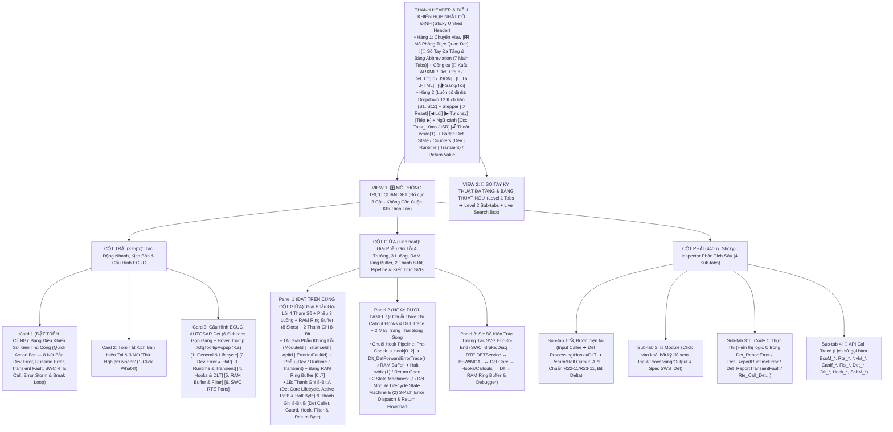
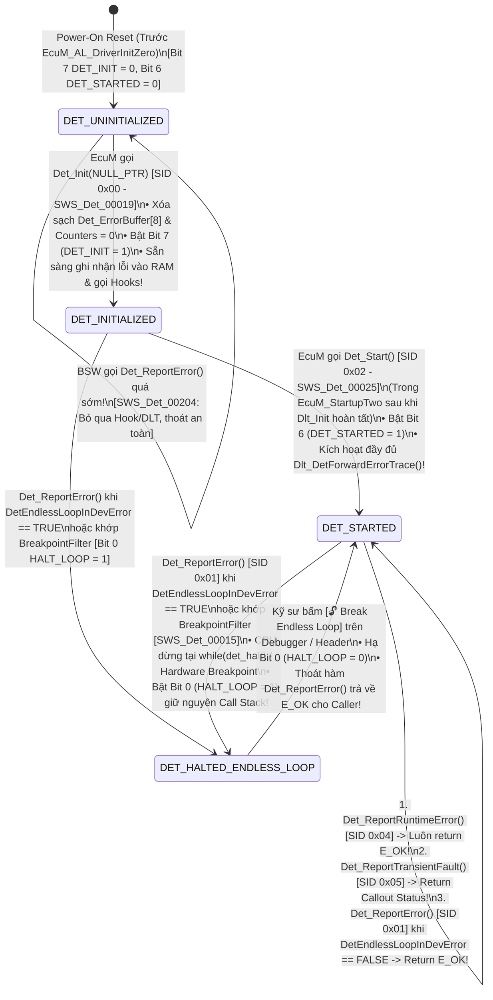
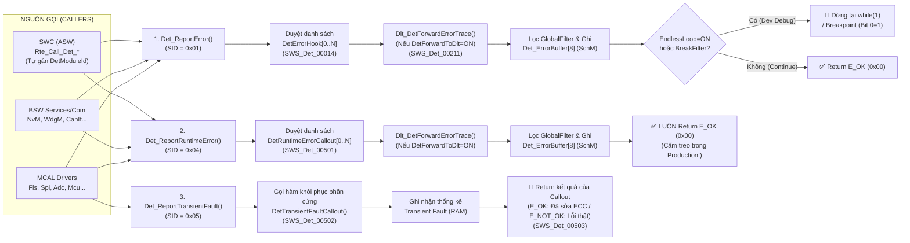

# Tài Liệu Thiết Kế Chi Tiết Trình Mô Phỏng AUTOSAR Det (`Det_Simulation_design.md`)

> **Trạng thái tài liệu:** Bản thiết kế chi tiết đã cập nhật theo xác nhận `A1`–`A4` của User — Sẵn sàng để User review trước khi triển khai code.  
> **File đích dự kiến xuất bản:** `d:\__Personal\AntiGravity\Simulation\03_Services\AUTOSAR_Det.html` (Ứng dụng Web Tương tác 1 file HTML độc lập, 100% Offline, Pure CSS, có nút tải `.HTML` kèm cấu hình nhúng & xuất code `ARXML / Det_Cfg.h / Det_Cfg.c / JSON`).  
> **Chuẩn tham chiếu:** **AUTOSAR Classic Platform R20-11 / R22-11 / R23-11 (`SWS_Det`, `SWS_Dlt`, `SWS_Dem`, `SWS_EcuM`, `SWS_BswM`, `SWS_Rte`, `SWS_Os`, `SWS_NvM`, `SWS_WdgM`, `SWS_CanIf`, `SWS_Fls`, `SWS_Spi`, `SWS_Adc`, `SWS_Mcu`)**, đính kèm mã requirement chuẩn **`SWS_Det_xxxxx`** tại từng bước xử lý, Bảng Giải Phẫu Gói Lỗi 4 Trường (`ModuleId / InstanceId / ApiId / ErrorId`), Phễu Điều Phối 3 Luồng (`Development Error / Runtime Error / Transient Fault`), Bộ Đệm Vòng RAM (`Det_ErrorBuffer[8]`) + Bộ Lọc (`Filter / Breakpoint`), 2 thanh ghi 8-Bit tương tác, tooltip cấu hình và sổ tay tra cứu đa tầng.

---

## 1. Tổng Quan Định Hướng Thiết Kế Đã Chốt (`A1` – `A4`)

| Hạng mục | Nội dung thiết kế đã xác nhận với User |
| :--- | :--- |
| **1. Bố cục giao diện & Ưu tiên Không Cuộn Trang — Zero-Scroll (`A1`)** | Kết hợp tinh hoa của **`AUTOSAR_DEM.html`**, **`AUTOSAR_BswM.html`** và **`AUTOSAR_WdgM.html`**, tối ưu hóa **Above-the-Fold (Zero-Scroll)** để các khối thao tác và giám sát tần suất cao nhất luôn nằm ngay phần đầu mỗi cột trong khung màn hình:<br>• **Thanh Điều Khiển Hợp Nhất Cố Định (Sticky Unified Header)**:<br>  - **Hàng 1**: Chuyển View `[🎛️ Mô Phỏng Trực Quan Det]` \| `[📖 Sổ Tay Đa Tầng & Bảng Abbreviation (7 Main Tabs)]` + Công cụ `[🧾 Xuất ARXML / Det_Cfg.h / Det_Cfg.c / JSON]` \| `[💾 Tải .HTML]` \| `[🌗 Sáng/Tối]`.<br>  - **Hàng 2 (Luôn cố định)**: Dropdown chọn 12 Kịch bản (`S1`–`S12`), Stepper (`↺ Reset`, `◀ Lùi`, `▶ Tự chạy`, `Tiếp ▶`), Bộ điều khiển Ngữ cảnh Thực thi (`Context: Task_10ms / ISR_CanRx / Startup`, `+1 Tick / Step`, `🔓 Break Endless Loop`) và Badge Trạng thái `Det State` (`UNINIT / INITIALIZED / STARTED / HALTED`), Bộ đếm `Dev / Runtime / Transient Counts` & `Last Return Code`.<br>• **Bố cục 3 cột hiện đại (Mỗi cột tự cuộn độc lập trong khung Viewport)**:<br>  - **Cột Trái (`375px`)**: Đưa **Card 1: Bảng Điều Khiển Bắn Lỗi Thủ Công (`Quick Action Bar` — 8 nút bắn trực tiếp `Det_ReportError`, `Det_ReportRuntimeError`, `Det_ReportTransientFault`, `Rte_Call_Det`, `Storm/ISR`, `Break Loop`)** và **Card 2: Tóm tắt kịch bản & 3 nút 1-Click What-If** lên trên cùng, tiếp theo là **Card 3: 6 Sub-tabs Cấu hình ECUC Det** (hỗ trợ Floating Hover Tooltip `#cfgTooltipPopup` sau `>1s` giống hệt `AUTOSAR_DEM.html`).<br>  - **Cột Giữa (`Linh hoạt`)**: Đưa **Panel 1: Bảng Giải Phẫu Gói Lỗi 4 Trường (`ModuleId, InstanceId, ApiId, ErrorId/FaultId`) + Phễu 3 Luồng (`Dev / Runtime / Transient`) + Bộ Đệm Vòng RAM (`Det_ErrorBuffer[8]`) + 2 Thanh Ghi 8-Bit Tương Tác** và **Panel 2: Chuỗi Callout/Hook & DLT Forwarding Pipeline + 2 Máy Trạng Thái Song Song (`Det Lifecycle State Machine` & `3-Path Error Dispatch Pipeline`)** lên ngay đầu cột giữa; bên dưới là **Panel 3: Sơ Đồ Kiến Trúc Tương Tác SVG End-to-End** (`SWC_Brake/SWC_Diag ↔ RTE (DETService Port) ↔ BSW (NvM/WdgM/ComM/CanIf) & MCAL (Fls/Spi/Adc/Mcu) ↔ Det Core ↔ ErrorHooks / RuntimeCallouts / TransientCallouts ↔ Dlt ↔ RAM Ring Buffer & Debugger Breakpoint`).<br>  - **Cột Phải (`440px, Sticky`)**: Inspector 4 Sub-tabs (`🔍 Bước hiện tại`, `🧩 Module`, `📄 Code C Thực Thi`, `📜 API Call Trace`). |
| **2. Khu vực Giám sát Bit-level, Giải phẫu Gói lỗi 4 Trường & RAM Ring Buffer 2 Tầng (`A2`)** | Đặt **cố định và nổi bật ở đầu Cột Giữa** gồm **2 tầng trực quan hóa**:<br>• **Tầng 1 — Bảng Giải Phẫu Gói Lỗi 4 Tham Số (`4-Tuple Error Packet Anatomy`), Phễu Điều Phối 3 Luồng & Bộ Đệm Vòng RAM 8 Ngăn (`Det_ErrorBuffer[0..7]`)**:<br>  - Giải phẫu trực quan 4 tham số chuẩn của mọi API `Det`: **`ModuleId (uint16)`** (tự động giải mã sang tên module chuẩn như `13=WdgM`, `20=NvM`, `60=CanIf`, `92=Fls`, `2048=SWC_Brake`), **`InstanceId (uint8)`**, **`ApiId (uint8)`** (giải mã tên hàm gọi lỗi), và **`ErrorId / FaultId (uint8)`** (giải mã tên hằng số lỗi như `E_UNINIT`, `E_PARAM_POINTER`, `FLS_E_ECC_SINGLE_BIT`).<br>  - Phễu phân luồng trực quan 3 nhánh theo chuẩn AUTOSAR R20-11..R23-11: **(1) `Det_ReportError` (`SID 0x01` — Development Error)**, **(2) `Det_ReportRuntimeError` (`SID 0x04` — Runtime Error)**, và **(3) `Det_ReportTransientFault` (`SID 0x05` — Hardware Transient Fault)**.<br>  - **Bảng Bộ Đệm Vòng RAM (`Det_ErrorBuffer[8]`)**: Hiển thị trực tiếp 8 slot bộ nhớ vòng kèm con trỏ `WriteIdx / ReadIdx`, bộ đếm tràn `OverflowCnt`, trạng thái khớp bộ lọc `Global Filter / Breakpoint Filter` và cho phép click chọn từng bản ghi để soi chi tiết!<br>• **Tầng 2 — 2 Thanh ghi 8-Bit tương tác song song**:<br>  1. **Thanh A (`8-Bit Det Core Lifecycle, Active Path & Halt Control Byte` — `Det_CoreStatusByte`)**: Theo dõi trạng thái khởi tạo & luồng lỗi đang kích hoạt (`DET_INITIALIZED`, `DET_STARTED`, `ACTV_DEV_ERR`, `ACTV_RUNTIME_ERR`, `ACTV_TRANSIENT_FLT`, `DLT_FORWARDED`, `BUF_OVERFLOW`, `HALT_ENDLESS_LOOP`).<br>  2. **Thanh B (`8-Bit Det Caller Context, Guard, Hook, Filter & Return Byte` — `Det_PipelineFilterByte`)**: Theo dõi ngữ cảnh gọi, bộ lọc và giá trị trả về (`CALLER_SWC_RTE`, `ISR_NESTED_CTX`, `DEV_DETECT_ENA`, `HOOK_CALLOUT_OK`, `GLOBAL_FLT_MATCH`, `BRK_FLT_MATCH`, `FAULT_RECOVERY_RET`, `SELF_ERR_DETECT`). Cho phép click trực tiếp vào từng bit để giải mã hoặc thử nghiệm! |
| **3. Hệ thống 12 Kịch bản mẫu (`A3`)** | Thiết kế sẵn **12 Kịch bản (`S1`–`S12`)** chia làm 4 nhóm lớn:<br>• **Nhóm 1 (`S1`–`S3`) — Khởi Tạo Sớm `EcuM ➔ Det_Init / Det_Start` & Luồng `Development Error` (`Det_ReportError`)**: Khởi tạo `Det` tại `EcuM_AL_DriverInitZero` (trước mọi BSW khác!), bắt lỗi tham số từ BSW (`NvM_ReadBlock` / `CanIf_Transmit` báo `E_UNINIT`, `E_PARAM_POINTER`), và đối chiếu 2 chế độ hậu xử lý: **Dừng treo trong vòng lặp `while(1)` / Debugger Breakpoint** (Development Debug) vs **Thoát về `E_OK`** (Integration Test).<br>• **Nhóm 2 (`S4`–`S6`) — Tương Tác Với `SWC` Qua Cổng `RTE (DETService)` & Luồng `Runtime Error` (`Det_ReportRuntimeError`)**: `SWC_BrakeCtrl` gọi `Rte_Call_Det_ReportError(InstanceId, ApiId, ErrorId)` (trong đó `RTE` tự động điền `DetModuleId` cấu hình trong `DetServiceInstance`), `SWC` gọi `Rte_Call_Det_ReportRuntimeError()`, và luồng **`Det_ReportRuntimeError()` trong bản Production** (khi `xxxDevErrorDetect = FALSE` nhưng lỗi Runtime như đầy hàng đợi `NvM` / timeout `CanSM` vẫn được ghi nhận và **luôn trả về `E_OK` không bao giờ treo ECU**!).<br>• **Nhóm 3 (`S7`–`S9`) — Luồng `Transient Fault` (`Det_ReportTransientFault`) Từ `MCAL` & Chuỗi `Callout Hooks` + `DLT Forwarding`**: Driver `Fls` / `Spi` / `Mcu` phát hiện lỗi phần cứng thoáng qua (lật 1 bit ECC Flash/RAM do nhiễu điện từ EMI), gọi `Det_ReportTransientFault()` để `DetTransientFaultCallout` xóa cờ ECC và trả mã khôi phục (`E_OK` vs `E_NOT_OK`) về cho Driver tự thử lại; thực thi tuần tự danh sách đa Hook (`DetErrorHook[0..2]`) và đẩy khung trace sang **`Dlt_DetForwardErrorTrace()`**.<br>• **Nhóm 4 (`S10`–`S12`) — Quản Lý Bộ Đệm Vòng RAM (`FIFO vs Stop-on-Full`), Bộ Lọc (`Filter / Breakpoint`), Đa Nhiệm `Task/ISR Reentrancy`, Lỗi Tự Thân `Det_GetVersionInfo(NULL)` & Phân Định `DET vs DEM`**: Tràn bộ đệm vòng `Det_ErrorBuffer[8]` khi xảy ra bão lỗi (`Error Storm`), lọc bỏ lỗi nhiễu bằng `Global Filter` hoặc chỉ dừng Debugger đúng mã lỗi cần tìm bằng `Breakpoint Filter`, ngắt `ISR_CanRx` cắt ngang `Task_10ms` đang chạy trong `Det` (bảo vệ bằng `DET_EXCLUSIVE_AREA_0`), `Det` tự báo lỗi chính mình `DET_E_PARAM_POINTER (0x01)` khi gọi `Det_GetVersionInfo(NULL_PTR)`, và kịch bản song hành phân biệt rõ khi nào báo **`Det`** vs khi nào báo **`Dem`**. |
| **4. Sổ tay tra cứu đa tầng & Bảng Abbreviation (`A4`)** | **View 2 (`📖 Sổ Tay Kỹ Thuật Det & Từ Điển Thuật Ngữ`)** được tổ chức theo cấu trúc **Đa Tầng (Multi-level Tabs)**:<br>• **6 Main Sub-tabs (Level 1) × 4 Chủ đề con (Level 2 Pills/Tabs = 24 chuyên đề)** phân tích sâu sự tiến hóa từ *Development Error Tracer* sang *Default Error Tracer* (R20-11..R23-11), giải phẫu 3 luồng lỗi (`Dev / Runtime / Transient`), cơ chế nối cổng `RTE DETService` cho `SWC`, kiến trúc `Callout Hooks & DLT Forwarding`, thiết kế `RAM Ring Buffer / Filter / Exclusive Area`, bảng tra cứu nhanh `ModuleId / ServiceId / ErrorId` phổ biến và so sánh `DET vs DEM`.<br>• **Tab 7 chuyên biệt: `🔤 Bảng Thuật Ngữ & Từ Viết Tắt (Abbreviation Table)`** trình bày dưới dạng bảng chuẩn 4 cột, tích hợp **Search Box tìm kiếm tức thời (Live Search + Highlight `<mark>`)** và 5 nút lọc nhanh theo phân nhóm (`Det Core & 3 Error Types`, `SWC, RTE & BSW Callers`, `Hooks, DLT & Debugger`, `RAM Buffer, Filter & Safety`). |

---

## 2. Bố Cục Giao Diện 3 Cột Ưu Tiên Zero-Scroll & Hệ Thống Sub-Tabs (UI Wireframe)

Để giải quyết triệt để yêu cầu **"đưa các khối được dùng thường xuyên hơn lên phía trên để người dùng không cần cuộn chuột lên xuống mỗi lần thao tác"**, giao diện được thiết kế theo nguyên lý **Viewport-First (Mọi nút bắn lỗi thủ công, bộ chọn ngữ cảnh SWC/BSW/MCAL, Bảng Giải Phẫu Gói Lỗi 4 Trường, Bộ Đệm Vòng RAM 8 Slot, 2 Thanh ghi 8-bit và Chuỗi Callout/DLT đều nằm ngay trong khung nhìn đầu tiên)**:



### Điểm Cải Tiến Đột Phá Về Trải Nghiệm "Zero-Scroll" Cho Module `Det`:
1. **Thanh Điều Khiển Hợp Nhất (`Sticky Unified Header`) Với Bộ Chọn Ngữ Cảnh & Nút Giải Cứu `🔓 Break Endless Loop`**:
   - Khi một lỗi **Development Error** (`Det_ReportError`) xảy ra trong lúc bật cấu hình **`DetEndlessLoopInDevError = TRUE`**, CPU mô phỏng sẽ bị giữ lại ở vòng lặp `while(1)` (biểu diễn trạng thái đứng máy chờ Debugger dừng tại Hardware Breakpoint). Nút **`🔓 Break Endless Loop (Resume E_OK)`** nằm ngay trên thanh Header cố định cho phép người dùng "nhả" CPU thoát khỏi vòng lặp bất kỳ lúc nào giống như gán biến `det_continue = 1` trên Trace32 / Lauterbach Debugger!
2. **Đưa `Quick Action Bar` (8 nút bắn lỗi trực tiếp) lên vị trí Card 1 (Đầu Cột Trái)** và đưa **Bảng Giải Phẫu Gói Lỗi 4 Tham Số + Bộ Đệm Vòng RAM (`Det_ErrorBuffer[8]`) + 2 Thanh Ghi 8-Bit** lên đầu Cột Giữa: Khi bấm bắn một lỗi từ `BSW (NvM/CanIf)`, `SWC (qua RTE)` hoặc `MCAL (Fls ECC Transient Fault)`, mắt người dùng nhìn thấy ngay lập tức gói 4 tham số `(ModuleId, InstanceId, ApiId, ErrorId)` được bóc tách, đi vào nhánh `Dev / Runtime / Transient`, kích hoạt các đèn `Hook[0..2]` & `DLT`, ghi vào dòng tiếp theo của `Det_ErrorBuffer[0..7]` và đổi trạng thái từng Bit trên Thanh A/B mà **không phải cuộn trang**.
3. **Gom 36 tham số ECUC vào 6 Sub-tabs gọn gàng**: Chiều cao Card Cấu hình được giữ gọn cố định (~275px), kèm hộp thoại giải thích nổi `#cfgTooltipPopup` khi hover quá `1000ms` giống hệt file `AUTOSAR_DEM.html`.

---

## 3. Thiết Kế Chi Tiết Panel 1 (Đầu Cột Giữa): Bảng Giải Phẫu Gói Lỗi 4 Trường, Phễu 3 Luồng, Bộ Đệm Vòng RAM (`Det_ErrorBuffer[8]`) & 2 Thanh Ghi 8-Bit Tương Tác

Theo chuẩn **AUTOSAR Classic R20-11 / R22-11 / R23-11 (`SWS_Det_00001`, `SWS_Det_00207`, `SWS_Det_00209`)**, `Det` không còn chỉ bắt lỗi lập trình lúc phát triển như thời AUTOSAR 3.x/4.0, mà là **trung tâm thu thập và điều phối 3 loại sự kiện lỗi khác nhau về bản chất** dựa trên cùng một cấu trúc định danh **4 tham số (`4-Tuple Error Signature`)**:
1. **`ModuleId (uint16)`**: Mã định danh duy nhất của module báo lỗi (BSW Module ID chuẩn từ `AUTOSAR_TR_BSWModuleList` như `13 = WdgM`, `15 = Det`, `20 = NvM`, `60 = CanIf`, `92 = Fls`; hoặc `SwcModuleId >= 2048` được gán tự động bởi `RTE` thông qua `DetServiceInstance`).
2. **`InstanceId (uint8)`**: Mã định danh thực thể/kênh phần cứng bên trong module đó (ví dụ `0` cho module đơn thể, hoặc `Channel = 0..3` cho `CanIf` / `Spi` / `Adc`, hoặc `InstanceId` do `SWC` truyền qua `RTE`).
3. **`ApiId (uint8)`**: Mã định danh hàm API (`Service ID — SID`) nơi phát hiện ra lỗi (ví dụ `0x06 = NvM_ReadBlock`, `0x0E = WdgM_CheckpointReached`, `0x03 = Det_GetVersionInfo`).
4. **`ErrorId` hoặc `FaultId (uint8)`**: Mã định danh lỗi cụ thể trong phạm vi module đó (ví dụ `0x01 = DET_E_PARAM_POINTER`, `0x14 = NVM_E_UNINIT`, `0x1A = NVM_E_QUEUE_FULL`, `0x08 = FLS_E_ECC_SINGLE_BIT_CORRECTED`).

Do đó, Panel 1 ở đầu Cột Giữa được thiết kế gồm **2 tầng trực quan hóa liên thông**:

### 3.1. Phần 1A — Bảng Giải Phẫu Gói Lỗi 4 Tham Số (`4-Tuple Anatomy`), Phễu 3 Luồng & Bảng Bộ Đệm Vòng RAM 8 Ngăn (`Det_ErrorBuffer[0..7]`)

```text
+-------------------------------------------------------------------------------------------------------------------+
| 🛡️ BẢNG GIẢI PHẪU GÓI LỖI 4 THAM SỐ, PHỄU 3 LUỒNG DET & BỘ ĐỆM VÒNG RAM (`SWS_Det_00039`, `00501`, `00502`, `00211`)|
| Trạng thái: [DET_STARTED] | Luồng актив: [SID 0x01: Dev Error] | Đếm: [Dev:3 | Run:1 | Trn:1] | Return: [HALT/E_OK]|
+-------------------------------------------------------------------------------------------------------------------+
| 1. GIẢI PHẪU GÓI LỖI ĐANG XỬ LÝ (`4-Tuple Error Packet Decoder`) & PHỄU 3 LUỒNG (Click để đổi gói thử nghiệm):     |
|  +---------------------------+------------------------+---------------------------+------------------------------+ |
|  | 🧩 ModuleId (uint16)      | 🔢 InstanceId (uint8)  | ⚙️ ApiId / SID (uint8)    | 🚨 ErrorId / FaultId (uint8) | |
|  | [ 0x0014 (Dec: 20)      ] | [ 0x00 (Instance #0) ] | [ 0x07 (NvM_WriteBlock) ] | [ 0x15 (NVM_E_PARAM_BLOCK) ] | |
|  | Giải mã: NvM (NVRAM Mgr)  | Nguồn: BSW Direct C API| Hàm: NvM_WriteBlock(99,p) | Loại: Development Error      | |
|  +---------------------------+------------------------+---------------------------+------------------------------+ |
|  | 🔀 PHỄU ĐIỀU PHỐI 3 LUỒNG CHUẨN AUTOSAR R23-11:                                                                | |
|  |  • [▶ 1. Det_ReportError (0x01)      ]: DevDetect=ON ➔ ErrorHooks[2] ➔ Dlt_Forward ➔ Buffer ➔ [Halt / E_OK]    | |
|  |  • [  2. Det_ReportRuntimeError(0x04)]: Luôn bật (Prod) ➔ RuntimeCallouts ➔ Dlt_Forward ➔ Buffer ➔ [Luôn E_OK!]| |
|  |  • [  3. Det_ReportTransientFault(05)]: HW Glitch (MCAL)➔ TransientCallout ➔ Khôi phục ECC ➔ [Return Callout]  | |
+-------------------------------------------------------------------------------------------------------------------+
| 2. BỘ ĐỆM VÒNG RAM NỘI BỘ (`Det_ErrorBuffer[8]` — Mode: [FIFO Ring] | WriteIdx: 4 | Overflow: 0 | Filter: ACTIVE): |
|  +------+----------+-------------+------------------+--------+------------------+-------------------+------------+ |
|  | Slot | Thời gian| Phân loại   | ModuleId (Tên)   | InstId | ApiId (Tên hàm)  | ErrorId / FaultId | Hành động  | |
|  +------+----------+-------------+------------------+--------+------------------+-------------------+------------+ |
|  | #0   | t=10 ms  | DEV (0x01)  | 0x003C (CanIf)   | 0x00   | 0x05 (Transmit)  | 0x1E (E_UNINIT)   | Logged+DLT | |
|  | #1   | t=20 ms  | DEV (0x01)  | 0x0800 (SWC_Brk) | 0x01   | 0x02 (CalcABS)   | 0x0A (E_RANGE)    | Via RTE    | |
|  | #2   | t=35 ms  | RUN (0x04)  | 0x0014 (NvM)     | 0x00   | 0x07 (WriteBlock)| 0x1A (QUEUE_FULL) | Prod E_OK  | |
|  | #3   | t=42 ms  | TRN (0x05)  | 0x005C (Fls)     | 0x00   | 0x08 (MainFunc)  | 0x08 (ECC_1BIT)   | Recovered! | |
|  | #4★  | t=50 ms  | DEV (0x01)  | 0x0014 (NvM)     | 0x00   | 0x07 (WriteBlock)| 0x15 (PARAM_BLK)  | BRK HALT!  | |
|  | #5..7| ---      | [ EMPTY ]   | ---              | ---    | ---              | ---               | Free Slot  | |
|  +------+----------+-------------+------------------+--------+------------------+-------------------+------------+ |
+-------------------------------------------------------------------------------------------------------------------+
```

- **Tính năng tương tác trực tiếp trên Phần 1A**:
  - Người dùng có thể **click vào bất kỳ hàng nào trong 8 ngăn của `Det_ErrorBuffer[0..7]`** để nạp lại gói lỗi 4 trường đó lên khung Giải Phẫu phía trên và xem lại toàn bộ Call Stack / Code C tại thời điểm lỗi xảy ra.
  - Có thể sửa trực tiếp các ô `ModuleId`, `InstanceId`, `ApiId`, `ErrorId` ngay trên khung Giải Phẫu rồi bấm **`⚡ Inject Custom 4-Tuple`** để xem `Det` tự động tra từ điển giải mã tên Module/API và chạy qua các bộ lọc `Global Filter` / `Breakpoint Filter`!

### 3.2. Phần 1B — 2 Thanh Ghi 8-Bit Trạng Thái Tương Tác Luôn Hiển Thị Nổi Bật

Ngay bên dưới Phần 1A là **2 Thanh ghi 8-Bit tương tác** theo đúng phong cách chuẩn của `AUTOSAR_DEM.html`, `AUTOSAR_BswM.html` và `AUTOSAR_WdgM.html`:

```text
+-------------------------------------------------------------------------------------------------------------------+
| 🔢 BẢNG GIÁM SÁT BITFIELD 8-BIT DET CORE & PIPELINE CONTROL (LIVE 8-BIT INSPECTOR) [Click vào từng Bit để thử]    |
| Bước #4: NvM gọi Det_ReportError(20, 0, 0x07, 0x15) ➔ Chạy Hook & DLT ➔ Khớp Breakpoint Filter | A: 0xE5 | B: 0x34|
+-------------------------------------------------------------------------------------------------------------------+
| A. THANH GHI 8-BIT VÒNG ĐỜI DET, LUỒNG LỖI & DỪNG KHẨN (`Det_CoreStatusByte`) — Hex: [ 0xE5 ]   Bin: [ 1110 0101b ]|
|    Lifecycle: [ DET_STARTED ] | Active Stream: [ DEV_ERROR (0x01) ] | DLT Trace: [ SENT ] | CPU: [ HALTED while(1)]|
|  +-------------+ +-------------+ +-------------+ +-------------+ +-------------+ +-------------+ +-------+ +-----+|
|  | Bit 7 (0x80)| | Bit 6 (0x40)| | Bit 5 (0x20)| | Bit 4 (0x10)| | Bit 3 (0x08)| | Bit 2 (0x04)| |Bit1(2)| |Bit 0||
|  | DET_INIT    | | DET_STARTED | | ACTV_DEV    | | ACTV_RUNTM  | | ACTV_TRANS  | | DLT_FWD_OK  | |BUF_OVF| |HALT!||
|  |      1      | |      1      | |      1      | |      0      | |      0      | |      1      | |   0   | |  1  ||
|  | Initialized | | Started=ON  | | SID 0x01    | | SID 0x04 Off| | SID 0x05 Off| | Dlt Sent    | |Buf OK | |Loop!||
|  +-------------+ +-------------+ +-------------+ +-------------+ +-------------+ +-------------+ +-------+ +-----+|
+-------------------------------------------------------------------------------------------------------------------+
| B. THANH GHI 8-BIT NGỮ CẢNH GỌI, CỔNG BẢO VỆ, HOOK, BỘ LỌC & KẾT QUẢ (`Det_PipelineFilterByte`) — Hex: [ 0x34 ]   |
|    Caller: [ BSW Direct (Task) ] | Guard: [ DevErrorDetect=ON ] | Hooks: [ 2/2 Run ] | Return: [ Pending / E_OK ] |
|  +-------------+ +-------------+ +-------------+ +-------------+ +-------------+ +-------------+ +-------+ +-----+|
|  | Bit 7 (0x80)| | Bit 6 (0x40)| | Bit 5 (0x20)| | Bit 4 (0x10)| | Bit 3 (0x08)| | Bit 2 (0x04)| |Bit1(2)| |Bit 0||
|  | VIA_RTE_SWC | | ISR_REENTR  | | DEV_DET_ENA | | HOOK_EXEC   | | GLB_FILTER  | | BRK_FILTER  | |FLT_REC| |SELF!||
|  |      0      | |      0      | |      1      | |      1      | |      0      | |      1      | |   0   | |  0  ||
|  | BSW/MCAL C  | | Normal Task | | Preproc ON  | | Callout Run | | Not Filtered| | Break Match!| |StdRet | |NoSlE||
|  +-------------+ +-------------+ +-------------+ +-------------+ +-------------+ +-------------+ +-------+ +-----+|
+-------------------------------------------------------------------------------------------------------------------+
```

#### 3.2.1. Giải Mã Chi Tiết Thanh A: `8-Bit Det Core Lifecycle, Active Path & Halt Control Byte` (`Det_CoreStatusByte`)

| Bit | Mask | Tên Cờ (`Det Core Bit`) | Ý nghĩa kỹ thuật & Khi nào bật lên `1` (`0 ➔ 1`) | Khi nào hạ về `0` (`1 ➔ 0`) |
| :-: | :-: | :--- | :--- | :--- |
| **Bit 7** | `0x80` | **`DET_INIT`** | Bật lên `1` ngay sau khi `EcuM` gọi **`Det_Init(NULL_PTR)`** (`SID = 0x00`, `SWS_Det_00019`, `SWS_Det_00020`) trong pha khởi tạo sớm `EcuM_AL_DriverInitZero`. Khởi tạo bộ đệm vòng `Det_ErrorBuffer`, xóa các bộ đếm lỗi về `0` và sẵn sàng nhận báo cáo lỗi từ mọi module khác. | Hạ về `0` khi ECU vừa cấp nguồn (trước `Det_Init`) hoặc khi người dùng tắt Checkbox `DetInitialized` để kiểm thử trường hợp một module BSW gọi `Det_ReportError()` khi chính `Det` còn chưa được khởi tạo (`SWS_Det_00204`: `Det` bỏ qua hoặc xử lý an toàn không gây treo). |
| **Bit 6** | `0x40` | **`DET_STARTED`** | Bật lên `1` sau khi `EcuM` gọi **`Det_Start()`** (`SID = 0x02`, `SWS_Det_00025`, `SWS_Det_00026`) trong pha `EcuM_StartupTwo`. Đánh dấu `Det` đã bước vào chế độ hoạt động hoàn chỉnh (sẵn sàng chuyển tiếp qua `Dlt` sau khi `Dlt_Init` đã xong). | Hạ về `0` khi mới chỉ chạy `Det_Init()` mà chưa gọi `Det_Start()`, hoặc khi Reset hệ thống. |
| **Bit 5** | `0x20` | **`ACTV_DEV`**<br>*(`SID 0x01`)* | Bật lên `1` khi `Det` đang xử lý một lời gọi **`Det_ReportError(ModuleId, InstanceId, ApiId, ErrorId)`** (`SID = 0x01`, `SWS_Det_00039`) — đại diện cho **Development Error** (lỗi logic lập trình, sai tham số đầu vào, con trỏ `NULL`, gọi hàm khi chưa `Init`). | Hạ về `0` khi chuyển sang xử lý loại lỗi khác (`Runtime Error` hoặc `Transient Fault`) hoặc khi Reset. |
| **Bit 4** | `0x10` | **`ACTV_RUNTM`**<br>*(`SID 0x04`)* | Bật lên `1` khi `Det` đang xử lý lời gọi **`Det_ReportRuntimeError(ModuleId, InstanceId, ApiId, ErrorId)`** (`SID = 0x04`, `SWS_Det_00501`) — đại diện cho **Runtime Error** xảy ra trong quá trình vận hành thực tế (hàng đợi đầy, tràn bộ đệm, xung đột trạng thái, mất đồng bộ thời gian thực). | Hạ về `0` khi chuyển sang xử lý `Development Error` / `Transient Fault` hoặc khi Reset. |
| **Bit 3** | `0x08` | **`ACTV_TRANS`**<br>*(`SID 0x05`)* | Bật lên `1` khi `Det` đang xử lý lời gọi **`Det_ReportTransientFault(ModuleId, InstanceId, ApiId, FaultId)`** (`SID = 0x05`, `SWS_Det_00502`) — đại diện cho **Transient Fault** (lỗi phần cứng thoáng qua tại tầng MCAL/ECU Abstraction như lật bit ECC bộ nhớ Flash/RAM, nhiễu thanh ghi ngoại vi SPI/ADC). | Hạ về `0` khi chuyển sang xử lý loại lỗi khác hoặc khi Reset. |
| **Bit 2** | `0x04` | **`DLT_FWD_OK`** | Bật lên `1` khi cấu hình **`DetForwardToDlt = TRUE`** (`ECUC_Det_00006`) và `Det` đã gọi thành công hàm **`Dlt_DetForwardErrorTrace(ModuleId, InstanceId, ApiId, ErrorId)`** (`SWS_Det_00211`) để đóng gói và truyền bản tin lỗi qua giao thức AUTOSAR DLT ra máy tính chẩn đoán bên ngoài. | Hạ về `0` khi tắt `DetForwardToDlt = FALSE`, hoặc đối với luồng `Det_ReportTransientFault()` (theo chuẩn `SWS_Det_00502`, Transient Fault chỉ gọi Callout chứ không gọi `Dlt_DetForwardErrorTrace`). |
| **Bit 1** | `0x02` | **`BUF_OVF`** | Bật lên `1` khi số lượng lỗi đổ về vượt quá dung lượng **Bộ Đệm Vòng RAM (`Det_ErrorBufferSize = 8`)**:<br>• Nếu ở chế độ **`FIFO Ring (Overwrite Oldest)`**: Ghi đè lên slot cũ nhất và bật cờ báo đã có lịch sử bị ghi đè.<br>• Nếu ở chế độ **`Stop-on-Full (Keep First 8)`**: Từ chối ghi thêm vào mảng để bảo toàn 8 lỗi gốc đầu tiên gây ra hiệu ứng domino! | Hạ về `0` khi bấm nút `Clear RAM Buffer` hoặc khi chạy lại `Det_Init(NULL_PTR)`. |
| **Bit 0** | `0x01` | **`HALT_LOOP`**<br>*(`while(1)` / Brk)* | Bật lên `1` khi một **Development Error (`Det_ReportError`)** đi tới bước cuối cùng trong lúc bật **`DetEndlessLoopInDevError = TRUE`** (hoặc gói lỗi khớp với **`Breakpoint Filter`**): CPU đi vào vòng lặp vô tận `while(det_halt_flag)` / lệnh hợp ngữ `__asm("BKPT #0")` để giữ nguyên hiện trường Call Stack cho kỹ sư cắm JTAG/Debugger kiểm tra (`SWS_Det_00015`)! | Hạ về `0` khi người dùng bấm nút **`🔓 Break Endless Loop`** trên Header, khi cấu hình `DetEndlessLoopInDevError = FALSE` (trả về `E_OK` ngay), hoặc trong mọi trường hợp của **`Det_ReportRuntimeError()`** và **`Det_ReportTransientFault()`** (2 hàm này **cấm tuyệt đối** việc lặp vô tận!). |

#### 3.2.2. Giải Mã Chi Tiết Thanh B: `8-Bit Det Caller Context, Guard, Hook, Filter & Return Byte` (`Det_PipelineFilterByte`)

| Bit | Mask | Tên Cờ (`Det Pipeline Bit`) | Ý nghĩa kỹ thuật & Khi nào bật lên `1` (`0 ➔ 1`) | Khi nào hạ về `0` (`1 ➔ 0`) |
| :-: | :-: | :--- | :--- | :--- |
| **Bit 7** | `0x80` | **`VIA_RTE_SWC`** | Bật lên `1` khi lỗi được báo cáo từ một **Application SWC (`SWC_BrakeCtrl`, `SWC_DiagApp`)** đi qua cổng dịch vụ chuẩn **`DETService` của `RTE`** (`Rte_Call_Det_ReportError(InstanceId, ApiId, ErrorId)` hoặc `Rte_Call_Det_ReportRuntimeError(...)` — `SWS_Det_00003`, `SWS_Det_00210`). Lúc này `RTE` tự động chèn tham số đầu tiên `ModuleId = DetModuleId`! | Hạ về `0` khi lỗi được gọi trực tiếp bằng hàm C (`#include "Det.h"`) từ một module **BSW, MCAL hoặc CDD** (nơi module gọi tự truyền đầy đủ cả 4 tham số bao gồm `ModuleId`). |
| **Bit 6** | `0x40` | **`ISR_REENTR`** | Bật lên `1` khi hàm báo lỗi của `Det` được gọi từ **Ngữ cảnh Ngắt (`ISR Cat2`) hoặc Task ưu tiên cao cắt ngang (Preempt)** một Task khác cũng đang ở bên trong `Det`! Minh họa tính chất **Reentrant (Tái nhập an toàn)** của toàn bộ API `Det` (`SWS_Det_00039`) nhờ vùng bảo vệ `SchM_Enter_Det_DET_EXCLUSIVE_AREA_0()`. | Hạ về `0` khi lời gọi diễn ra tuần tự trong một Task thông thường mà không có sự cắt ngang đồng thời. |
| **Bit 5** | `0x20` | **`DEV_DET_ENA`** | Bật lên `1` khi công tắc tiền xử lý **`xxxDevErrorDetect == STD_ON`** tại module gọi đang được bật, cho phép nhánh kiểm tra `#if (XXX_DEV_ERROR_DETECT == STD_ON)` gọi xuống `Det_ReportError()`. | Hạ về `0` khi biên dịch bản **Production Release (`xxxDevErrorDetect = STD_OFF`)**: Toàn bộ lời gọi `Det_ReportError()` của BSW được loại bỏ khỏi mã máy để tiết kiệm CPU/Flash, **NHƯNG các lời gọi `Det_ReportRuntimeError()` và `Det_ReportTransientFault()` VẪN HOẠT ĐỘNG BÌNH THƯỜNG**! |
| **Bit 4** | `0x10` | **`HOOK_EXEC`** | Bật lên `1` khi `Det` thực thi tuần tự các hàm Callback/Hook do người dùng cấu hình (`SWS_Det_00014`, `SWS_Det_00018`, `SWS_Det_00501`, `SWS_Det_00502`):<br>• `DetErrorHook[]` cho Development Error.<br>• `DetRuntimeErrorCallout[]` cho Runtime Error.<br>• `DetTransientFaultCallout` cho Transient Fault. | Hạ về `0` khi không có hàm Hook/Callout nào được cấu hình trong danh sách ECUC tương ứng (hoặc khi bị tắt qua Checkbox cấu hình). |
| **Bit 3** | `0x08` | **`GLB_FILTER`** | Bật lên `1` khi gói lỗi `(ModuleId, InstanceId, ApiId, ErrorId)` **khớp với Bộ Lọc Chặn (`DetGlobalFilter`)**: Gói lỗi này được nhận diện là lỗi đã biết/lỗi nhiễu lặp lại nên được **lọc bỏ không ghi vào `Det_ErrorBuffer`** (tránh làm tràn bộ đệm RAM bởi một lỗi lặp mỗi `1ms`). | Hạ về `0` khi bộ lọc tắt hoặc khi gói lỗi không nằm trong danh sách bị chặn (được ghi vào `Det_ErrorBuffer` bình thường). |
| **Bit 2** | `0x04` | **`BRK_FILTER`** | Bật lên `1` khi gói lỗi **khớp chính xác với Bộ Lọc Điểm Dừng (`DetBreakpointFilter`)**: Cho phép kỹ sư cấu hình `Det` chạy xuyên qua (`Return E_OK`) mọi lỗi thông thường, nhưng **chỉ dừng `while(1)` / kích hoạt Breakpoint ngay khi bắt gặp đúng mã `ModuleId / ErrorId` đang cần săn tìm**! | Hạ về `0` khi gói lỗi không khớp điều kiện `Breakpoint Filter`. |
| **Bit 1** | `0x02` | **`FLT_REC_RET`** | Bật lên `1` trong luồng **`Det_ReportTransientFault()`** khi hàm **`DetTransientFaultCallout`** xử lý khôi phục phần cứng và trả về một mã điều khiển đặc biệt (hoặc khi phân biệt giá trị trả về của `Det_ReportTransientFault` phụ thuộc hoàn toàn vào kết quả của Callout theo **`SWS_Det_00503`**, khác với `Det_ReportError / Det_ReportRuntimeError` luôn trả về `E_OK`!). | Hạ về `0` trong các luồng `Det_ReportError` và `Det_ReportRuntimeError` (vốn luôn cố định trả về `E_OK` khi thoát hàm), hoặc khi `TransientFaultCallout` trả về `E_OK` mặc định. |
| **Bit 0** | `0x01` | **`SELF_ERR`**<br>*(`0x01 NULL_PTR`)* | Bật lên `1` trong tình huống kinh điển theo chuẩn **`SWS_Det_00028` & `SWS_Det_00301`**: Khi một module gọi **`Det_GetVersionInfo(NULL_PTR)`** (`SID = 0x03`) với con trỏ rỗng, **chính module `Det` (`ModuleId = 15 / 0x000F`) sẽ tự gọi `Det_ReportError(15, 0, 0x03, DET_E_PARAM_POINTER = 0x01)` để báo lỗi cho chính mình**! | Hạ về `0` khi gọi `Det_GetVersionInfo(&versionInfo)` với con trỏ hợp lệ hoặc trong các luồng báo lỗi từ module khác. |

---

## 4. Phân Tích Xử Lý Từng Module: Input Lấy Từ Đâu, Xử Lý Gì, Output Route Đến Đâu

Mọi khối trên sơ đồ kiến trúc SVG đều có thể **click vào để xem giải thích chi tiết** ở cột phải (Tab `🧩 Module`) và được tổng hợp đầy đủ trong **Tab 1 của Sổ tay**:

| # | Module / Phân khối | Lớp AUTOSAR | 📥 Input lấy từ đâu? | ⚙️ Cách xử lý nội bộ (Processing, Guards & Context) | 📤 Output route đến đâu & Hàm API chuẩn (R20-11 / R22-11 / R23-11) |
| :-: | :--- | :--- | :--- | :--- | :--- |
| **1** | **`SWC_BrakeCtrl` & `SWC_DiagApp`**<br>*(Application Software Components)* | Application Layer (ASW) | • Nhận dữ liệu cảm biến / tín hiệu từ `RTE` (`Rte_Read_*`).<br>• Được kích hoạt bởi `TimingEvent` (`Runnable_10ms`) hoặc `OperationInvokedEvent`. | • **1. Kiểm tra tính hợp lệ dữ liệu ứng dụng (Development Check)**: Phát hiện dữ liệu cấu hình/con trỏ nội bộ hoặc trạng thái máy trạng thái của SWC bị sai lệch trong quá trình phát triển.<br>• **2. Kiểm tra giới hạn vận hành thực tế (Runtime Check)**: Phát hiện giá trị đầu vào vượt ngưỡng tính toán hoặc bộ đệm nội bộ của SWC bị đầy khi đang chạy thực tế.<br>• **Đặc điểm quan trọng (`SWS_Det_00003`)**: `SWC` **không truyền `ModuleId`** khi gọi port! Nó chỉ truyền 3 tham số `(InstanceId, ApiId, ErrorId)` qua `Client-Server Port` kết nối tới `DETService`. | • Gọi qua **RTE** xuống **Det**:<br>`Rte_Call_Det_ReportError(InstanceId, ApiId, ErrorId)`<br>`Rte_Call_Det_ReportRuntimeError(InstanceId, ApiId, ErrorId)`<br>*(Lưu ý: Theo chuẩn AUTOSAR, SWC không gọi `ReportTransientFault` vì Transient Fault dành riêng cho tầng phần cứng/BSW!)* |
| **2** | **`RTE` & `SchM`**<br>*(Runtime Environment & BSW Scheduler)* | RTE Layer | • Nhận lời gọi `Rte_Call_Det_*` từ các `SWC`.<br>• Nhận yêu cầu khóa vùng găng `SchM_Enter_Det_*` từ `Det`. | • **1. Cơ chế `Port-Defined Argument Value` cho `DetModuleId` (`SWS_Det_00210`)**: Mỗi `SWC` kết nối vào một `DetServiceInstance` riêng trong cấu hình ECUC của `Det` (ví dụ `SWC_BrakeCtrl` gắn với `DetModuleId = 2048 / 0x0800`, `SWC_DiagApp` gắn với `DetModuleId = 2049 / 0x0801`). Khi sinh code `Rte.c`, `RTE` tự động chèn hằng số `DetModuleId` này làm tham số đầu tiên khi gọi hàm C `Det_ReportError(2048, InstanceId, ApiId, ErrorId)`!<br>• **2. Bảo vệ Reentrancy (`SchM`)**: Cung cấp cặp hàm `SchM_Enter_Det_DET_EXCLUSIVE_AREA_0()` và `SchM_Exit_Det_DET_EXCLUSIVE_AREA_0()` (tạm khóa ngắt) khi `Det` ghi vào `Det_ErrorBuffer` để chống xung đột giữa `Task` và `ISR`. | • Định tuyến xuống **Det Core**:<br>`Det_ReportError(DetModuleId, InstanceId, ApiId, ErrorId)`<br>`Det_ReportRuntimeError(DetModuleId, InstanceId, ApiId, ErrorId)`<br>• Bảo vệ vùng găng:<br>`SchM_Enter_Det_DET_EXCLUSIVE_AREA_0()`<br>`SchM_Exit_Det_DET_EXCLUSIVE_AREA_0()` |
| **3** | **`BSW Services & Comm Stack`**<br>*(`NvM #20`, `WdgM #13`, `BswM #42`, `ComM #12`, `CanSM #140`, `PduR #51`)* | Services Layer | • Nhận lệnh gọi API từ `SWC / RTE` hoặc từ các module BSW khác.<br>• Chạy các hàm định kỳ `*_MainFunction()`. | • **1. Cổng bảo vệ tiền xử lý `Development Error` (`#if XXX_DEV_ERROR_DETECT == STD_ON`)**: Ở đầu mỗi hàm API, module BSW kiểm tra tuần tự:<br>  - Module đã khởi tạo chưa? (`!Initialized` ➔ báo `E_UNINIT`).<br>  - Con trỏ truyền vào có bị `NULL_PTR` không? (`Ptr == NULL_PTR` ➔ báo `E_PARAM_POINTER`).<br>  - Tham số ID/Mode có nằm ngoài dải cấu hình không? (`ID >= MAX` ➔ báo `E_PARAM_ID` / `E_PARAM_BLOCK_ID`).<br>• **2. Phát hiện `Runtime Error` (Không phụ thuộc `DevErrorDetect`!)**: Khi đang chạy thực tế mà hàng đợi `NvM` bị đầy (`NVM_E_QUEUE_FULL = 0x1A`), hoặc `CanSM` bị Bus-Off/Timeout, module gọi thẳng **`Det_ReportRuntimeError()`** rồi trả về `E_NOT_OK` an toàn. | • Gọi trực tiếp C API vào **Det**:<br>`Det_ReportError(ModuleId, InstanceId, ApiId, ErrorId)` [`SWS_Det_00039`]<br>`Det_ReportRuntimeError(ModuleId, InstanceId, ApiId, ErrorId)` [`SWS_Det_00501`] |
| **4** | **`ECU Abstraction & MCAL Drivers`**<br>*(`CanIf #60`, `Fls #92`, `Spi #83`, `Adc #123`, `Mcu #101`)* | ECU Abstraction & MCAL | • Nhận lệnh truy cập phần cứng từ tầng trên (`MemIf/Fee`, `IoHwAb`, `CanSM`).<br>• Đọc thanh ghi trạng thái phần cứng (`ECC Status`, `SPI Fault`, `ADC Overrun`). | • **1. Báo lỗi `Development Error` & `Runtime Error`**: Giống tầng Services (ví dụ `CanIf` báo `CANIF_E_PARAM_CANID`, `Fls` báo `FLS_E_BUSY` hoặc `FLS_E_TIMEOUT`).<br>• **2. Báo lỗi phần cứng thoáng qua (`Transient Fault` — `SWS_Det_00502`)**: Khi tia vũ trụ hoặc nhiễu điện từ (EMI) làm lật 1 bit trong ô nhớ Flash/RAM (được phần cứng ECC sửa tự động hoặc báo cờ `ECC Single/Double Bit Error`) hoặc thanh ghi điều khiển ngoại vi bị nhiễu tạm thời, Driver MCAL gọi **`Det_ReportTransientFault(ModuleId, InstanceId, ApiId, FaultId)`** và kiểm tra giá trị trả về để quyết định có đọc/ghi lại (Retry) hay báo hỏng hẳn lên `DEM`! | • Gọi trực tiếp C API vào **Det**:<br>`Det_ReportTransientFault(ModuleId, InstanceId, ApiId, FaultId)` [`SWS_Det_00502`]<br>`Det_ReportRuntimeError(...)`<br>`Det_ReportError(...)` |
| **5** | **`EcuM`**<br>*(ECU State Manager)* | System Services | • Bắt đầu chạy ngay từ `main()` sau khi khởi tạo стек C (`EcuM_Init`). | • **Quy tắc thứ tự khởi tạo sống còn trong AUTOSAR (`SWS_EcuM`, `SWS_Det_00019`)**:<br>  1. Trong pha **`EcuM_AL_DriverInitZero()`**, **`Det_Init(NULL_PTR)` bắt buộc phải được gọi ĐẦU TIÊN** trước tất cả các module MCAL và BSW khác! Lý do: Nếu `Mcu_Init()`, `Port_Init()` hay `Can_Init()` chạy ngay sau đó mà gặp lỗi cấu hình, chúng cần `Det` đã sẵn sàng để nhận `Det_ReportError()`.<br>  2. Trong pha **`EcuM_StartupTwo()`** (sau khi OS và `Dlt` đã khởi tạo), `EcuM` gọi tiếp **`Det_Start()`** để kích hoạt đầy đủ tính năng gửi trace của `Det`. | • Gọi điều khiển vòng đời **Det**:<br>`Det_Init(ConfigPtr)` [`SWS_Det_00019`]<br>`Det_Start()` [`SWS_Det_00025`] |
| **6** | **`Det Core Engine`**<br>*(Default Error Tracer — `ModuleId = 15`)* | System / Diagnostic Services | • Nhận `Det_Init`, `Det_Start`, `Det_GetVersionInfo`.<br>• Nhận 3 luồng báo lỗi:<br>  - `Det_ReportError` (`0x01`)<br>  - `Det_ReportRuntimeError` (`0x04`)<br>  - `Det_ReportTransientFault` (`0x05`) | • **1. Kiểm tra trạng thái `Det_Initialized` (`SWS_Det_00204`)**: Nếu `Det_Init()` chưa được gọi mà đã có module gọi báo lỗi, `Det` thoát an toàn (`return E_OK`) không thực thi Hook/DLT để tránh truy cập biến chưa khởi tạo.<br>• **2. Điều phối theo đúng chuẩn của từng luồng**:<br>  - **Luồng `Det_ReportError` (`0x01`)**: Duyệt gọi toàn bộ danh sách `DetErrorHook[]` (`SWS_Det_00014`) ➔ Nếu `DetForwardToDlt == TRUE`, gọi `Dlt_DetForwardErrorTrace()` (`SWS_Det_00211`) ➔ Kiểm tra `GlobalFilter` và ghi vào `Det_ErrorBuffer` (trong vùng găng `SchM`) ➔ Nếu `DetEndlessLoopInDevError == TRUE` hoặc khớp `BreakpointFilter`, dừng ở vòng lặp `while(1)`; ngược lại `return E_OK`.<br>  - **Luồng `Det_ReportRuntimeError` (`0x04`)**: Duyệt gọi toàn bộ danh sách `DetRuntimeErrorCallout[]` (`SWS_Det_00501`) ➔ Gọi `Dlt_DetForwardErrorTrace()` ➔ Ghi vào `Det_ErrorBuffer` ➔ **Luôn kết thúc bằng `return E_OK` (không bao giờ lặp vô tận!)**.<br>  - **Luồng `Det_ReportTransientFault` (`0x05`)**: Gọi hàm `DetTransientFaultCallout(ModuleId, InstanceId, ApiId, FaultId)` (`SWS_Det_00502`) ➔ Ghi nhận thống kê ➔ **Trả về đúng giá trị `Std_ReturnType` mà Callout đó trả về** (`SWS_Det_00503`; hoặc `E_OK` nếu không cấu hình Callout). | • Gọi sang **Hooks / Callouts**:<br>`Det_ErrorHook(ModuleId, InstanceId, ApiId, ErrorId)`<br>`Det_RuntimeErrorCallout(...)`<br>`Det_TransientFaultCallout(...)`<br>• Gọi sang **Dlt**:<br>`Dlt_DetForwardErrorTrace(ModuleId, InstanceId, ApiId, ErrorId)` [`SWS_Det_00211`]<br>• Tự báo lỗi chính mình khi `versioninfo == NULL_PTR`:<br>`Det_ReportError(15, 0, 0x03, DET_E_PARAM_POINTER)` [`SWS_Det_00301`] |
| **7** | **`User Callouts & Error Hooks`**<br>*(`DetErrorHook`, `DetRuntimeErrorCallout`, `DetTransientFaultCallout`)* | Integration / CDD Layer | • Được `Det Core` gọi đồng bộ ngay trong ngữ cảnh của hàm báo lỗi với đầy đủ 4 tham số `(ModuleId, InstanceId, ApiId, ErrorId/FaultId)`. | • **1. `DetErrorHook[]` (`SWS_Det_00181`)**: Hàm kiểu `Std_ReturnType (*)(uint16, uint8, uint8, uint8)`. Dùng để tích hợp ghi dấu vết lỗi vào vùng RAM chống xóa (`No-Init Crash Crumb`), bật đèn LED cảnh báo trên mạch phát triển hoặc đẩy nhanh ra cổng UART debug. *(Lưu ý: `SWS_Det_00180` nghiêm cấm Hook gọi đệ quy lại `Det_ReportError`!)*.<br>• **2. `DetRuntimeErrorCallout[]` (`SWS_Det_00504`)**: Ghi nhận thống kê lỗi vận hành vào RAM chẩn đoán nội bộ của OEM.<br>• **3. `DetTransientFaultCallout` (`SWS_Det_00505`)**: Can thiệp phần cứng ngay lập tức (ví dụ xóa thanh ghi cờ lỗi ECC của bộ điều khiển Flash/RAM, nạp lại thanh ghi cấu hình bị lật bit) và trả về `E_OK` (đã khắc phục) hoặc `E_NOT_OK` (lỗi thật sự, không thể khắc phục). | • Trả kết quả `Std_ReturnType` về cho **Det Core**.<br>• Cập nhật **No-Init Crash Crumb RAM** & thanh ghi phục hồi phần cứng **MCAL**. |
| **8** | **`Dlt`**<br>*(Diagnostic Log and Trace)* | System / Diagnostic Services | • Nhận lời gọi `Dlt_DetForwardErrorTrace(ModuleId, InstanceId, ApiId, ErrorId)` từ `Det`. | • Đóng gói 4 tham số lỗi của `Det` vào một bản tin chuẩn **AUTOSAR DLT Frame** với `ContextID = "DET "` và `ApplicationID = "BSW "`, gắn thêm dấu thời gian phần cứng (`Timestamp`) và đẩy xuống hàng đợi truyền thông (`UART / Ethernet SOME/IP / CAN`) tới phần mềm **GENIVI / AUTOSAR DLT Viewer** trên máy tính của kỹ sư. | • Phát gói tin chuẩn DLT:<br>`[DLT Header][App:BSW][Ctx:DET][Payload: ModId | InstId | ApiId | ErrId]` |
| **9** | **`Det RAM Ring Buffer & Filter Engine`**<br>*(`Det_ErrorBuffer[8]`, `GlobalFilter`, `BreakpointFilter`)* | Det Internal Memory | • Nhận gói lỗi 4 tham số từ `Det Core` bên trong vùng bảo vệ `DET_EXCLUSIVE_AREA_0`. | • **1. Kiểm tra `DetGlobalFilter`**: So khớp `(ModuleId, ErrorId)`. Nếu khớp bộ lọc chặn, tăng bộ đếm `FilteredCount++` và bỏ qua việc lưu vào RAM Buffer.<br>• **2. Lưu vào `Det_ErrorBuffer[8]`**: Hỗ trợ 2 chế độ cấu hình thực tế:<br>  - **`FIFO Ring Buffer`**: Con trỏ `WriteIdx = (WriteIdx + 1) % 8` xoay vòng liên tục, luôn giữ 8 lỗi mới nhất.<br>  - **`Linear Stop-on-Full`**: Khi đủ 8 lỗi (`Count == 8`), khóa mảng không ghi đè để giữ nguyên hiện trường 8 lỗi đầu tiên.<br>• **3. Kiểm tra `DetBreakpointFilter`**: Nếu gói lỗi khớp mẫu đang săn tìm, kích hoạt cờ dừng `Breakpoint` ngay lập tức! | • Cập nhật bảng trạng thái trực quan **8-Slot RAM Ring Buffer** trên giao diện mô phỏng.<br>• Lưu trữ cấu trúc `Det_ErrorEntryType`. |
| **10** | **`Hardware Debugger / ICE & Dem Reference`**<br>*(Lauterbach Trace32 / JTAG & DEM Comparison)* | Debug Environment & Diagnostic Stack | • Theo dõi con trỏ lệnh CPU khi chạm vào `Det_EndlessLoop` / `__BKPT(0)`.<br>• Đối chiếu với luồng `Dem_SetEventStatus()` từ BSW/SWC. | • **1. Tại `Det_EndlessLoop`**: Khi dừng trong vòng lặp `while(det_halt)`, kỹ sư dùng Debugger xem cửa sổ `Call Stack` để biết chính xác dòng code nào của module nào vừa truyền sai tham số, và có thể đổi biến `det_halt = 0` để cho CPU chạy tiếp.<br>• **2. Phân định ranh giới với `Dem` (`Diagnostic Event Manager`)**: Minh họa trực quan sự khác biệt: **`Det`** bắt lỗi lập trình/runtime/thoáng qua (lưu RAM / gửi DLT cho kỹ sư R&D), còn **`Dem`** quản lý các sự kiện lỗi sản xuất gắn với mã **DTC (Diagnostic Trouble Code)** có Debounce, lưu vào **`NvM` (Flash)** để kỹ thuật viên gara đọc qua dịch vụ **UDS `0x19`**! | • Dừng CPU tại `Hardware Breakpoint` hoặc giải phóng về `Caller` khi bấm **`🔓 Break Endless Loop`**.<br>• Hiển thị bảng đối chiếu trực tiếp `Det Trace (RAM/DLT)` vs `Dem DTC (NvM/UDS)`. |

---

## 5. Thiết Kế Chi Tiết 2 Máy Trạng Thái & Sơ Đồ Pipeline Của `Det` (Panel 2)

Trên Panel 2 của Cột Giữa, hệ thống hiển thị song song **Máy Trạng Thái Vòng Đời Của Module `Det`** và **Sơ Đồ Pipeline Điều Phối 3 Luồng Lỗi (`Dev / Runtime / Transient`)**:

### 5.1. Máy Trạng Thái Vòng Đời & Điều Khiển Của `Det` (`Det Lifecycle State Machine` — `SWS_Det_00019`..`00026`)



### 5.2. Sơ Đồ Pipeline Điều Phối 3 Luồng Lỗi Chuẩn AUTOSAR R20-11 / R22-11 / R23-11 (`3-Path Error Dispatch Pipeline`)

> **Điểm mấu chốt theo chuẩn AUTOSAR cần làm nổi bật trên giao diện**:
> - **Luồng 1 (`Det_ReportError` — `SID 0x01`)**: Phụ thuộc công tắc biên dịch `xxxDevErrorDetect`, gọi `DetErrorHook[]`, chuyển tiếp sang `Dlt`, lưu `RAM Buffer`, và **CÓ THỂ dừng CPU trong vòng lặp vô tận `while(1)`** (hoặc trả về `E_OK`).
> - **Luồng 2 (`Det_ReportRuntimeError` — `SID 0x04`)**: Luôn hoạt động cả trong bản Production, gọi `DetRuntimeErrorCallout[]`, chuyển tiếp sang `Dlt`, lưu `RAM Buffer`, và **BẮT BUỘC luôn trả về `E_OK` (tuyệt đối không được treo `while(1)`)**!
> - **Luồng 3 (`Det_ReportTransientFault` — `SID 0x05`)**: Dành cho lỗi phần cứng thoáng qua (ECC/Glitch), gọi `DetTransientFaultCallout`, **KHÔNG gọi `Dlt`**, và **trả về chính mã `Std_ReturnType` của hàm Callout** (hoặc `E_OK` nếu không có Callout) để Driver biết lỗi đã được khôi phục hay chưa!



---

## 6. Danh Mục Đầy Đủ 36 Trường Cấu Hình (Checkboxes & Textboxes — 6 Sub-Tabs) & Thiết Kế Hover Tooltip Giống File `DEM`

Ở Cột Trái (Card 3), toàn bộ 36 tham số cấu hình chuẩn ECUC `Det` và các cổng mở rộng thực tế được bố trí thành **Checkboxes, Textboxes, Number Spinners và Dropdowns** chia gọn vào **6 Sub-tabs**.  
Đặc biệt, **mọi ô cấu hình đều gắn thuộc tính `data-cfg-key` và hỗ trợ Floating Tooltip on Hover (`> 1s` delay hoặc click icon `ⓘ`) giống hệt `AUTOSAR_DEM.html`**.

### 6.1. Giao Diện & Cấu Trúc Dữ Liệu Của Floating Config Hover Tooltip (`#cfgTooltipPopup`)

Khi người dùng rê chuột giữ trên một ô cấu hình quá `1000ms` (hoặc bấm vào biểu tượng `ⓘ`), hộp thoại nổi `#cfgTooltipPopup` sẽ xuất hiện cạnh ô cấu hình với bố cục chuẩn của `AUTOSAR_DEM.html`:

```text
+----------------------------------------------------------------------------------------------------+
| 📘 Chuyển Tiếp Dữ Liệu Lỗi Sang Module DLT                       [SWS_Det_00211 | ECUC_Det_00006] |
| Det / DetGeneral / DetForwardToDlt                                                                 |
+----------------------------------------------------------------------------------------------------+
| Xác định xem module Det có tự động gọi hàm Dlt_DetForwardErrorTrace(ModuleId, InstanceId, ApiId,   |
| ErrorId) để đẩy thông tin lỗi sang module Dlt (Diagnostic Log and Trace) mỗi khi nhận được báo cáo |
| từ Det_ReportError() hoặc Det_ReportRuntimeError() hay không.                                      |
+-------------------------------------------------+--------------------------------------------------+
| Dải giá trị cho phép (Range):                   | Giá trị thường dùng (Typical):                   |
| TRUE (Enabled) / FALSE (Disabled)               | TRUE (khi ECU có cổng Ethernet/UART DLT Viewer)  |
+-------------------------------------------------+--------------------------------------------------+
| 💡 Lưu ý kỹ thuật: Theo chuẩn SWS_Det_00211 và SWS_Det_00502, tính năng DetForwardToDlt chỉ áp     |
| dụng cho Development Error (0x01) và Runtime Error (0x04), KHÔNG áp dụng cho Transient Fault (0x05)|
| để tránh làm nghẽn băng thông truyền thông khi xảy ra nhiễu phần cứng thoáng qua.                  |
+----------------------------------------------------------------------------------------------------+
```

### 6.2. Danh Sách Chi Tiết 36 Trường Cấu Hình Trong 6 Sub-Tabs

#### Sub-tab 1: `1. General & Lifecycle` (`DetGeneral` — Khởi Tạo, Phiên Bản & Chế Độ Vận Hành)
1. **Checkbox ☑️ `DetInitialized` (`Det_Init()` State — `SWS_Det_00019`)**: Trạng thái đã gọi `Det_Init(NULL_PTR)` hay chưa (nếu tắt, mọi lời gọi báo lỗi tới `Det` sẽ bị bỏ qua an toàn theo `SWS_Det_00204` mà không gọi Hook hay ghi vào RAM chưa khởi tạo).
2. **Checkbox ☑️ `DetStarted` (`Det_Start()` State — `SWS_Det_00025`)**: Trạng thái đã gọi `Det_Start()` trong `EcuM_StartupTwo` hay chưa.
3. **Checkbox ☑️ `DetVersionInfoApi` (`ECUC_Det_00003` — `SWS_Det_00027`)**: Bật/tắt API `Det_GetVersionInfo(Std_VersionInfoType* versioninfo)`.
4. **Checkbox ☑️ `DetReportRuntimeErrorCalloutEnabled` (`SWS_Det_00501`)**: Cho phép kích hoạt đường ống xử lý `Det_ReportRuntimeError()`.
5. **Checkbox ☑️ `DetReportTransientFaultCalloutEnabled` (`SWS_Det_00502`)**: Cho phép kích hoạt đường ống xử lý `Det_ReportTransientFault()`.
6. **Dropdown `EcuBuildProfile` (`Build Mode Preset`)**: Chuyển nhanh cấu hình giữa:
   - `DEV_DEBUG_BUILD` (`CallerDevErrorDetect = ON`, `DetEndlessLoopInDevError = ON`, `DetForwardToDlt = ON`).
   - `INTEGRATION_TEST_BUILD` (`CallerDevErrorDetect = ON`, `DetEndlessLoopInDevError = OFF (Return E_OK)`, `DetForwardToDlt = ON`).
   - `PRODUCTION_SERIES_BUILD` (`CallerDevErrorDetect = OFF`, `DetEndlessLoopInDevError = OFF`, chỉ chạy `RuntimeError` & `TransientFault`).

#### Sub-tab 2: `2. Dev Error & Halt` (Kiểm Soát `Det_ReportError`, Vòng Lặp `while(1)` & Cổng Tiền Xử Lý BSW)
7. **Checkbox ☑️ `CallerDevErrorDetect` (`xxxDevErrorDetect = STD_ON/OFF`)**: Đại diện cho công tắc tiền xử lý `#if (XXX_DEV_ERROR_DETECT == STD_ON)` tại các module BSW/MCAL (`NvMDevErrorDetect`, `CanIfDevErrorDetect`, `WdgMDevErrorDetect`). Khi tắt `FALSE`, BSW sẽ bỏ qua hoàn toàn các lệnh kiểm tra `Det_ReportError()`, giúp người dùng thấy rõ sự khác biệt với `Det_ReportRuntimeError()`!
8. **Checkbox ☑️ `DetEndlessLoopInDevError` (`SWS_Det_00015` — Halt in `while(1)`)**: Khi bật `TRUE`, sau khi chạy xong các Hook, DLT và lưu RAM Buffer, hàm `Det_ReportError()` sẽ **dừng lại trong vòng lặp `while(det_halt)`** để giữ nguyên Call Stack cho Debugger; khi tắt `FALSE`, hàm kết thúc và trả về `E_OK`.
9. **Checkbox ☑️ `TriggerHardwareBkptInstruction` (`__asm("BKPT #0")` / `__debugbreak()`)**: Phát xung ngắt phần cứng tới JTAG/Trace32 ngay khi vào `Det_ReportError()`.
10. **Checkbox ☑️ `ProtectReentrancyWithSchM` (`SchM_Enter_Det_DET_EXCLUSIVE_AREA_0` — `SWS_Det_00039`)**: Bật/tắt bảo vệ vùng găng khi nhiều Task/ISR gọi vào `Det` cùng lúc (nếu tắt trong kịch bản `ISR Preemption`, người dùng sẽ thấy hiện tượng ghi đè mất slot trong `Det_ErrorBuffer`!).
11. **Checkbox ☑️ `PreventRecursiveHookCall` (`SWS_Det_00180` Anti-Recursion Guard)**: Chặn trường hợp một hàm `DetErrorHook` bị viết lỗi lại gọi ngược vào API gây ra `Det_ReportError()` dẫn tới tràn Stack (`Stack Overflow`).
12. **Number `MaxHookExecutionTimeUs` (`Hook Watchdog Budget`)**: Ngưỡng thời gian thực thi tối đa khuyến nghị cho các hàm Hook/Callout (Mặc định: `50 µs`, cảnh báo nếu Hook chạy quá lâu làm trễ ngắt).

#### Sub-tab 3: `3. Runtime & Transient` (Cấu Hình Xử Lý `Runtime Error` & Khôi Phục `Transient Fault`)
13. **Checkbox ☑️ `LogRuntimeErrorsToBuffer`**: Cho phép lưu các lỗi `Det_ReportRuntimeError (SID 0x04)` vào chung bảng `Det_ErrorBuffer[8]` với nhãn `RUN (0x04)`.
14. **Checkbox ☑️ `LogTransientFaultsToBuffer`**: Cho phép lưu các lỗi `Det_ReportTransientFault (SID 0x05)` vào bảng `Det_ErrorBuffer[8]` với nhãn `TRN (0x05)` để dễ quan sát.
15. **Dropdown `TransientFaultRecoveryPolicy` (`DetTransientFaultCallout` Behavior — `SWS_Det_00503`)**: Chọn hành vi của hàm Callout khi MCAL báo lỗi phần cứng thoáng qua:
   - `AUTO_CORRECT_AND_RETURN_E_OK` (Xóa cờ lỗi ECC / nạp lại thanh ghi và trả về `E_OK = 0x00` báo Driver tiếp tục chạy/thử lại).
   - `FAIL_UNCORRECTABLE_RETURN_E_NOT_OK` (Lỗi ECC 2-bit không thể phục hồi ➔ trả về `E_NOT_OK = 0x01` để Driver hủy Job và báo lỗi cứng sang `DEM`!).
   - `CUSTOM_VENDOR_RETURN_CODE` (Trả về mã tùy chỉnh `0x02 = E_RETRY_REQUESTED`).
16. **Number `MaxTransientFaultRetries` (`Threshold before Escalation to DEM`)**: Số lần lỗi thoáng qua liên tiếp tối đa cho phép trước khi hệ thống leo thang thành lỗi phần cứng vĩnh viễn báo sang `Dem_SetEventStatus(FAILED)` (Mặc định: `3` lần).
17. **Checkbox ☑️ `EnableSideBySideDemComparison`**: Hiển thị khung so sánh song hành khi một lỗi nghiêm trọng vừa kích hoạt `Det_ReportRuntimeError / TransientFault` vừa kích hoạt `Dem_SetEventStatus()`.
18. **Checkbox ☑️ `SaveCrashCrumbToNoInitRam`**: Tự động lưu gói lỗi 4 tham số cuối cùng vào ô nhớ đặc biệt `Det_LastCrashCrumb` trong vùng `NO_INIT_RAM` để đọc lại sau khi Watchdog Reset.

#### Sub-tab 4: `4. Hooks & DLT` (`DetNotification`, `DetErrorHook`, `DetRuntimeErrorCallout` & `DetForwardToDlt`)
19. **Checkbox ☑️ `DetForwardToDlt` (`ECUC_Det_00006` — `SWS_Det_00211`)**: Bật/tắt việc gọi hàm **`Dlt_DetForwardErrorTrace(ModuleId, InstanceId, ApiId, ErrorId)`** sang module `Dlt`.
20. **Textbox `DltAppIdAndContextId`**: Định danh gói tin DLT phát ra (Mặc định: `AppId="BSW ", CtxId="DET "`).
21. **Checkbox ☑️ `DetErrorHook_0_Enabled` (`ECUC_Det_00002` — `App_DetErrorHook_CrashLog`)**: Bật/tắt hàm Hook thứ nhất trong danh sách `DetErrorHook[]` (ghi dấu vết lỗi vào No-Init RAM).
22. **Checkbox ☑️ `DetErrorHook_1_Enabled` (`ECUC_Det_00002` — `Bsw_DetErrorHook_UartPrint`)**: Bật/tắt hàm Hook thứ hai trong danh sách `DetErrorHook[]` (in thông báo lỗi ra cổng Serial/UART).
23. **Checkbox ☑️ `DetRuntimeErrorCallout_0_Enabled` (`ECUC_Det_00007` — `Oem_RuntimeErrorTelemetry`)**: Bật/tắt hàm Callout xử lý lỗi Runtime (`DetRuntimeErrorCallout`).
24. **Checkbox ☑️ `DetTransientFaultCallout_0_Enabled` (`ECUC_Det_00008` — `Mcal_EccFaultHandler`)**: Bật/tắt hàm Callout xử lý lỗi phần cứng thoáng qua (`DetTransientFaultCallout`).

#### Sub-tab 5: `5. RAM Buffer & Filter` (Quản Lý `Det_ErrorBuffer[8]`, `Global Filter` & `Breakpoint Filter`)
25. **Number `DetErrorBufferSize` (`RAM Ring Buffer Capacity`)**: Kích thước bộ đệm lưu lịch sử lỗi trong RAM (Mặc định: `8` slots, dải `4 .. 16`).
26. **Dropdown `DetBufferOverflowMode` (`Ring Buffer Policy`)**:
   - `FIFO_OVERWRITE_OLDEST` (Xoay vòng con trỏ `WriteIdx`, ghi đè lên lỗi cũ nhất để luôn giữ 8 lỗi mới nhất).
   - `STOP_ON_FULL_KEEP_FIRST` (Dừng ghi khi đầy 8 slot để bảo vệ hiện trường của lỗi gốc đầu tiên).
27. **Checkbox ☑️ `DetGlobalFilterEnabled` (`Enable Ignore/Suppression Filter`)**: Bật/tắt bộ lọc bỏ qua các lỗi lặp lại đã biết để không làm rác `Det_ErrorBuffer`.
28. **Textbox `DetGlobalFilterRule` (`Ignored ModuleId:ErrorId`)**: Quy tắc lọc chặn (Mặc định: `ModuleId=60, ErrorId=0x1E` — chặn lỗi `CanIf E_UNINIT` lặp lại, hoặc dùng `*` cho wildcard).
29. **Checkbox ☑️ `DetBreakpointFilterEnabled` (`Conditional Halt Filter`)**: Chỉ dừng `while(1)` khi gói lỗi khớp đúng điều kiện bên dưới (ngay cả khi `DetEndlessLoopInDevError = FALSE`).
30. **Textbox `DetBreakpointFilterRule` (`Target ModuleId:ApiId:ErrorId`)**: Mẫu săn lỗi mục tiêu để dừng Debugger (Mặc định: `ModuleId=20, ApiId=0x07, ErrorId=0x15` — dừng ngay khi `NvM_WriteBlock` báo sai `BlockId`).

#### Sub-tab 6: `6. SWC RTE Ports` (`DetServiceInstance` — Cấu Hình Cổng `DETService` Cho Các `SWC`)
31. **Checkbox ☑️ `SwcBrake_DetPortEnabled` (`DetServiceInstance_SwcBrake` — `ECUC_Det_00009`)**: Bật/tắt cổng dịch vụ `DETService` kết nối từ `SWC_BrakeCtrl` qua `RTE`.
32. **Number `SwcBrake_DetModuleId` (`ECUC_Det_00010` — `Port-Defined Argument Value`)**: Mã `ModuleId` được `RTE` tự động gán cho `SWC_BrakeCtrl` khi gọi `Rte_Call_Det_ReportError()` (Mặc định: `2048` / `0x0800`; chuẩn AUTOSAR khuyến nghị `>= 2048` cho Application SWC để không trùng với BSW Module ID `0..255`).
33. **Number `SwcBrake_DefaultInstanceId` (`ECUC_Det_00011`)**: Mã `InstanceId` mặc định của `SWC_BrakeCtrl` (Mặc định: `1`).
34. **Checkbox ☑️ `SwcDiag_DetPortEnabled` (`DetServiceInstance_SwcDiag` — `ECUC_Det_00009`)**: Bật/tắt cổng dịch vụ `DETService` cho `SWC_DiagApp`.
35. **Number `SwcDiag_DetModuleId` (`ECUC_Det_00010`)**: Mã `ModuleId` tự động gán cho `SWC_DiagApp` (Mặc định: `2049` / `0x0801`).
36. **Textbox `CustomInject4Tuple` (`ModuleId, InstanceId, ApiId, ErrorId`)**: Ô nhập nhanh gói 4 tham số tùy chỉnh để bắn thử từ bảng điều khiển (Mặc định: `20, 0, 0x07, 0x15`).

---

## 7. Thiết Kế Chi Tiết 12 Kịch Bản Chạy Mẫu (`S1` – `S12`)

Mỗi kịch bản được thiết kế để làm nổi bật rõ **sự thay đổi của từng Bit trên 2 Thanh ghi 8-Bit (`Det_CoreStatusByte` & `Det_PipelineFilterByte`)**, **Bảng Giải Phẫu Gói Lỗi 4 Trường**, **Bộ Đệm Vòng RAM (`Det_ErrorBuffer[8]`)**, **tác động của các trường Config**, và **luồng gọi hàm API chuẩn AUTOSAR R20-11 / R22-11 / R23-11** giữa các module:

| Mã | Nhóm chủ đề | Tên kịch bản | Luồng xử lý chính, API chuẩn & Các Bit / Config nổi bật | 3 Nút "Thử nghiệm nhanh" (1-Click What-If) |
| :-: | :--- | :--- | :--- | :--- |
| **S1** | **Nhóm 1: Khởi Tạo Sớm & Luồng Development Error (`Det_ReportError`)** | **Trình Tự Khởi Tạo Sống Còn (`EcuM_AL_DriverInitZero ➔ Det_Init ➔ Det_Start`) & Điều Gì Xảy Ra Khi Gọi `Det` Trước Khi `Det_Init()`?** | • **Pha 1 (Báo lỗi quá sớm trước `Det_Init` — `SWS_Det_00204`)**: Ngay khi mới bật nguồn (`Bit 7 DET_INIT = 0`), giả sử một đoạn code khởi tạo sớm gọi `Det_ReportError(101, 0, 0x00, 0x0A)`. Vì `DetInitialized == FALSE`, `Det` lập tức nhận diện trạng thái `UNINITIALIZED` và **thoát về `E_OK` an toàn** mà không chạm vào RAM Buffer hay gọi Hook!<br>• **Pha 2 (`Det_Init` tại `EcuM_AL_DriverInitZero` — `SWS_Det_00019`)**: `EcuM` gọi **`Det_Init(NULL_PTR)`** (`SID = 0x00`) đầu tiên trong `InitBlockZero`. `Det` xóa sạch `Det_ErrorBuffer[0..7]`, đặt các bộ đếm về `0` và bật **`Bit 7 (DET_INIT = 1)`** trên Thanh A.<br>• **Pha 3 (Bắt lỗi các Driver khởi tạo sau `Det_Init`)**: `CanIf_Init(NULL_PTR)` gặp lỗi con trỏ rỗng và gọi `Det_ReportError(60, 0, 0x01, CANIF_E_PARAM_POINTER = 0x14)`. Nhờ `Det` đã Init trước, lỗi này được ghi ngay vào `Slot #0` của `Det_ErrorBuffer`!<br>• **Pha 4 (`Det_Start` tại `EcuM_StartupTwo` — `SWS_Det_00025`)**: Sau khi `OS` và `Dlt` khởi tạo xong, `EcuM` gọi **`Det_Start()`** (`SID = 0x02`), bật **`Bit 6 (DET_STARTED = 1)`** trên Thanh A, sẵn sàng truyền gói trace sang `Dlt`. | 1. **Tắt `DetInitialized = FALSE` rồi bấm bắn lỗi `CanIf`** (xem cơ chế bảo vệ `SWS_Det_00204` chặn truy cập RAM chưa khởi tạo)<br>2. **Chạy lại `Det_Init(NULL_PTR)` khi Buffer đang có lỗi** (xem `Det_Init` xóa sạch Buffer về 0)<br>3. **Gọi `Det_ReportError` khi `Det_Init=1` nhưng `Det_Start=0`** |
| **S2** | **Nhóm 1: Khởi Tạo Sớm & Luồng Development Error (`Det_ReportError`)** | **Luồng `Development Error` Chuẩn Từ BSW (`NvM_WriteBlock` Báo `NVM_E_PARAM_BLOCK_ID`) & Dừng Tại `while(1)` / Debugger Breakpoint** | • Minh họa trọn vẹn đường đi của một lỗi lập trình (`SID = 0x01`) trong chế độ `DEV_DEBUG_BUILD` (`CallerDevErrorDetect = TRUE`, `DetEndlessLoopInDevError = TRUE`):<br>  1. **Bước 1 (BSW Guard Check)**: Ứng dụng gọi `NvM_WriteBlock(BlockId = 99, SrcPtr)` với mã `BlockId = 99` vượt quá số lượng khối cấu hình. Nhánh `#if (NVM_DEV_ERROR_DETECT == STD_ON)` (`Bit 5 DEV_DET_ENA = 1` trên Thanh B) phát hiện lỗi!<br>  2. **Bước 2 (Gọi `Det_ReportError`)**: `NvM` gọi **`Det_ReportError(20, 0, 0x07, NVM_E_PARAM_BLOCK_ID = 0x15)`** [`SWS_Det_00039`]. Bật **`Bit 5 (ACTV_DEV = 1)`** trên Thanh A.<br>  3. **Bước 3 (Chạy `DetErrorHook[]` & `DLT`)**: `Det` duyệt gọi `App_DetErrorHook_CrashLog(20, 0, 0x07, 0x15)` và `Bsw_DetErrorHook_UartPrint(...)` (bật **`Bit 4 HOOK_EXEC = 1`** trên Thanh B [`SWS_Det_00014`]), sau đó gọi **`Dlt_DetForwardErrorTrace(20, 0, 0x07, 0x15)`** (bật **`Bit 2 DLT_FWD_OK = 1`** trên Thanh A [`SWS_Det_00211`]).<br>  4. **Bước 4 (Lưu `Det_ErrorBuffer` & Dừng `while(1)`)**: `Det` ghi gói lỗi vào `Det_ErrorBuffer[0]` và vì `DetEndlessLoopInDevError == TRUE`, CPU **dừng lại tại vòng lặp `while(det_halt)`** (bật **`Bit 0 HALT_LOOP = 1`** trên Thanh A [`SWS_Det_00015`]) chờ kỹ sư kiểm tra Call Stack! | 1. **Bấm nút `🔓 Break Endless Loop` trên Header** (xem CPU thoát khỏi vòng lặp `while(1)`, hạ `Bit 0 = 0` và trả `E_OK` về cho `NvM`)<br>2. **Tắt `DetEndlessLoopInDevError = FALSE` (Chế độ Integration Test)** (xem `Det_ReportError` chạy thẳng qua và trả về `E_OK` ngay!)<br>3. **Tắt `CallerDevErrorDetect = FALSE`** (xem nhánh kiểm tra `#if` trong `NvM` bị loại bỏ hoàn toàn) |
| **S3** | **Nhóm 1: Khởi Tạo Sớm & Luồng Development Error (`Det_ReportError`)** | **Bộ Sưu Tập 4 Lỗi `Development Error` Điển Hình Nhất Trong BSW (`E_UNINIT`, `E_PARAM_POINTER`, `E_PARAM_ID`, `E_PARAM_CONFIG`)** | • Giúp người dùng nắm vững 4 mẫu kiểm tra tham số đầu vào phổ biến nhất ở mọi module AUTOSAR (`CanIf #60`, `WdgM #13`, `ComM #12`, `BswM #42`):<br>  1. **`CANIF_E_UNINIT (0x1E)`**: Gọi `CanIf_Transmit(TxPduId, PduInfoPtr)` (`ApiId = 0x05`) khi `CanIf` chưa chạy `CanIf_Init()` ➔ `Det_ReportError(60, 0, 0x05, 0x1E)`.<br>  2. **`WDGM_E_INV_POINTER (0x14)`**: Gọi `WdgM_GetGlobalStatus(NULL_PTR)` (`ApiId = 0x0D`) với con trỏ rỗng ➔ `Det_ReportError(13, 0, 0x0D, 0x14)`.<br>  3. **`COMM_E_PARAM_CHANNEL (0x02)`**: Gọi `ComM_RequestComMode(User, ComMode)` (`ApiId = 0x05`) với mã `User = 255` không tồn tại ➔ `Det_ReportError(12, 0, 0x05, 0x02)`.<br>  4. **`BSWM_E_PARAM_CONFIG (0x02)`**: Truyền cấu trúc `ConfigPtr` sai chữ ký vào `BswM_Init(BadConfigPtr)` (`ApiId = 0x00`) ➔ `Det_ReportError(42, 0, 0x00, 0x02)`.<br>  - Cả 4 gói lỗi lần lượt lấp vào `Slot #0 .. #3` của `Det_ErrorBuffer[8]`, cho phép người dùng click từng dòng để đối chiếu code C kiểm tra đầu hàm! | 1. **Click chọn từng dòng `Slot #0 .. #3` trên bảng `Det_ErrorBuffer`** (xem giải phẫu 4 tham số và đoạn code C `if (...) Det_ReportError(...)` tương ứng)<br>2. **Bật `BreakpointFilterRule = "ModuleId=13"`** (xem `CanIf` chạy qua nhưng dừng đúng tại `WdgM`!)<br>3. **Tắt `DetForwardToDlt = FALSE`** (xem `Bit 2 DLT_FWD_OK` hạ về `0`) |
| **S4** | **Nhóm 2: Tương Tác Với SWC Qua RTE & Luồng Runtime Error (`Det_ReportRuntimeError`)** | **Cách `SWC` Báo Lỗi Xuống `Det` Qua Cổng Dịch Vụ `RTE (DETService Port)` & Cơ Chế Tự Động Chèn `DetModuleId` (`SWS_Det_00003`, `00210`)** | • Giải đáp trực quan câu hỏi: *"Làm sao یک Application SWC (không được phép `#include "Det.h"` trực tiếp) báo lỗi xuống `Det`, và lấy `ModuleId` ở đâu?"*:<br>  1. **Cấu hình Cổng (`DetServiceInstance`)**: Trên tầng Application, `SWC_BrakeCtrl` có một `R-Port` kiểu `DETService` nối với `P-Port` của `Det`. Trong cấu hình ECUC của `Det`, thực thể `DetServiceInstance_SwcBrake` được gán **`DetModuleId = 2048 (0x0800)`**.<br>  2. **Lời gọi từ Runnable của `SWC_BrakeCtrl`**: Khi phát hiện tham số độ trượt bánh xe truyền vào không hợp lệ, `SWC_BrakeCtrl` chỉ truyền **3 tham số**: **`Rte_Call_Det_ReportError(InstanceId = 1, ApiId = 0x02, ErrorId = 0x0A)`** [`SWS_Det_00003`].<br>  3. **Ánh xạ bên trong `Rte.c` (`Port-Defined Argument Value`)**: Hàm keo của `RTE` tự động điền `DetModuleId = 2048` làm tham số thứ nhất và gọi xuống **`Det_ReportError(2048, 1, 0x02, 0x0A)`** [`SWS_Det_00210`]! Bật **`Bit 7 (VIA_RTE_SWC = 1)`** trên Thanh B.<br>  4. **Tiếp nối với `SWC_DiagApp`**: `SWC_DiagApp` gọi `Rte_Call_Det_ReportRuntimeError(0, 0x05, 0x11)` ➔ `RTE` tự động ánh xạ thành `Det_ReportRuntimeError(2049, 0, 0x05, 0x11)`! | 1. **Đổi `SwcBrake_DetModuleId` từ `2048` sang `2099`** (xem `RTE` tự động đổi mã `ModuleId` gửi xuống `Det` mà không cần sửa code của `SWC`!)<br>2. **Tắt `SwcBrake_DetPortEnabled = FALSE`** (xem `RTE` trả về `RTE_E_UNCONNECTED` khi cổng chưa được nối)<br>3. **So sánh gói lỗi từ `SWC (Bit 7 = 1)` với gói lỗi từ `BSW (Bit 7 = 0)`** |
| **S5** | **Nhóm 2: Tương Tác Với SWC Qua RTE & Luồng Runtime Error (`Det_ReportRuntimeError`)** | **Luồng `Runtime Error` (`Det_ReportRuntimeError` — `SID 0x04`) Trong Bản Production: Khi `DevErrorDetect = OFF` Nhưng Lỗi Vận Hành Vẫn Bắt & Luôn Thoát Về `E_OK`!** | • Minh họa lý do AUTOSAR 4.3 / R20-11..R23-11 tách riêng **`Det_ReportRuntimeError()`** khỏi `Det_ReportError()` (`SWS_Det_00501`):<br>  1. **Chuyển sang chế độ `PRODUCTION_SERIES_BUILD`**: Công tắc **`CallerDevErrorDetect = FALSE`** (`Bit 5 = 0` trên Thanh B) để mô phỏng phần mềm xe thương mại (mọi lệnh `Det_ReportError` đã bị tắt để tối ưu tốc độ).<br>  2. **Tình huống lỗi vận hành thực tế**: Trong lúc xe đang chạy, ứng dụng dồn dập gửi lệnh ghi Flash khiến hàng đợi `Standard Queue` của `NvM` bị đầy tràn! Đây không phải lỗi lập trình (code đúng 100%) và cũng không phải hỏng phần cứng Flash (nên không báo DTC sáng đèn Check Engine của `DEM`), mà là **Runtime Error**.<br>  3. **Gọi `Det_ReportRuntimeError`**: `NvM_WriteBlock()` gọi **`Det_ReportRuntimeError(20, 0, 0x07, NVM_E_QUEUE_FULL = 0x1A)`** [`SWS_Det_00501`]. Bật **`Bit 4 (ACTV_RUNTM = 1)`** trên Thanh A.<br>  4. **Xử lý an toàn không bao giờ treo máy**: `Det` gọi `DetRuntimeErrorCallout[]` (`Oem_RuntimeErrorTelemetry`), gửi `Dlt_DetForwardErrorTrace()`, lưu vào `Det_ErrorBuffer`, và **LUÔN TRẢ VỀ `E_OK` (`Bit 0 HALT_LOOP = 0`)** ngay cả khi `DetEndlessLoopInDevError` đang bật! | 1. **Bật cả `DetEndlessLoopInDevError = TRUE` rồi bắn `Det_ReportRuntimeError`** (kiểm chứng `Runtime Error` không bao giờ đi vào `while(1)`!)<br>2. **Bắn thử `Det_ReportError` ngay lúc `CallerDevErrorDetect = FALSE`** (thấy `Dev Error` bị chặn ở BSW, trong khi `Runtime Error` vẫn đi qua `Det`!)<br>3. **Bắn thêm Runtime Error từ `CanSM` (`CANSM_E_MODE_REQUEST_TIMEOUT`)** |
| **S6** | **Nhóm 2: Tương Tác Với SWC Qua RTE & Luồng Runtime Error (`Det_ReportRuntimeError`)** | **Đối Chiếu Trực Quan 3 Luồng Trên Cùng 1 Module (`Fls Driver #92`: `Dev Error 0x01` vs `Runtime Error 0x04` vs `Transient Fault 0x05`)** | • Kịch bản đặt cả 3 API báo lỗi của `Det` cạnh nhau trên cùng module **`Fls (Flash Driver — ModuleId = 92 / 0x005C)`** để người dùng thấy rõ sự khác biệt:<br>  1. **Pha 1 (`Det_ReportError` — `SID 0x01`)**: Gọi `Fls_Read(TargetAddress = 0xFFFFFF, NULL_PTR, Length)` với con trỏ đích rỗng ➔ Lỗi của lập trình viên! Gọi `Det_ReportError(92, 0, 0x07, FLS_E_PARAM_DATA = 0x04)` (`Bit 5 ACTV_DEV = 1`).<br>  2. **Pha 2 (`Det_ReportRuntimeError` — `SID 0x04`)**: Gọi `Fls_Write()` khi bộ điều khiển Flash đang bận thực thi một Job xóa Sector trước đó chưa xong ➔ Xung đột thời gian thực! Gọi `Det_ReportRuntimeError(92, 0, 0x02, FLS_E_BUSY = 0x06)` (`Bit 4 ACTV_RUNTM = 1`) và trả về `E_OK`.<br>  3. **Pha 3 (`Det_ReportTransientFault` — `SID 0x05`)**: Trong lúc `Fls_MainFunction()` đang đọc trang Flash, bộ giải mã phần cứng báo cờ **Single-Bit ECC Flip** do nhiễu nhiệt ➔ Lỗi vật lý thoáng qua! Gọi `Det_ReportTransientFault(92, 0, 0x06, FLS_E_ECC_SINGLE_BIT = 0x08)` (`Bit 3 ACTV_TRANS = 1`), kích hoạt `Mcal_EccFaultHandler` xóa cờ thanh ghi ECC mà không gọi `Dlt`! | 1. **So sánh cột `DLT_FWD_OK (Bit 2)` giữa Pha 1/2 và Pha 3** (thấy rõ Pha 1 & 2 gọi `Dlt_DetForwardErrorTrace`, còn Pha 3 `Transient Fault` thì không!)<br>2. **So sánh danh sách Hook được gọi ở từng Pha** (`DetErrorHook` vs `DetRuntimeErrorCallout` vs `DetTransientFaultCallout`)<br>3. **Đổi `EcuBuildProfile` sang `PRODUCTION_SERIES_BUILD` và chạy lại cả 3 Pha** |
| **S7** | **Nhóm 3: Luồng Transient Fault (`MCAL`) & Chuỗi Callout Hooks / DLT** | **Xử Lý Lỗi Phần Cứng Thoáng Qua (`Det_ReportTransientFault` — `SID 0x05`) & Cơ Chế Điều Khiển Giá Trị Trả Về Từ `DetTransientFaultCallout` (`SWS_Det_00502`, `00503`)** | • Đi sâu vào cơ chế đặc biệt nhất của `Det_ReportTransientFault()`: **Giá trị trả về của hàm `Det_ReportTransientFault()` chính là giá trị trả về của `DetTransientFaultCallout()`** (`SWS_Det_00503`):<br>  1. **Nhánh A (Lỗi 1-bit ECC tự sửa được — `Return E_OK`)**: Driver `Spi (#83)` hoặc `Fls (#92)` phát hiện nhiễu bit tạm thời trên thanh ghi đệm và gọi `ret = Det_ReportTransientFault(92, 0, 0x06, 0x08)`. `Det` gọi `Mcal_EccFaultHandler(92, 0, 0x06, 0x08)`. Hàm Callout kiểm tra thanh ghi phần cứng thấy chỉ là lỗi 1-bit đã được mạch ECC sửa, liền xóa cờ ngắt ECC và **trả về `E_OK (0x00)`**. `Det` chuyển nguyên `E_OK` về cho `Fls_MainFunction()` để tiếp tục đọc dữ liệu bình thường!<br>  2. **Nhánh B (Lỗi 2-bit ECC hoặc lặp lại quá ngưỡng `MaxTransientFaultRetries = 3` — `Return E_NOT_OK`)**: Khi nhiễu tiếp diễn lần thứ 3 liên tiếp (hoặc cấu hình `TransientFaultRecoveryPolicy = FAIL_UNCORRECTABLE_RETURN_E_NOT_OK`), hàm `Mcal_EccFaultHandler` nhận định ô nhớ đã hỏng thật sự và **trả về `E_NOT_OK (0x01)`** (bật **`Bit 1 FLT_REC_RET = 1`** trên Thanh B)! Nhận được `ret == E_NOT_OK` từ `Det`, Driver `Fls` lập tức hủy Job và báo lỗi cứng **`Dem_SetEventStatus(FLS_E_READ_FAILED, DEM_EVENT_STATUS_FAILED)`**! | 1. **Đổi `TransientFaultRecoveryPolicy` sang `FAIL_UNCORRECTABLE_RETURN_E_NOT_OK`** (xem `Det_ReportTransientFault` trả về `0x01 E_NOT_OK` và kích hoạt báo lỗi sang `DEM`!)<br>2. **Đổi sang `CUSTOM_VENDOR_RETURN_CODE (0x02)`** (xem Driver nhận mã `0x02` để thực hiện Retry đọc lại trang Flash)<br>3. **Tắt `DetTransientFaultCallout_0_Enabled = FALSE`** (xem `Det` mặc định trả về `E_OK` theo `SWS_Det_00503` khi không có Callout) |
| **S8** | **Nhóm 3: Luồng Transient Fault (`MCAL`) & Chuỗi Callout Hooks / DLT** | **Chuỗi Thực Thi Đa Callout (`DetErrorHook[0..N]`), Chuyển Tiếp `Dlt_DetForwardErrorTrace()` & Chống Đệ Quy Vô Tận (`SWS_Det_00014`, `00180`, `00211`)** | • Minh họa thứ tự thực thi nghiêm ngặt bên trong `Det` và quy tắc an toàn cho các hàm Hook:<br>  1. **Bước 1 (Duyệt mảng `DetErrorHook[]` theo thứ tự cấu hình — `SWS_Det_00018`)**: Khi `Adc_StartGroupConversion()` (`ModuleId = 123`) báo lỗi `ADC_E_PARAM_GROUP (0x15)`, `Det` lần lượt gọi:<br>     - `DetErrorHook[0]`: `App_DetErrorHook_CrashLog(123, 0, 0x02, 0x15)` ➔ Ghi dấu vết vào `No-Init RAM Crash Crumb`.<br>     - `DetErrorHook[1]`: `Bsw_DetErrorHook_UartPrint(123, 0, 0x02, 0x15)` ➔ Xuất chuỗi `[DET] Mod:123 Api:0x02 Err:0x15` ra UART.<br>  2. **Bước 2 (Chuyển tiếp sang `Dlt` — `SWS_Det_00211`)**: Ngay sau khi chạy xong toàn bộ `DetErrorHook[]`, `Det` kiểm tra `DetForwardToDlt == TRUE` và gọi **`Dlt_DetForwardErrorTrace(123, 0, 0x02, 0x15)`**. Module `Dlt` đóng gói khung `[DLT][BSW ][DET ][0x007B, 0x00, 0x02, 0x15]` gửi tới DLT Viewer.<br>  3. **Bước 3 (Kiểm thử lỗi đệ quy trong Hook — `SWS_Det_00180`)**: Nếu người dùng thử kịch bản một hàm `DetErrorHook` bị lập trình sai lại gọi một API BSW có lỗi khiến nó gọi ngược lại `Det_ReportError()`, cờ bảo vệ `PreventRecursiveHookCall` sẽ bắt giữ và ngăn chặn ngay thảm họa tràn Stack (`Stack Overflow`)! | 1. **Tắt `DetErrorHook_0_Enabled` hoặc `DetErrorHook_1_Enabled`** (quan sát đường ống Hook Pipeline bỏ qua hàm bị tắt)<br>2. **Thử nghiệm `Inject Recursive Hook Bug` khi bật vs tắt `PreventRecursiveHookCall`** (xem bảo vệ chống đệ quy vô tận!)<br>3. **Đổi `DltAppIdAndContextId`** và xem gói tin DLT Frame thay đổi trực tiếp |
| **S9** | **Nhóm 3: Luồng Transient Fault (`MCAL`) & Chuỗi Callout Hooks / DLT** | **Bão Lỗi (`Error Storm`) Làm Tràn Bộ Đệm Vòng RAM (`Det_ErrorBuffer[8]`): So Sánh Chế Độ `FIFO Overwrite` vs `Stop-on-Full` & Bộ Lọc `Global Filter`** | • Trong thực tế, một lỗi khởi tạo ban đầu (ví dụ `CanIf` chưa Init) sẽ khiến hàm `Com_MainFunctionTx` (chạy mỗi `5 ms`) bắn lỗi `CANIF_E_UNINIT` hàng trăm lần mỗi giây, xóa sạch mất lỗi gốc ban đầu trong bộ đệm RAM! Kịch bản này minh họa 2 giải pháp:<br>  1. **Hiện tượng Bão Lỗi (`Error Storm` ở chế độ `FIFO_OVERWRITE_OLDEST`)**: Tại `t = 5ms`, `Mcu` báo lỗi gốc `MCU_E_PLL_NOT_LOCKED` vào `Slot #0`. Ngay sau đó, một vòng lặp bắn liên tiếp 9 lỗi `CANIF_E_UNINIT`! Ở chế độ `FIFO`, con trỏ `WriteIdx` xoay vòng ghi đè mất `Slot #0` (bật **`Bit 1 BUF_OVF = 1`** trên Thanh A), làm mất dấu vết lỗi gốc của `Mcu`!<br>  2. **Giải pháp 1 (`STOP_ON_FULL_KEEP_FIRST`)**: Chuyển `DetBufferOverflowMode` sang `STOP_ON_FULL`: Khi 8 slot đầu tiên đã đầy, `Det` khóa mảng không nhận thêm, nhờ đó `Slot #0 (MCU_E_PLL_NOT_LOCKED)` vẫn được bảo toàn nguyên vẹn!<br>  3. **Giải pháp 2 (`DetGlobalFilterEnabled = TRUE`)**: Bật bộ lọc chặn `ModuleId=60, ErrorId=0x1E` (`Bit 3 GLB_FILTER = 1` trên Thanh B) để `Det` tự động lọc bỏ các lỗi `CANIF_E_UNINIT` lặp lại, giữ cho `Det_ErrorBuffer` chỉ lưu các lỗi mới thực sự có ý nghĩa! | 1. **Chuyển `DetBufferOverflowMode` từ `FIFO_OVERWRITE_OLDEST` sang `STOP_ON_FULL_KEEP_FIRST` rồi chạy lại Bão Lỗi** (xem `Slot #0` được cứu!)<br>2. **Bật `DetGlobalFilterEnabled = TRUE` với `ModuleId=60, ErrorId=0x1E`** (xem các lỗi `CanIf` lặp lại bị chặn bởi `Bit 3 GLB_FILTER = 1`)<br>3. **Bật `DetBreakpointFilterEnabled = TRUE`** để chỉ dừng CPU tại đúng 1 mã lỗi chỉ định |
| **S10** | **Nhóm 4: Đa Nhiệm `Task/ISR`, Lỗi Tự Thân `Det` & Phân Định `DET vs DEM`** | **Tính Tái Nhập Đa Nhiệm (`Reentrancy` — `SWS_Det_00039`): Ngắt `ISR_CanRx` Cắt Ngang `Task_10ms` Đang Chạy Trong `Det` & Vai Trò Của `DET_EXCLUSIVE_AREA_0`** | • Theo chuẩn **`SWS_Det_00039`**, tất cả các API báo lỗi của `Det` (`Det_ReportError`, `Det_ReportRuntimeError`, `Det_ReportTransientFault`) **bắt buộc phải là Reentrant (Tái nhập an toàn)** vì bất kỳ Task hay Ngắt (ISR) nào trên các nhân CPU cũng có thể gọi `Det` cùng lúc:<br>  1. **Tại `t = 12.0 ms`**: `Task_10ms` (đang chạy `NvM_ReadBlock`) phát hiện lỗi và gọi `Det_ReportError(20, 0, 0x06, 0x14)`.<br>  2. **Tại `t = 12.1 ms` (Ngắt cắt ngang — Preemption)**: Ngay khi `Task_10ms` vừa mới tính toán chỉ số `WriteIdx = 2` để chuẩn bị ghi vào `Det_ErrorBuffer[2]`, ngắt phần cứng **`ISR_CanRx`** nổ ra cắt ngang CPU! Bên trong `ISR_CanRx`, driver `CanIf_RxIndication()` cũng phát hiện lỗi DLC và gọi **`Det_ReportRuntimeError(60, 0, 0x14, 0x0B)`**! Bật **`Bit 6 (ISR_REENTR = 1)`** trên Thanh B.<br>  3. **So sánh khi Bật vs Tắt `SchM_Enter_Det_DET_EXCLUSIVE_AREA_0()`**:<br>     - Khi **`ProtectReentrancyWithSchM = TRUE`**: Khối ghi `Det_ErrorBuffer` được khóa nguyên tử (Atomic Critical Section), lỗi của `Task_10ms` ghi vào `Slot #2` và lỗi của `ISR_CanRx` ghi vào `Slot #3` an toàn tuyệt đối!<br>     - Khi **`ProtectReentrancyWithSchM = FALSE`**: Xảy ra **Race Condition** khiến cả 2 cùng ghi vào `Slot #2`, làm mất hoàn toàn bản ghi lỗi của `Task_10ms`! | 1. **Tắt `ProtectReentrancyWithSchM = FALSE` rồi chạy lại bước Ngắt cắt ngang** (quan sát trực tiếp lỗi Race Condition ghi đè mất `Slot #2`!)<br>2. **Bật lại `ProtectReentrancyWithSchM = TRUE`** (xem `SchM_Enter_Det_DET_EXCLUSIVE_AREA_0()` bảo vệ cả 2 slot an toàn)<br>3. **Mô phỏng 2 nhân CPU (`Core 0` & `Core 1`) gọi `Det` đồng thời** |
| **S11** | **Nhóm 4: Đa Nhiệm `Task/ISR`, Lỗi Tự Thân `Det` & Phân Định `DET vs DEM`** | **Khi "Người Bắt Lỗi" Tự Báo Lỗi Chính Mình: Gọi `Det_GetVersionInfo(NULL_PTR)` Kích Hoạt `DET_E_PARAM_POINTER (0x01)` (`SWS_Det_00028`, `00301`)** | • Một chi tiết cực kỳ thú vị trong tài liệu đặc tả chuẩn **`SWS_Det_00028` & `SWS_Det_00301`**: Bản thân module `Det` (`ModuleId = 15 / 0x000F`) cũng có 1 mã lỗi Development Error của riêng nó là **`DET_E_PARAM_POINTER = 0x01`**!<br>  1. **Trường hợp 1 (Hợp lệ)**: Ứng dụng chẩn đoán gọi **`Det_GetVersionInfo(&verInfo)`** (`SID = 0x03`) với con trỏ hợp lệ. `Det` điền `vendorID = 0x001E`, `moduleID = 15 (0x000F)`, `sw_major_version = 23`, `sw_minor_version = 11` và hoàn tất.<br>  2. **Trường hợp 2 (Truyền `NULL_PTR`)**: Ứng dụng vô tình gọi **`Det_GetVersionInfo(NULL_PTR)`**! Kiểm tra đầu hàm `if (versioninfo == NULL_PTR)` trong `Det.c` phát hiện lỗi.<br>  3. **`Det` tự gọi `Det_ReportError` cho chính mình**: `Det_GetVersionInfo` lập tức gọi **`Det_ReportError(ModuleId = 15, InstanceId = 0, ApiId = 0x03, ErrorId = DET_E_PARAM_POINTER = 0x01)`** [`SWS_Det_00301`]! Bật **`Bit 0 (SELF_ERR = 1)`** trên Thanh B, chạy qua `DetErrorHook`, gửi `Dlt` và lưu bản ghi `ModuleId = 15 (Det)` vào `Det_ErrorBuffer`! | 1. **Gọi `Det_GetVersionInfo(&verInfo)` với con trỏ hợp lệ** (xem kết quả trả về `ModuleId = 15, Release = R23-11` mà không phát sinh lỗi)<br>2. **Gọi `Det_GetVersionInfo(NULL_PTR)`** (xem `Det` tự báo lỗi `ModuleId=15, ApiId=0x03, ErrorId=0x01`!)<br>3. **Tắt `DetVersionInfoApi = FALSE`** (xem hàm `Det_GetVersionInfo` bị vô hiệu hóa khi biên dịch) |
| **S12** | **Nhóm 4: Đa Nhiệm `Task/ISR`, Lỗi Tự Thân `Det` & Phân Định `DET vs DEM`** | **Phân Định Ranh Giới Sống Còn Trong AUTOSAR: Khi Nào Báo `DET` (Dev / Runtime / Transient) vs Khi Nào Báo `DEM` (Production DTC & NvM)?** | • Kịch bản tổng kết giúp kỹ sư phân biệt rõ ràng mối quan hệ và sự khác nhau giữa **`Det` (Default Error Tracer)** và **`Dem` (Diagnostic Event Manager)** qua 4 sự kiện thực tế xảy ra liên tiếp trên ECU:<br>  1. **Sự kiện 1 (Lỗi Lập Trình API — Chỉ báo `Det_ReportError`)**: `SWC` truyền `Channel = 99` vào `Adc_StartGroupConversion()` ➔ Báo **`Det_ReportError(123, 0, 0x02, ADC_E_PARAM_GROUP)`**. Không báo `DEM` vì kỹ thuật viên gara ô tô không thể sửa lỗi code C!<br>  2. **Sự kiện 2 (Lỗi Vận Hành Phần Mềm — Chỉ báo `Det_ReportRuntimeError`)**: Hàng đợi truyền nội bộ bị đầy tạm thời ➔ Báo **`Det_ReportRuntimeError()`** đẩy qua `DLT` để đội R&D phân tích tải hệ thống.<br>  3. **Sự kiện 3 (Lỗi Phần Cứng Thoáng Qua Tự Khôi Phục — Chỉ báo `Det_ReportTransientFault`)**: Nhiễu 1-bit ECC Flash được `DetTransientFaultCallout` xóa thành công (`Return E_OK`) ➔ Không làm sáng đèn báo lỗi trên táp-lô của khách hàng.<br>  4. **Sự kiện 4 (Lỗi Phần Cứng / Hệ Thống Thực Sự — Báo `Dem_SetEventStatus` & Lưu `NvM`)**: Đứt dây cảm biến áp suất phanh hoặc lỗi ECC lặp lại quá 3 lần không sửa được (`Return E_NOT_OK`) ➔ Báo **`Dem_SetEventStatus(EventId, DEM_EVENT_STATUS_FAILED)`** để thực hiện Debounce, bật cờ `ConfirmedDTC`, lưu `FreezeFrame` xuống `NvM` và trả lời máy chẩn đoán UDS `0x19`! | 1. **Chuyển đổi giữa 4 sự kiện để xem Bảng So Sánh Trực Tiếp `DET Trace` vs `DEM DTC Status Byte`**<br>2. **Cho lỗi Transient Fault (Sự kiện 3) lặp lại 3 lần liên tiếp** (xem quá trình leo thang từ `Det_ReportTransientFault` sang `Dem_SetEventStatus(FAILED)`!)<br>3. **Mở nhanh Sổ tay Tab 6 để xem bảng đối chiếu 10 tiêu chí `DET vs DEM`** |

---

## 8. Thiết Kế Bảng Điều Khiển Sự Kiện Thủ Công (Quick Action Bar — Đặt Ngay Đầu Cột Trái)

Đặt ở **Card 1 (Đầu Cột Trái)** để người dùng có thể bấm thao tác bất kỳ lúc nào mà không cần cuộn trang, đóng vai các `BSW Module`, `Application SWC (qua RTE)`, `MCAL Driver` hoặc `Debugger` để bắn trực tiếp các sự kiện vào `Det`:

| Nút điều khiển | Tham số / Hành động | Hiệu ứng trực quan trên Bảng Giải Phẫu 4 Trường, Bộ Đệm RAM, 2 Thanh 8-Bit & Pipeline |
| :--- | :--- | :--- |
| **`🔴 1. Bắn BSW Dev Error (0x01)`** | `Det_ReportError(20, 0, 0x07, 0x15)` *(hoặc theo 4-Tuple đang chọn)* | Bật `Bit 5 (ACTV_DEV = 1)` trên Thanh A, giải mã 4 tham số trên Bảng Giải Phẫu, chạy `DetErrorHook[]` ➔ `Dlt` ➔ ghi `Det_ErrorBuffer` ➔ dừng `while(1)` (nếu bật `EndlessLoop`)! |
| **`🟠 2. Bắn Runtime Error (0x04)`** | `Det_ReportRuntimeError(20, 0, 0x07, 0x1A)` *(NvM Queue Full)* | Bật `Bit 4 (ACTV_RUNTM = 1)` trên Thanh A, hoạt động ngay cả khi `CallerDevErrorDetect = OFF`, gọi `DetRuntimeErrorCallout[]` ➔ `Dlt` ➔ ghi `Det_ErrorBuffer` ➔ **luôn trả về `E_OK`**! |
| **`🟣 3. Bắn MCAL Transient Fault (0x05)`** | `Det_ReportTransientFault(92, 0, 0x06, 0x08)` *(Fls ECC 1-Bit)* | Bật `Bit 3 (ACTV_TRANS = 1)` trên Thanh A, gọi `DetTransientFaultCallout` khôi phục phần cứng (không gọi `Dlt`) và trả về mã `Std_ReturnType` của Callout! |
| **`🔵 4. Bắn Từ SWC Qua RTE Port`** | `Rte_Call_Det_ReportError(1, 0x02, 0x0A)` *(SWC_BrakeCtrl)* | Bật `Bit 7 (VIA_RTE_SWC = 1)` trên Thanh B, minh họa `RTE` tự động chèn `DetModuleId = 2048` trước khi gọi xuống `Det_ReportError(2048, 1, 0x02, 0x0A)`! |
| **`⚡ 5. Giả Lập Bão Lỗi / ISR Cắt Ngang`** | Dropdown nhỏ: `[Error Storm (x10 CanIf)]`, `[ISR Preempt Task]`, `[Det_GetVersionInfo(NULL)]` | Bơm nhanh 10 lỗi liên tiếp để kiểm tra tràn `Det_ErrorBuffer[8]` (`Bit 1 BUF_OVF = 1`) / bộ lọc `Global Filter`, hoặc kích hoạt ngắt cắt ngang kiểm tra `DET_EXCLUSIVE_AREA_0`! |
| **`🔓 6. Thoát Vòng Lặp while(1) (Resume)`** | Giải phóng `det_halt_flag = 0` khi CPU đang dừng ở `HALT_LOOP` | Hạ `Bit 0 (HALT_LOOP: 1 ➔ 0)` trên Thanh A, cho phép hàm `Det_ReportError()` hoàn tất lệnh `return E_OK` về lại module gọi giống như bấm `Go` trên Debugger! |
| **`🧹 7. Xóa Bộ Đệm RAM (`Clear Buffer`)`** | Xóa `Det_ErrorBuffer[0..7]` & Reset Counters | Làm trống toàn bộ 8 ngăn của bộ đệm vòng RAM, đưa `WriteIdx = 0`, `Overflow = 0` và hạ `Bit 1 (BUF_OVF = 0)` để sẵn sàng thu thập đợt lỗi mới. |
| **`🔄 8. Khởi Tạo Lại (`Det_Init + Start`)`** | `Det_Init(NULL_PTR)` ➔ `Det_Start()` | Đưa toàn bộ trạng thái `Det` về chuẩn `DET_STARTED` (`Thanh A = 0xC0`), xóa sạch lỗi cũ và làm mới bảng `API Call Trace`. |

---

## 9. Cấu Trúc "Sổ Tay Kỹ Thuật AUTOSAR Det" Đa Tầng (`📖 Sổ tay tra cứu` — 2 Levels) & Bảng Giải Thích Thuật Ngữ (`Abbreviation Table` + `Search Box`)

Đáp ứng trọn vẹn yêu cầu của User:
- *"Tạo các mục 'sổ tay' để có thể tra cứu thông tin nhanh. Các topic con có thể chia thành nhiều tabs với nhiều level khác nhau."*
- *"Thêm mục abbreviation để giải thích các thuật ngữ dưới dạng bảng, thêm search box để thuận tiện cho việc tìm kiếm thuật ngữ."*

View **`📖 Sổ tay tra cứu & Thuật ngữ`** được thiết kế với **Hệ thống Tabs 2 Tầng (Level 1: 7 Main Tabs ➔ Level 2: 4 Sub-topic Tabs trong mỗi mục = 24 chuyên đề kỹ thuật + Tab 7 Bảng Thuật Ngữ có Live Search Box riêng)**:

### 9.1. Sơ Đồ Phân Cấp 2 Tầng Của 6 Main Tabs Sổ Tay Kỹ Thuật (`Tab 1` – `Tab 6`)

| Tầng 1 (Main Handbook Tabs) | Tầng 2 (Sub-Topic Tabs / Pills bên trong mỗi Tab chính) | Nội dung kỹ thuật trọng tâm được trình bày |
| :--- | :--- | :--- |
| **Tab 1: `1. Kiến Trúc Tổng Quan Default Error Tracer (Det)`** | • **`1.1. Sự Tiến Hóa Từ "Development Error Tracer" Sang "Default Error Tracer" (AUTOSAR 4.3 ➔ R23-11)`**<br>• **`1.2. Vị Trí Trung Tâm Của Det Trong Kiến Trúc AUTOSAR & Lý Do Phải Init Đầu Tiên`**<br>• **`1.3. Giải Phẫu Định Danh Lỗi 4 Tham Số: ModuleId, InstanceId, ApiId & ErrorId/FaultId`**<br>• **`1.4. Bảng Phân Tích I/O Chi Tiết 10 Module Liên Quan (Input ➔ Processing ➔ Output)`** | • Giải thích tại sao từ bản AUTOSAR 4.3 trở đi, chữ **D** trong `Det` đổi từ *Development* sang *Default* (vì module nay đảm nhận cả **Runtime Errors** và **Transient Faults** trong bản Production!).<br>• Tại sao trong `EcuM_AL_DriverInitZero()`, `Det_Init()` luôn nằm ở dòng đầu tiên trước mọi Driver khác.<br>• Bảng 10 module: **Input từ đâu ➔ Xử lý gì ➔ Output đi đâu & API chuẩn R22-11/R23-11**. |
| **Tab 2: `2. Giải Phẫu 3 Luồng Lỗi: Dev, Runtime & Transient`** | • **`2.1. Development Errors (Det_ReportError - SID 0x01): Công Tắc DevErrorDetect & Vòng Lặp while(1)`**<br>• **`2.2. Runtime Errors (Det_ReportRuntimeError - SID 0x04): Tại Sao Vẫn Bật Trong Bản Production?`**<br>• **`2.3. Transient Faults (Det_ReportTransientFault - SID 0x05): Xử Lý Nhiễu ECC/Glitch Tầng MCAL`**<br>• **`2.4. Bảng So Sánh Toàn Diện 3 Luồng Báo Lỗi Của Det (0x01 vs 0x04 vs 0x05)`** | • Phân tích sâu sự khác biệt về điều kiện kích hoạt, danh sách Callout, việc có gọi `Dlt_DetForwardErrorTrace()` hay không, và quy tắc giá trị trả về của 3 API.<br>• Làm rõ quy định `SWS_Det_00503`: Chỉ duy nhất `Det_ReportTransientFault()` mới trả về giá trị động từ Callout để điều khiển luồng khôi phục phần cứng của Driver MCAL. |
| **Tab 3: `3. Tương Tác Với SWC Qua RTE, BSW Guards & Reentrancy`** | • **`3.1. Cơ Chế Cổng Dịch Vụ RTE (DETService Interface) Dành Cho Application SWCs`**<br>• **`3.2. Kỹ Thuật Port-Defined Argument Value: Cách RTE Tự Động Gán DetModuleId Cho SWC`**<br>• **`3.3. Mẫu Thiết Kế Cổng Bảo Vệ Đầu Hàm (Defensive API Guards) Trong Các Module BSW`**<br>• **`3.4. Tính Tái Nhập (Reentrancy) & Bảo Vệ Vùng Găng DET_EXCLUSIVE_AREA_0 Giữa Task/ISR`** | • Sơ đồ chi tiết từ `SWC Runnable` ➔ `Rte_Call_Det_ReportError(InstId, ApiId, ErrId)` ➔ `Rte.c` chèn `DetModuleId` từ `DetServiceInstance` ➔ `Det_ReportError(ModId, InstId, ApiId, ErrId)`.<br>• Cấu trúc code C chuẩn của một hàm API trong AUTOSAR BSW (`UNINIT` check ➔ `NULL_PTR` check ➔ `PARAM_ID` check). |
| **Tab 4: `4. Chuỗi Callout Hooks, Chuyển Tiếp DLT & Debugger`** | • **`4.1. Kiến Trúc 3 Nhóm Hàm Hook/Callout (DetErrorHook, RuntimeCallout, TransientCallout)`**<br>• **`4.2. Quy Tắc An Toàn Khi Viết Hàm Hook (Cấm Đệ Quy SWS_Det_00180 & Giới Hạn Thời Gian)`**<br>• **`4.3. Giao Tiếp Với Module DLT Qua Hàm Dlt_DetForwardErrorTrace (SWS_Det_00211)`**<br>• **`4.4. Kỹ Thuật Debug Thực Chiến Với Det: Breakpoint Filter, Call Stack & No-Init Crash Crumb`** | • Hướng dẫn cách ứng dụng thực tế dùng `DetErrorHook` để ghi lại `Crash Crumb` (4 tham số lỗi + địa chỉ `LR/PC` + `OsTaskId`) vào vùng `NO_INIT_RAM` trước khi Watchdog Reset.<br>• Cấu trúc bản tin `DLT` và cách xem lỗi `Det` trực tiếp trên phần mềm AUTOSAR DLT Viewer. |
| **Tab 5: `5. Bộ Đệm Vòng RAM, Bộ Lọc & Phân Định DET vs DEM`** | • **`5.1. Thiết Kế Bộ Đệm Lịch Sử Lỗi Trong RAM (FIFO Ring Buffer vs Stop-on-Full)`**<br>• **`5.2. Chống Bão Lỗi (Error Storm) Với Global Filter & Săn Lỗi Với Breakpoint Filter`**<br>• **`5.3. Phân Định Ranh Giới Sống Còn: DET (Default Error Tracer) vs DEM (Diagnostic Event Manager)`**<br>• **`5.4. Chiến Lược Phối Hợp DET + DEM + WdgM Trong Hệ Thống An Toàn ISO 26262`** | • Bảng so sánh 10 tiêu chí cốt lõi giữa **`DET`** và **`DEM`** (Mục đích, Đối tượng sử dụng, Bộ nhớ lưu trữ RAM vs NvM Flash, Cơ chế Debounce, Mã DTC & Dịch vụ UDS `0x19`, Hành vi trong Production).<br>• Khi nào một lỗi bắt đầu ở `Det_ReportTransientFault` rồi leo thang thành `Dem_SetEventStatus(FAILED)`. |
| **Tab 6: `6. Từ Điển API Chuẩn R23-11, Bảng Mã ModuleId & 36 Tham Số ECUC`** | • **`6.1. Bảng Đầy Đủ 6 Hàm API & 4 Callout/Callback Chuẩn Của Det (R20-11 / R22-11 / R23-11)`**<br>• **`6.2. Bảng Tra Cứu Nhanh Mã AUTOSAR ModuleId Chuẩn (EcuM, Os, Det, NvM, WdgM, CanIf, Fls...)`**<br>• **`6.3. Bảng Các Mã Lỗi Chuẩn Phổ Biến Nhất Của Các Module BSW & Lỗi Tự Thân DET_E_PARAM_POINTER`**<br>• **`6.4. Từ Điển Đầy Đủ 36 Tham Số Cấu Hình ECUC Det (DetGeneral, DetNotification, DetServiceInstance)`** | • Bảng tra cứu đầy đủ chữ ký hàm (Function Prototype), `ServiceId (0x00..0x05)`, tính Reentrancy và mã `SWS_Det_xxxxx`.<br>• Bảng tra cứu nhanh **30+ mã `ModuleId` chuẩn AUTOSAR** (`1=Os`, `10=EcuM`, `12=ComM`, `13=WdgM`, `15=Det`, `20=NvM`, `42=BswM`, `50=Com`, `51=PduR`, `53=Dcm`, `54=Dem`, `55=Dlt`, `60=CanIf`, `80=Can`, `83=Spi`, `92=Fls`, `101=Mcu`, `123=Adc`, `140=CanSM`...). |

---

### 9.2. Thiết Kế Chi Tiết Tab 7: `🔤 Bảng Giải Thích Thuật Ngữ & Từ Viết Tắt (Abbreviation Table + Live Search Box)`

Đáp ứng yêu cầu: *"Thêm mục abbreviation để giải thích các thuật ngữ dưới dạng bảng, thêm search box để thuận tiện cho việc tìm kiếm thuật ngữ"*, **Tab 7 (`🔤 Thuật Ngữ / Abbreviation`)** được thiết kế với giao diện tra cứu chuyên nghiệp:

```text
+-------------------------------------------------------------------------------------------------------------------+
| 🔤 TỪ ĐIỂN THUẬT NGỮ & TỪ VIẾT TẮT AUTOSAR DET (ABBREVIATION & GLOSSARY TABLE)                                    |
+-------------------------------------------------------------------------------------------------------------------+
| [ 🔍 Nhập từ viết tắt, tên thuật ngữ tiếng Anh/Việt hoặc mã SWS để tìm kiếm nhanh... (VD: DET, DLT, SID, ECC, RTE)]|
| Bộ lọc nhanh: [ Tất cả (52) ] [ 🛡️ Det Core & 3 Error Types (15) ] [ 🧩 SWC, RTE & BSW Callers (13) ] [ 🪝 Hooks, DLT & Debugger (12) ] [ 💾 RAM Buffer, Filter & Safety (12) ]|
+---------------+--------------------------------+-------------------------+----------------------------------------+
| Từ viết tắt   | Tên đầy đủ (English Term)      | Phân nhóm               | Giải thích chi tiết & Vai trò trong Det|
+---------------+--------------------------------+-------------------------+----------------------------------------+
| DET / Det     | Default Error Tracer           | 🛡️ Det Core & 3 Types   | Module dịch vụ hệ thống trung tâm trong|
|               | (Trước AUTOSAR 4.3 gọi là      |                         | AUTOSAR Classic chịu trách nhiệm thu   |
|               | Development Error Tracer)      |                         | thập, lọc và điều phối cả 3 loại lỗi:  |
|               |                                |                         | Development, Runtime và Transient.     |
+---------------+--------------------------------+-------------------------+----------------------------------------+
| Dev Error     | Development Error              | 🛡️ Det Core & 3 Types   | Lỗi phát sinh do sai sót trong quá     |
| (SID 0x01)    | (Det_ReportError)              |                         | trình thiết kế/lập trình (như truyền   |
|               |                                |                         | NULL_PTR, sai ID, gọi hàm trước khi    |
|               |                                |                         | Init); bật/tắt qua xxxDevErrorDetect.  |
+---------------+--------------------------------+-------------------------+----------------------------------------+
| Runtime Error | Runtime Error                  | 🛡️ Det Core & 3 Types   | Lỗi xảy ra trong lúc vận hành thực tế  |
| (SID 0x04)    | (Det_ReportRuntimeError)       |                         | (tràn hàng đợi, timeout, xung đột trạng|
|               |                                |                         | thái); vẫn giữ nguyên trong Production |
|               |                                |                         | và luôn thoát hàm với giá trị E_OK.    |
+---------------+--------------------------------+-------------------------+----------------------------------------+
| Transient     | Transient Fault                | 🛡️ Det Core & 3 Types   | Lỗi phần cứng thoáng qua tại tầng MCAL |
| Fault         | (Det_ReportTransientFault)     |                         | (như lật bit ECC Flash/RAM do nhiễu    |
| (SID 0x05)    |                                |                         | EMI/tia vũ trụ); gọi Callout khôi phục |
|               |                                |                         | và trả về mã trạng thái của Callout.   |
+---------------+--------------------------------+-------------------------+----------------------------------------+
| ModuleId      | BSW / SWC Module Identifier    | 🧩 SWC, RTE & Callers   | Tham số 16-bit (uint16) định danh duy  |
|               |                                |                         | nhất module phát sinh lỗi (VD: 15=Det, |
|               |                                |                         | 20=NvM, 60=CanIf, >=2048 cho SWC).     |
+---------------+--------------------------------+-------------------------+----------------------------------------+
| InstanceId    | Module Instance Identifier     | 🧩 SWC, RTE & Callers   | Tham số 8-bit (uint8) chỉ định thực thể|
|               |                                |                         | hoặc kênh phần cứng thứ mấy bên trong  |
|               |                                |                         | module báo lỗi (0 cho module đơn thể). |
+---------------+--------------------------------+-------------------------+----------------------------------------+
| ApiId / SID   | Application Programming        | 🧩 SWC, RTE & Callers   | Tham số 8-bit (uint8) định danh mã hàm |
|               | Interface / Service Identifier |                         | API nơi phát hiện ra lỗi (VD: 0x00 là  |
|               |                                |                         | Det_Init, 0x03 là Det_GetVersionInfo). |
+---------------+--------------------------------+-------------------------+----------------------------------------+
| ErrorId /     | Error Identifier /             | 🧩 SWC, RTE & Callers   | Tham số 8-bit (uint8) định danh mã lỗi |
| FaultId       | Transient Fault Identifier     |                         | cụ thể của module đó (VD: 0x01 là      |
|               |                                |                         | DET_E_PARAM_POINTER).                  |
+---------------+--------------------------------+-------------------------+----------------------------------------+
| DETService    | AUTOSAR DET Service Interface  | 🧩 SWC, RTE & Callers   | Giao diện Client-Server chuẩn trên RTE |
|               | (RTE Port Interface)           |                         | cung cấp 2 hàm ReportError và          |
|               |                                |                         | ReportRuntimeError cho các SWC gọi.    |
+---------------+--------------------------------+-------------------------+----------------------------------------+
| DLT / Dlt     | Diagnostic Log and Trace       | 🪝 Hooks, DLT & Debug   | Module chuẩn AUTOSAR nhận khung lỗi từ |
|               | (Dlt_DetForwardErrorTrace)     |                         | Det và truyền qua UART/Ethernet/CAN tới|
|               |                                |                         | phần mềm DLT Viewer trên máy tính.     |
+---------------+--------------------------------+-------------------------+----------------------------------------+
```

Danh sách đầy đủ trong Bảng Abbreviation sẽ bao gồm **52 thuật ngữ chuyên ngành** (`DET / Det`, `Development Error (SID 0x01)`, `Runtime Error (SID 0x04)`, `Transient Fault (SID 0x05)`, `ModuleId`, `InstanceId`, `ApiId / SID`, `ErrorId / FaultId`, `4-Tuple Error Signature`, `Det_Init (0x00)`, `Det_Start (0x02)`, `Det_GetVersionInfo (0x03)`, `Det_ReportError (0x01)`, `Det_ReportRuntimeError (0x04)`, `Det_ReportTransientFault (0x05)`, `DET_E_PARAM_POINTER (0x01)`, `xxxDevErrorDetect`, `DetForwardToDlt`, `Dlt (Diagnostic Log and Trace)`, `Dlt_DetForwardErrorTrace`, `DetErrorHook`, `DetRuntimeErrorCallout`, `DetTransientFaultCallout`, `DETService (RTE Port Interface)`, `DetServiceInstance`, `Port-Defined Argument Value (PDAV)`, `SwcModuleId (>= 2048)`, `E_UNINIT`, `E_PARAM_POINTER`, `E_PARAM_ID / E_PARAM_CONFIG`, `E_OK / E_NOT_OK`, `ECC (Error Correction Code)`, `Single-Bit / Double-Bit Flip`, `EMI / Cosmic Ray Glitch`, `Endless Loop (while(1))`, `Hardware Breakpoint (BKPT / JTAG / Trace32)`, `RAM Ring Buffer (Det_ErrorBuffer)`, `FIFO Overwrite vs Stop-on-Full`, `Error Storm (Bão lỗi)`, `Global Filter (Suppression Filter)`, `Breakpoint Filter (Conditional Halt)`, `Reentrancy (Tính tái nhập)`, `DET_EXCLUSIVE_AREA_0 (SchM Critical Section)`, `ISR Preemption`, `Recursive Hook Guard (SWS_Det_00180)`, `No-Init RAM Crash Crumb`, `EcuM_AL_DriverInitZero`, `EcuM_StartupTwo`, `DEM (Diagnostic Event Manager)`, `DTC (Diagnostic Trouble Code)`, `UDS 0x19`, `ISO 26262 / ASIL`), hỗ trợ:
1. **Tìm kiếm tức thời (`Live Search Box`)**: Gõ bất kỳ ký tự nào sẽ lọc ngay các hàng khớp trong bảng và tô sáng (`<mark>`) từ khóa tìm thấy.
2. **Lọc theo nhóm chủ đề (`Category Filter Pills`)**: Giúp lọc nhanh theo 4 nhóm kiến thức chuyên sâu.

---

## 10. Kế Hoạch Triển Khai Chi Tiết (Sẵn Sàng Khi User Review & Phê Duyệt)

Sau khi User xem xét tài liệu thiết kế `Det_Simulation_design.md` này và yêu cầu triển khai, quy trình thực hiện sẽ gồm 7 bước chuẩn hóa:

| Mã Task | Tên Task | Nội dung thực hiện chi tiết |
| :-: | :--- | :--- |
| **T1** | **Khung HTML & Hệ Thống CSS Sáng/Tối Zero-Scroll (`part1_head_and_styles.html` & `part2_body_structure.html`)** | Thiết kế giao diện 3 cột tối ưu không cần cuộn trang, Sticky Unified Header (có bộ chọn ngữ cảnh `Task/ISR` & nút `🔓 Break Endless Loop`), hệ thống Sub-tabs, styling cho Bảng Giải Phẫu Gói Lỗi 4 Trường (`ModuleId / InstanceId / ApiId / ErrorId`), Phễu 3 Luồng (`Dev / Runtime / Transient`), Bảng Bộ Đệm Vòng RAM 8 Ngăn (`Det_ErrorBuffer[0..7]`), 2 Thanh ghi 8-Bit, sơ đồ SVG, 2 State Machines song song, Bảng Abbreviation và hộp thoại nổi `#cfgTooltipPopup` (Dark Mode & Light Mode, 100% Pure CSS Offline). |
| **T2** | **Cơ Sở Dữ Liệu Module, Từ Điển Giải Mã 4-Tuple, Bitfield & Config Tooltip (`part3_constants_and_cfg.js`)** | Xây dựng metadata cho 10 module (`MODULES_INFO`), từ điển tự động giải mã `ModuleId / ApiId / ErrorId` chuẩn AUTOSAR, 2 thanh ghi 8-Bit (`DET_CORE_BITS`, `DET_PIPELINE_BITS`), và dữ liệu đầy đủ cho **36 trường cấu hình trong `configTooltipData`** (phục vụ Hover Tooltip `>1s` giống `AUTOSAR_DEM.html`). |
| **T3** | **Engine Mô Phỏng Det: 3 Luồng Lỗi, RTE Port Mapping, Hooks, DLT, RAM Ring Buffer & Filter (`part4_engine.js`)** | Lập trình bộ xử lý chuẩn `Det_Init()`, `Det_Start()`, `Det_GetVersionInfo()`, `Det_ReportError()`, `Det_ReportRuntimeError()`, `Det_ReportTransientFault()`, ánh xạ cổng `Rte_Call_Det_*`, chuỗi thực thi `DetErrorHook[] / RuntimeCallout[] / TransientCallout`, `Dlt_DetForwardErrorTrace()`, bộ đệm vòng `Det_ErrorBuffer[8]` (`FIFO` vs `Stop-on-Full`), bộ lọc `Global Filter & Breakpoint Filter`, kiểm tra `SchM Exclusive Area` và bộ sinh code `ARXML / Det_Cfg.h / Det_Cfg.c / JSON`. |
| **T4** | **12 Kịch Bản Mẫu (`S1`–`S12`) & 1-Click What-If (`part4_scenarios.js`)** | Xây dựng chi tiết 12 kịch bản thuộc 4 nhóm chủ đề cùng 36 nút "Thử nghiệm nhanh (1-Click What-If)". |
| **T5** | **Bộ Render Sơ Đồ SVG, Giải Phẫu 4-Tuple, RAM Buffer, 2 Thanh 8-Bit & Tooltip (`part5_ui_and_exports.js`)** | Render sơ đồ kiến trúc End-to-End SVG có hiệu ứng xung gói lỗi 4 tham số & DLT frame, 2 State Machines song song, Bảng Giải Phẫu 4 Trường & `Det_ErrorBuffer[8]` (cho phép click chọn từng slot lỗi), 2 thanh ghi 8-Bit tương tác, Inspector 4 Sub-tabs và sự kiện hover `>1000ms` cho `#cfgTooltipPopup`. |
| **T6** | **Sổ Tay Đa Tầng (6×4 Sub-Tabs) & Bảng Abbreviation + Search Box (`part6_handbook.js`)** | Biên soạn đầy đủ 6 Main Tabs × 4 Level-2 Sub-tabs (24 chuyên đề kỹ thuật chuyên sâu có sơ đồ SVG minh họa) + Tab 7 Bảng Thuật Ngữ (`Abbreviation Table` 52 mục) kèm ô tìm kiếm tức thời (`Live Search Box`) và bộ lọc phân nhóm. |
| **T7** | **Đóng Gói `Simulation/03_Services/AUTOSAR_Det.html`, Liên Kết `autosar_modules.json` & Kiểm Thử Tự Động** | Đóng gói thành 1 file độc lập `d:\__Personal\AntiGravity\Simulation\03_Services\AUTOSAR_Det.html`, cập nhật liên kết module `Det` trong `autosar_modules.json` / `AUTOSAR.html` và kiểm thử toàn bộ 12 kịch bản, các Checkbox/Textbox/Dropdown, Hover Tooltip, Sổ tay đa tầng và Bảng Abbreviation. |
