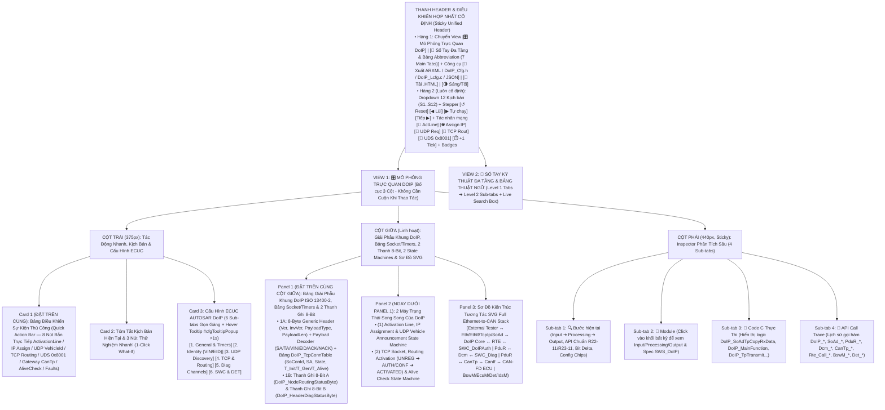
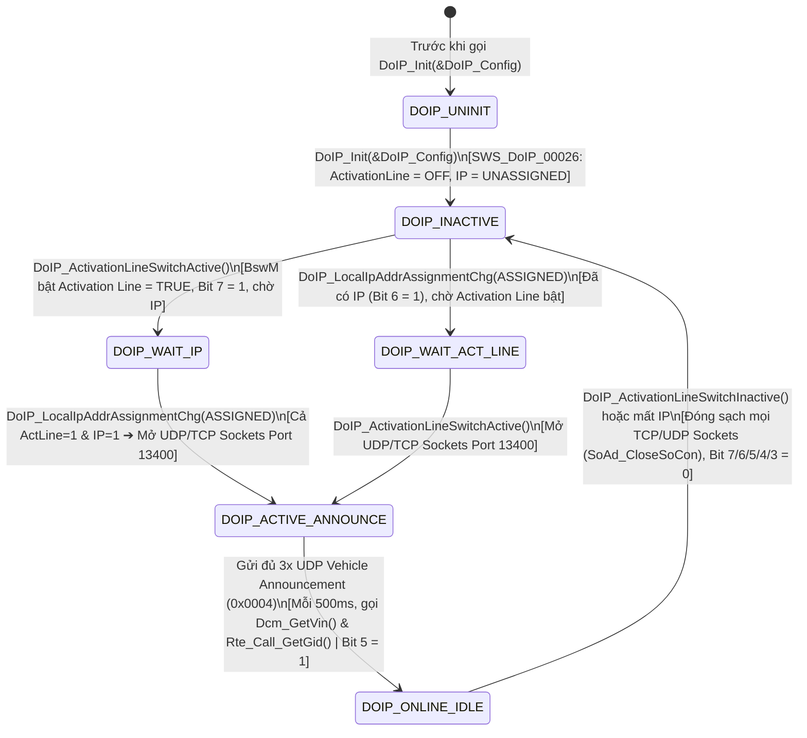
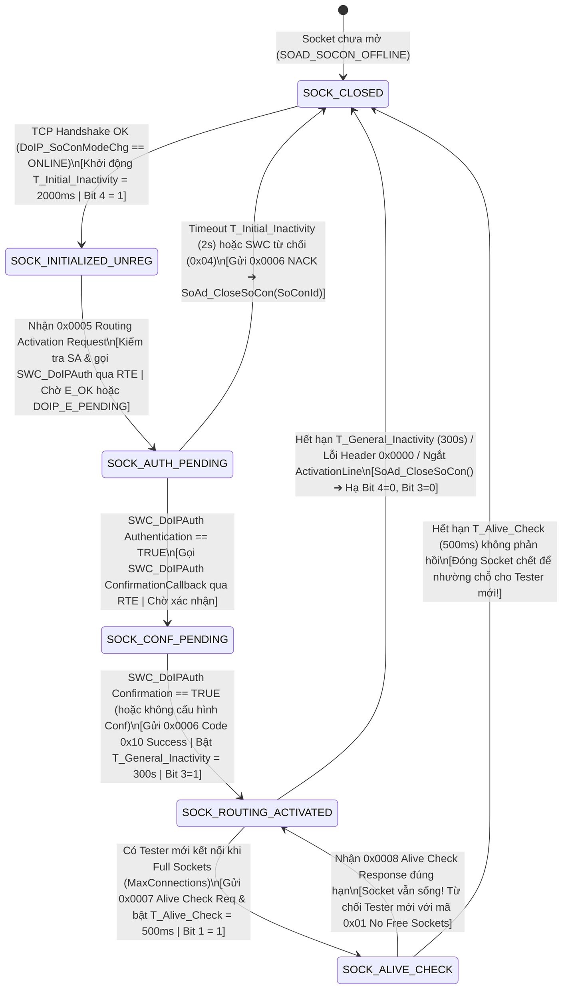

# Tài Liệu Thiết Kế Chi Tiết Trình Mô Phỏng AUTOSAR DoIP (`DoIP_Simulation_design.md`)

> **Trạng thái tài liệu:** Bản thiết kế chi tiết đã cập nhật theo xác nhận `A1`–`A4` của User — Sẵn sàng để User review trước khi triển khai code.  
> **File đích dự kiến xuất bản:** `d:\__Personal\AntiGravity\Simulation\03_Services\AUTOSAR_DoIP.html` (Ứng dụng Web Tương tác 1 file HTML độc lập, 100% Offline, Pure CSS, có nút tải `.HTML` kèm cấu hình nhúng & xuất code `ARXML / DoIP_Cfg.h / DoIP_Lcfg.c / JSON`).  
> **Chuẩn tham chiếu:** **AUTOSAR Classic Platform R20-11 / R22-11 / R23-11 (`SWS_DoIP` — `ModuleId = 173 / 0x00AD`, `ISO 13400-2:2012` & `ISO 13400-2:2019`, `SWS_SoAd`, `SWS_PduR`, `SWS_Dcm`, `SWS_CanTp`, `SWS_BswM`, `SWS_EcuM`, `SWS_TcpIp`, `SWS_EthSM`, `SWS_Det`, `SWS_IdsM`, `SWS_Rte`)**, đính kèm mã requirement chuẩn **`SWS_DoIP_xxxxx`** tại từng bước xử lý, Bảng Giải Phẫu Khung DoIP ISO 13400-2 (`8-Byte Generic Header` + Payload Decoder), Bảng Quản Lý Kết Nối TCP Socket & Timers (`DoIP_TcpConnTable`), 2 thanh ghi 8-Bit tương tác, tooltip cấu hình (`#cfgTooltipPopup` `>1s` giống `AUTOSAR_DEM.html`) và sổ tay tra cứu đa tầng.

---

## 1. Tổng Quan Định Hướng Thiết Kế Đã Chốt (`A1` – `A4`)

| Hạng mục | Nội dung thiết kế đã xác nhận với User |
| :--- | :--- |
| **1. Bố cục giao diện & Ưu tiên Không Cuộn Trang — Zero-Scroll (`A1`)** | Kế thừa tinh hoa của **`AUTOSAR_DEM.html`**, **`AUTOSAR_CanIf.html`** và **`AUTOSAR_SecOC.html`**, tối ưu hóa **Above-the-Fold (Zero-Scroll)** để các khối thao tác và giám sát tần suất cao nhất luôn nằm ngay phần đầu mỗi cột trong khung màn hình:<br>• **Thanh Điều Khiển Hợp Nhất Cố Định (Sticky Unified Header)**:<br>  - **Hàng 1**: Chuyển View `[🎛️ Mô Phỏng Trực Quan DoIP]` \| `[📖 Sổ Tay Đa Tầng & Bảng Abbreviation (7 Main Tabs)]` + Công cụ `[🧾 Xuất ARXML / DoIP_Cfg.h / DoIP_Lcfg.c / JSON]` \| `[💾 Tải .HTML]` \| `[🌗 Sáng/Tối]`.<br>  - **Hàng 2 (Luôn cố định)**: Dropdown chọn 12 Kịch bản (`S1`–`S12`), Stepper (`↺ Reset`, `◀ Lùi`, `▶ Tự chạy`, `Tiếp ▶`), Bộ kích hoạt sự kiện mạng & phần cứng (`🔌 Activation Line ON/OFF`, `🌐 Assign IP`, `📡 UDP VehId Req`, `🔐 TCP Routing Req`, `💉 Send UDS 0x8001`, `⏱️ +1 Tick DoIP_MainFunction`) và Badge Trạng thái (`ActivationLine`, `IP State`, `Open TCP Sockets`, `Routing State`).<br>• **Bố cục 3 cột hiện đại (Mỗi cột tự cuộn độc lập trong khung Viewport)**:<br>  - **Cột Trái (`375px`)**: Đưa **Card 1: Bảng Điều Khiển Sự Kiện Thủ Công (`Quick Action Bar` — 8 nút thao tác trực tiếp cốt lõi của `DoIP`)** và **Card 2: Tóm tắt kịch bản & 3 nút 1-Click What-If** lên trên cùng, tiếp theo là **Card 3: 6 Sub-tabs Cấu hình ECUC DoIP (36 tham số)** (hỗ trợ Floating Hover Tooltip `#cfgTooltipPopup` sau `>1s` giống hệt `AUTOSAR_DEM.html`).<br>  - **Cột Giữa (`Linh hoạt`)**: Đưa **Panel 1: Bảng Giải Phẫu Khung DoIP ISO 13400-2 (`8-Byte Generic Header` & Payload) + Bảng Quản Lý Kết Nối TCP Socket & Timers (`DoIP_TcpConnTable`) + 2 Thanh Ghi 8-Bit Tương Tác** và **Panel 2: 2 Máy Trạng Thái Song Song (`Activation Line & UDP Announcement` + `TCP Socket, Routing Activation & Alive Check`)** lên ngay đầu cột giữa; bên dưới là **Panel 3: Sơ Đồ Kiến Trúc Tương Tác SVG End-to-End** bao gồm cả **nhánh Local ECU (`SoAd ↔ DoIP ↔ PduR ↔ Dcm ↔ RTE ↔ SWC_Diag`)**, **cổng RTE trực tiếp (`DoIP ↔ RTE ↔ SWC_DoIPAuth`: Authentication / Confirmation / PowerMode / GID Callbacks)** VÀ **nhánh DoIP Edge Gateway (`DoIP ↔ PduR ↔ CanTp ↔ CanIf ↔ CAN-FD Sub-ECU`)**.<br>  - **Cột Phải (`440px, Sticky`)**: Inspector 4 Sub-tabs (`🔍 Bước hiện tại`, `🧩 Module`, `📄 Code C Thực Thi`, `📜 API Call Trace`). |
| **2. Khu vực Giám sát Bit-level, Giải phẫu Khung DoIP & Bảng Socket/Timers 2 Tầng (`A2`)** | Đặt **cố định và nổi bật ở đầu Cột Giữa** gồm **2 tầng trực quan hóa**:<br>• **Tầng 1 — Bảng Giải Phẫu Khung DoIP ISO 13400-2 (`8-Byte Generic Header` + Payload Decoder) & Bảng Quản Lý Kết Nối TCP Socket & Timers (`DoIP_TcpConnTable`)**:<br>  - **Giải mã 8-Byte Generic Header (`ISO 13400-2` / `SWS_DoIP_00014`)**: Hiển thị từng byte và kiểm chứng toán học trực tiếp `Byte 0: ProtocolVersion (0x02 / 0x03 / 0xFF)`, `Byte 1: InverseProtocolVersion (0xFD / 0xFC / 0x00)` kèm phép toán **`(Ver ^ InvVer) == 0xFF`**, `Byte 2..3: PayloadType (16-bit)`, `Byte 4..7: PayloadLength (32-bit Big-Endian)`.<br>  - **Giải mã Payload theo từng `PayloadType`**: `0x0001..0x0004` (`VIN[17]`, `LogicalAddress`, `EID[6]`, `GID[6]`, `FurtherAction`, `SyncStatus`), `0x0005/0x0006` (`Tester SA`, `ActivationType`, `RoutingRespCode`), `0x0007/0x0008` (`Alive Check SA`), `0x8001/0x8002/0x8003` (`SA`, `TA`, `UDS Payload / ACK / NACK`).<br>  - **Bảng `DoIP_TcpConnTable[0..MaxTesterConnections]`**: Hiển thị trực tiếp từng kết nối TCP (`SoConId`), `Tester SA`, `Routing State` (`UNREGISTERED`, `AUTH_PENDING`, `CONF_PENDING`, `ACTIVATED`), và đồng hồ đếm ngược **`T_Initial_Inactivity (2000ms)`**, **`T_General_Inactivity (300s)`**, **`T_Alive_Check (500ms)`**!<br>• **Tầng 2 — 2 Thanh ghi 8-Bit tương tác song song**:<br>  1. **Thanh A (`8-Bit DoIP Node, Activation, Socket & Routing Status Byte` — `DoIP_NodeRoutingStatusByte`)**: Theo dõi trạng thái kích hoạt phần cứng, IP, thông báo UDP, mở TCP Socket, kích hoạt định tuyến, xác thực SWC qua RTE, kiểm tra sống Alive Check và định tuyến Gateway sang CanTp.<br>  2. **Thanh B (`8-Bit DoIP Header, Payload, TP Buffer & Diag Response Byte` — `DoIP_HeaderDiagStatusByte`)**: Theo dõi tính hợp lệ của Generic Header (`Ver ^ InvVer == 0xFF`), Payload Length, tra cứu `SA/TA`, khóa bộ đệm TP (`SoAdTpCopyRxData`), mã phản hồi `0x8002 ACK` / `0x8003 NACK` / `0x0000 Header NACK` và cờ lỗi `DET / Close Socket`. Cho phép click trực tiếp vào từng bit để giải mã hoặc thử nghiệm! |
| **3. Hệ thống 12 Kịch bản mẫu (`A3`)** | Thiết kế sẵn **12 Kịch bản (`S1`–`S12`)** chia làm 4 nhóm lớn:<br>• **Nhóm 1 (`S1`–`S3`) — Activation Line, Gán IP, UDP Vehicle Announcement (`0x0004`), Vehicle ID Request (`0x0001..0x0003`) & Header NACK (`0x0000`)**: Khởi tạo `DoIP_Init` + `BswM` bật `ActivationLineSwitchActive` + `DoIP_LocalIpAddrAssignmentChg` phát 3 gói UDP `Vehicle Announcement (0x0004)` cách nhau `500ms`; Tester gửi UDP Broadcast `Vehicle ID Request (All / by EID / by VIN)` nhận phản hồi `0x0004` kèm `PowerMode` & `GID` lấy từ `SWC_DoIPAuth`; kiểm tra Generic Header lỗi `(Ver ^ InvVer != 0xFF)` hoặc `Unsupported PayloadType` trả `0x0000 Header NACK` và đóng socket!<br>• **Nhóm 2 (`S4`–`S6`) — TCP Routing Activation (`0x0005`/`0x0006`), Xác Thực Với `SWC_DoIPAuth` Qua `RTE`, TLS `0x07` & Alive Check (`0x0007`/`0x0008`) Khi Đầy Socket**: Tester kết nối TCP Port 13400 và gửi `Routing Activation Request (0x0005)` (kèm `T_Initial_Inactivity 2s`); `DoIP` gọi cổng RTE sang **`SWC_DoIPAuth`** (`AuthenticationCallback` & `ConfirmationCallback`) trả về `0x10 Success` hoặc Pending (`AuthenticationPending`); xử lý kết nối bảo mật **TLS (`ActivationType = 0x07` / Port 3496)** và kích hoạt **`Alive Check (0x0007 / 0x0008)`** (`T_Alive_Check 500ms`) để thu hồi socket treo khi đã chạm giới hạn `DoIPMaxTesterConnections`!<br>• **Nhóm 3 (`S7`–`S9`) — Thông Điệp Chẩn Đoán UDS (`0x8001`), ACK (`0x8002`), NACK (`0x8003`) Tới Local `Dcm/SWC` & Qua `PduR` Sang `CanTp` Gateway**: Nhận khung TCP `0x8001 (SA=0x0E80 ➔ TA=0x1001 Local Dcm)` ➔ xác nhận `0x8002 Diagnostic ACK` ➔ `PduR_DoIPTpRxIndication` ➔ `Dcm` ➔ `SWC_Diag` trả lời `0x62 F1 90 (VIN)`; từ chối thông điệp UDS khi `TA` không tồn tại hoặc `SA` chưa kích hoạt (`0x8003 Diagnostic NACK`: `0x02 Invalid SA` / `0x03 Unknown TA` / `0x06 Out of Memory`); và luồng **DoIP Edge Gateway** định tuyến `0x8001 (TA=0x2001 Sub-ECU)` qua **`PduR ➔ CanTp ➔ CanIf ➔ CAN-FD`**!<br>• **Nhóm 4 (`S10`–`S12`) — TP Streaming Đa Khung 4KB (`SoAdTpCopyRxData` / `CopyTxData`), Ngắt Activation Line / Inactivity Timeout & Hàng Rào Lỗi `DET`**: Truyền khối lượng lớn `4096 Bytes` (UDS TransferData `$36` Flash) qua cơ chế zero-overflow streaming `DoIP_SoAdTpCopyRxData()` & `DoIP_SoAdTpCopyTxData()` (kèm tách/ghép phân mảnh TCP); ngắt `DoIP_ActivationLineSwitchInactive()` / hết hạn `T_Initial_Inactivity (2s)` / `T_General_Inactivity (300s)` ép đóng toàn bộ TCP Sockets; và kiểm thử toàn diện hàng rào lỗi **`DET` (`ModuleId = 173`: `DOIP_E_UNINIT`, `DOIP_E_PARAM_POINTER`, `DOIP_E_INVALID_PDU_SDU_ID`, `DOIP_E_INVALID_PARAMETER`)** cùng báo cáo **`IdsM`**. |
| **4. Sổ tay tra cứu đa tầng & Bảng Abbreviation (`A4`)** | **View 2 (`📖 Sổ Tay Kỹ Thuật DoIP & Từ Điển Thuật Ngữ`)** được tổ chức theo cấu trúc **Đa Tầng (Multi-level Tabs)**:<br>• **6 Main Sub-tabs (Level 1) × 4 Chủ đề con (Level 2 Pills/Tabs = 24 chuyên đề)** phân tích sâu kiến trúc Ethernet Diagnostic Stack, cấu trúc gói tin `ISO 13400-2`, `Activation Line` & `UDP Discovery`, máy trạng thái `TCP Socket / Routing Activation / Alive Check`, giao diện TP & IF với `SoAd / PduR / Dcm / CanTp` + giao diện RTE trực tiếp với `SWC_DoIPAuth`, cũng như ECUC, `DET / IdsM` và kinh nghiệm thực chiến.<br>• **Tab 7 chuyên biệt: `🔤 Bảng Thuật Ngữ & Từ Viết Tắt (Abbreviation Table)`** trình bày dưới dạng bảng chuẩn 4 cột, tích hợp **Search Box tìm kiếm tức thời (Live Search + Highlight `<mark>`)** và 5 nút lọc nhanh theo phân nhóm (`DoIP Core & ISO 13400-2`, `UDP Discovery & Identity`, `TCP Routing, TLS & Timers`, `TP Streaming, PduR & Gateway`, `APIs, ECUC, SWC & DET`). |

---

## 2. Bố Cục Giao Diện 3 Cột Ưu Tiên Zero-Scroll & Hệ Thống Sub-Tabs (UI Wireframe)

Để đáp ứng triệt để yêu cầu **"đưa các khối được dùng thường xuyên hơn lên phía trên để người dùng không cần cuộn chuột lên xuống mỗi lần thao tác"**, giao diện được thiết kế theo nguyên lý **Viewport-First**: toàn bộ thanh nút bấm nhanh (`Quick Action Bar`), thanh kích hoạt mạng trên Header, Bảng Giải Phẫu Khung DoIP + Bảng Kết Nối TCP Socket/Timers, 2 Thanh ghi 8-Bit và 2 Máy Trạng Thái đều nằm ngay phần đầu vùng nhìn mà không cần cuộn lên xuống khi thao tác:



### Điểm Cải Tiến Đột Phá Về Trải Nghiệm "Zero-Scroll" Cho Module `DoIP`:
1. **Thanh Điều Khiển Hợp Nhất (`Sticky Unified Header`) Với Bộ Kích Hoạt Mạng Ethernet & Tick Thời Gian**:
   - `DoIP` vận hành dựa trên sự phối hợp liên tục giữa các sự kiện bất đồng bộ từ mạng Ethernet (`SoAd_SoConModeChg`, `DoIP_LocalIpAddrAssignmentChg`, `DoIP_SoAdIfRxIndication`, `DoIP_SoAdTpCopyRxData`), tín hiệu phần cứng (`DoIP_ActivationLineSwitchActive` từ `BswM`) và các bộ đếm thời gian định kỳ trong `DoIP_MainFunction()` (`5ms`/`10ms`). Việc gắn sẵn các nút kích hoạt trực tiếp lên Hàng 2 của Sticky Header giúp người dùng dễ dàng bấm nối tiếp chuỗi thao tác thực tế (`🔌 ActLine` ➔ `🌐 Assign IP` ➔ `🔐 TCP Routing` ➔ `💉 UDS 0x8001` ➔ `⏱️ +1 Tick`) mà không cần cuộn màn hình.
2. **Đặt `Quick Action Bar` lên Card 1 (Đầu Cột Trái)** và **Bảng Giải Phẫu Khung DoIP ISO 13400-2 + Bảng Socket/Timers + 2 Thanh Ghi 8-Bit lên Panel 1 (Đầu Cột Giữa)**:
   - Ngay khi thay đổi một tham số như `DoIPProtocolVersion`, `DoIPMaxTesterConnections`, `DoIPRoutingActivationAuthenticationCallback` hoặc bơm một khung `0x8001`, người dùng thấy ngay 8 byte Generic Header thay đổi từng ô bit/hex cùng trạng thái các kết nối TCP trong `DoIP_TcpConnTable`.
3. **Gom 36 tham số ECUC vào 6 Sub-tabs gọn gàng**:
   - Giữ chiều cao Card Cấu hình cố định ở mức tối ưu (`~280px`), hỗ trợ Floating Hover Tooltip `#cfgTooltipPopup` sau `>1000ms` (hoặc click `ⓘ`) theo đúng chuẩn của `AUTOSAR_DEM.html`.

---

## 3. Thiết Kế Chi Tiết Panel 1 (Đầu Cột Giữa): Bảng Giải Phẫu Khung DoIP ISO 13400-2, Bảng Kết Nối TCP Socket/Timers & 2 Thanh Ghi 8-Bit Tương Tác

Trong `AUTOSAR Classic` (`SWS_DoIP`) và chuẩn **`ISO 13400-2`**, bản chất kỹ thuật cốt lõi của `DoIP` xoay quanh **4 cơ chế chính**:
1. **Kiểm chứng 8-Byte Generic DoIP Header (`SWS_DoIP_00014`)**: Kiểm tra cặp byte nghịch đảo `(ProtocolVersion ^ InverseProtocolVersion) == 0xFF`, giải mã `PayloadType (16-bit)` (UDP Discovery `0x0001..0x0004` vs TCP Routing/Alive/Diag `0x0005..0x0008`, `0x8001..0x8003`) và kiểm soát chặt `PayloadLength (32-bit)` chống tràn bộ đệm (`0x04 Out of Memory`).
2. **Quản lý vòng đời `Activation Line`, Gán địa chỉ IP & Quảng bá UDP (`0x0004 Vehicle Announcement`)**: Chỉ khi cả `ActivationLine == TRUE` và `IP == TCPIP_IPADDR_STATE_ASSIGNED`, `DoIP` mới mở các Socket UDP (`13400`) và TCP (`13400` / TLS `3496`) và phát chuỗi `DoIPInitialVehicleAnnouncementTime` + `DoIPVehicleAnnouncementCount` (`3` lần).
3. **Quản lý Đa Kết Nối TCP Socket, `Routing Activation (0x0005/0x0006)` & Cơ chế `Alive Check (0x0007/0x0008)`**: Theo dõi từng `SoConId`, xác thực & xác nhận trực tiếp với **`SWC_DoIPAuth`** qua **`RTE`**, quản lý 3 bộ đếm thời gian chuẩn ISO 13400-2 (`T_Initial_Inactivity = 2s`, `T_General_Inactivity = 300s`, `T_Alive_Check = 500ms`) và xử lý kịch bản đầy kết nối (`DoIPMaxTesterConnections`).
4. **Truyền tải UDS Streaming (`0x8001`) qua `SoAd_Tp` & Phân luồng `PduR`**: Nhận phân mảnh TCP qua `DoIP_SoAdTpCopyRxData()`, kiểm tra `SA`/`TA`, phản hồi `0x8002 ACK` / `0x8003 NACK` và định tuyến qua `PduR` tới **Local `Dcm`** hoặc sang **`CanTp ➔ CanIf`** (DoIP Edge Gateway).

### 3.1. Phần 1A — Bảng Giải Phẫu Khung DoIP (`ISO 13400-2`) & Bảng Quản Lý Kết Nối TCP Socket / Timers

```text
+----------------------------------------------------------------------------------------------------------------------+
| 📦 BẢNG GIẢI PHẪU KHUNG DOIP (ISO 13400-2) & BẢNG KẾT NỐI TCP SOCKET / TIMERS (`SWS_DoIP_00014`, `00105`, `00144`)   |
| ActivationLine: [ 🟢 ACTIVE ] | IP State: [ 🟢 ASSIGNED (192.168.10.20) ] | Active Channel: [ TCP Port 13400 (SoCon 1) ]|
+----------------------------------------------------------------------------------------------------------------------+
| 1. GIẢI MÃ 8-BYTE GENERIC DOIP HEADER (Click Byte 0/1 để thử lỗi Inverse Version; Click PayloadType để đổi loại gói): |
|  +-----------------------+-------------------------+-----------------------------+---------------------------------+ |
|  | Byte 0: ProtocolVer   | Byte 1: InvProtocolVer  | Byte 2..3: PayloadType      | Byte 4..7: PayloadLength (BE)   | |
|  |   0x02 (ISO 13400-2)  |   0xFD (XOR Check = OK) |   0x8001 (Diagnostic Msg)   |   0x00000007 (4B SA/TA + 3B UDS)| |
|  +-----------------------+-------------------------+-----------------------------+---------------------------------+ |
|  ↳ Giải mã Payload hiện tại: [ SA = 0x0E80 (Ext Tester) ] ➔ [ TA = 0x1001 (Local Dcm) ] | UDS SDU: [ 22 F1 90 (ReadVIN)] |
|    Phản hồi DoIP dự kiến: [ 0x8002 Diagnostic Message Positive ACK (ACK Code = 0x00) ] | Route: [ PduR -> Dcm -> SWC ] |
+----------------------------------------------------------------------------------------------------------------------+
| 2. BẢNG QUẢN LÝ KẾT NỐI TCP SOCKET & BỘ ĐẾM THỜI GIAN (`DoIP_TcpConnTable` — MaxConnections = 2):                     |
|  +---------+-------------+------------------------+---------------+------------------+------------------+----------+ |
|  | SoConId | Tester SA   | Routing State          | ActType / TLS | T_Init_Inact(2s) | T_Gen_Inact(300s)| T_Alive  | |
|  +---------+-------------+------------------------+---------------+------------------+------------------+----------+ |
|  | SoCon_1 | 0x0E80      | [ 🟢 ACTIVATED ]       | 0x00 (Default)| Expired (N/A)    | 298.4 s / 300 s  | Idle     | |
|  | SoCon_2 | 0x0E81      | [ 🟡 AUTH_PENDING ]    | 0x01 (WWH-OBD)| 1,450 ms / 2000ms| ---              | Idle     | |
|  +---------+-------------+------------------------+---------------+------------------+------------------+----------+ |
|  • UDP Socket (SoCon_0 — Port 13400): [ 🟢 ONLINE ] | Announcement Counter: [ 3 / 3 Sent (Interval 500ms) ]          |
+----------------------------------------------------------------------------------------------------------------------+
```

- **Tính năng tương tác trực tiếp trên Phần 1A**:
  - Người dùng có thể **click trực tiếp vào ô `Byte 1: InvProtocolVersion`** để cố tình lật thành giá trị sai (ví dụ `0xFE` thay vì `0xFD`, làm `0x02 ^ 0xFE != 0xFF`) và bấm tiêm gói tin để thấy ngay `DoIP` trả về **`0x0000 Generic Header NACK (0x00 Incorrect Pattern Format)`** và ngắt kết nối TCP!
  - Người dùng có thể click chọn nhanh dòng trong `DoIP_TcpConnTable` (`SoCon_1` hoặc `SoCon_2`) để chuyển đổi Tester đang thao tác, hoặc bấm nút **`[⏱️ Advance Timers]`** để xem bộ đếm `T_Initial_Inactivity (2000ms)`, `T_General_Inactivity (300s)` và `T_Alive_Check (500ms)` đếm ngược và kích hoạt ngắt kết nối tự động khi hết hạn.

### 3.2. Phần 1B — 2 Thanh Ghi 8-Bit Trạng Thái Tương Tác Luôn Hiển Thị Nổi Bật

Ngay bên dưới Phần 1A là **2 Thanh ghi 8-Bit tương tác song song** theo đúng phong cách chuẩn của `AUTOSAR_DEM.html`, `AUTOSAR_CanIf.html` và `AUTOSAR_SecOC.html`:

```text
+----------------------------------------------------------------------------------------------------------------------+
| 🔢 BẢNG GIÁM SÁT BITFIELD 8-BIT DOIP NODE/ROUTING & HEADER/DIAGNOSTIC (LIVE 8-BIT INSPECTOR) [Click Bit để thử]       |
| Bước #4: Nhận 0x8001 (SA=0x0E80 ➔ TA=0x1001) ➔ Gửi ACK 0x8002 ➔ Đẩy sang PduR_DoIPTpRxIndication | A: 0xFD | B: 0xE8  |
+----------------------------------------------------------------------------------------------------------------------+
| A. THANH GHI 8-BIT TRẠNG THÁI NODE, KẾT NỐI & ĐỊNH TUYẾN (`DoIP_NodeRoutingStatusByte`) — Hex:[0xFD] [11111101]     |
|    ActivationLine: [ ACTIVE ] | IP: [ ASSIGNED ] | TCP: [ SoCon_1 ACTIVATED ] | Route Target: [ Local Dcm ]          |
|  +-------------+ +-------------+ +-------------+ +-------------+ +-------------+ +-------------+ +-------+ +-------+ |
|  | Bit 7 (0x80)| | Bit 6 (0x40)| | Bit 5 (0x20)| | Bit 4 (0x10)| | Bit 3 (0x08)| | Bit 2 (0x04)| |Bit1(2)| |Bit0(1)| |
|  | ACT_LINE_ON | | IP_ASSIGNED | | UDP_ANNOUN  | | TCP_SOC_OPN | | ROUT_ACTV   | | SWC_AUTH_OK | | ALIVE | |GW_CANT| |
|  |      1      | |      1      | |      1      | |      1      | |      1      | |      1      | |   0   | |   1   | |
|  | Line Active | | IPv4 Ready  | | 3x 0x0004 OK| | TCP Connected| | SA 0x0E80 OK| | Auth+Conf OK| |NoAlive| |GWReady| |
|  +-------------+ +-------------+ +-------------+ +-------------+ +-------------+ +-------------+ +-------+ +-------+ |
+----------------------------------------------------------------------------------------------------------------------+
| B. THANH GHI 8-BIT GIẢI MÃ HEADER, PAYLOAD, TP BUFFER & PHẢN HỒI (`DoIP_HeaderDiagStatusByte`) — Hex:[0xE8] [11101000] |
|    Header: [ Ver=0x02^Inv=0xFD OK ] | Len: [ 7B Valid ] | SA/TA: [ Valid ] | Resp: [ 0x8002 Positive ACK ]           |
|  +-------------+ +-------------+ +-------------+ +-------------+ +-------------+ +-------------+ +-------+ +-------+ |
|  | Bit 7 (0x80)| | Bit 6 (0x40)| | Bit 5 (0x20)| | Bit 4 (0x10)| | Bit 3 (0x08)| | Bit 2 (0x04)| |Bit1(2)| |Bit0(1)| |
|  | HDR_SYNC_OK | | PAY_LEN_OK  | | SA_TA_KNOWN | | TP_BUF_LOCK | | DIAG_ACK    | | DIAG_NACK   | |HDR_NCK| |DET_CLS| |
|  |      1      | |      1      | |      1      | |      0      | |      1      | |      0      | |   0   | |   0   | |
|  | Ver^Inv=FF  | | Length Valid| | SA & TA OK  | | Buf Released| | 0x8002 Sent | | No DiagNACK | |NoHdrNk| |NoError| |
|  +-------------+ +-------------+ +-------------+ +-------------+ +-------------+ +-------------+ +-------+ +-------+ |
+----------------------------------------------------------------------------------------------------------------------+
```

#### 3.2.1. Giải Mã Chi Tiết Thanh A: `8-Bit DoIP Node, Activation, Socket & Routing Status Byte` (`DoIP_NodeRoutingStatusByte`)

| Bit | Mask | Tên Cờ (`DoIP Node/Routing Bit`) | Ý nghĩa kỹ thuật & Khi nào bật lên `1` (`0 ➔ 1`) | Khi nào hạ về `0` (`1 ➔ 0`) |
| :-: | :-: | :--- | :--- | :--- |
| **Bit 7** | `0x80` | **`ACT_LINE_ON`** | Bật lên `1` khi `BswM` gọi **`DoIP_ActivationLineSwitchActive()`** (`SWS_DoIP_00251`): chân Ethernet Activation Line đã được kích hoạt (hoặc khởi động mặc định), cho phép `DoIP` chuẩn bị mở các Socket khi có địa chỉ IP. | Hạ về `0` khi `BswM` gọi **`DoIP_ActivationLineSwitchInactive()`** (`SWS_DoIP_00252`) — `DoIP` lập tức đóng toàn bộ kết nối TCP/UDP đang mở! |
| **Bit 6** | `0x40` | **`IP_ASSIGNED`** | Bật lên `1` khi `SoAd` thông báo **`DoIP_LocalIpAddrAssignmentChg(SoConId, TCPIP_IPADDR_STATE_ASSIGNED)`** (`SWS_DoIP_00043`): ECU đã được cấp IPv4/IPv6 hợp lệ (tĩnh, DHCP hoặc Auto-IP Link-Local `169.254.x.x`). | Hạ về `0` khi mất địa chỉ IP (`TCPIP_IPADDR_STATE_UNASSIGNED` / `ONHOLD`). |
| **Bit 5** | `0x20` | **`UDP_ANNOUN`** | Bật lên `1` khi cả `ACT_LINE_ON = 1` và `IP_ASSIGNED = 1`, `DoIP` chuyển Socket UDP Port `13400` sang `SOAD_SOCON_ONLINE` và phát chuỗi bản tin quảng bá **`Vehicle Announcement (0x0004)`** (`DoIPVehicleAnnouncementCount` lần, mặc định 3 lần — `SWS_DoIP_00205`). | Hạ về `0` khi UDP Socket đóng lại (`ActivationLine` tắt hoặc mất IP). |
| **Bit 4** | `0x10` | **`TCP_SOC_OPN`** | Bật lên `1` khi có ít nhất 1 Tester thiết lập bắt tay TCP 3-way handshake thành công với Socket lắng nghe Port `13400` (hoặc TLS `3496`) và `SoAd` báo **`DoIP_SoConModeChg(SoConId, SOAD_SOCON_ONLINE)`** (`SWS_DoIP_00249`). | Hạ về `0` khi tất cả các kết nối TCP Tester đã đóng (`SOAD_SOCON_OFFLINE`). |
| **Bit 3** | `0x08` | **`ROUT_ACTV`** | Bật lên `1` khi kết nối TCP hiện tại đã hoàn tất xử lý **`Routing Activation Request (0x0005)`**, vượt qua kiểm tra `SA`, số lượng kết nối và xác thực SWC, chuyển trạng thái Socket sang **`DOIP_SOCKET_ROUTING_ACTIVATED`** và trả về **`0x0006 (Code 0x10)`** (`SWS_DoIP_00105`). | Hạ về `0` khi Socket bị đóng do hết hạn `T_Initial_Inactivity (2s)`, `T_General_Inactivity (300s)`, trượt `Alive Check`, hoặc tắt `Activation Line`. |
| **Bit 2** | `0x04` | **`SWC_AUTH_OK`** | Bật lên `1` khi `DoIP` gọi trực tiếp các cổng giao tiếp **`RTE`** tới **`SWC_DoIPAuth`** (`RoutingActivationAuthenticationCallback` & `RoutingActivationConfirmationCallback` — `SWS_DoIP_00048`, `00112`) và nhận được kết quả chấp thuận **`Authentic = TRUE` / `Confirmed = TRUE`**. | Hạ về `0` khi `SWC_DoIPAuth` từ chối xác thực (`0x04` / `0x05`), đang chờ `DOIP_E_PENDING`, hoặc kết nối mới chưa kích hoạt. |
| **Bit 1** | `0x02` | **`ALIVE_PEND`** | Bật lên `1` khi có Tester mới kết nối vào lúc bảng socket đã đầy (`ActiveSockets == DoIPMaxTesterConnections`), buộc `DoIP` phải phát thông điệp **`Alive Check Request (0x0007)`** tới các kết nối cũ và khởi động đồng hồ đếm ngược **`T_Alive_Check (500ms)`** (`SWS_DoIP_00118`). | Hạ về `0` ngay khi các Socket cũ trả lời **`Alive Check Response (0x0008)`** hoặc khi hết `500ms` và Socket chết bị đóng thu hồi! |
| **Bit 0** | `0x01` | **`GW_CANTP`** | Bật lên `1` khi khung chẩn đoán `0x8001` mang địa chỉ đích **`TA` thuộc nhóm Sub-ECU trên mạng CAN/CAN-FD** (ví dụ `TA = 0x2001`), khiến `DoIP` đóng vai trò **Edge Gateway** chuyển tiếp thông điệp qua **`PduR ➔ CanTp ➔ CanIf`** thay vì vào Local `Dcm`! | Hạ về `0` khi `TA` là địa chỉ của Local ECU (`0x1001 ➔ PduR ➔ Dcm`) hoặc không có luồng Gateway đang chạy. |

#### 3.2.2. Giải Mã Chi Tiết Thanh B: `8-Bit DoIP Header, Payload, TP Buffer & Diag Response Byte` (`DoIP_HeaderDiagStatusByte`)

| Bit | Mask | Tên Cờ (`DoIP Frame/Diag Bit`) | Ý nghĩa kỹ thuật & Khi nào bật lên `1` (`0 ➔ 1`) | Khi nào hạ về `0` (`1 ➔ 0`) |
| :-: | :-: | :--- | :--- | :--- |
| **Bit 7** | `0x80` | **`HDR_SYNC_OK`** | Bật lên `1` khi 2 byte đầu tiên của Generic DoIP Header thỏa mãn điều kiện đồng bộ chuẩn ISO 13400-2 (`SWS_DoIP_00014`): **`(ProtocolVersion == 0x02 || 0x03 || 0xFF)`** VÀ **`(ProtocolVersion ^ InverseProtocolVersion) == 0xFF`**. | Hạ về `0` nếu `Ver ^ InvVer != 0xFF` hoặc phiên bản không được hỗ trợ ➔ Kích hoạt `0x0000 Header NACK (0x00)` và đóng kết nối TCP! |
| **Bit 6** | `0x40` | **`PAY_LEN_OK`** | Bật lên `1` khi trường `PayloadLength (32-bit)` hợp lệ với loại `PayloadType` tương ứng (ví dụ `0x0005` dài `7` hoặc `11` bytes; `0x8001` dài `>= 5` bytes) và không vượt quá **`DoIPMaxRequestBytes`** (`SWS_DoIP_00017`, `00018`). | Hạ về `0` nếu `PayloadLength` sai quy cách (`0x04 Invalid Payload Length` -> đóng socket) hoặc vượt giới hạn bộ nhớ tối đa (`0x03 Message Too Large`). |
| **Bit 5** | `0x20` | **`SA_TA_KNOWN`** | Bật lên `1` khi `Source Address (SA)` của Tester khớp với bảng `DoIPTesterCfg` đã cấu hình và được kích hoạt định tuyến trên Socket hiện tại, đồng thời `Target Address (TA)` tồn tại trong bảng `DoIPChannelCfg` (`SWS_DoIP_00127`). | Hạ về `0` nếu `SA` lạ/chưa Routing Activation (`NACK 0x02 Invalid SA`) hoặc `TA` không tồn tại trong hệ thống xe (`NACK 0x03 Unknown TA`). |
| **Bit 4** | `0x10` | **`TP_BUF_LOCK`** | Bật lên `1` khi `DoIP` đang ở giữa phiên truyền/nhận dữ liệu lớn (**TP Streaming**) với `SoAd` hoặc `PduR`: ví dụ đang nhận phân mảnh liên tiếp qua **`DoIP_SoAdTpCopyRxData()`** hoặc đang truyền response dài qua **`DoIP_SoAdTpCopyTxData()`** (`SWS_DoIP_00037`). | Hạ về `0` khi kết thúc truyền/nhận TP (`DoIP_SoAdTpRxIndication` / `DoIP_SoAdTpTxConfirmation`) và bộ đệm TP được giải phóng hoàn toàn. |
| **Bit 3** | `0x08` | **`DIAG_ACK`** | Bật lên `1` khi `DoIP` đã xác nhận toàn bộ khung UDS `0x8001`, gọi **`PduR_DoIPTpStartOfReception()`** trả về `BUFREQ_OK` và phát gói **`0x8002 Diagnostic Message Positive Acknowledgement (ACK Code = 0x00)`** về lại cho Tester (`SWS_DoIP_00131`). | Hạ về `0` khi bắt đầu chu kỳ khung mới hoặc khi khung bị từ chối bằng NACK. |
| **Bit 2** | `0x04` | **`DIAG_NACK`** | Bật lên `1` khi `DoIP` từ chối thông điệp UDS `0x8001` nhưng **giữ nguyên kết nối TCP mở** và gửi về gói **`0x8003 Diagnostic Message Negative Acknowledgement`** với mã NACK tương ứng (`0x02 Invalid SA`, `0x03 Unknown TA`, `0x04 Unsupported TA`, `0x06 Out of Memory`, `0x08 Target Unreachable` — `SWS_DoIP_00132`). | Hạ về `0` ở giao dịch chẩn đoán hợp lệ kế tiếp hoặc khi Reset. |
| **Bit 1** | `0x02` | **`HDR_NACK`** | Bật lên `1` khi bản tin vi phạm cấu trúc **Generic DoIP Header** (`0x00 Incorrect Pattern Format`, `0x01 Unknown Payload Type`, `0x02 Message Too Large`, `0x03 Out of Memory`, `0x04 Invalid Payload Length`), buộc `DoIP` phát gói **`0x0000 Generic DoIP Header NACK`** (`SWS_DoIP_00014`–`00018`). | Hạ về `0` sau khi dọn dẹp kết nối lỗi và quay lại trạng thái chờ. |
| **Bit 0** | `0x01` | **`DET_OR_CLS`** | Bật lên `1` ngay khi `DoIP` phát hiện lỗi lập trình/tham số gọi **`Det_ReportError()`** / **`Det_ReportRuntimeError()`** (ví dụ `DOIP_E_UNINIT`, `DOIP_E_PARAM_POINTER`, `DOIP_E_INVALID_PDU_SDU_ID`) HOẶC phải ra lệnh **`SoAd_CloseSoCon(SoConId, abort)`** đóng cưỡng bức kết nối TCP! | Hạ về `0` khi thực hiện tác vụ hợp lệ mới hoặc Reset kịch bản. |

---

## 4. Phân Tích Xử Lý Từng Module: Input Lấy Từ Đâu, Xử Lý Gì, Output Route Đến Đâu

Mọi khối trên sơ đồ kiến trúc SVG đều có thể **click vào để xem giải thích chi tiết** ở cột phải (Tab `🧩 Module`) và được tổng hợp đầy đủ trong **Tab 1 của Sổ tay**:

| # | Module / Phân khối | Lớp AUTOSAR | 📥 Input lấy từ đâu? | ⚙️ Cách xử lý nội bộ (Processing, State, Timers & Routing) | 📤 Output route đến đâu & Hàm API chuẩn (R20-11 / R22-11 / R23-11) |
| :-: | :--- | :--- | :--- | :--- | :--- |
| **1** | **`SWC_DoIPAuth` & `SWC_Diag`**<br>*(Application Layer)* | Application Layer (`01_Application`) | • **Tương tác TRỰC TIẾP (`DoIP ↔ RTE ↔ SWC_DoIPAuth`)**: Nhận các yêu cầu từ `DoIP` qua cổng **Client-Server RTE** về xác thực Routing Activation, xác nhận kết nối mới, đọc trạng thái nguồn (`PowerMode`) và lấy `GID`.<br>• **Tương tác GIÁN TIẾP (`DoIP ↔ PduR ↔ Dcm ↔ RTE ↔ SWC_Diag`)**: Nhận yêu cầu dịch vụ chẩn đoán UDS (`$22 ReadDataByIdentifier`, `$31 RoutineControl`, `$2E WriteDataByIdentifier`) từ `Dcm`. | • **`SWC_DoIPAuth` (Đặc thù của DoIP)**: Trong AUTOSAR, `DoIP` là một trong số ít module tầng Communication Services có cổng **Client-Server Interface trực tiếp tới SWC qua RTE**:<br>  1. `AuthenticationCallback`: Kiểm tra quyền Tester (chữ ký/whitelist SA/OEM token); có thể trả `E_OK` (Authentic), `DOIP_E_PENDING` (chờ xác thực bất đồng bộ), hoặc từ chối (`0x04`).<br>  2. `ConfirmationCallback`: Yêu cầu người lái/hệ thống xác nhận vật lý (ví dụ gạt cần số P / nhấn nút trên màn hình) trước khi mở khóa chẩn đoán (`0x05`).<br>  3. `PowerModeCallback` & `GetGidCallback`: Cung cấp `DoIP_PowerStateType` (`0x01 Ready`) và `GID[6]` động cho bản tin `0x0004`.<br>• **`SWC_Diag`**: Thực thi nghiệp vụ chẩn đoán ứng dụng và trả dữ liệu về `Dcm`. | • **Cổng RTE trực tiếp tới `DoIP`**:<br>`Rte_Call_CallbackAuthentication_RoutingActivationAuthentication(...)`<br>`Rte_Call_CallbackConfirmation_RoutingActivationConfirmation(...)`<br>`Rte_Call_PowerMode_GetPowerMode(&PowerState)`<br>`Rte_Call_CallbackGetGid_GetGid(GroupId)`<br>• **Cổng RTE tới `Dcm`**:<br>`Rte_Call_DataServices_VIN_ReadData(Data)` |
| **2** | **`RTE` & `SchM`**<br>*(Runtime Environment & BSW Scheduler)* | RTE Layer (`02_RTE`) | • Lời gọi Callback từ `DoIP` tới `SWC_DoIPAuth` và dữ liệu UDS từ `Dcm` tới `SWC_Diag`.<br>• Yêu cầu khóa vùng găng từ `DoIP` (`SchM_Enter_DoIP`). | • **RTE**: Thực hiện cơ chế Client-Server mapping giữa các port `PPort/RPort` của `SWC` và các service callbacks cấu hình trong `DoIP` (`DoIPRoutingActivationAuthenticationCallback`, `ConfirmationCallback`, `PowerModeCallback`).<br>• **SchM (`Exclusive Area`)**: Bảo vệ bảng kết nối `DoIP_TcpConnTable`, con trỏ TP Rx/Tx Buffer và các bộ đếm timer trước tranh chấp giữa `DoIP_MainFunction()` và ngữ cảnh `SoAd` Rx/Tx callbacks. | • Kết nối giữa **DoIP** và **SWC_DoIPAuth** / **Dcm** và **SWC_Diag**.<br>• Bảo vệ dữ liệu găng của **DoIP**:<br>`SchM_Enter_DoIP_EXCLUSIVE_AREA_0()`<br>`SchM_Exit_DoIP_EXCLUSIVE_AREA_0()` |
| **3** | **`Dcm`**<br>*(Diagnostic Communication Manager)* | Diagnostic Services (`03_Services`) | • Nhận bản tin UDS hoàn chỉnh từ `PduR` (`Dcm_StartOfReception`, `Dcm_CopyRxData`, `Dcm_TpRxIndication`).<br>• Cung cấp `VIN[17]` cho `DoIP` khi được hỏi danh tính xe. | • **Xử lý UDS Engine**: Giải mã Service ID (ví dụ `$10 DiagnosticSessionControl`, `$22 ReadDataByIdentifier`, `$27 SecurityAccess`, `$36 TransferData`).<br>• **Cung cấp VIN (`SWS_DoIP_00073`)**: Khi `DoIP` chuẩn bị phát UDP `Vehicle Announcement (0x0004)` hoặc trả lời `Vehicle ID Request (0x0001..0x0003)`, `DoIP` gọi trực tiếp **`Dcm_GetVin(uint8* Data)`** để lấy chính xác 17 ký tự số khung VIN hiện hành! | • Cung cấp VIN trực tiếp cho **DoIP**:<br>`Dcm_GetVin(DataPtr)`<br>• Trả lời UDS qua **PduR**:<br>`PduR_DcmTransmit(TxPduId, &PduInfo)`<br>• Gọi xuống **SWC_Diag** qua **RTE**. |
| **4** | **`PduR`**<br>*(PDU Router)* | Communication Services (`03_Services`) | • Nhận I-PDU chẩn đoán từ `DoIP` (chiều Rx từ Tester Ethernet) và từ `Dcm` / `CanTp` (chiều Tx phản hồi về Tester). | • **Định tuyến TP Routing Table (`PduRRoutingPath`)**:<br>  - Dựa vào `DoIPPduRRxPduId` tương ứng với `TA`:<br>    1. Nếu `TA == 0x1001` (Local ECU): `PduR` định tuyến thẳng lên **`Dcm`** (`Dcm_StartOfReception`, `Dcm_CopyRxData`, `Dcm_TpRxIndication`).<br>    2. Nếu `TA == 0x2001` (Sub-ECU trên bus CAN nội bộ — **DoIP Gateway Mode**): `PduR` định tuyến xuống **`CanTp_Transmit()`** để phân mảnh ISO 15765-2 đẩy xuống mạng CAN-FD!<br>  - Chiều ngược lại, mọi phản hồi từ `Dcm` hay `CanTp` đi vào `PduR` sẽ được định tuyến tới **`DoIP_TpTransmit()`**! | • Gọi lên **Dcm**:<br>`Dcm_StartOfReception()`, `Dcm_CopyRxData()`, `Dcm_TpRxIndication()`<br>• Gọi xuống **CanTp** (Gateway Mode):<br>`CanTp_Transmit(TxPduId, &PduInfo)`<br>• Gọi xuống **DoIP** (chiều Tx về Tester):<br>`DoIP_TpTransmit(DoIPPduRTxId, &PduInfo)` [`SWS_DoIP_00022`] |
| **5** | **`CanTp` & `CanIf`**<br>*(DoIP-to-CAN Edge Gateway)* | Comm Services & ECU Abstraction (`03_Services` / `04_ECU_Abstraction`) | • Nhận I-PDU UDS từ `PduR` khi Tester DoIP chẩn đoán một ECU con không có cổng Ethernet (`TA = 0x2001`).<br>• Nhận khung ISO-TP phản hồi từ bus CAN/CAN-FD (`CanIf_RxIndication`). | • **`CanTp`**: Thực hiện phân mảnh I-PDU (First Frame `FF` + Flow Control `FC` + Consecutive Frame `CF`) theo chuẩn ISO 15765-2 để gửi qua **`CanIf_Transmit()`**, và tái hợp các khung CAN phản hồi từ Sub-ECU rồi đẩy ngược lên `PduR` (`PduR_CanTpRxIndication`) để `DoIP` gửi về Tester Ethernet dưới dạng `0x8001`! | • Gọi xuống **CanIf**:<br>`CanIf_Transmit(CanTxPduId, &PduInfo)`<br>• Gọi ngược lên **PduR**:<br>`PduR_CanTpStartOfReception()`, `PduR_CanTpCopyRxData()`, `PduR_CanTpRxIndication()` |
| **6** | **`BswM` & `EcuM`**<br>*(Mode & ECU State Management)* | System Services (`03_Services`) | • Tín hiệu chân phần cứng Ethernet Activation Line (trên đầu nối OBD/RJ45) hoặc trạng thái nguồn ECU (`RUN` / `SHUTDOWN`).<br>• Trạng thái mạng `EthSM` (`ETHSM_STATE_ONLINE`). | • **`BswM`**: Thực thi các quy tắc kích hoạt DoIP: khi phát hiện đường Activation Line bật (hoặc `EthSM` vào `ONLINE`), gọi **`DoIP_ActivationLineSwitchActive()`**; khi tắt máy/rút giắc chẩn đoán, gọi **`DoIP_ActivationLineSwitchInactive()`** để `DoIP` đóng sạch mọi TCP/UDP socket và giải phóng tài nguyên! | • Gọi xuống **DoIP**:<br>`DoIP_Init(DoIPConfigPtr)` [`SWS_DoIP_00026`]<br>`DoIP_ActivationLineSwitchActive()` [`SWS_DoIP_00251`]<br>`DoIP_ActivationLineSwitchInactive()` [`SWS_DoIP_00252`] |
| **7** | **`DoIP Core Engine`**<br>*(Diagnostics over IP — Trọng tâm mô phỏng)* | Communication Services (`03_Services`) | • Dữ liệu UDP (`DoIP_SoAdIfRxIndication`) và TCP TP (`DoIP_SoAdTpStartOfReception`, `DoIP_SoAdTpCopyRxData`, `DoIP_SoAdTpRxIndication`) từ `SoAd`.<br>• Yêu cầu truyền phản hồi UDS từ `PduR` (`DoIP_TpTransmit`).<br>• Sự kiện IP/Socket (`DoIP_LocalIpAddrAssignmentChg`, `DoIP_SoConModeChg`) & lệnh từ `BswM`. | • **1. State & Timer Manager (`DoIP_MainFunction`)**: Quản lý `ActivationLine`, trạng thái gán IP, đếm chu kỳ phát 3 bản tin UDP `0x0004`, và giám sát 3 bộ đếm trên mỗi kết nối TCP (`T_Initial_Inactivity`, `T_General_Inactivity`, `T_Alive_Check`).<br>• **2. Generic Header & Payload Parser**: Kiểm chứng `(Ver ^ InvVer) == 0xFF`, `PayloadType`, `PayloadLength`, phát `0x0000 Header NACK` nếu sai.<br>• **3. Routing Activation & Alive Check Engine**: Xác thực `SA`, gọi callback `SWC_DoIPAuth` qua `RTE`, xử lý `0x0005/0x0006`, và kích hoạt `Alive Check (0x0007/0x0008)` khi đầy `DoIPMaxTesterConnections`.<br>• **4. Diagnostic TP Forwarder (`0x8001` / `0x8002` / `0x8003`)**: Kiểm tra `SA`/`TA`, đặt/xả `0x8002 ACK` hoặc `0x8003 NACK`, thực hiện streaming qua `PduR_DoIPTpCopyRxData` và `SoAd_TpTransmit`. | • Gọi xuống **SoAd**:<br>`SoAd_OpenSoCon()`, `SoAd_CloseSoCon()`<br>`SoAd_IfTransmit()` (UDP `0x0004`)<br>`SoAd_TpTransmit()` (TCP `0x0006`, `0x0007`, `0x8002`, `0x8003`, `0x8001`)<br>• Gọi lên **PduR**:<br>`PduR_DoIPTpStartOfReception()`, `PduR_DoIPTpCopyRxData()`, `PduR_DoIPTpRxIndication()`, `PduR_DoIPTpCopyTxData()`, `PduR_DoIPTpTxConfirmation()`<br>• Gọi **Dcm_GetVin()**, **RTE (`SWC_DoIPAuth`)**, **Det**, **IdsM**. |
| **8** | **`SoAd`**<br>*(Socket Adaptor)* | Communication Services (`03_Services`) | • Lời gọi truyền UDP (`SoAd_IfTransmit`) và TCP (`SoAd_TpTransmit`) + lệnh mở/đóng socket (`SoAd_OpenSoCon` / `SoAd_CloseSoCon`) từ `DoIP`.<br>• Sự kiện TCP/UDP và dữ liệu đến từ `TcpIp`. | • Là cầu nối **bắt buộc** chuyển đổi giữa mô hình **AUTOSAR PDU (`PduId`)** của `DoIP` và mô hình **Socket (`SocketId`, `IP:Port`)** của `TcpIp`:<br>  - Tách riêng **UDP Socket (`Port 13400` Broadcast/Unicast)** dùng giao diện **`IF`** (`SoAd_IfTransmit` / `DoIP_SoAdIfRxIndication`).<br>  - Tách riêng **TCP Listener & Data Sockets (`Port 13400` & TLS `3496`)** dùng giao diện **`TP`** (`SoAd_TpTransmit` / `DoIP_SoAdTpCopyTxData` / `DoIP_SoAdTpCopyRxData`). | • Gọi callbacks lên **DoIP**:<br>`DoIP_SoAdIfRxIndication()`, `DoIP_SoAdIfTxConfirmation()`<br>`DoIP_SoAdTpStartOfReception()`, `DoIP_SoAdTpCopyRxData()`, `DoIP_SoAdTpRxIndication()`<br>`DoIP_SoAdTpCopyTxData()`, `DoIP_SoAdTpTxConfirmation()`<br>`DoIP_SoConModeChg()`, `DoIP_LocalIpAddrAssignmentChg()`<br>• Gọi xuống **TcpIp**. |
| **9** | **`TcpIp`, `EthIf/Eth`, `Det` & `IdsM`**<br>*(Lower Eth Stack & Diagnostics/Security)* | Comm/Eth/Sys Services (`03_Services` / `04` / `05`) | • `TcpIp`: Dữ liệu Socket từ `SoAd` và gói Ethernet từ `EthIf`.<br>• `Det`: Báo lỗi từ `DoIP` (`ModuleId = 173`).<br>• `IdsM`: Sự kiện xâm nhập/bất thường mạng từ `DoIP`. | • **`TcpIp` & `EthIf/Eth`**: Quản lý giao thức UDP/TCP, IPv4/IPv6, DHCP/Auto-IP, bắt tay 3 bước TCP, TLS handshake (Port `3496` nếu cấu hình bảo mật ISO 13400-2:2019), và truyền nhận khung Ethernet vật lý trên dây.<br>• **`Det` (`ModuleId = 173`)**: Bắt lỗi cấu hình/tham số (`DOIP_E_UNINIT`, `DOIP_E_PARAM_POINTER`, `DOIP_E_INVALID_PDU_SDU_ID`, `DOIP_E_INVALID_PARAMETER`).<br>• **`IdsM`**: Ghi nhận sự kiện an ninh khi có Tester trái phép cố gắng tấn công `Routing Activation` hoặc gửi sai `Header` liên tục! | • `TcpIp_TcpTransmit()`, `TcpIp_UdpTransmit()`, `EthIf_Transmit()`<br>• `Det_ReportError(173, 0, ApiId, ErrorId)`<br>• `Det_ReportRuntimeError(...)`<br>• `IdsM_SetSecurityEvent(...)` |

---

## 5. Thiết Kế Chi Tiết 2 Máy Trạng Thái Của `DoIP` (Panel 2)

Trên Panel 2 của Cột Giữa, **2 sơ đồ máy trạng thái độc lập nhưng liên kết chặt chẽ với nhau** được hiển thị trực quan song song với hiệu ứng sáng đèn nút trạng thái đang hoạt động:

### 5.1. Máy Trạng Thái 1 — `Activation Line, IP Assignment & UDP Announcement State Machine`



### 5.2. Máy Trạng Thái 2 — `TCP Socket, Routing Activation & Alive Check State Machine (ISO 13400-2)`



---

## 6. Danh Mục Đầy Đủ 36 Trường Cấu Hình ECUC DoIP (Checkboxes & Textboxes — 6 Sub-Tabs) & Thiết Kế Hover Tooltip Giống File `DEM`

Ở Cột Trái (Card 3), toàn bộ **36 tham số cấu hình chuẩn ECUC `DoIP`** (`DoIPGeneral`, `DoIPConfigSet`, `DoIPChannel`, `DoIPTester`, `DoIPRoutingActivation`, `DoIPInterface`, `DoIPSoAdPdu`, `DoIPCallbacks`) được bố trí thành **Checkboxes, Textboxes, Number Spinners và Dropdowns** chia gọn vào **6 Sub-tabs**.  
Đặc biệt, **mọi ô cấu hình đều gắn thuộc tính `data-cfg-key` và hỗ trợ Floating Tooltip on Hover (`> 1s` delay hoặc click icon `ⓘ`) giống hệt `AUTOSAR_DEM.html`**.

### 6.1. Giao Diện & Cấu Trúc Dữ Liệu Của Floating Config Hover Tooltip (`#cfgTooltipPopup`)

Khi người dùng rê chuột giữ trên một ô cấu hình quá `1000ms` (hoặc bấm vào biểu tượng `ⓘ`), hộp thoại nổi `#cfgTooltipPopup` sẽ xuất hiện cạnh ô cấu hình với bố cục chuẩn của `AUTOSAR_DEM.html`:

```text
+----------------------------------------------------------------------------------------------------+
| 📘 Giới Hạn Kết Nối TCP Đồng Thời (Max Tester Connections)            [SWS_DoIP_00118 | ECUC_00018] |
| DoIP / DoIPGeneral / DoIPMaxTesterConnections                                                      |
+----------------------------------------------------------------------------------------------------+
| Số lượng kết nối TCP Socket tối đa (Port 13400 / TLS 3496) mà module DoIP có thể mở và duy trì    |
| đồng thời với các máy chẩn đoán (External Testers) tại cùng một thời điểm.                         |
+-------------------------------------------------+--------------------------------------------------+
| Dải giá trị cho phép (Range):                   | Giá trị thường dùng (Typical):                   |
| uint8: 1 .. 255 Connections                     | 2 .. 4 Connections (1 Main Tester + 1 Backup)    |
+-------------------------------------------------+--------------------------------------------------+
| 💡 Lưu ý kỹ thuật:                                                                                  |
| • Khi số lượng Socket đang mở đạt đúng giá trị này và có một Tester mới kết nối tới, DoIP không    |
|   từ chối ngay mà phải kích hoạt cơ chế Alive Check (0x0007) với bộ đếm T_Alive_Check (500ms) lên  |
|   các kết nối cũ để phát hiện và thu hồi các kết nối bị treo/đứt dây mạng đột ngột!               |
+----------------------------------------------------------------------------------------------------+
```

### 6.2. Danh Sách Chi Tiết 36 Trường Cấu Hình Trong 6 Sub-Tabs

#### Sub-tab 1: `1. General & Timers` (`DoIPGeneral` — Tính Năng Toàn Cục & Bộ Đếm ISO 13400-2)
1. **Checkbox ☑️ `DoIPDevErrorDetect` (`ECUC_DoIP_00001` — `SWS_DoIP_00027`)**: Bật/tắt kiểm tra và báo lỗi Development Error qua `Det_ReportError()` (`DOIP_E_UNINIT`, `DOIP_E_PARAM_POINTER`, `DOIP_E_INVALID_PDU_SDU_ID`, `DOIP_E_INVALID_PARAMETER`).
2. **Number `DoIPMainFunctionPeriodMs` (`ECUC_DoIP_00006` — `ms`)**: Chu kỳ gọi hàm `DoIP_MainFunction()` để xử lý đồng hồ đếm thời gian, hàng đợi Tx/Rx và phát UDP Announcement (Mặc định: `10 ms`).
3. **Number `DoIPInitialInactivityTimeMs` (`ECUC_DoIP_00007` — `T_TCP_Initial_Inactivity`)**: Thời gian tối đa chờ Tester gửi gói `Routing Activation Request (0x0005)` ngay sau khi kết nối TCP vừa mở; hết hạn mà chưa gửi sẽ bị đóng Socket (Chuẩn ISO 13400-2: `2000 ms`).
4. **Number `DoIPGeneralInactivityTimeMs` (`ECUC_DoIP_00008` — `T_TCP_General_Inactivity`)**: Thời gian chờ tối đa khi không có bất kỳ lưu lượng DoIP nào trên kết nối TCP đã kích hoạt định tuyến (Chuẩn ISO 13400-2: `300000 ms = 5 phút`).
5. **Number `DoIPAliveCheckResponseTimeoutMs` (`ECUC_DoIP_00009` — `T_TCP_Alive_Check`)**: Thời gian chờ các Tester cũ trả lời gói `Alive Check Response (0x0008)` sau khi `DoIP` phát `0x0007` (Chuẩn ISO 13400-2: `500 ms`).
6. **Number `DoIPMaxRequestBytes` (`ECUC_DoIP_00016` — `Bytes`)**: Kích thước Payload lớn nhất (tính bằng Bytes) mà ECU DoIP chấp nhận xử lý; vượt quá sẽ trả về `0x0000 Header NACK (0x02 Message Too Large)` hoặc `0x8003 (0x06 Out of Memory)` (Mặc định: `4096 Bytes` cho Flash UDS `$36`).

#### Sub-tab 2: `2. Identity (VIN/EID/GID)` (`DoIPConfigSet` — Danh Tính Nút Mạng DoIP)
7. **Textbox `DoIPVehicleVin` (`17-Char ASCII VIN` — `Dcm_GetVin`)**: Số khung xe 17 ký tự (`Vehicle Identification Number`), có thể lấy tự động từ `Dcm_GetVin()` hoặc điền cứng fallback (Mặc định: `"WBA1234567890DOIP"`).
8. **Textbox `DoIPLogicalAddressHex` (`ECUC_DoIP_00021` — `uint16`)**: Địa chỉ logic 16-bit của chính bản thân nút DoIP Gateway / ECU trên mạng Ethernet (Mặc định: `0x1001`).
9. **Textbox `DoIPEidHex` (`ECUC_DoIP_00022` — `6-Byte EID`)**: Địa chỉ định danh thực thể `Entity Identification (EID)` 6 bytes (thường lấy bằng địa chỉ MAC của cổng Ethernet ECU, mặc định: `02:00:13:40:02:01`).
10. **Textbox `DoIPGidHex` (`ECUC_DoIP_00023` — `6-Byte GID`)**: Địa chỉ định danh nhóm `Group Identification (GID)` 6 bytes (dùng để nhận diện nhiều thực thể DoIP trong cùng một chiếc xe, mặc định: `AA:BB:CC:DD:EE:01`).
11. **Checkbox ☑️ `DoIPUseMacAddressForIdentification` (`ECUC_DoIP_00064`)**: Tự động sử dụng địa chỉ MAC từ tầng `EthIf`/`TcpIp` làm giá trị `EID` (6 bytes) thay cho giá trị tĩnh.
12. **Checkbox ☑️ `DoIPEidUseAsGid` (`ECUC_DoIP_00067`)**: Nếu bật `TRUE` (và không có `DoIPGetGidCallback`), dùng luôn giá trị `EID` làm `GID` cho ECU đơn lẻ.

#### Sub-tab 3: `3. UDP Discovery` (`DoIPUdpVehicleAnnouncement` — Quảng Bá & Tìm Kiếm Xe UDP Port 13400)
13. **Checkbox ☑️ `DoIPVehicleAnnouncementEnabled` (`SWS_DoIP_00205`)**: Bật/tắt việc tự động phát bản tin UDP Broadcast `Vehicle Announcement (0x0004)` ngay khi đủ điều kiện `ActivationLine == ON` và `IP == ASSIGNED`.
14. **Number `DoIPVehicleAnnouncementCount` (`ECUC_DoIP_00011`)**: Số lần phát lặp lại gói tin UDP `0x0004` mỗi khi ECU khởi động mạng DoIP (Chuẩn ISO 13400-2: `3` lần).
15. **Number `DoIPVehicleAnnouncementIntervalMs` (`ECUC_DoIP_00012` — `T_Announce_Interval`)**: Khoảng thời gian giãn cách giữa các lần phát `0x0004` (Chuẩn ISO 13400-2: `500 ms`).
16. **Number `DoIPInitialVehicleAnnouncementTimeMs` (`ECUC_DoIP_00010` — `T_Announce_Wait`)**: Độ trễ ngẫu nhiên ban đầu (`0 .. 500 ms`) trước khi phát gói `0x0004` đầu tiên nhằm tránh bão đụng độ (Broadcast Storm) khi nhiều ECU cùng bật nguồn!
17. **Dropdown `SelectedUdpDiscoveryType` (`UDP Port 13400 Request Selector`)**: Chọn loại yêu cầu tìm xe mà Tester gửi qua UDP Broadcast để thử nghiệm nhanh:
    - `0x0001: Vehicle Identification Request (All Vehicles — Empty Payload)`
    - `0x0002: Vehicle Identification Request with EID (6 Bytes)`
    - `0x0003: Vehicle Identification Request with VIN (17 Bytes)`
    - `0x4001: DoIP Entity Status Request (Port/Socket/MaxSize Query ➔ 0x4002)`
    - `0x4003: Diagnostic Power Mode Info Request (➔ 0x4004)`
18. **Checkbox ☑️ `DoIPFurtherActionRequired` (`Further Action Byte 0x10 / 0x00`)**: Đánh dấu trường `Further Action Required` trong gói `0x0004` (ví dụ `0x10 = Routing Activation required to initiate central security` cho kết nối TLS).

#### Sub-tab 4: `4. TCP & Routing` (`DoIPConnections` & `DoIPRoutingActivation` — Quản Lý Kết Nối & Phiên Bản)
19. **Number `DoIPMaxTesterConnections` (`ECUC_DoIP_00018`)**: Số lượng kết nối TCP Socket đồng thời tối đa (Mặc định: `2` Sockets để dễ mô phỏng kích hoạt `Alive Check` khi Socket #3 gọi tới!).
20. **Number `DoIPMaxUdpRequestPerMessage` (`UDP Throttling`)**: Giới hạn xử lý bản tin UDP đồng thời để chống DoS flood.
21. **Dropdown `DoIPProtocolVersion` (`ISO 13400-2 Version Byte 0`)**: Phiên bản giao thức DoIP mặc định của ECU:
    - `0x02 (ISO 13400-2:2012 — Phổ biến nhất, InvVer = 0xFD)`
    - `0x03 (ISO 13400-2:2019 — Hỗ trợ TLS Port 3496, InvVer = 0xFC)`
    - `0xFF (Default Version dùng cho UDP Request 0x0001..0x0003, InvVer = 0x00)`
22. **Textbox `InjectedInverseVersionHex` (`Byte 1 Inverse Protocol Version`)**: Cho phép cố tình sửa `Byte 1` (Mặc định: `0xFD`, đúng bằng `0x02 ^ 0xFF`) để kích hoạt lỗi `0x0000 Generic Header NACK (0x00 Incorrect Pattern Format)`!
23. **Dropdown `ActiveRoutingActivationType` (`0x0005 Activation Type`)**: Loại kích hoạt định tuyến được phép:
    - `0x00: Default (Chẩn đoán UDS tiêu chuẩn)`
    - `0x01: WWH-OBD (World-Wide Harmonized OBD)`
    - `0x07: Central Security / TLS Port 3496 (ISO 13400-2:2019)`
    - `0xE0: OEM Specific Activation`
24. **Checkbox ☑️ `DoIPTlsPort3496Supported` (`ISO 13400-2:2019 TLS Mode`)**: Bật hỗ trợ phiên làm việc DoIP bảo mật qua TLS TCP Port `3496` (yêu cầu chuyển hướng từ `ActivationType = 0x07` / `FurtherAction = 0x10`).

#### Sub-tab 5: `5. Diag Channels` (`DoIPTesterCfg` & `DoIPChannelCfg` — Bảng Định Tuyến SA/TA & PduR/CanTp)
25. **Textbox `ConfiguredTesterSaHex` (`DoIPTesterSA` — `ECUC_DoIP_00033`)**: Địa chỉ logic nguồn hợp lệ của Tester (Mặc định: `0x0E80`; thử nhập `0x0FFF` chưa đăng ký để kích hoạt `0x04 Unknown Source Address` hoặc `0x8003 NACK 0x02`).
26. **Textbox `ActiveTargetAddressHex` (`DoIPChannelTA` — Đích chẩn đoán)**: Địa chỉ logic đích nằm trong gói `0x8001`:
    - `0x1001`: **Local ECU `Dcm`** (`PduR ➔ Dcm ➔ SWC_Diag`)
    - `0x2001`: **Sub-ECU CAN-FD (Gateway Mode)** (`PduR ➔ CanTp ➔ CanIf`)
    - `0xE000`: **Functional Broadcast Address**
    - `0x9999`: **Unknown Target Address** (Kích hoạt `0x8003 NACK 0x03 Unknown TA`!)
27. **Textbox `UdsPayloadHex` (`UDS SDU Payload Bytes`)**: Chuỗi byte dịch vụ UDS bên trong gói `0x8001` (Mặc định: `22 F1 90` — `ReadDataByIdentifier VIN`).
28. **Checkbox ☑️ `SimulateTpStreaming4KB` (`4096B Multi-Chunk TCP TransferData $36`)**: Khi bật `TRUE`, mô phỏng gói tin UDS lớn `4096 Bytes` bị chia làm nhiều phân mảnh TCP (`Chunk 1: 1400B`, `Chunk 2: 1400B`, `Chunk 3: 1296B`) chảy qua `DoIP_SoAdTpCopyRxData()`.
29. **Checkbox ☑️ `SimulateGatewayCanTpBusy` (`PduR ➔ CanTp Flow/Busy`)**: Giả lập tầng dưới `CanTp` / `Dcm` từ chối cấp buffer (`BUFREQ_E_OVFL` / `E_NOT_OK`) để quan sát `DoIP` trả về **`0x8003 Diagnostic Message NACK (0x06 Out of Memory / 0x08 Target Unreachable)`**.
30. **Checkbox ☑️ `DoIPUsePduRRxTxTpInterface` (`Use TP Streaming Interface`)**: Sử dụng giao diện `TP` (`StartOfReception / CopyRxData / RxIndication` & `CopyTxData / TxConfirmation`) thay vì `IF` khi giao tiếp với `PduR` (`SWS_DoIP_00022`).

#### Sub-tab 6: `6. SWC Callbacks & DET` (`DoIPCallbacks` & Fault Injection — Giao Tiếp Trực Tiếp SWC & Bắt Lỗi)
31. **Checkbox ☑️ `DoIPAuthCallbackEnabled` (`DoIPRoutingActivationAuthenticationCallback` via RTE)**: Bật kiểm tra xác thực quyền Tester trực tiếp với `SWC_DoIPAuth` qua cổng RTE khi nhận `0x0005`.
32. **Dropdown `SwcAuthCallbackResult` (`SWC_DoIPAuth Authentication Return`)**: Kết quả giả lập trả về từ `SWC_DoIPAuth`:
    - `E_OK (Authentic = TRUE — Chấp thuận ngay)`
    - `DOIP_E_PENDING (Bất đồng bộ — Chờ xác thực chữ ký)`
    - `E_NOT_OK / Reject (0x04 Routing Activation Denied due to missing authentication)`
33. **Checkbox ☑️ `DoIPConfCallbackEnabled` (`DoIPRoutingActivationConfirmationCallback` via RTE)**: Bật bước yêu cầu người dùng/hệ thống xác nhận (`Confirmation`) trên màn hình trung tâm qua `SWC_DoIPAuth` (nếu từ chối sẽ trả mã `0x05 Rejected Confirmation`).
34. **Dropdown `SwcPowerModeCallbackState` (`DoIPPowerStateType` from SWC via RTE)**: Giá trị chế độ nguồn chẩn đoán trả về bởi `SWC_DoIPAuth` cho bản tin `0x4004`: `0x00 Not Ready`, `0x01 Ready`, `0x02 Not Supported`.
35. **Checkbox ☑️ `PassInvalidPduOrNullPtrTest` (`Inject Invalid PduId / NULL_PTR for DET`)**: Cố tình gọi `DoIP_TpTransmit(InvalidId, NULL_PTR)` hoặc gọi API khi chưa `DoIP_Init()` để kích hoạt hàng rào **`DET` (`ModuleId = 173`)**.
36. **Checkbox ☑️ `EnableIdsMSecurityEvents` (`AUTOSAR R20-11+ IdsM Security Event Reporting`)**: Khi bật, mọi hành vi bất thường (Header sai `Ver^InvVer`, `Routing Activation` trái phép với `SA` lạ, tấn công `TLS`/cạn kiệt Socket) sẽ được `DoIP` báo cáo qua **`IdsM_SetSecurityEvent()`**!

---

## 7. Thiết Kế Chi Tiết 12 Kịch Bản Chạy Mẫu (`S1` – `S12`)

Mỗi kịch bản được thiết kế để làm nổi bật rõ **sự thay đổi của từng Bit trên 2 Thanh ghi 8-Bit (`DoIP_NodeRoutingStatusByte` & `DoIP_HeaderDiagStatusByte`)**, **Bảng Giải Phẫu Khung DoIP ISO 13400-2**, **Bảng `DoIP_TcpConnTable` & Timers**, **tác động của các trường Config**, và **luồng gọi hàm API chuẩn AUTOSAR R20-11 / R22-11 / R23-11**:

| Mã | Nhóm chủ đề | Tên kịch bản | Luồng xử lý chính, API chuẩn & Các Bit / Config nổi bật | 3 Nút "Thử nghiệm nhanh" (1-Click What-If) |
| :-: | :--- | :--- | :--- | :--- |
| **S1** | **Nhóm 1: Activation Line, IP, UDP Discovery & Header NACK** | **Khởi Động DoIP (`DoIP_Init`), Bật `Activation Line`, Nhận Địa Chỉ IP & Phát Chuỗi 3 Gói UDP `Vehicle Announcement (0x0004)`** | • **Pha 1 (`DoIP_Init`)**: `EcuM`/`BswM` gọi **`DoIP_Init(&DoIP_Config)`** [`SWS_DoIP_00026`], mọi bit đều ở `0`.<br>• **Pha 2 (`Activation Line` & `IP Assignment`)**: `BswM` gọi **`DoIP_ActivationLineSwitchActive()`** [`SWS_DoIP_00251`] (bật **`Bit 7 ACT_LINE_ON = 1`**). Khi `TcpIp` cấp xong IPv4 `192.168.10.20`, `SoAd` báo **`DoIP_LocalIpAddrAssignmentChg(SoCon_0, TCPIP_IPADDR_STATE_ASSIGNED)`** [`SWS_DoIP_00043`] (bật **`Bit 6 IP_ASSIGNED = 1`**).<br>• **Pha 3 (Mở Sockets & Chuẩn bị Payload `0x0004`)**: `DoIP` gọi **`SoAd_OpenSoCon()`** mở UDP `13400` & TCP `13400`; gọi **`Dcm_GetVin(VinPtr)`** [`SWS_DoIP_00073`] lấy 17 ký tự VIN và gọi cổng RTE **`Rte_Call_CallbackGetGid_GetGid()`** lấy 6 byte `GID` từ `SWC_DoIPAuth`.<br>• **Pha 4 (Phát `3x` `Vehicle Announcement 0x0004` mỗi `500ms`)**: Trong **`DoIP_MainFunction()`** [`SWS_DoIP_00040`], `DoIP` gọi **`SoAd_IfTransmit(UDP_Broadcast_TxPdu, &Pdu)`** phát đủ 3 gói UDP `0x0004` (`32 bytes` Payload: `VIN[17] + LA[2] + EID[6] + GID[6] + FurtherAction[1] + SyncStatus[1]`), bật **`Bit 5 UDP_ANNOUN = 1`**! | 1. **Thử gọi `Assign IP` trước khi bật `ActivationLine`** (thấy `DoIP` chờ im lặng chưa phát `0x0004` cho đến khi `ACT_LINE_ON == 1`!)<br>2. **Đổi `DoIPVehicleAnnouncementCount = 1`** rồi Reset chạy lại (chỉ phát đúng 1 gói thay vì 3)<br>3. **Bật `DoIPFurtherActionRequired = TRUE` (`0x10`)** (thấy byte FurtherAction trên bảng giải phẫu đổi thành `0x10`) |
| **S2** | **Nhóm 1: Activation Line, IP, UDP Discovery & Header NACK** | **Truy Vấn Danh Tính Xe Qua UDP (`0x0001` All / `0x0002` by EID / `0x0003` by VIN) & Truy Vấn `Entity Status (0x4001)` / `Power Mode (0x4003)`** | • Minh họa cơ chế Tester dò tìm ECU trên mạng Ethernet qua UDP Port `13400` [`SWS_DoIP_00057`–`00083`]:<br>  1. **UDP Broadcast `0x0001` (All Vehicles)**: `SoAd` gọi **`DoIP_SoAdIfRxIndication(RxPduId, &PduInfo)`** với `Header = 0xFF 0x00 0x0001 0x00000000` (Payload `0B`). `DoIP` kiểm tra `Bit 7 HDR_SYNC_OK = 1` và phản hồi **`0x0004`**. <br>  2. **UDP `0x0002` (by EID `6B`) & `0x0003` (by VIN `17B`)**: `DoIP` đối chiếu `EID`/`VIN` nhận được với `DoIPEidHex` / `Dcm_GetVin()`. Nếu **KHỚP** ➔ gửi `0x0004`; nếu **KHÔNG KHỚP** ➔ **im lặng tuyệt đối (Silent Drop)** theo đúng ISO 13400-2 để tránh hàng chục ECU trả lời nhầm!<br>  3. **UDP `0x4003` (Diagnostic Power Mode Request)**: `DoIP` gọi trực tiếp **`SWC_DoIPAuth`** qua **`RTE`** (`Rte_Call_PowerMode_GetPowerMode`) và trả về **`0x4004`** (`PowerMode = 0x01 Ready`). | 1. **Chọn `0x0003 (by VIN)` rồi sửa sai 1 ký tự trong `DoIPVehicleVin`** (quan sát `DoIP` bỏ qua âm thầm không phát `0x0004`!)<br>2. **Chọn `0x4003` và đổi `SwcPowerModeCallbackState` sang `0x00 Not Ready`** (xem byte trả về trong `0x4004` đổi thành `0x00`)<br>3. **Chọn `0x4001 (Entity Status Request)`** (xem `DoIP` trả về `0x4002` chứa số Socket đang mở & `DoIPMaxRequestBytes`) |
| **S3** | **Nhóm 1: Activation Line, IP, UDP Discovery & Header NACK** | **Kiểm Chứng 8-Byte Generic Header & Phản Hồi `0x0000 Generic DoIP Header NACK` (`0x00 Pattern`, `0x01 Unknown Payload`, `0x02 Too Large`, `0x04 Invalid Len`)** | • Giải phẫu cơ chế phòng vệ tầng giao vận của `DoIP` theo **`SWS_DoIP_00014`–`00018`**:<br>  1. **Trường hợp `0x00 Incorrect Pattern Format`**: Tester gửi `Ver = 0x02`, `InvVer = 0xFE` (`0x02 ^ 0xFE = 0xFC != 0xFF`). `DoIP` lập tức hạ **`Bit 7 HDR_SYNC_OK = 0`**, bật **`Bit 1 HDR_NACK = 1`** và **`Bit 0 DET_OR_CLS = 1`**, gửi gói **`0x0000 (NACK = 0x00)`** rồi **đóng cưỡng bức Socket TCP (`SoAd_CloseSoCon`)**!<br>  2. **Trường hợp `0x01 Unknown Payload Type`**: Tester gửi `PayloadType = 0x9999` ➔ Trả `0x0000 (NACK = 0x01)` (giữ Socket hoặc bỏ qua tùy tầng giao vận).<br>  3. **Trường hợp `0x02 Message Too Large` & `0x04 Invalid Payload Length`**: Nếu `PayloadLength > DoIPMaxRequestBytes (4096B)` hoặc sai chiều dài chuẩn của `PayloadType` (`Bit 6 PAY_LEN_OK = 0`) ➔ Trả `0x0000 (NACK = 0x02 / 0x04)` và gọi **`SoAd_CloseSoCon()`** để chống treo máy trạng thái phân mảnh TCP! | 1. **Click thẳng vào `Byte 1 InvVer` đổi thành `0xFE` rồi bấm `💉 Inject Header`** (xem phép XOR thất bại và phát ngay `0x0000 NACK 0x00` + đóng TCP!)<br>2. **Đặt `PayloadLength = 8192B` (> `DoIPMaxRequestBytes = 4096B`)** (xem kích hoạt `0x0000 NACK 0x02 Message Too Large`)<br>3. **Bật `EnableIdsMSecurityEvents = TRUE` khi gửi sai Header** (thấy `IdsM_SetSecurityEvent` được kích hoạt!) |
| **S4** | **Nhóm 2: TCP Routing Activation, SWC Auth, TLS & Alive Check** | **Bắt Tay TCP Socket (`SoCon_1`), Gửi `Routing Activation Request (0x0005)`, Bộ Đếm `T_Initial_Inactivity (2s)` & Phản Hồi `0x0006 (0x10 Success)`** | • Luồng mở kênh chẩn đoán TCP Port `13400` hoàn chỉnh [`SWS_DoIP_00105`–`00117`]:<br>  1. **Mở TCP Socket**: Tester kết nối TCP 3-way handshake; `SoAd` gọi **`DoIP_SoConModeChg(SoCon_1, SOAD_SOCON_ONLINE)`** [`SWS_DoIP_00249`]. `DoIP` bật **`Bit 4 TCP_SOC_OPN = 1`**, tạo hàng trong `DoIP_TcpConnTable` và khởi chạy bộ đếm **`T_Initial_Inactivity = 2000 ms`**!<br>  2. **Nhận `0x0005 Routing Activation Request`**: Tester gửi `SA = 0x0E80`, `ActivationType = 0x00 (Default)` qua `DoIP_SoAdTpCopyRxData()`. `DoIP` dừng `T_Initial_Inactivity`, kiểm tra `SA` khớp `ConfiguredTesterSaHex` (**`Bit 5 SA_TA_KNOWN = 1`**).<br>  3. **Phản hồi `0x0006` (`0x10 Routing Successfully Activated`)**: `DoIP` chuyển trạng thái Socket sang `DOIP_SOCKET_ROUTING_ACTIVATED` (**`Bit 3 ROUT_ACTV = 1`**), khởi động **`T_General_Inactivity = 300s`**, và gọi **`SoAd_TpTransmit()`** trả về gói **`0x0006` (`13 bytes`: `TesterSA + EcuLA + RespCode=0x10 + Reserved + OEM`)**! | 1. **Mở TCP Socket xong nhưng KHÔNG gửi `0x0005`, bấm `⏱️ +1 Tick` cho hết `2000ms`** (quan sát `T_Initial_Inactivity` hết hạn và `DoIP` tự gọi `SoAd_CloseSoCon()`!)<br>2. **Đổi `ConfiguredTesterSaHex` thành `0x0FFF` rồi gửi `0x0005` từ `0x0E80`** (thấy `0x0006` trả về mã lỗi `0x00 Unknown Source Address` và đóng Socket!)<br>3. **Gửi tiếp 1 gói `0x0005` khác từ một `SA` khác trên cùng Socket đã kích hoạt** (xem trả lỗi `0x02 Different SA already registered on Socket`) |
| **S5** | **Nhóm 2: TCP Routing Activation, SWC Auth, TLS & Alive Check** | **Xác Thực & Xác Nhận Trực Tiếp Với `SWC_DoIPAuth` Qua `RTE` (`AuthenticationPending`, `Denied 0x04`, `Rejected Confirmation 0x05`) & Kích Hoạt TLS `0x07` (Port 3496)** | • Nổi bật điểm đặc biệt của `DoIP` — giao tiếp **trực tiếp** với `SWC_DoIPAuth` qua **`RTE`** (`SWS_DoIP_00048`, `00112`, `00270`):<br>  1. **Pha 1 (Xác thực bất đồng bộ `DOIP_E_PENDING`)**: Khi nhận `0x0005` với `DoIPAuthCallbackEnabled = TRUE`, `DoIP` gọi **`Rte_Call_CallbackAuthentication_RoutingActivationAuthentication(SA, ActivationType, &Authentified, ...)`**. Nếu `SWC_DoIPAuth` trả về `DOIP_E_PENDING` (đang kiểm tra chữ ký bảo mật), `DoIP` giữ Socket ở trạng thái `AUTH_PENDING` và gọi lại trong chu kỳ **`DoIP_MainFunction()`** tiếp theo!<br>  2. **Pha 2 (Xác nhận bởi người dùng/xe — `ConfirmationCallback`)**: Khi `Authentified == TRUE`, nếu `DoIPConfCallbackEnabled = TRUE`, `DoIP` gọi tiếp **`Rte_Call_CallbackConfirmation_RoutingActivationConfirmation()`**; khi `SWC` trả về `Confirmed == TRUE`, **`Bit 2 SWC_AUTH_OK = 1`** và **`Bit 3 ROUT_ACTV = 1`**, gửi **`0x0006 (0x10)`**! *(Nếu từ chối, trả `0x04 Missing Auth` hoặc `0x05 Rejected Confirmation` và đóng Socket!)*.<br>  3. **Pha 3 (Chuyển hướng TLS `Port 3496` — ISO 13400-2:2019)**: Nếu Tester kết nối trên Port thường `13400` với cấu hình yêu cầu bảo mật (`DoIPTlsPort3496Supported = TRUE`), `DoIP` trả mã **`0x07 Routing Activation Denied: Requires Secure TLS Connection`** để ép Tester kết nối lại qua kênh TLS Port `3496`! | 1. **Chọn `SwcAuthCallbackResult = DOIP_E_PENDING` rồi bấm `⏱️ +1 Tick MainFunction`** (xem `DoIP` polling `SWC_DoIPAuth` trong `AUTH_PENDING`)<br>2. **Chọn `SwcAuthCallbackResult = Reject (0x04)`** (xem `DoIP` phát `0x0006 NACK 0x04`, bật `IdsM` và đóng Socket)<br>3. **Bật `DoIPTlsPort3496Supported = TRUE` và gửi `0x0005` qua cổng thường `13400`** (quan sát phản hồi `0x07 TLS Required`) |
| **S6** | **Nhóm 2: TCP Routing Activation, SWC Auth, TLS & Alive Check** | **Tranh Chấp Khi Đầy Kết Nối (`DoIPMaxTesterConnections = 2`): Phát `Alive Check Request (0x0007)`, Chờ `T_Alive_Check (500ms)` & Thu Hồi Socket Chết (`0x0008` Timeout)** | • Kịch bản kinh điển của ISO 13400-2 (`SWS_DoIP_00118`–`00125`):<br>  1. **Bối cảnh**: `DoIPMaxTesterConnections = 2`. Cả `SoCon_1 (SA=0x0E80)` và `SoCon_2 (SA=0x0E81)` đều đang `ACTIVATED` (`OpenSockets == 2/2`). Tuy nhiên dây mạng của `SoCon_2` thực chất đã bị rút đột ngột mà chưa kịp gửi gói TCP FIN!<br>  2. **Tester thứ 3 (`SA = 0x0E82`) gửi `0x0005` trên `SoCon_3`**: Vì đã đầy `2/2`, `DoIP` không từ chối ngay mà tạm giữ `SoCon_3` ở trạng thái chờ, bật **`Bit 1 ALIVE_PEND = 1`**, khởi động **`T_Alive_Check = 500 ms`** và phát đồng loạt gói **`0x0007 Alive Check Request`** xuống cả `SoCon_1` và `SoCon_2`!<br>  3. **Nhánh A — `SoCon_1` trả lời `0x0008`, `SoCon_2` im lặng đến hết `500ms`**: `DoIP` xác nhận `SoCon_1` còn sống (giữ lại), còn khi `T_Alive_Check` của `SoCon_2` về `0ms`, `DoIP` lập tức đóng cưỡng bức `SoCon_2` (`SoAd_CloseSoCon`), hạ `Bit 1 ALIVE_PEND = 0` và **chấp nhận `SoCon_3 (0x0E82)` với mã `0x0006 (0x10 Success)`**!<br>  4. **Nhánh B — Cả `SoCon_1` và `SoCon_2` đều trả lời `0x0008`**: Cả 2 đều đang hoạt động thật ➔ `DoIP` gửi **`0x0006 (Code 0x01: All supported sockets registered and active)`** cho `SoCon_3` và đóng `SoCon_3`! | 1. **Cho CẢ HAI `SoCon_1` và `SoCon_2` cùng trả lời `0x0008 Alive Check Response`** (quan sát `SoCon_3` nhận về mã từ chối `0x01 No Free Sockets`!)<br>2. **Để `SoCon_2` không trả lời rồi bấm `⏱️ +1 Tick` vượt `500ms`** (thấy `SoCon_2` bị thu hồi và `SoCon_3` lên thay ngay trên bảng `DoIP_TcpConnTable`!)<br>3. **Tăng `DoIPMaxTesterConnections = 4`** (xem `SoCon_3` vào thẳng không cần chạy `Alive Check`) |
| **S7** | **Nhóm 3: Chẩn Đoán UDS (`0x8001` / `0x8002` / `0x8003`) & Gateway `CanTp`** | **Luồng Chẩn Đoán UDS Toàn Vòng Tới Local ECU (`0x8001 ➔ 0x8002 ACK ➔ PduR ➔ Dcm ➔ SWC_Diag ➔ DoIP_TpTransmit ➔ 0x8001 Response`)** | • Luồng chính quan trọng nhất của toàn bộ module `DoIP` (`SWS_DoIP_00127`–`00136`):<br>  1. **Nhận Request `0x8001`**: Tester (`SA=0x0E80`) gửi `0x8001` mang `TA=0x1001` (Local `Dcm`) và UDS Payload `22 F1 90 (ReadVIN)`. `DoIP` reset `T_General_Inactivity = 300s`.<br>  2. **Kiểm tra & Đẩy lên `PduR ➔ Dcm`**: `DoIP` kiểm tra Socket đã `ROUT_ACTV = 1`, `SA/TA` hợp lệ (`Bit 5 SA_TA_KNOWN = 1`), gọi **`PduR_DoIPTpStartOfReception()`** ➔ **`PduR_DoIPTpCopyRxData()`** ➔ **`Dcm`**. Nhận về `BUFREQ_OK`, `DoIP` lập tức gửi gói **`0x8002 (Diagnostic Message Positive ACK, Code = 0x00)`** về cho Tester (bật **`Bit 3 DIAG_ACK = 1`**) rồi gọi **`PduR_DoIPTpRxIndication(E_OK)`** kích hoạt `Dcm` xử lý!<br>  3. **Phản hồi từ `SWC_Diag ➔ Dcm ➔ PduR ➔ DoIP_TpTransmit`**: `Dcm` đọc VIN từ `SWC_Diag` qua `RTE`, tạo phản hồi `62 F1 90 <17B VIN>`, gọi **`PduR_DcmTransmit()` ➔ `DoIP_TpTransmit(TxPduId, &PduInfo)`** [`SWS_DoIP_00022`].<br>  4. **Đóng gói `0x8001` trả về Tester**: `DoIP` chèn 8-Byte Header (`0x02 0xFD 0x8001`) + `SA=0x1001, TA=0x0E80` + UDS Response, gọi **`SoAd_TpTransmit()`** và kéo dữ liệu qua **`DoIP_SoAdTpCopyTxData()`**! | 1. **Gửi `0x8001` trước khi chạy `Routing Activation (0x0005)`** (xem `DoIP` chặn ngay và gửi `0x8003 NACK 0x02 Invalid SA` hoặc đóng Socket!)<br>2. **Đổi `UdsPayloadHex` sang `10 03` (Extended Diagnostic Session)** (xem toàn bộ luồng `Dcm` phản hồi `50 03 ...`)<br>3. **Click trực tiếp vào khối `Dcm` hoặc `PduR` trên sơ đồ SVG** (soi rõ Input/Processing/Output từng module) |
| **S8** | **Nhóm 3: Chẩn Đoán UDS (`0x8001` / `0x8002` / `0x8003`) & Gateway `CanTp`** | **Các Trường Hợp Từ Chối Thông Điệp Chẩn Đoán Bằng `0x8003 Diagnostic Message NACK` (`0x02 Invalid SA`, `0x03 Unknown TA`, `0x06 Out of Memory`, `0x08 Target Unreachable`)** | • Phân biệt rành mạch giữa **`0x0000 Header NACK`** (lỗi khung, thường đóng Socket) và **`0x8003 Diagnostic NACK`** (lỗi logic địa chỉ/bộ đệm UDS, **giữ nguyên Socket TCP mở** — `SWS_DoIP_00132`):<br>  1. **`NACK 0x02 (Invalid Source Address)`**: `SA` trong payload `0x8001` không khớp với `SA` đã đăng ký cho kết nối TCP này.<br>  2. **`NACK 0x03 (Unknown Target Address)`**: Tester gửi `TA = 0x9999` không tồn tại trong bảng `DoIPChannelCfg` (hạ `Bit 5 SA_TA_KNOWN = 0`, bật **`Bit 2 DIAG_NACK = 1`**).<br>  3. **`NACK 0x06 (Out of Memory)`**: `PduR_DoIPTpStartOfReception()` trả về **`BUFREQ_E_OVFL`** (bộ đệm `Dcm` hoặc `CanTp` đang đầy).<br>  4. **`NACK 0x08 (Target Unreachable)`**: `PduR_DoIPTpStartOfReception()` hoặc `PduR_DoIPTpRxIndication()` báo kết nối xuống `CanTp` / Sub-ECU không phản hồi (`E_NOT_OK`)! | 1. **Đổi `ActiveTargetAddressHex` sang `0x9999 (Unknown TA)` rồi bấm `💉 Send UDS 0x8001`** (thấy `0x8003 NACK 0x03` nhưng Socket TCP vẫn `ACTIVATED`!)<br>2. **Bật `SimulateGatewayCanTpBusy = TRUE` rồi gửi `0x8001`** (thấy kích hoạt `0x8003 NACK 0x06 Out of Memory`)<br>3. **Gửi với `SA = 0x0E99` khác với `SA` đã kích hoạt `0x0E80`** (quan sát `0x8003 NACK 0x02 Invalid SA`) |
| **S9** | **Nhóm 3: Chẩn Đoán UDS (`0x8001` / `0x8002` / `0x8003`) & Gateway `CanTp`** | **Kiến Trúc DoIP Edge Gateway: Định Tuyến Chẩn Đoán Từ Ethernet Sang Mạng CAN-FD Nội Bộ (`DoIP ➔ PduR ➔ CanTp ➔ CanIf ➔ Sub-ECU [TA=0x2001]`)** | • Chứng minh vai trò của ECU Trung tâm (Central Gateway) nhận gói DoIP trên Ethernet và bắc cầu sang bus CAN-FD (`Bit 0 GW_CANTP = 1`):<br>  1. **Khởi phát từ Ethernet**: Tester gửi `0x8001` với `SA = 0x0E80`, **`TA = 0x2001` (Engine Control Module trên bus CAN-FD)**, Payload `31 01 FF 00 (RoutineControl)` dài `12 bytes` (> `8 bytes` nên cần `CanTp` phân mảnh!).<br>  2. **Định tuyến `DoIP ➔ PduR ➔ CanTp`**: `DoIP` nhận biết `TA = 0x2001` ánh xạ tới `DoIPPduRRxPduId = 1`, phát `0x8002 ACK` về Tester và đẩy dữ liệu qua **`PduR`** xuống **`CanTp_Transmit()`** (bật **`Bit 0 GW_CANTP = 1`** trên Thanh A!).<br>  3. **Phân mảnh ISO 15765-2 tại `CanTp ➔ CanIf`**: `CanTp` tách 12 bytes thành **First Frame (`FF`)** + nhận **Flow Control (`FC`)** từ Engine ECU + gửi **Consecutive Frame (`CF`)** qua `CanIf_Transmit()`.<br>  4. **Phản hồi ngược về Tester Ethernet**: Engine ECU trả lời qua CAN (`71 01 FF 00 OK`) ➔ `CanIf_RxIndication` ➔ `CanTp` tái hợp ➔ `PduR` ➔ **`DoIP_TpTransmit()`** ➔ đóng gói **`0x8001` (`SA=0x2001, TA=0x0E80`)** gửi trả Tester qua TCP! | 1. **So sánh ngay trên sơ đồ SVG luồng `TA = 0x1001` (rẽ nhánh lên Local `Dcm`) vs `TA = 0x2001` (rẽ nhánh xuống `CanTp ➔ CanIf`)**<br>2. **Bật `SimulateGatewayCanTpBusy = TRUE` ở kịch bản Gateway** (xem `DoIP` báo `0x8003 NACK 0x08 Target Unreachable` về Tester!)<br>3. **Gửi gói `TA = 0xE000 (Functional Broadcast)`** (xem `DoIP` hỗ trợ định tuyến đa đích `IF`/`TP` không?) |
| **S10** | **Nhóm 4: TP Streaming 4KB, Shutdown/Timeout & Hàng Rào DET** | **Truyền Tải Dữ Liệu Lớn 4KB Flash Programming (`$36 TransferData`) Qua Cơ Chế TP Streaming (`DoIP_SoAdTpCopyRxData` & `DoIP_SoAdTpCopyTxData`)** | • Giải phẫu cơ chế tránh cấp phát bản sao RAM khổng lồ khi nạp phần mềm ECU (`Flash Bootloader`) qua Ethernet [`SWS_DoIP_00037`–`00039`]:<br>  1. **Header + Chunk 1 (`1400 Bytes`)**: TCP chia gói `0x8001` tổng cộng `4108 Bytes` (`8B Header + 4B SA/TA + 4096B UDS $36`) thành 3 phân mảnh mạng MTU `1500B`. Ở phân mảnh đầu, `SoAd` gọi **`DoIP_SoAdTpStartOfReception()`** (nhận biết `PayloadLength = 4100B`) rồi gọi **`DoIP_SoAdTpCopyRxData()`**. `DoIP` bật **`Bit 4 TP_BUF_LOCK = 1`** trên Thanh B, trích `SA/TA`, mở luồng **`PduR_DoIPTpStartOfReception(4096)`** và chuyển trực tiếp `1388B` đầu vào bộ đệm của `Dcm`/`CanTp` mà không cần đệm 4KB bên trong `DoIP`!<br>  2. **Chunk 2 (`1400B`) & Chunk 3 (`1308B`)**: Các phân mảnh TCP đến tiếp theo được `DoIP_SoAdTpCopyRxData()` đổ thẳng qua **`PduR_DoIPTpCopyRxData()`** theo con trỏ `AvailableBuffer`.<br>  3. **Hoàn tất Streaming**: Khi đủ `4096 Bytes`, `SoAd` gọi **`DoIP_SoAdTpRxIndication(E_OK)`** ➔ `DoIP` phát `0x8002 ACK`, hạ `Bit 4 = 0` và báo `PduR_DoIPTpRxIndication(E_OK)`! | 1. **Bấm step-by-step xem kích thước truyền tích lũy `1388B ➔ 2788B ➔ 4096B` trong `DoIP_SoAdTpCopyRxData()`**<br>2. **Giả lập `PduR_DoIPTpCopyRxData()` trả về `BUFREQ_E_NOT_OK` ở Chunk 2** (xem `DoIP` hủy luồng TP và dọn dẹp bộ đệm an toàn)<br>3. **Bơm gói `PayloadLength = 8192B` vượt quá `DoIPMaxRequestBytes = 4096B`** (chứng kiến từ chối ngay từ Chunk 1!) |
| **S11** | **Nhóm 4: TP Streaming 4KB, Shutdown/Timeout & Hàng Rào DET** | **Ngắt Kết Nối Bắt Buộc: Tắt `Activation Line (DoIP_ActivationLineSwitchInactive)`, Mất IP & Hết Hạn `T_General_Inactivity (300s)`** | • Kiểm chứng quy trình đóng băng và giải phóng toàn bộ tài nguyên mạng DoIP (`SWS_DoIP_00252`, `00144`):<br>  1. **Trường hợp 1 (`T_General_Inactivity = 300s` hết hạn)**: Một Tester kích hoạt `Routing Activation` xong rồi im lặng không gửi thêm bất kỳ lệnh UDS hay `TesterPresent ($3E)` nào. Khi đồng hồ đếm ngược trên `DoIP_TcpConnTable` chạm `0.0 s` bên trong `DoIP_MainFunction()`, `DoIP` gọi **`SoAd_CloseSoCon(SoCon_1, FALSE)`**, hạ `Bit 4 TCP_SOC_OPN = 0` và `Bit 3 ROUT_ACTV = 0`!<br>  2. **Trường hợp 2 (`DoIP_ActivationLineSwitchInactive()` từ `BswM`)**: Khi người dùng rút cáp chẩn đoán hoặc ECU chuyển sang chế độ ngủ (`EcuM GoSleep`), `BswM` gọi **`DoIP_ActivationLineSwitchInactive()`**. Ngay lập tức `DoIP` hạ **`Bit 7 ACT_LINE_ON = 0`**, **`Bit 5 UDP_ANNOUN = 0`**, abort mọi phiên TP đang dở (`PduR_DoIPTpRxIndication(E_NOT_OK)`) và đóng tất cả các TCP/UDP Socket (`SoAd_CloseSoCon(..., TRUE)`)! | 1. **Gửi một lệnh `0x8001` (hoặc `$3E TesterPresent`) khi `T_General_Inactivity` sắp hết** (quan sát bộ đếm tức khắc được nạp lại về `300.0 s`!)<br>2. **Bấm `🔌 ActLine OFF` ngay lúc đang truyền TP Streaming 4KB** (xem `DoIP` hủy luồng PduR và đóng sạch cả UDP lẫn TCP Sockets)<br>3. **Mô phỏng mất IP (`TCPIP_IPADDR_STATE_UNASSIGNED`)** (quan sát `Bit 6 IP_ASSIGNED = 0` và quá trình đóng socket) |
| **S12** | **Nhóm 4: TP Streaming 4KB, Shutdown/Timeout & Hàng Rào DET** | **Kiểm Thử Toàn Diện Hàng Rào Lỗi `DET` (`ModuleId = 173`: `DOIP_E_UNINIT`, `DOIP_E_PARAM_POINTER`, `DOIP_E_INVALID_PDU_SDU_ID`) & Cảnh Báo An Ninh `IdsM`** | • Kiểm chứng cơ chế phòng vệ phần mềm của module `DoIP` (`ModuleId = 173 / 0x00AD`, `SWS_DoIP_00027`, `00028`):<br>  1. **Lỗi chưa khởi tạo (`DOIP_E_UNINIT = 0x01`)**: Gọi `DoIP_TpTransmit()` hoặc `DoIP_MainFunction()` trước khi gọi `DoIP_Init()` ➔ Nếu `DoIPDevErrorDetect == TRUE`, gọi **`Det_ReportError(173, 0, ApiId, 0x01)`** (bật **`Bit 0 DET_OR_CLS = 1`** trên Thanh B) và trả về `E_NOT_OK`.<br>  2. **Lỗi con trỏ rỗng (`DOIP_E_PARAM_POINTER = 0x02`)**: Gọi `DoIP_Init(NULL_PTR)`, `DoIP_GetVersionInfo(NULL_PTR)` hoặc `DoIP_TpTransmit(0, NULL_PTR)` ➔ Báo **`Det_ReportError(173, 0, ApiId, 0x02)`**.<br>  3. **Lỗi ID PDU không hợp lệ (`DOIP_E_INVALID_PDU_SDU_ID = 0x03`)**: Truyền `DoIPPduRTxId = 999` vượt giới hạn cấu hình ➔ Báo **`Det_ReportError(173, 0, 0x03, 0x03)`**.<br>  4. **Lỗi tham số cấu hình (`DOIP_E_INVALID_PARAMETER = 0x04`)** & **Tích hợp `IdsM`**: Bơm liên tiếp `Routing Activation` sai `SA` hoặc sai `Header` khi bật `EnableIdsMSecurityEvents = TRUE` ➔ Kích hoạt **`IdsM_SetSecurityEvent()`**! | 1. **Bật `PassInvalidPduOrNullPtrTest = TRUE` rồi bấm `DoIP_TpTransmit`** (quan sát `Bit 0 DET_OR_CLS = 1` và bảng Call Trace hiển thị `Det_ReportError(173, 0, ...)`!)<br>2. **Tắt `DoIPDevErrorDetect = FALSE` rồi bấm lại test lỗi** (xem `Det_ReportError` không còn bị gọi nhưng hàm vẫn trả về `E_NOT_OK` an toàn)<br>3. **Gọi `DoIP_GetVersionInfo(&VerInfo)` hợp lệ** (xem thông tin `ModuleId = 173 / 0x00AD`) |

---

## 8. Thiết Kế Bảng Điều Khiển Sự Kiện Thủ Công (`Quick Action Bar` — Đặt Ngay Đầu Cột Trái)

Đặt ở **Card 1 (Đầu Cột Trái)** để người dùng có thể bấm thao tác bất kỳ lúc nào mà không cần cuộn trang, đóng vai `BswM / SoAd / External Tester / PduR / Dcm / SWC` để bắn trực tiếp các hàm API và thông điệp chuẩn của `DoIP`:

| Nút điều khiển | Tham số / Hành động | Hiệu ứng trực quan trên Bảng Khung DoIP, Bảng Socket/Timers, 2 Thanh ghi 8-Bit & 2 Máy Trạng Thái |
| :--- | :--- | :--- |
| **`🔌 1. Bật/Tắt Activation Line`** | `DoIP_ActivationLineSwitchActive()` / `Inactive()` | Chuyển đổi `Bit 7 ACT_LINE_ON`; nếu đang tắt mà chuyển bật kèm có IP thì tự mở Socket và phát 3 gói UDP `0x0004`; nếu chuyển tắt thì đóng sạch mọi TCP/UDP Socket! |
| **`🌐 2. Báo Gán IP (SoAd)`** | `DoIP_LocalIpAddrAssignmentChg(ASSIGNED / UNASSIGNED)` | Bật/tắt `Bit 6 IP_ASSIGNED`; tự động kích hoạt chu trình phát UDP `Vehicle Announcement (0x0004)` qua `SoAd_IfTransmit()` khi đủ điều kiện. |
| **`📡 3. Bơm UDP Discovery`** | `DoIP_SoAdIfRxIndication(0x0001 / 0x0002 / 0x0003 / 0x4001 / 0x4003)` | Bơm bản tin tìm xe/truy vấn trạng thái từ UDP Port `13400`; hiển thị phép khớp `VIN/EID`, gọi `Dcm_GetVin()` hoặc `SWC_DoIPAuth` qua `RTE` và trả lời `0x0004 / 0x4002 / 0x4004`. |
| **`🔐 4. Mở TCP & Routing 0x0005`** | `DoIP_SoConModeChg(ONLINE)` ➔ `0x0005 Routing Activation` | Mở kết nối TCP mới vào `DoIP_TcpConnTable`, khởi động `T_Initial_Inactivity (2s)`, gọi xác thực `SWC_DoIPAuth` (`RTE`), và phát `0x0006 (0x10)` hoặc kích hoạt `Alive Check (0x0007)` nếu đã đầy Socket! |
| **`💉 5. Gửi UDS Diag 0x8001`** | `0x8001` tới `ActiveTargetAddressHex` (`0x1001 Dcm` / `0x2001 CanTp` / `0x9999`) | Kiểm tra Generic Header (`Ver^InvVer==0xFF`), `SA/TA`, chạy `TP Streaming` qua `DoIP_SoAdTpCopyRxData()` ➔ `PduR` ➔ `Dcm`/`CanTp`, phát `0x8002 ACK` hoặc `0x8003 NACK` và đóng gói `0x8001` phản hồi! |
| **`📤 6. Gọi DoIP_TpTransmit`** | `DoIP_TpTransmit(DoIPPduRTxId, &PduInfo)` (`0x03`) | Đóng vai `PduR` (`Dcm`/`CanTp`) chủ động truyền phản hồi UDS xuống `DoIP`, kích hoạt `SoAd_TpTransmit()` & `DoIP_SoAdTpCopyTxData()`. |
| **`⏱️ 7. +1 Tick DoIP_MainFunction`** | `DoIP_MainFunction()` (`5..10 ms` / Step Timers) | Đẩy đồng hồ tiến tới để phát đợt UDP `0x0004` kế tiếp, polling `DOIP_E_PENDING` từ `SWC_DoIPAuth`, hoặc kiểm tra hết hạn `T_Initial_Inactivity (2s)` / `T_General_Inactivity (300s)` / `T_Alive_Check (500ms)`. |
| **`💥 8. Bơm Lỗi Header / Alive / DET`** | Menu nhanh: `[❌ Sai InvVer 0x0000]`, `[💓 Trả 0x0008 AliveResp]`, `[⚠️ Inject NullPtr/DET]` | Cho phép tạo ngay lỗi `0x0000 Generic Header NACK`, giả lập câu trả lời `Alive Check 0x0008`, hoặc kiểm thử hàng rào lỗi `DET (ModuleId 173)` chỉ với 1 cú click! |

---

## 9. Cấu Trúc "Sổ Tay Kỹ Thuật AUTOSAR DoIP" Đa Tầng (`📖 Sổ tay tra cứu` — 2 Levels) & Bảng Giải Thích Thuật Ngữ (`Abbreviation Table` + `Search Box`)

Đáp ứng trọn vẹn yêu cầu của User:
- *"Tạo các mục 'sổ tay' để có thể tra cứu thông tin nhanh. Các topic con có thể chia thành nhiều tabs với nhiều level khác nhau."*
- *"Thêm mục abbreviation để giải thích các thuật ngữ dưới dạng bảng, thêm search box để thuận tiện cho việc tìm kiếm thuật ngữ."*

View **`📖 Sổ tay tra cứu & Thuật ngữ`** được thiết kế với **Hệ thống Tabs 2 Tầng (Level 1: 7 Main Tabs ➔ Level 2: 4 Sub-topic Tabs trong mỗi mục = 24 chuyên đề kỹ thuật + Tab 7 Bảng Thuật Ngữ có Live Search Box riêng)**:

### 9.1. Sơ Đồ Phân Cấp 2 Tầng Của 6 Main Tabs Sổ Tay Kỹ Thuật (`Tab 1` – `Tab 6`)

| Tầng 1 (Main Handbook Tabs) | Tầng 2 (Sub-Topic Tabs / Pills bên trong mỗi Tab chính) | Nội dung kỹ thuật trọng tâm được trình bày |
| :--- | :--- | :--- |
| **Tab 1: `1. Kiến Trúc DoIP & Vị Trí Trong AUTOSAR Ethernet Stack`** | • **`1.1. Tổng Quan Ethernet Diagnostic Stack (Eth ➔ TcpIp ➔ SoAd ➔ DoIP ➔ PduR ➔ Dcm)`**<br>• **`1.2. Tại Sao DoIP Dùng Cả Giao Diện IF (UDP) Và TP (TCP) Với SoAd?`**<br>• **`1.3. Hai Con Đường Tới SWC: Trực Tiếp Qua RTE (SWC_DoIPAuth) & Gián Tiếp Qua Dcm (SWC_Diag)`**<br>• **`1.4. Bảng Phân Tích I/O Chi Tiết 9 Module Liên Quan (Input ➔ Processing ➔ Output)`** | • Giải thích tại sao `DoIP` vừa nằm trong Communication Services cạnh `SoAd`/`PduR`, vừa có thể định tuyến tới Local `Dcm` lẫn sang `CanTp` làm **Edge Gateway**.<br>• Làm rõ vai trò tách biệt giữa cổng UDP (Broadcast tìm xe không kết nối) và cổng TCP (Session-oriented truyền UDS tin cậy).<br>• Bảng 9 module: **Input từ đâu ➔ Xử lý gì ➔ Output đi đâu & API chuẩn R22-11/R23-11**. |
| **Tab 2: `2. Giải Phẫu Khung DoIP ISO 13400-2 & Giao Thức Lỗi Header`** | • **`2.1. Cấu Trúc 8-Byte Generic DoIP Header & Quy Tắc XOR (Ver ^ InvVer == 0xFF)`**<br>• **`2.2. Bảng Đầy Đủ Các PayloadType Chuẩn (0x0000..0x0008, 0x4001..0x4004, 0x8001..0x8003)`**<br>• **`2.3. Giải Mã Cấu Trúc Payload: Vehicle Announcement (32B), Routing Activation & Diagnostic Msg`**<br>• **`2.4. Phản Hồi 0x0000 Generic Header NACK (0x00..0x04) & Quy Tắc Đóng Socket TCP`** | • Minh họa từng byte của 8-Byte Generic Header (`Big-Endian`) và lý do thiết kế byte nghịch đảo `InverseProtocolVersion` để chống đồng bộ nhầm luồng TCP stream.<br>• Phân tích chi tiết các mã NACK ở tầng khung `0x0000` (`0x00 Pattern`, `0x01 PayloadType`, `0x02 TooLarge`, `0x03 OutOfMem`, `0x04 InvalidLen`) và hành vi đóng hay giữ Socket tương ứng theo ISO 13400-2. |
| **Tab 3: `3. Activation Line, Gán IP, UDP Discovery & Entity/PowerMode`** | • **`3.1. Activation Line (BswM) & Trạng Thái Gán Địa Chỉ IP (DoIP_LocalIpAddrAssignmentChg)`**<br>• **`3.2. Chu Trình Phát 3 Gói Vehicle Announcement (0x0004) & Thời Gian Chờ Ngẫu Nhiên 0..500ms`**<br>• **`3.3. Cơ Chế Tìm Xe UDP: 0x0001 (All), 0x0002 (by EID) & 0x0003 (by VIN + Dcm_GetVin)`**<br>• **`3.4. Truy Vấn Trạng Thái Thực Thể (0x4001/0x4002) & Chế Độ Nguồn (0x4003/0x4004)`** | • Phân tích bài toán thực tế trên xe: Tại sao dây `Activation Line` (chân Ethernet Pin 8 trên cổng OBD hoặc Wakeup Signal) phải ở trạng thái `Active` mới cho phép mở Socket DoIP (tránh lộ cổng chẩn đoán khi xe đang chạy bình thường hoặc bảo mật chống truy cập trái phép).<br>• Giải thích thuật toán tránh bão Broadcast bằng `T_Announce_Wait` ngẫu nhiên khi toàn xe khởi động đồng loạt 20+ ECUs. |
| **Tab 4: `4. TCP Sockets, Routing Activation, SWC Auth, TLS & Alive Check`** | • **`4.1. Vòng Đời Kết Nối TCP & 3 Đồng Hồ ISO 13400-2 (T_Init 2s, T_Gen 300s, T_Alive 500ms)`**<br>• **`4.2. Quy Trình Routing Activation (0x0005 ➔ 0x0006) & Bảng Mã Phản Hồi (0x00..0x11)`**<br>• **`4.3. Giao Tiếp Trực Tiếp Với SWC Qua RTE: AuthenticationCallback (PENDING) & ConfirmationCallback`**<br>• **`4.4. Cơ Chế Alive Check (0x0007/0x0008) Khi Đầy Socket & Bảo Mật TLS Port 3496 (ISO 13400-2:2019)`** | • Giải thích vì sao một Tester mở kết nối TCP xong chưa thể gửi ngay `0x8001` mà bắt buộc phải qua bước `Routing Activation (0x0005)`.<br>• Phân tích chi tiết luồng **TLS (`ActivationType = 0x07`, `Port 3496`, `FurtherAction = 0x10`)** trong ISO 13400-2:2019 và AUTOSAR R22-11/R23-11.<br>• Cơ chế thu hồi kết nối chết bằng `Alive Check` khi số Tester chạm ngưỡng `DoIPMaxTesterConnections`. |
| **Tab 5: `5. Chẩn Đoán UDS (0x8001/0x8002/0x8003), TP Streaming & Gateway CanTp`** | • **`5.1. Định Tuyến UDS (0x8001), Phản Hồi 0x8002 Positive ACK & 0x8003 Negative ACK`**<br>• **`5.2. Cơ Chế Zero-Overflow TP Streaming: DoIP_SoAdTpCopyRxData & DoIP_SoAdTpCopyTxData`**<br>• **`5.3. Tái Ghép Phân Mảnh TCP Stream Khi Một Gói 0x8001 Bị Tách Làm Nhiều Gói Ethernet`**<br>• **`5.4. Kiến Trúc DoIP-to-CanTp Edge Gateway: Chuyển Đổi Ethernet UDS Sang CAN-FD ISO-TP`** | • Làm rõ sự khác biệt giữa **ACK tầng DoIP (`0x8002`)** (báo DoIP đã giao được gói tin cho tầng `PduR/Dcm/CanTp` bên trong ECU) và **UDS Positive Response (`0x8001` mang `0x62 / 0x50`)** (do `Dcm`/`Sub-ECU` xử lý xong trả về).<br>• Giải thích cách `DoIP` xử lý phân mảnh ở tầng `TCP` (1 gói `0x8001` 4KB bị chia làm 3 gói TCP 1400B, hoặc ngược lại 1 gói TCP chứa dính liền 2 thông điệp `0x8001` nhỏ!) mà không tràn RAM vi điều khiển. |
| **Tab 6: `6. Từ Điển API Chuẩn R23-11, ECUC, Mã Lỗi DET/IdsM & Kinh Nghiệm Thực Chiến`** | • **`6.1. Bảng Tra Cứu Đầy Đủ API, SoAd/PduR Callbacks & RTE SWC Ports Theo Chuẩn R20-11..R23-11`**<br>• **`6.2. Bảng Tham Số Cấu Hình ECUC Cốt Lõi (DoIPGeneral, DoIPChannel, DoIPTester, RoutingActivation)`**<br>• **`6.3. Bảng Mã Lỗi DET (ModuleId = 173: DOIP_E_*) & Sự Kiện An Ninh IdsM`**<br>• **`6.4. 6 Bẫy Lỗi Cấu Hình Thực Tế Thường Gặp Khi Tích Hợp DoIP – SoAd – PduR – Dcm`** | • Tổng hợp các lỗi kinh điển khi tích hợp thực tế: quên cấu hình `SoAd` TCP Socket tách riêng từng `SoConId` cho mỗi `DoIPChannel` hoặc quên bật `SoAdSocketTcpNoDelay`; quên gọi `DoIP_ActivationLineSwitchActive()` từ `BswM` khiến ECU có IP nhưng không chịu mở Port `13400`; cấu hình lệch `DoIPMaxRequestBytes` và `DcmDslBufferSize` khiến dịch vụ nạp Flash `$36` bị rớt với mã `0x8003 NACK 0x06 Out of Memory`! |

---

### 9.2. Thiết Kế Chi Tiết Tab 7: `🔤 Bảng Giải Thích Thuật Ngữ & Từ Viết Tắt (Abbreviation Table + Live Search Box)`

Đáp ứng yêu cầu: *"Thêm mục abbreviation để giải thích các thuật ngữ dưới dạng bảng, thêm search box để thuận tiện cho việc tìm kiếm thuật ngữ"*, **Tab 7 (`🔤 Thuật Ngữ / Abbreviation`)** được thiết kế với giao diện tra cứu chuyên nghiệp:

```text
+----------------------------------------------------------------------------------------------------------------------+
| 🔤 TỪ ĐIỂN THUẬT NGỮ & TỪ VIẾT TẮT AUTOSAR DOIP & ISO 13400-2 (ABBREVIATION & GLOSSARY TABLE)                        |
+----------------------------------------------------------------------------------------------------------------------+
| [ 🔍 Nhập từ viết tắt, tên hàm API, mã PayloadType hoặc thuật ngữ Anh/Việt... (VD: VIN, EID, SA, TA, 0x8001, SoAd) ] |
| Bộ lọc: [ Tất cả (60) ] [ 📦 DoIP Core & ISO 13400 (14) ] [ 📡 UDP & Identity (12) ] [ 🔐 TCP, TLS & Timers (12) ] [ 🔄 TP & Gateway (12) ] [ 📜 APIs, SWC & DET (10) ]|
+------------------+----------------------------------+-----------------------+----------------------------------------+
| Từ viết tắt      | Tên đầy đủ (English Term)        | Phân nhóm             | Giải thích chi tiết & Vai trò          |
+------------------+----------------------------------+-----------------------+----------------------------------------+
| DoIP             | Diagnostics over Internet        | 📦 DoIP Core & ISO    | Module thuộc tầng Communication        |
|                  | Protocol (ISO 13400-2)           |                       | Services truyền tải thông điệp UDS     |
|                  |                                  |                       | qua mạng IP/Ethernet (UDP & TCP).      |
+------------------+----------------------------------+-----------------------+----------------------------------------+
| SA / TA          | Source Address / Target Address  | 📦 DoIP Core & ISO    | Địa chỉ logic 16-bit định danh máy     |
|                  | (Logical Address 16-bit)         |                       | chẩn đoán nguồn (Tester SA, vd 0x0E80) |
|                  |                                  |                       | và ECU đích (TA, vd 0x1001 / 0x2001).  |
+------------------+----------------------------------+-----------------------+----------------------------------------+
| VIN              | Vehicle Identification Number    | 📡 UDP & Identity     | Mã số khung xe 17 ký tự ASCII theo     |
|                  |                                  |                       | chuẩn ISO 3779, được DoIP lấy từ       |
|                  |                                  |                       | Dcm_GetVin() để quảng bá qua 0x0004.   |
+------------------+----------------------------------+-----------------------+----------------------------------------+
| EID / GID        | Entity ID / Group ID             | 📡 UDP & Identity     | Mã định danh 6-byte của thực thể DoIP  |
|                  |                                  |                       | (thường là địa chỉ MAC) và mã nhóm     |
|                  |                                  |                       | liên kết nhiều ECU DoIP trên cùng xe.  |
+------------------+----------------------------------+-----------------------+----------------------------------------+
| Activation Line  | DoIP Ethernet Activation Line    | 📡 UDP & Identity     | Đường tín hiệu vật lý/logic (BswM gọi  |
|                  |                                  |                       | DoIP_ActivationLineSwitchActive) cho   |
|                  |                                  |                       | phép ECU mở cổng chẩn đoán Ethernet.   |
+------------------+----------------------------------+-----------------------+----------------------------------------+
| Routing          | DoIP Routing Activation          | 🔐 TCP, TLS & Timers  | Thủ tục bắt tay tầng ứng dụng DoIP     |
| Activation       | (0x0005 / 0x0006)                |                       | trên kết nối TCP mới để đăng ký SA     |
|                  |                                  |                       | trước khi gửi được gói UDS 0x8001.     |
+------------------+----------------------------------+-----------------------+----------------------------------------+
| Alive Check      | DoIP TCP Socket Alive Check      | 🔐 TCP, TLS & Timers  | Cơ chế thăm dò (0x0007 / 0x0008 trong  |
|                  | (0x0007 / 0x0008)                |                       | 500ms) nhằm dọn dẹp các kết nối TCP    |
|                  |                                  |                       | chết khi chạm ngưỡng MaxConnections.   |
+------------------+----------------------------------+-----------------------+----------------------------------------+
| TLS (Port 3496)  | Transport Layer Security         | 🔐 TCP, TLS & Timers  | Kênh truyền bảo mật mã hóa bổ sung từ  |
|                  | (ISO 13400-2:2019 Port 3496)     |                       | ISO 13400-2:2019 (khác Port 13400      |
|                  |                                  |                       | thường), kích hoạt qua code 0x07/0x10. |
+------------------+----------------------------------+-----------------------+----------------------------------------+
```

Danh sách đầy đủ trong Bảng Abbreviation sẽ bao gồm **60+ thuật ngữ chuyên ngành** (`DoIP`, `ISO 13400-2`, `UDS (ISO 14229)`, `OBD-II / WWH-OBD`, `SoAd (Socket Adaptor)`, `TcpIp`, `EthIf`, `PduR`, `Dcm`, `CanTp (DoCAN)`, `BswM`, `EcuM`, `SWC_DoIPAuth`, `RTE`, `Det (ModuleId 173)`, `IdsM`, `Generic DoIP Header (8 Bytes)`, `ProtocolVersion (0x02 / 0x03 / 0xFF)`, `InverseProtocolVersion (XOR 0xFF)`, `PayloadType (16-bit)`, `PayloadLength (32-bit Big-Endian)`, `Header NACK (0x0000)`, `Activation Line`, `Vehicle Identification Request (0x0001 / 0x0002 / 0x0003)`, `Vehicle Announcement (0x0004)`, `VIN (17 Bytes)`, `EID (6 Bytes)`, `GID (6 Bytes)`, `Further Action Required (0x10)`, `VIN/GID Sync Status`, `DoIP Entity Status (0x4001 / 0x4002)`, `Diagnostic Power Mode (0x4003 / 0x4004)`, `Routing Activation (0x0005 / 0x0006)`, `SA (Source Address)`, `TA (Target Address)`, `Functional TA vs Physical TA`, `T_TCP_Initial_Inactivity (2000ms)`, `T_TCP_General_Inactivity (300s)`, `T_TCP_Alive_Check (500ms)`, `T_Announce_Wait (0..500ms)`, `T_Announce_Interval (500ms)`, `Alive Check (0x0007 / 0x0008)`, `TLS Port 3496 (ActivationType 0x07)`, `Diagnostic Message (0x8001)`, `Diagnostic Positive ACK (0x8002)`, `Diagnostic Negative ACK (0x8003)`, `Edge Gateway (DoIP-to-CanTp)`, `TP Streaming (CopyRxData / CopyTxData)`, `BUFREQ_OK / BUFREQ_E_OVFL`, `SoConId (Socket Connection ID)`, `TCP_NODELAY`, `RoutingActivationAuthenticationCallback`, `RoutingActivationConfirmationCallback`, `DOIP_E_PENDING`, `DOIP_E_UNINIT (0x01)`, `DOIP_E_PARAM_POINTER (0x02)`, `DOIP_E_INVALID_PDU_SDU_ID (0x03)`, `DOIP_E_INVALID_PARAMETER (0x04)`), hỗ trợ:
1. **Tìm kiếm tức thời (`Live Search Box`)**: Gõ bất kỳ ký tự nào sẽ lọc ngay các hàng khớp trong bảng và tô sáng (`<mark>`) từ khóa tìm thấy.
2. **Lọc theo nhóm chủ đề (`Category Filter Pills`)**: Giúp lọc nhanh theo 5 nhóm kiến thức chuyên sâu.

---

## 10. Kế Hoạch Triển Khai Chi Tiết (Sẵn Sàng Khi User Review & Phê Duyệt)

Sau khi User xem xét tài liệu thiết kế `DoIP_Simulation_design.md` này và yêu cầu triển khai, quy trình thực hiện sẽ gồm 7 bước chuẩn hóa:

| Mã Task | Tên Task | Nội dung thực hiện chi tiết |
| :-: | :--- | :--- |
| **T1** | **Khung HTML & Hệ Thống CSS Sáng/Tối Zero-Scroll (`part1_head.html` & `part2_body.html`)** | Thiết kế giao diện 3 cột tối ưu không cần cuộn trang, Sticky Unified Header (có các nút kích hoạt sự kiện mạng & phần cứng `🔌 ActLine`, `🌐 Assign IP`, `📡 UDP Req`, `🔐 TCP Rout`, `💉 UDS 0x8001`, `⏱️ +1 Tick`), hệ thống Sub-tabs, styling cho Bảng Giải Phẫu Khung DoIP ISO 13400-2, Bảng Kết Nối `DoIP_TcpConnTable`, 2 Thanh ghi 8-Bit, 2 State Machines song song, sơ đồ SVG Full Ethernet-to-CAN Stack, Bảng Abbreviation và hộp thoại nổi `#cfgTooltipPopup` (Dark Mode & Light Mode, 100% Pure CSS Offline). |
| **T2** | **Cơ Sở Dữ Liệu Module, Bitfield & Config Tooltip (`part3_constants_and_cfg.js`)** | Xây dựng metadata cho 9 phân khối trong DoIP Stack (`MODULES_INFO`), 2 thanh ghi 8-Bit (`DOIP_NODE_ROUTING_BITS`, `DOIP_HEADER_DIAG_BITS`), danh mục các `PayloadType`, `RoutingCodes`, `DiagNackCodes`, `HeaderNackCodes`, bảng `DoIPChannelCfg`/`DoIPTesterCfg` mẫu, và dữ liệu đầy đủ cho **36 trường cấu hình trong `configTooltipData`** (phục vụ Hover Tooltip `>1s` giống `AUTOSAR_DEM.html`). |
| **T3** | **Engine Mô Phỏng DoIP, Header Parser, Timers, TP Streaming & Code Generator (`part4_engine.js`)** | Lập trình đầy đủ các API chuẩn của `DoIP` (`DoIP_Init`, `DoIP_ActivationLineSwitchActive`, `DoIP_ActivationLineSwitchInactive`, `DoIP_LocalIpAddrAssignmentChg`, `DoIP_SoConModeChg`, `DoIP_SoAdIfRxIndication`, `DoIP_SoAdTpStartOfReception`, `DoIP_SoAdTpCopyRxData`, `DoIP_SoAdTpRxIndication`, `DoIP_TpTransmit`, `DoIP_SoAdTpCopyTxData`, `DoIP_SoAdTpTxConfirmation`, `DoIP_MainFunction`, `DoIP_GetVersionInfo`), bộ kiểm chứng Generic Header (`Ver ^ InvVer == 0xFF`), quản lý 3 bộ đếm thời gian (`T_Initial_Inactivity`, `T_General_Inactivity`, `T_Alive_Check`), tích hợp `SWC_DoIPAuth` qua `RTE`, định tuyến `Local Dcm` vs `Gateway CanTp`, kiểm tra lỗi `DET` / `IdsM` và bộ sinh code `ARXML / DoIP_Cfg.h / DoIP_Lcfg.c / JSON`. |
| **T4** | **12 Kịch Bản Mẫu (`S1`–`S12`) & 1-Click What-If (`part4_scenarios.js`)** | Xây dựng chi tiết 12 kịch bản thuộc 4 nhóm chủ đề cùng 36 nút "Thử nghiệm nhanh (1-Click What-If)". |
| **T5** | **Bộ Render Sơ Đồ SVG, Bảng Khung DoIP, Bảng Socket/Timers, 2 Thanh 8-Bit & Tooltip (`part5_ui_and_exports.js`)** | Render sơ đồ kiến trúc End-to-End SVG Ethernet-to-CAN Stack có hiệu ứng xung đường đi rẽ nhánh (`SWC_DoIPAuth` qua `RTE` vs `Dcm ➔ SWC_Diag` vs `CanTp ➔ CanIf`), 2 State Machines song song, Bảng Giải Phẫu Khung DoIP + `DoIP_TcpConnTable`, 2 thanh ghi 8-Bit, Inspector 4 Sub-tabs và sự kiện hover `>1000ms` cho `#cfgTooltipPopup`. |
| **T6** | **Sổ Tay Đa Tầng (6×4 Sub-Tabs) & Bảng Abbreviation + Search Box (`part6_handbook.js`)** | Biên soạn đầy đủ 6 Main Tabs × 4 Level-2 Sub-tabs (24 chuyên đề kỹ thuật chuyên sâu có sơ đồ minh họa) + Tab 7 Bảng Thuật Ngữ (`Abbreviation Table` 60+ mục) kèm ô tìm kiếm tức thời (`Live Search Box`) và bộ lọc phân nhóm. |
| **T7** | **Đóng Gói `Simulation/03_Services/AUTOSAR_DoIP.html` & Cập Nhật Hub** | Đóng gói thành 1 file độc lập `d:\__Personal\AntiGravity\Simulation\03_Services\AUTOSAR_DoIP.html`, cập nhật đường dẫn `"htmlPath"` cho module `DoIP` trong `autosar_modules.json` / `AUTOSAR.html` và kiểm thử toàn bộ 12 kịch bản, các Checkbox/Textbox/Dropdown, Hover Tooltip, Sổ tay đa tầng và Bảng Abbreviation. |
