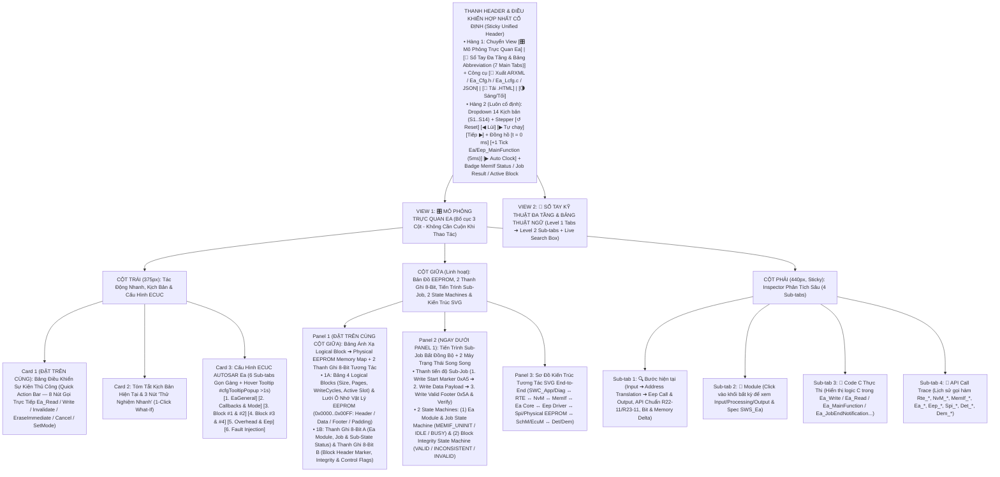
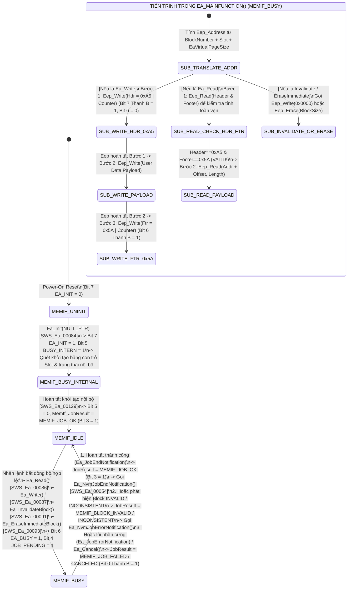
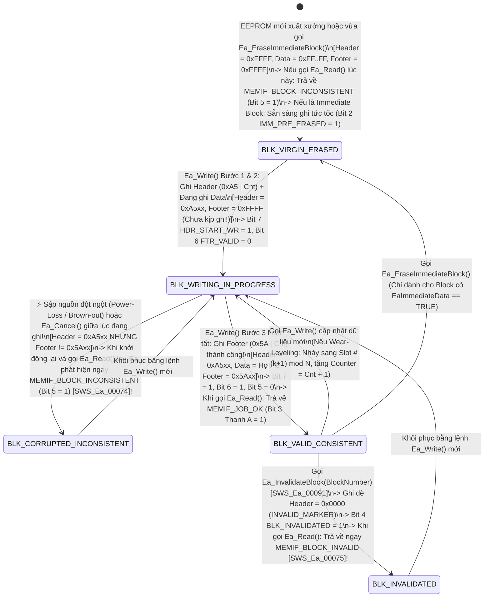

# Tài Liệu Thiết Kế Chi Tiết Trình Mô Phỏng AUTOSAR Ea — EEPROM Abstraction (`Ea_Simulation_design.md`)

> **Trạng thái tài liệu:** Bản thiết kế chi tiết đã cập nhật theo xác nhận `A1`–`A4` của User — Sẵn sàng để User review trước khi triển khai code.  
> **File đích dự kiến xuất bản:** `d:\__Personal\AntiGravity\Simulation\04_ECU_Abstraction\AUTOSAR_Ea.html` (Ứng dụng Web Tương tác 1 file HTML độc lập, 100% Offline, Pure CSS, có nút tải `.HTML` kèm cấu hình nhúng & xuất code `ARXML / Ea_Cfg.h / Ea_Lcfg.c / JSON`).  
> **Chuẩn tham chiếu:** **AUTOSAR Classic Platform R20-11 / R22-11 / R23-11 (`SWS_Ea` — EEPROM Abstraction, `SWS_MemIf`, `SWS_NvM`, `SWS_Eep`, `SWS_Spi`, `SWS_Dem`, `SWS_Det`, `SWS_SchM`, `SWS_EcuM`, `SWS_BswM`, `SWS_Rte`)**, đính kèm mã requirement chuẩn **`SWS_Ea_xxxxx`** tại từng bước xử lý, Bảng Ánh xạ `Logical Block ➔ Physical EEPROM Memory Map` (`Block Header / User Data / Block Footer`, `Virtual Page Alignment`, `Write-Cycle Spread / Wear-Leveling Slots` & `Immediate Block`), 2 thanh ghi 8-Bit tương tác, tooltip cấu hình (`#cfgTooltipPopup` `>1s` giống hệt `AUTOSAR_DEM.html`) và sổ tay tra cứu đa tầng.

---

## 1. Tổng Quan Định Hướng Thiết Kế Đã Chốt (`A1` – `A4`)

| Hạng mục | Nội dung thiết kế đã xác nhận với User |
| :--- | :--- |
| **1. Bố cục giao diện & Ưu tiên Không Cuộn Trang — Zero-Scroll (`A1`)** | Kết hợp tinh hoa của **`AUTOSAR_DEM.html`**, **`AUTOSAR_BswM.html`** và **`AUTOSAR_CanNM.html`**, tối ưu hóa **Above-the-Fold (Zero-Scroll)** để các khối thao tác và giám sát tần suất cao nhất luôn nằm ngay phần đầu mỗi cột trong khung màn hình:<br>• **Thanh Điều Khiển Hợp Nhất Cố Định (Sticky Unified Header)**:<br>  - **Hàng 1**: Chuyển View `[🎛️ Mô Phỏng Trực Quan Ea]` \| `[📖 Sổ Tay Đa Tầng & Bảng Abbreviation (7 Main Tabs)]` + Công cụ `[🧾 Xuất ARXML / Ea_Cfg.h / Ea_Lcfg.c / JSON]` \| `[💾 Tải .HTML]` \| `[🌗 Sáng/Tối]`.<br>  - **Hàng 2 (Luôn cố định)**: Dropdown chọn 14 Kịch bản (`S1`–`S14`), Stepper (`↺ Reset`, `◀ Lùi`, `▶ Tự chạy`, `Tiếp ▶`), Đồng hồ (`t = 0 ms`, `+1 Tick Ea_MainFunction & Eep_MainFunction (5ms)`, `▶ Auto Clock`) và Badge Trạng thái `MemIf_StatusType` / `MemIf_JobResultType` / `Active Block & Physical Slot`.<br>• **Bố cục 3 cột hiện đại (Mỗi cột tự cuộn độc lập trong khung Viewport)**:<br>  - **Cột Trái (`375px`)**: Đưa **Card 1: Bảng Điều Khiển Sự Kiện Thủ Công (`Quick Action Bar` — 8 nút gọi trực tiếp `Ea_Read`, `Ea_Write`, `Ea_InvalidateBlock`, `Ea_EraseImmediateBlock`, `Ea_Cancel`, `Ea_SetMode`, `+1 Tick MainFunction`)** và **Card 2: Tóm tắt kịch bản & 3 nút 1-Click What-If** lên trên cùng, tiếp theo là **Card 3: 6 Sub-tabs Cấu hình ECUC Ea** (hỗ trợ Floating Hover Tooltip `#cfgTooltipPopup` sau `>1s` giống hệt `AUTOSAR_DEM.html`).<br>  - **Cột Giữa (`Linh hoạt`)**: Đưa **Panel 1: Bảng Ánh Xạ Logical Block ➔ Physical EEPROM Memory Map (`Header / Data / Footer`, `Virtual Page Alignment`, `Multi-Slot Wear-Leveling`) + 2 Thanh Ghi 8-Bit Tương Tác** và **Panel 2: Hàng Đợi Job Bất Đồng Bộ & 2 Máy Trạng Thái Song Song (`Ea Module & Job Processing State Machine` + `Block Integrity & Lifecycle State Machine`)** lên ngay đầu cột giữa, bên dưới là **Panel 3: Sơ Đồ Kiến Trúc Tương Tác SVG End-to-End** (`SWC_App/Diag ↔ RTE ↔ NvM ↔ MemIf ↔ Ea Core ↔ Eep Driver ↔ Spi / Physical EEPROM HW ↔ SchM/OS & EcuM/BswM ↔ Det/Dem`).<br>  - **Cột Phải (`440px, Sticky`)**: Inspector 4 Sub-tabs (`🔍 Bước hiện tại`, `🧩 Module`, `📄 Code C Thực Thi`, `📜 API Call Trace`).<br>• **Config Hover Tooltip (`> 1s` delay)** giống hệt `AUTOSAR_DEM.html` (`#cfgTooltipPopup` hiển thị tên tham số, đường dẫn ECUC, mã `SWS_Ea_xxxxx`, mô tả, dải giá trị, giá trị typical và lưu ý kỹ thuật). |
| **2. Khu vực Giám sát Bit-level & Bản đồ Bộ nhớ EEPROM 2 Tầng (`A2`)** | Đặt **cố định và nổi bật ở đầu Cột Giữa** gồm **2 tầng trực quan hóa**:<br>• **Tầng 1 — Bảng Ánh Xạ Logical Block ➔ Physical EEPROM Memory Map (`0x0000 .. 0x00FF`)**: Hiển thị trực tiếp bảng cấu hình 4 Logical Blocks (`Block #1: Calibration`, `Block #2: Dataset[0..1]`, `Block #3: High-Cycle Odometer (4 Wear-Leveling Slots)`, `Block #4: Immediate Crash Data`), công thức tính địa chỉ vật lý theo **`EaVirtualPageSize`** (`8 bytes/page`), và lưới ô nhớ EEPROM vật lý hiển thị trực quan từng byte `Header Marker (0xA5)` / `Payload Data` / `Footer Marker (0x5A)` / `Invalidated (0x00)` / `Erased (0xFF)`!<br>• **Tầng 2 — 2 Thanh ghi 8-Bit tương tác song song**:<br>  1. **Thanh A (`8-Bit Ea Module, Job & Sub-State Status Byte` — `Ea_ModuleJobStatusByte`)**: Theo dõi trạng thái lõi của module `Ea` (`EA_INITIALIZED`, `EA_STATUS_BUSY`, `EA_BUSY_INTERNAL`, `JOB_PENDING`, `JOB_RESULT_OK`, `EEP_SUBJOB_ACTV`, `FAST_MODE_EN`, `POLLING_MODE_EN`).<br>  2. **Thanh B (`8-Bit Ea Block Header Marker, Integrity & Control Flags Byte` — `Ea_BlockHeaderControlByte`)**: Theo dõi trực quan trạng thái toàn vẹn và cờ quản lý trên EEPROM của Block đang xử lý (`BLK_HDR_START_WR`, `BLK_FTR_VALID`, `BLK_INCONSISTENT`, `BLK_INVALIDATED`, `IMM_DATA_BLOCK`, `IMM_PRE_ERASED`, `WEAR_SLOT_ROTATE`, `JOB_ERR_OR_CANCEL`). Cho phép click trực tiếp vào từng bit hoặc từng ô nhớ EEPROM để thử nghiệm! |
| **3. Hệ thống 14 Kịch bản mẫu (`A3`)** | Thiết kế sẵn **14 Kịch bản (`S1`–`S14`)** chia làm 4 nhóm lớn:<br>• **Nhóm 1 (`S1`–`S4`) — Khởi Tạo `Ea_Init`, Luồng Ghi/Đọc Chuẩn (`SWC ➔ RTE ➔ NvM ➔ MemIf ➔ Ea ➔ Eep`) & Căn Chỉnh Trang Ảo (`EaVirtualPageSize`)**: Khởi tạo `Ea_Init(NULL_PTR)`, luồng ghi đầy đủ `Ea_Write()` qua 3 bước an toàn (`Header 0xA5 ➔ Data ➔ Footer 0x5A`), đọc dữ liệu một phần `Ea_Read(BlockNumber, BlockOffset, DataBufferPtr, Length)` kèm giải mã `DatasetIndex`, và minh họa quy tắc căn chỉnh địa chỉ theo bội số `EaVirtualPageSize`.<br>• **Nhóm 2 (`S5`–`S8`) — Tính Toàn Vẹn Khối (`INCONSISTENT` vs `INVALID`), Vô Hiệu Hóa (`Ea_InvalidateBlock`) & Chia Tải Chu Kỳ Ghi (`Write-Cycle Wear-Leveling`)**: Phát hiện khối không nhất quán (`MEMIF_BLOCK_INCONSISTENT`) khi mất điện giữa lúc đang ghi (`Start Marker = 0xA5` nhưng chưa kịp ghi `Footer = 0x5A`) hoặc đọc vùng EEPROM trắng (`0xFF`), chủ động vô hiệu hóa khối bằng `Ea_InvalidateBlock()` (`MEMIF_BLOCK_INVALID`), và thuật toán luân chuyển qua 4 Slot vật lý (`Slot #0 ➔ Slot #3`) khi `EaNumberOfWriteCycles (400,000) > EepAllowedWriteCycles (100,000)`.<br>• **Nhóm 3 (`S9`–`S11`) — Dữ Liệu Khẩn Cấp (`EaImmediateData` & `Ea_EraseImmediateBlock`), Chuyển Tốc Độ (`Ea_SetMode`) & Đối Chiếu `Callback` vs `Polling Mode`**: Quy trình xóa trước vùng nhớ bằng `Ea_EraseImmediateBlock()` để `Ea_Write()` ghi tức thì khi có sự cố khẩn cấp, chuyển đổi chế độ `Ea_SetMode(MEMIF_MODE_FAST / SLOW)` khi chạy `NvM_ReadAll / WriteAll`, và đối chiếu cơ chế thông báo ngắt (`Ea_JobEndNotification`) với chế độ hỏi vòng (`EaPollingMode = TRUE`).<br>• **Nhóm 4 (`S12`–`S14`) — Hủy Lệnh Giữa Chừng (`Ea_Cancel`), Lỗi Phần Cứng (`Ea_JobErrorNotification`) & Kiểm Thử `DET / Runtime Error` R22-11/R23-11**: Gọi `Ea_Cancel()` khi đang ghi dở dang (`MEMIF_JOB_CANCELED`), xử lý lỗi phần cứng từ `Eep` (`Ea_JobErrorNotification` ➔ `MEMIF_JOB_FAILED` ➔ `NvM_JobErrorNotification`), và kiểm thử toàn diện các mã lỗi Development Error (`EA_E_UNINIT`, `EA_E_INVALID_BLOCK_NO`, `EA_E_INVALID_BLOCK_OFS`, `EA_E_INVALID_DATA_PTR`, `EA_E_INVALID_BLOCK_LEN`) cùng Runtime Error (`EA_E_BUSY`, `EA_E_INVALID_CANCEL`). |
| **4. Sổ tay tra cứu đa tầng & Bảng Abbreviation (`A4`)** | **View 2 (`📖 Sổ Tay Kỹ Thuật Ea & Từ Điển Thuật Ngữ`)** được tổ chức theo cấu trúc **Đa Tầng (Multi-level Tabs)**:<br>• **6 Main Sub-tabs (Level 1) × 4 Chủ đề con (Level 2 Pills/Tabs = 24 chuyên đề)** phân tích sâu kiến trúc Memory Stack (`SWC ➔ RTE ➔ NvM ➔ MemIf ➔ Ea ➔ Eep`), ánh xạ địa chỉ ảo & Wear-Leveling, cấu trúc Header/Footer & xử lý mất nguồn, cơ chế `EaImmediateData`, đối chiếu `Ea` vs `Fee`, và từ điển API/ECUC chuẩn R23-11.<br>• **Tab 7 chuyên biệt: `🔤 Bảng Thuật Ngữ & Từ Viết Tắt (Abbreviation Table)`** trình bày dưới dạng bảng chuẩn 4 cột, tích hợp **Search Box tìm kiếm tức thời (Live Search + Highlight `<mark>`)** và 5 nút lọc nhanh theo phân nhóm (`Ea Core & Addressing`, `Block Status & Integrity`, `Memory Stack (NvM/MemIf/Fee)`, `Eep Driver, HW & Errors`). |

---

## 2. Bố Cục Giao Diện 3 Cột Ưu Tiên Zero-Scroll & Hệ Thống Sub-Tabs (UI Wireframe)

Để đảm bảo **"người dùng không cần cuộn chuột lên xuống mỗi lần thao tác"**, toàn bộ giao diện được thiết kế theo nguyên lý **Viewport-First (Đưa các khối tương tác và giám sát tần suất cao nhất lên ngay phần đầu của mỗi cột, kết hợp hệ thống Sub-tabs gọn gàng)**:



### Điểm Cải Tiến Đột Phá Về Trải Nghiệm "Zero-Scroll" Cho Module `Ea`:
1. **Thanh Điều Khiển Hợp Nhất (`Sticky Unified Header`)**: Gộp chọn kịch bản, nút bấm `Bước tiếp / Lùi / Tự chạy`, và nút nhịp đồng hồ **`+1 Tick Ea/Eep_MainFunction (5ms)`** vào ngay thanh Header cố định. Vì mọi thao tác Đọc/Ghi/Xóa của `Ea` và `Eep` đều là **bất đồng bộ (Asynchronous)**, việc đặt nút `+1 Tick` cố định trên Header giúp người dùng có thể bấm nhích từng chu kỳ `Ea_MainFunction()` để quan sát từng bước chuyển trạng thái nội bộ (`Write Header 0xA5 ➔ Write Data ➔ Write Footer 0x5A ➔ Ea_JobEndNotification`) ở bất kỳ đâu.
2. **Đưa `Quick Action Bar` (8 nút gọi API trực tiếp) lên vị trí Card 1 (Đầu Cột Trái)** và đưa **Bảng Ánh Xạ Logical Block ➔ Physical EEPROM Memory Map + 2 Thanh Ghi 8-Bit** lên đầu Cột Giữa: Khi bấm `Ea_Write(Block #1)`, `Ea_Read(Block #1, Offset=2, Len=4)`, `Ea_InvalidateBlock(Block #2)` hoặc `Ea_EraseImmediateBlock(Block #4)`, mắt người dùng nhìn thấy ngay lập tức địa chỉ vật lý nào trên EEPROM (`0x0000 .. 0x00FF`) đang đổi màu, byte `Header/Footer` nào vừa được ghi, và bit trạng thái nào vừa lật trên 2 Thanh ghi 8-Bit mà **không phải cuộn trang**.
3. **Gom 36 tham số ECUC vào 6 Sub-tabs gọn gàng**: Chiều cao Card Cấu hình được giữ gọn cố định (~275px), kèm hộp thoại giải thích nổi `#cfgTooltipPopup` khi hover quá `1000ms` giống hệt `AUTOSAR_DEM.html`.

---

## 3. Thiết Kế Chi Tiết Panel 1 (Đầu Cột Giữa): Bảng Ánh Xạ `Logical Block ➔ Physical EEPROM Memory Map` & 2 Thanh Ghi 8-Bit Tương Tác

Theo chuẩn **`AUTOSAR_SWS_EEPROMAbstraction` (`SWS_Ea_00001`, `SWS_Ea_00003`, `SWS_Ea_00005`)**, nhiệm vụ cốt lõi của `Ea` là **che giấu hoàn toàn địa chỉ vật lý và đặc tính phần cứng của EEPROM** khỏi lớp trên (`MemIf` / `NvM`):
1. **Chuyển đổi Địa chỉ Logic sang Địa chỉ Vật lý & Căn chỉnh Trang ảo (`Logical-to-Physical Address Translation & Virtual Page Alignment`)**: Người dùng chỉ truyền `BlockNumber (1..0xFFFE)`, `BlockOffset` và `Length`. `Ea` tự động cộng thêm phần `EaBlockOverhead` (Header + Footer quản lý tính nhất quán), làm tròn kích thước khối lên bội số nguyên của **`EaVirtualPageSize`** (ví dụ `8 bytes/page` — `SWS_Ea_00051`), và tính ra địa chỉ `Eep_AddressType` chính xác.
2. **Chia tải chu kỳ ghi (`Write-Cycle Spread / Multi-Slot Wear-Leveling`)**: Khi một khối dữ liệu yêu cầu số lần ghi suốt vòng đời xe (`EaNumberOfWriteCycles`, ví dụ `400,000` lần) lớn hơn giới hạn chịu đựng của 1 ô nhớ EEPROM vật lý (`EepAllowedWriteCycles`, ví dụ `100,000` lần), `Ea` tự động nhân bản khối đó thành $N = \lceil 400,000 / 100,000 \rceil = 4$ vùng vật lý liên tiếp (`Slot #0 .. Slot #3`) và luân chuyển vị trí ghi để chống hỏng ô nhớ EEPROM!

Do đó, Panel 1 ở đầu Cột Giữa được thiết kế gồm **2 tầng trực quan hóa liên thông**:

### 3.1. Phần 1A — Bảng Ánh Xạ `Logical Block` & Bản Đồ Ô Nhớ Vật Lý EEPROM (`Physical EEPROM Memory Map 0x0000 .. 0x00DF`)

```text
+-------------------------------------------------------------------------------------------------------------------+
| 🗺️ BẢNG ÁNH XẠ LOGICAL BLOCK ➔ PHYSICAL EEPROM MEMORY MAP (`EaVirtualPageSize = 8B`, `Overhead = 4B [Hdr2+Ftr2]`) |
| MemIf Status: [ MEMIF_IDLE ] | Last Job Result: [ MEMIF_JOB_OK ] | Mode: [ MEMIF_MODE_SLOW ] | Active: [Block #1] |
+-------------------------------------------------------------------------------------------------------------------+
| 1. BẢNG CẤU HÌNH & TRẠNG THÁI 4 LOGICAL BLOCKS (`EaBlockConfiguration` — Click hàng để chọn Block thao tác):      |
|  +---------+----------------------+--------+---------+--------------+-------------+---------------+--------------+|
|  | Block # | Tên Khối (Logical)   | DataSz | +Ovrhd  | VirtualPages | WriteCycles | PhysicalAddr  | Trạng Thái   ||
|  +---------+----------------------+--------+---------+--------------+-------------+---------------+--------------+|
|  | #1 (01) | ★ Blk_Calibration    |  12 B  | 16 B    | 2 Pages (16B)| 100k (1 Slt)| 0x0000..0x000F| ✅ VALID     ||
|  | #2 (02) |   Blk_Dataset_0      |   8 B  | 12➔16 B | 2 Pages (16B)| 100k (1 Slt)| 0x0010..0x001F| ✅ VALID     ||
|  | #2 (03) |   Blk_Dataset_1      |   8 B  | 12➔16 B | 2 Pages (16B)| 100k (1 Slt)| 0x0020..0x002F| 🚫 INVALID   ||
|  | #3 (04) |   Blk_Odometer_Wear  |   4 B  |  8 B    | 1 Pagex4 Slts| 400k (4 Slt)| 0x0030..0x004F| 🔄 SLOT #2 OK||
|  | #4 (05) | ⚡ Blk_Crash_ImmData  |  10 B  | 14➔16 B | 2 Pages (16B)| 100k (Imm!) | 0x0050..0x005F| 🧹 PRE-ERASED||
|  +---------+----------------------+--------+---------+--------------+-------------+---------------+--------------+|
| 2. LƯỚI Ô NHỚ VẬT LÝ EEPROM (`Physical EEPROM Hex Map` — Mỗi dòng = 1 hoặc 2 Virtual Pages, Click ô để sửa/phá): |
|  [0x0000 Blk#1] : [A5 01:HDR] [12 34 56 78 9A BC DE F0 11 22 33 44:DATA (12B)] [5A 01:FTR]          ➔ ✅ VALID    |
|  [0x0010 Blk#2a]: [A5 01:HDR] [AA BB CC DD 55 66 77 88:DATA (8B)] [5A 01:FTR] [FF FF FF FF:PAD (4B)] ➔ ✅ VALID    |
|  [0x0020 Blk#2b]: [00 00:INV] [AA BB CC DD 55 66 77 88:OLD_DATA ] [00 00:INV] [FF FF FF FF:PAD (4B)] ➔ 🚫 INVALID  |
|  [0x0030 Blk#3] : [Slt0: 00 01|OLD] [Slt1: 00 02|OLD] [★Slt2: A5 03|00 05 43 21|5A 03] [Slt3: FF..FF]➔ 🔄 WEAR #2  |
|  [0x0050 Blk#4⚡]: [FF FF:ERS] [FF FF FF FF FF FF FF FF FF FF:PRE-ERASED (10B)] [FF FF:ERS] [FF..FF] ➔ ⚡ READY_WR |
+-------------------------------------------------------------------------------------------------------------------+
```

- **Tính năng tương tác trực tiếp trên Phần 1A**:
  - Người dùng nhìn thấy tận mắt **cấu trúc vật lý bên trong mỗi Block trên EEPROM**:
    - **`[A5 xx : HDR]` (2-byte Block Header)**: Gồm Byte cờ `Start-of-Write Marker (0xA5)` (hoặc `0x00` khi bị `Invalidate`, `0xFF` khi đang trống `Erased`) kèm `Write Counter / Version Byte (xx)`.
    - **`[... : DATA]`**: Vùng dữ liệu thực tế (`EaBlockSize` bytes) của ứng dụng.
    - **`[5A xx : FTR]` (2-byte Block Footer / End Marker)**: Gồm Byte cờ `End-of-Write / Valid Marker (0x5A)` và byte đối chiếu `Version Byte (xx)`. Chỉ khi cả Header (`0xA5`) và Footer (`0x5A`) cùng khớp `Version Byte`, `Ea_Read()` mới kết luận Block là **`VALID (MEMIF_JOB_OK)`**! Nếu có Header `0xA5` mà Footer vẫn là `0xFF` (do sập nguồn giữa lúc đang ghi!), `Ea` phát hiện ngay **`MEMIF_BLOCK_INCONSISTENT`**!
    - **`[FF .. FF : PAD]`**: Các byte đệm tự động ở cuối để tổng độ dài vùng nhớ vật lý luôn chia hết cho **`EaVirtualPageSize`** (`SWS_Ea_00051`).
  - Người dùng có thể **click trực tiếp vào bất kỳ Block hoặc ô nhớ Hex nào** trên bản đồ EEPROM để giả lập làm hỏng byte Footer (`Corrupt Byte` ➔ kiểm tra `MEMIF_BLOCK_INCONSISTENT`) hoặc xem chi tiết công thức tính địa chỉ!

### 3.2. Phần 1B — 2 Thanh Ghi 8-Bit Trạng Thái Tương Tác Luôn Hiển Thị Nổi Bật

Ngay bên dưới Phần 1A là **2 Thanh ghi 8-Bit tương tác** theo đúng phong cách trực quan của `AUTOSAR_DEM.html` và `AUTOSAR_BswM.html`:

```text
+-------------------------------------------------------------------------------------------------------------------+
| 🔢 BẢNG GIÁM SÁT BITFIELD 8-BIT EA MODULE STATUS & BLOCK INTEGRITY (LIVE 8-BIT INSPECTOR) [Click ô Bit để thử]    |
| Bước #4: Ea_MainFunction() hoàn tất ghi Footer 0x5A cho Block #1 ➔ Ea_JobEndNotification() | A: 0x88 | B: 0xC0    |
+-------------------------------------------------------------------------------------------------------------------+
| A. THANH GHI 8-BIT TRẠNG THÁI MODULE & TIẾN TRÌNH JOB (`Ea_ModuleJobStatusByte`) — Hex: [ 0x88 ] Bin: [1000 1000b]|
|    MemIf_Status: [ MEMIF_IDLE ] | MemIf_JobResult: [ MEMIF_JOB_OK ] | Mode: [ SLOW ] | Notify: [ CALLBACK ]       |
|  +-------------+ +-------------+ +-------------+ +-------------+ +-------------+ +-------------+ +-------+ +-----+|
|  | Bit 7 (0x80)| | Bit 6 (0x40)| | Bit 5 (0x20)| | Bit 4 (0x10)| | Bit 3 (0x08)| | Bit 2 (0x04)| |Bit1(2)| |Bit 0||
|  | EA_INIT     | | EA_BUSY     | | BUSY_INTERN | | JOB_PENDING | | JOB_RES_OK  | | EEP_SUBJOB  | |FAST_MD| |POLL ||
|  |      1      | |      0      | |      0      | |      0      | |      1      | |      0      | |   0   | |  0  ||
|  | Initialized | | MEMIF_IDLE  | | Normal Op   | | No Pend Job | | MEMIF_JOB_OK| | Eep Idle    | |SlowMd | |CbMod||
|  +-------------+ +-------------+ +-------------+ +-------------+ +-------------+ +-------------+ +-------+ +-----+|
+-------------------------------------------------------------------------------------------------------------------+
| B. THANH GHI 8-BIT ĐÁNH DẤU HEADER, TOÀN VẸN & ĐIỀU KHIỂN BLOCK (`Ea_BlockHeaderControlByte`) — Hex:[0xC0] [11000000]|
|    Block #1 Integrity: [ VALID (Hdr=0xA5, Ftr=0x5A) ] | Immediate: [ FALSE ] | Active Slot: [ Slot #0 / 1 ]       |
|  +-------------+ +-------------+ +-------------+ +-------------+ +-------------+ +-------------+ +-------+ +-----+|
|  | Bit 7 (0x80)| | Bit 6 (0x40)| | Bit 5 (0x20)| | Bit 4 (0x10)| | Bit 3 (0x08)| | Bit 2 (0x04)| |Bit1(2)| |Bit 0||
|  | HDR_START_WR| | FTR_VALID   | | INCONSISTENT| | INVALIDATED | | IMM_DATA_BLK| | IMM_PRE_ERS | |WEAR_RT| |ERR_C||
|  |      1      | |      1      | |      0      | |      0      | |      0      | |      0      | |   0   | |  0  ||
|  | Hdr = 0xA5  | | Ftr = 0x5A  | | Consistent! | | Valid Data  | | Normal Block| | Not PreErsd | |Slot #0| |NoErr||
|  +-------------+ +-------------+ +-------------+ +-------------+ +-------------+ +-------------+ +-------+ +-----+|
+-------------------------------------------------------------------------------------------------------------------+
```

#### 3.2.1. Giải Mã Chi Tiết Thanh A: `8-Bit Ea Module, Job & Sub-State Status Byte` (`Ea_ModuleJobStatusByte`)

| Bit | Mask | Tên Cờ (`Ea Status Bit`) | Ý nghĩa kỹ thuật & Khi nào bật lên `1` (`0 ➔ 1`) | Khi nào hạ về `0` (`1 ➔ 0`) |
| :-: | :-: | :--- | :--- | :--- |
| **Bit 7** | `0x80` | **`EA_INITIALIZED`** | Bật lên `1` sau khi `EcuM` gọi **`Ea_Init(NULL_PTR)`** thành công (`SWS_Ea_00084`, `SWS_Ea_00129`), chuyển trạng thái module từ `MEMIF_UNINIT` sang `MEMIF_IDLE` và khởi tạo các con trỏ quản lý Block. | Hạ về `0` khi hệ thống chưa gọi `Ea_Init()` hoặc khi người dùng tắt Checkbox `EaInitialized` để kiểm thử báo lỗi `Det_ReportError(EA_E_UNINIT = 0x01)`. |
| **Bit 6** | `0x40` | **`EA_STATUS_BUSY`** | Bật lên `1` ngay khi `Ea` chấp nhận một lệnh bất đồng bộ (`Ea_Read`, `Ea_Write`, `Ea_InvalidateBlock`, `Ea_EraseImmediateBlock`), chuyển trạng thái trả về của `Ea_GetStatus()` sang **`MEMIF_BUSY`** (`SWS_Ea_00089`). Trong lúc `Bit 6 == 1`, mọi yêu cầu Job mới đều bị từ chối và báo lỗi Runtime Error `EA_E_BUSY (0x06)`! | Hạ về `0` (trở lại **`MEMIF_IDLE`**) khi Job hoàn tất (`MEMIF_JOB_OK`), thất bại (`MEMIF_JOB_FAILED`), phát hiện `INCONSISTENT / INVALID`, hoặc bị hủy bởi `Ea_Cancel()`. |
| **Bit 5** | `0x20` | **`EA_BUSY_INTERNAL`** | Bật lên `1` khi `Ea` đang thực hiện tác vụ quản lý nội bộ (`Ea_GetStatus() == MEMIF_BUSY_INTERNAL` — `SWS_Ea_00035`, ví dụ đang quét kiểm tra phiên bản các Slot Wear-Leveling hoặc dọn dẹp nội bộ sau khởi tạo). | Hạ về `0` ngay khi tác vụ quản lý nội bộ kết thúc, trả module về `MEMIF_IDLE`. |
| **Bit 4** | `0x10` | **`JOB_PENDING`** | Bật lên `1` khi `Ea_GetJobResult()` đang ở trạng thái **`MEMIF_JOB_PENDING`** (`SWS_Ea_00090`), báo cho `MemIf` / `NvM` biết yêu cầu Đọc/Ghi/Xóa đang được tiến hành từng bước trong `Ea_MainFunction()`. | Hạ về `0` ngay khi Job kết thúc và chuyển sang một trong các kết quả cuối: `MEMIF_JOB_OK`, `MEMIF_JOB_FAILED`, `MEMIF_JOB_CANCELED`, `MEMIF_BLOCK_INCONSISTENT` hoặc `MEMIF_BLOCK_INVALID`. |
| **Bit 3** | `0x08` | **`JOB_RESULT_OK`** | Bật lên `1` khi Job gần nhất hoàn tất trọn vẹn với kết quả **`MEMIF_JOB_OK`** (`SWS_Ea_00054`, `SWS_Ea_00055`), đồng thời `Ea` kích hoạt callback **`EaNvmJobEndNotification()`** (`NvM_JobEndNotification`). | Hạ về `0` khi bắt đầu một Job mới (`MEMIF_JOB_PENDING`) hoặc khi Job kết thúc với trạng thái lỗi / không nhất quán / bị hủy. |
| **Bit 2** | `0x04` | **`EEP_SUBJOB_ACTV`** | Bật lên `1` khi `Ea_MainFunction()` vừa phát lệnh xuống tầng MCAL (`Eep_Read`, `Eep_Write`, `Eep_Erase`, hoặc `Eep_Compare`) và đang đợi `Eep_MainFunction()` xử lý phần cứng EEPROM. | Hạ về `0` khi `Eep` hoàn tất Sub-Job và báo ngược lên qua `Ea_JobEndNotification()` (hoặc khi `Eep_GetJobResult() == MEMIF_JOB_OK` ở chế độ Polling). |
| **Bit 1** | `0x02` | **`FAST_MODE_EN`** | Bật lên `1` khi lớp trên gọi **`Ea_SetMode(MEMIF_MODE_FAST)`** (`SWS_Ea_00085`, khi `EaSetModeSupported = TRUE`) và `Ea` chuyển tiếp lệnh `Eep_SetMode(MEMIF_MODE_FAST)` xuống `Eep` để tăng kích thước khối đọc/ghi mỗi chu kỳ (thường dùng trong `NvM_ReadAll` / `NvM_WriteAll`). | Hạ về `0` khi đang ở chế độ mặc định **`MEMIF_MODE_SLOW`** (giảm chiếm dụng tài nguyên bus SPI / CPU trong chế độ vận hành bình thường `RUN`). |
| **Bit 0** | `0x01` | **`POLLING_MODE_EN`** | Bật lên `1` khi tham số cấu hình **`EaPollingMode = TRUE`** (`ECUC_Ea_00039`): `Ea_MainFunction()` chủ động gọi `Eep_GetJobResult()` mỗi chu kỳ thay vì dùng hàm callback ngắt. | Hạ về `0` khi `EaPollingMode = FALSE` (chế độ mặc định dùng Callback `Ea_JobEndNotification()` / `Ea_JobErrorNotification()` từ `Eep`). |

#### 3.2.2. Giải Mã Chi Tiết Thanh B: `8-Bit Ea Block Header Marker, Integrity & Control Flags Byte` (`Ea_BlockHeaderControlByte`)

| Bit | Mask | Tên Cờ (`Block Header / Control Bit`) | Ý nghĩa kỹ thuật & Khi nào bật lên `1` (`0 ➔ 1`) | Khi nào hạ về `0` (`1 ➔ 0`) |
| :-: | :-: | :--- | :--- | :--- |
| **Bit 7** | `0x80` | **`BLK_HDR_START_WR`** | Bật lên `1` ở **Bước 1 của chu trình `Ea_Write()`** (hoặc khi `Ea_Read()` đọc thấy Header hợp lệ): `Ea` ghi dấu **`START_WRITE_MARKER (0xA5)`** kèm `CycleCounter` vào 2 byte đầu của Block trên EEPROM trước khi ghi dữ liệu ứng dụng. | Hạ về `0` khi Block bị xóa trắng (`0xFF` sau `Ea_EraseImmediateBlock`) hoặc bị ghi đè thành `0x00` bởi lệnh `Ea_InvalidateBlock()`. |
| **Bit 6** | `0x40` | **`BLK_FTR_VALID`** | Bật lên `1` ở **Bước cuối của chu trình `Ea_Write()`** (hoặc khi `Ea_Read()` kiểm tra khớp cả Header lẫn Footer): Sau khi toàn bộ byte dữ liệu (`User Data`) đã ghi xong xuống EEPROM, `Ea` ghi dấu **`VALID_FOOTER_MARKER (0x5A)`** kèm `CycleCounter` trùng khớp vào 2 byte cuối của Block! Khi cả **`Bit 7 == 1` VÀ `Bit 6 == 1`**, khối dữ liệu được chứng nhận **`VALID`**! | Hạ về `0` ngay khi bắt đầu một chu trình ghi đè mới (lúc vừa cập nhật Header nhưng chưa ghi xong Footer), khi sập nguồn giữa lúc ghi, khi bị `Invalidate`, hoặc khi vừa `Pre-Erase`. |
| **Bit 5** | `0x20` | **`BLK_INCONSISTENT`** | Bật lên `1` khi `Ea_Read()` kiểm tra Header & Footer của Block và phát hiện **dữ liệu không nhất quán (`MEMIF_BLOCK_INCONSISTENT` — `SWS_Ea_00055`, `SWS_Ea_00074`)**: hoặc do **mất điện đột ngột giữa lúc đang ghi** (`Bit 7 HDR = 0xA5` nhưng `Bit 6 FTR != 0x5A` hoặc lệch `CycleCounter`), hoặc do đọc phải ô nhớ EEPROM mới xuất xưởng (`0xFF`). | Hạ về `0` sau khi khối đó được ghi lại thành công bằng một lệnh `Ea_Write()` hoàn chỉnh hoặc khi chuyển sang đọc một Block hợp lệ khác. |
| **Bit 4** | `0x10` | **`BLK_INVALIDATED`** | Bật lên `1` khi thực thi lệnh **`Ea_InvalidateBlock(BlockNumber)`** (`SWS_Ea_00091`): `Ea` gọi `Eep_Write()` ghi dấu **`INVALID_MARKER (0x0000)`** vào Header của Block trên EEPROM. Khi `Ea_Read()` gặp cờ này, nó không đọc dữ liệu nữa mà trả ngay kết quả **`MEMIF_BLOCK_INVALID`** (`SWS_Ea_00075`) cho `NvM`! | Hạ về `0` khi ứng dụng gọi `Ea_Write()` ghi dữ liệu mới hợp lệ đè lên Block đó. |
| **Bit 3** | `0x08` | **`IMM_DATA_BLOCK`** | Bật lên `1` khi Block đang được chọn có cấu hình **`EaImmediateData = TRUE`** (`ECUC_Ea_00118` — ví dụ `Block #4: Blk_Crash_ImmData`), cho phép sử dụng dịch vụ `Ea_EraseImmediateBlock()` và ưu tiên ghi tức tốc. | Hạ về `0` khi thao tác trên các Block thông thường (`EaImmediateData = FALSE`). Nếu gọi `Ea_EraseImmediateBlock()` khi `Bit 3 == 0`, `Ea` sẽ từ chối và báo lỗi `EA_E_INVALID_BLOCK_NO (0x02)`! |
| **Bit 2** | `0x04` | **`IMM_PRE_ERASED`** | Bật lên `1` sau khi gọi **`Ea_EraseImmediateBlock(BlockNumber)`** (`SWS_Ea_00093`, `SWS_Ea_00064`) thành công trên một Block có `EaImmediateData = TRUE`: vùng EEPROM vật lý của Block đã được xóa sạch (`0xFF`) sẵn sàng chờ lệnh `Ea_Write()` khẩn cấp mà không tốn thời gian Erase! | Hạ về `0` ngay sau khi lệnh `Ea_Write()` ghi dữ liệu khẩn cấp vào vùng đã xóa sẵn đó (hoặc nếu chưa chạy `Ea_EraseImmediateBlock` mà đã gọi `Ea_Write` khi bật kiểm tra nghiêm ngặt). |
| **Bit 1** | `0x02` | **`WEAR_SLOT_ROTATE`** | Bật lên `1` khi thao tác trên Block có cấu hình **`EaNumberOfWriteCycles > EepAllowedWriteCycles`** (ví dụ `Block #3` có 4 Slots vật lý `Slot #0 .. Slot #3` — `SWS_Ea_00005`): mỗi lần gọi `Ea_Write(Block #3)`, `Ea` tự động tăng `CycleCounter` và dịch con trỏ địa chỉ vật lý sang Slot kế tiếp (`Slot #(k+1) mod 4`)! | Hạ về `0` khi thao tác trên các Block chỉ dùng 1 Slot vật lý duy nhất (`EaNumberOfWriteCycles <= EepAllowedWriteCycles`). |
| **Bit 0** | `0x01` | **`JOB_ERR_OR_CANCEL`** | Bật lên `1` khi xảy ra một trong các sự kiện bất thường: (1) Lệnh bị hủy giữa chừng bởi **`Ea_Cancel()`** (`MEMIF_JOB_CANCELED`), (2) Tầng `Eep` báo lỗi phần cứng **`Ea_JobErrorNotification()`** (`MEMIF_JOB_FAILED`), hoặc (3) Phát hiện lỗi tham số báo về **`Det_ReportError / Det_ReportRuntimeError`**. | Hạ về `0` khi bắt đầu lệnh hợp lệ tiếp theo hoặc khi bấm `Reset`. |

---

## 4. Phân Tích Xử Lý Từng Module: Input Lấy Từ Đâu, Xử Lý Gì, Output Route Đến Đâu (Từ `SWC` Xuống `EEPROM HW`)

Một câu hỏi kiến trúc rất quan trọng cần làm rõ ngay trên giao diện và sổ tay: **"`SWC` (Software Component) có gọi trực tiếp `Ea` hay không, và dữ liệu từ `SWC` đi qua những đâu để xuống tới `Ea`?"**
- Theo kiến trúc phân tầng **AUTOSAR Classic (`SWS_Ea_00001`, `SWS_MemIf`, `SWS_NvM`)**: **`SWC` KHÔNG BAO GIỜ gọi trực tiếp `Ea`!** `Ea` nằm ở tầng *ECU Abstraction Layer* và không có cổng giao tiếp với `RTE`.
- Toàn bộ yêu cầu đọc/ghi dữ liệu bền vững (Non-Volatile Data) từ `SWC` phải đi theo chuỗi chuẩn **5 tầng**:
  **`SWC (Application)` ➔ `RTE` ➔ `NvM (Services)` ➔ `MemIf (ECU Abstraction)` ➔ `Ea (ECU Abstraction)` ➔ `Eep (MCAL)` ➔ `Physical EEPROM (Internal hoặc qua Spi)`**.

Mọi khối trên sơ đồ kiến trúc SVG đều có thể **click vào để xem giải thích chi tiết** ở cột phải (Tab `🧩 Module`) và được tổng hợp đầy đủ trong bảng dưới đây:

| # | Module / Phân khối | Lớp AUTOSAR | 📥 Input lấy từ đâu? | ⚙️ Cách xử lý nội bộ (Processing, Address Translation & State) | 📤 Output route đến đâu & Hàm API chuẩn (R20-11 / R22-11 / R23-11) |
| :-: | :--- | :--- | :--- | :--- | :--- |
| **1** | **`SWC_App` & `SWC_Diag`**<br>*(Application Software Components)* | Application Layer | • Sự kiện ứng dụng (cập nhật Odometer, lưu thông số Calibration, ghi dữ liệu va chạm khẩn cấp `Crash Data` hoặc lệnh UDS `0x2E WriteDataByIdentifier`).<br>• Nhận thông báo hoàn tất `JobFinished` từ `NvM` qua `RTE`. | • **Giao tiếp với bộ nhớ EEPROM gián tiếp qua `RTE` & `NvM`**:<br>  - Chuẩn bị buffer dữ liệu trong RAM (`RamBlockData`).<br>  - Gọi Port `NvMService` (`ReadBlock`, `WriteBlock`, `InvalidateNvBlock`, `EraseNvBlock`) qua `RTE`.<br>  - Với dữ liệu khẩn cấp (`Crash Data`), `SWC` gọi trước `EraseNvBlock` để xóa sẵn vùng Immediate EEPROM, khi xảy ra sự cố chỉ cần gọi `WriteBlock` để ghi tức tốc! | • Gọi xuống **NvM** thông qua **RTE**:<br>`Rte_Call_NvMService_<Block>_ReadBlock(DstPtr)`<br>`Rte_Call_NvMService_<Block>_WriteBlock(SrcPtr)`<br>`Rte_Call_NvMService_<Block>_InvalidateNvBlock()`<br>`Rte_Call_NvMService_<Block>_EraseNvBlock()`<br>• Nhận Callback từ **RTE**:<br>`Rte_Call_NvMNotifyJobFinished_<Block>_JobFinished(ServiceId, JobResult)` |
| **2** | **`RTE`**<br>*(Runtime Environment)* | RTE Layer | • Lời gọi Client-Server `Rte_Call_NvMService_*` hoặc cập nhật biến `Sender-Receiver` từ `SWC_App` / `SWC_Diag`.<br>• Callback `NvM_SingleBlockCallbackFunction` từ `NvM`. | • Đóng vai trò cầu nối chuẩn hóa giữa thế giới Application (`SWC`) và tầng Basic Software (`NvM`).<br>• Chuyển đổi lời gọi Port của `SWC` thành lời gọi hàm C trực tiếp vào `NvM` (`NvM_ReadBlock(BlockId, ...)`, `NvM_WriteBlock(BlockId, ...)`). | • Gọi xuống **NvM**:<br>`NvM_ReadBlock(BlockId, NvM_DstPtr)`<br>`NvM_WriteBlock(BlockId, NvM_SrcPtr)`<br>`NvM_InvalidateNvBlock(BlockId)`<br>`NvM_EraseNvBlock(BlockId)` |
| **3** | **`NvM`**<br>*(NVRAM Manager)* | Memory Services (`03_Services`) | • Yêu cầu đọc/ghi từng Block từ `SWC/RTE` hoặc `Dcm`/`Dem`.<br>• Lệnh đọc/ghi toàn cục `NvM_ReadAll()` / `NvM_WriteAll()` từ `EcuM` / `BswM`.<br>• Kết quả hoàn tất từ `Ea` qua `NvM_JobEndNotification()` / `NvM_JobErrorNotification()`. | • Quản lý 2 hàng đợi: **Standard Priority Queue** và **Immediate Priority Queue** (dành cho Block có `NvMJobPriority = 0` / `EaImmediateData = TRUE`, có quyền ngắt ngang Job thường!).<br>• Tính toán mã **`Physical BlockNumber` (16-bit)** truyền xuống `MemIf`/`Ea` từ `NvMNvBlockBaseNumber` và chỉ số `DataIndex` (nếu là khối `NVM_BLOCK_DATASET`):<br>  $$\text{Ea\_BlockNumber} = (\text{NvMNvBlockBaseNumber} \ll \text{NvMDatasetSelectionBits}) \mid \text{DataIndex}$$<br>• Kiểm tra/tính CRC (nếu bật), sau đó gọi xuống `MemIf` kèm `DeviceIndex = EA_INDEX`. | • Gọi xuống **MemIf**:<br>`MemIf_Read(DeviceIndex, BlockNumber, BlockOffset, DataBufferPtr, Length)`<br>`MemIf_Write(DeviceIndex, BlockNumber, DataBufferPtr)`<br>`MemIf_InvalidateBlock(DeviceIndex, BlockNumber)`<br>`MemIf_EraseImmediateBlock(DeviceIndex, BlockNumber)`<br>`MemIf_Cancel(DeviceIndex)`<br>`MemIf_SetMode(Mode)` |
| **4** | **`MemIf`**<br>*(Memory Abstraction Interface)* | ECU Abstraction (`04_ECU_Abstraction`) | • Nhận các lời gọi dịch vụ bộ nhớ từ `NvM` kèm tham số **`DeviceIndex`** (`0 = Ea`, `1 = Fee`). | • **Định tuyến đa thiết bị (Memory Device Multiplexer — `SWS_MemIf_00018`)**:<br>  - Nếu hệ thống chỉ dùng 1 module trừu tượng bộ nhớ (`Ea`), `MemIf` được biên dịch thành các **Macro ánh xạ trực tiếp 1-1** sang hàm `Ea_*` (Zero runtime overhead!).<br>  - Nếu ECU dùng cả `Ea` (EEPROM) và `Fee` (Data Flash), `MemIf` dùng mảng con trỏ hàm tra theo `DeviceIndex`: với `DeviceIndex == EA_INDEX (0)`, `MemIf` route toàn bộ lệnh xuống **`Ea`**! | • Định tuyến trực tiếp xuống **Ea**:<br>`Ea_Read(BlockNumber, BlockOffset, DataBufferPtr, Length)`<br>`Ea_Write(BlockNumber, DataBufferPtr)`<br>`Ea_InvalidateBlock(BlockNumber)`<br>`Ea_EraseImmediateBlock(BlockNumber)`<br>`Ea_Cancel()` / `Ea_GetStatus()` / `Ea_GetJobResult()` / `Ea_SetMode(Mode)` |
| **5** | **`Ea Core Engine`**<br>*(EEPROM Abstraction — Module Trọng Tâm)* | ECU Abstraction (`04_ECU_Abstraction`) | • Nhận lệnh từ `MemIf` (`Ea_Read`, `Ea_Write`, `Ea_InvalidateBlock`, `Ea_EraseImmediateBlock`, `Ea_Cancel`, `Ea_SetMode`).<br>• Nhận lệnh khởi tạo `Ea_Init(NULL_PTR)` từ `EcuM`/`BswM`.<br>• Xung nhịp `Ea_MainFunction()` từ `SchM`.<br>• Callback `Ea_JobEndNotification()` / `Ea_JobErrorNotification()` từ `Eep`. | • **1. Kiểm tra bảo vệ tham số (DET & Runtime Checks)**: Kiểm tra `EA_E_UNINIT`, `EA_E_INVALID_BLOCK_NO`, `EA_E_INVALID_BLOCK_OFS`, `EA_E_INVALID_BLOCK_LEN`, `EA_E_INVALID_DATA_PTR`, `EA_E_BUSY`, `EA_E_INVALID_CANCEL`.<br>• **2. Giải mã Địa chỉ Vật lý & Căn chỉnh `EaVirtualPageSize` (`SWS_Ea_00003`, `SWS_Ea_00051`)**:<br>  - Tra bảng `EaBlockConfiguration` theo `BlockNumber`.<br>  - Cộng `EaBlockOverhead` (`Header 2B + Footer 2B`) vào `EaBlockSize` và làm tròn lên bội số nguyên của `EaVirtualPageSize (8B)`.<br>  - Nếu `EaNumberOfWriteCycles > EepAllowedWriteCycles`, xác định Slot vật lý hiện hành (`ActiveSlot = CycleCount % NumSlots`) để phân tải hao mòn (**Wear-Leveling**).<br>• **3. Thực thi Máy trạng thái Bất đồng bộ trong `Ea_MainFunction()`**:<br>  - **Khi `Ea_Write`**: Bước 1 gọi `Eep_Write` ghi Header `0xA5 + Counter` ➔ Bước 2 gọi `Eep_Write` ghi `User Data` ➔ Bước 3 gọi `Eep_Write` ghi Footer `0x5A + Counter` (và `Eep_Compare` nếu bật xác thực).<br>  - **Khi `Ea_Read`**: Đọc và kiểm tra Header/Footer trước: nếu khớp `0xA5..0x5A` ➔ đọc `Length` bytes từ `BlockOffset` trả về `MEMIF_JOB_OK`; nếu Header `0x00` ➔ trả `MEMIF_BLOCK_INVALID`; nếu lệch/trống ➔ trả `MEMIF_BLOCK_INCONSISTENT`! | • Gọi xuống **Eep Driver** (`Eep.h`):<br>`Eep_Read(EepromAddress, DataBufferPtr, Length)` [`SWS_Ea_00021`]<br>`Eep_Write(EepromAddress, DataBufferPtr, Length)` [`SWS_Ea_00024`]<br>`Eep_Erase(EepromAddress, Length)` [`SWS_Ea_00064`]<br>`Eep_Compare(EepromAddress, DataBufferPtr, Length)`<br>`Eep_Cancel()` / `Eep_SetMode(Mode)` / `Eep_GetJobResult()`<br>• Báo ngược lên **NvM** (`NvM_Cbk.h`):<br>`Ea_NvmJobEndNotification()` ➔ `NvM_JobEndNotification()` [`SWS_Ea_00054`]<br>`Ea_NvmJobErrorNotification()` ➔ `NvM_JobErrorNotification()` [`SWS_Ea_00056`]<br>• Báo lỗi sang **Det**:<br>`Det_ReportError()` / `Det_ReportRuntimeError()` |
| **6** | **`Eep`**<br>*(EEPROM Driver)* | MCAL (`05_MCAL`) | • Nhận các yêu cầu đọc/ghi/xóa/so sánh theo địa chỉ vật lý (`Eep_AddressType`) từ `Ea`.<br>• Xung nhịp `Eep_MainFunction()` từ `SchM`. | • Kiểm tra dải địa chỉ vật lý EEPROM (`EepBaseAddress .. EepBaseAddress + EepSize`).<br>• Chia nhỏ lệnh đọc/ghi theo `EepNormalReadBlockSize` / `EepNormalWriteBlockSize` (khi `MEMIF_MODE_SLOW`) hoặc `EepFastReadBlockSize` / `EepFastWriteBlockSize` (khi `MEMIF_MODE_FAST`).<br>• Điều khiển phần cứng EEPROM trong `Eep_MainFunction()` và gọi `Ea_JobEndNotification()` khi hoàn tất (hoặc `Ea_JobErrorNotification()` + `Dem_SetEventStatus(EEP_E_WRITE_FAILED)` khi lỗi phần cứng). | • Gọi Callback thông báo lên **Ea** (`Ea_Cbk.h`):<br>`Ea_JobEndNotification(void)` [`SWS_Ea_00095`]<br>`Ea_JobErrorNotification(void)` [`SWS_Ea_00096`]<br>• Gọi xuống **Spi / EEPROM HW** và **Dem**:<br>`Spi_AsyncTransmit(Sequence)` (nếu EEPROM ngoài)<br>`Dem_SetEventStatus(EEP_E_*, DEM_EVENT_STATUS_FAILED)` |
| **7** | **`Spi & Physical EEPROM HW`**<br>*(Internal EEPROM / External SPI EEPROM)* | MCAL / ECU Hardware | • Tín hiệu điều khiển thanh ghi bộ nhớ nội bộ hoặc chuỗi khung truyền `SPI` (`Command + Address + Data`) từ `Eep`. | • Lưu trữ mảng byte vật lý không mất dữ liệu khi tắt nguồn (`0x0000 .. 0x00FF`).<br>• Thực hiện chu kỳ xóa trang (`Erase = 0xFF`) và lập trình trang (`Program/Write`).<br>• Hỗ trợ giả lập **sập nguồn giữa chừng (`Power-Loss / Brown-out Mid-Write`)** và **lỗi ô nhớ phần cứng (`Stuck Bit / Write Verify Error`)** trên trình mô phỏng! | • Trả dữ liệu vật lý về **Eep Driver** và cập nhật trực tiếp lên **Lưới Ô Nhớ Vật Lý EEPROM (Panel 1A)**. |
| **8** | **`SchM` & `OS`**<br>*(BSW Scheduler & AUTOSAR OS)* | System / RTE Services | • Ngắt bộ định thời phần cứng (`System Tick Counter`). | • Lập lịch gọi chu kỳ `Task_Bsw_Mem_5ms` theo đúng thứ tự chuẩn AUTOSAR: **`NvM_MainFunction()` ➔ `Ea_MainFunction()` ➔ `Eep_MainFunction()`**.<br>• Cung cấp cơ chế khóa vùng găng `SchM_Enter_Ea_EA_EXCLUSIVE_AREA_0()` / `SchM_Exit_Ea_EA_EXCLUSIVE_AREA_0()` để bảo vệ trạng thái `Ea_GlobModuleState` khi có ngắt. | • Gọi định kỳ vào **Ea & Eep**:<br>`Ea_MainFunction(void)` [`SWS_Ea_00097`]<br>`Eep_MainFunction(void)` |
| **9** | **`EcuM` & `BswM`**<br>*(ECU State & BSW Mode Manager)* | System Services (`03_Services`) | • Chu trình khởi động (`STARTUP_ONE / STARTUP_TWO`) và tắt máy (`PREP_SHUTDOWN / GO_OFF_ONE`). | • Trong pha khởi động, `EcuM` gọi `Eep_Init(&Eep_Config)` rồi gọi **`Ea_Init(NULL_PTR)`** (`SWS_Ea_00084`) trước khi `BswM` kích hoạt `NvM_ReadAll()`.<br>• Khi chạy `NvM_ReadAll()` hoặc `NvM_WriteAll()`, `BswM`/`NvM` có thể chuyển `MemIf_SetMode(MEMIF_MODE_FAST)` để tăng tốc độ nạp/lưu EEPROM, và hạ về `MEMIF_MODE_SLOW` khi vào `RUN`. | • Gọi vào **Ea**:<br>`Ea_Init(NULL_PTR)` [`SWS_Ea_00084`]<br>`Ea_SetMode(MEMIF_MODE_FAST / SLOW)` [`SWS_Ea_00085`] |
| **10** | **`Det` & `Dem`**<br>*(Default Error Tracer & Diagnostic Event Manager)* | System / Diagnostic Services | • Nhận lỗi lập trình/runtime từ `Ea` (`ModuleId = 40 / 0x0028`) và lỗi phần cứng từ `Eep` (`ModuleId = 90 / 0x005A`). | • **Det (`ModuleId = 40`)**: Ghi nhận 6 mã lỗi Development Error qua `Det_ReportError()` (`EA_E_UNINIT`, `EA_E_INVALID_BLOCK_NO`, `EA_E_INVALID_BLOCK_OFS`, `EA_E_INVALID_DATA_PTR`, `EA_E_INVALID_BLOCK_LEN`, `EA_E_INIT_FAILED`) và 2 mã lỗi Runtime Error qua `Det_ReportRuntimeError()` (`EA_E_BUSY`, `EA_E_INVALID_CANCEL` — chuẩn R20-11/R22-11/R23-11 [`SWS_Ea_00049`]).<br>• **Dem**: Ghi nhận lỗi phần cứng vật lý từ `Eep` (`EEP_E_WRITE_FAILED`, `EEP_E_READ_FAILED`, `EEP_E_ERASE_FAILED`). | • Hiển thị cảnh báo trực tiếp trên **API Call Trace** & **Inspector**. |

---

## 5. Thiết Kế Chi Tiết 2 Máy Trạng Thái Của `Ea`: `Ea Module & Job Processing State Machine` & `Block Integrity Lifecycle Graph` (Panel 2)

Trên Panel 2 của Cột Giữa, luồng hoạt động của `Ea` được hiển thị trực quan đồng thời qua **2 sơ đồ trạng thái liên kết chặt chẽ**:

### 5.1. Máy Trạng Thái Module & Xử Lý Sub-Job Bất Đồng Bộ Của `Ea` (`Ea Module & Asynchronous Job State Machine` — `SWS_Ea_00035`, `SWS_Ea_00054`, `SWS_Ea_00097`)



### 5.2. Máy Trạng Thái Tính Toàn Vẹn Của Khối Dữ Liệu Trên EEPROM (`Physical EEPROM Block Integrity Lifecycle Graph`)



---

## 6. Danh Mục Đầy Đủ 36 Trường Cấu Hình (Checkboxes, Textboxes & Dropdowns — 6 Sub-Tabs) & Thiết Kế Hover Tooltip Giống File `DEM`

Ở Cột Trái (Card 3), toàn bộ 36 tham số cấu hình chuẩn ECUC `Ea` (`EaGeneral`, `EaBlockConfiguration`, `EaPublishedInformation` & `Eep` liên quan) được bố trí thành **Checkboxes, Textboxes, Number Spinners và Dropdowns** chia gọn vào **6 Sub-tabs**.  
Đặc biệt, **mọi ô cấu hình đều gắn thuộc tính `data-cfg-key` và hỗ trợ Floating Tooltip on Hover (`> 1s` delay hoặc click icon `ⓘ`) giống hệt `AUTOSAR_DEM.html`**.

### 6.1. Giao Diện & Cấu Trúc Dữ Liệu Của Floating Config Hover Tooltip (`#cfgTooltipPopup`)

Khi người dùng rê chuột giữ trên một ô cấu hình quá `1000ms` (hoặc bấm vào biểu tượng `ⓘ`), hộp thoại nổi `#cfgTooltipPopup` sẽ xuất hiện cạnh ô cấu hình với bố cục chuẩn của `AUTOSAR_DEM.html`:

```text
+----------------------------------------------------------------------------------------------------+
| 📘 Kích Thước Trang Ảo Căn Chỉnh Địa Chỉ (Virtual Page Size)        [SWS_Ea_00051 | ECUC_Ea_00070]|
| Ea / EaGeneral / EaVirtualPageSize                                                                 |
+----------------------------------------------------------------------------------------------------+
| Quy định kích thước (tính bằng byte) của một Trang ảo (Virtual Page) mà mọi Logical Block trong Ea |
| bắt buộc phải được căn chỉnh theo bội số nguyên:                                                   |
| • Tổng kích thước vật lý của mỗi Block = ceil((EaBlockSize + EaBlockOverhead) / EaVirtualPageSize) |
|   × EaVirtualPageSize.                                                                             |
| • Giúp biên giới các Block luôn khớp với kích thước trang ghi vật lý của Eep Driver.               |
+-------------------------------------------------+--------------------------------------------------+
| Dải giá trị cho phép (Range):                   | Giá trị thường dùng (Typical):                   |
| 1 .. 65535 (bytes) — Thường là lũy thừa của 2   | 4, 8, 16 hoặc 32 bytes (Mặc định mô phỏng: 8 B)  |
+-------------------------------------------------+--------------------------------------------------+
| 💡 Lưu ý kỹ thuật: Khi tăng EaVirtualPageSize (ví dụ từ 8 lên 16 bytes), các Block nhỏ sẽ phát sinh|
| thêm các byte đệm (Padding Bytes = 0xFF) ở cuối mỗi Block trên bản đồ bộ nhớ EEPROM!               |
+----------------------------------------------------------------------------------------------------+
```

### 6.2. Danh Sách Chi Tiết 36 Trường Cấu Hình Trong 6 Sub-Tabs

#### Sub-tab 1: `1. EaGeneral` (`EaGeneral` — Khởi Tạo, DET, Polling & Trang Ảo)
1. **Checkbox ☑️ `EaInitialized` (`Ea_Init()` State)**: Bật/tắt trạng thái đã khởi tạo module `Ea` (`MEMIF_IDLE` vs `MEMIF_UNINIT` — `SWS_Ea_00084`, `SWS_Ea_00129`; nếu tắt, mọi lời gọi API đều bị từ chối và báo `Det_ReportError(EA_E_UNINIT = 0x01)`).
2. **Checkbox ☑️ `EaDevErrorDetect` (`ECUC_Ea_00038`)**: Bật/tắt phát hiện và báo lỗi Development Error & Runtime Error qua `Det_ReportError()` / `Det_ReportRuntimeError()`.
3. **Checkbox ☑️ `EaVersionInfoApi` (`ECUC_Ea_00121`)**: Cho phép gọi hàm `Ea_GetVersionInfo(&VersionInfo)`.
4. **Checkbox ☑️ `EaPollingMode` (`ECUC_Ea_00039`)**: Bật (`TRUE`) để `Ea_MainFunction()` chủ động hỏi trạng thái `Eep_GetJobResult()` thay vì chờ hàm callback ngắt `Ea_JobEndNotification()` từ `Eep` (Mặc định: `FALSE` = Callback Mode).
5. **Checkbox ☑️ `EaSetModeSupported` (`ECUC_Ea_00120`)**: Cho phép gọi hàm `Ea_SetMode(MemIf_ModeType Mode)` để chuyển đổi tốc độ đọc/ghi `MEMIF_MODE_SLOW` ↔ `MEMIF_MODE_FAST` (`SWS_Ea_00085`).
6. **Dropdown / Number `EaVirtualPageSize` (`ECUC_Ea_00070`)**: Kích thước trang ảo (bytes) dùng để căn chỉnh biên giới các Logical Block trên EEPROM (Chọn `1`, `4`, `8` — mặc định, `16`, `32 bytes` — `SWS_Ea_00051`).
7. **Number `EaIndex` (`ECUC_Ea_00119`)**: Định danh `DeviceIndex` của module `Ea` khi đăng ký với `MemIf` (Mặc định: `0`).
8. **Number `EaMainFunctionPeriod` (`ECUC_Ea_00125`)**: Chu kỳ gọi `Ea_MainFunction()` từ `SchM` tính bằng `ms` (Mặc định: `5 ms`, dải `1 .. 50 ms`).

#### Sub-tab 2: `2. Callbacks & Mode` (`EaNvmJobEndNotification`, `JobError` & `MemIfMode`)
9. **Checkbox ☑️ `EaNvmJobEndNotificationEnabled` (`ECUC_Ea_00072`)**: Bật/tắt gọi hàm callback báo hoàn tất công việc lên `NvM` khi Job kết thúc với `MEMIF_JOB_OK` (`SWS_Ea_00054`).
10. **Textbox `EaNvmJobEndNotification` (`ECUC_Ea_00072`)**: Tên hàm callback của lớp trên được gọi khi Job thành công (Mặc định: `NvM_JobEndNotification`).
11. **Checkbox ☑️ `EaNvmJobErrorNotificationEnabled` (`ECUC_Ea_00073`)**: Bật/tắt gọi hàm callback báo lỗi công việc lên `NvM` khi Job thất bại (`MEMIF_JOB_FAILED`, `MEMIF_BLOCK_INCONSISTENT`, `MEMIF_BLOCK_INVALID` — `SWS_Ea_00056`).
12. **Textbox `EaNvmJobErrorNotification` (`ECUC_Ea_00073`)**: Tên hàm callback của lớp trên được gọi khi Job gặp lỗi (Mặc định: `NvM_JobErrorNotification`).
13. **Dropdown `CurrentMemIfMode` (`MemIf_ModeType`)**: Chế độ vận hành hiện tại của `Ea` & `Eep` (`MEMIF_MODE_SLOW` — mặc định: xử lý từng trang nhỏ, hoặc `MEMIF_MODE_FAST`: xử lý khối lớn tốc độ cao).
14. **Number `EaBufferAlignmentValue`**: Ràng buộc căn chỉnh địa chỉ bộ đệm RAM truyền vào `Ea_Read / Ea_Write` (`1`, `2`, hoặc `4 bytes`).

#### Sub-tab 3: `3. Block #1 & #2` (`EaBlockConfiguration` — Khối Chuẩn & Khối Dataset)
15. **Number `Blk1_BlockNumber` (`ECUC_Ea_00040` — `Blk_Calibration`)**: Mã định danh `EaBlockNumber` của Khối #1 (Mặc định: `1`, dải chuẩn `1 .. 0xFFFE`; không được bằng `0x0000` hoặc `0xFFFF` theo `SWS_Ea_00006`).
16. **Number `Blk1_BlockSize` (`ECUC_Ea_00042`)**: Kích thước dữ liệu người dùng (User Payload) của Khối #1 tính bằng byte (Mặc định: `12 bytes`).
17. **Checkbox ☑️ `Blk1_ImmediateData` (`ECUC_Ea_00118`)**: Đánh dấu Khối #1 có phải là dữ liệu ưu tiên khẩn cấp hay không (Mặc định: `FALSE`).
18. **Number `Blk2_BaseBlockNumber` (`Blk_Dataset_0 / Blk_Dataset_1`)**: Mã `EaBlockNumber` cơ sở cho tập dữ liệu Dataset #2 (Mặc định: `2` cho `Dataset[0]` và `3` cho `Dataset[1]`).
19. **Number `Blk2_BlockSize` (`ECUC_Ea_00042`)**: Kích thước mỗi phần tử Dataset của Khối #2 (Mặc định: `8 bytes`).
20. **Dropdown `Blk2_SelectedDatasetIndex` (`NvM DataIndex`)**: Chọn phần tử Dataset đang truy cập từ `NvM` (`DataIndex = 0 ➔ BlockNumber #2` [Đang `VALID`], hoặc `DataIndex = 1 ➔ BlockNumber #3` [Đang `INVALID`]).

#### Sub-tab 4: `4. Block #3 & #4` (`EaBlockConfiguration` — Khối Chia Tải `Wear-Leveling` & Khối Khẩn Cấp `Immediate Data`)
21. **Number `Blk3_BlockNumber` (`ECUC_Ea_00040` — `Blk_Odometer_Wear`)**: Mã định danh `EaBlockNumber` của Khối #3 chuyên lưu số công-tơ-mét (Mặc định: `4`).
22. **Number `Blk3_BlockSize` (`ECUC_Ea_00042`)**: Kích thước dữ liệu của Khối #3 (Mặc định: `4 bytes`).
23. **Number `Blk3_NumberOfWriteCycles` (`ECUC_Ea_00116` — `EaNumberOfWriteCycles`)**: Tổng số chu kỳ ghi yêu cầu trong suốt vòng đời của Khối #3 (Mặc định: `400,000` chu kỳ ➔ Khi chia cho `EepAllowedWriteCycles = 100,000`, `Ea` tự động cấp phát **4 Slots vật lý** `Slot #0 .. Slot #3` để luân phiên ghi! — `SWS_Ea_00005`).
24. **Number `Blk4_BlockNumber` (`ECUC_Ea_00040` — `Blk_Crash_ImmData`)**: Mã định danh `EaBlockNumber` của Khối #4 chuyên lưu sự kiện va chạm khẩn cấp (Mặc định: `5`).
25. **Number `Blk4_BlockSize` (`ECUC_Ea_00042`)**: Kích thước dữ liệu của Khối #4 (Mặc định: `10 bytes`).
26. **Checkbox ☑️ `Blk4_ImmediateData` (`ECUC_Ea_00118` — `EaImmediateData`)**: Bật `TRUE` (Mặc định) cho Khối #4 để cho phép gọi `Ea_EraseImmediateBlock(5)` xóa sẵn vùng EEPROM và ghi tức thì khi có sự cố!

#### Sub-tab 5: `5. Overhead & Eep` (`EaPublishedInformation` & Thông Số Phần Cứng `Eep`)
27. **Number `EaBlockOverhead` (`ECUC_Ea_00074`)**: Số byte quản lý phụ trội trên mỗi Logical Block (Mặc định: `4 bytes` = `2 bytes Header [0xA5 + Counter]` + `2 bytes Footer [0x5A + Counter]`).
28. **Number `EaPageOverhead` (`ECUC_Ea_00075`)**: Số byte quản lý phụ trội trên mỗi Virtual Page (Mặc định: `0 bytes`).
29. **Number `EepAllowedWriteCycles` (`ECUC_Eep_00170`)**: Số chu kỳ xóa/ghi tối đa mà 1 ô nhớ EEPROM vật lý chịu được theo datasheet phần cứng (Mặc định: `100,000` chu kỳ — dùng làm mẫu số để `Ea` tính số lượng Wear-Leveling Slots cho mỗi Block!).
30. **Textbox `EepBaseAddress` (`ECUC_Eep_00165`)**: Địa chỉ bắt đầu của vùng nhớ EEPROM vật lý (Mặc định: `0x0000`).
31. **Number `EepFast vs Slow Chunk Size` (`EepNormalWriteBlockSize / EepFastWriteBlockSize`)**: Số byte tối đa mà `Eep_MainFunction()` ghi được trong 1 chu kỳ (`SLOW = 8 bytes/tick`, `FAST = 32 bytes/tick`).

#### Sub-tab 6: `6. Fault Injection` (Kiểm Thử Sập Nguồn, Lỗi Phần Cứng & Biên Tham Số)
32. **Checkbox ☑️ `SimulatePowerLossMidWrite` (Brown-out / Power-Loss Injection)**: Khi bật `TRUE`, quá trình `Ea_Write()` sẽ bị ngắt nguồn đột ngột ngay sau khi ghi xong `Header (0xA5)` và một nửa `Data`, **chưa kịp ghi `Footer (0x5A)`**! Dùng để chứng minh `Ea_Read()` phát hiện `MEMIF_BLOCK_INCONSISTENT` ở lần đọc kế tiếp.
33. **Checkbox ☑️ `InjectEepHardwareError` (EEPROM Hardware Fault Injection)**: Giả lập tầng `Eep` gặp lỗi phần cứng vật lý (ví dụ đứt cáp SPI hoặc ô nhớ EEPROM bị chết), kích hoạt `Ea_JobErrorNotification()` và báo `Dem_SetEventStatus(EEP_E_WRITE_FAILED, FAILED)`.
34. **Checkbox ☑️ `AutoVerifyAfterWrite` (Read-Back / Compare Verification)**: Yêu cầu `Ea_MainFunction()` gọi thêm bước `Eep_Compare()` sau khi ghi xong Footer để đối chiếu từng byte trên EEPROM với bộ đệm RAM.
35. **Checkbox ☑️ `StrictImmediateEraseCheck`**: Yêu cầu các Block có `EaImmediateData = TRUE` bắt buộc phải ở trạng thái `PRE_ERASED` (đã gọi `Ea_EraseImmediateBlock`) trước khi gọi `Ea_Write()` để đạt tốc độ ghi 1 bước không cần xóa.
36. **Dropdown `TestInvalidParamMode` (DET Trigger Selector)**: Chọn nhanh chế độ bơm tham số sai khi bấm nút Test (`None`, `BlockNumber = 0xFFFF`, `BlockOffset >= BlockSize`, `BlockOffset + Length > BlockSize`, `DataBufferPtr = NULL_PTR`) để kiểm thử trực quan các mã lỗi `DET`.

---

## 7. Thiết Kế Chi Tiết 14 Kịch Bản Chạy Mẫu (`S1` – `S14`)

Mỗi kịch bản được thiết kế để làm nổi bật rõ **sự thay đổi của từng Bit trên 2 Thanh ghi 8-Bit (`Ea_ModuleJobStatusByte` & `Ea_BlockHeaderControlByte`)**, **Bảng Ánh Xạ `Logical Block ➔ Physical EEPROM Memory Map`**, **tác động của các trường Config**, và **luồng gọi hàm API chuẩn AUTOSAR R22-11 / R23-11** từ `SWC` qua `RTE ➔ NvM ➔ MemIf ➔ Ea ➔ Eep`:

| Mã | Nhóm chủ đề | Tên kịch bản | Luồng xử lý chính, API chuẩn & Các Bit / Config nổi bật | 3 Nút "Thử nghiệm nhanh" (1-Click What-If) |
| :-: | :--- | :--- | :--- | :--- |
| **S1** | **Nhóm 1: Khởi Tạo, Ghi/Đọc Chuẩn & Căn Chỉnh Trang Ảo** | **Khởi Tạo Hệ Thống Bộ Nhớ (`Eep_Init` ➔ `Ea_Init(NULL_PTR)`) & Quét Khởi Tạo Bảng Ánh Xạ Logical Block (`MEMIF_UNINIT ➔ MEMIF_BUSY_INTERNAL ➔ MEMIF_IDLE`)** | • **Pha 1 (`MEMIF_UNINIT`)**: Khi mới cấp nguồn, `Ea_GetStatus()` trả về `MEMIF_UNINIT` (`Bit 7 EA_INIT = 0`).<br>• **Pha 2 (`Ea_Init`)**: `EcuM_StartupOne/Two()` gọi `Eep_Init(&Eep_Config)` rồi gọi **`Ea_Init(NULL_PTR)`** [`SWS_Ea_00084`, `SWS_Ea_00129`]. `Ea` bật **`Bit 7 (EA_INIT = 1)`** và **`Bit 5 (EA_BUSY_INTERNAL = 1)`** trên Thanh A, tính toán bảng địa chỉ vật lý cho 4 Logical Blocks dựa trên `EaVirtualPageSize = 8B` và `EaBlockOverhead = 4B`.<br>• **Pha 3 (`MEMIF_IDLE`)**: `Ea` hoàn tất khởi tạo nội bộ, hạ `Bit 5 = 0`, bật **`Bit 3 (JOB_RESULT_OK = 1)`**, sẵn sàng ở trạng thái **`MEMIF_IDLE`**! | 1. **Đổi `EaVirtualPageSize` từ `8B` sang `16B`** rồi bấm Reset (xem lại toàn bộ địa chỉ vật lý `0x0000..` và số byte Padding tự động tính lại!)<br>2. **Tắt `EaInitialized = FALSE`** rồi thử gọi `Ea_Read()` (xem báo lỗi `EA_E_UNINIT = 0x01`)<br>3. **Gọi `Ea_GetVersionInfo(&VerInfo)`** để kiểm tra thông tin phiên bản R23-11 |
| **S2** | **Nhóm 1: Khởi Tạo, Ghi/Đọc Chuẩn & Căn Chỉnh Trang Ảo** | **Luồng Ghi Đầy Đủ Từ `SWC` Xuống `EEPROM` (`SWC ➔ RTE ➔ NvM_WriteBlock ➔ MemIf_Write ➔ Ea_Write(Block #1)`) Qua 3 Bước An Toàn (`Header 0xA5 ➔ Data ➔ Footer 0x5A`)** | • Minh họa trọn vẹn luồng ghi từ tầng Application xuống tới ô nhớ vật lý (`SWS_Ea_00024`, `SWS_Ea_00054`):<br>  1. **Yêu cầu từ `SWC`**: `SWC_App` gọi `Rte_Call_NvMService_Blk_Calibration_WriteBlock(RamBuf)` ➔ `NvM` gọi `MemIf_Write(0, 1, RamBuf)` ➔ định tuyến tới **`Ea_Write(1, DataBufferPtr)`** [`SWS_Ea_00087`].<br>  2. **Tiếp nhận bất đồng bộ**: `Ea_Write()` chuyển trạng thái sang **`MEMIF_BUSY`** (`Bit 6 = 1`) và **`MEMIF_JOB_PENDING`** (`Bit 4 = 1`).<br>  3. **Tick #1 (`Ea_MainFunction` — Ghi Header)**: `Ea` gọi **`Eep_Write(0x0000, [0xA5, 0x02], 2)`** để đánh dấu bắt đầu ghi (`Bit 7 HDR_START_WR = 1`, `Bit 6 FTR_VALID = 0` trên Thanh B).<br>  4. **Tick #2 (`Ea_MainFunction` — Ghi Payload)**: Sau khi `Ea_JobEndNotification()` báo xong Header, `Ea` gọi **`Eep_Write(0x0002, DataBufferPtr, 12)`** ghi 12 bytes dữ liệu Calibration vào `0x0002..0x000D`.<br>  5. **Tick #3 (`Ea_MainFunction` — Ghi Footer & Hoàn tất)**: `Ea` gọi **`Eep_Write(0x000E, [0x5A, 0x02], 2)`** chốt Footer hợp lệ (`Bit 6 FTR_VALID = 1`). Khi `Eep` báo xong, `Ea` chuyển về **`MEMIF_IDLE`** (`Bit 6 = 0, Bit 4 = 0, Bit 3 JOB_RES_OK = 1`) và gọi **`NvM_JobEndNotification()`** báo ngược lên `SWC`! | 1. **Bật `AutoVerifyAfterWrite = TRUE`** (xem `Ea_MainFunction` chạy thêm Bước 4 gọi `Eep_Compare()` để đối chiếu dữ liệu!)<br>2. **Bật `SimulatePowerLossMidWrite = TRUE`** (xem sập nguồn ngay sau Bước 2 khiến Footer vẫn là `0xFFFF`!)<br>3. **Tắt `EaNvmJobEndNotificationEnabled = FALSE`** (xem `Ea` không gọi callback lên `NvM` khi xong) |
| **S3** | **Nhóm 1: Khởi Tạo, Ghi/Đọc Chuẩn & Căn Chỉnh Trang Ảo** | **Luồng Đọc Dữ Liệu Có Độ Lệch `BlockOffset` & `Length` (`SWC ➔ NvM ➔ MemIf_Read ➔ Ea_Read(Block #1, Offset=4, Length=6)`) & Kiểm Tra Cặp `Header / Footer`** | • Minh họa cách `Ea_Read()` vừa bảo vệ tính toàn vẹn vừa hỗ trợ đọc một phần khối dữ liệu (`Partial Block Read` — `SWS_Ea_00021`, `SWS_Ea_00086`):<br>  1. **Nhận lệnh**: Lớp trên gọi **`Ea_Read(BlockNumber=1, BlockOffset=4, DataBufferPtr, Length=6)`** (`Bit 6 EA_BUSY = 1`, `Bit 4 JOB_PENDING = 1`).<br>  2. **Bước 1 (`Kiểm tra Header & Footer`)**: Trong `Ea_MainFunction()`, `Ea` đọc kiểm tra 2 byte Header tại `0x0000` (`0xA5 0x02`) và 2 byte Footer tại `0x000E` (`0x5A 0x02`). Cả hai khớp hoàn hảo ➔ xác nhận **`Bit 7 = 1, Bit 6 = 1 (VALID)`**.<br>  3. **Bước 2 (`Đọc đúng vùng Offset`)**: `Ea` tính địa chỉ vật lý cần đọc: $\text{EepAddr} = \text{BaseAddr}(0x0000) + \text{Header}(2) + \text{BlockOffset}(4) = \text{0x0006}$, rồi gọi **`Eep_Read(0x0006, DataBufferPtr, 6)`** lấy đúng 6 bytes dữ liệu trả về RAM!<br>  4. **Hoàn tất**: Khi `Eep` báo `Ea_JobEndNotification()`, `Ea` trả `MEMIF_JOB_OK` (`Bit 3 = 1`) và gọi `NvM_JobEndNotification()`. | 1. **Đổi `BlockOffset = 0, Length = 12`** (đọc trọn vẹn toàn bộ 12 bytes của `Block #1`)<br>2. **Thử truyền `BlockOffset = 10, Length = 6`** (`10 + 6 > 12`) ➔ Xem `Ea_Read` bắt lỗi ngay `EA_E_INVALID_BLOCK_LEN (0x05)`!<br>3. **Làm hỏng byte Footer tại `0x000E` thành `0xFF`** rồi đọc lại ➔ Xem `Ea_Read` trả về `MEMIF_BLOCK_INCONSISTENT`! |
| **S4** | **Nhóm 1: Khởi Tạo, Ghi/Đọc Chuẩn & Căn Chỉnh Trang Ảo** | **Ánh Xạ Khối `Dataset` Từ `NvM` Xuống `Ea` (`DatasetIndex 0 ➔ Block #2` vs `DatasetIndex 1 ➔ Block #3`) & Quy Tắc Căn Chỉnh Trang Ảo `EaVirtualPageSize`** | • Giải thích cách `NvM` và `Ea` phối hợp quản lý mảng dữ liệu đa phiên bản (`Dataset Blocks`) và căn chỉnh trang ảo (`SWS_Ea_00003`, `SWS_Ea_00051`):<br>  1. Khối `Blk_Dataset` trong `NvM` có `BaseNumber = 1`, `DatasetSelectionBits = 1` và 2 bản ghi (`DataIndex = 0` và `DataIndex = 1`) ánh xạ xuống 2 Logical Blocks liên tiếp trong `Ea`: **`BlockNumber = 2` (`0x0010..0x001F`)** và **`BlockNumber = 3` (`0x0020..0x002F`)**.<br>  2. Mỗi khối có `EaBlockSize = 8 bytes` + `Overhead = 4 bytes` = `12 bytes`. Vì `EaVirtualPageSize = 8 bytes`, `Ea` tự động làm tròn kích thước mỗi khối lên **2 Virtual Pages = `16 bytes`** (tạo ra `4 bytes Padding = 0xFF` ở địa chỉ `0x001C..0x001F`), đảm bảo `Block #3` bắt đầu chẵn ở địa chỉ `0x0020`!<br>  3. Minh họa đọc `DataIndex = 0` (`Block #2` tại `0x0010`) trả về `MEMIF_JOB_OK`. | 1. **Chuyển `Blk2_SelectedDatasetIndex` từ `0` sang `1` (`Block #3` tại `0x0020`)** (xem `NvM` đổi `BlockNumber` truyền xuống `Ea`)<br>2. **Đổi `EaVirtualPageSize` thành `4 bytes`** (xem kích thước vật lý của `Block #2` thu gọn từ `16B` về đúng `12B` = 3 Pages, không còn byte Padding thừa!)<br>3. **Đổi `EaVirtualPageSize` thành `16 bytes`** (quan sát sự thay đổi bản đồ địa chỉ) |
| **S5** | **Nhóm 2: Tính Toàn Vẹn, Vô Hiệu Hóa & Chia Tải Wear-Leveling** | **Sập Nguồn Giữa Lúc Đang Ghi (`Power-Loss Mid-Write`) & Cách `Ea_Read()` Phát Hiện Dữ Liệu Hỏng (`MEMIF_BLOCK_INCONSISTENT` — `SWS_Ea_00074`)** | • Kịch bản cốt lõi giải thích tại sao `Ea` phải có cấu trúc Header & Footer thay vì ghi thẳng xuống EEPROM:<br>  1. **Pha 1 (Đang ghi thì mất điện)**: Ứng dụng gọi `Ea_Write(1, NewData)`. `Ea` vừa ghi xong Header `0xA5 0x03` tại `0x0000` (`Bit 7 HDR_START_WR = 1`) và xóa/ghi dở dữ liệu thì **ECU bị sập nguồn đột ngột (`SimulatePowerLossMidWrite = TRUE`)** trước khi kịp ghi Footer `0x5A 0x03` tại `0x000E` (`Bit 6 FTR_VALID = 0`)!<br>  2. **Pha 2 (Khởi động lại & Đọc kiểm tra)**: Sau khi bật khóa điện lại, `NvM_ReadAll()` gọi **`Ea_Read(1, 0, Buf, 12)`**. Trong `Ea_MainFunction()`, `Ea` đọc Header (`0xA5 0x03`) và Footer (`0xFF 0xFF`) ➔ phát hiện **Header đã mở nhưng Footer chưa đóng**!<br>  3. **Pha 3 (Báo `MEMIF_BLOCK_INCONSISTENT`)**: `Ea` lập tức bật **`Bit 5 (BLK_INCONSISTENT = 1)`** trên Thanh B, đặt kết quả `Ea_GetJobResult() = MEMIF_BLOCK_INCONSISTENT` [`SWS_Ea_00074`] và gọi **`NvM_JobErrorNotification()`** để `NvM` tự động nạp giá trị mặc định an toàn (`ROM Default Block`) thay vì dùng dữ liệu rác! | 1. **Gọi lại `Ea_Write(1, RecoveryData)` với `SimulatePowerLossMidWrite = FALSE`** (xem `Block #1` được ghi trọn vẹn cả Header `0xA5` và Footer `0x5A`, xóa cờ `Bit 5 INCONSISTENT` về `0`!)<br>2. **Đọc một vùng EEPROM trắng tinh (`0xFFFF..FF`)** (xem `Ea_Read` cũng trả về `MEMIF_BLOCK_INCONSISTENT`)<br>3. **So sánh trực tiếp giữa `MEMIF_BLOCK_INCONSISTENT` (dữ liệu hỏng/trống) và `MEMIF_BLOCK_INVALID` (chủ động vô hiệu hóa)** |
| **S6** | **Nhóm 2: Tính Toàn Vẹn, Vô Hiệu Hóa & Chia Tải Wear-Leveling** | **Chủ Động Vô Hiệu Hóa Khối Dữ Liệu (`Ea_InvalidateBlock` ➔ Ghi Dấu `0x0000`) & Xử Lý Khi Đọc Lại (`MEMIF_BLOCK_INVALID` — `SWS_Ea_00075`)** | • Minh họa dịch vụ **`Ea_InvalidateBlock(uint16 BlockNumber)`** (`SWS_Ea_00091`, `SWS_Ea_00067`) khi ứng dụng hoặc dịch vụ chẩn đoán (ví dụ xóa DTC / xóa thông số học thích nghi) muốn đánh dấu một khối dữ liệu không còn giá trị sử dụng:<br>  1. **Pha 1 (`Ea_InvalidateBlock`)**: `SWC` gọi `Rte_Call_NvMService_InvalidateNvBlock()` ➔ `MemIf_InvalidateBlock(0, 3)` ➔ **`Ea_InvalidateBlock(3)`**. `Ea` chuyển sang `MEMIF_BUSY` (`Bit 6 = 1`).<br>  2. **Pha 2 (Ghi dấu `INVALID_MARKER = 0x0000`)**: Trong `Ea_MainFunction()`, `Ea` không cần xóa toàn bộ dữ liệu mà chỉ gọi **`Eep_Write(0x0020, [0x00, 0x00], 2)`** ghi đè Header của `Block #3` tại `0x0020` thành `0x0000`! Khi hoàn tất, `Ea` bật **`Bit 4 (BLK_INVALIDATED = 1)`** trên Thanh B, trả `MEMIF_JOB_OK` cho lệnh Invalidate và gọi `NvM_JobEndNotification()`.<br>  3. **Pha 3 (Đọc lại khối đã Invalidate)**: Khi có lệnh **`Ea_Read(3, 0, Buf, 8)`** tiếp theo, `Ea_MainFunction()` đọc Header tại `0x0020` thấy `0x0000`, lập tức dừng đọc dữ liệu, đặt **`Ea_GetJobResult() = MEMIF_BLOCK_INVALID`** [`SWS_Ea_00075`] và gọi `NvM_JobErrorNotification()`! | 1. **Gọi `Ea_Write(3, FreshData)` lên khối đang `INVALID`** (xem `Ea` ghi đè lại Header `0xA5` & Footer `0x5A`, khôi phục khối từ `INVALID` về `VALID`!)<br>2. **Vô hiệu hóa `Block #1` rồi gọi `Ea_Read(1)`** (quan sát `Bit 4 BLK_INVALIDATED = 1` trên Thanh B)<br>3. **Thử gọi `Ea_InvalidateBlock(99)` với mã Block không tồn tại** (xem `DET` bắt lỗi `EA_E_INVALID_BLOCK_NO = 0x02`) |
| **S7** | **Nhóm 2: Tính Toàn Vẹn, Vô Hiệu Hóa & Chia Tải Wear-Leveling** | **Chia Tải Chu Kỳ Ghi Đa Vùng Nhớ (`Write-Cycle Spread / Wear-Leveling`: `EaNumberOfWriteCycles = 400,000` ➔ Luân Chuyển 4 Slots Vật Lý `0x0030..0x004F`)** | • Minh họa cơ chế bảo vệ tuổi thọ EEPROM của `Ea` theo yêu cầu **`SWS_Ea_00005`** và **`ECUC_Ea_00116`**:<br>  1. `Block #3 (Blk_Odometer_Wear, BlockNumber = 4)` có kích thước `4B + 4B Overhead = 8B (1 Page)`, nhưng yêu cầu ghi **`EaNumberOfWriteCycles = 400,000` lần**, trong khi phần cứng `Eep` chỉ chịu được **`EepAllowedWriteCycles = 100,000` lần/ô nhớ**.<br>  2. `Ea` tự động nhân bản `Block #3` thành **4 Slots vật lý liên tiếp (`8B × 4 = 32 bytes`)** tại `Slot #0 (0x0030)`, `Slot #1 (0x0038)`, `Slot #2 (0x0040)` và `Slot #3 (0x0048)`.<br>  3. Khi gọi **`Ea_Write(4, OdoData)`** lần 1 ➔ ghi vào `Slot #0 (0x0030)` với `Counter = 1`. Gọi `Ea_Write(4)` lần 2 ➔ bật **`Bit 1 (WEAR_SLOT_ROTATE = 1)`** trên Thanh B, tự động dịch sang **`Slot #1 (0x0038)`** với `Counter = 2`! Gọi lần 3 ➔ sang **`Slot #2 (0x0040)`** với `Counter = 3`! Khi `Ea_Read(4)` được gọi, `Ea` luôn đọc từ Slot có `Counter` hợp lệ mới nhất! | 1. **Bấm liên tiếp `Ea_Write(Block #3)` 4 lần** (nhìn trực tiếp điểm sáng chạy vòng tròn qua `Slot #0 ➔ Slot #1 ➔ Slot #2 ➔ Slot #3 ➔ Slot #0` trên bản đồ EEPROM!)<br>2. **Đổi `Blk3_NumberOfWriteCycles` từ `400,000` xuống `100,000`** (xem `Block #3` thu gọn về 1 Slot duy nhất, `Bit 1 WEAR_SLOT_ROTATE = 0`)<br>3. **Giả lập mất điện khi đang ghi vào `Slot #3`** (xem `Ea` phát hiện `Slot #3` bị lỗi và chỉ ra `Slot #2` vẫn giữ nguyên dữ liệu cũ an toàn!) |
| **S8** | **Nhóm 2: Tính Toàn Vẹn, Vô Hiệu Hóa & Chia Tải Wear-Leveling** | **Quét Tìm Slot Hợp Lệ Mới Nhất Khi Khởi Động (`Multi-Slot Header Scan During Init/First Read`) & Khôi Phục Sau Sự Cố** | • Phân tích sâu cách `Ea` nhận biết đâu là bản ghi mới nhất trong $N$ Slots vật lý của một khối Wear-Leveling sau khi ECU tắt nguồn rồi bật lại:<br>  1. Khi `Ea_Init()` hoặc lần `Ea_Read(4)` đầu tiên diễn ra, `Ea` quét qua Header & Footer của cả 4 Slots (`0x0030`, `0x0038`, `0x0040`, `0x0048`).<br>  2. `Slot #0` có `Cnt = 0x10 (VALID)`, `Slot #1` có `Cnt = 0x11 (VALID)`, `Slot #2` có `Cnt = 0x12 (VALID)`, còn `Slot #3` đang là `0xFFFF (Erased)`.<br>  3. `Ea` xác định **`Slot #2 (0x0040)`** có `CycleCounter = 0x12` lớn nhất và hợp lệ (`Hdr 0xA5 == Ftr 0x5A`) ➔ gán con trỏ đọc hiện hành vào `Slot #2`, và chuẩn bị con trỏ ghi tiếp theo tại `Slot #3 (0x0048)`! | 1. **Giả lập `Slot #2` có Header `0xA5 0x12` nhưng Footer bị đứt nguồn `0xFFFF`** (xem `Ea` phát hiện bản ghi mới nhất bị `INCONSISTENT` và báo cho `NvM`)<br>2. **Xem chi tiết thuật toán so sánh `CycleCounter` chống tràn số (Wrap-around `0xFF ➔ 0x00`)**<br>3. **Thực hiện `Ea_InvalidateBlock(4)` trên khối nhiều Slot** |
| **S9** | **Nhóm 3: Dữ Liệu Khẩn Cấp (Immediate Data), SetMode & Polling** | **Dữ Liệu Khẩn Cấp (`EaImmediateData = TRUE`): Xóa Trước Bằng `Ea_EraseImmediateBlock(Block #4)` Để Ghi Tức Thì Khi Xảy Ra Va Chạm (`SWS_Ea_00064`, `SWS_Ea_00093`)** | • Giải thích cơ chế đặc biệt nhất của `Ea` dành cho dữ liệu khẩn cấp (ví dụ dữ liệu túi khí / va chạm hoặc lưu nhanh khi tụ điện sắp cạn — `SWS_Ea_00064`, `SWS_Ea_00066`):<br>  1. Với EEPROM, thao tác **Xóa ô nhớ (`Erase`) tốn nhiều thời gian hơn rất nhiều so với thao tác Ghi (`Program`)**. Nếu đợi đến lúc xảy ra tai nạn mới vừa xóa vừa ghi thì ECU đã sập nguồn!<br>  2. **Pha 1 (Chuẩn bị trước — `Pre-Erase`)**: Lúc xe đang chạy bình thường, hệ thống gọi **`Ea_EraseImmediateBlock(5)`** [`SWS_Ea_00093`] cho `Block #4 (Blk_Crash_ImmData, EaImmediateData = TRUE)`. `Ea_MainFunction()` gọi **`Eep_Erase(0x0050, 16)`** xóa sạch vùng `0x0050..0x005F` về `0xFF` và bật **`Bit 3 (IMM_DATA_BLOCK = 1)`** + **`Bit 2 (IMM_PRE_ERASED = 1)`** trên Thanh B.<br>  3. **Pha 2 (Ghi khẩn cấp — `Immediate Write`)**: Ngay khi cảm biến phát hiện va chạm, `SWC` gọi `NvM_WriteBlock` (ưu tiên `Immediate Queue`) ➔ **`Ea_Write(5, CrashData)`**. Vì vùng `0x0050` đã được `Pre-Erased` sẵn (`Bit 2 == 1`), `Ea` và `Eep` **bỏ qua hoàn toàn pha Erase**, lập trình thẳng các byte xuống EEPROM với thời gian ngắn nhất, hạ `Bit 2: 1 ➔ 0` và bật `Bit 7 = 1, Bit 6 = 1`! | 1. **Thử gọi `Ea_EraseImmediateBlock(1)` trên `Block #1` (có `EaImmediateData == FALSE`)** ➔ Xem `Ea` từ chối ngay và báo lỗi `Det_ReportError(EA_E_INVALID_BLOCK_NO = 0x02)` [`SWS_Ea_00066`]!<br>2. **Bật `StrictImmediateEraseCheck = TRUE` rồi gọi `Ea_Write(5)` hai lần liên tiếp mà không gọi `Ea_EraseImmediateBlock(5)` ở giữa** (xem cảnh báo chưa Pre-Erase!)<br>3. **Chạy lại chu trình chuẩn `Ea_EraseImmediateBlock(5)` ➔ `Ea_Write(5)`** |
| **S10** | **Nhóm 3: Dữ Liệu Khẩn Cấp (Immediate Data), SetMode & Polling** | **Chuyển Đổi Tốc Độ Đọc/Ghi (`Ea_SetMode(MEMIF_MODE_FAST)` Khi Chạy `NvM_ReadAll / WriteAll` vs `MEMIF_MODE_SLOW` Khi Chạy Bình Thường — `SWS_Ea_00085`)** | • Minh họa công dụng của dịch vụ **`Ea_SetMode(MemIf_ModeType Mode)`** (`SWS_Ea_00085`, `SWS_Ea_00026`):<br>  1. Ở chế độ mặc định **`MEMIF_MODE_SLOW`** (`Bit 1 FAST_MODE_EN = 0` trên Thanh A), mỗi chu kỳ `Eep_MainFunction()` chỉ truyền tối đa `8 bytes` qua SPI để không làm nghẽn CPU và bus truyền thông.<br>  2. Khi khởi động (`NvM_ReadAll`) hoặc tắt máy (`NvM_WriteAll`), `BswM` / `NvM` gọi `MemIf_SetMode(MEMIF_MODE_FAST)` ➔ **`Ea_SetMode(MEMIF_MODE_FAST)`**. Khi `EaSetModeSupported = TRUE` và module đang ở `MEMIF_IDLE`, `Ea` bật **`Bit 1 (FAST_MODE_EN = 1)`** và gọi xuống **`Eep_SetMode(MEMIF_MODE_FAST)`**!<br>  3. Nhờ đó, `Eep_MainFunction()` tăng kích thước khối đọc/ghi lên `32 bytes/tick`, rút ngắn số chu kỳ hoàn tất `Ea_Write / Ea_Read` đi một nửa! | 1. **So sánh số nhịp `MainFunction` để ghi xong `Block #1` giữa `MEMIF_MODE_SLOW` và `MEMIF_MODE_FAST`**<br>2. **Gọi `Ea_SetMode(MEMIF_MODE_FAST)` trong lúc `Ea` đang bận (`MEMIF_BUSY`)** ➔ Xem `Ea` từ chối và báo lỗi Runtime Error `EA_E_BUSY (0x06)`!<br>3. **Tắt `EaSetModeSupported = FALSE`** (xem hàm `Ea_SetMode` bị vô hiệu hóa theo cấu hình tiền xử lý) |
| **S11** | **Nhóm 3: Dữ Liệu Khẩn Cấp (Immediate Data), SetMode & Polling** | **Đối Chiếu Cơ Chế Thông Báo Ngắt (`Callback Mode`: `Ea_JobEndNotification`) Với Chế Độ Hỏi Vòng (`EaPollingMode = TRUE`: `Eep_GetJobResult`)** | • Giúp kỹ sư hiểu rõ sự khác biệt giữa 2 mô hình tích hợp giữa `Ea` và `Eep` (`SWS_Ea_00054`, `SWS_Ea_00095`, `ECUC_Ea_00039`):<br>  1. **Nhánh A (`EaPollingMode = FALSE` — Callback Mode, `Bit 0 = 0`)**: Ngay khi `Eep_MainFunction()` hoàn tất một Sub-Job phần cứng, `Eep` chủ động gọi ngược lên hàm callback **`Ea_JobEndNotification()`** [`SWS_Ea_00095`] để thúc đẩy máy trạng thái của `Ea` chuyển ngay sang bước kế tiếp.<br>  2. **Nhánh B (`EaPollingMode = TRUE` — Polling Mode, `Bit 0 = 1`)**: Các hàm `Ea_JobEndNotification` không được sử dụng. Thay vào đó, ở mỗi chu kỳ **`Ea_MainFunction()`**, `Ea` chủ động gọi **`Eep_GetJobResult()`**: nếu còn `MEMIF_JOB_PENDING` thì giữ nguyên trạng thái chờ; khi thấy `MEMIF_JOB_OK` thì chuyển sang Sub-Job tiếp theo! | 1. **Chuyển `EaPollingMode` từ `FALSE` sang `TRUE`** rồi chạy `Ea_Write(Block #1)` (quan sát `API Call Trace` xuất hiện các lệnh `Eep_GetJobResult()` thay cho `Ea_JobEndNotification()`!)<br>2. **Chuyển `EaPollingMode` về lại `FALSE`** (quan sát luồng Callback chuẩn)<br>3. **Giả lập lỗi phần cứng ở cả 2 chế độ (`Ea_JobErrorNotification` vs `Eep_GetJobResult() == MEMIF_JOB_FAILED`)** |
| **S12** | **Nhóm 4: Hủy Lệnh (Cancel), Lỗi Phần Cứng & Kiểm Thử DET** | **Hủy Bỏ Công Việc Đang Chạy Giữa Chừng (`Ea_Cancel()` ➔ `Eep_Cancel()` ➔ `MEMIF_JOB_CANCELED` — `SWS_Ea_00088`, `SWS_Ea_00077`)** | • Minh họa điều gì xảy ra khi `NvM` cần hủy gấp một lệnh đang chạy (ví dụ hủy Job thường để nhường chỗ cho một yêu cầu `Immediate Crash Data` hoặc chuẩn bị tắt nguồn — `SWS_Ea_00031`, `SWS_Ea_00077`):<br>  1. `Ea` đang ở giữa tiến trình `Ea_Write(1)` (`MEMIF_BUSY`, `Bit 6 = 1`, `Bit 4 JOB_PENDING = 1`, mới ghi xong Header `0xA5`).<br>  2. `NvM` gọi `MemIf_Cancel(0)` ➔ **`Ea_Cancel()`** [`SWS_Ea_00088`].<br>  3. `Ea` lập tức gọi xuống **`Eep_Cancel()`** [`SWS_Ea_00031`], đặt lại trạng thái module của `Ea` về **`MEMIF_IDLE`** (`Bit 6: 1 ➔ 0`, `Bit 4: 1 ➔ 0`), đặt kết quả **`Ea_GetJobResult() = MEMIF_JOB_CANCELED`**, bật **`Bit 0 (JOB_ERR_OR_CANCEL = 1)`** trên Thanh B, và gọi `Ea_NvmJobErrorNotification()`! Lưu ý: vùng EEPROM đang ghi dở dang sẽ mang trạng thái `INCONSISTENT` vì chưa có Footer `0x5A`. | 1. **Gọi `Ea_Read(1)` ngay sau khi vừa `Ea_Cancel()` lệnh ghi** (xác nhận `Ea_Read` phát hiện `MEMIF_BLOCK_INCONSISTENT` do lệnh ghi trước bị hủy giữa chừng!)<br>2. **Gọi `Ea_Cancel()` khi `Ea` đang rảnh (`MEMIF_IDLE`)** ➔ Xem `Ea` báo lỗi Runtime Error `Det_ReportRuntimeError(EA_E_INVALID_CANCEL = 0x08)` [`SWS_Ea_00078`]!<br>3. **Hủy `Block #1` để chèn ngay lệnh ghi khẩn cấp `Ea_Write(Block #4 Immediate)`** |
| **S13** | **Nhóm 4: Hủy Lệnh (Cancel), Lỗi Phần Cứng & Kiểm Thử DET** | **Xử Lý Lỗi Phần Cứng EEPROM (`InjectEepHardwareError = TRUE` ➔ `Ea_JobErrorNotification()` ➔ `MEMIF_JOB_FAILED` & Báo Lỗi `Dem` / `NvM`)** | • Minh họa luồng xử lý lỗi phần cứng vật lý (`SWS_Ea_00056`, `SWS_Ea_00096`):<br>  1. Bật `InjectEepHardwareError = TRUE`, sau đó gọi **`Ea_Write(1, Data)`**.<br>  2. Trong `Eep_MainFunction()`, trình điều khiển `Eep` phát hiện lỗi ghi vật lý trên EEPROM (hoặc `Eep_Compare` thất bại).<br>  3. `Eep` báo lỗi sản xuất **`Dem_SetEventStatus(EEP_E_WRITE_FAILED, DEM_EVENT_STATUS_FAILED)`** sang `DEM`, đặt kết quả của `Eep` thành `MEMIF_JOB_FAILED`, và gọi callback **`Ea_JobErrorNotification()`** [`SWS_Ea_00096`] lên `Ea`!<br>  4. `Ea` lập tức dừng các Sub-Job còn lại, chuyển trạng thái từ `MEMIF_BUSY` về **`MEMIF_IDLE`** (`Bit 6 = 0`), đặt **`Ea_GetJobResult() = MEMIF_JOB_FAILED`**, bật **`Bit 0 (JOB_ERR_OR_CANCEL = 1)`** trên Thanh B, và gọi **`NvM_JobErrorNotification()`** [`SWS_Ea_00056`] để `NvM` kích hoạt cơ chế thử lại (`NvMMaxNumOfWriteRetries`)! | 1. **Tắt `InjectEepHardwareError = FALSE` để `NvM` thực hiện Retry `Ea_Write(1)` thành công**<br>2. **Bơm lỗi phần cứng trong lúc đang chạy `Ea_Read(1)`** (xem `EEP_E_READ_FAILED` + `Ea_JobErrorNotification`)<br>3. **Bơm lỗi phần cứng trong lúc đang chạy `Ea_EraseImmediateBlock(5)`** (xem `EEP_E_ERASE_FAILED`) |
| **S14** | **Nhóm 4: Hủy Lệnh (Cancel), Lỗi Phần Cứng & Kiểm Thử DET** | **Kiểm Thử Toàn Diện Bảo Vệ Tham Số `DET` & `Runtime Errors` Chuẩn R22-11 / R23-11 (`EA_E_UNINIT`, `EA_E_INVALID_BLOCK_NO`, `EA_E_INVALID_BLOCK_OFS`, `EA_E_INVALID_BLOCK_LEN`, `EA_E_INVALID_DATA_PTR`, `EA_E_BUSY`, `EA_E_INVALID_CANCEL`)** | • Kiểm chứng toàn bộ cơ chế phòng vệ của `Ea` (`EaDevErrorDetect = TRUE`, `ModuleId = 40 / 0x0028` — `SWS_Ea_00049`):<br>  1. **`EA_E_UNINIT (0x01)`**: Gọi `Ea_Read / Ea_Write / Ea_InvalidateBlock` khi chưa chạy `Ea_Init()` (`Bit 7 = 0`).<br>  2. **`EA_E_INVALID_BLOCK_NO (0x02)`**: Truyền `BlockNumber = 0`, `0xFFFF`, mã không có trong bảng cấu hình, hoặc gọi `Ea_EraseImmediateBlock()` cho Block có `EaImmediateData == FALSE` (`SWS_Ea_00066`).<br>  3. **`EA_E_INVALID_BLOCK_OFS (0x03)`**: Truyền `BlockOffset >= EaBlockSize` trong `Ea_Read()`.<br>  4. **`EA_E_INVALID_DATA_PTR (0x04)`**: Truyền `DataBufferPtr == NULL_PTR` vào `Ea_Read()`, `Ea_Write()`, `Ea_GetVersionInfo()`.<br>  5. **`EA_E_INVALID_BLOCK_LEN (0x05)`**: Truyền `Length == 0` hoặc `BlockOffset + Length > EaBlockSize` trong `Ea_Read()`.<br>  6. **`EA_E_BUSY (0x06)` & `EA_E_INVALID_CANCEL (0x08)` (Runtime Errors — R22-11/R23-11)**: Gọi lệnh mới khi `Ea` đang `MEMIF_BUSY`, hoặc gọi `Ea_Cancel()` khi `Ea` đang `MEMIF_IDLE` ➔ gọi **`Det_ReportRuntimeError(40, 0, ServiceId, ErrorId)`**! | 1. **Bấm kiểm tra liên hoàn 5 lỗi Development Error (`0x01 .. 0x05`)** trên `Det_ReportError`<br>2. **Gọi chồng `Ea_Write(2)` trong lúc `Ea_Write(1)` đang `MEMIF_BUSY`** ➔ xem `Det_ReportRuntimeError(EA_E_BUSY = 0x06)`!<br>3. **Tắt `EaDevErrorDetect = FALSE`** để so sánh hành vi khi tắt kiểm tra Development Error |

---

## 8. Thiết Kế Bảng Điều Khiển Sự Kiện Thủ Công (`Quick Action Bar` — Đặt Ngay Đầu Cột Trái)

Đặt ở **Card 1 (Đầu Cột Trái)** để người dùng có thể bấm thao tác bất kỳ lúc nào mà không cần cuộn trang, đóng vai `SWC / NvM / MemIf` hoặc `SchM` để phát trực tiếp các yêu cầu xuống `Ea`:

| Nút điều khiển | Tham số / Hành động | Hiệu ứng trực quan trên Bản Đồ EEPROM, 2 Thanh ghi 8-Bit & State Machines |
| :--- | :--- | :--- |
| **`✍️ 1. Ea_Write (Ghi Block)`** | Chọn `Block #1..#4` + dữ liệu Hex ➔ gọi `Ea_Write(BlockNo, DataPtr)` | Chuyển `Ea` sang `MEMIF_BUSY` (`Bit 6 = 1`, `Bit 4 = 1`), kích hoạt chuỗi 3 Sub-Jobs (`Write Header 0xA5 ➔ Write Payload ➔ Write Footer 0x5A`), hoặc xoay sang Slot mới nếu chọn `Block #3 (Wear-Leveling)`! |
| **`📖 2. Ea_Read (Đọc Block)`** | Chọn `Block #1..#4` + `Offset` + `Length` ➔ gọi `Ea_Read(BlockNo, Ofs, Buf, Len)` | Kiểm tra cặp `Header (0xA5)` và `Footer (0x5A)` trên bản đồ EEPROM: nếu hợp lệ trả `MEMIF_JOB_OK` (`Bit 3 = 1`); nếu hỏng/mất nguồn trả `MEMIF_BLOCK_INCONSISTENT` (`Bit 5 Thanh B = 1`); nếu bị xóa logic trả `MEMIF_BLOCK_INVALID` (`Bit 4 Thanh B = 1`)! |
| **`🚫 3. Ea_InvalidateBlock`** | Chọn `Block #1..#4` ➔ gọi `Ea_InvalidateBlock(BlockNo)` | Ghi đè `0x0000 (INVALID_MARKER)` vào 2 byte Header của Block trên EEPROM và bật ngay `Bit 4 (BLK_INVALIDATED = 1)` trên Thanh B! |
| **`🧹 4. Ea_EraseImmediateBlock`** | Gọi `Ea_EraseImmediateBlock(BlockNo)` (Mặc định `Block #4: Immediate`) | Nếu chọn `Block #4 (EaImmediateData = TRUE)`: xóa vùng `0x0050..0x005F` về `0xFF` và bật `Bit 2 (IMM_PRE_ERASED = 1)`. Nếu chọn `Block #1..#3`: báo lỗi ngay `EA_E_INVALID_BLOCK_NO (0x02)`! |
| **`⚡ 5. Ngắt Nguồn / Lỗi HW`** | Nút gạt nhanh `Power-Loss Mid-Write` hoặc `Corrupt Footer Byte` | Cho phép làm đứt nguồn ngay giữa lúc đang ghi hoặc làm hỏng 1 byte trên EEPROM để kiểm chứng cơ chế phát hiện `MEMIF_BLOCK_INCONSISTENT`! |
| **`🛑 6. Ea_Cancel & Ea_SetMode`** | Gọi `Ea_Cancel()` hoặc chuyển `Ea_SetMode(FAST / SLOW)` | Hủy ngay Job đang chạy (`MEMIF_JOB_CANCELED`, `Bit 0 Thanh B = 1`) hoặc chuyển đổi tốc độ xử lý `MEMIF_MODE_FAST` (`Bit 1 Thanh A = 1`) ↔ `MEMIF_MODE_SLOW`. |
| **`⏱ 7. +1 Tick Ea/Eep_MainFunction`** | Tiến đồng hồ thêm `+5ms` (`Ea_MainFunction()` + `Eep_MainFunction()`) | Nhích từng bước Sub-Job bất đồng bộ (từ `Ghi Header` ➔ `Ghi Payload` ➔ `Ghi Footer` ➔ `Callback NvM_JobEndNotification`) để quan sát cực kỳ rõ ràng! |
| **`🔄 8. Reset Về Mặc Định`** | `Ea_Init(NULL_PTR)` | Đưa toàn bộ Bản đồ EEPROM, 4 Logical Blocks, máy trạng thái và 2 Thanh ghi 8-Bit về trạng thái khởi tạo chuẩn. |

---

## 9. Cấu Trúc "Sổ Tay Kỹ Thuật AUTOSAR Ea" Đa Tầng (`📖 Sổ tay tra cứu` — 2 Levels) & Bảng Giải Thích Thuật Ngữ (`Abbreviation Table` + `Search Box`)

Đáp ứng trọn vẹn yêu cầu của User:
- *"Tạo các mục 'sổ tay' để có thể tra cứu thông tin nhanh. Các topic con có thể chia thành nhiều tabs với nhiều level khác nhau."*
- *"Thêm mục abbreviation để giải thích các thuật ngữ dưới dạng bảng, thêm search box để thuận tiện cho việc tìm kiếm thuật ngữ."*

View **`📖 Sổ tay tra cứu & Thuật ngữ`** được thiết kế với **Hệ thống Tabs 2 Tầng (Level 1: 7 Main Tabs ➔ Level 2: 4 Sub-topic Tabs trong mỗi mục = 24 chuyên đề kỹ thuật + Tab 7 Bảng Thuật Ngữ có Live Search Box riêng)**:

### 9.1. Sơ Đồ Phân Cấp 2 Tầng Của 6 Main Tabs Sổ Tay Kỹ Thuật (`Tab 1` – `Tab 6`)

| Tầng 1 (Main Handbook Tabs) | Tầng 2 (Sub-Topic Tabs / Pills bên trong mỗi Tab chính) | Nội dung kỹ thuật trọng tâm được trình bày |
| :--- | :--- | :--- |
| **Tab 1: `1. Kiến Trúc Memory Stack & Vai Trò Của Module Ea`** | • **`1.1. Tại Sao AUTOSAR Cần Lớp Trừu Tượng Hóa EEPROM (Ea)?`**<br>• **`1.2. Luồng Tương Tác 5 Tầng: SWC ➔ RTE ➔ NvM ➔ MemIf ➔ Ea ➔ Eep`**<br>• **`1.3. Bảng Phân Tích I/O Chi Tiết 10 Module Trong Chuỗi Memory Stack`**<br>• **`1.4. Cơ Chế Định Tuyến Theo DeviceIndex Của MemIf (Macro vs Function Pointer)`** | • Giải thích tại sao `SWC` và `NvM` không làm việc trực tiếp với địa chỉ vật lý của `Eep` mà cần `Ea` để trừu tượng hóa thành các `Logical Blocks`.<br>• Sơ đồ luồng dữ liệu từ `Rte_Call_NvMService` xuống tới `Eep_Write` / `Spi_AsyncTransmit`.<br>• Bảng 10 module: **Input từ đâu ➔ Xử lý gì ➔ Output đi đâu & API chuẩn R22-11/R23-11**. |
| **Tab 2: `2. Ánh Xạ Địa Chỉ Logic, Virtual Page & Wear-Leveling`** | • **`2.1. Cấu Trúc Logical Block (BlockNumber, BlockOffset, Length & DatasetIndex)`**<br>• **`2.2. Quy Tắc Căn Chỉnh Trang Ảo (EaVirtualPageSize & Padding Bytes)`**<br>• **`2.3. Thuật Toán Chia Tải Chu Kỳ Ghi (Write-Cycle Spread / Multi-Slot Wear-Leveling)`**<br>• **`2.4. Công Thức Tính Địa Chỉ Vật Lý (Eep_AddressType) & Ví Dụ Minh Họa Từng Byte`** | • Giải thích công thức chuyển đổi từ `(NvMNvBlockBaseNumber, DataIndex)` sang `EaBlockNumber`.<br>• Công thức tính kích thước vật lý: $\text{AlignedSize} = \lceil (\text{EaBlockSize} + \text{EaBlockOverhead}) / \text{EaVirtualPageSize} \rceil \times \text{EaVirtualPageSize}$.<br>• Cách `Ea` tự động nhân bản một Block thành $N = \lceil \text{EaNumberOfWriteCycles} / \text{EepAllowedWriteCycles} \rceil$ Slots vật lý để bảo vệ tuổi thọ EEPROM. |
| **Tab 3: `3. Cấu Trúc Header/Footer, Tính Nhất Quán & Chống Sập Nguồn`** | • **`3.1. Giải Phẫu Block Management Overhead (Start Marker 0xA5, Counter & Valid Footer 0x5A)`**<br>• **`3.2. Phân Biệt 3 Trạng Thái Khối: VALID vs INCONSISTENT vs INVALID`**<br>• **`3.3. Kịch Bản Mất Điện Giữa Lúc Ghi (Brown-out / Power-Loss Protection)`**<br>• **`3.4. Cơ Chế Vô Hiệu Hóa Logic Bằng Ea_InvalidateBlock (SWS_Ea_00091)`** | • Giải thích tại sao `Ea_Write()` phải ghi theo trình tự 3 bước (`Header ➔ Payload ➔ Footer`) để đảm bảo tính nguyên tử (Atomicity).<br>• Cách `Ea_Read()` phân biệt khối bị đứt nguồn giữa chừng (`MEMIF_BLOCK_INCONSISTENT` — `SWS_Ea_00074`) với khối bị xóa chủ động (`MEMIF_BLOCK_INVALID` — `SWS_Ea_00075`). |
| **Tab 4: `4. Xử Lý Bất Đồng Bộ, Immediate Data, SetMode & Polling`** | • **`4.1. Máy Trạng Thái MEMIF_UNINIT / IDLE / BUSY / BUSY_INTERNAL & Ea_MainFunction`**<br>• **`4.2. Cơ Chế Dữ Liệu Khẩn Cấp (EaImmediateData & Ea_EraseImmediateBlock)`**<br>• **`4.3. Đối Chiếu Callback Mode (Ea_JobEndNotification) vs Polling Mode (EaPollingMode)`**<br>• **`4.4. Điều Khiển Tốc Độ Đọc/Ghi (Ea_SetMode: MEMIF_MODE_SLOW vs FAST) & Ea_Cancel`** | • Sequence Diagram chi tiết cho `Ea_Read`, `Ea_Write`, `Ea_Cancel`.<br>• Tại sao các Block khẩn cấp (`EaImmediateData = TRUE`) cần gọi trước `Ea_EraseImmediateBlock()` để loại bỏ độ trễ xóa trang khi xảy ra sự cố.<br>• Khi nào dùng `MEMIF_MODE_FAST` và khi nào dùng `MEMIF_MODE_SLOW`. |
| **Tab 5: `5. So Sánh Chuyên Sâu: AUTOSAR Ea (EEPROM) vs Fee (Data Flash)`** | • **`5.1. Sự Khác Biệt Vật Lý Giữa EEPROM (Eep) Và Data Flash (Fls)`**<br>• **`5.2. Bảng Đối Chiếu Toàn Diện: Ea + Eep vs Fee + Fls Trong AUTOSAR`**<br>• **`5.3. Khi Nào Dự Án Dùng Ea, Khi Nào Dùng Fee, Khi Nào Dùng Cả Hai Qua MemIf?`**<br>• **`5.4. Kinh Nghiệm Tích Hợp Thực Tế & Các Lỗi Cấu Hình Thường Gặp`** | • So sánh kích thước Erase Sector (EEPROM xóa theo Byte/Page nhỏ vs Flash xóa theo Sector lớn 4KB–64KB), cơ chế Wear-Leveling (cố định theo Slot của `Ea` vs Dynamic Log-structured / Bank Garbage Collection của `Fee`).<br>• Hướng dẫn cấu hình `MemIf` khi ECU vừa có Data Flash nội bộ (`Fee`) vừa có EEPROM ngoài giao tiếp SPI (`Ea`). |
| **Tab 6: `6. Từ Điển API Chuẩn R23-11, Lỗi DET/Dem & 36 Tham Số ECUC`** | • **`6.1. Bảng Đầy Đủ 12 Hàm API & Callbacks Của Module Ea (SWS_Ea R23-11)`**<br>• **`6.2. Bảng Các Hàm Tương Tác Của MemIf, NvM & Eep Driver`**<br>• **`6.3. Bảng Mã Lỗi Development Errors & Runtime Errors (EA_E_* — ModuleId = 40)`**<br>• **`6.4. Từ Điển Đầy Đủ 36 Tham Số Cấu Hình ECUC Ea`** | • Bảng tra cứu đầy đủ chữ ký hàm (Function Prototype), `ServiceId`, tính đồng bộ/bất đồng bộ, Reentrancy và mã `SWS_Ea_xxxxx` của tất cả API chuẩn R22-11/R23-11.<br>• Bảng phân biệt rõ Development Errors (`Det_ReportError`) và Runtime Errors (`Det_ReportRuntimeError`: `EA_E_BUSY`, `EA_E_INVALID_CANCEL`). |

---

### 9.2. Thiết Kế Chi Tiết Tab 7: `🔤 Bảng Giải Thích Thuật Ngữ & Từ Viết Tắt (Abbreviation Table + Live Search Box)`

Đáp ứng yêu cầu: *"Thêm mục abbreviation để giải thích các thuật ngữ dưới dạng bảng, thêm search box để thuận tiện cho việc tìm kiếm thuật ngữ"*, **Tab 7 (`🔤 Thuật Ngữ / Abbreviation`)** được thiết kế với giao diện tra cứu chuyên nghiệp:

```text
+-------------------------------------------------------------------------------------------------------------------+
| 🔤 TỪ ĐIỂN THUẬT NGỮ & TỪ VIẾT TẮT AUTOSAR EA (ABBREVIATION & GLOSSARY TABLE)                                     |
+-------------------------------------------------------------------------------------------------------------------+
| [ 🔍 Nhập từ viết tắt, tên thuật ngữ tiếng Anh/Việt hoặc mã SWS để tìm kiếm nhanh... (VD: Virtual Page, Inconsistent, Immediate)]|
| Bộ lọc nhanh: [ Tất cả (52) ] [ 🗺️ Ea Core & Addressing (15) ] [ 🛡️ Block Status & Integrity (13) ] [ 📚 Memory Stack NvM/MemIf/Fee (12) ] [ ⚙️ Eep Driver, HW & Errors (12) ]|
+------------+----------------------------------+-----------------------+-------------------------------------------+
| Từ viết tắt| Tên đầy đủ (English Term)        | Phân nhóm             | Giải thích chi tiết & Vai trò trong Ea    |
+------------+----------------------------------+-----------------------+-------------------------------------------+
| Ea         | EEPROM Abstraction               | 🗺️ Ea Core &          | Module thuộc tầng ECU Abstraction cung cấp|
|            | (AUTOSAR Module Id = 40)         |    Addressing         | cơ chế truy cập theo Logical Block độc lập|
|            |                                  |                       | với địa chỉ vật lý của EEPROM (Eep).      |
+------------+----------------------------------+-----------------------+-------------------------------------------+
| Virtual    | Virtual Page Size                | 🗺️ Ea Core &          | Đơn vị kích thước trang ảo (bytes) mà mọi |
| Page       | (EaVirtualPageSize)              |    Addressing         | khối dữ liệu trong Ea đều phải được căn   |
|            |                                  |                       | chỉnh theo bội số nguyên (SWS_Ea_00051).  |
+------------+----------------------------------+-----------------------+-------------------------------------------+
| Block      | Logical Block Number             | 🗺️ Ea Core &          | Mã định danh 16-bit (1..0xFFFE) đại diện  |
| Number     | (EaBlockNumber)                  |    Addressing         | cho một khối dữ liệu logic; giá trị 0x0000|
|            |                                  |                       | và 0xFFFF bị cấm sử dụng (SWS_Ea_00006).  |
+------------+----------------------------------+-----------------------+-------------------------------------------+
| WriteCycle | Write-Cycle Spread / Multi-Slot  | 🗺️ Ea Core &          | Cơ chế nhân bản một Logical Block thành N |
| Spread     | Wear-Leveling                    |    Addressing         | vùng nhớ vật lý (Slots) khi số chu kỳ ghi |
|            | (EaNumberOfWriteCycles)          |                       | yêu cầu vượt quá EepAllowedWriteCycles.   |
+------------+----------------------------------+-----------------------+-------------------------------------------+
| Block      | Block Management Overhead        | 🛡️ Block Status &     | Số byte quản lý phụ trội (Header & Footer)|
| Overhead   | (EaBlockOverhead)                |    Integrity          | được Ea gắn thêm vào mỗi Block để kiểm    |
|            |                                  |                       | soát tính toàn vẹn và đếm chu kỳ ghi.     |
+------------+----------------------------------+-----------------------+-------------------------------------------+
| INCONSIS-  | Inconsistent Block Result        | 🛡️ Block Status &     | Trạng thái trả về khi Ea_Read phát hiện   |
| TENT       | (MEMIF_BLOCK_INCONSISTENT)       |    Integrity          | Header và Footer không khớp (do sập nguồn |
|            |                                  |                       | giữa lúc đang ghi) hoặc ô nhớ trống 0xFF. |
+------------+----------------------------------+-----------------------+-------------------------------------------+
| INVALID    | Invalidated Block Result         | 🛡️ Block Status &     | Trạng thái trả về khi Ea_Read gặp khối đã |
|            | (MEMIF_BLOCK_INVALID)            |    Integrity          | bị đánh dấu vô hiệu hóa chủ động thông qua|
|            |                                  |                       | dịch vụ Ea_InvalidateBlock() (SWS_Ea_00075)|
+------------+----------------------------------+-----------------------+-------------------------------------------+
| Immediate  | Immediate Data Block             | 🛡️ Block Status &     | Khối dữ liệu ưu tiên cao (như Crash Data) |
| Data       | (EaImmediateData)                |    Integrity          | cho phép xóa sẵn bằng Ea_EraseImmediate-  |
|            |                                  |                       | Block() để ghi tức thì không bị trễ Erase.|
+------------+----------------------------------+-----------------------+-------------------------------------------+
| MemIf      | Memory Abstraction Interface     | 📚 Memory Stack       | Lớp giao diện nằm giữa NvM và Ea/Fee, định|
|            |                                  |    (NvM/MemIf/Fee)    | tuyến các lệnh đọc/ghi dựa vào tham số    |
|            |                                  |                       | DeviceIndex (0 = Ea, 1 = Fee).            |
+------------+----------------------------------+-----------------------+-------------------------------------------+
| Eep        | EEPROM Driver                    | ⚙️ Eep Driver, HW &   | Trình điều khiển MCAL làm việc trực tiếp  |
|            | (MCAL Memory Driver)             |    Errors             | với phần cứng EEPROM nội bộ hoặc EEPROM   |
|            |                                  |                       | ngoài qua SPI theo địa chỉ vật lý.        |
+------------+----------------------------------+-----------------------+-------------------------------------------+
```

Danh sách đầy đủ trong Bảng Abbreviation sẽ bao gồm **52 thuật ngữ chuyên ngành** (`Ea`, `EEPROM`, `Eep`, `MemIf`, `NvM`, `Fee`, `Fls`, `Logical Block`, `Physical Block / Slot`, `EaBlockNumber`, `BlockOffset`, `Length`, `Dataset Block`, `DataIndex`, `NvMDatasetSelectionBits`, `EaVirtualPageSize`, `Virtual Page Alignment`, `Padding Bytes`, `EaBlockSize`, `EaBlockOverhead`, `EaPageOverhead`, `Block Header (Start Marker 0xA5)`, `Block Footer (Valid Marker 0x5A)`, `CycleCounter / Version Byte`, `EaNumberOfWriteCycles`, `EepAllowedWriteCycles`, `Write-Cycle Spread (Wear-Leveling)`, `EaImmediateData`, `Ea_EraseImmediateBlock`, `Pre-Erased Block`, `Ea_InvalidateBlock`, `MEMIF_UNINIT`, `MEMIF_IDLE`, `MEMIF_BUSY`, `MEMIF_BUSY_INTERNAL`, `MEMIF_JOB_OK`, `MEMIF_JOB_PENDING`, `MEMIF_JOB_FAILED`, `MEMIF_JOB_CANCELED`, `MEMIF_BLOCK_INCONSISTENT`, `MEMIF_BLOCK_INVALID`, `MEMIF_MODE_SLOW`, `MEMIF_MODE_FAST`, `EaPollingMode`, `Ea_JobEndNotification`, `Ea_JobErrorNotification`, `EaNvmJobEndNotification`, `EaNvmJobErrorNotification`, `Brown-out / Power-Loss Mid-Write`, `SPI EEPROM`, `EA_E_UNINIT .. EA_E_INVALID_CANCEL`, `EEP_E_WRITE_FAILED / READ_FAILED`), hỗ trợ:
1. **Tìm kiếm tức thời (`Live Search Box`)**: Gõ bất kỳ ký tự nào sẽ lọc ngay các hàng khớp trong bảng và tô sáng (`<mark>`) từ khóa tìm thấy.
2. **Lọc theo nhóm chủ đề (`Category Filter Pills`)**: Giúp lọc nhanh theo 4 nhóm kiến thức chuyên sâu.

---

## 10. Kế Hoạch Triển Khai Chi Tiết (Sẵn Sàng Khi User Review & Phê Duyệt)

Sau khi User xem xét tài liệu thiết kế `Ea_Simulation_design.md` này và yêu cầu triển khai, quy trình thực hiện sẽ gồm 7 bước chuẩn hóa:

| Mã Task | Tên Task | Nội dung thực hiện chi tiết |
| :-: | :--- | :--- |
| **T1** | **Khung HTML & Hệ Thống CSS Sáng/Tối Zero-Scroll (`part1_head_and_styles.html` & `part2_body_structure.html`)** | Thiết kế giao diện 3 cột tối ưu không cần cuộn trang, Sticky Unified Header, hệ thống Sub-tabs, styling cho Bảng Ánh Xạ `Logical Block ➔ Physical EEPROM Memory Map` (lưới ô nhớ Hex trực quan `Header / Data / Footer / Padding`), 2 Thanh ghi 8-Bit, thanh tiến trình Sub-Job, sơ đồ SVG, 2 State Machines song song, Bảng Abbreviation và hộp thoại nổi `#cfgTooltipPopup` (Dark Mode & Light Mode, 100% Pure CSS Offline). |
| **T2** | **Cơ Sở Dữ Liệu Module, Bitfield & Config Tooltip (`part3_constants_and_cfg.js`)** | Xây dựng metadata cho 10 module (`MODULES_INFO`), 2 thanh ghi 8-Bit (`EA_STATUS_BITS`, `EA_BLOCK_HDR_BITS`), cấu hình 4 Logical Blocks mẫu và dữ liệu đầy đủ cho **36 trường cấu hình trong `configTooltipData`** (phục vụ Hover Tooltip `>1s` giống `AUTOSAR_DEM.html`). |
| **T3** | **Engine Mô Phỏng Ea Address Translation, Wear-Leveling, Sub-Jobs & Code Gen (`part4_engine.js`)** | Lập trình bộ tính toán địa chỉ vật lý theo `EaVirtualPageSize` & `EaBlockOverhead`, bộ quản lý Multi-Slot Wear-Leveling (`EaNumberOfWriteCycles`), máy trạng thái bất đồng bộ `Ea_MainFunction()` & `Eep_MainFunction()` (3 bước ghi `Header 0xA5 ➔ Data ➔ Footer 0x5A`, kiểm tra `VALID / INCONSISTENT / INVALID`, `EaImmediateData` & `Ea_EraseImmediateBlock`, `Ea_Cancel`, `Ea_SetMode`, `DET`), và bộ sinh code `ARXML / Ea_Cfg.h / Ea_Lcfg.c / JSON`. |
| **T4** | **14 Kịch Bản Mẫu (`S1`–`S14`) & 1-Click What-If (`part4_scenarios.js`)** | Xây dựng chi tiết 14 kịch bản thuộc 4 nhóm chủ đề cùng 42 nút "Thử nghiệm nhanh (1-Click What-If)". |
| **T5** | **Bộ Render Sơ Đồ SVG, Bản Đồ EEPROM, 2 Thanh 8-Bit & Tooltip (`part5_ui_and_exports.js`)** | Render sơ đồ kiến trúc End-to-End SVG (`SWC ↔ RTE ↔ NvM ↔ MemIf ↔ Ea ↔ Eep ↔ Spi/EEPROM HW`), 2 State Machines song song (`Ea Module/Job State Machine` & `Block Integrity Lifecycle`), Bảng Logical Blocks & Lưới ô nhớ EEPROM vật lý tương tác, 2 thanh ghi 8-Bit tương tác, Inspector 4 Sub-tabs và sự kiện hover `>1000ms` cho `#cfgTooltipPopup`. |
| **T6** | **Sổ Tay Đa Tầng (6×4 Sub-Tabs) & Bảng Abbreviation + Search Box (`part6_handbook.js`)** | Biên soạn đầy đủ 6 Main Tabs × 4 Level-2 Sub-tabs (24 chuyên đề kỹ thuật chuyên sâu kèm sơ đồ SVG trực quan) + Tab 7 Bảng Thuật Ngữ (`Abbreviation Table` 52 mục) kèm ô tìm kiếm tức thời (`Live Search Box`) và bộ lọc phân nhóm. |
| **T7** | **Đóng Gói `Simulation/04_ECU_Abstraction/AUTOSAR_Ea.html`, Cập Nhật `autosar_modules.json` & Kiểm Thử Tự Động** | Đóng gói thành 1 file độc lập `d:\__Personal\AntiGravity\Simulation\04_ECU_Abstraction\AUTOSAR_Ea.html`, liên kết vào `autosar_modules.json` và kiểm thử tự động toàn bộ 14 kịch bản, các Checkbox/Textbox/Dropdown, Hover Tooltip, Sổ tay đa tầng và Bảng Abbreviation. |
