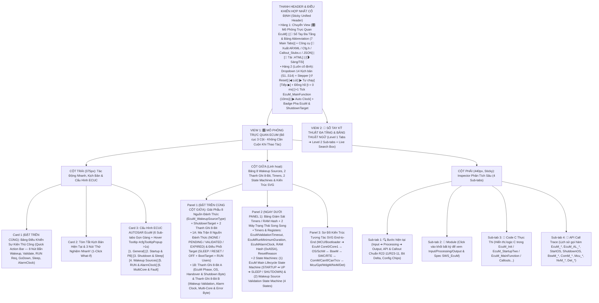
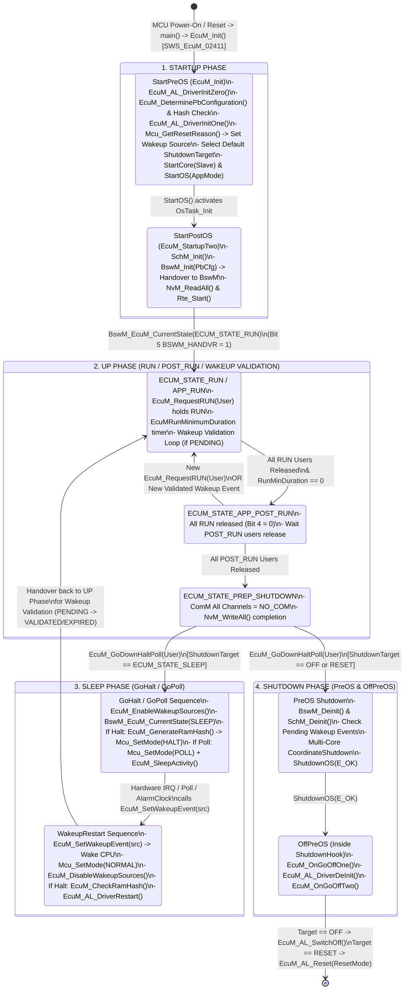
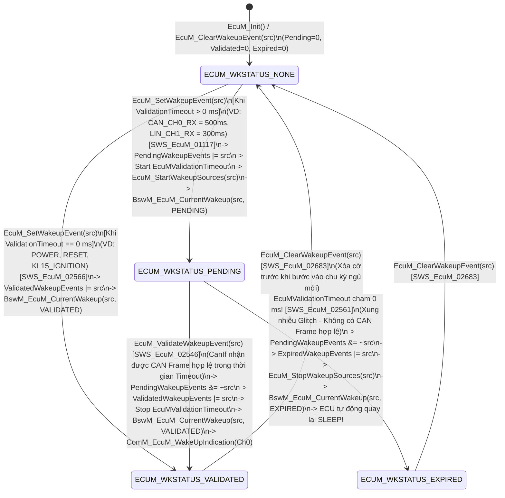

# Tài Liệu Thiết Kế Chi Tiết Trình Mô Phỏng AUTOSAR EcuM (`EcuM_Simulation_design.md`)

> **Trạng thái tài liệu:** Bản thiết kế chi tiết đã cập nhật theo xác nhận `A1`–`A4` của User — Sẵn sàng để User review trước khi triển khai code.  
> **File đích dự kiến xuất bản:** `d:\__Personal\AntiGravity\Simulation\AUTOSAR_EcuM.html` (Ứng dụng Web Tương tác 1 file HTML độc lập, 100% Offline, Pure CSS, có nút tải `.HTML` kèm cấu hình nhúng & xuất code `ARXML / EcuM_Cfg.h / EcuM_PBcfg.c / EcuM_Callout_Stubs.c / JSON`).  
> **Chuẩn tham chiếu:** **AUTOSAR Classic Platform R20-11 / R22-11 / R23-11 (`SWS_EcuM`, `SWS_BswM`, `SWS_Os`, `SWS_SchM`, `SWS_ComM`, `SWS_Mcu`, `SWS_Gpt`, `SWS_WdgM`, `SWS_NvM`, `SWS_CanIf`, `SWS_CanTrcv`, `SWS_Det`, `SWS_Rte`)**, đính kèm mã requirement chuẩn **`SWS_EcuM_xxxxx`** tại từng bước xử lý, Bảng giải phẫu 8 Nguồn Đánh Thức (`EcuM_WakeupSourceType`), 2 thanh ghi 8-Bit tương tác, tooltip cấu hình chuẩn `DEM` và sổ tay tra cứu đa tầng.

---

## 1. Tổng Quan Định Hướng Thiết Kế Đã Chốt (`A1` – `A4`)

| Hạng mục | Nội dung thiết kế đã xác nhận với User |
| :--- | :--- |
| **1. Bố cục giao diện & Ưu tiên Không Cuộn Trang — Zero-Scroll (`A1`)** | Kế thừa và nâng cấp từ **`AUTOSAR_DEM.html`**, **`AUTOSAR_ComM.html`** và **`AUTOSAR_CanNM.html`**, tối ưu hóa **Above-the-Fold (Zero-Scroll)** để các khối thao tác và giám sát tần suất cao nhất luôn nằm ngay phần đầu mỗi cột trong khung màn hình:<br>• **Thanh Điều Khiển Hợp Nhất Cố Định (Sticky Unified Header)**:<br>  - **Hàng 1**: Chuyển View `[🎛️ Mô Phỏng Trực Quan EcuM]` \| `[📖 Sổ Tay Đa Tầng & Bảng Abbreviation (7 Main Tabs)]` + Công cụ `[🧾 Xuất ARXML / EcuM_Cfg.h / Callout_Stubs.c / JSON]` \| `[💾 Tải .HTML]` \| `[🌗 Sáng/Tối]`.<br>  - **Hàng 2 (Luôn cố định)**: Dropdown chọn 14 Kịch bản (`S1`–`S14`), Stepper (`↺ Reset`, `◀ Lùi`, `▶ Tự chạy`, `Tiếp ▶`), Đồng hồ (`t = 0 ms`, `+1 Tick EcuM_MainFunction (10ms)`, `▶ Auto Clock`) và Badge Trạng thái Pha `EcuM` (`STARTUP / UP / SLEEP / SHUTDOWN`), `ShutdownTarget` & `Multi-Core`.<br>• **Bố cục 3 cột hiện đại (Mỗi cột tự cuộn độc lập trong khung Viewport)**:<br>  - **Cột Trái (`375px`)**: Đưa **Card 1: Bảng Điều Khiển Sự Kiện Thủ Công (`Quick Action Bar` — 8 nút tác động trực tiếp)** và **Card 2: Tóm tắt kịch bản & 3 nút 1-Click What-If** lên trên cùng, tiếp theo là **Card 3: 6 Sub-tabs Cấu hình ECUC EcuM** (hỗ trợ Floating Hover Tooltip `#cfgTooltipPopup` sau `>1s` giống hệt `AUTOSAR_DEM.html`).<br>  - **Cột Giữa (`Linh hoạt`)**: Đưa **Panel 1: Bảng Giải Phẫu 8 Nguồn Đánh Thức (`EcuM_WakeupSourceType` — `NONE / PENDING / VALIDATED / EXPIRED`) + Mục Tiêu Shutdown/BootTarget & 2 Thanh Ghi 8-Bit Tương Tác** và **Panel 2: Bảng Timers/RAM Hash & 2 Máy Trạng Thái Song Song (`EcuM Lifecycle State Machine` + `Wakeup Validation State Machine`)** lên ngay đầu cột giữa, bên dưới là **Panel 3: Sơ Đồ Kiến Trúc Tương Tác SVG End-to-End** (`MCU/Bootloader ➔ EcuM Master/Slave ↔ OS/SchM ↔ BswM ↔ SWC/RTE ↔ ComM/CanIf/CanTrcv ↔ Mcu/Gpt/WdgM/NvM/Det`).<br>  - **Cột Phải (`440px, Sticky`)**: Inspector 4 Sub-tabs (`🔍 Bước hiện tại`, `🧩 Module`, `📄 Code C Thực Thi (EcuM & Callouts)`, `📜 API Call Trace`).<br>• **Config Hover Tooltip (`> 1s` delay)** giống hệt `AUTOSAR_DEM.html` (`#cfgTooltipPopup` hiển thị tên tham số, đường dẫn ECUC, mã `SWS_EcuM_xxxxx`, mô tả, dải giá trị, giá trị typical và lưu ý kỹ thuật). |
| **2. Khu vực Giám sát Bit-level & Giải Phẫu Wakeup Source 2 Tầng (`A2`)** | Đặt **cố định và nổi bật ở đầu Cột Giữa** gồm **2 tầng trực quan hóa Bit**:<br>• **Tầng 1 — Bảng Giải Phẫu Vector Nguồn Đánh Thức (`EcuM_WakeupSourceType` Bitmask 0..7) + Ma Trận `ShutdownTarget / BootTarget / RUN Users`**:<br>  - Hiển thị trực quan 5 nguồn chuẩn AUTOSAR (`Bit 0: POWER`, `Bit 1: RESET`, `Bit 2: INTERNAL_RESET`, `Bit 3: INTERNAL_WDG`, `Bit 4: EXTERNAL_WDG` — `SWS_EcuM_02165`) và 3 nguồn mở rộng (`Bit 5: CAN_CH0_RX`, `Bit 6: LIN_CH1_RX`, `Bit 7: KL15_IGNITION`) qua 4 thanh ghi nội bộ của `EcuM`: `PendingWakeupEvents`, `ValidatedWakeupEvents`, `ExpiredWakeupEvents`, `EnabledSleepMask`.<br>  - Hiển thị trực quan mục tiêu tắt/ngủ hiện tại (`Target: SLEEP [Halt/Poll] / RESET [MCU/WDG/IO] / OFF`), `BootTarget` (`APP / OEM_BOOTLOADER / SYS_BOOTLOADER`) và trạng thái giữ `RUN / POST_RUN` của các `EcuMUser`.<br>• **Tầng 2 — 2 Thanh ghi 8-Bit tương tác song song**:<br>  1. **Thanh A (`8-Bit EcuM Lifecycle Phase, OS, Handover & Shutdown Control Byte` — `EcuM_PhaseControlByte`)**: Theo dõi các cờ lõi (`ECUM_INIT_DONE`, `OS_STARTED`, `BSWM_HANDOVER`, `RUN_REQ_HELD`, `POST_RUN_HELD`, `SHUTDOWN_GO_DOWN`, `SLEEP_HALT_ACTV`, `RAM_HASH_VALID`).<br>  2. **Thanh B (`8-Bit EcuM Wakeup Validation, Alarm Clock, Multi-Core & Fault Status Byte` — `EcuM_WakeupStatusByte`)**: Theo dõi trực quan các cờ xác thực wakeup, đồng hồ báo thức, đa nhân và lỗi (`WKUP_PENDING`, `WKUP_VAL_TMR_RUN`, `WKUP_VALIDATED`, `WKUP_EXPIRED`, `SLEEP_POLL_ACTV`, `ALARM_CLK_RUN`, `SLAVE_CORE_SYNC`, `CFG_OR_RAM_ERR`). Cho phép click trực tiếp vào từng bit để giải mã hoặc thử nghiệm! |
| **3. Hệ thống 14 Kịch bản mẫu (`A3`)** | Thiết kế sẵn **14 Kịch bản (`S1`–`S14`)** bao quát cả **`EcuM Flexible` (chuẩn R20-11/R22-11/R23-11 phối hợp `BswM`)** lẫn **`EcuM Fixed` (`RUN / POST_RUN Request Protocol`)**, chia làm 4 nhóm lớn:<br>• **Nhóm 1 (`S1`–`S3`)**: Khởi Động Đa Pha (`StartPreOS`: `EcuM_AL_DriverInitZero` ➔ `DeterminePbConfiguration` ➔ `DriverInitOne` ➔ `StartOS` & `StartPostOS`: `EcuM_StartupTwo` ➔ `SchM_Init` ➔ `BswM_Init`), Giao Thức Giữ Mạng `SWC RUN / POST_RUN` (`EcuM_RequestRUN`, `EcuMRunMinimumDuration`, `NvM_WriteAll`), và Phát Hiện Lỗi `Post-Build Config Hash` / `Loop Detection`.<br>• **Nhóm 2 (`S4`–`S6`)**: Chu Trình Ngủ (`SLEEP Phase`): Chế độ `GoHalt` (Dừng CPU qua `Mcu_SetMode(MCU_HALT)`, tạo & kiểm tra `EcuM_GenerateRamHash` / `EcuM_CheckRamHash`), Chế độ `GoPoll` (Tiết kiệm năng lượng có轮询 `EcuM_SleepActivity`), và Đồng Hồ Báo Thức Nội Bộ **`EcuM Alarm Clock`** (`EcuM_SetRelAlarmClock` / `EcuM_SetAbsAlarmClock`).<br>• **Nhóm 3 (`S7`–`S10`)**: Giao Thức Xác Thực Nguồn Đánh Thức (`Wakeup Validation Protocol`): Nguồn không cần xác thực (`KL15_IGNITION`, `ValidationTimeout = 0`), Nguồn `CAN_CH0_RX` cần xác thực (`PENDING` ➔ `CanIf/CanSM` khởi động ➔ `EcuM_ValidateWakeupEvent` ➔ `VALIDATED` ➔ `ComM_EcuM_WakeUpIndication`), Chống Nhiễu Xung Giả (`Glitch / False Wakeup` ➔ hết `EcuMValidationTimeout` ➔ `EXPIRED` ➔ tự ngủ lại), và Đánh Thức Mạng Con `PNC` (`ComM_EcuM_PNCWakeUpIndication`).<br>• **Nhóm 4 (`S11`–`S14`)**: Chu Trình Tắt Nguồn (`SHUTDOWN Phase` ➔ `OFF` qua `EcuM_OnGoOffOne/Two` & `EcuM_AL_SwitchOff`), Khởi Động Lại Vào Bootloader (`ECUM_STATE_RESET` + `EcuM_SelectBootTarget(OEM_BOOTLOADER)` cho lập trình UDS `0x11`), Đồng Bộ Đa Nhân (`Multi-Core Master Core 0 & Slave Core 1`: `StartCore`, `EcuM_SetState`, đồng bộ điểm chốt trước khi `Halt/Off`), và Kiểm Thử Lỗi `DET` & `RAM Check Failed`. |
| **4. Sổ tay tra cứu đa tầng & Bảng Abbreviation (`A4`)** | **View 2 (`📖 Sổ Tay Kỹ Thuật EcuM & Từ Điển Thuật Ngữ`)** được tổ chức theo cấu trúc **Đa Tầng (Multi-level Tabs)**:<br>• **6 Main Sub-tabs (Level 1) × 4 Chủ đề con (Level 2 Pills/Tabs = 24 chuyên đề)** phân tích sâu kiến trúc `EcuM Flexible vs Fixed`, trình tự `Startup PreOS/PostOS`, `Shutdown PreOS/OffPreOS`, `Sleep Halt/Poll & RAM Hash`, `Wakeup Validation Protocol`, `Multi-Core & Alarm Clock`, và từ điển `API / Callouts / ECUC`.<br>• **Tab 7 chuyên biệt: `🔤 Bảng Thuật Ngữ & Từ Viết Tắt (Abbreviation Table)`** trình bày dưới dạng bảng chuẩn 4 cột (50+ thuật ngữ), tích hợp **Search Box tìm kiếm tức thời (Live Search + Highlight `<mark>`)** và 5 nút lọc nhanh theo phân nhóm (`EcuM Phases & Core`, `Startup & Callouts`, `Wakeup & Validation`, `Sleep, Shutdown & Multi-Core`). |

---

## 2. Bố Cục Giao Diện 3 Cột Ưu Tiên Zero-Scroll & Hệ Thống Sub-Tabs (UI Wireframe)

Để đảm bảo **"người dùng không cần cuộn chuột lên xuống mỗi lần thao tác"**, giao diện được thiết kế theo nguyên lý **Viewport-First (Đưa các khối tương tác và giám sát tần suất cao nhất lên ngay phần đầu của mỗi cột, kết hợp cơ chế Sub-tabs gọn gàng)**:



### Điểm Cải Tiến Đột Phá Về Trải Nghiệm "Zero-Scroll" Cho Module `EcuM`:
1. **Thanh Điều Khiển Hợp Nhất (`Sticky Unified Header`)**: Gộp chọn kịch bản, nút bấm `Bước tiếp / Lùi / Tự chạy`, và nút nhịp đồng hồ `+1 Tick EcuM_MainFunction (10ms)` vào ngay thanh Header cố định. Người dùng ở bất kỳ vị trí nào cũng có thể tiến đồng hồ để xem các bộ đếm `EcuMValidationTimeout`, `EcuMRunMinimumDuration`, `EcuMAlarmClock` đếm lùi.
2. **Đưa `Quick Action Bar` (8 nút tác động nhanh) lên vị trí Card 1 (Đầu Cột Trái)** và đưa **Bảng Giải Phẫu 8 Nguồn Đánh Thức + Mục Tiêu Shutdown/BootTarget + 2 Thanh Ghi 8-Bit + 2 Máy Trạng Thái** lên đầu Cột Giữa: Khi bấm `EcuM_SetWakeupEvent(CAN_CH0_RX)`, `EcuM_ValidateWakeupEvent(CAN_CH0_RX)`, hoặc `EcuM_GoDownHaltPoll()`, mắt người dùng nhìn thấy ngay lập tức sự dịch chuyển của từng Bit trong `Pending / Validated / Expired`, trên Thanh A/B, và sự chuyển pha của cả ECU lẫn nguồn đánh thức mà **không phải cuộn trang**.
3. **Gom 34 tham số ECUC vào 6 Sub-tabs gọn gàng**: Chiều cao Card Cấu hình được giữ gọn cố định (~275px), kèm hộp thoại giải thích nổi `#cfgTooltipPopup` khi hover quá `1000ms` giống hệt `AUTOSAR_DEM.html`.

---

## 3. Thiết Kế Chi Tiết Panel 1 (Đầu Cột Giữa): Giải Phẫu `EcuM_WakeupSourceType` (8 Nguồn Đánh Thức), Điều Phối `Shutdown / Boot Target` & 2 Thanh Ghi 8-Bit Tương Tác

Trong `AUTOSAR EcuM`, bản chất điều khiển vòng đời ECU xoay quanh **hai cơ chế cốt lõi**: (1) **Quản lý 4 pha vòng đời (`STARTUP ➔ UP ➔ SLEEP / SHUTDOWN`) gắn với mục tiêu `ShutdownTarget (SLEEP / RESET / OFF)`, `BootTarget` và `RUN Users`**, và (2) **Giao thức xác thực 4 trạng thái (`NONE ➔ PENDING ➔ VALIDATED / EXPIRED`) trên thanh ghi mặt nạ bit `EcuM_WakeupSourceType` (`SWS_EcuM_02165`, `SWS_EcuM_02344`)**. Do đó, Panel 1 ở đầu Cột Giữa được thiết kế gồm **2 phần trực quan hóa liên thông**:

### 3.1. Phần 1A — Bảng Giải Phẫu 8 Nguồn Đánh Thức (`EcuM_WakeupSourceType`) & Bảng Điều Phối `ShutdownTarget / BootTarget / RUN Users`

```text
+-------------------------------------------------------------------------------------------------------------------+
| ⚡ GIẢI PHẪU VECTOR NGUỒN ĐÁNH THỨC (`EcuM_WakeupSourceType`) & ĐIỀU PHỐI SHUTDOWN TARGET [`SWS_EcuM_02165`]       |
| Mode: [EcuM Flexible + BswM] | ShutdownTarget: [ECUM_STATE_SLEEP (Halt)] | BootTarget: [APP] | RUN Users: [0x01] |
+-------------------------------------------------------------------------------------------------------------------+
| 1. ĐIỀU PHỐI MỤC TIÊU TẮT/NGỦ & GIỮ RUN (`EcuM_ShutdownTargetType` / `EcuM_BootTargetType` / `EcuM_UserType`):    |
|    • Shutdown Target : [ ECUM_STATE_SLEEP ] | Sleep Mode: [ 0: Halt (MCU_HALT) ] | Reset Mode: [ 0: MCU_RESET ]   |
|    • Boot Target     : [ ECUM_BOOT_TARGET_APP ]  | RUN Req: [User0=RUN, User1=IDLE] | POST_RUN Req: [All=IDLE]    |
+-------------------------------------------------------------------------------------------------------------------+
| 2. BẢNG BITMASK 8 NGUỒN ĐÁNH THỨC (5 Nguồn Chuẩn AUTOSAR Bit 0..4 + 3 Nguồn Ngoại Vi Bit 5..7) [Click ô để Test]: |
|  +------------------------+---------+---------+---------+---------+---------+-----------+-----------+-----------+ |
|  | Thanh Ghi / Trạng Thái | Bit 0   | Bit 1   | Bit 2   | Bit 3   | Bit 4   | Bit 5     | Bit 6     | Bit 7     | |
|  | (EcuM_WakeupSourceType)| POWER   | RESET   | INT_RST | INT_WDG | EXT_WDG | CAN0_RX   | LIN1_RX   | KL15_IGN  | |
|  |                        | (0x01)  | (0x02)  | (0x04)  | (0x08)  | (0x10)  | (0x20)    | (0x40)    | (0x80)    | |
|  +------------------------+---------+---------+---------+---------+---------+-----------+-----------+-----------+ |
|  | Validation Timeout (ms)|  0 ms   |  0 ms   |  0 ms   |  0 ms   |  0 ms   |  500 ms   |  300 ms   |   0 ms    | |
|  | PendingWakeupEvents    |  [ 0 ]  |  [ 0 ]  |  [ 0 ]  |  [ 0 ]  |  [ 0 ]  |  [ 1 ] ⏳ |  [ 0 ]    |  [ 0 ]    | |
|  | ValidatedWakeupEvents  |  [ 1 ]  |  [ 0 ]  |  [ 0 ]  |  [ 0 ]  |  [ 0 ]  |  [ 0 ]    |  [ 0 ]    |  [ 0 ]    | |
|  | ExpiredWakeupEvents    |  [ 0 ]  |  [ 0 ]  |  [ 0 ]  |  [ 0 ]  |  [ 0 ]  |  [ 0 ]    |  [ 0 ]    |  [ 0 ]    | |
|  +------------------------+---------+---------+---------+---------+---------+-----------+-----------+-----------+ |
|  💡 API Query: EcuM_GetPendingWakeupEvents() = 0x20 | EcuM_GetValidatedWakeupEvents() = 0x01 | Expired = 0x00     |
+-------------------------------------------------------------------------------------------------------------------+
```

- **Tính năng tương tác trực tiếp trên Phần 1A**:
  - Người dùng phân biệt rõ **5 nguồn đánh thức chuẩn bắt buộc của AUTOSAR (`Bit 0..4`: `ECUM_WKSOURCE_POWER` .. `ECUM_WKSOURCE_EXTERNAL_WDG` có `ValidationTimeout = 0 ms`, hễ gọi `EcuM_SetWakeupEvent` là vào thẳng `VALIDATED`)** với **các nguồn đánh thức truyền thông (`Bit 5 CAN_CH0_RX`, `Bit 6 LIN_CH1_RX` có `ValidationTimeout > 0 ms`, phải đi qua trạng thái `PENDING` chờ `CanIf/LinIf` xác nhận để lọc nhiễu xung điện trên bus)**.
  - Cho phép **click trực tiếp vào bất kỳ cột nguồn đánh thức nào (`Bit 0..7`)** để giả lập gọi `EcuM_SetWakeupEvent()`, `EcuM_ValidateWakeupEvent()` hoặc `EcuM_ClearWakeupEvent()`, quan sát ngay sự thay đổi giá trị Hex trả về của bộ 3 API `EcuM_GetPendingWakeupEvents()`, `EcuM_GetValidatedWakeupEvents()`, `EcuM_GetExpiredWakeupEvents()`.

### 3.2. Phần 1B — 2 Thanh Ghi 8-Bit Trạng Thái Tương Tác Luôn Hiển Thị Nổi Bật

Ngay bên dưới Phần 1A là **2 Thanh ghi 8-Bit tương tác** theo đúng phong cách của `AUTOSAR_DEM.html`, `AUTOSAR_ComM.html` và `AUTOSAR_CanNM.html`:

```text
+-------------------------------------------------------------------------------------------------------------------+
| 🔢 BẢNG GIÁM SÁT BITFIELD 8-BIT ECUM LIFECYCLE & WAKEUP (LIVE 8-BIT INSPECTOR) [Click vào từng ô Bit để thử nghiệm]|
| Bước #4: EcuM_StartupTwo() ➔ BswM_Init() hoàn tất, ECU vào pha UP (RUN) | Byte A: 0xE1 | Byte B: 0x22             |
+-------------------------------------------------------------------------------------------------------------------+
| A. THANH GHI 8-BIT PHA VÒNG ĐỜI, OS, BSWM & SHUTDOWN (`EcuM_PhaseControlByte`) — Hex: [ 0xE1 ] Bin: [1110 0001b]  |
|    Current Phase: [ ECUM_STATE_UP (RUN) ] | Sub-Phase: [ StartPostOS Done ] | ShutdownTarget: [ SLEEP (Halt) ]    |
|  +-------------+ +-------------+ +-------------+ +-------------+ +-------------+ +-------------+ +-------+ +-----+|
|  | Bit 7 (0x80)| | Bit 6 (0x40)| | Bit 5 (0x20)| | Bit 4 (0x10)| | Bit 3 (0x08)| | Bit 2 (0x04)| |Bit1(2)| |Bit 0||
|  | ECUM_INIT   | | OS_STARTED  | | BSWM_HANDVR | | RUN_REQ_ACT | | POSTRUN_ACT | | GO_DOWN_ACT | |HALT_SL| |RAMOK||
|  |      1      | |      1      | |      1      | |      0      | |      0      | |      0      | |   0   | |  1  ||
|  | Initialized | | OS Running  | | BswM Active | | No SWC Hold | | Idle        | | Normal Up   | |Awake  | |Hash1||
|  +-------------+ +-------------+ +-------------+ +-------------+ +-------------+ +-------------+ +-------+ +-----+|
+-------------------------------------------------------------------------------------------------------------------+
| B. THANH GHI 8-BIT XÁC THỰC WAKEUP, ALARM, ĐA NHÂN & LỖI (`EcuM_WakeupStatusByte`) — Hex: [ 0x22 ] Bin:[0010 0010]|
|    Pending: [ 0x00 ] | Validated: [ 0x01 (POWER) ] | Expired: [ 0x00 ] | Core1: [ SYNCED ] | AlarmClock: [ OFF ]  |
|  +-------------+ +-------------+ +-------------+ +-------------+ +-------------+ +-------------+ +-------+ +-----+|
|  | Bit 7 (0x80)| | Bit 6 (0x40)| | Bit 5 (0x20)| | Bit 4 (0x10)| | Bit 3 (0x08)| | Bit 2 (0x04)| |Bit1(2)| |Bit 0||
|  | WKUP_PEND   | | WK_VAL_TMR  | | WKUP_VALID  | | WKUP_EXPIRE | | POLL_SLEEP  | | ALARM_CLK   | |CORE_SY| |FAULT||
|  |      0      | |      0      | |      1      | |      0      | |      0      | |      0      | |   1   | |  0  ||
|  | None Pend   | | Timer Idle  | | Power Valid | | No Expired  | | Poll Off    | | Alarm Idle  | |Synced | |NoErr||
|  +-------------+ +-------------+ +-------------+ +-------------+ +-------------+ +-------------+ +-------+ +-----+|
+-------------------------------------------------------------------------------------------------------------------+
```

#### 3.2.1. Giải Mã Chi Tiết Thanh A: `8-Bit EcuM Lifecycle Phase, OS, Handover & Shutdown Control Byte` (`EcuM_PhaseControlByte`)

| Bit | Mask | Tên Cờ (`EcuM Phase & Control Bit`) | Ý nghĩa kỹ thuật & Khi nào bật lên `1` (`0 ➔ 1`) | Khi nào hạ về `0` (`1 ➔ 0`) |
| :-: | :-: | :--- | :--- | :--- |
| **Bit 7** | `0x80` | **`ECUM_INIT_DONE`** | Bật lên `1` ngay khi hàm **`EcuM_Init()`** khởi chạy ở đầu pha `StartPreOS` (`SWS_EcuM_02411`), sau khi hoàn tất `EcuM_AL_DriverInitZero()` và xác định cấu hình Post-Build `EcuM_DeterminePbConfiguration()`. | Hạ về `0` (`ECUM_UNINIT`) khi ECU đã tắt nguồn hoàn toàn (`EcuM_AL_SwitchOff()`) hoặc khi người dùng tắt Checkbox `EcuMInitialized` để kiểm thử lỗi `Det_ReportError(ECUM_E_UNINIT = 0x10)`. |
| **Bit 6** | `0x40` | **`OS_STARTED`** | Bật lên `1` ở cuối pha `StartPreOS` khi `EcuM_Init()` gọi **`StartOS(EcuMDefaultAppMode)`** (`SWS_EcuM_02603`), bàn giao quyền lập lịch CPU cho Hệ điều hành AUTOSAR OS để kích hoạt Task khởi tạo `EcuM_StartupTwo()`. | Hạ về `0` trong pha `Shutdown PreOS` khi `EcuM` gọi **`ShutdownOS(E_OK)`** (`SWS_EcuM_02920`) để đi vào trình tự `ShutdownHook ➔ EcuM_OnGoOffOne()`. |
| **Bit 5** | `0x20` | **`BSWM_HANDOVER`** | Bật lên `1` ở cuối hàm **`EcuM_StartupTwo()`** (pha `StartPostOS`) sau khi `EcuM` gọi `SchM_Init()` và **`BswM_Init()`** (`SWS_EcuM_04004`), bàn giao quyền điều phối chế độ hoạt động của ECU cho `BswM` (trong kiến trúc `EcuM Flexible`). | Hạ về `0` khi bắt đầu trình tự tắt nguồn (`BswM_Deinit()` trước khi gọi `ShutdownOS()`). |
| **Bit 4** | `0x10` | **`RUN_REQ_HELD`** | Bật lên `1` khi có ít nhất 1 `EcuM_UserType` (SWC hoặc BSW) đang giữ yêu cầu **`EcuM_RequestRUN(User)`** (`SWS_EcuM_01144`) hoặc bộ đếm **`EcuMRunMinimumDuration`** vẫn đang chạy, giữ chặt ECU ở trạng thái `ECUM_STATE_APP_RUN` (ngăn không cho ECU tự động rơi vào `POST_RUN / SHUTDOWN`). | Hạ về `0` khi tất cả các `User` đều đã gọi **`EcuM_ReleaseRUN(User)`** (`SWS_EcuM_01145`) VÀ bộ đếm `EcuMRunMinimumDuration` đã chạm `0 ms`. |
| **Bit 3** | `0x08` | **`POSTRUN_ACT`** | Bật lên `1` khi ECU chuyển sang trạng thái **`ECUM_STATE_APP_POST_RUN`** (sau khi mọi `RUN Request` đã nhả nhưng còn `User` giữ **`EcuM_RequestPOST_RUN(User)`** hoặc đang chờ hoàn tất công việc hậu kỳ trước khi chuẩn bị tắt). | Hạ về `0` khi mọi `User` đều đã gọi **`EcuM_ReleasePOST_RUN(User)`** (hoặc khi có `EcuM_RequestRUN` mới kéo ECU quay ngược lên `APP_RUN`!). |
| **Bit 2** | `0x04` | **`GO_DOWN_ACT`** | Bật lên `1` khi `BswM` (hoặc `User` được cấp quyền trong `EcuMGoDownAllowedUsers`) gọi **`EcuM_GoDownHaltPoll(UserID)`** / **`EcuM_GoDown(UserID)`** (`SWS_EcuM_04050`) để bắt đầu trình tự đi xuống `SLEEP`, `RESET` hoặc `OFF` theo `ShutdownTarget` đã chọn. | Hạ về `0` khi quá trình thức dậy từ `SLEEP` hoàn tất (`WakeupRestart`), hoặc sau khi ECU khởi động lại từ đầu. |
| **Bit 1** | `0x02` | **`HALT_SLEEP_ACT`** | Bật lên `1` khi `EcuM` thực thi trình tự **`EcuM_GoHalt()`** (`SWS_EcuM_02960`): đã tính toán xong chữ ký RAM `EcuM_GenerateRamHash()`, khóa ngắt và gọi **`Mcu_SetMode(MCU_HALT_MODE)`** để dừng xung nhịp CPU tiết kiệm điện tối đa. | Hạ về `0` ngay khi có ngắt phần cứng đánh thức CPU (`EcuM_SetWakeupEvent`), thực thi `EcuM_CheckRamHash()` và chạy `EcuM_AL_DriverRestart()` để thoát khỏi `SLEEP`. |
| **Bit 0** | `0x01` | **`RAM_HASH_VALID`** | Bật lên `1` khi chữ ký kiểm tra toàn vẹn RAM (tạo bởi `EcuM_GenerateRamHash()` trước khi `GoHalt`) được hàm **`EcuM_CheckRamHash()`** xác nhận trùng khớp (`!= 0`) ngay sau khi CPU thức dậy từ chế độ Halt (`SWS_EcuM_02926`). | Hạ về `0` nếu dữ liệu RAM bị lỗi trong lúc ngủ (`EcuM_CheckRamHash() == 0`), kích hoạt ngay **`EcuM_ErrorHook(ECUM_RAM_CHECK_FAILED)`**! |

#### 3.2.2. Giải Mã Chi Tiết Thanh B: `8-Bit EcuM Wakeup Validation, Alarm Clock, Multi-Core & Fault Status Byte` (`EcuM_WakeupStatusByte`)

| Bit | Mask | Tên Cờ (`EcuM Wakeup & System Bit`) | Ý nghĩa kỹ thuật & Khi nào bật lên `1` (`0 ➔ 1`) | Khi nào hạ về `0` (`1 ➔ 0`) |
| :-: | :-: | :--- | :--- | :--- |
| **Bit 7** | `0x80` | **`WKUP_PENDING`** | Bật lên `1` khi có ít nhất 1 nguồn đánh thức có `ValidationTimeout > 0` vừa được kích hoạt qua **`EcuM_SetWakeupEvent(sources)`** (`SWS_EcuM_01117`), làm cho `EcuM_GetPendingWakeupEvents() != 0` và báo `BswM_EcuM_CurrentWakeup(source, ECUM_WKSTATUS_PENDING)`. | Hạ về `0` khi nguồn đánh thức đó được xác nhận hợp lệ (`EcuM_ValidateWakeupEvent()`), hoặc hết giờ chuyển sang `EXPIRED`, hoặc bị xóa bởi `EcuM_ClearWakeupEvent()`. |
| **Bit 6** | `0x40` | **`WK_VAL_TMR_RUN`** | Bật lên `1` khi `EcuM` đang chạy vòng lặp giao thức **Wakeup Validation** trong `EcuM_MainFunction()`: đã gọi `EcuM_StartWakeupSources(pending)` và đang đếm ngược bộ đếm **`EcuMValidationTimeout`** (`SWS_EcuM_02539`). | Hạ về `0` ngay khi nguồn đánh thức được `EcuM_ValidateWakeupEvent()` xác nhận thành công, hoặc khi bộ đếm `EcuMValidationTimeout` chạm `0 ms` (gọi `EcuM_StopWakeupSources()`). |
| **Bit 5** | `0x20` | **`WKUP_VALIDATED`** | Bật lên `1` khi nguồn đánh thức được xác nhận là hợp lệ (do `ValidationTimeout == 0` khi gọi `EcuM_SetWakeupEvent()`, hoặc do driver/stack gọi **`EcuM_ValidateWakeupEvent(sources)`** [`SWS_EcuM_02546`]), làm cho `EcuM_GetValidatedWakeupEvents() != 0`, báo `BswM_EcuM_CurrentWakeup(VALIDATED)` và `ComM_EcuM_WakeUpIndication()`. | Hạ về `0` khi `BswM` / ứng dụng gọi **`EcuM_ClearWakeupEvent(sources)`** (`SWS_EcuM_02683`) trước khi chuẩn bị cho chu kỳ ngủ tiếp theo. |
| **Bit 4** | `0x10` | **`WKUP_EXPIRED`** | Bật lên `1` khi bộ đếm `EcuMValidationTimeout` đếm lùi về `0 ms` mà `EcuM` không nhận được `EcuM_ValidateWakeupEvent()` (ví dụ nhiễu xung điện trên bus CAN), làm cho `EcuM_GetExpiredWakeupEvents() != 0`, gọi `EcuM_StopWakeupSources()` và báo `BswM_EcuM_CurrentWakeup(ECUM_WKSTATUS_EXPIRED)` (`SWS_EcuM_02561`). | Hạ về `0` khi gọi **`EcuM_ClearWakeupEvent(sources)`** để xóa cờ hết hạn. |
| **Bit 3** | `0x08` | **`POLL_SLEEP_ACT`** | Bật lên `1` khi `EcuM` thực thi trình tự **`EcuM_GoPoll()`** (`SWS_EcuM_02962`): đặt MCU vào chế độ tiết kiệm điện nhẹ `Mcu_SetMode(MCU_POLL_MODE)` và chạy vòng lặp gọi `EcuM_SleepActivity()` + **`EcuM_CheckWakeup(source)`** để thăm dò định kỳ các nguồn đánh thức không có ngắt. | Hạ về `0` khi phát hiện sự kiện đánh thức (`EcuM_SetWakeupEvent`) thoát khỏi vòng lặp Poll. |
| **Bit 2** | `0x04` | **`ALARM_CLK_RUN`** | Bật lên `1` khi `SWC` / `User` đặt hẹn giờ đánh thức nội bộ qua **`EcuM_SetRelAlarmClock(User, time)`** hoặc **`EcuM_SetAbsAlarmClock(User, time)`** (`SWS_EcuM_04054`), làm cho bộ đếm `EcuMMasterAlarm` đang tích cực đếm trong lúc ECU ngủ. | Hạ về `0` khi đồng hồ báo thức chạm mốc hẹn giờ (kích hoạt nguồn đánh thức `ECUM_WKSOURCE_ALARM / GPT` đánh thức ECU) hoặc khi gọi **`EcuM_AbortWakeupAlarm(User)`**. |
| **Bit 1** | `0x02` | **`SLAVE_CORE_SYNC`** | Bật lên `1` trong hệ thống **Multi-Core** khi `Master Core (Core 0)` đã gọi `StartCore(OS_CORE_ID_1)` thành công và cả hai nhân đã đồng bộ trạng thái (`StartupTwo` hoàn tất hoặc đã hội tụ tại điểm hẹn `CoordinateShutdown` trước khi `GoHalt`/`GoOff` — `SWS_EcuM_04018`). | Hạ về `0` khi `Slave Core (Core 1)` đang lệch pha hoặc chưa hoàn tất `EcuM_GoDownHaltPoll()` trong khi `Master Core` đang chờ đồng bộ tắt nguồn. |
| **Bit 0** | `0x01` | **`CFG_OR_RAM_ERR`** | Bật lên `1` khi phát hiện lỗi nghiêm trọng: (1) Mã băm cấu hình Post-Build `EcuMConfigConsistencyHash` không khớp (`EcuM_ErrorHook(ECUM_E_CONFIGURATION_DATA_INCONSISTENT)`), (2) `EcuM_CheckRamHash() == 0` (`ECUM_RAM_CHECK_FAILED`), hoặc (3) Phát hiện lỗi `DET` (`ECUM_E_UNINIT`, `ECUM_E_UNKNOWN_WAKEUP_SOURCE`). | Hạ về `0` khi khắc phục cấu hình hợp lệ và Reset lại ECU. |

---

## 4. Phân Tích Xử Lý Từng Module: Input Lấy Từ Đâu, Xử Lý Gì, Output Route Đến Đâu

Mọi khối trên sơ đồ kiến trúc SVG đều có thể **click vào để xem giải thích chi tiết** ở cột phải (Tab `🧩 Module`) và được tổng hợp đầy đủ trong **Tab 1 của Sổ tay**:

| # | Module / Phân khối | Lớp AUTOSAR | 📥 Input lấy từ đâu? | ⚙️ Cách xử lý nội bộ (Processing, State & Timers) | 📤 Output route đến đâu & Hàm API chuẩn (R20-11 / R22-11 / R23-11) |
| :-: | :--- | :--- | :--- | :--- | :--- |
| **1** | **`MCU Bootloader` & `Startup Code`**<br>*(Reset Vector & Boot Target)* | Microcontroller / Boot | • Sự kiện cấp nguồn ắc-quy (`KL30 Power-On`), chân phần cứng `RESET`, hoặc lệnh khởi động lại từ `Mcu_PerformReset()`.<br>• Đọc giá trị `BootTarget` từ vùng RAM đặc biệt không xóa khi Reset (`No-Init RAM`). | • Khi CPU vừa thoát khỏi Reset, `Startup Code` khởi tạo Stack Pointer, bảng Vector ngắt và kiểm tra `BootTarget` (nếu là `ECUM_BOOT_TARGET_OEM_BOOTLOADER` thì nhảy vào Flash Bootloader để nạp phần mềm UDS `0x11 / 0x34`).<br>• Nếu là `ECUM_BOOT_TARGET_APP`, hàm `main()` của ứng dụng được gọi và việc đầu tiên là gọi ngay **`EcuM_Init()`** khi OS còn chưa chạy (`StartPreOS`)! | • Gọi vào **EcuM**:<br>`EcuM_Init()` [`SWS_EcuM_02811`] |
| **2** | **`EcuM Core Engine`**<br>*(ECU State Manager — Master Core 0 & Slave Core 1)* | System Services | • Lệnh khởi động `EcuM_Init()`, `EcuM_StartupTwo()`, và xung nhịp `EcuM_MainFunction()` mỗi `10ms` từ `SchM`.<br>• Yêu cầu từ `SWC` / `BswM`: `EcuM_SelectShutdownTarget()`, `EcuM_GoDownHaltPoll()`, `EcuM_RequestRUN()`, `EcuM_ReleaseRUN()`, `EcuM_SetRelAlarmClock()`.<br>• Báo hiệu đánh thức từ phần cứng / ISR / Driver: `EcuM_SetWakeupEvent()`, `EcuM_ValidateWakeupEvent()`. | • **1. Trình tự Khởi động 2 Pha (`StartPreOS` & `StartPostOS`)**: Thực thi các callout `DriverInitZero`, nạp và kiểm tra `EcuMConfigConsistencyHash` của Post-Build Config (`DeterminePbConfiguration`), gọi `DriverInitOne`, đọc `Mcu_GetResetReason()` ánh xạ vào `EcuM_WakeupSourceType`, khởi động `Slave Core` (`StartCore`) và gọi `StartOS()`. Sau khi OS chạy, thực thi `EcuM_StartupTwo()` để gọi `SchM_Init()` và `BswM_Init()`.<br>• **2. Giao thức Xác thực Đánh thức (`Wakeup Validation`)**: Quản lý 4 thanh ghi trạng thái (`Pending`, `Validated`, `Expired`, `Cleared`), gọi `EcuM_StartWakeupSources()`, đếm lùi `EcuMValidationTimeout` và gọi `EcuM_StopWakeupSources()` nếu quá hạn.<br>• **3. Điều phối Ngủ (`GoHalt / GoPoll`) & Tắt/Reset (`GoOff / Reset`)**: Quản lý `EcuM_GenerateRamHash()` / `EcuM_CheckRamHash()`, đồng bộ đa nhân trước khi gọi `Mcu_SetMode()`, `ShutdownOS()`, `EcuM_OnGoOffOne/Two()`, `EcuM_AL_SwitchOff()` hoặc `EcuM_AL_Reset()`. | • Gọi Callouts phần cứng (`EcuM_Callout.h`):<br>`EcuM_AL_DriverInitZero()`, `EcuM_DeterminePbConfiguration()`, `EcuM_AL_DriverInitOne()`, `EcuM_AL_DriverRestart()`, `EcuM_OnGoOffOne()`, `EcuM_OnGoOffTwo()`, `EcuM_AL_SwitchOff()`, `EcuM_AL_Reset()`, `EcuM_GenerateRamHash()`, `EcuM_CheckRamHash()`, `EcuM_StartWakeupSources()`, `EcuM_CheckValidation()`, `EcuM_StopWakeupSources()`, `EcuM_ErrorHook()`<br>• Gọi sang **OS / SchM / BswM / ComM / Mcu / Det**:<br>`StartOS()`, `ShutdownOS()`, `StartCore()`, `SchM_Init()`, `BswM_Init()`, `BswM_Deinit()`, `BswM_EcuM_CurrentState()`, `BswM_EcuM_CurrentWakeup()`, `ComM_EcuM_WakeUpIndication()`, `ComM_EcuM_PNCWakeUpIndication()`, `Mcu_SetMode()`, `Det_ReportError()` |
| **3** | **`AUTOSAR OS` & `SchM`**<br>*(Operating System & BSW Scheduler)* | OS / RTE Layer | • Nhận lệnh `StartOS(AppMode)`, `ShutdownOS(Error)`, `StartCore(CoreId)`, `GetResource()` / `ReleaseResource()` từ `EcuM`. | • Khi `StartOS()` được gọi ở cuối `EcuM_Init()`, `AUTOSAR OS` bắt đầu lập lịch và tự động kích hoạt Task khởi tạo (`Autostart Task`: `OsTask_Init`) chứa lời gọi **`EcuM_StartupTwo()`**.<br>• Sau khi `SchM_Init()` hoàn tất, `SchM` kích hoạt định kỳ **`EcuM_MainFunction()`** (ví dụ mỗi `10ms`) trên từng Core.<br>• Khi `EcuM` gọi `ShutdownOS()`, OS dừng toàn bộ Task và nhảy vào hàm **`ShutdownHook()`** để `EcuM` thực thi pha `OffPreOS` (`EcuM_OnGoOffOne ➔ DriverDeInit ➔ EcuM_OnGoOffTwo`). | • Gọi vào **EcuM**:<br>`EcuM_StartupTwo()` [`SWS_EcuM_02838`]<br>`EcuM_MainFunction()` [`SWS_EcuM_02839`]<br>`ShutdownHook(StatusType Error)` ➔ kết thúc `ShutdownOS()` |
| **4** | **`BswM`**<br>*(BSW Mode Manager)* | System Services | • Được `EcuM` khởi tạo qua `BswM_Init(PbCfg)` trong `EcuM_StartupTwo()`.<br>• Nhận thông báo trạng thái từ `EcuM`: `BswM_EcuM_CurrentState(State)`, `BswM_EcuM_CurrentWakeup(source, status)`, `BswM_EcuM_RequestedState(State, Status)`. | • Trong kiến trúc **`EcuM Flexible` (R20-11/R22-11/R23-11)**, `EcuM` không còn tự chứa bảng cứng khởi tạo `DriverInitTwo/Three` hay bảng điều kiện `RUN/POST_RUN`, mà **ủy quyền điều phối Mode cho `BswM`**!<br>• Khi nhận `BswM_Init()`, `BswM` thực thi `ActionList` khởi tạo các module BSW có dùng OS (`NvM_Init`, `NvM_ReadAll`, `ComM_Init`, `CanSM_Init`, `Dcm_Init`, `Rte_Start()`).<br>• Khi mọi kênh truyền thông đã về `NO_COM` và `NvM_WriteAll()` hoàn tất, `BswM` gọi **`EcuM_SelectShutdownTarget()`** và **`EcuM_GoDownHaltPoll()`** để ra lệnh cho `EcuM` đưa ECU đi ngủ hoặc tắt nguồn! | • Gọi điều khiển xuống **EcuM**:<br>`EcuM_SetState(State)` [`SWS_EcuM_04005`]<br>`EcuM_SelectShutdownTarget(target, mode)` [`SWS_EcuM_02585`]<br>`EcuM_GoDownHaltPoll(UserID)` [`SWS_EcuM_04050`] |
| **5** | **`SWC_App` & `RTE`**<br>*(Application Software Components & RTE)* | Application / RTE Layer | • Trạng thái khóa điện (`KL15`), logic nghiệp vụ của xe, yêu cầu hẹn giờ thức dậy định kỳ (ví dụ BMS kiểm tra nhiệt độ pin mỗi 2 giờ khi đỗ xe), hoặc yêu cầu chẩn đoán Reset (`UDS 0x11`). | • **1. Giữ ECU thức (`RUN / POST_RUN Request Protocol`)**: `SWC` gọi qua cổng `EcuM_StateRequest` trên `RTE` (`Rte_Call_EcuM_StateRequest_RequestRUN()` / `ReleaseRUN()`) để giữ ECU không tắt nguồn khi đang tính toán dở.<br>• **2. Chọn mục tiêu tắt/Reset & BootTarget**: `SWC_Diag / Dcm` gọi `EcuM_SelectBootTarget(ECUM_BOOT_TARGET_OEM_BOOTLOADER)` và `EcuM_SelectShutdownTarget(ECUM_STATE_RESET, ECUM_RESET_MCU)` khi cần nạp lại phần mềm.<br>• **3. Đặt đồng hồ báo thức (`EcuM Alarm Clock`)**: `SWC_BMS` gọi `EcuM_SetRelAlarmClock(3600s)` trước khi nhả `RUN` để ECU tự thức dậy sau 1 giờ. | • Gọi qua **RTE** xuống **EcuM**:<br>`EcuM_RequestRUN(User)` / `EcuM_ReleaseRUN(User)`<br>`EcuM_RequestPOST_RUN(User)` / `EcuM_ReleasePOST_RUN(User)`<br>`EcuM_SelectShutdownTarget(target, mode)`<br>`EcuM_SelectShutdownCause(cause)`<br>`EcuM_SelectBootTarget(target)`<br>`EcuM_SetRelAlarmClock(User, time)` |
| **6** | **`ComM`**<br>*(Communication Manager)* | System / Comm Services | • Nhận chỉ báo đánh thức đã được xác thực từ `EcuM`: **`ComM_EcuM_WakeUpIndication(Channel)`** hoặc **`ComM_EcuM_PNCWakeUpIndication(PNCid)`**. | • Chỉ khi `EcuM` xác nhận một nguồn đánh thức truyền thông đã chuyển sang trạng thái **`ECUM_WKSTATUS_VALIDATED`** (tức không phải nhiễu xung điện!), `EcuM` mới gọi `ComM_EcuM_WakeUpIndication(Channel)` (`SWS_EcuM_02562`).<br>• Nhờ cơ chế lọc của `EcuM`, `ComM` và toàn bộ ngăn xếp phía trên (`COM`, `PduR`, `SWC`) không bị đánh thức oan bởi các xung nhiễu trên đường dây CAN/LIN! | • Nhận từ **EcuM** (`ComM_EcuM.h`):<br>`ComM_EcuM_WakeUpIndication(Channel)`<br>`ComM_EcuM_PNCWakeUpIndication(PNCid)` |
| **7** | **`CanIf`, `CanTrcv` & `Icu`**<br>*(Communication HW Ab & I/O Drivers)* | ECU Abstraction / MCAL | • Xung sườn xuống trên đường truyền CAN (`RXD`), khung đánh thức `WUF` trên Transceiver, hoặc tín hiệu chân `KL15_IGNITION` qua `Icu`.<br>• Nhận lệnh từ Callout của `EcuM`: `EcuM_CheckWakeup()`, `EcuM_StartWakeupSources()`, `EcuM_CheckValidation()`, `EcuM_StopWakeupSources()`. | • **Pha Phát hiện (`Detection`)**: Khi có ngắt cạnh xuống hoặc trong `EcuM_CheckWakeup(wakeupSource)`, `CanIf_CheckWakeup()` kiểm tra `CanTrcv` và gọi **`EcuM_SetWakeupEvent(CAN_CH0_RX)`** đưa nguồn vào trạng thái `PENDING`.<br>• **Pha Xác thực (`Validation`)**: `EcuM` gọi `EcuM_StartWakeupSources(CAN_CH0_RX)` để bật CAN Controller ở chế độ lắng nghe. Khi nhận được 1 khung CAN hợp lệ đầu tiên trên bus, `CanIf_RxIndication()` gọi **`EcuM_ValidateWakeupEvent(CAN_CH0_RX)`** (hoặc `CanIf_CheckValidation()` xác nhận trong `EcuM_CheckValidation()`), hoàn tất việc xác thực! | • Gọi lên **EcuM** (`EcuM_Cbk.h`):<br>`EcuM_SetWakeupEvent(sources)` [`SWS_EcuM_02826`]<br>`EcuM_ValidateWakeupEvent(sources)` [`SWS_EcuM_02827`]<br>• Được **EcuM Callout** gọi xuống:<br>`CanIf_CheckWakeup(WakeupSource)`<br>`CanIf_CheckValidation(WakeupSource)` |
| **8** | **`Mcu`, `Gpt` & `WdgM`**<br>*(Microcontroller, Timer & Watchdog)* | MCAL / System Services | • Nhận lệnh từ `EcuM` & Callouts: `Mcu_Init()`, `Mcu_InitClock()`, `Mcu_GetResetReason()`, `Mcu_SetMode()`, `Mcu_PerformReset()`, `Gpt_EnableWakeup()`. | • **`Mcu`**:<br>  - Cung cấp nguyên nhân Reset phần cứng qua **`Mcu_GetResetReason()`** (`MCU_POWER_ON_RESET`, `MCU_WATCHDOG_RESET`, `MCU_SW_RESET`) để `EcuM_Init()` ánh xạ thành bit `EcuM_WakeupSourceType` tương ứng (`SWS_EcuM_02623`).<br>  - Chuyển vi điều khiển sang chế độ ngủ sâu `MCU_HALT_MODE` hoặc ngủ nhẹ `MCU_POLL_MODE` qua **`Mcu_SetMode()`**, và thực thi Reset phần cứng qua **`Mcu_PerformReset()`**.<br>• **`Gpt`**: Cung cấp xung nhịp `1s` cho tính năng **`EcuM Alarm Clock`** khi ECU đang ngủ. | • Phối hợp trực tiếp với **EcuM**:<br>`Mcu_GetResetReason()`<br>`Mcu_SetMode(McuMode)`<br>`Mcu_PerformReset()`<br>`Gpt_StartTimer()` / `Gpt_EnableWakeup()` |
| **9** | **`NvM`**<br>*(Non-Volatile Memory Manager)* | Memory Services | • Lệnh `NvM_ReadAll()` tại pha `Startup` (do `BswM` hoặc `EcuM` kích hoạt) và `NvM_WriteAll()` tại pha `PREP_SHUTDOWN / GoOffOne`. | • Trước khi `EcuM` cho phép gọi `ShutdownOS()` và cắt nguồn `EcuM_AL_SwitchOff()`, toàn bộ dữ liệu RAM quan trọng phải được **`NvM_WriteAll()`** ghi xuống Flash/EEPROM hoàn tất (`NVM_REQ_OK`) để tránh mất dữ liệu hoặc hỏng ô nhớ đang ghi dở! | • Phối hợp đóng/mở dữ liệu bền vững:<br>`NvM_ReadAll()` (tại Startup)<br>`NvM_WriteAll()` (trước khi `GoOff`) |
| **10** | **`Det`**<br>*(Default Error Tracer)* | System Services | • Nhận báo cáo lỗi từ `EcuM` (`ModuleId = 10 / 0x000A`) qua `Det_ReportError()` và lỗi nghiêm trọng qua `EcuM_ErrorHook()`. | • Ghi nhận mã API (`ServiceId`) và mã lỗi chuẩn AUTOSAR R22-11/R23-11:<br>  - `ECUM_E_UNINIT (0x10)`: Gọi API khi chưa chạy `EcuM_Init()`.<br>  - `ECUM_E_SERVICE_DISABLED (0x11)`: Dịch vụ bị vô hiệu hóa.<br>  - `ECUM_E_NULL_POINTER (0x12)`: Truyền `NULL_PTR` vào API.<br>  - `ECUM_E_INVALID_PAR (0x13)`: Tham số `User` / `Target` không hợp lệ.<br>  - `ECUM_E_STATE_PAR_OUT_OF_RANGE (0x16)`: Trạng thái truyền vào ngoài dải.<br>  - `ECUM_E_UNKNOWN_WAKEUP_SOURCE (0x17)`: Bitmask nguồn đánh thức không xác định.<br>  - Lỗi Hook: `ECUM_RAM_CHECK_FAILED` & `ECUM_E_CONFIGURATION_DATA_INCONSISTENT`. | • Hiển thị cảnh báo trực tiếp trên **API Call Trace** & **Inspector**. |

---

## 5. Thiết Kế Chi Tiết 2 Máy Trạng Thái Của `EcuM`: `Lifecycle State Machine` & `Wakeup Source Validation State Machine` (Panel 2)

Trên Panel 2 của Cột Giữa, sơ đồ máy trạng thái của `EcuM` được hiển thị trực quan đồng thời ở cả **2 máy trạng thái độc lập nhưng liên kết chặt chẽ**:

### 5.1. Máy Trạng Thái Vòng Đời Tổng Thể `EcuM` (`4 Major Phases`: `STARTUP`, `UP`, `SLEEP`, `SHUTDOWN` — `SWS_EcuM_02933`)



### 5.2. Máy Trạng Thái Xác Thực Nguồn Đánh Thức (`Wakeup Source Validation State Machine` — `SWS_EcuM_02344`)



---

## 6. Danh Mục Đầy Đủ 34 Trường Cấu Hình (Checkboxes & Textboxes — 6 Sub-Tabs) & Thiết Kế Hover Tooltip Giống File `DEM`

Ở Cột Trái (Card 3), toàn bộ 34 tham số cấu hình chuẩn ECUC `EcuM` được bố trí thành **Checkboxes, Textboxes, Number Spinners và Dropdowns** chia gọn vào **6 Sub-tabs**.  
Đặc biệt, **mọi ô cấu hình đều gắn thuộc tính `data-cfg-key` và hỗ trợ Floating Tooltip on Hover (`> 1s` delay hoặc click icon `ⓘ`) giống hệt `AUTOSAR_DEM.html`**.

### 6.1. Giao Diện & Cấu Trúc Dữ Liệu Của Floating Config Hover Tooltip (`#cfgTooltipPopup`)

Khi người dùng rê chuột giữ trên một ô cấu hình quá `1000ms` (hoặc bấm vào biểu tượng `ⓘ`), hộp thoại nổi `#cfgTooltipPopup` sẽ xuất hiện cạnh ô cấu hình với bố cục chuẩn của `AUTOSAR_DEM.html`:

```text
+----------------------------------------------------------------------------------------------------+
| 📘 Thời Gian Chờ Xác Thực Nguồn Đánh Thức (Validation Timeout)        [SWS_EcuM_02539 | ECUC_00151]|
| EcuMConfiguration / EcuMCommonConfiguration / EcuMWakeupSource / EcuMValidationTimeout             |
+----------------------------------------------------------------------------------------------------+
| Quy định khoảng thời gian tối đa (tính bằng giây / ms) mà EcuM chờ đợi tầng truyền thông (CanIf,   |
| LinIf, FrIf) gọi hàm EcuM_ValidateWakeupEvent() sau khi một sự kiện đánh thức ngoại vi được phát   |
| hiện qua EcuM_SetWakeupEvent(). Nếu bằng 0, nguồn đánh thức được công nhận VALIDATED ngay lập tức! |
+-------------------------------------------------+--------------------------------------------------+
| Dải giá trị cho phép (Range):                   | Giá trị thường dùng (Typical):                   |
| 0.000 .. 65.535 s (0 = Không cần xác thực)      | 0 ms (POWER/KL15), 500 ms (CAN_RX), 300 ms (LIN) |
+-------------------------------------------------+--------------------------------------------------+
| 💡 Lưu ý kỹ thuật: Nếu hết EcuMValidationTimeout mà không nhận được frame hợp lệ, EcuM coi đó là   |
| nhiễu xung điện (False Wakeup), chuyển nguồn sang ECUM_WKSTATUS_EXPIRED và đưa ECU ngủ trở lại!   |
+----------------------------------------------------------------------------------------------------+
```

### 6.2. Danh Sách Chi Tiết 34 Trường Cấu Hình Trong 6 Sub-Tabs

#### Sub-tab 1: `1. General` (`EcuMGeneral` — Kiến Trúc, Chu Kỳ, Loop Detection & Error Detection)
1. **Checkbox ☑️ `EcuMInitialized` (`EcuM_Init()` State)**: Bật/tắt trạng thái đã khởi tạo module `EcuM` (`Bit 7 ECUM_INIT_DONE`; nếu tắt, mọi lời gọi API đều bị từ chối và báo `Det_ReportError(ECUM_E_UNINIT = 0x10)`).
2. **Dropdown `EcuMArchitectureVariant` (`EcuMFlexible` vs `EcuMFixed`)**: Chọn chế độ kiến trúc (`ECUM_FLEXIBLE_WITH_BSWM` chuẩn R22-11/R23-11 phối hợp `BswM` + hỗ trợ `RUN Request`, hoặc `ECUM_FIXED_CLASSIC` tự quản lý bảng trạng thái `RUN/POST_RUN`).
3. **Checkbox ☑️ `EcuMDevErrorDetect` (`ECUC_EcuM_00108`)**: Bật/tắt phát hiện và báo lỗi Development Error qua `Det_ReportError()`.
4. **Checkbox ☑️ `EcuMVersionInfoApi` (`ECUC_EcuM_00112`)**: Cho phép gọi hàm `EcuM_GetVersionInfo(&versioninfo)`.
5. **Number `EcuMMainFunctionPeriod` (`ECUC_EcuM_00121`)**: Chu kỳ gọi `EcuM_MainFunction()` từ `SchM` tính bằng `ms` (Mặc định: `10 ms`, dải `1 .. 100 ms`).
6. **Checkbox ☑️ `EcuMLoopDetectionEnabled` (`ECUC_EcuM_00167`)**: Bật/tắt gọi hàm callout `EcuM_LoopDetection()` trong pha `StartPreOS` để phát hiện ECU bị Reset lặp vô tận do lỗi phần cứng/sụt áp.

#### Sub-tab 2: `2. Startup & PB` (`EcuMCommonConfiguration` — Cấu Hình Post-Build, AppMode & Reset Reason)
7. **Textbox `EcuMDefaultAppMode` (`ECUC_EcuM_00104`)**: Chế độ ứng dụng OS mặc định truyền vào `StartOS(EcuMDefaultAppMode)` (Mặc định: `OSDEFAULTAPPMODE`).
8. **Textbox `EcuMConfigConsistencyHash` (`ECUC_EcuM_00103`)**: Mã băm 32-bit (Hex) kiểm tra tính nhất quán giữa code Pre-Compile và cấu hình Post-Build `EcuM_PBcfg.c` trong `EcuM_Init()` (Mặc định: `0x5A3C9F01`).
9. **Textbox `InjectedPbConfigHash` (Kiểm thử lỗi Hash)**: Giá trị Hash thực tế đọc từ `EcuM_DeterminePbConfiguration()` (Mặc định: `0x5A3C9F01` khớp chuẩn; nếu sửa khác đi sẽ kích hoạt `EcuM_ErrorHook(ECUM_E_CONFIGURATION_DATA_INCONSISTENT)`!).
10. **Dropdown `SimulatedMcuResetReason` (`Mcu_GetResetReason()`)**: Chọn nguyên nhân Reset phần cứng giả lập khi chạy `EcuM_Init()` (`MCU_POWER_ON_RESET` ➔ `Bit 0 POWER`, `MCU_SW_RESET` ➔ `Bit 2 INT_RESET`, `MCU_WATCHDOG_RESET` ➔ `Bit 3 INT_WDG`, `MCU_EXT_RESET` ➔ `Bit 1 RESET`).
11. **Checkbox ☑️ `EcuMDriverInitZeroEnabled` (`ECUC_EcuM_00125`)**: Bật/tắt thực thi `EcuM_AL_DriverInitZero()` (khởi tạo `Det` và các module không dùng Post-Build).
12. **Checkbox ☑️ `EcuMDriverInitOneEnabled` (`ECUC_EcuM_00126`)**: Bật/tắt thực thi `EcuM_AL_DriverInitOne()` (khởi tạo `Mcu`, `Port`, `Dio`, `Gpt`, `CanTrcv` trước khi `StartOS()`).

#### Sub-tab 3: `3. Shutdown & Sleep` (`EcuMDefaultShutdownTarget`, `EcuMSleepMode`, `EcuMResetMode` & `BootTarget`)
13. **Dropdown `EcuMDefaultShutdownTarget` (`ECUC_EcuM_00105`)**: Mục tiêu tắt/ngủ mặc định được nạp ngay trong `EcuM_Init()` (`ECUM_STATE_SLEEP`, `ECUM_STATE_RESET`, `ECUM_STATE_OFF`).
14. **Dropdown `EcuMSleepModeId` (`ECUC_EcuM_00142`)**: Chọn chế độ ngủ (`0: EcuMSleepMode_Halt` [tạm dừng CPU `Mcu_SetMode(MCU_HALT)`, `EcuMSleepModeSuspend = TRUE`] hoặc `1: EcuMSleepMode_Poll` [chạy vòng lặp `EcuM_SleepActivity()`, `EcuMSleepModeSuspend = FALSE`]).
15. **Checkbox ☑️ `EcuMSleepModeSuspend` (`ECUC_EcuM_00144`)**: Xác định chế độ ngủ có dừng CPU (`TRUE` = `GoHalt` kèm `GenerateRamHash / CheckRamHash`) hay không (`FALSE` = `GoPoll`).
16. **Dropdown `EcuMResetModeId` (`ECUC_EcuM_00174`)**: Chọn kiểu Reset khi `ShutdownTarget == ECUM_STATE_RESET` (`0: ECUM_RESET_MCU`, `1: ECUM_RESET_WDG`, `2: ECUM_RESET_IO`).
17. **Dropdown `EcuMShutdownCauseId` (`ECUC_EcuM_00175`)**: Nguyên nhân tắt nguồn truyền vào `EcuM_SelectShutdownCause()` (`0: ECUM_CAUSE_UNKNOWN`, `1: ECUM_CAUSE_ECU_STATE`, `2: ECUM_CAUSE_WDGM`, `3: ECUM_CAUSE_DCM`).
18. **Dropdown `CurrentBootTarget` (`EcuM_SelectBootTarget`)**: Mục tiêu khởi động cho lần Reset kế tiếp (`ECUM_BOOT_TARGET_APP`, `ECUM_BOOT_TARGET_OEM_BOOTLOADER`, `ECUM_BOOT_TARGET_SYS_BOOTLOADER`).

#### Sub-tab 4: `4. Wakeup Sources` (`EcuMWakeupSource` — Thời Gian Xác Thực, Mapping `ComM` / `PNC` & `ResetReason`)
19. **Number `Can0WakeupValidationTimeout` (`ECUC_EcuM_00151` — `Bit 5 CAN_CH0_RX`)**: Thời gian chờ xác thực khung CAN hợp lệ tính bằng `ms` (Mặc định: `500 ms`; nếu đặt `0 ms` sẽ bỏ qua bước `PENDING` và vào thẳng `VALIDATED`).
20. **Number `Lin1WakeupValidationTimeout` (`ECUC_EcuM_00151` — `Bit 6 LIN_CH1_RX`)**: Thời gian chờ xác thực khung LIN hợp lệ tính bằng `ms` (Mặc định: `300 ms`).
21. **Number `Kl15WakeupValidationTimeout` (`ECUC_EcuM_00151` — `Bit 7 KL15_IGNITION`)**: Thời gian lọc nhiễu chân khóa điện IG (Mặc định: `0 ms` = xác thực tức thì; có thể tăng lên `50 ms` để thử nghiệm debounce).
22. **Checkbox ☑️ `Can0ComMChannelRefEnabled` (`ECUC_EcuM_00150`)**: Khi `CAN_CH0_RX` được xác thực (`VALIDATED`), tự động gọi **`ComM_EcuM_WakeUpIndication(ComMChannel_0)`** (`SWS_EcuM_02562`).
23. **Checkbox ☑️ `Can0ComMPNCRefEnabled` (`ECUC_EcuM_00221` — `PNC #16`)**: Khi `CAN_CH0_RX` đánh thức qua bộ lọc WUF của mạng con, gọi thêm **`ComM_EcuM_PNCWakeUpIndication(PNC_16)`** (`SWS_EcuM_04016`).
24. **Textbox `EcuMSleepModeWakeupSourceMask` (`ECUC_EcuM_00145`)**: Mặt nạ Hex 8-bit quy định những nguồn đánh thức nào được bật (`EcuM_EnableWakeupSources`) khi đi vào `SLEEP` (Mặc định: `0xE0` = cho phép `CAN0_RX`, `LIN1_RX`, `KL15_IGN`).

#### Sub-tab 5: `5. RUN & AlarmClock` (`EcuMFixed / FlexUser`, `RunMinimumDuration` & `EcuMAlarmClock`)
25. **Number `EcuMRunMinimumDuration` (`ECUC_EcuM_00110`)**: Khoảng thời gian tối thiểu (tính bằng `ms`) mà ECU bắt buộc phải duy trì ở trạng thái `RUN` sau khi vừa khởi động hoặc thức dậy (Mặc định: `300 ms`).
26. **Checkbox ☑️ `User0_RunRequestActive` (`EcuMUser_0 — SWC_Powertrain`)**: Bật/tắt yêu cầu `EcuM_RequestRUN(0)` / `EcuM_ReleaseRUN(0)`.
27. **Checkbox ☑️ `User1_PostRunRequestActive` (`EcuMUser_1 — SWC_DiagLogger`)**: Bật/tắt yêu cầu giữ `EcuM_RequestPOST_RUN(1)` / `EcuM_ReleasePOST_RUN(1)`.
28. **Checkbox ☑️ `EcuMAlarmClockPresent` (`ECUC_EcuM_00199`)**: Bật/tắt tính năng đồng hồ báo thức nội bộ (`EcuM Alarm Clock`) cho phép ECU tự hẹn giờ thức dậy từ trạng thái ngủ.
29. **Number `EcuMAlarmClockTimeOut` (`ECUC_EcuM_00198`)**: Thời gian hẹn giờ đánh thức tương đối (tính bằng `ms` trong mô phỏng, đại diện cho giây thực tế) khi gọi `EcuM_SetRelAlarmClock()` (Mặc định: `400 ms`).
30. **Checkbox ☑️ `EcuMGoDownAllowedForUser0` (`ECUC_EcuM_00206` — `EcuMGoDownAllowedUsers`)**: Cho phép/cấm `UserId` gọi trực tiếp `EcuM_GoDownHaltPoll(UserId)` (nếu tắt sẽ từ chối lệnh tắt nguồn trái phép!).

#### Sub-tab 6: `6. MultiCore & Fault` (`Multi-Core Synchronization`, `RAM Hash Check` & `DET`)
31. **Checkbox ☑️ `EcuMMultiCoreSupport` (`Master Core 0 + Slave Core 1`)**: Bật/tắt mô phỏng kiến trúc Đa nhân (`Core 0` gọi `StartCore(Core 1)` trong `EcuM_Init` và đồng bộ điểm chốt trước khi `Halt / Off`).
32. **Checkbox ☑️ `SlaveCore1ReadyForSleep` (`Core 1 Halted / Synced`)**: Giả lập trạng thái `Slave Core 1` đã sẵn sàng đi ngủ hay vẫn đang bận (nếu tắt, `Master Core 0` sẽ phải chờ ở bước đồng bộ!).
33. **Checkbox ☑️ `SimulateRamHashCorruption` (`EcuM_CheckRamHash() == 0`)**: Giả lập lỗi hỏng bộ nhớ RAM trong lúc ngủ `Halt` để quan sát `EcuM_CheckRamHash()` trả về `0` và kích hoạt `EcuM_ErrorHook(ECUM_RAM_CHECK_FAILED)`.
34. **Checkbox ☑️ `NvMWriteAllPendingDelay`**: Giả lập `NvM_WriteAll()` đang bận ghi Flash ở pha `PREP_SHUTDOWN` trước khi cho phép `BswM` gọi `EcuM_GoDownHaltPoll()`.

---

## 7. Thiết Kế Chi Tiết 14 Kịch Bản Chạy Mẫu (`S1` – `S14`)

Mỗi kịch bản được thiết kế để làm nổi bật rõ **sự thay đổi của từng Bit trên Bảng 8 Nguồn Đánh Thức (`Pending / Validated / Expired`)**, **2 Thanh ghi 8-Bit (`EcuM_PhaseControlByte` & `EcuM_WakeupStatusByte`)**, **tác động của các trường Config**, và **luồng gọi hàm API & Callout chuẩn AUTOSAR R22-11 / R23-11** giữa các module:

| Mã | Nhóm chủ đề | Tên kịch bản | Luồng xử lý chính, API/Callout chuẩn & Các Bit / Config nổi bật | 3 Nút "Thử nghiệm nhanh" (1-Click What-If) |
| :-: | :--- | :--- | :--- | :--- |
| **S1** | **Nhóm 1: Khởi Động (`STARTUP`) & `RUN / POST_RUN`** | **Khởi Động Lạnh Đa Pha (`Cold Start`: `StartPreOS` ➔ `StartOS` ➔ `StartPostOS / EcuM_StartupTwo` ➔ Bàn Giao `BswM_Init` & Vào `RUN`)** | • **Pha 1 (`StartPreOS` — Trước khi OS chạy)**: Cấp nguồn `KL30` ➔ `main()` gọi **`EcuM_Init()`** [`SWS_EcuM_02411`].<br>  1. Gọi **`EcuM_AL_DriverInitZero()`** (khởi tạo `Det`).<br>  2. Gọi **`EcuM_DeterminePbConfiguration()`** lấy con trỏ `EcuM_PBcfg` và kiểm tra mã băm **`EcuMConfigConsistencyHash (0x5A3C9F01)`** [`SWS_EcuM_02795`]. Bật **`Bit 7 (ECUM_INIT = 1)`**.<br>  3. Gọi **`EcuM_AL_DriverInitOne()`** (khởi tạo `Mcu`, `Port`, `Gpt`, `CanTrcv`).<br>  4. Đọc **`Mcu_GetResetReason()`** (`MCU_POWER_ON_RESET`) ➔ ánh xạ thành nguồn đánh thức **`ECUM_WKSOURCE_POWER (0x01)`** vào thẳng **`ValidatedWakeupEvents = 0x01`** (`Bit 5 WKUP_VALID = 1` trên Thanh B) [`SWS_EcuM_02623`].<br>  5. Nạp mục tiêu mặc định `EcuM_SelectShutdownTarget(ECUM_STATE_SLEEP, Halt)` và gọi **`StartOS(OSDEFAULTAPPMODE)`** (`Bit 6 OS_STARTED = 1`).<br>• **Pha 2 (`StartPostOS` — Sau khi OS chạy)**: OS kích hoạt `OsTask_Init` gọi **`EcuM_StartupTwo()`** [`SWS_EcuM_02838`] ➔ gọi **`SchM_Init()`** và **`BswM_Init(PbCfg)`** (`Bit 5 BSWM_HANDVR = 1`).<br>• **Pha 3 (`UP / RUN`)**: `BswM` thực thi `NvM_ReadAll()`, `Rte_Start()` và gọi `EcuM_SetState(ECUM_STATE_RUN)` ➔ `BswM_EcuM_CurrentState(ECUM_STATE_RUN)`. | 1. **Đổi `SimulatedMcuResetReason` sang `MCU_WATCHDOG_RESET`** (xem `ValidatedWakeupEvents` bật `Bit 3 INT_WDG = 0x08` thay vì `POWER`)<br>2. **Tắt `EcuMDriverInitOneEnabled = FALSE`** (so sánh trình tự bỏ qua `DriverInitOne`)<br>3. **Bật `EcuMMultiCoreSupport = TRUE`** (xem thêm bước `StartCore(OS_CORE_ID_1)` trước `StartOS`) |
| **S2** | **Nhóm 1: Khởi Động (`STARTUP`) & `RUN / POST_RUN`** | **Giao Thức Giữ Mạng Từ `SWC` (`EcuM_RequestRUN` / `ReleaseRUN` / `RequestPOST_RUN`), Bộ Đếm `EcuMRunMinimumDuration` & `NvM_WriteAll`** | • Minh họa cách `SWC` phối hợp với `EcuM` / `BswM` để giữ ECU không bị tắt nguồn đột ngột:<br>  1. Khi vừa vào `RUN`, bộ đếm **`EcuMRunMinimumDuration (300ms)`** chạy và `SWC_Powertrain (User_0)` gọi **`EcuM_RequestRUN(0)`** [`SWS_EcuM_01144`] ➔ Bật **`Bit 4 (RUN_REQ_ACT = 1)`** trên Thanh A.<br>  2. `SWC_DiagLogger (User_1)` gọi thêm **`EcuM_RequestPOST_RUN(1)`** [`SWS_EcuM_01146`].<br>  3. Khi tắt khóa điện IG, `User_0` gọi **`EcuM_ReleaseRUN(0)`** [`SWS_EcuM_01145`]. Nếu `EcuMRunMinimumDuration` chưa hết, ECU vẫn giữ `RUN` cho đến khi chạm `0 ms` (`Bit 4: 1 ➔ 0`).<br>  4. ECU chuyển sang **`ECUM_STATE_APP_POST_RUN`** (`Bit 3 POSTRUN_ACT = 1`) để `User_1` lưu log chẩn đoán. Khi `User_1` gọi **`EcuM_ReleasePOST_RUN(1)`** (`Bit 3 = 0`), ECU chuyển sang **`ECUM_STATE_PREP_SHUTDOWN`**, đợi `NvM_WriteAll()` hoàn tất rồi gọi `EcuM_GoDownHaltPoll()`! | 1. **Nhả `EcuM_ReleaseRUN(0)` ngay lúc `t = 50ms`** (quan sát `EcuMRunMinimumDuration` giữ ECU ở `RUN` đủ `300ms`)<br>2. **Gọi lại `EcuM_RequestRUN(0)` khi đang ở `APP_POST_RUN`** (xem ECU lập tức quay ngược từ `POST_RUN` lên lại `APP_RUN`!)<br>3. **Bật `NvMWriteAllPendingDelay = TRUE`** (xem `PREP_SHUTDOWN` chờ `NvM_WriteAll` xong mới tắt) |
| **S3** | **Nhóm 1: Khởi Động (`STARTUP`) & `RUN / POST_RUN`** | **Phát Hiện Lỗi Nhất Quán Cấu Hình Post-Build (`EcuMConfigConsistencyHash` Mismatch ➔ `EcuM_ErrorHook`) & Chống Lặp Reset (`EcuM_LoopDetection`)** | • Kiểm chứng cơ chế an toàn tối quan trọng ở pha `StartPreOS`:<br>  1. Trong `EcuM_Init()`, sau khi gọi `EcuM_DeterminePbConfiguration()`, `EcuM` so sánh mã băm biên dịch tĩnh `EcuMConfigConsistencyHash (0x5A3C9F01)` với mã băm trong `EcuM_PBcfg` (`InjectedPbConfigHash = 0xDEAD0000`) [`SWS_EcuM_02795`].<br>  2. Do không khớp, `EcuM` bật **`Bit 0 (CFG_OR_RAM_ERR = 1)`** trên Thanh B và nhảy ngay vào **`EcuM_ErrorHook(ECUM_E_CONFIGURATION_DATA_INCONSISTENT)`** [`SWS_EcuM_02796`], ngăn không cho gọi `StartOS()` với dữ liệu cấu hình sai lệch!<br>  3. Ngoài ra, nếu bật `EcuMLoopDetectionEnabled = TRUE`, `EcuM` gọi **`EcuM_LoopDetection()`** để kiểm tra số lần Reset liên tiếp và xử lý an toàn. | 1. **Sửa `InjectedPbConfigHash` khớp lại `0x5A3C9F01`** (xem `EcuM_Init()` vượt qua kiểm tra và gọi `StartOS()` thành công)<br>2. **Kích hoạt `EcuMLoopDetectionEnabled = TRUE`** (xem callout `EcuM_LoopDetection()` bắt lỗi Reset lặp)<br>3. **Truyền con trỏ `NULL_PTR` từ `EcuM_DeterminePbConfiguration()`** (xem báo lỗi `ECUM_E_NULL_POINTER`) |
| **S4** | **Nhóm 2: Chu Trình Ngủ (`SLEEP Phase`)** | **Chu Trình Ngủ Sâu `GoHalt` (`Mcu_SetMode(MCU_HALT)`, Tạo & Kiểm Tra Chữ Ký `EcuM_GenerateRamHash` / `EcuM_CheckRamHash` Khi Thức Dậy)** | • Luồng ngủ tiết kiệm điện phổ biến nhất trên ECU ô tô (`EcuMSleepModeSuspend = TRUE`):<br>  1. **Đi vào `GoHalt`**: `BswM` gọi `EcuM_SelectShutdownTarget(ECUM_STATE_SLEEP, 0)` và **`EcuM_GoDownHaltPoll(User_0)`** (`Bit 2 GO_DOWN_ACT = 1`).<br>  2. `EcuM` gọi **`EcuM_EnableWakeupSources(0xE0)`** [`SWS_EcuM_02549`] mở ngắt đánh thức cho `CAN0_RX / LIN1_RX / KL15`, lấy khóa `EcuM_GetResource()` và gọi **`EcuM_GenerateRamHash()`** [`SWS_EcuM_02960`] tạo chữ ký `0xA55A` (`Bit 0 RAM_HASH_VALID = 1`).<br>  3. Gọi **`Mcu_SetMode(MCU_HALT_MODE)`** (`Bit 1 HALT_SLEEP_ACT = 1`) — CPU dừng xung nhịp hoàn toàn!<br>  4. **Thức dậy (`WakeupRestart`)**: Khi có xung đánh thức gọi `EcuM_SetWakeupEvent()`, CPU tỉnh dậy, gọi `Mcu_SetMode(MCU_NORMAL)`, `EcuM_DisableWakeupSources()`, kiểm tra **`EcuM_CheckRamHash()`** (`== 1 OK`), rồi gọi **`EcuM_AL_DriverRestart()`** [`SWS_EcuM_02961`] và nhả `EcuM_ReleaseResource()` để quay lại pha `UP`! | 1. **Bật `SimulateRamHashCorruption = TRUE` trước khi thức dậy** (xem `EcuM_CheckRamHash() == 0` gọi ngay `EcuM_ErrorHook(ECUM_RAM_CHECK_FAILED)`!)<br>2. **Đổi mặt nạ `EcuMSleepModeWakeupSourceMask = 0x80`** (chỉ cho phép `KL15_IGN` đánh thức, chặn `CAN0_RX`)<br>3. **Tắt `EcuMGoDownAllowedForUser0 = FALSE`** (xem lệnh `EcuM_GoDownHaltPoll` bị từ chối!) |
| **S5** | **Nhóm 2: Chu Trình Ngủ (`SLEEP Phase`)** | **Chu Trình Ngủ Thăm Dò `GoPoll` (`Mcu_SetMode(MCU_POLL)` Kết Hợp Vòng Lặp `EcuM_SleepActivity()` & `EcuM_CheckWakeup()`)** | • Dùng khi phần cứng ngoại vi không có chân ngắt đánh thức trực tiếp (`EcuMSleepModeSuspend = FALSE`):<br>  1. Chọn `EcuM_SelectShutdownTarget(ECUM_STATE_SLEEP, 1 [Poll Mode])` ➔ gọi `EcuM_GoDownHaltPoll()`.<br>  2. Trong trình tự **`EcuM_GoPoll()`** [`SWS_EcuM_02962`], `EcuM` đặt vi điều khiển vào chế độ giảm xung nhịp **`Mcu_SetMode(MCU_POLL_MODE)`** và bật **`Bit 3 (POLL_SLEEP_ACT = 1)`** trên Thanh B.<br>  3. Trong vòng lặp blocking của `EcuM_GoPoll()`, mỗi chu kỳ `EcuM` gọi liên tiếp **`EcuM_SleepActivity()`** và duyệt qua từng nguồn đánh thức gọi **`EcuM_CheckWakeup(wakeupSource)`** [`SWS_EcuM_02963`].<br>  4. Ngay khi `EcuM_CheckWakeup(LIN_CH1_RX)` phát hiện tín hiệu và gọi **`EcuM_SetWakeupEvent(0x40)`**, `EcuM` lập tức thoát vòng lặp `Poll`, tắt `Bit 3 = 0`, gọi `EcuM_AL_DriverRestart()` và bước vào pha xác thực `Wakeup Validation`! | 1. **Bấm `+1 Tick` trong lúc đang ở `POLL_SLEEP`** (quan sát `EcuM_SleepActivity()` và `EcuM_CheckWakeup()` quét định kỳ)<br>2. **Bắn sự kiện `EcuM_SetWakeupEvent(LIN_CH1_RX)`** để thoát khỏi vòng lặp Poll<br>3. **So sánh trực tiếp `GoPoll` (không cần `RamHash`) với `GoHalt` (bắt buộc `RamHash`)** |
| **S6** | **Nhóm 2: Chu Trình Ngủ (`SLEEP Phase`)** | **Hẹn Giờ Đánh Thức Nội Bộ Với `EcuM Alarm Clock` (`EcuM_SetRelAlarmClock` / `EcuM_SetAbsAlarmClock` ➔ Tự Động Thức Dậy Khi Đang Ngủ)** | • Minh họa tính năng hẹn giờ thức dậy định kỳ (ví dụ ECU quản lý pin BMS thức dậy kiểm tra nhiệt độ cell pin mỗi `400ms` mô phỏng khi xe đang tắt máy):<br>  1. Trước khi đi ngủ, `SWC_BMS (User_0)` gọi **`EcuM_SetRelAlarmClock(0, 400)`** [`SWS_EcuM_04054`] ➔ `EcuM` cập nhật `EcuMMasterAlarm = 400ms` và bật **`Bit 2 (ALARM_CLK_RUN = 1)`** trên Thanh B.<br>  2. ECU đi vào trạng thái ngủ `SLEEP` và kích hoạt `Gpt_EnableWakeup()` (nguồn đánh thức nội bộ `GPT / ALARM`).<br>  3. Mỗi nhịp đồng hồ trôi qua, bộ đếm `EcuMMasterAlarm` giảm dần. Khi chạm `0 ms`, `EcuM` tự động kích hoạt **`EcuM_SetWakeupEvent(ECUM_WKSOURCE_INTERNAL_WDG / ALARM)`** [`SWS_EcuM_04057`], đánh thức CPU khỏi `SLEEP`, chạy `EcuM_AL_DriverRestart()` và đưa ECU lên lại `RUN`! | 1. **Gọi `EcuM_AbortWakeupAlarm(0)` trước khi đi ngủ** (xem `Bit 2 ALARM_CLK` tắt và ECU ngủ tiếp không tự thức)<br>2. **Đặt 2 User cùng hẹn giờ (`User_0 = 600ms`, `User_1 = 300ms`)** (xem `EcuMMasterAlarm` tự động chọn mốc sớm nhất `300ms`!)<br>3. **Thử gọi `EcuM_SetRelAlarmClock` khi tắt `EcuMAlarmClockPresent = FALSE`** |
| **S7** | **Nhóm 3: Xác Thực Đánh Thức (`Wakeup Validation`)** | **Đánh Thức Từ Nguồn Tích Hợp Không Cần Xác Thực (`KL15_IGNITION` với `EcuMValidationTimeout = 0 ms` ➔ Vào Thẳng `VALIDATED`)** | • Minh họa luồng xử lý nhanh cho các nguồn đánh thức tin cậy cao (`POWER`, `RESET`, `KL15_IGNITION` có `ValidationTimeout == 0 ms`):<br>  1. Người lái bật chìa khóa điện IG (`KL15`) ➔ `Icu_Isr` gọi **`EcuM_SetWakeupEvent(ECUM_WKSOURCE_KL15_IGN = 0x80)`** [`SWS_EcuM_01117`].<br>  2. Vì `Kl15WakeupValidationTimeout == 0 ms`, `EcuM` **bỏ qua hoàn toàn trạng thái `PENDING`**, đặt thẳng bit `0x80` vào thanh ghi **`ValidatedWakeupEvents`** (`Bit 5 WKUP_VALID = 1`) [`SWS_EcuM_02566`]!<br>  3. `EcuM` thông báo ngay cho `BswM` qua **`BswM_EcuM_CurrentWakeup(0x80, ECUM_WKSTATUS_VALIDATED)`** để khởi động toàn bộ ứng dụng mà không tốn bất kỳ chu kỳ chờ xác thực nào. | 1. **Tăng `Kl15WakeupValidationTimeout` từ `0 ms` lên `100 ms`** (xem `KL15_IGN` phải đi qua bước `PENDING` 100ms để lọc nhiễu công tắc)<br>2. **Gọi `EcuM_ClearWakeupEvent(0x80)`** (xem `ValidatedWakeupEvents` xóa bit `0x80` về `0`)<br>3. **Kích hoạt đồng thời cả `POWER (0x01)` và `KL15 (0x80)`** |
| **S8** | **Nhóm 3: Xác Thực Đánh Thức (`Wakeup Validation`)** | **Giao Thức Xác Thực Đánh Thức Mạng `CAN_CH0_RX` Thành Công (`NONE ➔ PENDING ➔ CanIf_CheckValidation ➔ VALIDATED ➔ ComM_EcuM_WakeUpIndication`)** | • Kịch bản kinh điển nhất của `EcuM` phối hợp cùng `CanTrcv`, `CanIf`, `BswM` và `ComM`:<br>  1. **Phát hiện xung (`PENDING`)**: `CanTrcv` phát hiện xung trên bus CAN ➔ gọi **`EcuM_SetWakeupEvent(CAN_CH0_RX = 0x20)`**. Vì `Can0WakeupValidationTimeout = 500 ms > 0`, `EcuM` đặt `PendingWakeupEvents = 0x20` (`Bit 7 WKUP_PEND = 1`), báo `BswM_EcuM_CurrentWakeup(0x20, PENDING)`.<br>  2. **Mở nguồn chờ xác thực**: Trong `EcuM_MainFunction()`, `EcuM` gọi **`EcuM_StartWakeupSources(0x20)`** [`SWS_EcuM_02539`] (bật CAN Controller lắng nghe) và khởi chạy bộ đếm **`EcuMValidationTimeout = 500 ms`** (`Bit 6 WK_VAL_TMR = 1`).<br>  3. **Xác nhận hợp lệ (`VALIDATED`)**: Tại `t = 120ms`, một khung CAN hợp lệ đến `CanIf_RxIndication()`, gọi **`EcuM_ValidateWakeupEvent(0x20)`** [`SWS_EcuM_02546`].<br>  4. `EcuM` xóa `Pending (0x20 ➔ 0x00)`, bật **`ValidatedWakeupEvents = 0x20`** (`Bit 5 WKUP_VALID = 1`), dừng bộ đếm Timeout (`Bit 6 = 0`), báo **`BswM_EcuM_CurrentWakeup(0x20, VALIDATED)`** và gọi **`ComM_EcuM_WakeUpIndication(ComMChannel_0)`** [`SWS_EcuM_02562`] để đánh thức toàn bộ mạng CAN! | 1. **Tắt `Can0ComMChannelRefEnabled = FALSE`** (xem `EcuM` chỉ báo `BswM` mà không gọi `ComM_EcuM_WakeUpIndication`)<br>2. **Đặt `Can0WakeupValidationTimeout = 0 ms`** (xem `CAN_CH0_RX` nhảy thẳng vào `VALIDATED` không cần chờ frame)<br>3. **Click trực tiếp nút `✅ 2. Validate Wakeup`** trên Quick Action Bar ở bất kỳ thời điểm nào trước `500ms` |
| **S9** | **Nhóm 3: Xác Thực Đánh Thức (`Wakeup Validation`)** | **Chống Đánh Thức Giả Do Nhiễu Xung Điện Trên Bus (`Glitch / False Wakeup`: `PENDING` ➔ Hết `EcuMValidationTimeout (500ms)` ➔ `EXPIRED` ➔ Tự Ngủ Lại)** | • Minh họa tại sao xe ô tô không bị cạn bình ắc-quy khi có tia lửa điện hoặc nhiễu cảm ứng trên dây CAN lúc đang đỗ xe:<br>  1. Một xung nhiễu điện từ (Glitch) xuất hiện trên dây CAN làm `CanTrcv` kích hoạt **`EcuM_SetWakeupEvent(CAN_CH0_RX = 0x20)`**. ECU thức dậy từ `SLEEP`, bật `PendingWakeupEvents = 0x20` (`Bit 7 = 1`), gọi `EcuM_StartWakeupSources(0x20)` và đếm ngược `EcuMValidationTimeout (500ms)` (`Bit 6 = 1`).<br>  2. Trong suốt `500ms`, `EcuM_MainFunction()` gọi **`EcuM_CheckValidation(0x20)`** nhưng không hề có bất kỳ khung CAN hợp lệ nào xuất hiện trên bus!<br>  3. Khi đồng hồ chạm `500ms` (Timeout = `0 ms`), `EcuM` kết luận đây là **đánh thức giả**: xóa `Pending (0x00)`, bật **`ExpiredWakeupEvents = 0x20`** (`Bit 4 WKUP_EXPIRE = 1`), gọi **`EcuM_StopWakeupSources(0x20)`** [`SWS_EcuM_02561`] tắt lại CAN Controller, báo **`BswM_EcuM_CurrentWakeup(0x20, ECUM_WKSTATUS_EXPIRED)`**.<br>  4. Vì không có `ComM_EcuM_WakeUpIndication()` nào được phát ra, `BswM` lập tức gọi `EcuM_GoDownHaltPoll()` đưa ECU **quay trở lại trạng thái ngủ sâu `SLEEP`**! | 1. **Bấm `EcuM_ValidateWakeupEvent(0x20)` ngay trước khi hết `500ms`** (cứu nguồn đánh thức sang `VALIDATED`)<br>2. **Giảm `Can0WakeupValidationTimeout` xuống `200ms`** (xem ECU phát hiện nhiễu và ngủ lại nhanh hơn)<br>3. **Gọi `EcuM_ClearWakeupEvent(0x20)` sau khi `EXPIRED`** (xóa sạch thanh ghi `ExpiredWakeupEvents`) |
| **S10** | **Nhóm 3: Xác Thực Đánh Thức (`Wakeup Validation`)** | **Đánh Thức Cụm Mạng Con `Partial Network (PNC #16)` Từ `EcuM` (`EcuM_ValidateWakeupEvent` ➔ `ComM_EcuM_PNCWakeUpIndication(PNC_16)`)** | • Minh họa sự phối hợp giữa `EcuM` và `ComM` khi hệ thống dùng Partial Networking (`Can0ComMPNCRefEnabled = TRUE` [`SWS_EcuM_04016`]):<br>  1. `CanTrcv` có bộ lọc phần cứng PN giải mã được khung đánh thức `WUF` khớp với `PNC #16`, kích hoạt `EcuM_SetWakeupEvent(CAN_CH0_RX = 0x20)`.<br>  2. Sau khi `EcuM_ValidateWakeupEvent(0x20)` xác nhận nguồn đánh thức hợp lệ (`ValidatedWakeupEvents = 0x20`), bên cạnh thông báo cho `BswM`, `EcuM` kiểm tra cấu hình `EcuMComMPNCRef` của nguồn `CAN_CH0_RX`.<br>  3. `EcuM` gọi trực tiếp **`ComM_EcuM_PNCWakeUpIndication(PNC_16)`** (và `ComM_EcuM_WakeUpIndication(Ch0)`) [`SWS_EcuM_04016`] để `ComM` đưa riêng cụm mạng con `PNC #16` vào trạng thái `COMM_PNC_PREPARE_SLEEP`! | 1. **Bật/Tắt `Can0ComMPNCRefEnabled`** (quan sát sự xuất hiện của lệnh `ComM_EcuM_PNCWakeUpIndication(16)` trên API Call Trace)<br>2. **Kết hợp bật cả `Can0ComMChannelRefEnabled` và `Can0ComMPNCRefEnabled`**<br>3. **Thử nghiệm khi `CAN_CH0_RX` bị `EXPIRED`** (chứng minh `ComM_EcuM_PNCWakeUpIndication` không bị gọi oan) |
| **S11** | **Nhóm 4: Tắt Nguồn (`SHUTDOWN`), Multi-Core & `DET`** | **Chu Trình Tắt Nguồn Hoàn Toàn (`ECUM_STATE_OFF`: `PreOS Shutdown` ➔ `BswM_Deinit` ➔ `ShutdownOS` ➔ `OffPreOS: OnGoOffOne / DriverDeInit / OnGoOffTwo / SwitchOff`)** | • Minh họa trình tự tắt nguồn an toàn (`Off`) khi ECU cắt rơ-le nguồn chính (`Power Hold Relay`):<br>  1. Chọn mục tiêu **`EcuM_SelectShutdownTarget(ECUM_STATE_OFF, 0)`** [`SWS_EcuM_02585`] và gọi **`EcuM_GoDownHaltPoll(User_0)`** (`Bit 2 GO_DOWN_ACT = 1`).<br>  2. **Pha `Shutdown PreOS`**: `EcuM` gọi **`BswM_Deinit()`** và **`SchM_Deinit()`** (`Bit 5 BSWM_HANDVR: 1 ➔ 0`), kiểm tra xem có sự kiện đánh thức mới nào xuất hiện vào phút chót không (`Pending/ValidatedWakeupEvents`), sau đó gọi **`ShutdownOS(E_OK)`** (`Bit 6 OS_STARTED: 1 ➔ 0`) [`SWS_EcuM_02920`].<br>  3. **Pha `OffPreOS` (Bên trong `ShutdownHook`)**:<br>     - Gọi **`EcuM_OnGoOffOne()`** (thông báo chuẩn bị cắt nguồn cuối cùng).<br>     - Gọi **`EcuM_AL_DriverDeInit()`** (đóng các driver phần cứng).<br>     - Gọi **`EcuM_OnGoOffTwo()`**.<br>     - Nếu trong quá trình tắt phát hiện có `Pending/Validated Wakeup Event` mới vừa tới, `EcuM` tự động **chuyển hướng từ `OFF` sang `EcuM_AL_Reset()`** để ECU khởi động lại ngay thay vì chết nguồn!<br>     - Nếu không có Wakeup mới, gọi **`EcuM_AL_SwitchOff()`** (`Bit 7 ECUM_INIT = 0`) ngắt chân giữ nguồn phần cứng! | 1. **Bắn `EcuM_SetWakeupEvent(KL15_IGN)` ngay trong lúc đang chạy `Shutdown PreOS`** (quan sát tính năng cứu hộ: `EcuM` hủy lệnh `SwitchOff` và tự động gọi `EcuM_AL_Reset` để khởi động lại!)<br>2. **Chọn `EcuM_SelectShutdownCause(ECUM_CAUSE_ECU_STATE)` trước khi tắt**<br>3. **Khởi động lại từ `OFF` bằng nút `🔄 8. Cold Power-On Reset`** |
| **S12** | **Nhóm 4: Tắt Nguồn (`SHUTDOWN`), Multi-Core & `DET`** | **Khởi Động Lại Vào Flash Bootloader Phục Vụ Nạp Phần Mềm UDS (`EcuM_SelectBootTarget(OEM_BOOTLOADER)` + `ECUM_STATE_RESET` ➔ `Mcu_PerformReset`)** | • Luồng xử lý khi máy chẩn đoán gửi dịch vụ `UDS 0x10 02 (Programming Session)` hoặc `0x11 01 (HardReset)`:<br>  1. `Dcm / SWC_Diag` gọi **`EcuM_SelectBootTarget(ECUM_BOOT_TARGET_OEM_BOOTLOADER)`** [`SWS_EcuM_02247`] (ghi cờ magic `0xB007L0AD` vào vùng `No-Init RAM`).<br>  2. Gọi **`EcuM_SelectShutdownCause(ECUM_CAUSE_DCM)`** và **`EcuM_SelectShutdownTarget(ECUM_STATE_RESET, ECUM_RESET_MCU)`**.<br>  3. Gọi **`EcuM_GoDownHaltPoll(User_0)`** ➔ chạy qua `BswM_Deinit()` ➔ `ShutdownOS()` ➔ `EcuM_OnGoOffOne()` ➔ `EcuM_AL_DriverDeInit()` ➔ `EcuM_OnGoOffTwo()` ➔ **`EcuM_AL_Reset(ECUM_RESET_MCU)`** ➔ gọi **`Mcu_PerformReset()`**.<br>  4. Khi MCU vừa Reset lại, `Startup Code` đọc `BootTarget == OEM_BOOTLOADER` từ `No-Init RAM` và nhảy vào **OEM Flash Bootloader** (hoặc khi Reset về App, `Mcu_GetResetReason() == MCU_SW_RESET` ánh xạ thành `ECUM_WKSOURCE_INTERNAL_RESET = 0x04`)! | 1. **Đổi `EcuMResetModeId` sang `ECUM_RESET_WDG`** (xem `EcuM_AL_Reset` kích hoạt Watchdog Reset thay vì `Mcu_PerformReset`)<br>2. **Đổi `CurrentBootTarget` về lại `ECUM_BOOT_TARGET_APP`** (xem sau khi Reset MCU chạy thẳng vào lại `EcuM_Init()` với `INT_RESET = 0x04`)<br>3. **Đọc lại nguyên nhân tắt nguồn qua `EcuM_GetLastShutdownTarget()`** |
| **S13** | **Nhóm 4: Tắt Nguồn (`SHUTDOWN`), Multi-Core & `DET`** | **Đồng Bộ Đa Nhân `Multi-Core EcuM` (`Master Core 0` & `Slave Core 1`: `StartCore`, Đồng Bộ `StartupTwo` & Điểm Chốt `CoordinateShutdown` Trước Khi `Halt / Off`)** | • Minh họa cách `EcuM` điều phối vi điều khiển đa nhân (ví dụ Aurix TC3xx `Core 0 Master` + `Core 1 Slave` — `SWS_EcuM_04018`):<br>  1. **Khởi động Đa nhân**: Trong `EcuM_Init()` trên `Master Core 0`, sau khi khởi tạo phần cứng chung, `Core 0` gọi **`StartCore(OS_CORE_ID_1, &Status)`** để đánh thức `Slave Core 1`. Cả 2 nhân cùng gọi `StartOS(OSDEFAULTAPPMODE)` và chạy `EcuM_StartupTwo()` + `BswM_Init()` riêng trên từng nhân (`Bit 1 SLAVE_CORE_SYNC = 1`).<br>  2. **Đồng bộ Tắt / Ngủ (`CoordinateShutdown`)**: Khi cần đi ngủ hoặc tắt nguồn, `Slave Core 1` phải gọi `EcuM_GoDownHaltPoll()` và dừng hoạt động trước. `Master Core 0` **chờ tại rào chắn đồng bộ (Spinlock / Shared Flag)** cho đến khi mọi `Slave Core` đã báo sẵn sàng (`SlaveCore1ReadyForSleep == TRUE`) [`SWS_EcuM_04025`].<br>  3. Chỉ sau khi `Slave Core 1` đã Halt/Deinit xong, `Master Core 0` mới được phép gọi `EcuM_GenerateRamHash()` và `Mcu_SetMode(MCU_HALT)` hoặc `EcuM_AL_SwitchOff()`! | 1. **Tắt `SlaveCore1ReadyForSleep = FALSE`** (quan sát `Master Core 0` dừng chờ tại điểm hẹn đồng bộ `Bit 1 CORE_SYNC = 0`, chưa dám cắt nguồn!)<br>2. **Bật lại `SlaveCore1ReadyForSleep = TRUE`** (xem `Master Core 0` lập tức hoàn tất `ShutdownOS` / `GoHalt`)<br>3. **So sánh luồng Single-Core và Multi-Core trên Sơ đồ SVG** |
| **S14** | **Nhóm 4: Tắt Nguồn (`SHUTDOWN`), Multi-Core & `DET`** | **Kiểm Thử Bảo Vệ Tham Số & Báo Cáo Lỗi `DET` (`ECUM_E_UNINIT`, `ECUM_E_UNKNOWN_WAKEUP_SOURCE`, `ECUM_E_INVALID_PAR`, `ECUM_E_NULL_POINTER`)** | • Kiểm chứng cơ chế phòng vệ của `EcuM` (`EcuMDevErrorDetect = TRUE`, `ModuleId = 10`):<br>  1. **`ECUM_E_UNINIT (0x10)`**: Tắt `EcuMInitialized = FALSE` (`Bit 7 = 0` trên Thanh A) rồi gọi `EcuM_SelectShutdownTarget()` hoặc `EcuM_RequestRUN()` ➔ `EcuM` từ chối thực thi (`E_NOT_OK`) và gọi `Det_ReportError(10, 0, ServiceId, 0x10)`.<br>  2. **`ECUM_E_UNKNOWN_WAKEUP_SOURCE (0x17)`**: Gọi `EcuM_SetWakeupEvent(0xFF00)` với bitmask không tồn tại trong cấu hình ➔ báo `Det_ReportError(10, 0, 0x0C, 0x17)`.<br>  3. **`ECUM_E_INVALID_PAR (0x13)` / `ECUM_E_STATE_PAR_OUT_OF_RANGE (0x16)`**: Truyền `User = 99` hoặc `ShutdownTarget = 0xFF` không hợp lệ ➔ báo `Det_ReportError(10, 0, ServiceId, 0x13 / 0x16)`.<br>  4. **`ECUM_E_NULL_POINTER (0x12)`**: Truyền `NULL_PTR` vào `EcuM_GetShutdownTarget(NULL_PTR, NULL_PTR)` hoặc `EcuM_GetVersionInfo(NULL_PTR)` ➔ báo `Det_ReportError(10, 0, ServiceId, 0x12)`. | 1. **Tắt `EcuMInitialized = FALSE` rồi bấm nút bất kỳ** ➔ xem `ECUM_E_UNINIT (0x10)` trên Trace!<br>2. **Bắn thử `EcuM_SetWakeupEvent(0xFF00)` không hợp lệ** ➔ xem `ECUM_E_UNKNOWN_WAKEUP_SOURCE (0x17)`<br>3. **Gọi `EcuM_GetShutdownTarget(NULL_PTR, NULL_PTR)`** ➔ xem `ECUM_E_NULL_POINTER (0x12)` |

---

## 8. Thiết Kế Bảng Điều Khiển Sự Kiện Thủ Công (Quick Action Bar — Đặt Ngay Đầu Cột Trái)

Đặt ở **Card 1 (Đầu Cột Trái)** để người dùng có thể bấm thao tác bất kỳ lúc nào mà không cần cuộn trang, đóng vai `Hardware IRQ / CanIf`, `SWC Users`, `BswM`, hoặc `Diagnostic Tester` để bắn trực tiếp các sự kiện vào `EcuM`:

| Nút điều khiển | Tham số / Hành động | Hiệu ứng trực quan trên Bảng 8 Wakeup Sources, 2 Thanh ghi 8-Bit & 2 Máy Trạng Thái |
| :--- | :--- | :--- |
| **`⚡ 1. Trigger Wakeup (SetWakeupEvent)`** | Kèm Dropdown chọn 1 trong 8 nguồn (`CAN0_RX`, `LIN1_RX`, `KL15_IGN`, `POWER`, `RESET`...) gọi `EcuM_SetWakeupEvent(src)` | Nếu đang ở `SLEEP`, đánh thức CPU ngay lập tức (`WakeupRestart`). Nếu `ValidationTimeout == 0` ➔ vào thẳng `ValidatedWakeupEvents` (`Bit 5 = 1`); nếu `> 0` ➔ vào `PendingWakeupEvents` (`Bit 7 = 1`) và khởi chạy `EcuMValidationTimeout` (`Bit 6 = 1`)! |
| **`✅ 2. Validate Wakeup Event`** | Gọi `EcuM_ValidateWakeupEvent(src)` cho các nguồn đang `PENDING` | Chuyển bit nguồn đánh thức từ hàng `Pending` xuống hàng `Validated` (`Bit 7: 1 ➔ 0`, `Bit 5: 0 ➔ 1`), dừng bộ đếm `EcuMValidationTimeout` (`Bit 6 = 0`), báo `BswM_EcuM_CurrentWakeup(VALIDATED)` và gọi `ComM_EcuM_WakeUpIndication()`! |
| **`🏃 3. Toggle SWC RUN / POST_RUN`** | 2 Nút nhanh: `[Request/Release RUN]` & `[Request/Release POST_RUN]` | Bật/tắt `Bit 4 (RUN_REQ_ACT)` và `Bit 3 (POSTRUN_ACT)` trên Thanh A; giữ chặt ECU ở `ECUM_STATE_APP_RUN` hoặc `APP_POST_RUN` hoặc nhả ra để chuyển sang `PREP_SHUTDOWN`. |
| **`🎯 4. Select Target & GoDown`** | Chọn `SLEEP / RESET / OFF` + Gọi `EcuM_GoDownHaltPoll(User_0)` | Cập nhật `ShutdownTarget`, bật `Bit 2 (GO_DOWN_ACT = 1)` và kích hoạt trình tự đi xuống `SLEEP` (`GoHalt / GoPoll`) hoặc `SHUTDOWN` (`BswM_Deinit ➔ ShutdownOS ➔ OffPreOS`). |
| **`💤 5. Enter Sleep (Halt / Poll)`** | Chuyển thẳng vào `EcuM_GoHalt()` hoặc `EcuM_GoPoll()` | Tính `EcuM_GenerateRamHash()` (`0xA55A`), bật `Bit 1 (HALT_SLEEP_ACT)` hoặc `Bit 3 (POLL_SLEEP_ACT)` và đặt `Mcu_SetMode(HALT / POLL)` chờ sự kiện đánh thức. |
| **`⏰ 6. Set EcuM Alarm Clock`** | Gọi `EcuM_SetRelAlarmClock(User_0, 400ms)` | Bật `Bit 2 (ALARM_CLK_RUN = 1)` trên Thanh B và nạp bộ đếm `EcuMMasterAlarm = 400ms` để tự động đánh thức ECU khi đang ngủ. |
| **`⏱ 7. +1 Tick EcuM_MainFunction`** | Tiến đồng hồ thêm `+10ms` (`EcuM_MainFunction()`) | Giảm đồng loạt các bộ đếm `EcuMValidationTimeout`, `EcuMRunMinimumDuration`, `EcuMMasterAlarm`, chạy `EcuM_CheckValidation()` / `EcuM_SleepActivity()` và tự động kích hoạt chuyển trạng thái khi chạm `0 ms` (ví dụ chuyển `PENDING ➔ EXPIRED`). |
| **`🔄 8. Cold Power-On Reset (Init)`** | Khởi động lại từ `EcuM_Init()` ➔ `StartOS()` ➔ `EcuM_StartupTwo()` | Thực thi lại toàn bộ trình tự khởi động từ đầu theo cấu hình `SimulatedMcuResetReason` và `CurrentBootTarget` hiện tại, làm mới bảng Trace. |

---

## 9. Cấu Trúc "Sổ Tay Kỹ Thuật AUTOSAR EcuM" Đa Tầng (`📖 Sổ tay tra cứu` — 2 Levels) & Bảng Giải Thích Thuật Ngữ (`Abbreviation Table` + `Search Box`)

Đáp ứng trọn vẹn yêu cầu của User:
- *"Tạo các mục 'sổ tay' để có thể tra cứu thông tin nhanh. Các topic con có thể chia thành nhiều tabs với nhiều level khác nhau."*
- *"Thêm mục abbreviation để giải thích các thuật ngữ dưới dạng bảng, thêm search box để thuận tiện cho việc tìm kiếm thuật ngữ."*

View **`📖 Sổ tay tra cứu & Thuật ngữ`** được thiết kế với **Hệ thống Tabs 2 Tầng (Level 1: 7 Main Tabs ➔ Level 2: 4 Sub-topic Tabs trong mỗi mục = 24 chuyên đề kỹ thuật + Tab 7 Bảng Thuật Ngữ có Live Search Box riêng)**:

### 9.1. Sơ Đồ Phân Cấp 2 Tầng Của 6 Main Tabs Sổ Tay Kỹ Thuật (`Tab 1` – `Tab 6`)

| Tầng 1 (Main Handbook Tabs) | Tầng 2 (Sub-Topic Tabs / Pills bên trong mỗi Tab chính) | Nội dung kỹ thuật trọng tâm được trình bày |
| :--- | :--- | :--- |
| **Tab 1: `1. Kiến Trúc EcuM (Flexible vs Fixed) & BswM`** | • **`1.1. Vai Trò "Người Gác Cổng Vòng Đời" Của EcuM`**<br>• **`1.2. So Sánh Toàn Diện: EcuM Flexible vs EcuM Fixed`**<br>• **`1.3. Bảng Phân Tích I/O Chi Tiết 10 Module Liên Quan`**<br>• **`1.4. Sự Phối Hợp Giữa EcuM, BswM, OS/SchM Và ComM`** | • Giải thích tại sao cần `EcuM` để khởi tạo vi điều khiển trước cả khi `AUTOSAR OS` chạy (`StartPreOS`) và tắt nguồn sau khi `OS` đã dừng (`OffPreOS`).<br>• Phân tích bước tiến từ `EcuM Fixed` (cứng nhắc) sang **`EcuM Flexible`** (ủy quyền điều phối `RUN/POST_RUN` và `DriverInitTwo/Three` sang `BswM`).<br>• Bảng 10 module: **Input từ đâu ➔ Xử lý gì ➔ Output đi đâu & API chuẩn R22-11/R23-11**. |
| **Tab 2: `2. Giải Phẫu Pha Khởi Động (Startup PreOS & PostOS)`** | • **`2.1. Trình Tự StartPreOS (Từ main() Đến StartOS())`**<br>• **`2.2. Kiểm Tra Post-Build Hash & Ánh Xạ Mcu_GetResetReason()`**<br>• **`2.3. Trình Tự StartPostOS (EcuM_StartupTwo ➔ SchM_Init ➔ BswM_Init)`**<br>• **`2.4. Phân Bổ Khởi Tạo Driver: InitZero vs InitOne vs BswM Init`** | • Phân tích từng bước lệnh từ lúc CPU thoát Reset: tại sao `DriverInitZero` chỉ khởi tạo module Pre-Compile (`Det`), sau đó `DeterminePbConfiguration()` nạp cấu hình Post-Build và kiểm tra `EcuMConfigConsistencyHash`, rồi mới gọi `DriverInitOne` (`Mcu`, `Port`, `Dio`, `CanTrcv`).<br>• Bảng phân loại module nào đặt ở `InitZero`, `InitOne`, và module nào bắt buộc phải đợi sau `StartOS()` (như `NvM_ReadAll()`). |
| **Tab 3: `3. Pha UP (RUN / POST_RUN) & Pha SHUTDOWN (OFF / RESET)`** | • **`3.1. Giao Thức RUN / POST_RUN Request & EcuMRunMinimumDuration`**<br>• **`3.2. Chọn Mục Tiêu ShutdownTarget, ShutdownCause & BootTarget`**<br>• **`3.3. Trình Tự Shutdown PreOS & OffPreOS (Trong ShutdownHook)`**<br>• **`3.4. Cơ Chế Phục Hồi Khẩn Cấp Khi Có Wakeup Giữa Lúc Đang Tắt Nguồn`** | • Giải thích cách `EcuM_RequestRUN()` / `EcuM_RequestPOST_RUN()` bảo vệ dữ liệu ứng dụng và đảm bảo `NvM_WriteAll()` hoàn tất trước khi tắt máy.<br>• Phân tích chi tiết luồng `EcuM_GoDownHaltPoll()` ➔ `BswM_Deinit()` ➔ `ShutdownOS()` ➔ `EcuM_OnGoOffOne()` ➔ `EcuM_AL_DriverDeInit()` ➔ `EcuM_OnGoOffTwo()` ➔ `EcuM_AL_SwitchOff()` / `EcuM_AL_Reset()`.<br>• Giải thích cách chuyển sang Flash Bootloader qua `EcuM_SelectBootTarget()`. |
| **Tab 4: `4. Pha SLEEP (GoHalt vs GoPoll), RAM Hash & Alarm Clock`** | • **`4.1. So Sánh Chế Độ Ngủ GoHalt (Suspend) Và GoPoll (Polling)`**<br>• **`4.2. Trình Tự GoHalt & Cơ Chế Kiểm Tra Toàn Vẹn RAM (RamHash)`**<br>• **`4.3. Trình Tự WakeupRestart & EcuM_AL_DriverRestart()`**<br>• **`4.4. Đồng Hồ Báo Thức Nội Bộ EcuM Alarm Clock (Rel / Abs)`** | • Phân tích chi tiết bước khóa ngắt, tạo chữ ký `EcuM_GenerateRamHash()` trước khi gọi `Mcu_SetMode(MCU_HALT)` và kiểm tra `EcuM_CheckRamHash()` ngay khi tỉnh dậy.<br>• Giải thích vòng lặp `EcuM_SleepActivity()` + `EcuM_CheckWakeup()` trong chế độ `GoPoll`.<br>• Cách `EcuMMasterAlarm` tổng hợp thời gian hẹn giờ sớm nhất từ nhiều `SWC Users` để đánh thức ECU định kỳ. |
| **Tab 5: `5. Giao Thức Xác Thực Nguồn Đánh Thức (Wakeup Validation)`** | • **`5.1. Kiến Trúc 32-Bit EcuM_WakeupSourceType (5 Chuẩn + Mở Rộng)`**<br>• **`5.2. Máy Trạng Thái 4 Bước: NONE ➔ PENDING ➔ VALIDATED / EXPIRED`**<br>• **`5.3. Phối Hợp EcuM ↔ CanTrcv / CanIf ↔ BswM / ComM (Lọc Nhiễu Glitch)`**<br>• **`5.4. Đánh Thức Cụm Mạng Con Partial Networking (PNC Wakeup)`** | • Giải thích tại sao `POWER / RESET / KL15` có `ValidationTimeout = 0` (vào thẳng `VALIDATED`), trong khi `CAN / LIN / FlexRay` phải đi qua `PENDING` để chờ khung truyền thông hợp lệ.<br>• Phân tích trình tự `EcuM_SetWakeupEvent()` ➔ `EcuM_StartWakeupSources()` ➔ `EcuM_CheckValidation()` / `EcuM_ValidateWakeupEvent()` ➔ `ComM_EcuM_WakeUpIndication()` (hoặc `EcuM_StopWakeupSources()` khi `EXPIRED`). |
| **Tab 6: `6. Đa Nhân (Multi-Core), Từ Điển API, Callouts & 34 ECUC`** | • **`6.1. Kiến Trúc EcuM Đa Nhân (Master Core 0 & Slave Core 1..N)`**<br>• **`6.2. Bảng Đầy Đủ API Chuẩn EcuM & Callouts (R22-11 / R23-11)`**<br>• **`6.3. Bảng Mã Lỗi DET & ErrorHook (ECUM_E_*)`**<br>• **`6.4. Từ Điển Đầy Đủ 34 Tham Số Cấu Hình ECUC EcuM`** | • Giải thích cách `Master Core` khởi động `Slave Cores` qua `StartCore()` và cách đồng bộ điểm hẹn `CoordinateShutdown` trước khi cắt nguồn hoặc đưa MCU vào `Halt`.<br>• Bảng tra cứu đầy đủ chữ ký hàm (Function Prototype), `ServiceId`, tham số vào/ra và mã `SWS_EcuM_xxxxx` của tất cả API & Callouts.<br>• Bảng tổng hợp toàn bộ 34 tham số ECUC. |

---

### 9.2. Thiết Kế Chi Tiết Tab 7: `🔤 Bảng Giải Thích Thuật Ngữ & Từ Viết Tắt (Abbreviation Table + Live Search Box)`

Đáp ứng yêu cầu: *"Thêm mục abbreviation để giải thích các thuật ngữ dưới dạng bảng, thêm search box để thuận tiện cho việc tìm kiếm thuật ngữ"*, **Tab 7 (`🔤 Thuật Ngữ / Abbreviation`)** được thiết kế với giao diện tra cứu chuyên nghiệp:

```text
+-------------------------------------------------------------------------------------------------------------------+
| 🔤 TỪ ĐIỂN THUẬT NGỮ & TỪ VIẾT TẮT AUTOSAR ECUM (ABBREVIATION & GLOSSARY TABLE)                                   |
+-------------------------------------------------------------------------------------------------------------------+
| [ 🔍 Nhập từ viết tắt, tên thuật ngữ tiếng Anh/Việt hoặc mã SWS để tìm kiếm nhanh... (VD: PreOS, Halt, WUF, BswM)]|
| Bộ lọc nhanh: [ Tất cả (52) ] [ 🏛️ EcuM Phases & Core (14) ] [ 🚀 Startup & Callouts (12) ] [ ⚡ Wakeup & Validation (14) ] [ 💤 Sleep, Shutdown & Multi-Core (12) ]|
+--------------+----------------------------------+------------------------+----------------------------------------+
| Từ viết tắt  | Tên đầy đủ (English Term)        | Phân nhóm              | Giải thích chi tiết & Vai trò ở EcuM   |
+--------------+----------------------------------+------------------------+----------------------------------------+
| EcuM         | ECU State Manager                | 🏛️ EcuM Phases & Core  | Module BSW thuộc tầng System Services  |
|              |                                  |                        | quản lý toàn bộ vòng đời ECU (STARTUP, |
|              |                                  |                        | UP, SLEEP, SHUTDOWN) và xác thực nguồn |
|              |                                  |                        | đánh thức (Wakeup Validation).         |
+--------------+----------------------------------+------------------------+----------------------------------------+
| EcuM Flex    | EcuM Flexible Architecture       | 🏛️ EcuM Phases & Core  | Kiến trúc EcuM hiện đại (R20-11/R23-11)|
|              |                                  |                        | phối hợp chặt với BswM để điều phối    |
|              |                                  |                        | linh hoạt các pha khởi tạo và chế độ.  |
+--------------+----------------------------------+------------------------+----------------------------------------+
| StartPreOS   | Startup Phase Before OS Starts   | 🚀 Startup & Callouts  | Pha khởi động sớm trong EcuM_Init()    |
|              |                                  |                        | trước khi gọi StartOS(): chạy InitZero,|
|              |                                  |                        | DeterminePbConfiguration, InitOne.     |
+--------------+----------------------------------+------------------------+----------------------------------------+
| StartPostOS  | Startup Phase After OS Starts    | 🚀 Startup & Callouts  | Pha khởi động trong EcuM_StartupTwo()  |
|              |                                  |                        | sau khi OS đã chạy: khởi tạo SchM_Init |
|              |                                  |                        | và BswM_Init() để bàn giao quyền.      |
+--------------+----------------------------------+------------------------+----------------------------------------+
| WKSTATUS     | Wakeup Source Status (NONE /     | ⚡ Wakeup & Validation | 4 trạng thái chuẩn của từng nguồn đánh |
|              | PENDING / VALIDATED / EXPIRED)   |                        | thức trong giao thức lọc nhiễu Wakeup  |
|              |                                  |                        | Validation của EcuM (SWS_EcuM_02344).  |
+--------------+----------------------------------+------------------------+----------------------------------------+
| GoHalt       | Sleep Mode Halt (CPU Suspended)  | 💤 Sleep & Shutdown    | Chế độ ngủ sâu dừng hoàn toàn xung nhịp|
|              |                                  |                        | CPU qua Mcu_SetMode(HALT), kèm tạo và  |
|              |                                  |                        | kiểm tra chữ ký RamHash khi thức dậy.  |
+--------------+----------------------------------+------------------------+----------------------------------------+
| GoPoll       | Sleep Mode Poll (Polling Loop)   | 💤 Sleep & Shutdown    | Chế độ ngủ tiết kiệm điện vẫn duy trì  |
|              |                                  |                        | vòng lặp EcuM_SleepActivity() và       |
|              |                                  |                        | EcuM_CheckWakeup() quét ngoại vi.      |
+--------------+----------------------------------+------------------------+----------------------------------------+
| OffPreOS     | Shutdown Phase After ShutdownOS  | 💤 Sleep & Shutdown    | Pha tắt nguồn cuối cùng chạy bên trong |
|              |                                  |                        | ShutdownHook: gọi OnGoOffOne,          |
|              |                                  |                        | DriverDeInit, OnGoOffTwo, SwitchOff.   |
+--------------+----------------------------------+------------------------+----------------------------------------+
| BootTarget   | EcuM_BootTargetType (APP /       | 💤 Sleep & Shutdown    | Đích khởi động lưu trong No-Init RAM   |
|              | OEM_BOOTLOADER / SYS_BOOTLOADER) |                        | để Startup Code biết nhảy vào App hay  |
|              |                                  |                        | vào Flash Bootloader sau khi Reset.    |
+--------------+----------------------------------+------------------------+----------------------------------------+
```

Danh sách đầy đủ trong Bảng Abbreviation sẽ bao gồm **52+ thuật ngữ chuyên ngành** (`EcuM`, `EcuM Flexible`, `EcuM Fixed`, `BswM`, `STARTUP`, `StartPreOS`, `StartPostOS`, `EcuM_Init`, `EcuM_StartupTwo`, `DriverInitZero`, `DeterminePbConfiguration`, `EcuMConfigConsistencyHash`, `DriverInitOne`, `DriverRestart`, `LoopDetection`, `UP Phase`, `ECUM_STATE_RUN`, `ECUM_STATE_APP_RUN`, `ECUM_STATE_APP_POST_RUN`, `ECUM_STATE_PREP_SHUTDOWN`, `EcuM_RequestRUN`, `EcuMRunMinimumDuration`, `SLEEP Phase`, `GoHalt`, `GoPoll`, `WakeupRestart`, `RamHash (GenerateRamHash / CheckRamHash)`, `SleepActivity`, `EcuM Alarm Clock`, `EcuMMasterAlarm`, `SHUTDOWN Phase`, `PreOS Shutdown`, `OffPreOS`, `OnGoOffOne`, `OnGoOffTwo`, `EcuM_AL_SwitchOff`, `EcuM_AL_Reset`, `ShutdownTarget`, `ShutdownCause`, `BootTarget`, `FBL (Flash Bootloader)`, `EcuM_WakeupSourceType`, `WKSTATUS_NONE`, `WKSTATUS_PENDING`, `WKSTATUS_VALIDATED`, `WKSTATUS_EXPIRED`, `EcuMValidationTimeout`, `WUF (Wake-Up Frame)`, `PNC Wakeup`, `Multi-Core (Master / Slave Core)`, `CoordinateShutdown`, `Mcu_GetResetReason`, `DET`), hỗ trợ:
1. **Tìm kiếm tức thời (`Live Search Box`)**: Gõ bất kỳ ký tự nào sẽ lọc ngay các hàng khớp trong bảng và tô sáng (`<mark>`) từ khóa tìm thấy.
2. **Lọc theo nhóm chủ đề (`Category Filter Pills`)**: Giúp lọc nhanh theo 4 nhóm kiến thức chuyên sâu.

---

## 10. Kế Hoạch Triển Khai Chi Tiết (Sẵn Sàng Khi User Review & Phê Duyệt)

Sau khi User xem xét tài liệu thiết kế `EcuM_Simulation_design.md` này và yêu cầu triển khai, quy trình thực hiện sẽ gồm 7 bước chuẩn hóa:

| Mã Task | Tên Task | Nội dung thực hiện chi tiết |
| :-: | :--- | :--- |
| **T1** | **Khung HTML & Hệ Thống CSS Sáng/Tối Zero-Scroll (`part1_head.html` & `part2_body.html`)** | Thiết kế giao diện 3 cột tối ưu không cần cuộn trang, Sticky Unified Header, hệ thống Sub-tabs, styling cho Bảng Giải Phẫu 8 Nguồn Đánh Thức (`NONE/PENDING/VALIDATED/EXPIRED`) & Điều phối `ShutdownTarget/BootTarget`, 2 Thanh ghi 8-Bit, thanh tiến trình Timer & RAM Hash, sơ đồ SVG, 2 State Machines song song, Bảng Abbreviation và hộp thoại nổi `#cfgTooltipPopup` (Dark Mode & Light Mode, 100% Pure CSS Offline). |
| **T2** | **Cơ Sở Dữ Liệu Module, Bitfield & Config Tooltip (`part3_constants_and_cfg.js`)** | Xây dựng metadata cho 10 module (`MODULES_INFO`), 8 nguồn đánh thức (`WAKEUP_SOURCES_INFO`), 2 thanh ghi 8-Bit (`ECUM_PHASE_BITS`, `ECUM_WKUP_BITS`), và dữ liệu đầy đủ cho **34 trường cấu hình trong `configTooltipData`** (phục vụ Hover Tooltip `>1s` giống `AUTOSAR_DEM.html`). |
| **T3** | **Engine Mô Phỏng EcuM, Startup/Shutdown, Sleep, Wakeup Validation & Multi-Core (`part4_engine.js`)** | Lập trình máy trạng thái 4 pha vòng đời `EcuM` (`STARTUP`, `UP`, `SLEEP`, `SHUTDOWN`), Giao thức xác thực 8 nguồn đánh thức (`Pending / Validated / Expired` + `EcuMValidationTimeout`), cơ chế `GoHalt / GoPoll` & `RAM Hash`, `RUN / POST_RUN Request Protocol`, `EcuM Alarm Clock`, `Multi-Core Sync` và bộ sinh code `ARXML / EcuM_Cfg.h / EcuM_PBcfg.c / EcuM_Callout_Stubs.c / JSON`. |
| **T4** | **14 Kịch Bản Mẫu (`S1`–`S14`) & 1-Click What-If (`part4_scenarios.js`)** | Xây dựng chi tiết 14 kịch bản thuộc 4 nhóm chủ đề cùng 42 nút "Thử nghiệm nhanh (1-Click What-If)". |
| **T5** | **Bộ Render Sơ Đồ SVG, Wakeup Matrix, 2 Thanh 8-Bit & Tooltip (`part5_ui_and_exports.js`)** | Render sơ đồ kiến trúc End-to-End SVG có hiệu ứng gói lệnh/callout, 2 State Machines song song (`Lifecycle` & `Wakeup Validation`), Bảng Giải Phẫu 8 Nguồn Đánh Thức, 2 thanh ghi 8-Bit tương tác, bảng tiến trình Timers/RAM Hash, Inspector 4 Sub-tabs và sự kiện hover `>1000ms` cho `#cfgTooltipPopup`. |
| **T6** | **Sổ Tay Đa Tầng (6×4 Sub-Tabs) & Bảng Abbreviation + Search Box (`part6_handbook.js`)** | Biên soạn đầy đủ 6 Main Tabs × 4 Level-2 Sub-tabs (24 chuyên đề kỹ thuật chuyên sâu) + Tab 7 Bảng Thuật Ngữ (`Abbreviation Table` 52+ mục) kèm ô tìm kiếm tức thời (`Live Search Box`) và bộ lọc phân nhóm. |
| **T7** | **Đóng Gói `Simulation/AUTOSAR_EcuM.html` & Kiểm Thử Tự Động** | Đóng gói thành 1 file độc lập `d:\__Personal\AntiGravity\Simulation\AUTOSAR_EcuM.html` và kiểm thử toàn bộ 14 kịch bản, các Checkbox/Textbox/Dropdown, Hover Tooltip, Sổ tay đa tầng và Bảng Abbreviation. |
