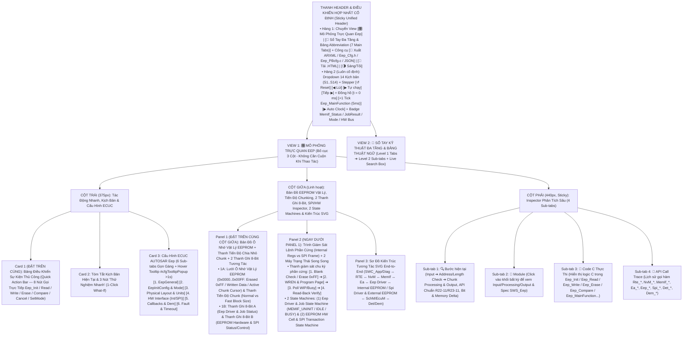
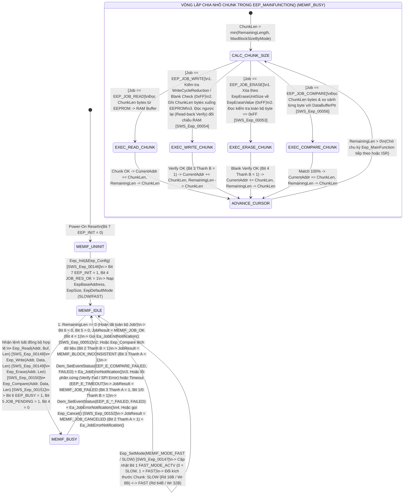
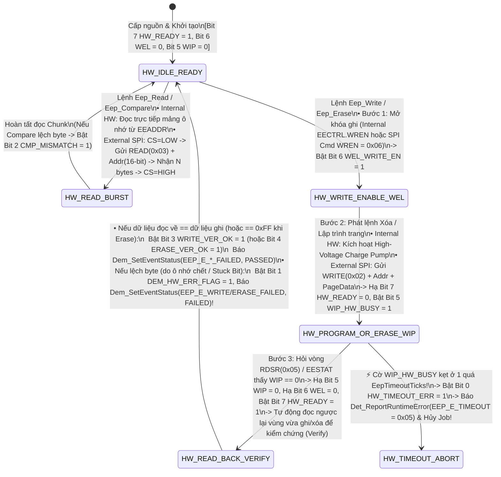

# Tài Liệu Thiết Kế Chi Tiết Trình Mô Phỏng AUTOSAR Eep — EEPROM Driver (`Eep_Simulation_design.md`)

> **Trạng thái tài liệu:** Bản thiết kế chi tiết đã cập nhật theo xác nhận `A1`–`A4` của User — Sẵn sàng để User review trước khi triển khai code.  
> **File đích dự kiến xuất bản:** `d:\__Personal\AntiGravity\Simulation\05_MCAL\AUTOSAR_Eep.html` (Ứng dụng Web Tương tác 1 file HTML độc lập, 100% Offline, Pure CSS, có nút tải `.HTML` kèm cấu hình nhúng & xuất code `ARXML / Eep_Cfg.h / Eep_PBcfg.c / JSON`).  
> **Chuẩn tham chiếu:** **AUTOSAR Classic Platform R20-11 / R22-11 / R23-11 (`SWS_Eep` — EEPROM Driver, `ModuleId = 90 / 0x005A`, `SWS_Ea`, `SWS_MemIf`, `SWS_NvM`, `SWS_Spi`, `SWS_Dem`, `SWS_Det`, `SWS_SchM`, `SWS_EcuM`, `SWS_BswM`, `SWS_Rte`)**, đính kèm mã requirement chuẩn **`SWS_Eep_xxxxx`** tại từng bước xử lý, Bản đồ Ô nhớ Vật lý EEPROM (`Physical EEPROM Hex Memory Map` + `Chunking Progress Bar` theo `MEMIF_MODE_SLOW / FAST` + `Internal EEPROM Registers vs External SPI EEPROM Frame Trace`), 2 thanh ghi 8-Bit tương tác, tooltip cấu hình (`#cfgTooltipPopup` `>1s` giống hệt `AUTOSAR_DEM.html`) và sổ tay tra cứu đa tầng.

---

## 1. Tổng Quan Định Hướng Thiết Kế Đã Chốt (`A1` – `A4`)

| Hạng mục | Nội dung thiết kế đã xác nhận với User |
| :--- | :--- |
| **1. Bố cục giao diện & Ưu tiên Không Cuộn Trang — Zero-Scroll (`A1`)** | Kết hợp tinh hoa của **`AUTOSAR_DEM.html`**, **`AUTOSAR_Ea.html`** và **`AUTOSAR_Fee.html`**, tối ưu hóa **Above-the-Fold (Zero-Scroll)** để các khối thao tác và giám sát tần suất cao nhất luôn nằm ngay phần đầu mỗi cột trong khung màn hình:<br>• **Thanh Điều Khiển Hợp Nhất Cố Định (Sticky Unified Header)**:<br>  - **Hàng 1**: Chuyển View `[🎛️ Mô Phỏng Trực Quan Eep]` \| `[📖 Sổ Tay Đa Tầng & Bảng Abbreviation (7 Main Tabs)]` + Công cụ `[🧾 Xuất ARXML / Eep_Cfg.h / Eep_PBcfg.c / JSON]` \| `[💾 Tải .HTML]` \| `[🌗 Sáng/Tối]`.<br>  - **Hàng 2 (Luôn cố định)**: Dropdown chọn 14 Kịch bản (`S1`–`S14`), Stepper (`↺ Reset`, `◀ Lùi`, `▶ Tự chạy`, `Tiếp ▶`), Đồng hồ (`t = 0 ms`, `+1 Tick Eep_MainFunction (5ms)`, `▶ Auto Clock`) và Badge Trạng thái `MemIf_StatusType` / `MemIf_JobResultType` / `MemIf_ModeType` / `HW Bus Mode (Internal vs SPI)`.<br>• **Bố cục 3 cột hiện đại (Mỗi cột tự cuộn độc lập trong khung Viewport)**:<br>  - **Cột Trái (`375px`)**: Đưa **Card 1: Bảng Điều Khiển Sự Kiện Thủ Công (`Quick Action Bar` — 8 nút gọi trực tiếp `Eep_Init`, `Eep_Read`, `Eep_Write`, `Eep_Erase`, `Eep_Compare`, `Eep_Cancel`, `Eep_SetMode`, `+1 Tick Eep_MainFunction`)** và **Card 2: Tóm tắt kịch bản & 3 nút 1-Click What-If** lên trên cùng, tiếp theo là **Card 3: 6 Sub-tabs Cấu hình ECUC Eep** (hỗ trợ Floating Hover Tooltip `#cfgTooltipPopup` sau `>1s` giống hệt `AUTOSAR_DEM.html`).<br>  - **Cột Giữa (`Linh hoạt`)**: Đưa **Panel 1: Bản Đồ Ô Nhớ Vật Lý EEPROM (`EepBaseAddress 0x0000 .. +EepSize`) + Thanh Tiến Độ Chia Nhỏ Chunk (`Normal vs Fast Block Size`) + 2 Thanh Ghi 8-Bit Tương Tác** và **Panel 2: Trình Giám Sát Giao Tiếp Phần Cứng (`Internal Regs` vs `External SPI Frame: WREN/WRITE/READ/RDSR`) + 2 Máy Trạng Thái Song Song (`Eep Driver & Job State Machine` + `EEPROM Hardware Cell & Cycle State Machine`)** lên ngay đầu cột giữa, bên dưới là **Panel 3: Sơ Đồ Kiến Trúc Tương Tác SVG End-to-End** (`SWC_App/Diag ↔ RTE ↔ NvM ↔ MemIf ↔ Ea ↔ Eep Driver Core ↔ Internal EEPROM HW / Spi Driver & External SPI EEPROM ↔ SchM/OS & EcuM/BswM ↔ Det/Dem`).<br>  - **Cột Phải (`440px, Sticky`)**: Inspector 4 Sub-tabs (`🔍 Bước hiện tại`, `🧩 Module`, `📄 Code C Thực Thi`, `📜 API Call Trace`).<br>• **Config Hover Tooltip (`> 1s` delay)** giống hệt `AUTOSAR_DEM.html` (`#cfgTooltipPopup` hiển thị tên tham số, đường dẫn ECUC, mã `SWS_Eep_xxxxx`, mô tả, dải giá trị, giá trị typical và lưu ý kỹ thuật). |
| **2. Kiến trúc Phần cứng Kép (`Internal vs External SPI`) & Giám sát Bit-level 2 Tầng (`A2`)** | Đặt **cố định và nổi bật ở đầu Cột Giữa** gồm **2 tầng trực quan hóa**:<br>• **Tầng 1 — Bản Đồ Ô Nhớ Vật Lý EEPROM (`0x0000 .. 0x00FF`) & Thanh Tiến Độ Chunking (`Eep_MainFunction`)**: Hiển thị trực tiếp các trang/ô nhớ EEPROM vật lý (`EepEraseValue = 0xFF`, `EepWriteUnitSize`, `EepEraseUnitSize`), đánh dấu màu trực quan vùng đang được `Eep_Read`, `Eep_Write`, `Eep_Erase` hoặc `Eep_Compare`, con trỏ `CurrentAddress`, số byte còn lại `RemainingLength`, số byte xử lý mỗi chu kỳ (`MEMIF_MODE_SLOW`: `Read 16B / Write 8B` vs `MEMIF_MODE_FAST`: `Read 64B / Write 32B`), và khung truyền SPI (`WREN 0x06`, `WRITE 0x02`, `READ 0x03`, `RDSR 0x05`) khi chọn chế độ **External SPI EEPROM**!<br>• **Tầng 2 — 2 Thanh ghi 8-Bit tương tác song song**:<br>  1. **Thanh A (`8-Bit Eep Driver & Job Status Register` — `Eep_DriverJobStatusByte`)**: Theo dõi trạng thái lõi của module `Eep` (`EEP_INITIALIZED`, `EEP_STATUS_BUSY`, `JOB_PENDING`, `JOB_RESULT_OK`, `JOB_FAILED_OR_INC`, `JOB_CANCELED`, `FAST_MODE_ACTV`, `ISR_MODE_EN`).<br>  2. **Thanh B (`8-Bit EEPROM Hardware & SPI Status/Control Register` — `Eep_HwStatusCtrlByte`)**: Mô phỏng thanh ghi trạng thái phần cứng EEPROM (`EESTAT / SPI RDSR`) và các cờ kiểm chứng vật lý (`HW_READY_IDLE`, `WEL_WRITE_EN`, `WIP_HW_BUSY`, `ERASE_BLANK_OK`, `WRITE_VERIFY_OK`, `COMPARE_MISMATCH`, `DEM_HW_ERR_FLAG`, `HW_TIMEOUT_ERR`). Cho phép click trực tiếp vào từng bit hoặc từng ô nhớ EEPROM để thử nghiệm! |
| **3. Hệ thống 14 Kịch bản mẫu (`A3`)** | Thiết kế sẵn **14 Kịch bản (`S1`–`S14`)** chia làm 4 nhóm lớn:<br>• **Nhóm 1 (`S1`–`S4`) — Khởi Tạo `Eep_Init`, Đọc Đa Chu Kỳ (`Eep_Read`), Ghi Kèm Kiểm Chứng (`Eep_Write` + `Erase-Before-Write` & `Verify`) & Xóa Trang (`Eep_Erase`)**: Khởi tạo `Eep_Init(&Eep_Config)`, đọc dữ liệu chia nhỏ theo `EepNormalReadBlockSize`, ghi dữ liệu theo `EepNormalWriteBlockSize` kèm kiểm tra ô trống `0xFF` & đối chiếu `Read-back Verify`, và xóa vùng nhớ về `EepEraseValue (0xFF)` phục vụ `Ea_EraseImmediateBlock()`.<br>• **Nhóm 2 (`S5`–`S8`) — So Sánh Dữ Liệu (`Eep_Compare`), Giảm Chu Kỳ Ghi (`EepWriteCycleReduction`), Chuyển Tốc Độ (`Eep_SetMode: SLOW vs FAST`) & `Polling` vs `Interrupt Mode`**: So sánh khớp hoàn toàn (`MEMIF_JOB_OK`) vs lệch dữ liệu (`MEMIF_BLOCK_INCONSISTENT` + `EEP_E_COMPARE_FAILED`), cơ chế `EepWriteCycleReduction = TRUE` (đọc trước khi ghi để bỏ qua các byte không đổi), tăng tốc gấp 4 lần với `Eep_SetMode(MEMIF_MODE_FAST)`, và đối chiếu `EepUseInterrupts = FALSE` vs `TRUE`.<br>• **Nhóm 3 (`S9`–`S11`) — Điều Khiển External SPI EEPROM (`Spi_AsyncTransmit`), Chuỗi Liên Tầng End-to-End (`SWC ➔ RTE ➔ NvM ➔ MemIf ➔ Ea ➔ Eep`) & Hủy Lệnh (`Eep_Cancel`)**: Luồng truyền lệnh SPI (`WREN 0x06 ➔ WRITE 0x02 ➔ RDSR 0x05 WIP Polling`), chuỗi 3 Sub-Jobs từ `SWC` xuống `Ea` và `Eep` (`Header 0xA5 ➔ Data ➔ Footer 0x5A`), và hủy lệnh ngay lập tức bằng `Eep_Cancel()` (`MEMIF_JOB_CANCELED`).<br>• **Nhóm 4 (`S12`–`S14`) — Lỗi Phần Cứng Báo `Dem` (`EEP_E_WRITE/READ/ERASE_FAILED`), Lỗi Quá Hạn (`EEP_E_TIMEOUT`) & Kiểm Thử Toàn Diện `DET / Runtime Error` R22-11/R23-11**: Xác thực sau ghi/xóa thất bại báo `Dem_SetEventStatus()`, cờ phần cứng `WIP_HW_BUSY` bị treo quá ngưỡng báo `Det_ReportRuntimeError(EEP_E_TIMEOUT = 0x05)`, và kiểm thử đầy đủ các mã lỗi `EEP_E_UNINIT`, `EEP_E_INVALID_ADDRESS`, `EEP_E_INVALID_DATA`, `EEP_E_INVALID_LENGTH`, `EEP_E_INIT_FAILED`, `EEP_E_PARAM_POINTER`, `EEP_E_BUSY`. |
| **4. Sổ tay tra cứu đa tầng & Bảng Abbreviation (`A4`)** | **View 2 (`📖 Sổ Tay Kỹ Thuật Eep & Từ Điển Thuật Ngữ`)** được tổ chức theo cấu trúc **Đa Tầng (Multi-level Tabs)**:<br>• **6 Main Sub-tabs (Level 1) × 4 Chủ đề con (Level 2 Pills/Tabs = 24 chuyên đề)** phân tích sâu kiến trúc Memory Stack (`SWC ➔ RTE ➔ NvM ➔ MemIf ➔ Ea ➔ Eep ➔ Spi/HW`), nguyên lý chia nhỏ Chunk theo `MEMIF_MODE_SLOW / FAST`, quy trình vật lý `Erase / Write / Verify / WriteCycleReduction`, đối chiếu `Internal On-Chip EEPROM` vs `External SPI EEPROM`, so sánh `Eep` (EEPROM Driver) vs `Fls` (Flash Driver), và từ điển API/ECUC chuẩn R23-11.<br>• **Tab 7 chuyên biệt: `🔤 Bảng Thuật Ngữ & Từ Viết Tắt (Abbreviation Table)`** trình bày dưới dạng bảng chuẩn 4 cột, tích hợp **Search Box tìm kiếm tức thời (Live Search + Highlight `<mark>`)** và 5 nút lọc nhanh theo phân nhóm (`Eep Core & Addressing`, `Hardware, SPI & Timing`, `Memory Stack (NvM/MemIf/Ea/Fls)`, `Errors (DET / Runtime / Dem)`). |

---

## 2. Bố Cục Giao Diện 3 Cột Ưu Tiên Zero-Scroll & Hệ Thống Sub-Tabs (UI Wireframe)

Để đảm bảo **"người dùng không cần cuộn chuột lên xuống mỗi lần thao tác"**, toàn bộ giao diện được thiết kế theo nguyên lý **Viewport-First (Đưa các khối tương tác và giám sát tần suất cao nhất lên ngay phần đầu của mỗi cột, kết hợp hệ thống Sub-tabs gọn gàng)**:



### Điểm Cải Tiến Đột Phá Về Trải Nghiệm "Zero-Scroll" Cho Module `Eep`:
1. **Thanh Điều Khiển Hợp Nhất (`Sticky Unified Header`)**: Gộp chọn kịch bản, nút bấm `Bước tiếp / Lùi / Tự chạy`, và nút nhịp đồng hồ **`+1 Tick Eep_MainFunction (5ms)`** vào ngay thanh Header cố định. Vì theo chuẩn `SWS_Eep_00037` và `SWS_Eep_00038`, một lệnh `Eep_Read` hoặc `Eep_Write` lớn sẽ được chia nhỏ thành nhiều **Chunk** xử lý qua từng chu kỳ `Eep_MainFunction()` (tùy theo `EepNormalReadBlockSize / EepFastReadBlockSize`), việc đặt nút `+1 Tick` cố định trên Header giúp người dùng bấm nhích từng nhịp và thấy con trỏ `CurrentAddress` dịch chuyển từng bước trên bản đồ EEPROM mà không cần cuộn trang.
2. **Đưa `Quick Action Bar` (8 nút gọi API trực tiếp) lên vị trí Card 1 (Đầu Cột Trái)** và đưa **Bản Đồ Ô Nhớ Vật Lý EEPROM + Thanh Tiến Độ Chunking + 2 Thanh Ghi 8-Bit** lên đầu Cột Giữa: Khi bấm `Eep_Write(0x0010, Data, 24)`, `Eep_Read(0x0010, Buf, 24)`, `Eep_Erase(0x0050, 16)` hoặc `Eep_Compare(0x0010, ExpectedBuf, 12)`, mắt người dùng nhìn thấy ngay lập tức ô nhớ nào trên EEPROM (`0x0000 .. 0x00FF`) đang đổi màu, bao nhiêu byte được xử lý trong mỗi chu kỳ `SLOW` vs `FAST`, và bit trạng thái nào vừa lật trên 2 Thanh ghi 8-Bit.
3. **Gom 36 tham số ECUC vào 6 Sub-tabs gọn gàng**: Chiều cao Card Cấu hình được giữ gọn cố định (~275px), kèm hộp thoại giải thích nổi `#cfgTooltipPopup` khi hover quá `1000ms` giống hệt `AUTOSAR_DEM.html`.

---

## 3. Thiết Kế Chi Tiết Panel 1 (Đầu Cột Giữa): Bản Đồ Ô Nhớ Vật Lý EEPROM, Tiến Độ Chia Nhỏ Chunk & 2 Thanh Ghi 8-Bit Tương Tác

Theo chuẩn **`AUTOSAR_SWS_EEPROMDriver` (`SWS_Eep_00001`, `SWS_Eep_00005`, `SWS_Eep_00037`, `SWS_Eep_00038`)**, nhiệm vụ cốt lõi của `Eep` là:
1. **Truy cập trực tiếp theo Địa chỉ Vật lý tuyến tính (`Eep_AddressType`)**: Khác với `Ea` làm việc theo `BlockNumber`, `Eep` nhận địa chỉ offset vật lý tính từ `EepBaseAddress` (`0 .. EepSize - 1`) và độ dài `Length` bytes để thực hiện 4 dịch vụ cốt lõi: **`Eep_Read`**, **`Eep_Write`**, **`Eep_Erase`**, và **`Eep_Compare`**.
2. **Chia nhỏ công việc theo từng chu kỳ (`Cyclic Job Chunking in Eep_MainFunction`)**: Để không khóa chết CPU trong thời gian dài khi đọc/ghi EEPROM (vốn có tốc độ vật lý chậm, khoảng `2 ms – 5 ms` cho mỗi trang ghi), `Eep_MainFunction()` giới hạn số byte tối đa được xử lý trong 1 lần gọi dựa vào chế độ hiện hành (`MemIf_ModeType`):
   - Khi ở **`MEMIF_MODE_SLOW`**: Mỗi chu kỳ `Eep_MainFunction()` chỉ đọc tối đa **`EepNormalReadBlockSize`** (ví dụ `16 bytes`) hoặc ghi tối đa **`EepNormalWriteBlockSize`** (ví dụ `8 bytes` = 1 Page).
   - Khi ở **`MEMIF_MODE_FAST`**: Mỗi chu kỳ `Eep_MainFunction()` tăng tốc đọc lên **`EepFastReadBlockSize`** (ví dụ `64 bytes`) và ghi lên **`EepFastWriteBlockSize`** (ví dụ `32 bytes` = 4 Pages).
3. **Đảm bảo tính toàn vẹn vật lý (`Erase-Before-Write`, `WriteCycleReduction` & `Read-Back Verification`)**: Trong quá trình ghi/xóa, `Eep` kiểm tra ô nhớ đã được xóa về `EepEraseValue (0xFF)` chưa, có thể đọc trước để bỏ qua các byte không thay đổi (`EepWriteCycleReduction = TRUE` — `SWS_Eep_00024`), và đọc ngược lại sau khi ghi/xóa để xác nhận dữ liệu trên phần cứng khớp 100% với RAM (`SWS_Eep_00053`, `SWS_Eep_00054`).

Do đó, Panel 1 ở đầu Cột Giữa được thiết kế gồm **2 tầng trực quan hóa liên thông**:

### 3.1. Phần 1A — Bản Đồ Ô Nhớ Vật Lý EEPROM (`Physical EEPROM Hex Memory Map 0x0000 .. 0x00FF`) & Thanh Tiến Độ Chunking

```text
+-------------------------------------------------------------------------------------------------------------------+
| 🗺️ BẢN ĐỒ Ô NHỚ VẬT LÝ EEPROM (`EepBaseAddress = 0x0000`, `EepSize = 256B`, `Page = 8B`, `EraseVal = 0xFF`)       |
| Driver Status: [ MEMIF_BUSY ] | Job Result: [ MEMIF_JOB_PENDING ] | Mode: [ MEMIF_MODE_SLOW (Rd:16B / Wr:8B) ]    |
+-------------------------------------------------------------------------------------------------------------------+
| 1. THANH TIẾN ĐỘ CHIA NHỎ CÔNG VIỆC TRONG `Eep_MainFunction()` (`Cyclic Chunking & Hardware Bus Monitor`):        |
|  • Active Job : [ Eep_Write(Addr = 0x0000, Len = 16B) ] | Tiến độ: [████████░░░░░░░░] 8 / 16 Bytes (Chunk #1/2)   |
|  • Con trỏ nội: CurrentAddr = 0x0008 | RemainingLen = 8B | ChunkSize = 8B/tick (EepNormalWriteBlockSize)          |
|  • HW Bus Trace: [SPI Mode] CS=LOW ➔ Cmd: WREN(0x06) ➔ Cmd: WRITE(0x02) + Addr(0x0000) + 8B Data ➔ Poll RDSR(WIP) |
+-------------------------------------------------------------------------------------------------------------------+
| 2. LƯỚI Ô NHỚ VẬT LÝ EEPROM (`Physical EEPROM Hex Map` — Mỗi hàng = 16 Bytes = 2 Physical Pages, Click ô để sửa): |
|  Addr   | +0 +1 +2 +3 +4 +5 +6 +7 (Page Even)     | +8 +9 +A +B +C +D +E +F (Page Odd)      | Vùng Ánh Xạ & Trạng Thái
|  -------+-----------------------------------------+-----------------------------------------+---------------------|
|  0x0000 | [A5 02 12 34 56 78 9A BC: ✅ CHUNK#1 OK] | [▶DE F0 11 22 33 44 5A 02: ⏳ CHUNK#2 ] | Ea Blk#1 (Calib 16B)|
|  0x0010 | [A5 01 AA BB CC DD 55 66: ✅ VALID DATA] | [77 88 5A 01 FF FF FF FF: ✅ VALID+PAD] | Ea Blk#2a (Dataset0)|
|  0x0020 | [00 00 AA BB CC DD 55 66: 🚫 INVALIDHDR] | [77 88 00 00 FF FF FF FF: 🚫 INVALID  ] | Ea Blk#2b (Dataset1)|
|  0x0030 | [00 01 00 05 43 1F 5A 01: 🔄 OLD SLOT#0] | [00 02 00 05 43 20 5A 02: 🔄 OLD SLT#1] | Ea Blk#3 (Slots 0-1)|
|  0x0040 | [A5 03 00 05 43 21 5A 03: ★ ACTV SLOT#2] | [FF FF FF FF FF FF FF FF: 🧹 ERASED #3] | Ea Blk#3 (Slots 2-3)|
|  0x0050 | [FF FF FF FF FF FF FF FF: 🧹 ERASED 0xFF] | [FF FF FF FF FF FF FF FF: 🧹 ERASED   ] | Ea Blk#4 (Immediate)|
|  0x0060 | [DE AD BE EF CA FE BA BE: 📦 RAW EEP   ] | [FF FF FF FF FF FF FF FF: 🧹 ERASED   ] | Vùng Eep Test Trực Tiếp|
+-------------------------------------------------------------------------------------------------------------------+
```

- **Tính năng tương tác trực tiếp trên Phần 1A**:
  - Hiển thị rõ **con trỏ `▶` (`CurrentAddress`)** và **khung tô sáng màu vàng/xanh** cho biết `Eep_MainFunction()` đang xử lý Chunk nào trong chu kỳ hiện tại (`Chunk #1: 0x0000..0x0007`, sang Tick tiếp theo nhảy tới `Chunk #2: 0x0008..0x000F`).
  - Cho phép người dùng **click trực tiếp vào bất kỳ ô nhớ Hex nào** trên bản đồ EEPROM để:
    1. Sửa giá trị byte vật lý (ví dụ gài 1 byte khác `0xFF` vào vùng sắp ghi để thử nghiệm lỗi chưa xóa trước khi ghi, hoặc làm lệch 1 byte để thử nghiệm `Eep_Compare()` trả về `MEMIF_BLOCK_INCONSISTENT`).
    2. Đặt dấu **🔥 Stuck Bit (Ô nhớ bị hỏng vật lý)** tại một địa chỉ bất kỳ: khi `Eep_Write` hoặc `Eep_Erase` đi qua địa chỉ đó, bước `Read-Back Verification` sẽ phát hiện byte đọc về khác byte vừa ghi, lập tức kích hoạt `Dem_SetEventStatus(EEP_E_WRITE_FAILED / EEP_E_ERASE_FAILED, DEM_EVENT_STATUS_FAILED)`!

### 3.2. Phần 1B — 2 Thanh Ghi 8-Bit Trạng Thái Tương Tác Luôn Hiển Thị Nổi Bật

Ngay bên dưới Phần 1A là **2 Thanh ghi 8-Bit tương tác** theo đúng phong cách trực quan của `AUTOSAR_DEM.html` và `AUTOSAR_Ea.html`:

```text
+-------------------------------------------------------------------------------------------------------------------+
| 🔢 BẢNG GIÁM SÁT BITFIELD 8-BIT EEP DRIVER STATUS & HARDWARE/SPI REGISTER (LIVE 8-BIT INSPECTOR) [Click Bit để thử]|
| Bước #3: Eep_MainFunction() hoàn tất ghi Chunk #2 (8B) & Verify OK ➔ Ea_JobEndNotification() | A: 0x90 | B: 0x98  |
+-------------------------------------------------------------------------------------------------------------------+
| A. THANH GHI 8-BIT TRẠNG THÁI EEP DRIVER & TIẾN TRÌNH JOB (`Eep_DriverJobStatusByte`) — Hex:[0x90] Bin:[1001 0000b]|
|    Eep_GetStatus(): [ MEMIF_IDLE ] | Eep_GetJobResult(): [ MEMIF_JOB_OK ] | Mode: [ SLOW ] | Exec: [ POLLING ]    |
|  +-------------+ +-------------+ +-------------+ +-------------+ +-------------+ +-------------+ +-------+ +-----+|
|  | Bit 7 (0x80)| | Bit 6 (0x40)| | Bit 5 (0x20)| | Bit 4 (0x10)| | Bit 3 (0x08)| | Bit 2 (0x04)| |Bit1(2)| |Bit 0||
|  | EEP_INIT    | | EEP_BUSY    | | JOB_PENDING | | JOB_RES_OK  | | JOB_ERR_INC | | JOB_CANCELED| |FAST_MD| |ISR_M||
|  |      1      | |      0      | |      0      | |      1      | |      0      | |      0      | |   0   | |  0  ||
|  | Initialized | | MEMIF_IDLE  | | No Pend Job | | MEMIF_JOB_OK| | No Job Error| | Not Canceled| |SlowMd | |Poll ||
|  +-------------+ +-------------+ +-------------+ +-------------+ +-------------+ +-------------+ +-------+ +-----+|
+-------------------------------------------------------------------------------------------------------------------+
| B. THANH GHI 8-BIT TRẠNG THÁI PHẦN CỨNG EEPROM & SPI (`Eep_HwStatusCtrlByte` / `EESTAT / RDSR`) — Hex:[0x98]      |
|    HW Interface: [ External SPI EEPROM ] | Last SPI Cmd: [ RDSR (0x05) -> WIP=0 ] | Verify: [ ERASE & WRITE OK ]  |
|  +-------------+ +-------------+ +-------------+ +-------------+ +-------------+ +-------------+ +-------+ +-----+|
|  | Bit 7 (0x80)| | Bit 6 (0x40)| | Bit 5 (0x20)| | Bit 4 (0x10)| | Bit 3 (0x08)| | Bit 2 (0x04)| |Bit1(2)| |Bit 0||
|  | HW_READY    | | WEL_WR_EN   | | WIP_HW_BUSY | | ERASE_VER_OK| | WRITE_VER_OK| | CMP_MISMATCH| |DEM_ERR| |TMOUT||
|  |      1      | |      0      | |      0      | |      1      | |      1      | |      0      | |   0   | |  0  ||
|  | Bus/HW Idle | | Latch Reset | | Write Done  | | Blank=0xFF  | | Verify Match| | Compare OK  | |NoDemEr| |NoTmo||
|  +-------------+ +-------------+ +-------------+ +-------------+ +-------------+ +-------------+ +-------+ +-----+|
+-------------------------------------------------------------------------------------------------------------------+
```

#### 3.2.1. Giải Mã Chi Tiết Thanh A: `8-Bit Eep Driver & Job Status Register` (`Eep_DriverJobStatusByte`)

| Bit | Mask | Tên Cờ (`Eep Driver Status Bit`) | Ý nghĩa kỹ thuật & Khi nào bật lên `1` (`0 ➔ 1`) | Khi nào hạ về `0` (`1 ➔ 0`) |
| :-: | :-: | :--- | :--- | :--- |
| **Bit 7** | `0x80` | **`EEP_INITIALIZED`** | Bật lên `1` sau khi `EcuM` gọi **`Eep_Init(&Eep_Config)`** thành công (`SWS_Eep_00010`, `SWS_Eep_00014`), nạp cấu hình địa chỉ/chế độ mặc định và chuyển kết quả của `Eep_GetStatus()` từ `MEMIF_UNINIT` sang **`MEMIF_IDLE`**, `Eep_GetJobResult()` sang **`MEMIF_JOB_OK`**. | Hạ về `0` khi hệ thống chưa gọi `Eep_Init()` hoặc khi người dùng tắt Checkbox `EepInitialized` để kiểm thử báo lỗi `Det_ReportError(EEP_E_UNINIT = 0x00)`. |
| **Bit 6** | `0x40` | **`EEP_STATUS_BUSY`** | Bật lên `1` ngay khi `Eep` chấp nhận một lệnh bất đồng bộ (`Eep_Read`, `Eep_Write`, `Eep_Erase`, `Eep_Compare`), chuyển trạng thái trả về của `Eep_GetStatus()` sang **`MEMIF_BUSY`** (`SWS_Eep_00034`). Trong lúc `Bit 6 == 1`, mọi yêu cầu Job mới hoặc `Eep_SetMode()` đều bị từ chối và báo lỗi Runtime Error `EEP_E_BUSY (0x04)` (`SWS_Eep_00020`, `SWS_Eep_00023`)! | Hạ về `0` (trở lại **`MEMIF_IDLE`**) khi Job hoàn tất toàn bộ các Chunk (`MEMIF_JOB_OK`), gặp lỗi phần cứng/timeout (`MEMIF_JOB_FAILED`), phát hiện lệch dữ liệu (`MEMIF_BLOCK_INCONSISTENT`), hoặc bị hủy bởi `Eep_Cancel()`. |
| **Bit 5** | `0x20` | **`JOB_PENDING`** | Bật lên `1` khi `Eep_GetJobResult()` đang ở trạng thái **`MEMIF_JOB_PENDING`** (`SWS_Eep_00035`), báo cho `Ea` biết tiến trình đọc/ghi/xóa/so sánh vẫn còn các byte (`RemainingLength > 0`) đang được chia nhỏ xử lý qua từng nhịp `Eep_MainFunction()`. | Hạ về `0` ngay khi toàn bộ độ dài `Length` đã xử lý xong hoặc khi Job kết thúc sớm do lỗi / hủy lệnh. |
| **Bit 4** | `0x10` | **`JOB_RESULT_OK`** | Bật lên `1` khi `Eep_Init()` hoàn tất hoặc khi `Eep_MainFunction()` xử lý xong Chunk cuối cùng thành công, chuyển `Eep_GetJobResult()` sang **`MEMIF_JOB_OK`** (`SWS_Eep_00036`) và kích hoạt callback **`Ea_JobEndNotification()`** (`SWS_Eep_00051`). | Hạ về `0` ngay khi nhận một lệnh bất đồng bộ mới (`MEMIF_JOB_PENDING`) hoặc khi Job kết thúc với lỗi / không khớp / bị hủy. |
| **Bit 3** | `0x08` | **`JOB_ERR_OR_INCONSISTENT`** | Bật lên `1` khi Job kết thúc với trạng thái lỗi phần cứng **`MEMIF_JOB_FAILED`** (do lỗi đọc/ghi/xóa hoặc hết thời gian chờ `EEP_E_TIMEOUT`) hoặc trạng thái **`MEMIF_BLOCK_INCONSISTENT`** (khi `Eep_Compare()` phát hiện byte trên EEPROM khác với bộ đệm RAM — `SWS_Eep_00056`), đồng thời kích hoạt **`Ea_JobErrorNotification()`** (`SWS_Eep_00052`). | Hạ về `0` khi bắt đầu một Job mới hoặc khi bấm `Reset`. |
| **Bit 2** | `0x04` | **`JOB_CANCELED`** | Bật lên `1` ngay khi lớp trên gọi **`Eep_Cancel()`** lúc driver đang bận (`SWS_Eep_00027`, `SWS_Eep_00033`): `Eep` đặt kết quả `Eep_GetJobResult()` thành **`MEMIF_JOB_CANCELED`**, đưa trạng thái driver về `MEMIF_IDLE` và gọi `Ea_JobErrorNotification()` (nếu được cấu hình). | Hạ về `0` khi một lệnh `Eep_Read / Write / Erase / Compare` mới được khởi chạy. |
| **Bit 1** | `0x02` | **`FAST_MODE_ACTV`** | Bật lên `1` khi `Eep` đang hoạt động ở chế độ **`MEMIF_MODE_FAST`** (do cấu hình `EepDefaultMode = MEMIF_MODE_FAST` khi `Eep_Init` hoặc sau lệnh **`Eep_SetMode(MEMIF_MODE_FAST)`** — `SWS_Eep_00016`): `Eep_MainFunction()` sử dụng `EepFastReadBlockSize (64B)` và `EepFastWriteBlockSize (32B)`. | Hạ về `0` khi ở chế độ **`MEMIF_MODE_SLOW`**: `Eep_MainFunction()` sử dụng kích thước khối nhỏ `EepNormalReadBlockSize (16B)` và `EepNormalWriteBlockSize (8B)` để giảm tải CPU / bus SPI. |
| **Bit 0** | `0x01` | **`ISR_MODE_EN`** | Bật lên `1` khi tham số cấu hình **`EepUseInterrupts = TRUE`** (`ECUC_Eep_00162`, `SWS_Eep_00117`): tiến trình chuyển tiếp giữa các trang phần cứng hoặc khung truyền SPI được kích hoạt ngay trong trình phục vụ ngắt `ISR(Eep_JobEndIsr)` thay vì phải chờ chu kỳ `Eep_MainFunction()` kế tiếp. | Hạ về `0` khi `EepUseInterrupts = FALSE` (chế độ mặc định xử lý tuần tự hoàn toàn trong `Eep_MainFunction()`). |

#### 3.2.2. Giải Mã Chi Tiết Thanh B: `8-Bit EEPROM Hardware & SPI Status/Control Register` (`Eep_HwStatusCtrlByte`)

| Bit | Mask | Tên Cờ (`HW / SPI Register Bit`) | Ý nghĩa kỹ thuật & Khi nào bật lên `1` (`0 ➔ 1`) | Khi nào hạ về `0` (`1 ➔ 0`) |
| :-: | :-: | :--- | :--- | :--- |
| **Bit 7** | `0x80` | **`HW_READY_IDLE`** | Biểu thị bộ điều khiển phần cứng EEPROM nội (`EECTRL`) hoặc bus `SPI` + chip EEPROM ngoài đang ở trạng thái **Sẵn sàng (`Ready / Idle`)**, sẵn sàng nhận lệnh đọc/ghi/xóa trang mới. | Hạ về `0` trong suốt thời gian mạch bơm điện áp cao nội bộ của EEPROM đang thực hiện chu kỳ xóa/lập trình ô nhớ (`WIP_HW_BUSY = 1`). |
| **Bit 6** | `0x40` | **`WEL_WRITE_EN`** | Tương ứng với bit **`WEL (Write Enable Latch - Bit 1 của thanh ghi RDSR)`** trên chip EEPROM hoặc khóa mở ghi thanh ghi nội bộ: bật lên `1` khi `Eep` phát lệnh mở khóa ghi **`WREN (0x06)`** trước mỗi chu kỳ `Eep_Write()` hoặc `Eep_Erase()`. | Tự động hạ về `0` (Hardware Auto-Reset) ngay sau khi hoàn tất một chu kỳ lập trình trang (`Page Program`), xóa trang (`Page Erase`) hoặc khi gặp lỗi phần cứng, chống ghi nhầm ngoài ý muốn. |
| **Bit 5** | `0x20` | **`WIP_HW_BUSY`** | Tương ứng với bit **`WIP (Write In Progress - Bit 0 của thanh ghi RDSR)`** hoặc cờ `EEBUSY` của phần cứng EEPROM: bật lên `1` khi phần cứng đang nạp điện tích vào cổng nổi (Floating Gate) của ô nhớ EEPROM. Trong lúc `Bit 5 == 1` (ví dụ khi `Eep_Cancel()` vừa hủy phần mềm nhưng phần cứng chưa xong chu kỳ ghi trang hiện tại — `SWS_Eep_00029`), `Eep` phải đợi `Bit 5` hạ về `0` trước khi phát lệnh phần cứng mới! | Hạ về `0` khi chu kỳ vật lý trên silicon hoàn tất (trừ khi người dùng bật `InjectHwTimeoutStuckBusy = TRUE` khiến `Bit 5` kẹt ở `1` gây lỗi `EEP_E_TIMEOUT`). |
| **Bit 4** | `0x10` | **`ERASE_BLANK_OK`** | Bật lên `1` khi: (1) Bước kiểm tra ô trống trước khi ghi (**Erase-before-Write check** — `SWS_Eep_00053`) hoặc (2) Bước đọc xác thực sau khi chạy `Eep_Erase()` (**Erase Verification** — `SWS_Eep_00053`) xác nhận toàn bộ các byte trong vùng mục tiêu đều bằng **`EepEraseValue (0xFF)`**! | Hạ về `0` khi phát hiện ô nhớ chưa được xóa sạch (`!= 0xFF`) trong quá trình kiểm tra Erase Verification. |
| **Bit 3** | `0x08` | **`WRITE_VERIFY_OK`** | Bật lên `1` sau mỗi Chunk của `Eep_Write()`: `Eep_MainFunction()` tự động đọc ngược lại vùng EEPROM vừa ghi và đối chiếu từng byte với bộ đệm RAM nguồn (`DataBufferPtr` — `SWS_Eep_00054`). Nếu khớp 100%, `Bit 3` bật lên `1`! (Cũng bật khi `EepWriteCycleReduction = TRUE` phát hiện dữ liệu cũ trên EEPROM đã giống hệt dữ liệu mới nên bỏ qua chu kỳ ghi vật lý). | Hạ về `0` khi bắt đầu lệnh mới hoặc khi phát hiện sai lệch giữa dữ liệu vừa ghi xuống EEPROM và dữ liệu trong bộ đệm RAM (`EEP_E_WRITE_FAILED`). |
| **Bit 2** | `0x04` | **`CMP_MISMATCH`** | Bật lên `1` khi dịch vụ **`Eep_Compare(EepromAddress, DataBufferPtr, Length)`** phát hiện ít nhất **1 byte trên EEPROM khác với bộ đệm RAM** (`SWS_Eep_00056`): `Eep` dừng so sánh ngay lập tức, chuyển `JobResult` sang **`MEMIF_BLOCK_INCONSISTENT`** (`Bit 3 Thanh A = 1`), báo `Dem` (`EEP_E_COMPARE_FAILED`) và gọi `Ea_JobErrorNotification()`! | Hạ về `0` khi `Eep_Compare()` đối chiếu khớp 100% toàn bộ các byte (`MEMIF_JOB_OK`) hoặc khi bắt đầu lệnh mới. |
| **Bit 1** | `0x02` | **`DEM_HW_ERR_FLAG`** | Bật lên `1` khi `Eep` phát hiện lỗi phần cứng vật lý và gọi **`Dem_SetEventStatus(..., DEM_EVENT_STATUS_FAILED)`** cho một trong 4 mã lỗi Extended Production Error chuẩn AUTOSAR: **`EEP_E_WRITE_FAILED`**, **`EEP_E_READ_FAILED`**, **`EEP_E_ERASE_FAILED`**, hoặc **`EEP_E_COMPARE_FAILED`**. | Hạ về `0` khi chu kỳ đọc/ghi/xóa/so sánh tiếp theo thành công và `Eep` báo `DEM_EVENT_STATUS_PASSED` sang `Dem` (`SWS_Eep_00053`, `SWS_Eep_00054`). |
| **Bit 0** | `0x01` | **`HW_TIMEOUT_ERR`** | Bật lên `1` khi bộ giám sát thời gian thực thi phần cứng trong `Eep_MainFunction()` phát hiện cờ `WIP_HW_BUSY (Bit 5)` bị treo quá số chu kỳ cho phép (`EepTimeoutTicks`), kích hoạt báo lỗi **`Det_ReportRuntimeError(90, 0, ServiceId, EEP_E_TIMEOUT = 0x05)`** và hủy Job với `MEMIF_JOB_FAILED`! | Hạ về `0` khi phần cứng phản hồi đúng hạn hoặc khi bấm `Reset`. |

---

## 4. Phân Tích Xử Lý Từng Module: Input Lấy Từ Đâu, Xử Lý Gì, Output Route Đến Đâu (Từ `SWC` Xuống `Eep` & `Physical EEPROM / SPI`)

Một câu hỏi kiến trúc cốt lõi được giải đáp trực quan ngay trên sơ đồ và sổ tay: **"`SWC` (Software Component) tương tác với `Eep` như thế nào, và dữ liệu đi qua các tầng nào trong AUTOSAR?"**
- Theo kiến trúc phân tầng **AUTOSAR Classic (`SWS_Eep_00001`, `SWS_Eep_00002`, `SWS_Ea`, `SWS_MemIf`, `SWS_NvM`)**:
  - **`SWC` KHÔNG BAO GIỜ gọi trực tiếp `Eep`!** `Eep` là trình điều khiển cấp thấp nằm ở tầng **MCAL (`Microcontroller Abstraction Layer`)** và chỉ làm việc với địa chỉ vật lý (`Eep_AddressType`).
  - Mọi yêu cầu đọc/ghi/xóa dữ liệu EEPROM khởi phát từ `SWC` ở tầng Application đều đi qua **chuỗi 5 tầng chuẩn**:
    **`SWC (Application)` ➔ `RTE` ➔ `NvM (Memory Services)` ➔ `MemIf (Memory Abstraction Interface)` ➔ `Ea (EEPROM Abstraction)` ➔ `Eep (EEPROM Driver - MCAL)` ➔ `Internal EEPROM HW` (hoặc `Spi Driver` ➔ `External SPI EEPROM`)**.
  - Ở chiều ngược lại, khi `Eep` hoàn tất hoặc gặp lỗi phần cứng, thông báo đi ngược từ **`Eep` (`Ea_JobEndNotification` / `Ea_JobErrorNotification`) ➔ `Ea` (`NvM_JobEndNotification` / `NvM_JobErrorNotification`) ➔ `NvM` ➔ `RTE` ➔ `SWC` (`JobFinished`)**!

Mọi khối trên sơ đồ kiến trúc SVG đều có thể **click vào để xem giải thích chi tiết** ở cột phải (Tab `🧩 Module`) và được tổng hợp đầy đủ trong bảng dưới đây:

| # | Module / Phân khối | Lớp AUTOSAR | 📥 Input lấy từ đâu? | ⚙️ Cách xử lý nội bộ (Processing, Chunking & Hardware Control) | 📤 Output route đến đâu & Hàm API chuẩn (R20-11 / R22-11 / R23-11) |
| :-: | :--- | :--- | :--- | :--- | :--- |
| **1** | **`SWC_App` & `SWC_Diag`**<br>*(Application Software Components)* | Application Layer (`01_Application`) | • Sự kiện nghiệp vụ (lưu Calibration, cập nhật Odometer, ghi dữ liệu khẩn cấp `Crash Data` hoặc dịch vụ UDS `0x22 / 0x2E`).<br>• Callback `JobFinished` từ `NvM` qua `RTE`. | • **Tương tác gián tiếp với `Eep` thông qua chuỗi `RTE ➔ NvM ➔ MemIf ➔ Ea`**:<br>  - `SWC` chỉ biết tới tên khối NVRAM (`NvMBlockDescriptor`) và bộ đệm RAM.<br>  - Gọi Port `NvMService` (`ReadBlock`, `WriteBlock`, `InvalidateNvBlock`, `EraseNvBlock`). | • Gọi xuống **NvM** qua **RTE**:<br>`Rte_Call_NvMService_<Block>_ReadBlock(DstPtr)`<br>`Rte_Call_NvMService_<Block>_WriteBlock(SrcPtr)`<br>`Rte_Call_NvMService_<Block>_EraseNvBlock()`<br>• Nhận thông báo hoàn tất:<br>`Rte_Call_NvMNotifyJobFinished_<Block>_JobFinished(ServiceId, JobResult)` |
| **2** | **`RTE`**<br>*(Runtime Environment)* | RTE Layer (`02_RTE`) | • Lời gọi Client-Server Port từ `SWC_App` / `SWC_Diag`.<br>• Callback hoàn tất từ `NvM`. | • Ánh xạ lời gọi Port của `SWC` thành lời gọi API C trực tiếp vào `NvM` kèm mã `NvM_BlockIdType`. | • Gọi xuống **NvM**:<br>`NvM_ReadBlock(BlockId, NvM_DstPtr)`<br>`NvM_WriteBlock(BlockId, NvM_SrcPtr)`<br>`NvM_EraseNvBlock(BlockId)` |
| **3** | **`NvM`**<br>*(NVRAM Manager)* | Memory Services (`03_Services`) | • Yêu cầu đọc/ghi/xóa khối từ `SWC/RTE`, `Dcm`, `Dem`.<br>• Lệnh đọc/ghi toàn cục `NvM_ReadAll()` / `NvM_WriteAll()` từ `EcuM` / `BswM`.<br>• Callback `NvM_JobEndNotification()` / `NvM_JobErrorNotification()` từ `Ea`. | • Xếp hàng đợi ưu tiên (`Standard Queue` vs `Immediate Queue`), tính toán/kiểm tra `CRC` (nếu cấu hình).<br>• Chuyển đổi `BlockId` + `DataIndex` thành `BlockNumber` của `Ea` và gọi xuống `MemIf` với `DeviceIndex = EA_INDEX (0)`.<br>• Nếu `Eep` / `Ea` báo lỗi `NvM_JobErrorNotification()`, `NvM` thực hiện cơ chế thử lại (`Write Retries`) hoặc nạp `ROM Default Data`. | • Gọi xuống **MemIf**:<br>`MemIf_Read(DeviceIndex, BlockNumber, BlockOffset, DataBufferPtr, Length)`<br>`MemIf_Write(DeviceIndex, BlockNumber, DataBufferPtr)`<br>`MemIf_EraseImmediateBlock(DeviceIndex, BlockNumber)`<br>`MemIf_Cancel(DeviceIndex)` / `MemIf_SetMode(Mode)` |
| **4** | **`MemIf`**<br>*(Memory Abstraction Interface)* | ECU Abstraction (`04_ECU_Abstraction`) | • Các lời gọi đọc/ghi/xóa/hủy từ `NvM` kèm `DeviceIndex`. | • Dựa vào `DeviceIndex == 0 (EA_INDEX)`, định tuyến (qua Macro hoặc bảng con trỏ hàm) toàn bộ yêu cầu từ `NvM` sang module **`Ea` (`EEPROM Abstraction`)**. | • Gọi xuống **Ea**:<br>`Ea_Read(BlockNumber, BlockOffset, DataBufferPtr, Length)`<br>`Ea_Write(BlockNumber, DataBufferPtr)`<br>`Ea_InvalidateBlock(BlockNumber)` / `Ea_EraseImmediateBlock(BlockNumber)`<br>`Ea_Cancel()` / `Ea_SetMode(Mode)` |
| **5** | **`Ea`**<br>*(EEPROM Abstraction — Caller Trực Tiếp Duy Nhất Của `Eep`)* | ECU Abstraction (`04_ECU_Abstraction`) | • Nhận các lệnh theo `BlockNumber` từ `MemIf`.<br>• Nhận Callback `Ea_JobEndNotification()` & `Ea_JobErrorNotification()` từ **`Eep`** (`Ea_Cbk.h`). | • **Chuyển đổi `Logical BlockNumber` sang Địa chỉ Vật lý `Eep_AddressType`**:<br>  - Cộng `EaBlockOverhead` (`Header 0xA5 + Footer 0x5A`), căn chỉnh theo `EaVirtualPageSize`, và chọn Slot vật lý (nếu bật Wear-Leveling).<br>  - Chia một lệnh `Ea_Write()` thành chuỗi các lệnh gọi xuống **`Eep`**: (1) `Eep_Write(Header 0xA5)` ➔ (2) `Eep_Write(Data Payload)` ➔ (3) `Eep_Write(Footer 0x5A)` ➔ (4) `Eep_Compare()` (tùy chọn). | • **Gọi trực tiếp xuống `Eep` (`Eep.h`)**:<br>`Eep_Read(EepromAddress, DataBufferPtr, Length)` [`SWS_Eep_00148`]<br>`Eep_Write(EepromAddress, DataBufferPtr, Length)` [`SWS_Eep_00149`]<br>`Eep_Erase(EepromAddress, Length)` [`SWS_Eep_00150`]<br>`Eep_Compare(EepromAddress, DataBufferPtr, Length)` [`SWS_Eep_00151`]<br>`Eep_Cancel(void)` [`SWS_Eep_00152`]<br>`Eep_SetMode(Mode)` [`SWS_Eep_00147`]<br>`Eep_GetStatus()` / `Eep_GetJobResult()` |
| **6** | **`Eep Driver Core`**<br>*(EEPROM Driver — Module Trọng Tâm)* | MCAL (`05_MCAL`) | • Nhận lệnh đọc/ghi/xóa/so sánh/hủy/đổi mode từ `Ea`.<br>• Nhận lệnh khởi tạo `Eep_Init(&Eep_Config)` từ `EcuM`.<br>• Nhận xung nhịp `Eep_MainFunction()` từ `SchM` (hoặc ngắt `Eep_Isr`).<br>• Nhận dữ liệu/trạng thái từ thanh ghi EEPROM nội hoặc Callback `Spi_JobEndNotification` từ `Spi Driver`. | • **1. Kiểm tra bảo vệ tham số (DET & Runtime Checks — `SWS_Eep_00047`)**:<br>  - Kiểm tra `EEP_E_UNINIT (0x00)`, `EEP_E_INVALID_ADDRESS (0x01)` (`Addr >= EepSize`), `EEP_E_INVALID_DATA (0x02)` (`NULL_PTR`), `EEP_E_INVALID_LENGTH (0x03)` (`Len == 0` hoặc `Addr + Len > EepSize`), `EEP_E_BUSY (0x04)` (khi đang `MEMIF_BUSY`).<br>• **2. Lưu thông tin Job vào biến nội bộ & Chuyển sang `MEMIF_BUSY` / `MEMIF_JOB_PENDING`**:<br>  - Lưu `JobType`, `CurrentAddress = EepBaseAddress + EepromAddress`, `DataBufferPtr`, `RemainingLength = Length`.<br>• **3. Xử lý Chia nhỏ Chunk theo Mode trong `Eep_MainFunction()` (`SWS_Eep_00037`, `SWS_Eep_00038`)**:<br>  - Xác định kích thước khối xử lý mỗi chu kỳ: `ChunkLen = min(RemainingLength, BlockSizeByMode)` (với `SLOW`: Read `16B` / Write `8B`; với `FAST`: Read `64B` / Write `32B`).<br>  - **Khi `Eep_Write`**: Nếu bật `EepWriteCycleReduction`, đọc trước để bỏ qua các byte giống nhau (`SWS_Eep_00024`); kiểm tra vùng nhớ đã xóa `0xFF` (hoặc tự động Erase-before-Write); ghi `ChunkLen` bytes xuống phần cứng; sau đó **đọc ngược lại (Read-back Verify — `SWS_Eep_00054`)** để đối chiếu từng byte với RAM!<br>  - **Khi `Eep_Erase`**: Xóa các đơn vị `EepEraseUnitSize` về `EepEraseValue (0xFF)` và đọc kiểm tra lại (`SWS_Eep_00053`).<br>  - **Khi `Eep_Compare`**: Đọc `ChunkLen` bytes từ EEPROM vào buffer tạm và so sánh với `DataBufferPtr`; nếu lệch dù chỉ 1 byte ➔ trả về **`MEMIF_BLOCK_INCONSISTENT`** (`SWS_Eep_00056`)! | • **Gọi Callback ngược lên `Ea` (`Ea_Cbk.h`)**:<br>`Ea_JobEndNotification(void)` [`SWS_Eep_00141`, `SWS_Eep_00051`]<br>`Ea_JobErrorNotification(void)` [`SWS_Eep_00142`, `SWS_Eep_00052`]<br>• **Điều khiển phần cứng EEPROM**:<br>  - Nội bộ: Ghi thanh ghi `EEADDR / EEDATA / EECTRL`<br>  - Qua SPI (`Spi.h`): `Spi_SetupEB()` + `Spi_AsyncTransmit(Sequence)` [`SWS_Eep_00116`]<br>• **Báo lỗi sang `Dem` & `Det`**:<br>`Dem_SetEventStatus(EEP_E_WRITE_FAILED / READ_FAILED / ERASE_FAILED / COMPARE_FAILED, ...)`<br>`Det_ReportError(90, 0, ApiId, ErrorId)`<br>`Det_ReportRuntimeError(90, 0, ApiId, EEP_E_BUSY / EEP_E_TIMEOUT)` |
| **7** | **`Spi Driver` & `Physical EEPROM Hardware`**<br>*(Internal On-Chip EEPROM / External SPI EEPROM)* | MCAL / ECU Hardware | • Thanh ghi điều khiển nội bộ (`EECTRL / EEADDR / EEDATA`) hoặc chuỗi lệnh truyền thông `SPI` (`WREN 0x06`, `WRITE 0x02`, `READ 0x03`, `RDSR 0x05`) từ `Eep`. | • **Chế độ 1 — Internal On-Chip EEPROM**: Bộ điều khiển phần cứng trên vi điều khiển thực hiện xóa/ghi trực tiếp vào mảng ô nhớ EEPROM nội bộ và bật cờ `EESTAT.WIP` trong thời gian lập trình.<br>• **Chế độ 2 — External SPI EEPROM (`SWS_Eep_00001`, `SWS_Eep_00116`)**: `Eep` đóng vai trò **SPI Handler/Driver User**, gọi `Spi_SetupEB()` và `Spi_AsyncTransmit()` để gửi lệnh `WREN (0x06)` bật chốt `WEL`, gửi lệnh `WRITE (0x02)` kèm địa chỉ 16-bit và dữ liệu trang, sau đó hỏi vòng thanh ghi `RDSR (0x05)` cho đến khi bit `WIP == 0`. | • Trả dữ liệu vật lý và thanh ghi trạng thái (`EESTAT / RDSR`) về **`Eep Driver Core`**.<br>• Cập nhật trực tiếp lên **Bản Đồ Ô Nhớ Vật Lý EEPROM (Panel 1A)** & **Thanh ghi 8-Bit B (Panel 1B)**. |
| **8** | **`SchM` & `OS`**<br>*(BSW Scheduler & AUTOSAR OS)* | System / RTE Services | • Xung nhịp định thời hệ thống (`5ms Periodic BSW Task`) & Ngắt phần cứng (`Eep_JobEndIsr`). | • Gọi định kỳ hàm **`Eep_MainFunction()`** (`SWS_Eep_00155`) theo chu kỳ `EepJobCallCycle (5ms)` trong chuỗi `NvM_MainFunction() ➔ Ea_MainFunction() ➔ Eep_MainFunction()`.<br>• Bảo vệ vùng găng `SchM_Enter_Eep_EEP_EXCLUSIVE_AREA_0()` / `SchM_Exit_Eep_EEP_EXCLUSIVE_AREA_0()` khi cập nhật trạng thái Job. | • Gọi định kỳ vào **Eep**:<br>`Eep_MainFunction(void)` [`SWS_Eep_00155`]<br>• Hoặc kích hoạt ISR (khi `EepUseInterrupts = TRUE`):<br>`ISR(Eep_JobEndIsr)` [`SWS_Eep_00117`] |
| **9** | **`EcuM` & `BswM`**<br>*(ECU State & BSW Mode Manager)* | System Services (`03_Services`) | • Trạng thái khởi động ECU (`EcuM_StartupOne`) và chuyển đổi chế độ vận hành. | • Trong pha khởi động `EcuM_AL_DriverInitOne`, `EcuM` gọi **`Eep_Init(&Eep_Config)`** (`SWS_Eep_00146`) trước khi khởi tạo `Ea_Init()` và chạy `NvM_ReadAll()`. | • Gọi vào **Eep**:<br>`Eep_Init(const Eep_ConfigType* ConfigPtr)` [`SWS_Eep_00146`] |
| **10** | **`Det` & `Dem`**<br>*(Default Error Tracer & Diagnostic Event Manager)* | System / Diagnostic Services | • Nhận mã lỗi lập trình/runtime và lỗi phần cứng vật lý từ `Eep` (`ModuleId = 90 / 0x005A`). | • **Det (`ModuleId = 90`)**: Ghi nhận 6 mã lỗi Development Error qua `Det_ReportError()` (`EEP_E_UNINIT`, `EEP_E_INVALID_ADDRESS`, `EEP_E_INVALID_DATA`, `EEP_E_INVALID_LENGTH`, `EEP_E_INIT_FAILED`, `EEP_E_PARAM_POINTER`) và 2 mã lỗi Runtime Error qua `Det_ReportRuntimeError()` (`EEP_E_BUSY = 0x04`, `EEP_E_TIMEOUT = 0x05`).<br>• **Dem**: Ghi nhận và lưu DTC cho 4 sự kiện lỗi phần cứng EEPROM (`EEP_E_WRITE_FAILED`, `EEP_E_READ_FAILED`, `EEP_E_ERASE_FAILED`, `EEP_E_COMPARE_FAILED`). | • Hiển thị cảnh báo trực quan trên **Thanh ghi 8-Bit**, **API Call Trace** & **Inspector**. |

---

## 5. Thiết Kế Chi Tiết 2 Máy Trạng Thái Của `Eep`: `Eep Driver & Cyclic Job Processing State Machine` & `EEPROM Hardware Cell & SPI Transaction State Machine` (Panel 2)

Trên Panel 2 của Cột Giữa, luồng hoạt động của `Eep` được hiển thị trực quan đồng thời qua **2 sơ đồ trạng thái liên kết chặt chẽ**:

### 5.1. Máy Trạng Thái Driver & Xử Lý Chia Nhỏ Chunk Bất Đồng Bộ Của `Eep` (`Eep Driver & Cyclic Chunk State Machine` — `SWS_Eep_00034`, `SWS_Eep_00036`, `SWS_Eep_00037`)



### 5.2. Máy Trạng Thái Ô Nhớ Phần Cứng EEPROM & Giao Thức SPI (`EEPROM Hardware Cell & SPI Transaction State Machine`)



---

## 6. Danh Mục Đầy Đủ 36 Trường Cấu Hình (Checkboxes, Textboxes & Dropdowns — 6 Sub-Tabs) & Thiết Kế Hover Tooltip Giống File `DEM`

Ở Cột Trái (Card 3), toàn bộ 36 tham số cấu hình chuẩn ECUC `Eep` (`EepGeneral`, `EepInitConfiguration`, `EepDemEventParameterRefs`, `EepPublishedInformation` & Fault Injection) được bố trí thành **Checkboxes, Textboxes, Number Spinners và Dropdowns** chia gọn vào **6 Sub-tabs**.  
Đặc biệt, **mọi ô cấu hình đều gắn thuộc tính `data-cfg-key` và hỗ trợ Floating Tooltip on Hover (`> 1s` delay hoặc click icon `ⓘ`) giống hệt `AUTOSAR_DEM.html`**.

### 6.1. Giao Diện & Cấu Trúc Dữ Liệu Của Floating Config Hover Tooltip (`#cfgTooltipPopup`)

Khi người dùng rê chuột giữ trên một ô cấu hình quá `1000ms` (hoặc bấm vào biểu tượng `ⓘ`), hộp thoại nổi `#cfgTooltipPopup` sẽ xuất hiện cạnh ô cấu hình với bố cục chuẩn của `AUTOSAR_DEM.html`:

```text
+----------------------------------------------------------------------------------------------------+
| 📘 Giảm Chu Kỳ Ghi Bằng Đọc So Sánh Trước (Write Cycle Reduction)  [SWS_Eep_00024 | ECUC_Eep_00164]|
| Eep / EepGeneral / EepWriteCycleReduction                                                          |
+----------------------------------------------------------------------------------------------------+
| Quy định trình điều khiển Eep có tự động đọc và so sánh nội dung đang lưu trên EEPROM với dữ liệu  |
| mới trong bộ đệm RAM trước khi thực hiện lệnh ghi vật lý hay không:                                |
| • Nếu EepWriteCycleReduction = TRUE: Khi dữ liệu cũ trên EEPROM đã giống hệt dữ liệu cần ghi mới,  |
|   Eep sẽ BỎ QUA chu kỳ xóa/ghi vật lý cho trang/byte đó để tiết kiệm tuổi thọ ô nhớ EEPROM!        |
| • Nếu EepWriteCycleReduction = FALSE: Luôn thực hiện ghi vật lý toàn bộ các byte được yêu cầu.     |
+-------------------------------------------------+--------------------------------------------------+
| Dải giá trị cho phép (Range):                   | Giá trị thường dùng (Typical):                   |
| Boolean: TRUE (Bật) / FALSE (Tắt)               | FALSE (hoặc TRUE cho các khối hay ghi lặp lại)   |
+-------------------------------------------------+--------------------------------------------------+
| 💡 Lưu ý kỹ thuật: Bật EepWriteCycleReduction = TRUE giúp kéo dài tuổi thọ EEPROM đáng kể nhưng làm|
| tăng nhẹ thời gian xử lý do phải thực hiện thêm thao tác đọc đối chiếu trước khi ghi.              |
+----------------------------------------------------------------------------------------------------+
```

### 6.2. Danh Sách Chi Tiết 36 Trường Cấu Hình Trong 6 Sub-Tabs

#### Sub-tab 1: `1. EepGeneral` (`EepGeneral` — Khởi Tạo, DET, Ngắt & Tối Ưu Chu Kỳ Ghi)
1. **Checkbox ☑️ `EepInitialized` (`Eep_Init()` State)**: Bật/tắt trạng thái đã khởi tạo module `Eep` (`MEMIF_IDLE` vs `MEMIF_UNINIT` — `SWS_Eep_00010`, `SWS_Eep_00014`; nếu tắt, các API `Eep_Read / Write / Erase / Compare / Cancel / SetMode` đều bị từ chối và báo `Det_ReportError(EEP_E_UNINIT = 0x00)`).
2. **Checkbox ☑️ `EepDevErrorDetect` (`ECUC_Eep_00161`)**: Bật/tắt phát hiện và báo lỗi Development Error qua `Det_ReportError()` (`SWS_Eep_00047`).
3. **Checkbox ☑️ `EepVersionInfoApi` (`ECUC_Eep_00163`)**: Cho phép sử dụng hàm `Eep_GetVersionInfo(&VersionInfo)` (`SWS_Eep_00156`).
4. **Checkbox ☑️ `EepUseInterrupts` (`ECUC_Eep_00162`)**: Bật (`TRUE`) để sử dụng ngắt hoàn tất phần cứng (`Eep_JobEndIsr`) thúc đẩy tiến trình đọc/ghi/xóa; tắt (`FALSE` — mặc định) để xử lý hỏi vòng hoàn toàn trong `Eep_MainFunction()` (`SWS_Eep_00117`).
5. **Checkbox ☑️ `EepWriteCycleReduction` (`ECUC_Eep_00164`)**: Khi bật (`TRUE`), trước khi ghi một khối/byte xuống EEPROM, `Eep` đọc nội dung hiện có ra so sánh trước: nếu dữ liệu trên EEPROM đã trùng khớp với `DataBufferPtr`, `Eep` bỏ qua chu kỳ ghi vật lý để bảo vệ tuổi thọ ô nhớ (`SWS_Eep_00024`).
6. **Number `EepDriverIndex` (`ECUC_Eep_00178`)**: Chỉ số định danh của trình điều khiển `Eep` (Mặc định: `0`).
7. **Number `EepJobCallCycle` (`ECUC_Eep_00175`)**: Chu kỳ lập lịch gọi hàm `Eep_MainFunction()` từ `SchM` tính bằng `ms` (Mặc định: `5 ms`, dải `1 .. 50 ms`).

#### Sub-tab 2: `2. EepInitConfig & Mode` (`EepInitConfiguration` — Chế Độ `SLOW / FAST` & Kích Thước Chunk)
8. **Dropdown `EepDefaultMode` (`ECUC_Eep_00166`)**: Chế độ hoạt động mặc định của `Eep` ngay sau khi gọi `Eep_Init()` (`MEMIF_MODE_SLOW` — mặc định, hoặc `MEMIF_MODE_FAST` — `SWS_Eep_00015`).
9. **Dropdown `CurrentMemIfMode` (`Active MemIf_ModeType`)**: Chế độ vận hành hiện hành của `Eep` (đổi trực tiếp hoặc qua `Eep_SetMode(Mode)` — `SWS_Eep_00147`).
10. **Number `EepNormalReadBlockSize` (`ECUC_Eep_00171`)**: Số byte tối đa được `Eep_MainFunction()` đọc hoặc so sánh trong **1 chu kỳ** khi đang ở chế độ **`MEMIF_MODE_SLOW`** (Mặc định: `16 bytes/tick` — `SWS_Eep_00037`).
11. **Number `EepNormalWriteBlockSize` (`ECUC_Eep_00172`)**: Số byte tối đa được `Eep_MainFunction()` ghi trong **1 chu kỳ** khi đang ở chế độ **`MEMIF_MODE_SLOW`** (Mặc định: `8 bytes/tick` = 1 Page — `SWS_Eep_00038`).
12. **Number `EepFastReadBlockSize` (`ECUC_Eep_00167`)**: Số byte tối đa được `Eep_MainFunction()` đọc hoặc so sánh trong **1 chu kỳ** khi chuyển sang chế độ **`MEMIF_MODE_FAST`** (Mặc định: `64 bytes/tick` — tăng tốc gấp 4 lần!).
13. **Number `EepFastWriteBlockSize` (`ECUC_Eep_00168`)**: Số byte tối đa được `Eep_MainFunction()` ghi trong **1 chu kỳ** khi chuyển sang chế độ **`MEMIF_MODE_FAST`** (Mặc định: `32 bytes/tick` = 4 Pages).

#### Sub-tab 3: `3. Physical Layout & Units` (`EepInitConfiguration` & `EepPublishedInformation` — Địa Chỉ & Đơn Vị Vật Lý)
14. **Textbox `EepBaseAddress` (`ECUC_Eep_00165`)**: Địa chỉ cơ sở vật lý của vùng nhớ EEPROM (Mặc định: `0x0000`).
15. **Number `EepSize` (`ECUC_Eep_00173`)**: Dung lượng vùng nhớ EEPROM được cấu hình sử dụng tính bằng byte (Mặc định mô phỏng: `256 bytes` (`0x0000 .. 0x00FF`) để hiển thị trọn vẹn từng byte trên màn hình; kiểm tra biên `EepromAddress + Length <= EepSize` theo `SWS_Eep_00019`, `SWS_Eep_00022`).
16. **Number `EepTotalSize` (`ECUC_Eep_00174`)**: Tổng dung lượng tối đa của chip EEPROM vật lý (Mặc định: `256 bytes`, hoặc `4096 / 32768 bytes`).
17. **Textbox `EepEraseValue` (`ECUC_Eep_00193`)**: Giá trị Hex của một byte EEPROM sau khi được xóa trắng (Mặc định chuẩn: `0xFF`).
18. **Number `EepReadUnitSize` (`ECUC_Eep_00194`)**: Kích thước đơn vị đọc nhỏ nhất của phần cứng EEPROM (Mặc định: `1 byte`).
19. **Number `EepWriteUnitSize` (`ECUC_Eep_00195`)**: Kích thước đơn vị ghi/trang vật lý (`Page Size` — Mặc định: `1 byte` cho byte-write hoặc `8 bytes` cho page-write).
20. **Number `EepEraseUnitSize` (`ECUC_Eep_00192`)**: Kích thước khối xóa vật lý nhỏ nhất (`Erase Unit / Page` — Mặc định: `8 bytes`; lệnh `Eep_Erase` xóa theo bội số của đơn vị này).
21. **Number `EepAllowedWriteCycles` (`ECUC_Eep_00170`)**: Số chu kỳ xóa/ghi tối đa cho phép trên mỗi ô nhớ vật lý (Mặc định: `100,000` chu kỳ — cung cấp cho `Ea` để tính số Slot Wear-Leveling).

#### Sub-tab 4: `4. HW Interface (Int/SPI)` (Cấu Hình Phần Cứng: `Internal On-Chip EEPROM` vs `External SPI EEPROM`)
22. **Dropdown `EepHardwareInterfaceType` (`SWS_Eep_00001`)**: Chọn kiến trúc phần cứng EEPROM cần mô phỏng:
    - **`INTERNAL_ONCHIP_EEPROM`**: Truy cập trực tiếp qua các thanh ghi điều khiển nội bộ của MCU (`EECTRL`, `EESTAT`, `EEADDR`, `EEDATA`).
    - **`EXTERNAL_SPI_EEPROM`** (Mặc định khuyến nghị để quan sát đầy đủ khung truyền): Giao tiếp với chip EEPROM ngoài (như `25LC256 / M95256`) thông qua `Spi_SetupEB()` và `Spi_AsyncTransmit()` (`SWS_Eep_00116`).
23. **Number `EepSpiSequenceId` (`SpiSequence` Reference)**: Mã định danh Sequence của `Spi Driver` dùng để truyền khung lệnh EEPROM (`SPI_SEQ_EEPROM = 0`).
24. **Number `EepWriteTimeMs` (`ECUC_Eep_00191`)**: Thời gian vật lý cần thiết để lập trình 1 trang EEPROM (Mặc định: `5 ms` = 1 chu kỳ `MainFunction`).
25. **Number `EepEraseTimeMs` (`ECUC_Eep_00176`)**: Thời gian vật lý cần thiết để xóa 1 đơn vị xóa EEPROM (Mặc định: `5 ms`).
26. **Checkbox ☑️ `AutoEraseBeforeWrite` (Hardware Pre-Erase Mode)**: Cho phép phần cứng tự động xóa ô nhớ về `0xFF` trước khi lập trình dữ liệu mới trong `Eep_Write()`, hoặc yêu cầu kiểm tra ô nhớ phải đang là `0xFF` (`Blank Check` — `SWS_Eep_00053`).

#### Sub-tab 5: `5. Callbacks & Dem` (`EepJobEndNotification`, `EepJobErrorNotification` & `EepDemEventParameterRefs`)
27. **Checkbox ☑️ `EepJobEndNotificationEnabled` (`ECUC_Eep_00169`)**: Bật/tắt gọi hàm callback lên `Ea` khi Job hoàn tất thành công (`MEMIF_JOB_OK` — `SWS_Eep_00051`).
28. **Textbox `EepJobEndNotification` (`ECUC_Eep_00169`)**: Tên hàm callback báo hoàn tất công việc (Mặc định chuẩn: `Ea_JobEndNotification`).
29. **Checkbox ☑️ `EepJobErrorNotificationEnabled` (`ECUC_Eep_00170`)**: Bật/tắt gọi hàm callback lên `Ea` khi Job kết thúc với lỗi hoặc bị hủy (`MEMIF_JOB_FAILED`, `MEMIF_BLOCK_INCONSISTENT`, `MEMIF_JOB_CANCELED` — `SWS_Eep_00052`).
30. **Textbox `EepJobErrorNotification` (`ECUC_Eep_00170`)**: Tên hàm callback báo lỗi công việc (Mặc định chuẩn: `Ea_JobErrorNotification`).
31. **Checkbox ☑️ `EepDemErrorReportingEnabled` (`EepDemEventParameterRefs`)**: Bật/tắt báo cáo 4 mã lỗi phần cứng sản xuất (`EEP_E_WRITE_FAILED`, `EEP_E_READ_FAILED`, `EEP_E_ERASE_FAILED`, `EEP_E_COMPARE_FAILED`) sang `Dem_SetEventStatus()`.

#### Sub-tab 6: `6. Fault & Timeout` (Kiểm Thử Xác Thực Ghi/Xóa, Lỗi Ô Nhớ Chết, Timeout & DET)
32. **Checkbox ☑️ `EnableWriteVerification` (`SWS_Eep_00054`)**: Bật (`TRUE` — mặc định) để `Eep` tự động đọc ngược lại dữ liệu vừa ghi trên EEPROM và so sánh với bộ đệm RAM nguồn; nếu sai lệch sẽ báo `Dem_SetEventStatus(EEP_E_WRITE_FAILED, DEM_EVENT_STATUS_FAILED)` và chuyển sang `MEMIF_JOB_FAILED`!
33. **Checkbox ☑️ `EnableEraseVerification` (`SWS_Eep_00053`)**: Bật (`TRUE` — mặc định) để `Eep` đọc kiểm tra toàn bộ các byte sau khi xóa đều bằng `EepEraseValue (0xFF)`; nếu còn bit kẹt `!= 0xFF` sẽ báo `Dem_SetEventStatus(EEP_E_ERASE_FAILED, DEM_EVENT_STATUS_FAILED)`.
34. **Checkbox ☑️ `InjectHwWriteOrEraseVerifyFail` (Stuck Bit / Cell Wear-Out Fault Injection)**: Giả lập ô nhớ EEPROM bị hỏng vật lý (kẹt bit hoặc đứt đường truyền SPI), khiến bước kiểm tra sau ghi/xóa/đọc thất bại để kiểm chứng luồng xử lý lỗi `Dem` & `Ea_JobErrorNotification()`.
35. **Checkbox ☑️ `InjectHwTimeoutStuckBusy` (`EEP_E_TIMEOUT` Fault Injection)**: Giả lập phần cứng EEPROM bị treo cờ `WIP_HW_BUSY = 1` vượt quá ngưỡng `EepTimeoutTicks (3 ticks)`, kích hoạt báo lỗi `Det_ReportRuntimeError(90, 0, ServiceId, EEP_E_TIMEOUT = 0x05)`.
36. **Dropdown `TestInvalidParamMode` (DET Trigger Selector)**: Chọn nhanh chế độ bơm tham số sai (`None`, `EepromAddress >= EepSize (0x0100)`, `EepromAddress + Length > EepSize`, `Length = 0`, `DataBufferPtr = NULL_PTR`, `ConfigPtr = NULL_PTR`) để kiểm thử trực quan 6 mã lỗi `Det_ReportError`.

---

## 7. Thiết Kế Chi Tiết 14 Kịch Bản Chạy Mẫu (`S1` – `S14`)

Mỗi kịch bản được thiết kế để làm nổi bật rõ **sự thay đổi của từng Bit trên 2 Thanh ghi 8-Bit (`Eep_DriverJobStatusByte` & `Eep_HwStatusCtrlByte`)**, **Bản Đồ Ô Nhớ Vật Lý EEPROM (`0x0000 .. 0x00FF`)**, **Thanh Tiến Độ Chia Nhỏ Chunk (`SLOW` vs `FAST`)**, **tác động của các trường Config**, và **luồng gọi hàm API chuẩn AUTOSAR R22-11 / R23-11** từ `SWC ➔ RTE ➔ NvM ➔ MemIf ➔ Ea ➔ Eep ➔ Spi/HW`:

| Mã | Nhóm chủ đề | Tên kịch bản | Luồng xử lý chính, API chuẩn & Các Bit / Config nổi bật | 3 Nút "Thử nghiệm nhanh" (1-Click What-If) |
| :-: | :--- | :--- | :--- | :--- |
| **S1** | **Nhóm 1: Khởi Tạo, Đọc, Ghi Đa Chu Kỳ & Xóa Trang** | **Khởi Tạo Trình Điều Khiển EEPROM (`EcuM` ➔ `Eep_Init(&Eep_Config)`) & Thiết Lập Tham Số Vật Lý (`MEMIF_UNINIT ➔ MEMIF_IDLE` — `SWS_Eep_00010`..`00015`)** | • **Pha 1 (`MEMIF_UNINIT`)**: Khi mới cấp nguồn, `Eep_GetStatus()` trả về `MEMIF_UNINIT` (`Bit 7 EEP_INIT = 0` trên Thanh A).<br>• **Pha 2 (`Eep_Init`)**: `EcuM_StartupOne()` gọi **`Eep_Init(&Eep_Config)`** [`SWS_Eep_00146`]. `Eep` kiểm tra `ConfigPtr != NULL_PTR`, nạp `EepBaseAddress = 0x0000`, `EepSize = 256B`, `EepDefaultMode = MEMIF_MODE_SLOW` (`Bit 1 FAST_MODE = 0`), `NormalReadBlockSize = 16B`, `NormalWriteBlockSize = 8B`.<br>• **Pha 3 (`MEMIF_IDLE`)**: `Eep` khởi tạo thanh ghi phần cứng EEPROM / giao diện SPI (`Bit 7 HW_READY = 1` trên Thanh B), bật **`Bit 7 (EEP_INIT = 1)`** và **`Bit 4 (JOB_RESULT_OK = 1)`** trên Thanh A, chuyển trạng thái module sang **`MEMIF_IDLE`** và kết quả Job sang **`MEMIF_JOB_OK`** [`SWS_Eep_00014`, `SWS_Eep_00015`]! | 1. **Đổi `EepDefaultMode` sang `MEMIF_MODE_FAST`** rồi bấm Reset (xem `Eep_Init` bật ngay `Bit 1 FAST_MODE_ACTV = 1` với Chunk `64B / 32B`!)<br>2. **Tắt `EepInitialized = FALSE`** rồi thử gọi `Eep_Read()` (xem `DET` bắt lỗi `EEP_E_UNINIT = 0x00`)<br>3. **Gọi `Eep_GetVersionInfo(&VerInfo)`** để kiểm tra `ModuleId = 90 (0x005A)` chuẩn R23-11 |
| **S2** | **Nhóm 1: Khởi Tạo, Đọc, Ghi Đa Chu Kỳ & Xóa Trang** | **Luồng Đọc Đa Chu Kỳ (`Ea_Read` ➔ `Eep_Read(Addr=0x0000, BufPtr, Len=24)`) Chia Nhỏ Theo `EepNormalReadBlockSize = 16B` Qua 2 Nhịp `Eep_MainFunction()`** | • Minh họa rõ cơ chế chia nhỏ lệnh đọc (**Cyclic Read Chunking** — `SWS_Eep_00019`, `SWS_Eep_00037`):<br>  1. **Nhận lệnh (`Eep_Read`)**: `Ea` gọi **`Eep_Read(0x0000, DataBufferPtr, 24)`** [`SWS_Eep_00148`]. `Eep` kiểm tra `0x0000 + 24 <= 256`, lưu `CurrentAddr = 0x0000, RemainingLen = 24`, bật **`Bit 6 (EEP_BUSY = 1)`** và **`Bit 5 (JOB_PENDING = 1)`** trên Thanh A, trả về `E_OK`.<br>  2. **Tick #1 (`Eep_MainFunction` — Chunk #1: `16 Bytes`)**: Vì đang ở `MEMIF_MODE_SLOW` (`EepNormalReadBlockSize = 16B`), `Eep_MainFunction()` chỉ đọc **16 bytes đầu tiên (`0x0000 .. 0x000F`)** từ EEPROM vào `DataBufferPtr[0..15]`, tăng `CurrentAddr = 0x0010`, giảm `RemainingLen = 8B`. Job vẫn giữ `MEMIF_JOB_PENDING`!<br>  3. **Tick #2 (`Eep_MainFunction` — Chunk #2: `8 Bytes cuối` & Hoàn tất)**: `Eep_MainFunction()` đọc nốt **8 bytes còn lại (`0x0010 .. 0x0017`)** vào `DataBufferPtr[16..23]`. Khi `RemainingLen == 0`, `Eep` báo `Dem_SetEventStatus(EEP_E_READ_FAILED, PASSED)`, chuyển trạng thái về **`MEMIF_IDLE`** (`Bit 6 = 0, Bit 5 = 0`), đặt **`MEMIF_JOB_OK`** (`Bit 4 = 1`) và gọi callback **`Ea_JobEndNotification()`** [`SWS_Eep_00051`]! | 1. **Chuyển sang `MEMIF_MODE_FAST` (`EepFastReadBlockSize = 64B`)** rồi chạy lại `Eep_Read(0x0000, 24)` (xem toàn bộ 24 bytes được đọc gọn chỉ trong **1 nhịp `Eep_MainFunction()` duy nhất**!)<br>2. **Đổi `EepNormalReadBlockSize` thành `8B`** (xem lệnh đọc 24B tự động chia thành **3 Chunks: `8B + 8B + 8B`**)<br>3. **Bật `InjectHwWriteOrEraseVerifyFail = TRUE`** khi đọc (xem báo lỗi `EEP_E_READ_FAILED`) |
| **S3** | **Nhóm 1: Khởi Tạo, Đọc, Ghi Đa Chu Kỳ & Xóa Trang** | **Luồng Ghi Đa Chu Kỳ (`Ea_Write` ➔ `Eep_Write(Addr=0x0060, DataPtr, Len=16)`) Kèm Kiểm Tra Ô Trống (`0xFF`) & Đọc Ngược Xác Thực (`Read-Back Verify` — `SWS_Eep_00022`, `SWS_Eep_00054`)** | • Minh họa trọn vẹn quy trình ghi vật lý an toàn của `Eep` (`SWS_Eep_00022`, `SWS_Eep_00038`, `SWS_Eep_00054`):<br>  1. **Nhận lệnh (`Eep_Write`)**: `Ea` gọi **`Eep_Write(0x0060, DataBufferPtr, 16)`** [`SWS_Eep_00149`]. `Eep` chuyển sang `MEMIF_BUSY` (`Bit 6 = 1`) và `MEMIF_JOB_PENDING` (`Bit 5 = 1`).<br>  2. **Tick #1 (`Eep_MainFunction` — Ghi Chunk #1: `8 Bytes` tại `0x0060..0x0067`)**: Với `EepNormalWriteBlockSize = 8B`:<br>     - **Bước 1a (Blank Check / Pre-Erase)**: Kiểm tra vùng `0x0060..0x0067` đang là `0xFF` (`Bit 4 ERASE_VER_OK = 1`).<br>     - **Bước 1b (Program Page)**: Bật chốt ghi `Bit 6 WEL = 1`, phát lệnh ghi 8 bytes, bật `Bit 5 WIP = 1` rồi hạ về `0` khi hoàn tất.<br>     - **Bước 1c (Read-back Verify — `SWS_Eep_00054`)**: Đọc ngược lại `0x0060..0x0067` so sánh với `DataBufferPtr[0..7]` ➔ khớp 100% ➔ bật **`Bit 3 (WRITE_VERIFY_OK = 1)`** trên Thanh B! Dịch con trỏ sang `CurrentAddr = 0x0068, RemainingLen = 8B`.<br>  3. **Tick #2 (`Eep_MainFunction` — Ghi Chunk #2: `8 Bytes` tại `0x0068..0x006F` & Hoàn tất)**: Ghi và Verify 8 bytes tiếp theo thành công ➔ `RemainingLen = 0` ➔ chuyển về **`MEMIF_IDLE`** (`Bit 6 = 0, Bit 4 JOB_RES_OK = 1`) và gọi **`Ea_JobEndNotification()`**! | 1. **Tắt `AutoEraseBeforeWrite = FALSE` rồi gọi `Eep_Write` đè lên vùng `0x0060` chưa xóa (`!= 0xFF`)** ➔ Xem `Eep` phát hiện lỗi chưa xóa trước khi ghi và báo `EEP_E_WRITE_FAILED` [`SWS_Eep_00053`]!<br>2. **Bật `InjectHwWriteOrEraseVerifyFail = TRUE`** (xem bước Read-back Verify bắt được lỗi lệch bit vừa ghi!)<br>3. **Chuyển sang `MEMIF_MODE_FAST` (`32B/tick`)** (xem ghi cả 16 bytes hoàn tất trong 1 chu kỳ) |
| **S4** | **Nhóm 1: Khởi Tạo, Đọc, Ghi Đa Chu Kỳ & Xóa Trang** | **Luồng Xóa Vùng Nhớ EEPROM (`Ea_EraseImmediateBlock` ➔ `Eep_Erase(Addr=0x0050, Len=16)`) Về Giá Trị `EepEraseValue (0xFF)` & Xác Thực Sau Xóa (`SWS_Eep_00025`, `SWS_Eep_00053`)** | • Minh họa dịch vụ **`Eep_Erase(Eep_AddressType EepromAddress, Eep_LengthType Length)`** (`SWS_Eep_00150`, `SWS_Eep_00025`, `SWS_Eep_00053`):<br>  1. Khi `Ea` chuẩn bị vùng nhớ cho khối dữ liệu khẩn cấp (`Block #4: Immediate Crash Data`) bằng `Ea_EraseImmediateBlock(5)`, `Ea` gọi xuống **`Eep_Erase(0x0050, 16)`**.<br>  2. `Eep` kiểm tra `0x0050` và `Length = 16` căn chỉnh theo `EepEraseUnitSize = 8B`, chuyển sang **`MEMIF_BUSY`** (`Bit 6 = 1, Bit 5 = 1`).<br>  3. Trong `Eep_MainFunction()`, `Eep` mở chốt `WEL (Bit 6 = 1)`, kích hoạt chu kỳ xóa vật lý đưa toàn bộ 16 bytes tại `0x0050..0x005F` về giá trị **`EepEraseValue = 0xFF`**.<br>  4. Ngay sau khi xóa, `Eep` thực hiện **Erase Verification (`SWS_Eep_00053`)**: đọc lại toàn bộ 16 bytes vừa xóa để chắc chắn mọi byte đều bằng `0xFF`. Khi khớp 100%, `Eep` bật **`Bit 4 (ERASE_BLANK_OK = 1)`** trên Thanh B, bật **`Bit 4 (JOB_RES_OK = 1)`** trên Thanh A, báo `Dem_SetEventStatus(EEP_E_ERASE_FAILED, PASSED)` và gọi **`Ea_JobEndNotification()`**! | 1. **Gài 1 Stuck Bit tại địa chỉ `0x0053` (`InjectHwWriteOrEraseVerifyFail = TRUE`)** rồi chạy `Eep_Erase(0x0050, 16)` (xem bước Erase Verification phát hiện byte `0x0053 != 0xFF` và báo ngay `EEP_E_ERASE_FAILED`!)<br>2. **Đổi `EepEraseValue` sang `0x00`** (quan sát các ô nhớ sau khi xóa chuyển thành `0x00` thay vì `0xFF`)<br>3. **Ghi ngay dữ liệu mới vào vùng `0x0050` vừa xóa sạch** |
| **S5** | **Nhóm 2: So Sánh (Compare), Tối Ưu Chu Kỳ Ghi, SetMode & Ngắt** | **So Sánh Dữ Liệu Khớp Hoàn Toàn (`Eep_Compare(Addr=0x0000, ExpectedBuf, Len=16)` ➔ `MEMIF_JOB_OK` — `SWS_Eep_00055`, `SWS_Eep_00151`)** | • Minh họa dịch vụ **`Eep_Compare()`** được `Ea` sử dụng để xác minh tính toàn vẹn của khối dữ liệu trên EEPROM so với bộ đệm RAM mà không làm thay đổi dữ liệu:<br>  1. `Ea` gọi **`Eep_Compare(0x0000, ExpectedRamBuf, 16)`** [`SWS_Eep_00151`]. `Eep` chuyển sang `MEMIF_BUSY` (`Bit 6 = 1`) và `MEMIF_JOB_PENDING` (`Bit 5 = 1`).<br>  2. Trong `Eep_MainFunction()`, `Eep` đọc `16 bytes` (`EepNormalReadBlockSize = 16B`) từ địa chỉ `0x0000..0x000F` trên EEPROM và so sánh từng byte với `ExpectedRamBuf[0..15]`.<br>  3. Tất cả 16 bytes đều trùng khớp 100% (`Bit 2 CMP_MISMATCH = 0` trên Thanh B) ➔ `Eep` chuyển trạng thái về **`MEMIF_IDLE`**, đặt kết quả **`Eep_GetJobResult() = MEMIF_JOB_OK`** (`Bit 4 Thanh A = 1`), báo `Dem_SetEventStatus(EEP_E_COMPARE_FAILED, PASSED)` và gọi **`Ea_JobEndNotification()`**! | 1. **Sửa 1 byte tại `0x0005` trên Bản đồ EEPROM rồi bấm chạy lại `Eep_Compare()`** (xem chuyển ngay sang kịch bản phát hiện lệch dữ liệu `MEMIF_BLOCK_INCONSISTENT`!)<br>2. **Thử `Eep_Compare()` với độ dài `32 bytes` ở chế độ `SLOW (16B/tick)`** (xem chia thành 2 nhịp so sánh)<br>3. **Xem code C thực thi của hàm `Eep_Compare()` ở cột phải** |
| **S6** | **Nhóm 2: So Sánh (Compare), Tối Ưu Chu Kỳ Ghi, SetMode & Ngắt** | **So Sánh Phát Hiện Lệch Dữ Liệu (`Eep_Compare` Mismatch ➔ Trả Về `MEMIF_BLOCK_INCONSISTENT` + `Ea_JobErrorNotification()` — `SWS_Eep_00056`)** | • Kịch bản quan trọng làm rõ quy định đặc biệt của chuẩn AUTOSAR **`SWS_Eep_00056`** khi `Eep_Compare()` thấy dữ liệu không khớp:<br>  1. Giả sử byte tại địa chỉ `0x0005` trên EEPROM bị biến đổi thành `0xFF` (trong khi bộ đệm RAM mong đợi là `0x78`).<br>  2. Khi gọi **`Eep_Compare(0x0000, ExpectedRamBuf, 16)`**, `Eep_MainFunction()` đọc vùng `0x0000..0x000F` và phát hiện **Mismatch tại offset `+5` (`0xFF != 0x78`)**!<br>  3. Theo đúng **`SWS_Eep_00056`**, `Eep` dừng ngay quá trình so sánh, bật **`Bit 2 (CMP_MISMATCH = 1)`** trên Thanh B, bật **`Bit 3 (JOB_ERR_OR_INCONSISTENT = 1)`** trên Thanh A, đặt kết quả `Eep_GetJobResult()` thành **`MEMIF_BLOCK_INCONSISTENT`** (chứ không phải `MEMIF_JOB_FAILED`!), báo `Dem_SetEventStatus(EEP_E_COMPARE_FAILED, DEM_EVENT_STATUS_FAILED)` (nếu cấu hình) và gọi **`Ea_JobErrorNotification()`**! | 1. **Khôi phục byte `0x0005` về lại `0x78` rồi chạy lại `Eep_Compare()`** (xem `Bit 2 CMP_MISMATCH` hạ về `0` và trả `MEMIF_JOB_OK`)<br>2. **Tắt `EepDemErrorReportingEnabled = FALSE`** (xem `Eep` chỉ trả `MEMIF_BLOCK_INCONSISTENT` lên `Ea` mà không gọi `Dem`)<br>3. **So sánh sự khác nhau giữa `MEMIF_BLOCK_INCONSISTENT` (dữ liệu khác nhau) và `MEMIF_JOB_FAILED` (lỗi phần cứng không đọc được)** |
| **S7** | **Nhóm 2: So Sánh (Compare), Tối Ưu Chu Kỳ Ghi, SetMode & Ngắt** | **Giảm Chu Kỳ Ghi Vật Lý (`EepWriteCycleReduction = TRUE` — `SWS_Eep_00024`) & Chuyển Đổi Tốc Độ `Eep_SetMode(MEMIF_MODE_FAST vs SLOW)` (`SWS_Eep_00016`)** | • Kết hợp minh họa 2 tính năng tối ưu hóa hiệu năng và tuổi thọ phần cứng quan trọng nhất của `Eep`:<br>  1. **Pha 1 (`EepWriteCycleReduction = TRUE` — `SWS_Eep_00024`, `ECUC_Eep_00164`)**: Ứng dụng gọi `Eep_Write(0x0010, DataPtr, 16)` trong đó **8 bytes đầu (`0x0010..0x0017`) giữ nguyên không đổi**, chỉ có **8 bytes sau (`0x0018..0x001F`) thay đổi**. Nhờ `EepWriteCycleReduction = TRUE`, `Eep_MainFunction()` đọc đối chiếu trước và **BỎ QUA hoàn toàn chu kỳ xóa/ghi vật lý cho trang `0x0010..0x0017`** (tiết kiệm 100% hao mòn cho trang đó!), chỉ thực hiện ghi vật lý cho trang `0x0018..0x001F`!<br>  2. **Pha 2 (`Eep_SetMode(MEMIF_MODE_FAST)` — `SWS_Eep_00147`)**: Khi `Ea` gọi **`Eep_SetMode(MEMIF_MODE_FAST)`** lúc `Eep` đang `MEMIF_IDLE`, `Eep` bật **`Bit 1 (FAST_MODE_ACTV = 1)`** trên Thanh A, nâng kích thước Chunk từ `Read 16B / Write 8B` lên **`Read 64B / Write 32B`**, giúp lệnh ghi 32 bytes tiếp theo hoàn tất chỉ trong **1 chu kỳ `Eep_MainFunction()`**! | 1. **Tắt `EepWriteCycleReduction = FALSE`** rồi chạy lại lệnh ghi (xem `Eep` phải xóa và ghi lại cả những trang có dữ liệu y hệt như cũ!)<br>2. **Chuyển đổi qua lại `MEMIF_MODE_SLOW` ↔ `MEMIF_MODE_FAST`** và quan sát thanh `ChunkSize` trên Panel 1A<br>3. **Thử gọi `Eep_SetMode(MEMIF_MODE_SLOW)` trong lúc `Eep` đang `MEMIF_BUSY`** ➔ Xem `Eep` bắt lỗi `EEP_E_BUSY (0x04)` [`SWS_Eep_00017`]! |
| **S8** | **Nhóm 2: So Sánh (Compare), Tối Ưu Chu Kỳ Ghi, SetMode & Ngắt** | **Đối Chiếu Chế Độ Hỏi Vòng Định Kỳ (`EepUseInterrupts = FALSE`: `Eep_MainFunction`) Với Chế Độ Điều Khiển Bằng Ngắt (`EepUseInterrupts = TRUE`: `Eep_JobEndIsr` — `SWS_Eep_00117`)** | • Giải thích trực quan cách tham số **`EepUseInterrupts`** (`ECUC_Eep_00162`) thay đổi cơ chế thực thi của `Eep`:<br>  1. **Nhánh A (`EepUseInterrupts = FALSE` — Polling Mode, `Bit 0 Thanh A = 0`)**: `Eep` không dùng ngắt. Mỗi khi phát lệnh ghi 1 trang xuống phần cứng, `Eep` phải đợi đến chu kỳ `Eep_MainFunction()` tiếp theo (cách nhau `5ms`) mới kiểm tra cờ `WIP == 0` và phát trang kế tiếp.<br>  2. **Nhánh B (`EepUseInterrupts = TRUE` — Interrupt Mode, `Bit 0 Thanh A = 1`)**: Ngay khi mạch phần cứng EEPROM (hoặc bộ truyền `SPI`) hoàn tất 1 trang (ví dụ sau `1.8ms`), phần cứng phát ngắt **`ISR(Eep_JobEndIsr)`** [`SWS_Eep_00117`]. Trình phục vụ ngắt kiểm tra `Verify`, nạp ngay trang kế tiếp vào phần cứng hoặc gọi luôn `Ea_JobEndNotification()` mà không cần đợi đến nhịp `5ms` của `Eep_MainFunction()`! | 1. **Chuyển `EepUseInterrupts` từ `FALSE` sang `TRUE`** (xem `Bit 0 ISR_MODE_EN = 1` trên Thanh A và quan sát `ISR(Eep_JobEndIsr)` xuất hiện trong `API Call Trace`)<br>2. **Chuyển `EepUseInterrupts` về lại `FALSE`** (quan sát luồng `Eep_MainFunction` chuẩn)<br>3. **So sánh tổng thời gian hoàn tất lệnh ghi 16 bytes giữa `Interrupt Mode` và `Polling Mode`** |
| **S9** | **Nhóm 3: Giao Tiếp External SPI EEPROM, Luồng Liên Tầng & Cancel** | **Điều Khiển External SPI EEPROM Qua `Spi Driver` (`Eep_Write` ➔ `Spi_SetupEB` & `Spi_AsyncTransmit`: Chuỗi Khung Lệnh `WREN 0x06` ➔ `WRITE 0x02` ➔ `RDSR 0x05` — `SWS_Eep_00001`, `SWS_Eep_00116`)** | • Minh họa chi tiết trường hợp phổ biến trong thực tế khi vi điều khiển không có EEPROM nội mà dùng **chip EEPROM ngoài giao tiếp qua bus SPI** (ví dụ `25LC256 / M95256`):<br>  1. Khi cấu hình `EepHardwareInterfaceType = EXTERNAL_SPI_EEPROM`, `Eep` đóng vai trò là **SPI Handler/Driver User**.<br>  2. **Bước 1 (`WREN = 0x06`)**: Trong `Eep_MainFunction()`, `Eep` gọi `Spi_SetupEB()` và `Spi_AsyncTransmit(SPI_SEQ_EEP_WREN)` gửi byte lệnh `0x06` để bật chốt **`Bit 6 (WEL_WRITE_EN = 1)`** trong chip EEPROM.<br>  3. **Bước 2 (`WRITE = 0x02 + Addr + Data`)**: `Eep` gọi `Spi_AsyncTransmit(SPI_SEQ_EEP_WRITE)` truyền khung `[0x02 | 0x00 | 0x00 | 8 Bytes Data]`. Chip EEPROM kéo bit **`Bit 5 (WIP_HW_BUSY = 1)`** lên cao trong lúc lập trình trang.<br>  4. **Bước 3 (`RDSR = 0x05` & Read-back Verify)**: Ở nhịp kế tiếp, `Eep` phát lệnh `RDSR (0x05)` đọc thanh ghi trạng thái của chip EEPROM; khi thấy `WIP == 0` (`Bit 5 = 0, Bit 6 = 0`), `Eep` phát lệnh `READ (0x03)` để Verify dữ liệu rồi báo `Ea_JobEndNotification()`! | 1. **Chuyển `EepHardwareInterfaceType` sang `INTERNAL_ONCHIP_EEPROM`** (so sánh sự khác biệt giữa truy cập thanh ghi `EECTRL/EEDATA` nội bộ và gọi hàm `Spi_AsyncTransmit`!)<br>2. **Thực hiện `Eep_Read()` ở chế độ `EXTERNAL_SPI_EEPROM`** (quan sát khung lệnh `READ (0x03) + Addr 16-bit`)<br>3. **Giả lập lỗi đứt đường truyền `SPI` (`Spi_GetSequenceResult() == SPI_SEQ_FAILED`)** |
| **S10** | **Nhóm 3: Giao Tiếp External SPI EEPROM, Luồng Liên Tầng & Cancel** | **Luồng Liên Tầng End-to-End Từ `SWC` Xuống `Eep` (`SWC ➔ RTE ➔ NvM_WriteBlock ➔ MemIf_Write ➔ Ea_Write ➔ 3 Sub-Jobs Eep_Write: Header 0xA5 ➔ Payload ➔ Footer 0x5A`)** | • Cho phép người dùng nhìn xuyên suốt bức tranh tổng thể: **1 lệnh `WriteBlock` từ `SWC` biến thành các lệnh `Eep_Write` ở tầng MCAL như thế nào**:<br>  1. `SWC_App` gọi `Rte_Call_NvMService_Blk_Calibration_WriteBlock(RamPtr)` ➔ `NvM_WriteBlock(1, RamPtr)` ➔ `MemIf_Write(0, 1, RamPtr)` ➔ **`Ea_Write(1, RamPtr)`**.<br>  2. **Sub-Job #1 (`Ghi Block Header`)**: `Ea_MainFunction()` gọi **`Eep_Write(0x0000, [0xA5, 0x03], 2)`** ➔ `Eep_MainFunction()` ghi 2 bytes Header vào `0x0000..0x0001` trên EEPROM rồi gọi `Ea_JobEndNotification()`.<br>  3. **Sub-Job #2 (`Ghi User Payload`)**: Nhận được callback từ `Eep`, `Ea_MainFunction()` phát tiếp lệnh thứ hai **`Eep_Write(0x0002, RamPtr, 12)`** ➔ `Eep_MainFunction()` chia thành 2 Chunks (`8B + 4B`) ghi vào `0x0002..0x000D` rồi gọi `Ea_JobEndNotification()`.<br>  4. **Sub-Job #3 (`Ghi Valid Footer`)**: `Ea_MainFunction()` phát lệnh thứ ba **`Eep_Write(0x000E, [0x5A, 0x03], 2)`** chốt Footer vào `0x000E..0x000F`! Khi `Eep` báo `Ea_JobEndNotification()` lần thứ 3, `Ea` báo ngược lên `NvM_JobEndNotification()` ➔ `RTE` ➔ `SWC`! | 1. **Chuyển sang `MEMIF_MODE_FAST`** để xem Sub-Job #2 (`12 bytes Payload`) được `Eep` ghi gọn trong 1 nhịp thay vì 2 nhịp!<br>2. **Bấm `Eep_Cancel()` ngay giữa Sub-Job #2** (xem `Eep` dừng ghi Payload khiến Footer `0x5A` chưa được ghi!)<br>3. **Theo dõi toàn bộ chuỗi 18 lệnh gọi API liên tầng trong Tab `📜 API Call Trace`** |
| **S11** | **Nhóm 3: Giao Tiếp External SPI EEPROM, Luồng Liên Tầng & Cancel** | **Hủy Lệnh Đang Chạy Bằng `Eep_Cancel()` (`MEMIF_JOB_CANCELED` — `SWS_Eep_00027`..`00033`) & Quản Lý Trạng Thái Phần Cứng Đang Ghi Dở (`WIP_HW_BUSY = 1`)** | • Minh họa chính xác hành vi của dịch vụ đồng bộ **`Eep_Cancel(void)`** theo chuẩn **`SWS_Eep_00027`, `SWS_Eep_00029`, `SWS_Eep_00033`**:<br>  1. `Eep` đang thực hiện dở lệnh `Eep_Write(0x0000, Data, 16)` (mới xong Chunk #1 `8B`, đang ở trạng thái `MEMIF_BUSY`, `Bit 6 = 1, Bit 5 = 1`, phần cứng đang giữ `Bit 5 WIP_HW_BUSY = 1`).<br>  2. Lớp trên (`NvM ➔ MemIf ➔ Ea`) gọi **`Eep_Cancel()`** [`SWS_Eep_00152`].<br>  3. **Xử lý tức thời trong `Eep_Cancel()`**: `Eep` lập tức hủy các Chunk còn lại (`RemainingLen = 0`), đặt lại trạng thái phần mềm của driver về **`MEMIF_IDLE`** (`Bit 6: 1 ➔ 0`, `Bit 5: 1 ➔ 0` — `SWS_Eep_00033`), chuyển kết quả `Eep_GetJobResult()` từ `MEMIF_JOB_PENDING` sang **`MEMIF_JOB_CANCELED`** (`Bit 2 JOB_CANCELED = 1` trên Thanh A — `SWS_Eep_00028`), và gọi **`Ea_JobErrorNotification()`** (`SWS_Eep_00031`).<br>  4. **Bảo vệ phần cứng (`SWS_Eep_00029`)**: Chu kỳ ghi vật lý của trang hiện tại trên silicon vẫn tiếp tục chạy cho đến khi `Bit 5 WIP_HW_BUSY` tự hạ về `0`; `Eep` đảm bảo không phát lệnh phần cứng mới chèn vào khi `WIP == 1`! | 1. **Gọi ngay một lệnh `Eep_Read(0x0050, Buf, 8)` mới sau khi `Eep_Cancel()`** (xem `Eep` chấp nhận lệnh mới nhưng đợi `WIP_HW_BUSY == 0` mới truy cập phần cứng!)<br>2. **Gọi `Eep_Cancel()` khi `Eep` đang rảnh (`MEMIF_IDLE`)** (xác nhận không gây lỗi và giữ nguyên trạng thái)<br>3. **Kiểm tra nội dung ô nhớ EEPROM tại `0x0000..0x000F` sau khi hủy giữa chừng** (8B đầu đã ghi mới, 8B sau vẫn giữ dữ liệu cũ!) |
| **S12** | **Nhóm 4: Lỗi Phần Cứng (Dem), Timeout & Kiểm Thử DET** | **Xác Thực Sau Ghi/Xóa Thất Bại Do Ô Nhớ Hỏng (`Read-Back Verify Fail` ➔ Báo `Dem_SetEventStatus(EEP_E_WRITE_FAILED, FAILED)` & `MEMIF_JOB_FAILED` — `SWS_Eep_00053`, `SWS_Eep_00054`)** | • Minh họa cơ chế phát hiện lỗi phần cứng vật lý (Extended Production Errors) của `Eep`:<br>  1. Bật `InjectHwWriteOrEraseVerifyFail = TRUE` (giả lập ô nhớ tại địa chỉ `0x0062` bị chết cổng nổi, luôn đọc ra `0xFF` dù vừa ghi `0x56`).<br>  2. Gọi **`Eep_Write(0x0060, DataPtr, 8)`**. Trong `Eep_MainFunction()`, sau khi phát lệnh lập trình trang, `Eep` thực hiện bước **Read-back Verification (`SWS_Eep_00054`)**: đọc ngược vùng `0x0060..0x0067` và phát hiện **byte tại `0x0062` đọc về (`0xFF`) khác với byte vừa ghi (`0x56`)**!<br>  3. `Eep` lập tức hạ `Bit 3 WRITE_VERIFY_OK = 0`, bật **`Bit 1 (DEM_HW_ERR_FLAG = 1)`** trên Thanh B, gọi **`Dem_SetEventStatus(EEP_E_WRITE_FAILED, DEM_EVENT_STATUS_FAILED)`** để ghi nhận mã lỗi phần cứng vào bộ nhớ chẩn đoán!<br>  4. Đồng thời, `Eep` dừng Job, chuyển về **`MEMIF_IDLE`** (`Bit 6 = 0`), đặt **`Eep_GetJobResult() = MEMIF_JOB_FAILED`** (`Bit 3 Thanh A = 1`), và gọi **`Ea_JobErrorNotification()`** [`SWS_Eep_00052`]! | 1. **Tắt `InjectHwWriteOrEraseVerifyFail = FALSE` rồi chạy lại `Eep_Write(0x0060, 8)`** (xem Verify thành công, `Eep` gọi `Dem_SetEventStatus(EEP_E_WRITE_FAILED, DEM_EVENT_STATUS_PASSED)` và xóa cờ `Bit 1 DEM_ERR`!)<br>2. **Thử nghiệm lỗi khi chạy `Eep_Erase()`** (xem báo mã lỗi `EEP_E_ERASE_FAILED` [`SWS_Eep_00053`])<br>3. **Tắt `EnableWriteVerification = FALSE`** (cảnh báo nguy cơ dữ liệu ghi lỗi mà phần mềm không phát hiện được!) |
| **S13** | **Nhóm 4: Lỗi Phần Cứng (Dem), Timeout & Kiểm Thử DET** | **Giám Sát Thời Gian Chờ Phần Cứng (`Hardware Busy Timeout Monitoring`: Cờ `WIP_HW_BUSY` Bị Treo ➔ Báo `Det_ReportRuntimeError(EEP_E_TIMEOUT = 0x05)` & `MEMIF_JOB_FAILED`)** | • Minh họa cơ chế bảo vệ chống treo hệ thống khi mạch phần cứng EEPROM hoặc chip SPI EEPROM bị đơ (`EEP_E_TIMEOUT = 0x05` — chuẩn AUTOSAR R20-11 / R22-11 / R23-11 `SWS_Eep_00047`):<br>  1. Bật `InjectHwTimeoutStuckBusy = TRUE`, sau đó gọi **`Eep_Write(0x0000, DataPtr, 8)`**.<br>  2. Ở Tick #1, `Eep_MainFunction()` phát lệnh ghi trang xuống phần cứng, phần cứng bật **`Bit 5 (WIP_HW_BUSY = 1)`** trên Thanh B.<br>  3. Qua Tick #2 và Tick #3 của `Eep_MainFunction()`, bộ đếm giám sát thời gian chờ (`TimeoutCounter`) tăng dần nhưng cờ `WIP_HW_BUSY` trên thanh ghi trạng thái vẫn bị kẹt ở `1` vượt quá giới hạn cấu hình (`EepTimeoutTicks = 3`)!<br>  4. `Eep` lập tức bật **`Bit 0 (HW_TIMEOUT_ERR = 1)`** trên Thanh B, gọi **`Det_ReportRuntimeError(90, 0, EEP_MAINFUNCTION_ID (0x09), EEP_E_TIMEOUT (0x05))`**, hủy bỏ công việc đang treo, chuyển trạng thái driver về **`MEMIF_IDLE`**, đặt kết quả **`MEMIF_JOB_FAILED`** (`Bit 3 Thanh A = 1`) và gọi **`Ea_JobErrorNotification()`**! | 1. **Tắt `InjectHwTimeoutStuckBusy = FALSE`** rồi chạy lại lệnh ghi (xem cờ `WIP_HW_BUSY` hạ về `0` ngay ở Tick kế tiếp)<br>2. **Thử nghiệm `EEP_E_TIMEOUT` trong quá trình xóa trang `Eep_Erase()`**<br>3. **Xem đoạn code C kiểm tra `TimeoutCounter >= EEP_MAX_TIMEOUT_TICKS` trong `Eep_MainFunction()` ở cột phải** |
| **S14** | **Nhóm 4: Lỗi Phần Cứng (Dem), Timeout & Kiểm Thử DET** | **Kiểm Thử Toàn Diện Bảo Vệ Tham Số `DET` & `Runtime Errors` Chuẩn R22-11 / R23-11 (`EEP_E_UNINIT`, `EEP_E_INVALID_ADDRESS`, `EEP_E_INVALID_DATA`, `EEP_E_INVALID_LENGTH`, `EEP_E_INIT_FAILED`, `EEP_E_PARAM_POINTER`, `EEP_E_BUSY`)** | • Kiểm chứng toàn bộ cơ chế phòng vệ đầu vào của `Eep` (`EepDevErrorDetect = TRUE`, `ModuleId = 90 / 0x005A` — `SWS_Eep_00047`):<br>  1. **`EEP_E_UNINIT (0x00)`**: Gọi `Eep_Read / Write / Erase / Compare / Cancel / SetMode` khi chưa gọi `Eep_Init()` (`Bit 7 = 0`).<br>  2. **`EEP_E_INVALID_ADDRESS (0x01)`**: Truyền `EepromAddress >= EepSize` (ví dụ `Addr = 0x0100 >= 256` — `SWS_Eep_00019`, `SWS_Eep_00022`).<br>  3. **`EEP_E_INVALID_DATA (0x02)`**: Truyền `DataBufferPtr == NULL_PTR` vào `Eep_Read()`, `Eep_Write()`, hoặc `Eep_Compare()`.<br>  4. **`EEP_E_INVALID_LENGTH (0x03)`**: Truyền `Length == 0` hoặc `EepromAddress + Length > EepSize` (ví dụ `Addr = 0x00F8, Len = 16 ➔ 248 + 16 = 264 > 256`).<br>  5. **`EEP_E_INIT_FAILED (0x09)` & `EEP_E_PARAM_POINTER (0x0A)`**: Gọi `Eep_Init(NULL_PTR)` khi yêu cầu Post-Build pointer hoặc gọi `Eep_GetVersionInfo(NULL_PTR)`.<br>  6. **`EEP_E_BUSY (0x04)` (Runtime Error)**: Gọi chồng lệnh `Eep_Read / Write / Erase / Compare / SetMode` trong lúc `Eep` đang bận (`MEMIF_BUSY`, `Bit 6 == 1`) ➔ trả về `E_NOT_OK` và gọi **`Det_ReportRuntimeError(90, 0, ServiceId, EEP_E_BUSY = 0x04)`**! | 1. **Bấm kiểm tra liên hoàn 6 mã lỗi Development Error (`0x00, 0x01, 0x02, 0x03, 0x09, 0x0A`)** trên `Det_ReportError`<br>2. **Gọi chồng `Eep_Write()` trong lúc `Eep_Read()` đang `MEMIF_BUSY`** ➔ xem `Det_ReportRuntimeError(EEP_E_BUSY = 0x04)`!<br>3. **Tắt `EepDevErrorDetect = FALSE`** để so sánh hành vi khi tắt kiểm tra Development Error |

---

## 8. Thiết Kế Bảng Điều Khiển Sự Kiện Thủ Công (`Quick Action Bar` — Đặt Ngay Đầu Cột Trái)

Đặt ở **Card 1 (Đầu Cột Trái)** để người dùng có thể bấm thao tác bất kỳ lúc nào mà không cần cuộn trang, đóng vai `Ea` hoặc `EcuM / SchM` để phát trực tiếp các yêu cầu xuống `Eep`:

| Nút điều khiển | Tham số / Hành động | Hiệu ứng trực quan trên Bản Đồ EEPROM, Thanh Tiến Độ Chunk, 2 Thanh ghi 8-Bit & State Machines |
| :--- | :--- | :--- |
| **`📖 1. Eep_Read (Đọc Vật Lý)`** | Chọn `Addr (0x00..0xFF)` + `Length` ➔ gọi `Eep_Read(Addr, Buf, Len)` | Chuyển `Eep` sang `MEMIF_BUSY` (`Bit 6 = 1, Bit 5 = 1`), hiển thị khung đọc chia theo `EepNormalReadBlockSize (16B)` hoặc `EepFastReadBlockSize (64B)` qua từng nhịp `Eep_MainFunction()`! |
| **`✍️ 2. Eep_Write (Ghi Vật Lý)`** | Chọn `Addr` + `Length` + dữ liệu Hex ➔ gọi `Eep_Write(Addr, Data, Len)` | Chia nhỏ theo `EepNormalWriteBlockSize (8B)` hoặc `EepFastWriteBlockSize (32B)`, thực hiện `WriteCycleReduction` (nếu bật), mở chốt `WEL (Bit 6 Thanh B = 1)`, ghi xuống EEPROM và `Read-Back Verify (Bit 3 Thanh B = 1)`! |
| **`🧹 3. Eep_Erase (Xóa Vùng Nhớ)`** | Chọn `Addr` + `Length` ➔ gọi `Eep_Erase(Addr, Len)` | Xóa các trang EEPROM mục tiêu về giá trị `EepEraseValue (0xFF)` theo đơn vị `EepEraseUnitSize (8B)` và bật `Bit 4 (ERASE_BLANK_OK = 1)` trên Thanh B sau khi kiểm tra trắng! |
| **`🔍 4. Eep_Compare (So Sánh)`** | Gọi `Eep_Compare(Addr, ExpectedBuf, Len)` | Đối chiếu từng byte trên EEPROM với bộ đệm RAM: nếu khớp 100% trả `MEMIF_JOB_OK` (`Bit 4 Thanh A = 1`); nếu lệch dù chỉ 1 byte lập tức bật `Bit 2 (CMP_MISMATCH = 1)` trên Thanh B và trả `MEMIF_BLOCK_INCONSISTENT`! |
| **`⚡ 5. Eep_SetMode (SLOW ↔ FAST)`** | Gọi `Eep_SetMode(MEMIF_MODE_FAST / SLOW)` | Lật trực tiếp `Bit 1 (FAST_MODE_ACTV)` trên Thanh A, thay đổi ngay kích thước Chunk từ `Read 16B / Write 8B` (`SLOW`) sang `Read 64B / Write 32B` (`FAST`)! |
| **`🛑 6. Eep_Cancel & Bơm Lỗi HW`** | Gọi `Eep_Cancel()` hoặc gạt nhanh `Stuck Bit / Timeout` | Hủy ngay Job đang chạy (`MEMIF_JOB_CANCELED`, `Bit 2 Thanh A = 1`) hoặc bơm lỗi phần cứng (`EEP_E_WRITE_FAILED`, `EEP_E_TIMEOUT`) để kiểm chứng nhánh xử lý lỗi! |
| **`⏱ 7. +1 Tick Eep_MainFunction`** | Tiến đồng hồ thêm `+5ms` (`Eep_MainFunction()`) | Nhích từng Chunk đọc/ghi/xóa/so sánh (`CurrentAddr += ChunkLen, RemainingLen -= ChunkLen`) để quan sát con trỏ chạy trên Bản đồ EEPROM cực kỳ rõ ràng! |
| **`🔄 8. Reset / Eep_Init`** | Gọi lại `Eep_Init(&Eep_Config)` | Đưa toàn bộ Bản đồ EEPROM (`0x0000..0x00FF`), con trỏ Chunk, máy trạng thái và 2 Thanh ghi 8-Bit về trạng thái khởi tạo chuẩn. |

---

## 9. Cấu Trúc "Sổ Tay Kỹ Thuật AUTOSAR Eep" Đa Tầng (`📖 Sổ tay tra cứu` — 2 Levels) & Bảng Giải Thích Thuật Ngữ (`Abbreviation Table` + `Search Box`)

Đáp ứng trọn vẹn yêu cầu của User:
- *"Tạo các mục 'sổ tay' để có thể tra cứu thông tin nhanh. Các topic con có thể chia thành nhiều tabs với nhiều level khác nhau."*
- *"Thêm mục abbreviation để giải thích các thuật ngữ dưới dạng bảng, thêm search box để thuận tiện cho việc tìm kiếm thuật ngữ."*

View **`📖 Sổ tay tra cứu & Thuật ngữ`** được thiết kế với **Hệ thống Tabs 2 Tầng (Level 1: 7 Main Tabs ➔ Level 2: 4 Sub-topic Tabs trong mỗi mục = 24 chuyên đề kỹ thuật + Tab 7 Bảng Thuật Ngữ có Live Search Box riêng)**:

### 9.1. Sơ Đồ Phân Cấp 2 Tầng Của 6 Main Tabs Sổ Tay Kỹ Thuật (`Tab 1` – `Tab 6`)

| Tầng 1 (Main Handbook Tabs) | Tầng 2 (Sub-Topic Tabs / Pills bên trong mỗi Tab chính) | Nội dung kỹ thuật trọng tâm được trình bày |
| :--- | :--- | :--- |
| **Tab 1: `1. Kiến Trúc Memory Stack & Vai Trò Của Module Eep`** | • **`1.1. Vị Trí Của Eep Trong Kiến Trúc AUTOSAR MCAL (ModuleId = 90)`**<br>• **`1.2. Tại Sao SWC Không Gọi Trực Tiếp Eep? Chuỗi 5 Tầng SWC ➔ RTE ➔ NvM ➔ MemIf ➔ Ea ➔ Eep`**<br>• **`1.3. Bảng Phân Tích I/O Chi Tiết 10 Module Trong Chuỗi Memory Stack`**<br>• **`1.4. Quan Hệ Giữa Logical Block (Ea) Và Physical Address (Eep)`** | • Giải thích rõ vai trò của `Eep` là cung cấp các dịch vụ đọc/ghi/xóa/so sánh theo địa chỉ vật lý tuyến tính (`Eep_AddressType`).<br>• Sơ đồ luồng dữ liệu từ `Rte_Call_NvMService` qua `Ea` xuống tới `Eep_Write` / `Spi_AsyncTransmit` và luồng Callback ngược lên.<br>• Bảng 10 module: **Input từ đâu ➔ Xử lý gì ➔ Output đi đâu & API chuẩn R22-11/R23-11**. |
| **Tab 2: `2. Địa Chỉ Vật Lý, Đơn Vị Đọc/Ghi/Xóa & Chia Nhỏ Chunk (Chunking)`** | • **`2.1. Mô Hình Địa Chỉ Vật Lý (EepBaseAddress, EepSize & Offset)`**<br>• **`2.2. Các Đơn Vị Phần Cứng: EepReadUnitSize, EepWriteUnitSize & EepEraseUnitSize`**<br>• **`2.3. Cơ Chế Chia Nhỏ Công Việc Trong Eep_MainFunction (Normal vs Fast Block Size)`**<br>• **`2.4. Điều Khiển Chế Độ Tốc Độ Bằng Eep_SetMode (MEMIF_MODE_SLOW vs FAST)`** | • Giải thích cách `Eep` kiểm tra giới hạn địa chỉ `EepromAddress + Length <= EepSize`.<br>• Tại sao `Eep_MainFunction()` không ghi toàn bộ hàng trăm byte trong 1 lần gọi mà chia thành từng Chunk theo `EepNormalReadBlockSize / EepNormalWriteBlockSize` (`SLOW`) hoặc `EepFastReadBlockSize / EepFastWriteBlockSize` (`FAST`).<br>• Biểu đồ thời gian (Timing Diagram) so sánh `MEMIF_MODE_SLOW` và `MEMIF_MODE_FAST`. |
| **Tab 3: `3. Quy Trình Ghi/Xóa Vật Lý, Verify, Compare & WriteCycleReduction`** | • **`3.1. Giải Phẫu Một Chu Kỳ Eep_Write (Blank Check, Page Program & Read-Back Verify)`**<br>• **`3.2. Cơ Chế EepWriteCycleReduction: Đọc Trước Khi Ghi Để Bảo Vệ Tuổi Thọ EEPROM`**<br>• **`3.3. Quy Trình Eep_Erase (EepEraseValue = 0xFF) & Xác Thực Sau Xóa (SWS_Eep_00053)`**<br>• **`3.4. Dịch Vụ Eep_Compare & Ý Nghĩa Kết Quả MEMIF_BLOCK_INCONSISTENT (SWS_Eep_00056)`** | • Phân tích chi tiết các bước kiểm tra an toàn bên trong `Eep_Write()` và `Eep_Erase()`.<br>• Cách thuật toán `EepWriteCycleReduction = TRUE` giúp bỏ qua các byte/trang không thay đổi.<br>• Tại sao `Eep_Compare()` trả về `MEMIF_BLOCK_INCONSISTENT` khi phát hiện lệch dữ liệu nhưng trả về `MEMIF_JOB_FAILED` khi gặp lỗi đọc phần cứng. |
| **Tab 4: `4. Giao Tiếp Phần Cứng: Internal On-Chip EEPROM vs External SPI EEPROM`** | • **`4.1. Kiến Trúc Internal On-Chip EEPROM (Thanh Ghi EECTRL, EESTAT, EEADDR, EEDATA)`**<br>• **`4.2. Kiến Trúc External SPI EEPROM (Eep Đóng Vai Trò SPI Handler/Driver User)`**<br>• **`4.3. Giải Phẫu Tập Lệnh Chuẩn SPI EEPROM (WREN 0x06, WRITE 0x02, READ 0x03, RDSR 0x05)`**<br>• **`4.4. So Sánh Chế Độ Hỏi Vòng (Polling) vs Chế Độ Ngắt (EepUseInterrupts = TRUE)`** | • Sơ đồ kết nối giữa `Eep` và `Spi Driver` (`Spi_SetupEB`, `Spi_AsyncTransmit`) theo `SWS_Eep_00001` và `SWS_Eep_00116`.<br>• Giải thích vai trò của 2 bit quan trọng nhất trong thanh ghi trạng thái phần cứng EEPROM: **`WEL (Write Enable Latch)`** và **`WIP (Write In Progress)`**.<br>• Cách xử lý `Eep_Cancel()` khi phần cứng vẫn đang bận (`WIP == 1` — `SWS_Eep_00029`). |
| **Tab 5: `5. So Sánh Chuyên Sâu: AUTOSAR Eep (EEPROM Driver) vs Fls (Flash Driver)`** | • **`5.1. Sự Khác Biệt Vật Lý Giữa Bộ Nhớ EEPROM Và NOR Data Flash`**<br>• **`5.2. Bảng Đối Chiếu Toàn Diện: Eep (kết hợp Ea) vs Fls (kết hợp Fee)`**<br>• **`5.3. So Sánh Kích Thước Đơn Vị Xóa, Thời Gian Ghi & Độ Bền Chu Kỳ Ghi`**<br>• **`5.4. Kinh Nghiệm Thiết Kế & Lựa Chọn Giữa Eep Và Fls Trong Dự Án Thực Tế`** | • So sánh trực diện 2 driver MCAL bộ nhớ: `Eep` (xóa theo Byte / Page nhỏ `1B–32B`, độ bền cao `100,000 – 1,000,000` chu kỳ, có thể nằm ngoài qua SPI) vs `Fls` (xóa theo Sector lớn `4KB – 128KB`, độ bền `10,000 – 100,000` chu kỳ, luôn đi kèm `Fee`). |
| **Tab 6: `6. Từ Điển API Chuẩn R23-11, Lỗi DET/Dem & 36 Tham Số ECUC`** | • **`6.1. Bảng Đầy Đủ 11 Hàm API, ISR & 2 Callbacks Của Module Eep (SWS_Eep R23-11)`**<br>• **`6.2. Bảng Các Hàm Tương Tác Của Ea, MemIf, NvM & Spi Driver`**<br>• **`6.3. Bảng Mã Lỗi DET, Runtime Errors & Dem Extended Production Errors (ModuleId = 90)`**<br>• **`6.4. Từ Điển Đầy Đủ 36 Tham Số Cấu Hình ECUC Eep`** | • Bảng tra cứu đầy đủ chữ ký hàm (Function Prototype), `ServiceId (0x00..0x0A)`, tính đồng bộ/bất đồng bộ, Reentrancy và mã `SWS_Eep_xxxxx` của tất cả API chuẩn R22-11/R23-11.<br>• Bảng phân biệt rõ 6 Development Errors (`Det_ReportError`), 2 Runtime Errors (`Det_ReportRuntimeError`: `EEP_E_BUSY`, `EEP_E_TIMEOUT`) và 4 Dem Events (`EEP_E_*_FAILED`). |

---

### 9.2. Thiết Kế Chi Tiết Tab 7: `🔤 Bảng Giải Thích Thuật Ngữ & Từ Viết Tắt (Abbreviation Table + Live Search Box)`

Đáp ứng yêu cầu: *"Thêm mục abbreviation để giải thích các thuật ngữ dưới dạng bảng, thêm search box để thuận tiện cho việc tìm kiếm thuật ngữ"*, **Tab 7 (`🔤 Thuật Ngữ / Abbreviation`)** được thiết kế với giao diện tra cứu chuyên nghiệp:

```text
+-------------------------------------------------------------------------------------------------------------------+
| 🔤 TỪ ĐIỂN THUẬT NGỮ & TỪ VIẾT TẮT AUTOSAR EEP (ABBREVIATION & GLOSSARY TABLE)                                    |
+-------------------------------------------------------------------------------------------------------------------+
| [ 🔍 Nhập từ viết tắt, tên thuật ngữ tiếng Anh/Việt hoặc mã SWS để tìm kiếm nhanh... (VD: WIP, Chunk, WriteCycle, Compare)]|
| Bộ lọc nhanh: [ Tất cả (52) ] [ ⚙️ Eep Core & Addressing (15) ] [ 🔌 Hardware, SPI & Timing (13) ] [ 📚 Memory Stack Ea/MemIf/NvM (12) ] [ 🛡️ Errors: DET, Runtime & Dem (12) ]|
+------------+----------------------------------+-----------------------+-------------------------------------------+
| Từ viết tắt| Tên đầy đủ (English Term)        | Phân nhóm             | Giải thích chi tiết & Vai trò trong Eep   |
+------------+----------------------------------+-----------------------+-------------------------------------------+
| Eep        | EEPROM Driver                    | ⚙️ Eep Core &         | Trình điều khiển thuộc tầng MCAL cung cấp |
|            | (AUTOSAR Module Id = 90 / 0x005A)|    Addressing         | dịch vụ đọc, ghi, xóa, so sánh trực tiếp  |
|            |                                  |                       | trên bộ nhớ EEPROM theo địa chỉ vật lý.   |
+------------+----------------------------------+-----------------------+-------------------------------------------+
| Base       | EEPROM Base Address              | ⚙️ Eep Core &         | Địa chỉ bắt đầu vật lý của vùng nhớ EEPROM|
| Address    | (EepBaseAddress)                 |    Addressing         | (ECUC_Eep_00165); mọi EepromAddress truyền|
|            |                                  |                       | vào API là độ lệch (offset) từ địa chỉ này|
+------------+----------------------------------+-----------------------+-------------------------------------------+
| Normal /   | Normal & Fast Read/Write Block   | ⚙️ Eep Core &         | Số byte tối đa mà Eep_MainFunction() xử lý|
| Fast Block | Size (Chunk Size)                |    Addressing         | trong 1 chu kỳ ứng với chế độ MEMIF_MODE_ |
| Size       |                                  |                       | SLOW hoặc MEMIF_MODE_FAST (SWS_Eep_00037).|
+------------+----------------------------------+-----------------------+-------------------------------------------+
| WriteCycle | Write Cycle Reduction            | ⚙️ Eep Core &         | Tính năng đọc đối chiếu dữ liệu trên      |
| Reduction  | (EepWriteCycleReduction)         |    Addressing         | EEPROM trước khi ghi; nếu dữ liệu không   |
|            |                                  |                       | đổi sẽ bỏ qua chu kỳ ghi để giảm hao mòn. |
+------------+----------------------------------+-----------------------+-------------------------------------------+
| WIP        | Write In Progress Bit            | 🔌 Hardware, SPI &    | Bit 0 trong thanh ghi trạng thái phần cứng|
|            | (Status Register Bit 0)          |    Timing             | EEPROM (RDSR/EESTAT), bằng 1 khi chip đang|
|            |                                  |                       | bận xóa hoặc lập trình trang vật lý.      |
+------------+----------------------------------+-----------------------+-------------------------------------------+
| WEL        | Write Enable Latch Bit           | 🔌 Hardware, SPI &    | Bit 1 trong thanh ghi trạng thái EEPROM,  |
|            | (Status Register Bit 1)          |    Timing             | phải được bật lên 1 bằng lệnh WREN (0x06) |
|            |                                  |                       | trước mỗi thao tác ghi hoặc xóa trang.    |
+------------+----------------------------------+-----------------------+-------------------------------------------+
| Read-Back  | Write & Erase Verification       | 🔌 Hardware, SPI &    | Cơ chế tự động đọc ngược lại vùng EEPROM  |
| Verify     | (SWS_Eep_00053 / SWS_Eep_00054)  |    Timing             | vừa ghi/xóa để đối chiếu với RAM hoặc     |
|            |                                  |                       | giá trị xóa 0xFF nhằm phát hiện ô nhớ lỗi.|
+------------+----------------------------------+-----------------------+-------------------------------------------+
| Ea         | EEPROM Abstraction               | 📚 Memory Stack       | Module tầng ECU Abstraction nằm ngay trên |
|            | (Upper Layer Caller of Eep)      |    (Ea/MemIf/NvM)     | Eep, chuyển đổi từ Logical BlockNumber    |
|            |                                  |                       | sang địa chỉ vật lý Eep_AddressType.      |
+------------+----------------------------------+-----------------------+-------------------------------------------+
| INCONSIS-  | Inconsistent Block Result        | 🛡️ Errors: DET,       | Kết quả trả về của Eep_GetJobResult() khi |
| TENT       | (MEMIF_BLOCK_INCONSISTENT)       |    Runtime & Dem      | dịch vụ Eep_Compare() phát hiện dữ liệu   |
|            |                                  |                       | trên EEPROM khác với bộ đệm RAM.          |
+------------+----------------------------------+-----------------------+-------------------------------------------+
| EEP_E_     | Hardware Write Failure Event     | 🛡️ Errors: DET,       | Sự kiện lỗi phần cứng báo sang Dem khi    |
| WRITE_FAIL | (Dem Extended Production Error)  |    Runtime & Dem      | bước Read-back Verify sau khi ghi thất bại|
|            |                                  |                       | hoặc ô nhớ chưa được xóa trước khi ghi.   |
+------------+----------------------------------+-----------------------+-------------------------------------------+
```

Danh sách đầy đủ trong Bảng Abbreviation sẽ bao gồm **52 thuật ngữ chuyên ngành** (`Eep`, `EEPROM`, `MCAL`, `Eep_AddressType`, `Eep_LengthType`, `Eep_ConfigType`, `EepBaseAddress`, `EepSize`, `EepTotalSize`, `EepEraseValue (0xFF)`, `EepReadUnitSize`, `EepWriteUnitSize`, `EepEraseUnitSize`, `EepAllowedWriteCycles`, `EepNormalReadBlockSize`, `EepNormalWriteBlockSize`, `EepFastReadBlockSize`, `EepFastWriteBlockSize`, `Cyclic Job Chunking`, `EepWriteCycleReduction`, `Erase-Before-Write (Blank Check)`, `Write Verification (Read-Back Verify)`, `Erase Verification`, `EepUseInterrupts`, `EepJobCallCycle`, `Internal On-Chip EEPROM`, `External SPI EEPROM`, `SPI Handler/Driver (Spi_AsyncTransmit)`, `WREN (0x06 - Write Enable)`, `WRITE (0x02 - Page Program)`, `READ (0x03 - Read Data)`, `RDSR (0x05 - Read Status Register)`, `WIP (Write In Progress Bit)`, `WEL (Write Enable Latch Bit)`, `Floating Gate / Charge Pump`, `Ea (EEPROM Abstraction)`, `MemIf (Memory Abstraction Interface)`, `NvM (NVRAM Manager)`, `Fls (Flash Driver)`, `MEMIF_UNINIT / IDLE / BUSY`, `MEMIF_JOB_OK / PENDING / FAILED / CANCELED`, `MEMIF_BLOCK_INCONSISTENT`, `MEMIF_MODE_SLOW / FAST`, `Ea_JobEndNotification`, `Ea_JobErrorNotification`, `EEP_E_UNINIT .. EEP_E_PARAM_POINTER`, `EEP_E_BUSY (0x04)`, `EEP_E_TIMEOUT (0x05)`, `EEP_E_WRITE_FAILED`, `EEP_E_READ_FAILED`, `EEP_E_ERASE_FAILED`, `EEP_E_COMPARE_FAILED`), hỗ trợ:
1. **Tìm kiếm tức thời (`Live Search Box`)**: Gõ bất kỳ ký tự nào sẽ lọc ngay các hàng khớp trong bảng và tô sáng (`<mark>`) từ khóa tìm thấy.
2. **Lọc theo nhóm chủ đề (`Category Filter Pills`)**: Giúp lọc nhanh theo 4 nhóm kiến thức chuyên sâu.

---

## 10. Kế Hoạch Triển Khai Chi Tiết (Sẵn Sàng Khi User Review & Phê Duyệt)

Sau khi User xem xét tài liệu thiết kế `Eep_Simulation_design.md` này và yêu cầu triển khai, quy trình thực hiện sẽ gồm 7 bước chuẩn hóa:

| Mã Task | Tên Task | Nội dung thực hiện chi tiết |
| :-: | :--- | :--- |
| **T1** | **Khung HTML & Hệ Thống CSS Sáng/Tối Zero-Scroll (`part1_head_and_styles.html` & `part2_body_structure.html`)** | Thiết kế giao diện 3 cột tối ưu không cần cuộn trang, Sticky Unified Header, hệ thống Sub-tabs, styling cho Bản Đồ Ô Nhớ Vật Lý EEPROM (`0x0000 .. 0x00FF` với con trỏ Active Chunk), Thanh tiến độ Chunking (`SLOW` vs `FAST`), Trình giám sát khung truyền `SPI / Internal Regs`, 2 Thanh ghi 8-Bit, sơ đồ SVG, 2 State Machines song song, Bảng Abbreviation và hộp thoại nổi `#cfgTooltipPopup` (Dark Mode & Light Mode, 100% Pure CSS Offline). |
| **T2** | **Cơ Sở Dữ Liệu Module, Bitfield & Config Tooltip (`part3_constants_and_cfg.js`)** | Xây dựng metadata cho 10 module (`MODULES_INFO`), 2 thanh ghi 8-Bit (`EEP_DRIVER_STATUS_BITS`, `EEP_HW_CTRL_BITS`), dữ liệu mặc định của mảng EEPROM `256 bytes` và dữ liệu đầy đủ cho **36 trường cấu hình trong `configTooltipData`** (phục vụ Hover Tooltip `>1s` giống `AUTOSAR_DEM.html`). |
| **T3** | **Engine Mô Phỏng Eep Chunking, Verify, SPI Frame & Code Gen (`part4_engine.js`)** | Lập trình bộ xử lý chia nhỏ Chunk theo `EepNormal/FastReadBlockSize` & `EepNormal/FastWriteBlockSize` trong `Eep_MainFunction()`, cơ chế `EepWriteCycleReduction`, `Blank Check / Auto Erase`, `Read-back Verification`, `Eep_Compare()`, `Eep_Cancel()`, giám sát `EEP_E_TIMEOUT`, kiểm tra `DET / Runtime Error` và bộ sinh code `ARXML / Eep_Cfg.h / Eep_PBcfg.c / JSON`. |
| **T4** | **14 Kịch Bản Mẫu (`S1`–`S14`) & 1-Click What-If (`part4_scenarios.js`)** | Xây dựng chi tiết 14 kịch bản thuộc 4 nhóm chủ đề cùng 42 nút "Thử nghiệm nhanh (1-Click What-If)". |
| **T5** | **Bộ Render Sơ Đồ SVG, Bản Đồ EEPROM, 2 Thanh 8-Bit & Tooltip (`part5_ui_and_exports.js`)** | Render sơ đồ kiến trúc End-to-End SVG (`SWC ↔ RTE ↔ NvM ↔ MemIf ↔ Ea ↔ Eep ↔ Internal EEPROM / Spi & External EEPROM`), 2 State Machines song song (`Eep Driver/Chunk State Machine` & `EEPROM HW/SPI State Machine`), Lưới ô nhớ EEPROM vật lý tương tác, 2 thanh ghi 8-Bit tương tác, Inspector 4 Sub-tabs và sự kiện hover `>1000ms` cho `#cfgTooltipPopup`. |
| **T6** | **Sổ Tay Đa Tầng (6×4 Sub-Tabs) & Bảng Abbreviation + Search Box (`part6_handbook.js`)** | Biên soạn đầy đủ 6 Main Tabs × 4 Level-2 Sub-tabs (24 chuyên đề kỹ thuật chuyên sâu kèm sơ đồ SVG trực quan) + Tab 7 Bảng Thuật Ngữ (`Abbreviation Table` 52 mục) kèm ô tìm kiếm tức thời (`Live Search Box`) và bộ lọc phân nhóm. |
| **T7** | **Đóng Gói `Simulation/05_MCAL/AUTOSAR_Eep.html`, Cập Nhật `autosar_modules.json` & Kiểm Thử Tự Động** | Đóng gói thành 1 file độc lập `d:\__Personal\AntiGravity\Simulation\05_MCAL\AUTOSAR_Eep.html`, liên kết vào `autosar_modules.json` (và `AUTOSAR.html`) và kiểm thử tự động toàn bộ 14 kịch bản, các Checkbox/Textbox/Dropdown, Hover Tooltip, Sổ tay đa tầng và Bảng Abbreviation. |


---

## 11. Đặc Tả Chi Tiết 13 Hàm API / Callbacks Chuẩn AUTOSAR R23-11, Bảng Mã Lỗi `DET / Runtime / Dem` & Mẫu Code C Thực Thi Của Module `Eep`

Để đảm bảo trình mô phỏng hiển thị chính xác 100% chữ ký hàm (Function Prototype), mã `ServiceId`, mã lỗi và logic C chuẩn AUTOSAR R20-11 / R22-11 / R23-11 (`AUTOSAR_SWS_EEPROMDriver`), dưới đây là bảng đặc tả đầy đủ sẽ được nhúng vào **Sub-tab `📄 Code C Thực Thi`** và **Sổ tay Tab 6**:

### 11.1. Bảng Tổng Hợp 11 Hàm API, 2 Callbacks & ISR Của Module `Eep` (`ModuleId = 90 / 0x005A`)

| # | Tên Hàm API / Callback | Service ID | Chữ Ký Hàm Chuẩn C (`Eep.h` / `Ea_Cbk.h` — R22-11 / R23-11) | Đồng bộ / Bất đồng bộ | Mã SWS & Chức năng cốt lõi |
| :-: | :--- | :-: | :--- | :-: | :--- |
| **1** | **`Eep_Init`** | `0x00` | `void Eep_Init(const Eep_ConfigType* ConfigPtr)` | Synchronous | **[`SWS_Eep_00146`, `SWS_Eep_00010`..`00015`]** Khởi tạo trình điều khiển `Eep`, nạp cấu hình `EepBaseAddress`, `EepSize`, `EepDefaultMode` (`MEMIF_MODE_SLOW/FAST`), khởi tạo phần cứng EEPROM/SPI và chuyển trạng thái từ `MEMIF_UNINIT` sang `MEMIF_IDLE`, `JobResult = MEMIF_JOB_OK`. |
| **2** | **`Eep_SetMode`** | `0x01` | `void Eep_SetMode(MemIf_ModeType Mode)` | Synchronous | **[`SWS_Eep_00147`, `SWS_Eep_00016`..`00018`]** Chuyển đổi chế độ hoạt động của `Eep` giữa `MEMIF_MODE_SLOW` (sử dụng `EepNormalReadBlockSize` / `EepNormalWriteBlockSize`) và `MEMIF_MODE_FAST` (sử dụng `EepFastReadBlockSize` / `EepFastWriteBlockSize`). Báo `EEP_E_BUSY` nếu gọi khi đang `MEMIF_BUSY`. |
| **3** | **`Eep_Read`** | `0x02` | `Std_ReturnType Eep_Read(Eep_AddressType EepromAddress, uint8* DataBufferPtr, Eep_LengthType Length)` | Asynchronous | **[`SWS_Eep_00148`, `SWS_Eep_00019`..`00021`]** Đăng ký Job đọc `Length` bytes từ địa chỉ offset `EepromAddress` vào `DataBufferPtr`. Chuyển trạng thái sang `MEMIF_BUSY` & `MEMIF_JOB_PENDING`; việc đọc thực tế diễn ra theo từng Chunk trong `Eep_MainFunction()`. |
| **4** | **`Eep_Write`** | `0x03` | `Std_ReturnType Eep_Write(Eep_AddressType EepromAddress, const uint8* DataBufferPtr, Eep_LengthType Length)` | Asynchronous | **[`SWS_Eep_00149`, `SWS_Eep_00022`..`00024`]** Đăng ký Job ghi `Length` bytes từ `DataBufferPtr` xuống địa chỉ offset `EepromAddress`. Chuyển sang `MEMIF_BUSY` & `MEMIF_JOB_PENDING`; thực hiện theo từng Chunk kèm `WriteCycleReduction` (nếu bật) và `Read-Back Verification` trong `Eep_MainFunction()`. |
| **5** | **`Eep_Erase`** | `0x04` | `Std_ReturnType Eep_Erase(Eep_AddressType EepromAddress, Eep_LengthType Length)` | Asynchronous | **[`SWS_Eep_00150`, `SWS_Eep_00025`..`00026`]** Đăng ký Job xóa `Length` bytes bắt đầu từ `EepromAddress` về giá trị `EepEraseValue (0xFF)`. Thực hiện xóa và kiểm tra trắng (`Erase Verification`) trong `Eep_MainFunction()`. |
| **6** | **`Eep_Compare`** | `0x05` | `Std_ReturnType Eep_Compare(Eep_AddressType EepromAddress, const uint8* DataBufferPtr, Eep_LengthType Length)` | Asynchronous | **[`SWS_Eep_00151`, `SWS_Eep_00055`..`00057`]** Đăng ký Job so sánh `Length` bytes trên EEPROM tại `EepromAddress` với bộ đệm RAM `DataBufferPtr`. Nếu khớp hoàn toàn trả `MEMIF_JOB_OK`; nếu lệch dù chỉ 1 byte trả **`MEMIF_BLOCK_INCONSISTENT`** (`SWS_Eep_00056`). |
| **7** | **`Eep_Cancel`** | `0x06` | `void Eep_Cancel(void)` | Synchronous | **[`SWS_Eep_00152`, `SWS_Eep_00027`..`00033`]** Hủy ngay lập tức Job đang chờ (`MEMIF_JOB_PENDING`), đặt lại trạng thái phần mềm của driver về `MEMIF_IDLE`, đặt `JobResult = MEMIF_JOB_CANCELED` và gọi `Ea_JobErrorNotification()`. |
| **8** | **`Eep_GetStatus`** | `0x07` | `MemIf_StatusType Eep_GetStatus(void)` | Synchronous | **[`SWS_Eep_00153`, `SWS_Eep_00034`]** Trả về trạng thái hiện tại của module `Eep`: `MEMIF_UNINIT`, `MEMIF_IDLE`, hoặc `MEMIF_BUSY`. |
| **9** | **`Eep_GetJobResult`** | `0x08` | `MemIf_JobResultType Eep_GetJobResult(void)` | Synchronous | **[`SWS_Eep_00154`, `SWS_Eep_00035`]** Trả về kết quả của Job bất đồng bộ gần nhất: `MEMIF_JOB_OK`, `MEMIF_JOB_PENDING`, `MEMIF_JOB_CANCELED`, `MEMIF_JOB_FAILED`, hoặc `MEMIF_BLOCK_INCONSISTENT`. |
| **10** | **`Eep_MainFunction`** | `0x09` | `void Eep_MainFunction(void)` | Scheduled (Cyclic) | **[`SWS_Eep_00155`, `SWS_Eep_00036`..`00060`]** Hàm lập lịch định kỳ (gọi mỗi `EepJobCallCycle = 5ms` từ `SchM`) thực thi từng Chunk của Job Đọc/Ghi/Xóa/So sánh, kiểm tra xác thực phần cứng, giám sát Timeout và phát Callback khi hoàn tất. |
| **11** | **`Eep_GetVersionInfo`** | `0x0A` | `void Eep_GetVersionInfo(Std_VersionInfoType* versioninfo)` | Synchronous | **[`SWS_Eep_00156`]** Trả về thông tin phiên bản của module `Eep` (`vendorID`, `moduleID = 90`, `sw_major_version`, `sw_minor_version`, `sw_patch_version`). |
| **12** | **`Ea_JobEndNotification`** | Callback | `void Ea_JobEndNotification(void)` *(Configured via `EepJobEndNotification`)* | Callback to `Ea` | **[`SWS_Eep_00141`, `SWS_Eep_00051`]** Được `Eep_MainFunction()` (hoặc `Eep_JobEndIsr`) gọi khi một Job bất đồng bộ hoàn tất trọn vẹn với kết quả `MEMIF_JOB_OK`. |
| **13** | **`Ea_JobErrorNotification`** | Callback | `void Ea_JobErrorNotification(void)` *(Configured via `EepJobErrorNotification`)* | Callback to `Ea` | **[`SWS_Eep_00142`, `SWS_Eep_00052`]** Được `Eep` gọi khi một Job bất đồng bộ bị hủy (`MEMIF_JOB_CANCELED`), thất bại do phần cứng/timeout (`MEMIF_JOB_FAILED`), hoặc so sánh không khớp (`MEMIF_BLOCK_INCONSISTENT`). |

---

### 11.2. Bảng Phân Loại Đầy Đủ Các Mã Lỗi `Development Error`, `Runtime Error` & `Extended Production Error (Dem)` Của `Eep` (`SWS_Eep_00047`)

| Phân loại lỗi | Tên Hằng Số Mã Lỗi | Giá Trị Hex | Cơ Chế Báo Cáo | Điều Kiện Kích Hoạt Chi Tiết Theo Chuẩn AUTOSAR R22-11 / R23-11 |
| :--- | :--- | :-: | :--- | :--- |
| **1. Development Error**<br>*(Khi `EepDevErrorDetect == TRUE`)* | **`EEP_E_UNINIT`** | `0x00` | `Det_ReportError(90, 0, ApiId, 0x00)` | Gọi bất kỳ dịch vụ nào (`Eep_SetMode`, `Eep_Read`, `Eep_Write`, `Eep_Erase`, `Eep_Compare`, `Eep_Cancel`, `Eep_GetJobResult`) khi module chưa được khởi tạo (`Eep_GlobalStatus == MEMIF_UNINIT`). |
| **1. Development Error** | **`EEP_E_INVALID_ADDRESS`** | `0x01` | `Det_ReportError(90, 0, ApiId, 0x01)` | Tham số `EepromAddress` nằm ngoài dải hợp lệ (`EepromAddress >= EepSize`) hoặc không căn chỉnh theo đơn vị đọc/ghi/xóa (`EepReadUnitSize / EepWriteUnitSize / EepEraseUnitSize`). |
| **1. Development Error** | **`EEP_E_INVALID_DATA`** | `0x02` | `Det_ReportError(90, 0, ApiId, 0x02)` | Con trỏ bộ đệm dữ liệu `DataBufferPtr == NULL_PTR` khi gọi `Eep_Read()`, `Eep_Write()`, hoặc `Eep_Compare()`. |
| **1. Development Error** | **`EEP_E_INVALID_LENGTH`** | `0x03` | `Det_ReportError(90, 0, ApiId, 0x03)` | Tham số độ dài `Length == 0` hoặc vượt quá dung lượng còn lại tính từ địa chỉ bắt đầu (`EepromAddress + Length > EepSize`). |
| **1. Development Error** | **`EEP_E_INIT_FAILED`** | `0x09` | `Det_ReportError(90, 0, 0x00, 0x09)` | Gọi `Eep_Init(ConfigPtr)` với tập cấu hình không hợp lệ hoặc khởi tạo phần cứng thất bại. |
| **1. Development Error** | **`EEP_E_PARAM_POINTER`** | `0x0A` | `Det_ReportError(90, 0, 0x0A, 0x0A)` | Gọi `Eep_GetVersionInfo(NULL_PTR)` với con trỏ `versioninfo == NULL_PTR`. |
| **2. Runtime Error**<br>*(Chuẩn R20-11 / R22-11 / R23-11)* | **`EEP_E_BUSY`** | `0x04` | `Det_ReportRuntimeError(90, 0, ApiId, 0x04)` | Gọi `Eep_Read()`, `Eep_Write()`, `Eep_Erase()`, `Eep_Compare()`, hoặc `Eep_SetMode()` trong lúc driver đang bận xử lý Job trước đó (`Eep_GlobalStatus == MEMIF_BUSY` — `SWS_Eep_00020`, `SWS_Eep_00023`). |
| **2. Runtime Error**<br>*(Chuẩn R20-11 / R22-11 / R23-11)* | **`EEP_E_TIMEOUT`** | `0x05` | `Det_ReportRuntimeError(90, 0, 0x09, 0x05)` | Thời gian chờ phần cứng EEPROM hoàn tất chu kỳ đọc/ghi/xóa/so sánh (cờ `WIP_HW_BUSY`) vượt quá ngưỡng timeout cho phép trong `Eep_MainFunction()`. |
| **3. Extended Production Error**<br>*(Báo sang `Dem`)* | **`EEP_E_COMPARE_FAILED`** | `Dem_EventId` | `Dem_SetEventStatus(Id, FAILED / PASSED)` | Bước so sánh trong `Eep_Compare()` phát hiện dữ liệu trên EEPROM không khớp với bộ đệm RAM (`SWS_Eep_00056`). |
| **3. Extended Production Error**<br>*(Báo sang `Dem`)* | **`EEP_E_ERASE_FAILED`** | `Dem_EventId` | `Dem_SetEventStatus(Id, FAILED / PASSED)` | Bước đọc kiểm tra sau khi xóa (`Erase Verification`) phát hiện ít nhất 1 byte trong vùng vừa xóa khác `EepEraseValue (0xFF)` (`SWS_Eep_00053`). |
| **3. Extended Production Error**<br>*(Báo sang `Dem`)* | **`EEP_E_READ_FAILED`** | `Dem_EventId` | `Dem_SetEventStatus(Id, FAILED / PASSED)` | Lỗi phần cứng hoặc lỗi đường truyền SPI trong quá trình thực hiện `Eep_Read()`. |
| **3. Extended Production Error**<br>*(Báo sang `Dem`)* | **`EEP_E_WRITE_FAILED`** | `Dem_EventId` | `Dem_SetEventStatus(Id, FAILED / PASSED)` | Bước đọc ngược xác thực sau khi ghi (`Write Verification`) phát hiện dữ liệu trên EEPROM khác với bộ đệm RAM nguồn, hoặc phát hiện ô nhớ chưa được xóa trước khi ghi (`SWS_Eep_00053`, `SWS_Eep_00054`). |

---

### 11.3. Mẫu Code C Chuẩn AUTOSAR R23-11 Hiển Thị Trong Tab `📄 Code C Thực Thi`

Khi người dùng chạy từng bước mô phỏng, Sub-tab `📄 Code C Thực Thi` ở Cột Phải sẽ hiển thị đoạn mã nguồn C chuẩn của hàm đang chạy và **tô sáng (highlight) đúng dòng lệnh vừa thực thi**:

```c
/* ============================================================================
 * File: Eep.c — AUTOSAR Classic R23-11 EEPROM Driver (ModuleId = 90 / 0x005A)
 * ============================================================================ */
#include "Eep.h"
#include "Ea_Cbk.h"
#include "Det.h"
#include "Dem.h"
#include "Spi.h"
#include "SchM_Eep.h"

void Eep_MainFunction(void) /* [SWS_Eep_00155] ServiceId = 0x09 */
{
    Eep_LengthType chunkLen;
    Eep_LengthType maxBlockSize;

    if (Eep_GlobState.Status != MEMIF_BUSY) {
        return; /* Không có Job đang chờ (MEMIF_IDLE) [SWS_Eep_00039] */
    }

    /* 1. Giám sát cờ phần cứng WIP_HW_BUSY & Kiểm tra Timeout [SWS_Eep_00047] */
    if (Eep_Hw_IsBusy() == TRUE) {
        Eep_GlobState.TimeoutCounter++;
        if (Eep_GlobState.TimeoutCounter >= EEP_CFG_MAX_TIMEOUT_TICKS) {
            (void)Det_ReportRuntimeError(EEP_MODULE_ID, EEP_INSTANCE_ID,
                                         EEP_MAINFUNCTION_ID, EEP_E_TIMEOUT);
            Eep_FinishJobWithError(MEMIF_JOB_FAILED);
        }
        return;
    }

    /* 2. Xác định kích thước Chunk tối đa theo chế độ SLOW / FAST [SWS_Eep_00037, SWS_Eep_00038] */
    if (Eep_GlobState.CurrentMode == MEMIF_MODE_FAST) {
        maxBlockSize = (Eep_GlobState.JobType == EEP_JOB_WRITE)
                       ? Eep_CfgPtr->FastWriteBlockSize   /* 32 Bytes/tick */
                       : Eep_CfgPtr->FastReadBlockSize;   /* 64 Bytes/tick */
    } else {
        maxBlockSize = (Eep_GlobState.JobType == EEP_JOB_WRITE)
                       ? Eep_CfgPtr->NormalWriteBlockSize /*  8 Bytes/tick */
                       : Eep_CfgPtr->NormalReadBlockSize; /* 16 Bytes/tick */
    }

    chunkLen = (Eep_GlobState.RemainingLength > maxBlockSize)
               ? maxBlockSize
               : Eep_GlobState.RemainingLength;

    /* 3. Thực thi từng Chunk theo loại Job (READ / WRITE / ERASE / COMPARE) */
    switch (Eep_GlobState.JobType) {
        case EEP_JOB_WRITE:
            /* [SWS_Eep_00024] EepWriteCycleReduction: Bỏ qua nếu dữ liệu trên EEPROM đã giống RAM */
            if ((Eep_CfgPtr->WriteCycleReduction == TRUE) &&
                (Eep_Hw_IsChunkIdentical(Eep_GlobState.CurrentAddr, Eep_GlobState.DataPtr, chunkLen) == TRUE)) {
                /* Skip physical erase/program cycle to save EEPROM endurance! */
            } else {
                /* Mở khóa WEL (0x06), lập trình trang và thực hiện Read-Back Verify [SWS_Eep_00054] */
                Eep_Hw_ProgramChunk(Eep_GlobState.CurrentAddr, Eep_GlobState.DataPtr, chunkLen);
                if (Eep_Hw_VerifyWrite(Eep_GlobState.CurrentAddr, Eep_GlobState.DataPtr, chunkLen) != E_OK) {
                    Dem_SetEventStatus(EEP_E_WRITE_FAILED, DEM_EVENT_STATUS_FAILED);
                    Eep_FinishJobWithError(MEMIF_JOB_FAILED);
                    return;
                }
                Dem_SetEventStatus(EEP_E_WRITE_FAILED, DEM_EVENT_STATUS_PASSED);
            }
            break;

        case EEP_JOB_COMPARE:
            /* [SWS_Eep_00056] Nếu phát hiện bất kỳ byte nào lệch -> trả MEMIF_BLOCK_INCONSISTENT */
            if (Eep_Hw_CompareChunk(Eep_GlobState.CurrentAddr, Eep_GlobState.DataPtr, chunkLen) != E_OK) {
                Dem_SetEventStatus(EEP_E_COMPARE_FAILED, DEM_EVENT_STATUS_FAILED);
                Eep_FinishJobWithError(MEMIF_BLOCK_INCONSISTENT);
                return;
            }
            Dem_SetEventStatus(EEP_E_COMPARE_FAILED, DEM_EVENT_STATUS_PASSED);
            break;

        /* ... Xử lý tương tự cho EEP_JOB_READ và EEP_JOB_ERASE [SWS_Eep_00053] ... */
    }

    /* 4. Dịch con trỏ địa chỉ & Kiểm tra hoàn tất toàn bộ Job [SWS_Eep_00051] */
    Eep_GlobState.CurrentAddr     += chunkLen;
    Eep_GlobState.DataPtr         += chunkLen;
    Eep_GlobState.RemainingLength -= chunkLen;

    if (Eep_GlobState.RemainingLength == 0U) {
        Eep_GlobState.Status    = MEMIF_IDLE;
        Eep_GlobState.JobResult = MEMIF_JOB_OK;
        if (Eep_CfgPtr->JobEndNotification != NULL_PTR) {
            Eep_CfgPtr->JobEndNotification(); /* Gọi Ea_JobEndNotification() [SWS_Eep_00141] */
        }
    }
}
```

---

## 12. Điểm Nhấn Tổng Kết Để User Review Trước Khi Triển Khai

1. **Giải đáp trọn vẹn câu hỏi tương tác của `Eep` với `SWC` và các module AUTOSAR**:
   - Minh họa rõ trên sơ đồ SVG và bảng I/O 10 module: `SWC` ở tầng Application không gọi trực tiếp `Eep` mà đi qua chuỗi chuẩn **`SWC ➔ RTE ➔ NvM ➔ MemIf ➔ Ea ➔ Eep ➔ Internal EEPROM HW / Spi Driver`**, đồng thời thể hiện rõ cách 1 lệnh `Ea_Write` từ `Ea` được tách thành 3 Sub-Jobs gọi xuống `Eep_Write` (`Header 0xA5 ➔ Payload ➔ Footer 0x5A`).
2. **Trực quan hóa sâu tới từng Byte EEPROM, từng Chunk (`SLOW vs FAST`) và từng Bit phần cứng (`WEL / WIP / Verify`)**:
   - **Bản đồ Ô nhớ Vật lý EEPROM (`0x0000 .. 0x00FF`)** kết hợp **Thanh tiến độ chia nhỏ Chunk** và **2 Thanh ghi 8-Bit tương tác (`Eep_DriverJobStatusByte` & `Eep_HwStatusCtrlByte`)** được đặt ngay đầu Cột Giữa.
3. **36 Trường Cấu Hình ECUC Chia Gọn Trong 6 Sub-Tabs Kèm Floating Hover Tooltip (`> 1s` delay)**:
   - Đầy đủ Checkboxes, Textboxes, Number Spinners & Dropdowns có `#cfgTooltipPopup` giống hệt `AUTOSAR_DEM.html`.
4. **Sổ Tay Đa Tầng (`6 Main Tabs × 4 Sub-tabs = 24 chuyên đề`) + Bảng Thuật Ngữ (`Abbreviation Table` 52 mục có `Live Search Box`)**:
   - Giúp tra cứu nhanh mọi khái niệm, công thức Chunking, khung lệnh SPI EEPROM (`WREN / WRITE / READ / RDSR`), mã lỗi và từ viết tắt ngay trong 1 ứng dụng web độc lập.
