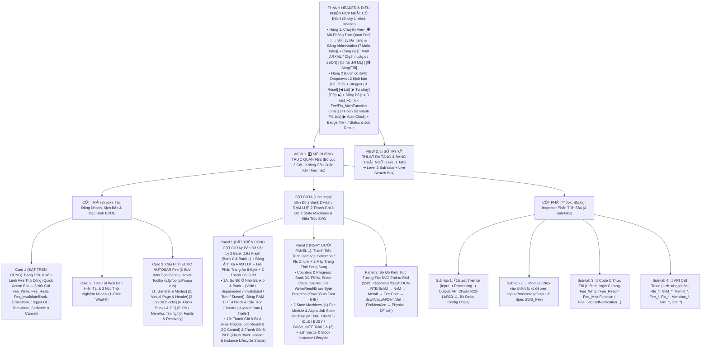
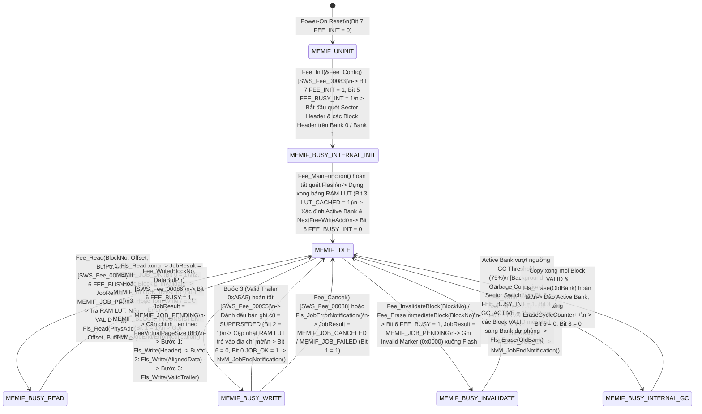
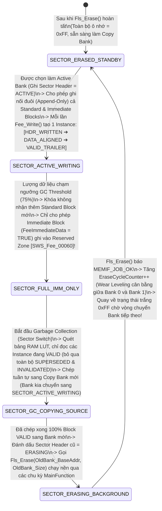

# Tài Liệu Thiết Kế Chi Tiết Trình Mô Phỏng AUTOSAR Fee (`Fee_Simulation_design.md`)

> **Trạng thái tài liệu:** Bản thiết kế chi tiết trình mô phỏng **AUTOSAR Fee (Flash EEPROM Emulation)** — Sẵn sàng để User review trước khi triển khai code.  
> **File đích dự kiến xuất bản:** `d:\__Personal\AntiGravity\Simulation\04_ECU_Abstraction\AUTOSAR_Fee.html` (Ứng dụng Web Tương tác 1 file HTML độc lập, 100% Offline, Pure CSS, có nút tải `.HTML` kèm cấu hình nhúng & xuất code `ARXML / Fee_Cfg.h / Fee_Lcfg.c / JSON`).  
> **Chuẩn tham chiếu:** **AUTOSAR Classic Platform R20-11 / R22-11 / R23-11 (`SWS_Fee`, `SWS_MemIf`, `SWS_NvM`, `SWS_Fls`, `SWS_MemAcc`, `SWS_BswM`, `SWS_EcuM`, `SWS_Dem`, `SWS_Det`, `SWS_SchM`)**, đính kèm mã requirement chuẩn **`SWS_Fee_xxxxx`** tại từng bước xử lý, Bản đồ Bộ nhớ 2 Bank Data Flash (`Bank 0` & `Bank 1`) kèm Giải phẫu Trang ảo (`FeeVirtualPageSize = 8B`) & Bảng ánh xạ `RAM LUT`, 2 thanh ghi 8-Bit tương tác, tooltip cấu hình và sổ tay tra cứu đa tầng.

---

## 1. Tổng Quan Định Hướng Thiết Kế (`A1` – `A4`)

| Hạng mục | Nội dung thiết kế chi tiết |
| :--- | :--- |
| **1. Bố cục giao diện & Ưu tiên Không Cuộn Trang — Zero-Scroll (`A1`)** | Kế thừa và tối ưu hóa từ **`AUTOSAR_DEM.html`**, **`AUTOSAR_WdgM.html`** và **`AUTOSAR_BswM.html`**, áp dụng triết lý **Above-the-Fold (Zero-Scroll)** để mọi thao tác đọc/ghi/xóa Block, bước chạy `Fee_MainFunction`, bản đồ vật lý 2 Bank Flash và 2 thanh ghi 8-bit luôn nằm ngay phần đầu mỗi cột trong khung nhìn (Viewport):<br>• **Thanh Điều Khiển Hợp Nhất Cố Định (Sticky Unified Header)**:<br>  - **Hàng 1**: Chuyển View `[🎛️ Mô Phỏng Trực Quan Fee]` \| `[📖 Sổ Tay Đa Tầng & Bảng Abbreviation (7 Main Tabs)]` + Công cụ `[🧾 Xuất ARXML / Fee_Cfg.h / Fee_Lcfg.c / JSON]` \| `[💾 Tải .HTML]` \| `[🌗 Sáng/Tối]`.<br>  - **Hàng 2 (Luôn cố định)**: Dropdown chọn 12 Kịch bản (`S1`–`S12`), Stepper (`↺ Reset`, `◀ Lùi`, `▶ Tự chạy`, `Tiếp ▶`), Đồng hồ chu kỳ (`t = 0 ms`, `+1 Tick Fee/Fls_MainFunction (5ms)`, `⚡ Hoàn tất nhanh Fls Job`, `▶ Auto Clock`) và Badge Trạng thái `MemIf Status`, `Job Result` & `Active Bank`.<br>• **Bố cục 3 cột hiện đại (Mỗi cột tự cuộn độc lập trong khung Viewport)**:<br>  - **Cột Trái (`375px`)**: Đưa **Card 1: Bảng Điều Khiển Lệnh Fee Thủ Công (`Quick Action Bar` — 8 nút gọi trực tiếp `Fee_Write`, `Fee_Read`, `Fee_InvalidateBlock`, `Fee_EraseImmediateBlock`, `Trigger GC`, `Torn-Write`, `Fee_SetMode`, `Fee_Cancel`)** và **Card 2: Tóm tắt kịch bản & 3 nút 1-Click What-If** lên trên cùng, tiếp theo là **Card 3: 6 Sub-tabs Cấu hình ECUC Fee** (hỗ trợ Floating Hover Tooltip `#cfgTooltipPopup` sau `>1s` giống hệt `AUTOSAR_DEM.html`).<br>  - **Cột Giữa (`Linh hoạt`)**: Đưa **Panel 1: Bản Đồ Vật Lý 2 Bank Data Flash (`Bank 0` & `Bank 1`) + Bảng Ánh Xạ `RAM LUT` + Giải Phẫu `FeeVirtualPageSize (8B)` + 2 Thanh Ghi 8-Bit Tương Tác** và **Panel 2: Thanh Tiến Trình `Garbage Collection / Fls Chunk` + 2 Máy Trạng Thái Song Song (`Fee Module & Job State Machine` & `Flash Sector & Block Lifecycle State Machine`)** lên ngay đầu cột giữa; bên dưới là **Panel 3: Sơ Đồ Kiến Trúc Tương Tác SVG End-to-End** (`SWC_Odometer / SWC_CrashSensor / DCM ↔ RTE/SchM ↔ NvM ↔ MemIf ↔ Fee Core ↔ BswM/EcuM/Dem/Det ↔ Fls / MemAcc ↔ Physical MCU Data Flash`).<br>  - **Cột Phải (`440px, Sticky`)**: Inspector 4 Sub-tabs (`🔍 Bước hiện tại`, `🧩 Module`, `📄 Code C Thực Thi`, `📜 API Call Trace`). |
| **2. Khu vực Giám sát Bit-level & Giải phẫu Bộ nhớ Flash 2 Tầng (`A2`)** | Đặt **cố định và nổi bật ở đầu Cột Giữa** gồm **2 tầng trực quan hóa**:<br>• **Tầng 1 — Bản Đồ Vật Lý 2 Bank Data Flash (`Bank 0: 0x0800_0000` & `Bank 1: 0x0800_1000`), Bảng `RAM Block Lookup Table (LUT)` & Giải Phẫu Khung Block (`Header + Padded Data + Valid Trailer`)**:<br>  - Hiển thị trực tiếp các ô nhớ vật lý trong `Bank 0` và `Bank 1` với mã màu trạng thái thời gian thực: 🟢 `VALID (Latest)`, ⚪ `SUPERSEDED (Old)`, 🟣 `INVALIDATED`, 🔴 `TORN / INCONSISTENT`, 🟨 `IMM_RESERVED`, ⬜ `ERASED (0xFF)`.<br>  - Hiển thị con trỏ `NextFreeWriteAddr`, ngưỡng kích hoạt thu gom rác `GC Threshold (75%)`, vùng dự trữ khẩn cấp `Immediate Reserved Zone`, số chu kỳ xóa `Sector Erase Counter`, và công thức căn chỉnh trang ảo: $\text{AlignedSize} = \lceil \text{RawSize} / \text{FeeVirtualPageSize} \rceil \times \text{FeeVirtualPageSize}$.<br>• **Tầng 2 — 2 Thanh ghi 8-Bit tương tác song song**:<br>  1. **Thanh A (`8-Bit Fee Module, Job Result & Bank/GC Control Byte` — `Fee_ModuleControlByte`)**: Theo dõi trạng thái module và kết quả công việc (`FEE_INIT`, `FEE_BUSY`, `FEE_BUSY_INT`, `FAST_MODE`, `GC_ACTIVE`, `IMM_PREEMPT`, `JOB_ERR_PEND`, `JOB_OK_DONE`).<br>  2. **Thanh B (`8-Bit Flash Block Header & Instance Lifecycle Status Byte` — `Fee_BlockHeaderStatusByte`)**: Theo dõi trạng thái vật lý trên Flash và cờ quản lý của Block đang chọn (`BLK_HDR_WRITTEN`, `BLK_DATA_ALIGNED`, `BLK_VALID_TRAILER`, `BLK_IMM_PRIO`, `BLK_LUT_CACHED`, `BLK_SUPERSEDED`, `BLK_INVALIDATED`, `BLK_INCONSISTENT`). Cho phép click trực tiếp vào từng bit để giải mã hoặc thử nghiệm! |
| **3. Hệ thống 12 Kịch bản mẫu (`A3`)** | Thiết kế sẵn **12 Kịch bản (`S1`–`S12`)** chia làm 4 nhóm lớn:<br>• **Nhóm 1 (`S1`–`S3`) — Khởi Tạo `Fee_Init()`, Ghi Nguyên Tử 3 Pha (`Fee_Write`) & Đọc Qua `RAM LUT` (`Fee_Read`)**: Quét 2 Bank Flash khi bật nguồn để dựng bảng `RAM LUT` (`MEMIF_BUSY_INTERNAL ➔ MEMIF_IDLE`); Ghi Block có căn chỉnh `FeeVirtualPageSize (8B)` theo quy trình 3 bước chống sập nguồn (`Header ➔ Padded Payload ➔ Valid Trailer 0xA5A5`); Đọc dữ liệu với `BlockOffset & Length` qua `RAM LUT` (`O(1)`).<br>• **Nhóm 2 (`S4`–`S6`) — Wear Leveling (`Append-Only`), Vô Hiệu Hóa (`Fee_InvalidateBlock`) & Khôi Phục Sập Nguồn (`Torn Write / MEMIF_BLOCK_INCONSISTENT`)**: Ghi đè nhiều lần (`v1 ➔ v2 ➔ v3`) không cần xóa Sector & quản lý `Dataset Block`; Đánh dấu vô hiệu hóa trả về `MEMIF_BLOCK_INVALID`; Giả lập sập nguồn giữa chừng khi đang ghi (`Torn Write`) ➔ phát hiện `MEMIF_BLOCK_INCONSISTENT` và tự động lùi về bản sao hợp lệ trước đó (`Fallback to v1`)!<br>• **Nhóm 3 (`S7`–`S9`) — Thu Gom Rác (`Garbage Collection / Sector Switch`), Dữ Liệu Khẩn Cấp (`FeeImmediateData`) & Điều Khiển `SetMode / Cancel`**: Chuyển Bank (`Bank 0 ➔ Bank 1`), chỉ chép sang Bank mới các bản ghi `VALID` mới nhất và gọi `Fls_Erase(Bank 0)` nền; Ghi Block khẩn cấp (`Airbag Crash Data`) vào vùng dự trữ `Reserved Immediate Space` hoặc `Fee_EraseImmediateBlock()` ngắt ngang GC (`SWS_Fee_00060`); Đổi tốc độ `MEMIF_MODE_SLOW ↔ MEMIF_MODE_FAST` và hủy lệnh `Fee_Cancel()`.<br>• **Nhóm 4 (`S10`–`S12`) — Luồng Toàn Trình (`SWC ↔ RTE ↔ NvM ↔ MemIf ↔ Fee ↔ Fls`), Kiến Trúc Mới R22-11/R23-11 (`MemAcc`) & Lỗi Phần Cứng / `DET`**: Luồng dọc từ `SWC_Odometer` qua `NvM_WriteBlock / NvM_WriteAll` xuống `Fls` và chuỗi Callback ngược lên; Đối chiếu `Fee ↔ Fls` truyền thống với `Fee ↔ MemAcc` (R22-11/R23-11) & xử lý `Fee_JobErrorNotification()`; Kiểm thử toàn bộ mã lỗi `DET` (`FEE_E_UNINIT`, `FEE_E_INVALID_BLOCK_NO`, `FEE_E_INVALID_BLOCK_OFS`, `FEE_E_INVALID_BLOCK_LEN`, `FEE_E_PARAM_POINTER`, `FEE_E_BUSY`, `FEE_E_INVALID_CANCEL`). |
| **4. Sổ tay tra cứu đa tầng & Bảng Abbreviation (`A4`)** | **View 2 (`📖 Sổ Tay Kỹ Thuật Fee & Từ Điển Thuật Ngữ`)** được tổ chức theo cấu trúc **Đa Tầng (Multi-level Tabs)**:<br>• **6 Main Sub-tabs (Level 1) × 4 Chủ đề con (Level 2 Pills/Tabs = 24 chuyên đề)** phân tích sâu kiến trúc Memory Stack (`NvM - MemIf - Fee - Fls/MemAcc`), vật lý bộ nhớ NOR Data Flash vs EEPROM, thuật toán Append-Only Wear Leveling & Atomic Header/Trailer, cơ chế Garbage Collection 2 Bank & Immediate Data Preemption, cùng bảng tra cứu API/ECUC.<br>• **Tab 7 chuyên biệt: `🔤 Bảng Thuật Ngữ & Từ Viết Tắt (Abbreviation Table)`** trình bày dưới dạng bảng chuẩn 4 cột (55+ thuật ngữ), tích hợp **Search Box tìm kiếm tức thời (Live Search + Highlight `<mark>`)** và 5 nút lọc nhanh theo phân nhóm (`Fee Core & Block Layout`, `Garbage Collection & Wear Leveling`, `Memory Stack (NvM/MemIf/Fls/MemAcc)`, `Data Flash Hardware & Errors`). |

---

## 2. Bố Cục Giao Diện 3 Cột Ưu Tiên Zero-Scroll & Hệ Thống Sub-Tabs (UI Wireframe)

Để đáp ứng triệt để yêu cầu **"đưa các khối được dùng thường xuyên hơn lên phía trên để người dùng không cần cuộn chuột lên xuống mỗi lần thao tác"**, giao diện được thiết kế theo nguyên lý **Viewport-First (Mọi nút bắn lệnh Đọc/Ghi/Vô hiệu hóa/GC, nút nhịp đồng hồ `Fee_MainFunction`, Bản đồ 2 Bank Flash, Bảng `RAM LUT`, 2 Thanh ghi 8-bit và 2 Máy trạng thái đều nằm ngay tầm mắt đầu trang)**:



### Điểm Cải Tiến Đột Phá Về Trải Nghiệm "Zero-Scroll" Cho Module `Fee`:
1. **Thanh Điều Khiển Hợp Nhất (`Sticky Unified Header`) Với Nút `+1 Tick Fee/Fls_MainFunction (5ms)` & `⚡ Hoàn Tất Nhanh Fls Job`**:
   - Trong `AUTOSAR Fee`, mọi thao tác đọc/ghi/xóa (`Fee_Read`, `Fee_Write`, `Fee_InvalidateBlock`, `Fee_EraseImmediateBlock`) đều là **Bất đồng bộ (Asynchronous)**: Hàm gọi ban đầu chỉ xếp hàng công việc (`MEMIF_BUSY` + `MEMIF_JOB_PENDING`) và trả về `E_OK` ngay lập tức; việc ghi Header, ghi Data, ghi Trailer hay xóa Sector diễn ra qua nhiều chu kỳ gọi **`Fee_MainFunction()`** và **`Fls_MainFunction()`**. Nhờ đặt cả nút `+1 Tick MainFunction (5ms)` (để soi từng pha nhỏ) và nút `⚡ Hoàn tất nhanh Fls Job` (để chạy hết chu trình `Header ➔ Data ➔ Trailer` trong 1 click) ngay trên thanh Header cố định, người dùng chủ động điều khiển tốc độ mô phỏng mà không cần cuộn trang!
2. **Đưa `Quick Action Bar` (8 nút tác động nhanh) lên vị trí Card 1 (Đầu Cột Trái)** và đưa **Bản Đồ Vật Lý 2 Bank Data Flash + Bảng `RAM LUT` + 2 Thanh Ghi 8-Bit** lên đầu Cột Giữa: Khi bấm `Fee_Write(Blk_Odometer)`, mắt người dùng nhìn thấy ngay lập tức một ô nhớ mới được cấp phát nối đuôi (`Append-Only`) tại `NextFreeWriteAddr` của `Bank 0`, ô nhớ cũ chuyển sang màu xám `SUPERSEDED (OLD)`, bảng `RAM LUT` cập nhật địa chỉ mới, và từng Bit trên Thanh A/B chuyển trạng thái trực quan.
3. **Gom 36 tham số ECUC vào 6 Sub-tabs gọn gàng**: Chiều cao Card Cấu hình được giữ gọn cố định (~275px), kèm hộp thoại giải thích nổi `#cfgTooltipPopup` khi hover quá `1000ms` giống hệt file `AUTOSAR_DEM.html`.

---

## 3. Thiết Kế Chi Tiết Panel 1 (Đầu Cột Giữa): Bản Đồ Vật Lý 2 Bank Data Flash (`Bank 0` & `Bank 1`), Bảng `RAM LUT`, Giải Phẫu `FeeVirtualPageSize` & 2 Thanh Ghi 8-Bit Tương Tác

Trong `AUTOSAR Fee`, bài toán cốt lõi là **làm sao giả lập một bộ nhớ EEPROM (cho phép ghi đè từng khối nhỏ bất kỳ lúc nào) trên nền phần cứng NOR Data Flash (vốn chỉ cho phép ghi trang `8B` từ `0xFF` và bắt buộc phải xóa cả Sector lớn `16KB..64KB` trước khi ghi lại)**. Để người dùng nhìn thấu suốt cơ chế này, Panel 1 ở đầu Cột Giữa được thiết kế gồm **2 phần trực quan hóa liên thông**:

### 3.1. Phần 1A — Bản Đồ Vật Lý 2 Bank Data Flash (`Bank 0` & `Bank 1`), Bảng Ánh Xạ `RAM LUT` & Giải Phẫu Khung Block (`8-Byte Virtual Page Grid`)

```text
+-------------------------------------------------------------------------------------------------------------------+
| 💾 BẢN ĐỒ VẬT LÝ DATA FLASH 2 BANK (WEAR LEVELING & GC) & BẢNG ÁNH XẠ RAM LUT (`SWS_Fee_00003`, `00049`, `00060`) |
| Mode: [MEMIF_MODE_FAST] | VirtualPage: [8 Bytes] | Active Bank: [BANK 0] | NextFreeAddr: [0x0800_0058] | GC: [OFF]|
+-------------------------------------------------------------------------------------------------------------------+
| 1. BẢN ĐỒ Ô NHỚ VẬT LÝ TRÊN 2 BANK DATA FLASH (Click vào từng Slot trên Flash để soi cấu trúc Byte & Bit):        |
|  • BANK 0 (Base: 0x0800_0000 | State: [🟢 ACTIVE_BANK] | Fill: [62% / GC@75%] | EraseCnt: [ 42 / 100,000 ]):       |
|    [HDR:ACTIVE] [⚪ Blk#1_v1: OLD (24B)] [🟢 Blk#2_DS0: VALID (32B)] [🟣 Blk#4_v1: INVALID (8B)]                   |
|    [🟢 Blk#1_v2: VALID (24B)] [⬜ FREE: 0xFF (NextWrite=0x0800_0058)] | [🟨 IMM_RESERVED_ZONE (75%..100%)]        |
|                                                                                                                   |
|  • BANK 1 (Base: 0x0800_1000 | State: [⬜ ERASED_STANDBY] | Fill: [ 0% ]        | EraseCnt: [ 41 / 100,000 ]):     |
|    [HDR:ERASED] [⬜ 0xFF Blank] [⬜ 0xFF Blank] [⬜ 0xFF Blank] [⬜ 0xFF Blank] [⬜ 0xFF Blank] [⬜ 0xFF Blank]     |
+-------------------------------------------------------------------------------------------------------------------+
| 2. BẢNG ÁNH XẠ ĐỊA CHỈ TRONG RAM (`Fee_BlockLutCache` — Click để chọn Logical Block đang thao tác):               |
|  +------------------------+-------------+---------------+----------------+------------------+-------------------+ |
|  | Logical Block (Name)   | BlockNumber | Raw ➔ Aligned | Loại Block     | Địa chỉ Flash LUT| Trạng thái Instance| |
|  +------------------------+-------------+---------------+----------------+------------------+-------------------+ |
|  | ▶ Blk#1: Odometer      | 0x0010 (16) | 14B ➔ 16B (2P)| Standard       | 0x0800_0040 (B0) | 🟢 VALID (v2)     | |
|  |   Blk#2: EngCalib_DS0  | 0x0020 (32) | 24B ➔ 24B (3P)| Dataset (DS=0) | 0x0800_0018 (B0) | 🟢 VALID (v1)     | |
|  |   Blk#3: CrashEvt_Imm  | 0x0030 (48) |  8B ➔  8B (1P)| 🚨 IMMEDIATE   | UNWRITTEN (0xFF) | ⬜ BLANK (0xFF)   | |
|  |   Blk#4: DiagVinCode   | 0x0040 (64) | 17B ➔ 24B (3P)| Standard       | 0x0800_0038 (B0) | 🟣 INVALIDATED    | |
|  +------------------------+-------------+---------------+----------------+------------------+-------------------+ |
| 3. GIẢI PHẪU KHUNG VẬT LÝ CỦA BLOCK ĐANG CHỌN (`Blk#1: Odometer v2` @ `0x0800_0040` — Tổng `24 Bytes = 3 Pages`): |
|    [ Page 0 (8B): HEADER (BlkNo=0x0010 | Len=14B | Cyc=2 | Crc=0x9A | Stat=0xA5) ]                                |
|    [ Page 1 (8B): PAYLOAD_0 (D0..D7: 00 12 4F 80 01 A0 00 55) ]                                                   |
|    [ Page 2 (8B): PAYLOAD_1 (D8..D13: 11 22 33 44 55 66) + PADDING (FF FF) + TRAILER (0xA5A5 = VALID!) ]          |
+-------------------------------------------------------------------------------------------------------------------+
```

- **Tính năng tương tác trực tiếp trên Phần 1A**:
  - Người dùng có thể **click chọn bất kỳ ô nhớ (`Slot`) nào trên `Bank 0` hoặc `Bank 1`** (hoặc chọn 1 trong 4 dòng trong bảng `RAM LUT`) để soi giải phẫu chi tiết từng Trang ảo (`Page 0: Header`, `Page 1..N: Data Payload + 0xFF Padding`, `Trailer: Validation Marker`) và xem trạng thái 8-bit của bản ghi đó trên Thanh B.
  - Khi người dùng bấm `Fee_Write(Blk#1_Odometer)` nhiều lần liên tiếp, bản đồ `Bank 0` sẽ hiển thị trực quan các khối `[⚪ Blk#1_v1: OLD]`, `[⚪ Blk#1_v2: OLD]`, `[🟢 Blk#1_v3: VALID]` xếp nối đuôi nhau từ trái sang phải cho tới khi chạm vạch `GC@75%` ➔ kích hoạt **Garbage Collection** gom riêng các khối `🟢 VALID` sang `Bank 1` và xóa sạch `Bank 0`!

### 3.2. Phần 1B — 2 Thanh Ghi 8-Bit Trạng Thái Tương Tác Luôn Hiển Thị Nổi Bật

Ngay bên dưới Phần 1A là **2 Thanh ghi 8-Bit tương tác** theo đúng phong cách chuẩn của `AUTOSAR_DEM.html`, `AUTOSAR_WdgM.html` và `AUTOSAR_BswM.html`:

```text
+-------------------------------------------------------------------------------------------------------------------+
| 🔢 BẢNG GIÁM SÁT BITFIELD 8-BIT FEE MODULE & FLASH BLOCK HEADER (LIVE 8-BIT INSPECTOR) [Click vào từng Bit để thử]|
| Bước #5: Fee_MainFunction() hoàn tất ghi Trailer (0xA5A5) cho Blk#1_v2 ➔ Báo Fee_JobEndNotification() |A:0x91|B:0xE8|
+-------------------------------------------------------------------------------------------------------------------+
| A. THANH GHI 8-BIT TRẠNG THÁI MODULE FEE, JOB & BANK/GC (`Fee_ModuleControlByte`) — Hex: [ 0x91 ] Bin: [1001 0001]|
|    MemIf_Status: [ MEMIF_IDLE (0x01) ] | MemIf_JobResult: [ MEMIF_JOB_OK (0x00) ] | Mode: [ MEMIF_MODE_FAST ]     |
|  +-------------+ +-------------+ +-------------+ +-------------+ +-------------+ +-------------+ +-------+ +-----+|
|  | Bit 7 (0x80)| | Bit 6 (0x40)| | Bit 5 (0x20)| | Bit 4 (0x10)| | Bit 3 (0x08)| | Bit 2 (0x04)| |Bit1(2)| |Bit 0||
|  | FEE_INIT    | | FEE_BUSY    | | FEE_BUSY_INT| | FAST_MODE   | | GC_ACTIVE   | | IMM_PREEMPT | |JOB_ERR| |JOBOK||
|  |      1      | |      0      | |      0      | |      1      | |      0      | |      0      | |   0   | |  1  ||
|  | Initialized | | Idle State  | | No Int Op   | | Fast=64B/tk | | GC Standby  | | Normal Prio | |No Err | |OK=1 ||
|  +-------------+ +-------------+ +-------------+ +-------------+ +-------------+ +-------------+ +-------+ +-----+|
+-------------------------------------------------------------------------------------------------------------------+
| B. THANH GHI 8-BIT HEADER VẬT LÝ & VÒNG ĐỜI BẢN GHI FLASH (`Fee_BlockHeaderStatusByte`) — Hex:[0xE8] Bin:[11101000]|
|    Block đang chọn: [ Blk#1: Odometer (0x0010) - Instance v2 @ 0x0800_0040 ] | Instance State: [ VALID_LATEST ]   |
|  +-------------+ +-------------+ +-------------+ +-------------+ +-------------+ +-------------+ +-------+ +-----+|
|  | Bit 7 (0x80)| | Bit 6 (0x40)| | Bit 5 (0x20)| | Bit 4 (0x10)| | Bit 3 (0x08)| | Bit 2 (0x04)| |Bit1(2)| |Bit 0||
|  | HDR_WRITTEN | | DATA_ALIGNED| | VALID_TRAILR| | IMM_BLOCK   | | LUT_CACHED  | | SUPERSEDED  | |INVALID| |INCON||
|  |      1      | |      1      | |      1      | |      0      | |      1      | |      0      | |   0   | |  0  ||
|  | Step1: HdrOK| | Step2:PadOK | | Step3:Valid!| | StandardBlk | | In RAM LUT  | | Latest Inst | |Not Inv| |Cons!||
|  +-------------+ +-------------+ +-------------+ +-------------+ +-------------+ +-------------+ +-------+ +-----+|
+-------------------------------------------------------------------------------------------------------------------+
```

#### 3.2.1. Giải Mã Chi Tiết Thanh A: `8-Bit Fee Module, Job Result & Bank/GC Control Byte` (`Fee_ModuleControlByte`)

> **Ánh xạ chuẩn AUTOSAR (`SWS_MemIf_00015`, `SWS_MemIf_00016`, `SWS_Fee_00092`, `SWS_Fee_00093`)**:
> - Tổ hợp **`Bit 7, Bit 6, Bit 5`** phản ánh trực tiếp 4 trạng thái chuẩn của kiểu **`MemIf_StatusType`** trả về bởi `Fee_GetStatus()`:
>   - `Bit 7 = 0` ➔ **`MEMIF_UNINIT (0x00)`** (Chưa khởi tạo `Fee_Init`).
>   - `Bit 7 = 1, Bit 6 = 0, Bit 5 = 0` ➔ **`MEMIF_IDLE (0x01)`** (Đã khởi tạo, sẵn sàng nhận lệnh mới).
>   - `Bit 7 = 1, Bit 6 = 1, Bit 5 = 0` ➔ **`MEMIF_BUSY (0x02)`** (Đang thực thi lệnh `Read / Write / Invalidate / EraseImmediate` từ `NvM/MemIf`).
>   - `Bit 7 = 1, Bit 6 = 0, Bit 5 = 1` ➔ **`MEMIF_BUSY_INTERNAL (0x03)`** (Đang bận xử lý nội bộ: Quét Sector dựng `RAM LUT` sau `Fee_Init` hoặc đang chạy **Garbage Collection / Sector Switch** nền!).

| Bit | Mask | Tên Cờ (`Fee Module Bit`) | Ý nghĩa kỹ thuật & Khi nào bật lên `1` (`0 ➔ 1`) | Khi nào hạ về `0` (`1 ➔ 0`) |
| :-: | :-: | :--- | :--- | :--- |
| **Bit 7** | `0x80` | **`FEE_INIT`** | Bật lên `1` sau khi `Fee_Init(ConfigPtr)` (`SWS_Fee_00083`) được gọi và hoàn tất khởi tạo máy trạng thái nội bộ của module `Fee`. | Hạ về `0` trước khi gọi `Fee_Init()` hoặc khi người dùng tắt Checkbox `FeeInitialized` để kiểm thử báo lỗi `Det_ReportError(FEE_E_UNINIT = 0x01)`. |
| **Bit 6** | `0x40` | **`FEE_BUSY`**<br>*(`MEMIF_BUSY`)* | Bật lên `1` ngay khi `Fee` chấp nhận một yêu cầu công việc từ `MemIf / NvM` (`Fee_Read`, `Fee_Write`, `Fee_InvalidateBlock`, `Fee_EraseImmediateBlock`), đồng thời đặt `JobResult = MEMIF_JOB_PENDING` (`SWS_Fee_00022`). Khi bit này đang bằng `1`, mọi yêu cầu Job mới đều bị từ chối với lỗi `FEE_E_BUSY (0x06)`! | Hạ về `0` (trở về `MEMIF_IDLE`) ngay khi `Fls` hoàn tất công việc (`Fee_JobEndNotification` hoặc `Fee_JobErrorNotification`) hoặc khi người dùng gọi `Fee_Cancel()`! |
| **Bit 5** | `0x20` | **`FEE_BUSY_INT`**<br>*(`MEMIF_BUSY_INTERNAL`)* | Bật lên `1` khi `Fee` đang thực hiện tác vụ quản lý Flash nội bộ không do `NvM` trực tiếp gọi (`SWS_Fee_00015`):<br>1. Quét Header toàn bộ Sector lúc mới khởi động (`Startup Scan`) để dựng bảng `RAM LUT`.<br>2. Hoặc đang thực hiện **Garbage Collection (Sector Copy & Erase)** khi Bank đầy! | Hạ về `0` khi quá trình quét khởi tạo hoặc quá trình thu gom rác (kèm xóa Sector cũ) hoàn tất, trả module về trạng thái rảnh `MEMIF_IDLE`. |
| **Bit 4** | `0x10` | **`FAST_MODE`**<br>*(`MEMIF_MODE_FAST`)* | Bật lên `1` khi `BswM / NvM` gọi **`Fee_SetMode(MEMIF_MODE_FAST)`** (`SWS_Fee_00084`, thường dùng trong pha `NvM_ReadAll` lúc khởi động hoặc `NvM_WriteAll` lúc tắt máy): `Fee` chuyển `Fls` sang chế độ xử lý khối lượng byte lớn mỗi chu kỳ (ví dụ `64 Bytes / MainFunction`). | Hạ về `0` khi ở chế độ mặc định **`MEMIF_MODE_SLOW`** (trong lúc xe đang chạy `RUN`), giới hạn mỗi chu kỳ `MainFunction` chỉ đọc/ghi `8 Bytes` để không chiếm dụng băng thông Bus/CPU của các tác vụ thời gian thực. |
| **Bit 3** | `0x08` | **`GC_ACTIVE`** | Bật lên `1` khi lượng dữ liệu ghi trong `Active Bank` vượt ngưỡng **`FeeGcTriggerThresholdPct` (75%)** hoặc khi người dùng bấm nút `Trigger Garbage Collection`: `Fee` kích hoạt quy trình **Sector Switch** (sao chép các Block `VALID` sang Bank dự phòng rồi gọi `Fls_Erase()` xóa Bank cũ). | Hạ về `0` sau khi toàn bộ các Block `VALID` đã được dời sang Bank mới và lệnh `Fls_Erase()` trên Bank cũ báo hoàn tất (`SECTOR_ERASED_READY`). |
| **Bit 2** | `0x04` | **`IMM_PREEMPT`** | Bật lên `1` khi `Fee` xử lý một Block có cấu hình **`FeeImmediateData = TRUE`** (ví dụ `Blk#3: CrashEvt_Imm`): Cho phép ghi thẳng vào vùng **`Reserved Immediate Zone` (75%..100%)** ngay cả khi Bank đã đầy đối với Standard Block, hoặc tạm dừng/ưu tiên trước tiến trình Garbage Collection (`SWS_Fee_00060`)! | Hạ về `0` sau khi yêu cầu ghi/xóa của Immediate Block được hoàn tất hoặc khi đang xử lý Standard Block thông thường. |
| **Bit 1** | `0x02` | **`JOB_ERR_PEND`** | Bật lên `1` khi công việc kết thúc với trạng thái khác `OK`:<br>• `MEMIF_JOB_FAILED` (lỗi phần cứng `Fls_Write / Fls_Erase`).<br>• `MEMIF_BLOCK_INCONSISTENT` (phát hiện bản ghi bị sập nguồn giữa chừng `Torn Write`, sai CRC/ECC hoặc chưa từng được ghi).<br>• `MEMIF_BLOCK_INVALID` (đọc trúng Block đã bị gọi `Fee_InvalidateBlock`) hoặc `MEMIF_JOB_CANCELED`. | Hạ về `0` khi bắt đầu một công việc mới hoặc khi công việc hoàn tất thành công (`Bit 0 JOB_OK_DONE = 1`). |
| **Bit 0** | `0x01` | **`JOB_OK_DONE`**<br>*(`MEMIF_JOB_OK`)* | Bật lên `1` ngay khi công việc hiện tại (`Read`, `Write`, `Invalidate`, `EraseImmediate`) hoàn tất trọn vẹn với kết quả **`MEMIF_JOB_OK`** (`SWS_Fee_00055`) và `Fee` phát callback **`NvM_JobEndNotification()`** báo lên tầng `NvM`. | Hạ về `0` ngay khi `Fee` nhận yêu cầu công việc tiếp theo (chuyển sang `MEMIF_JOB_PENDING`) hoặc khi xảy ra lỗi (`Bit 1 = 1`). |

#### 3.2.2. Giải Mã Chi Tiết Thanh B: `8-Bit Physical Flash Block Header & Instance Lifecycle Status Byte` (`Fee_BlockHeaderStatusByte`)

> **Ý nghĩa cốt lõi trong thiết kế `Fee`**: Trên bộ nhớ Flash vật lý, một bản ghi Block không xuất hiện tức thời trong 1 chu kỳ xung nhịp, mà phải trải qua **3 pha ghi tuần tự (`Header ➔ Aligned Payload ➔ Valid Trailer`)**, sau đó có thể bị **Ghi đè bởi bản mới (`Superseded`)** hoặc bị **Vô hiệu hóa (`Invalidated`)**. Thanh B giúp người dùng quan sát tường tận từng pha vật lý này:

| Bit | Mask | Tên Cờ (`Block Instance Bit`) | Ý nghĩa kỹ thuật & Khi nào bật lên `1` (`0 ➔ 1`) | Khi nào hạ về `0` (`1 ➔ 0`) |
| :-: | :-: | :--- | :--- | :--- |
| **Bit 7** | `0x80` | **`BLK_HDR_WRITTEN`**<br>*(Pha 1: Ghi Header)* | Bật lên `1` khi `Fee_MainFunction()` hoàn tất **Bước 1 của quy trình `Fee_Write`**: Ghi xong `Block Header` (`BlockNumber`, `BlockSize`, `WriteCycleCount`, `HeaderCRC`, `StartMarker = 0x5A`) xuống trang ảo đầu tiên (`Page 0`) tại `NextFreeWriteAddr` qua `Fls_Write()`. | Bằng `0` khi ô nhớ Flash đang ở trạng thái trắng sau khi xóa (`0xFF — Blank/Erased`) hoặc khi chỉ mới thực hiện `Fee_EraseImmediateBlock()`. |
| **Bit 6** | `0x40` | **`BLK_DATA_ALIGNED`**<br>*(Pha 2: Căn chỉnh & Ghi Data)* | Bật lên `1` khi `Fee_MainFunction()` hoàn tất **Bước 2 của quy trình `Fee_Write`**: Đệm thêm các byte `0xFF` vào cuối dữ liệu thô để tổng kích thước chia hết cho **`FeeVirtualPageSize` (8 Bytes)** và ghi toàn bộ các trang Payload xuống Data Flash qua `Fls_Write()`. | Hạ về `0` nếu quá trình ghi Payload bị ngắt ngang bởi `Fee_Cancel()`, lỗi phần cứng `Fls`, hoặc sập nguồn trước khi ghi xong dữ liệu. |
| **Bit 5** | `0x20` | **`BLK_VALID_TRAILER`**<br>*(Pha 3: Chốt Trailer Hợp lệ)* | Bật lên `1` khi `Fee_MainFunction()` hoàn tất **Bước 3 (Bước cuối cùng) của `Fee_Write`**: Ghi dấu xác nhận **`Validation Trailer = 0xA5A5`** vào cuối bản ghi! Chỉ khi cả **`Bit 7 = 1, Bit 6 = 1, Bit 5 = 1`**, bản ghi này mới được công nhận là **Hợp lệ & Toàn vẹn (`VALID`)**! | Nếu bị sập nguồn (`Torn Write`) khi `Bit 7 = 1` nhưng **`Bit 5 == 0`**, thì ở lần khởi động tiếp theo `Fee_Init()` sẽ phát hiện ngay đây là bản ghi **Ghi dở dang (`Bit 0 BLK_INCONSISTENT = 1`)** và loại bỏ nó! |
| **Bit 4** | `0x10` | **`BLK_IMM_PRIO`**<br>*(`FeeImmediateData`)* | Bật lên `1` nếu Logical Block đang chọn có cấu hình **`FeeImmediateData = TRUE`** (`ECUC_Fee_00151`, ví dụ `Blk#3: CrashEvt_Imm`), cho phép sử dụng dịch vụ `Fee_EraseImmediateBlock()` và quyền ưu tiên ghi vào vùng dự trữ cuối Bank Flash. | Bằng `0` đối với các Block dữ liệu thông thường (`Standard / Non-Immediate Block` như `Odometer`, `Calibration`, `VIN`). |
| **Bit 3** | `0x08` | **`BLK_LUT_CACHED`**<br>*(Có trong RAM LUT)* | Bật lên `1` khi địa chỉ vật lý của bản ghi `VALID` mới nhất của Block này đã được nạp vào **Bảng ánh xạ nhanh trên RAM (`Fee_BlockLutCache[BlockIdx]`)** (nhờ `Fee_Init()` quét xong hoặc vừa `Fee_Write()` xong), giúp lệnh `Fee_Read()` nhảy thẳng tới địa chỉ đọc với độ phức tạp $O(1)$! | Hạ về `0` khi chưa chạy `Fee_Init()`, khi tắt tính năng `FeeEnableRamLutCache = FALSE` (buộc phải quét tuần tự Header trên Flash), hoặc khi Block chưa từng được ghi lên Flash. |
| **Bit 2** | `0x04` | **`BLK_SUPERSEDED`**<br>*(Bản ghi cũ / Lỗi thời)* | Bật lên `1` trên bản ghi cũ (`v1`) ngay tại khoảnh khắc một bản ghi mới hơn (`v2`) của cùng `BlockNumber` hoàn tất Bước 3 (`Bit 5 VALID_TRAILER = 1`) ở địa chỉ cao hơn! Bản ghi có `Bit 2 = 1` trở thành **Rác (Dead / Obsolete Space)** và sẽ bị **bỏ qua (Skip)** khi chạy Garbage Collection! | Bằng `0` trên bản ghi mới nhất (`Latest Instance`) đang được trỏ bởi `RAM LUT`. Khi Sector chứa bản ghi `SUPERSEDED` bị xóa bởi `Fls_Erase()`, toàn bộ ô nhớ quay về `0x00` (Blank `0xFF`). |
| **Bit 1** | `0x02` | **`BLK_INVALIDATED`**<br>*(`MEMIF_BLOCK_INVALID`)* | Bật lên `1` khi tầng trên gọi **`Fee_InvalidateBlock(BlockNumber)`** (`SWS_Fee_00087`): `Fee` ghi mẫu đánh dấu `INVALIDATED_MARKER (0x0000)` lên Flash và cập nhật `RAM LUT`. Nếu sau đó `NvM` gọi `Fee_Read()` vào Block này, `Fee` sẽ trả về ngay **`MEMIF_BLOCK_INVALID`** (`SWS_Fee_00024`)! | Hạ về `0` ngay khi ứng dụng gọi `Fee_Write(BlockNumber, NewData)` để ghi một bản sao mới hợp lệ (`v_new`) cho Block đó! |
| **Bit 0** | `0x01` | **`BLK_INCONSISTENT`**<br>*(`MEMIF_BLOCK_INCONSISTENT`)* | Bật lên `1` khi bản ghi bị hỏng tính toàn vẹn:<br>1. Bị sập nguồn giữa chừng khi đang ghi (`Torn Write`: có `Bit 7 HDR_WRITTEN = 1` nhưng thiếu `Bit 5 VALID_TRAILER = 0`).<br>2. Hoặc lỗi bit phần cứng Flash (`ECC / Header CRC Mismatch`), hoặc Block chưa từng được ghi lần nào trên Flash trắng (`0xFF`). Khi đọc Block này (mà không có bản sao cũ hợp lệ để fallback), `Fee` trả về **`MEMIF_BLOCK_INCONSISTENT`** (`SWS_Fee_00023`)! | Hạ về `0` khi `Fee` tự động khôi phục (Fallback) về bản sao `VALID` trước đó (`v1`), hoặc khi `NvM` ghi đè lại một bản ghi mới hoàn chỉnh bằng `Fee_Write()`. |

---

## 4. Phân Tích Xử Lý Từng Module: Input Lấy Từ Đâu, Xử Lý Gì, Output Route Đến Đâu

Mọi khối trên sơ đồ kiến trúc SVG đều có thể **click vào để xem giải thích chi tiết** ở cột phải (Tab `🧩 Module`) và được tổng hợp đầy đủ trong **Tab 1 của Sổ tay**:

| # | Module / Phân khối | Lớp AUTOSAR | 📥 Input lấy từ đâu? | ⚙️ Cách xử lý nội bộ (Processing, State & Timers) | 📤 Output route đến đâu & Hàm API chuẩn (R20-11 / R22-11 / R23-11) |
| :-: | :--- | :--- | :--- | :--- | :--- |
| **1** | **`SWC_Odometer`, `SWC_Calib` & `SWC_CrashSensor`**<br>*(Application SWCs)* | Application Layer | • Tín hiệu tốc độ xe, thông số hiệu chuẩn động cơ, hoặc xung va chạm túi khí (`Airbag Crash Trigger`).<br>• Nhận thông báo hoàn tất đọc/ghi (`SingleBlockCallback`) từ `NvM` qua `RTE`. | • **Quy tắc kiến trúc quan trọng**: Các `SWC` trên tầng Application **KHÔNG BAO GIỜ gọi trực tiếp `Fee`**! Thay vào đó, `SWC` cập nhật dữ liệu trên `RAM Block` cục bộ rồi gọi cổng dịch vụ `NvMService` qua `RTE`:<br>  - `SWC_Odometer`: Gọi `WriteBlock` định kỳ hoặc đánh dấu `SetRamBlockStatus(TRUE)` để lưu khi tắt máy (`NvM_WriteAll`).<br>  - `SWC_Calib`: Chọn chỉ số tập dữ liệu `SetDataIndex(0/1)` rồi gọi `ReadBlock` / `WriteBlock`.<br>  - `SWC_CrashSensor`: Khi xảy ra va chạm, gọi `WriteBlock` cho khối khẩn cấp (`Immediate Block`) để `NvM ➔ MemIf ➔ Fee` ghi tức khắc vào vùng dự trữ Flash! | • Gọi qua **RTE** xuống **NvM**:<br>`Rte_Call_NvMService_Odometer_WriteBlock(SrcPtr)`<br>`Rte_Call_NvMService_Odometer_ReadBlock(DstPtr)`<br>`Rte_Call_NvMService_Calib_SetDataIndex(DataIndex)`<br>`Rte_Call_NvMService_Vin_InvalidateNvBlock()`<br>`Rte_Call_NvMService_Crash_EraseNvBlock()` |
| **2** | **`RTE` & `SchM`**<br>*(Runtime Environment & BSW Scheduler)* | RTE Layer | • Lời gọi cổng `NvMService` từ các `SWC`.<br>• Nhịp đồng hồ hệ thống từ `AUTOSAR OS` (`Task_Bsw_Mem_5ms`). | • **RTE**: Ánh xạ `Port-Defined Argument Value` (`NvM_BlockIdType`) từ `SWC` xuống hàm C của `NvM`, và chuyển tiếp callback `NvM_SingleBlockCallbackFunction` ngược lên `SWC`.<br>• **SchM**: Gọi định kỳ bộ 3 hàm xử lý nền của Memory Stack theo đúng thứ tự:<br>  1. **`NvM_MainFunction()`**<br>  2. **`Fee_MainFunction()`** [`SWS_Fee_00097`]<br>  3. **`Fls_MainFunction()`** (hoặc `MemAcc_MainFunction()` + `Mem_30_Fls_MainFunction()`).<br>  Đồng thời bảo vệ vùng găng `SchM_Enter_Fee_FEE_EXCLUSIVE_AREA_0()`. | • Gọi định kỳ xuống Memory Stack:<br>`NvM_MainFunction(void)`<br>`Fee_MainFunction(void)` [`SWS_Fee_00097`]<br>`Fls_MainFunction(void)` |
| **3** | **`NvM`**<br>*(NVRAM Manager)* | Memory Services (Services Layer) | • Yêu cầu đọc/ghi từng Block từ `SWC / RTE`, `DEM` (lưu DTC/FreezeFrame), `DCM` (`UDS 0x2E WriteDataByIdentifier`).<br>• Lệnh đọc/ghi toàn cục `NvM_ReadAll()` / `NvM_WriteAll()` từ `EcuM / BswM`.<br>• Nhận callback `NvM_JobEndNotification()` / `NvM_JobErrorNotification()` từ `Fee`. | • Quản lý mức logic cao của dữ liệu bền vững (`RAM Mirror`, `ROM Default`, tính/kiểm tra `Block CRC16/CRC32`, quản lý hàng đợi ưu tiên `Immediate Queue` vs `Standard Queue`).<br>• Khi đến lượt thực thi một Block xuống phần cứng, `NvM` ghép **`BlockNumber = (FeeBlockNumber << DatasetBits) | DatasetIndex`**, sau đó gọi xuống **`MemIf`** kèm `DeviceIndex = 0` (ánh xạ tới `Fee`).<br>• Nếu `Fee` trả về **`MEMIF_BLOCK_INCONSISTENT`** hoặc **`MEMIF_BLOCK_INVALID`** trong lúc `NvM_ReadAll()`, `NvM` sẽ tự động nạp dữ liệu mặc định từ `ROM Default Block` và báo trạng thái `NVM_REQ_INTEGRITY_FAILED` / `NVM_REQ_NV_INVALIDATED`! | • Gọi xuống **MemIf**:<br>`MemIf_Read(DeviceIndex, BlockNumber, BlockOffset, DataBufferPtr, Length)`<br>`MemIf_Write(DeviceIndex, BlockNumber, DataBufferPtr)`<br>`MemIf_InvalidateBlock(DeviceIndex, BlockNumber)`<br>`MemIf_EraseImmediateBlock(DeviceIndex, BlockNumber)`<br>`MemIf_Cancel(DeviceIndex)`<br>`MemIf_SetMode(Mode)` |
| **4** | **`MemIf`**<br>*(Memory Abstraction Interface)* | ECU Abstraction Layer | • Nhận các lệnh đọc/ghi/xóa/kiểm tra trạng thái từ `NvM` kèm tham số `DeviceIndex`. | • **Bộ định tuyến trừu tượng hóa bộ nhớ (`SWS_MemIf_00019`)**: Giúp `NvM` giao tiếp đồng nhất với cả **Data Flash (`Fee`)** lẫn **EEPROM (`Ea`)**:<br>  - Nếu chỉ cấu hình 1 thiết bị (`MemIfNumberOfDevices == 1`), `MemIf` dùng **Macro ánh xạ trực tiếp 1-1** sang `Fee_*` (Zero runtime overhead!).<br>  - Nếu cấu hình cả `Fee` (`DeviceIndex = 0`) và `Ea` (`DeviceIndex = 1`), `MemIf` tra bảng con trỏ hàm theo `DeviceIndex` để gọi xuống `Fee_*` hoặc `Ea_*`.<br>  - Với `MemIf_GetStatus(MEMIF_BROADCAST_ID)`, `MemIf` tổng hợp trạng thái của toàn bộ các module bên dưới! | • Định tuyến trực tiếp sang **Fee** (`DeviceIndex = 0`):<br>`Fee_Read(BlockNumber, BlockOffset, DataBufferPtr, Length)`<br>`Fee_Write(BlockNumber, DataBufferPtr)`<br>`Fee_InvalidateBlock(BlockNumber)`<br>`Fee_EraseImmediateBlock(BlockNumber)`<br>`Fee_GetStatus()` / `Fee_GetJobResult()` |
| **5** | **`Fee Core Engine`**<br>*(Flash EEPROM Emulation — ModuleId = 21)* | ECU Abstraction Layer | • Lệnh từ `MemIf / NvM`: `Fee_Read`, `Fee_Write`, `Fee_InvalidateBlock`, `Fee_EraseImmediateBlock`, `Fee_Cancel`, `Fee_SetMode`.<br>• Lệnh khởi tạo `Fee_Init(ConfigPtr)` từ `EcuM / BswM`.<br>• Xung nhịp `Fee_MainFunction()` từ `SchM`.<br>• Callback `Fee_JobEndNotification()` & `Fee_JobErrorNotification()` từ `Fls / MemAcc`. | • **1. Ánh xạ Địa chỉ Logic sang Địa chỉ Vật lý (`Logical-to-Physical Translation`)**: Tra cứu `BlockNumber` trong bảng **`RAM Block Lookup Table (LUT)`** để tìm địa chỉ Flash của bản sao `VALID` mới nhất.<br>• **2. Căn chỉnh Trang Ảo (`Virtual Page Alignment`)**: Mọi thao tác ghi đều được căn chỉnh theo bội số của `FeeVirtualPageSize` (ví dụ `8 Bytes`).<br>• **3. Ghi Nguyên Tử 3 Pha (`Append-Only Atomic Write`)**: Ghi nối đuôi tại `NextFreeWriteAddr` theo 3 bước: `Bước 1: Block Header` ➔ `Bước 2: Padded Payload` ➔ `Bước 3: Valid Trailer (0xA5A5)`, đánh dấu bản ghi cũ là `SUPERSEDED` và cập nhật `RAM LUT`.<br>• **4. Bảo vệ Dữ liệu Khẩn cấp (`FeeImmediateData`)**: Giữ lại vùng trống dự trữ cuối Bank cho các Block `Immediate` (`SWS_Fee_00060`).<br>• **5. Thu gom rác (`Garbage Collection / Sector Switch`)**: Khi `Active Bank` chạm ngưỡng đầy, tự động chép các Block `VALID` mới nhất sang `Copy Bank`, chuyển quyền Active và gọi `Fls_Erase()` xóa Bank cũ! | • Gọi xuống **Fls** (hoặc **MemAcc** trong R22-11/R23-11):<br>`Fls_Read(SourceAddress, TargetAddressPtr, Length)`<br>`Fls_Write(TargetAddress, SourceAddressPtr, Length)`<br>`Fls_Erase(TargetAddress, Length)`<br>`Fls_Compare()` / `Fls_Cancel()` / `Fls_SetMode()`<br>• Gọi ngược lên **NvM**:<br>`NvM_JobEndNotification()` [`SWS_Fee_00055`]<br>`NvM_JobErrorNotification()` [`SWS_Fee_00056`] |
| **6** | **`Fls` (MCAL Flash Driver) & `MemAcc` (R22-11/R23-11)** | MCAL / Memory Services | • Nhận yêu cầu đọc/ghi/xóa theo địa chỉ vật lý (`Fls_AddressType`, `Fls_LengthType`) từ `Fee`.<br>• Xung nhịp `Fls_MainFunction()` từ `SchM` và ngắt phần cứng từ bộ điều khiển Flash MCU. | • **`Fls` (Classic MCAL)**: Chia nhỏ yêu cầu đọc/ghi thành từng cụm byte (`FlsMaxReadNormalMode / FastMode`, `FlsMaxWriteNormalMode / FastMode`) trong mỗi chu kỳ `Fls_MainFunction()`, phát lệnh xuống thanh ghi Flash Controller, kiểm tra `BlankCheck / Verify / ECC` và gọi callback `Fee_JobEndNotification()` khi xong.<br>• **`MemAcc` (Cải tiến mới từ AUTOSAR R21-11 / R22-11 / R23-11)**: Đóng vai trò bộ điều phối truy cập bộ nhớ đồng nhất nằm giữa `Fee` và `Mem_30_Fls`, giúp phân xử truy cập đa phân vùng (Multi-core/Multi-partition) trước khi chạm tới phần cứng Flash! | • Báo kết quả ngược lên **Fee** (`Fee_Cbk.h`):<br>`Fee_JobEndNotification(void)` [`SWS_Fee_00095`]<br>`Fee_JobErrorNotification(void)` [`SWS_Fee_00096`]<br>• Hoặc trả trạng thái qua Polling:<br>`Fls_GetJobResult()` / `MemAcc_GetJobResult()` |
| **7** | **`Physical MCU Data Flash (`DFlash Bank 0 & Bank 1`)`** | Microcontroller Hardware (`ECU_HW`) | • Tín hiệu điều khiển từ `Fls` Driver (`Command Sequence: Program Page 8B / Erase Sector 16KB / Read Burst`). | • Bộ nhớ NOR Data Flash nội bộ trên vi điều khiển (ví dụ Infineon AURIX TC3xx/TC4xx DFlash0, NXP S32K3 Data Flash, Renesas RH850):<br>  - Trạng thái sau khi xóa (`Erased State`): Toàn bộ bit bằng `1` (`0xFF`).<br>  - Đơn vị ghi nhỏ nhất (`Page Size`): `8 Bytes` (chỉ lật bit từ `1 ➔ 0`).<br>  - Đơn vị xóa nhỏ nhất (`Physical Sector / Bank`): `16 KB .. 64 KB` (đưa toàn bộ bit trong Bank về lại `0xFF`). | • Trả dữ liệu đọc + cờ phần cứng (`ECC Error / Verify Error / Busy Flag`) về cho **Fls Driver**. |
| **8** | **`EcuM`, `BswM`, `Dem` & `Det`**<br>*(System & Diagnostic Services)* | System / Diagnostic Services | • Trạng thái khởi động/tắt máy của ECU; sự kiện lỗi chẩn đoán (`Dem`) và lỗi tham số (`Det`). | • **`EcuM & BswM`**: Khởi tạo `Fls_Init()` ➔ `Fee_Init(&Fee_Config)` ➔ `NvM_Init()` trong pha `STARTUP_ONE`, bật `MemIf_SetMode(MEMIF_MODE_FAST)` khi chạy `NvM_ReadAll()` / `NvM_WriteAll()`, và giữ nguồn ECU chờ cho tới khi `Fee` hoàn tất ghi xuống Flash trong pha `GO_OFF_ONE`.<br>• **`Dem`**: Vừa là khách hàng ghi các khối lỗi `DTC / FreezeFrame` (`Immediate / Standard`) xuống `Fee`, vừa nhận báo cáo lỗi phần cứng Flash.<br>• **`Det` (`ModuleId = 21 / 0x0015`)**: Ghi nhận các lỗi lập trình và lỗi runtime của `Fee` (`FEE_E_UNINIT`, `FEE_E_INVALID_BLOCK_NO`, `FEE_E_BUSY`...). | • Gọi vào **Fee / MemIf**:<br>`Fee_Init(ConfigPtr)` [`SWS_Fee_00083`]<br>`MemIf_SetMode(MEMIF_MODE_FAST / SLOW)`<br>• Nhận từ **Fee**:<br>`Det_ReportError(21, 0, ApiId, ErrorId)`<br>`Det_ReportRuntimeError(21, 0, ApiId, FEE_E_BUSY / FEE_E_INVALID_CANCEL)` |

---

## 5. Thiết Kế Chi Tiết 2 Máy Trạng Thái Của `Fee`: `Module & Asynchronous Job State Machine` & `Flash Sector / Block Instance Lifecycle` (Panel 2)

Trên Panel 2 của Cột Giữa, toàn bộ hoạt động nội bộ của `Fee` được hiển thị trực quan đồng thời qua **2 sơ đồ máy trạng thái liên kết chặt chẽ**:

### 5.1. Máy Trạng Thái Module `Fee` & Luồng Công Việc Bất Đồng Bộ (`MemIf_StatusType` & `Fee_MainFunction` — `SWS_Fee_00022`, `SWS_Fee_00073`)

> **Điểm mấu chốt theo chuẩn AUTOSAR cần làm nổi bật trên giao diện**:
> - Ngay sau khi gọi `Fee_Init()`, module `Fee` cần quét Header của 2 Bank Flash để xác định Bank nào đang Active, tìm địa chỉ trống `NextFreeWriteAddr` và xây dựng bảng `RAM LUT`. Trong suốt thời gian quét này, `Fee` ở trạng thái **`MEMIF_BUSY_INTERNAL (0x03)`**.
> - Khi nhận lệnh **`Fee_Write()`**, `Fee_MainFunction()` chia công việc thành **3 lệnh `Fls_Write()` nối tiếp nhau**: `(1) Write Block Header` ➔ `(2) Write Padded Data Pages` ➔ `(3) Write Valid Trailer (0xA5A5)`. Chỉ khi bước (3) hoàn tất, `Fee` mới chuyển `JobResult` từ `MEMIF_JOB_PENDING` sang **`MEMIF_JOB_OK`**!



### 5.2. Máy Trạng Thái Vòng Đời Sector Flash & Bản Ghi Block Vật Lý (`Physical Sector & Block Instance Lifecycle`)



---

## 6. Danh Mục Đầy Đủ 36 Trường Cấu Hình (Checkboxes & Textboxes — 6 Sub-Tabs) & Thiết Kế Hover Tooltip Giống File `DEM`

Ở Cột Trái (Card 3), toàn bộ 36 tham số cấu hình chuẩn ECUC `Fee` và `Fls/MemAcc` được bố trí thành **Checkboxes, Textboxes, Number Spinners và Dropdowns** chia gọn vào **6 Sub-tabs**.  
Đặc biệt, **mọi ô cấu hình đều gắn thuộc tính `data-cfg-key` và hỗ trợ Floating Tooltip on Hover (`> 1s` delay hoặc click icon `ⓘ`) giống hệt `AUTOSAR_DEM.html`**.

### 6.1. Giao Diện & Cấu Trúc Dữ Liệu Của Floating Config Hover Tooltip (`#cfgTooltipPopup`)

Khi người dùng rê chuột giữ trên một ô cấu hình quá `1000ms` (hoặc bấm vào biểu tượng `ⓘ`), hộp thoại nổi `#cfgTooltipPopup` sẽ xuất hiện cạnh ô cấu hình với bố cục chuẩn của `AUTOSAR_DEM.html`:

```text
+----------------------------------------------------------------------------------------------------+
| 📘 Kích Thước Trang Ảo Căn Chỉnh Đọc/Ghi (Virtual Page Size)        [SWS_Fee_00003 | ECUC_Fee_00105]|
| Fee / FeeGeneral / FeeVirtualPageSize                                                              |
+----------------------------------------------------------------------------------------------------+
| Quy định bội số kích thước (tính bằng Bytes) mà mọi Logical Block và Header/Trailer của Fee bắt    |
| buộc phải được căn chỉnh (align/pad) trước khi gọi xuống hàm Fls_Write() của tầng MCAL Flash.      |
+-------------------------------------------------+--------------------------------------------------+
| Dải giá trị cho phép (Range):                   | Giá trị thường dùng (Typical):                   |
| 4, 8, 16, 32, 64 (Bytes — bội số của FlsPage)   | 8 Bytes (trên AURIX TC3xx / S32K3 / RH850 DFlash)|
+-------------------------------------------------+--------------------------------------------------+
| 💡 Lưu ý kỹ thuật: Nếu một Block có kích thước thực tế (FeeBlockSize) là 14 Bytes và               |
| FeeVirtualPageSize = 8 Bytes, Fee sẽ tự động đệm (pad) thêm 2 Bytes 0xFF để ghi đủ 16 Bytes (2     |
| Virtual Pages) xuống phần cứng Data Flash!                                                         |
+-------------------------------------------------+--------------------------------------------------+
```

### 6.2. Danh Sách Chi Tiết 36 Trường Cấu Hình Trong 6 Sub-Tabs

#### Sub-tab 1: `1. General & Modes` (`FeeGeneral` — Khởi Tạo, Chế Độ Polling/Callback & Chu Kỳ)
1. **Checkbox ☑️ `FeeInitialized` (`Fee_Init()` State)**: Bật/tắt trạng thái đã khởi tạo module `Fee` (`SWS_Fee_00083`; nếu tắt, mọi lời gọi API đều bị từ chối và báo `Det_ReportError(FEE_E_UNINIT = 0x01)`).
2. **Checkbox ☑️ `FeeDevErrorDetect` (`ECUC_Fee_00101`)**: Bật/tắt phát hiện và báo lỗi Development Error qua `Det_ReportError()`.
3. **Checkbox ☑️ `FeeVersionInfoApi` (`ECUC_Fee_00103`)**: Cho phép gọi hàm `Fee_GetVersionInfo(&VersionInfoPtr)`.
4. **Checkbox ☑️ `FeePollingMode` (`ECUC_Fee_00102`)**: Khi `FALSE` (mặc định), `Fee` nhận kết quả bất đồng bộ qua hàm callback `Fee_JobEndNotification()` / `Fee_JobErrorNotification()` từ `Fls`. Khi bật `TRUE`, `Fee_MainFunction()` chủ động gọi `Fls_GetJobResult()` mỗi chu kỳ để hỏi trạng thái (`SWS_Fee_00145`).
5. **Checkbox ☑️ `FeeSetModeSupported` (`ECUC_Fee_00104`)**: Cho phép gọi API `Fee_SetMode(Mode)` để chuyển đổi tốc độ xử lý của `Fls` bên dưới (`MEMIF_MODE_SLOW` ↔ `MEMIF_MODE_FAST` — `SWS_Fee_00084`).
6. **Number `FeeMainFunctionPeriod` (`ECUC_Fee_00153`)**: Chu kỳ gọi hàm `Fee_MainFunction()` tính bằng `ms` (Mặc định: `5 ms`, dải `1 .. 20 ms`).

#### Sub-tab 2: `2. Virtual Page & Header` (`FeeGeneral` — Trang Ảo, Căn Chỉnh & Cấu Trúc Khung Block)
7. **Dropdown / Number `FeeVirtualPageSize` (`ECUC_Fee_00105`)**: Kích thước trang ảo dùng để căn chỉnh địa chỉ và độ dài dữ liệu ghi xuống Flash (Mặc định: `8 Bytes`; hỗ trợ chọn `4`, `8`, `16`, `32 Bytes`).
8. **Number `FeeMinimumReadPageSize`**: Kích thước đọc tối thiểu của phần cứng Flash (Mặc định: `1 Byte` — cho phép đọc byte lẻ theo `BlockOffset` và `Length`).
9. **Number `FeeBlockHeaderSize`**: Kích thước phần Header quản lý của mỗi bản ghi Block trên Flash (Mặc định: `8 Bytes` = `1 Virtual Page`, chứa `BlockNumber (2B) + BlockSize (2B) + WriteCycleCnt (2B) + HeaderCRC (1B) + StartMarker (1B)`).
10. **Checkbox ☑️ `FeeEnableHeaderCrc`**: Bật/tắt kiểm tra mã `CRC8 / CRC16` trên phần Header và Trailer của bản ghi Flash để phát hiện lỗi lật bit (`Bit Flip`) trong quá trình đọc hoặc quét `Fee_Init()`.
11. **Textbox `FeeValidTrailerPattern`**: Giá trị Hex của dấu xác nhận hoàn tất ghi ở Bước 3 (`Validation Trailer`, mặc định: `0xA5A5`; khi bị sập nguồn chưa kịp ghi dấu này thì byte trên Flash vẫn là `0xFFFF`).
12. **Textbox `FeeErasedValue` (`FlsErasedValue`)**: Giá trị byte mặc định của bộ nhớ Data Flash sau khi xóa Sector (Mặc định: `0xFF`).

#### Sub-tab 3: `3. Logical Blocks` (`FeeBlockConfiguration` — Cấu Hình Block, Dataset & Immediate)
13. **Dropdown `SelectedFeeBlock`**: Chọn Logical Block đang thao tác/cấu hình trực tiếp:
    - `Block #1: Blk_Odometer (0x0010)` — Dữ liệu quãng đường Odometer (`Standard`).
    - `Block #2: Blk_EngineCalib_DS (0x0020)` — Bản đồ hiệu chuẩn động cơ (`Dataset Block: DS0 / DS1`).
    - `Block #3: Blk_CrashEvent_Imm (0x0030)` — Dữ liệu va chạm túi khí khẩn cấp (`Immediate Block`).
    - `Block #4: Blk_DiagVinCode (0x0040)` — Số khung xe VIN chẩn đoán (`Standard`).
14. **Number / Hex `FeeBlockNumber` (`ECUC_Fee_00150`)**: Mã định danh 16-bit của Logical Block đang chọn (Mặc định: `0x0010` cho `Blk_Odometer`; dải `0x0001 .. 0xFFFE`, không được phép dùng `0x0000` và `0xFFFF` theo `SWS_Fee_00006`).
15. **Number `FeeBlockSize` (`ECUC_Fee_00148`)**: Kích thước dữ liệu thực tế (Raw Payload Size) của Block tính bằng Bytes chưa tính Padding (Mặc định: `14 Bytes` cho `Blk_Odometer` ➔ tự động căn chỉnh lên `16 Bytes = 2 Virtual Pages`).
16. **Checkbox ☑️ `FeeImmediateData` (`ECUC_Fee_00151`)**: Đánh dấu Block chứa dữ liệu khẩn cấp ưu tiên cao (`TRUE` cho `Blk_CrashEvent_Imm`, `FALSE` cho `Blk_Odometer`), cho phép ghi vào vùng dự trữ `Reserved Immediate Space` và hỗ trợ `Fee_EraseImmediateBlock()` (`SWS_Fee_00060`).
17. **Number `FeeNumberOfWriteCycles` (`ECUC_Fee_00110`)**: Số chu kỳ ghi thiết kế tối đa của Block này trong suốt vòng đời xe (Mặc định: `100,000` chu kỳ).
18. **Number `FeeDatasetSelectionBits` (`NvMDatasetSelectionBits`)**: Số bit thấp trong `BlockNumber` dùng để mã hóa chỉ số `DatasetIndex` khi `NvM` gọi xuống `Fee` (Mặc định: `2 bits` ➔ hỗ trợ tối đa `4 Datasets: 0..3` cho mỗi Block).

#### Sub-tab 4: `4. Flash Banks & GC` (`Sector / Cluster Group` — Quản Lý 2 Bank Flash & Thu Gom Rác)
19. **Number `FeeBank0SizeBytes` (`Bank 0 Sector Size`)**: Dung lượng vùng nhớ mô phỏng của `Flash Bank 0` (Mặc định: `256 Bytes = 32 Virtual Pages` trên bản đồ trực quan, đại diện cho `16 KB` thực tế để người dùng dễ dàng kích hoạt đầy Bank chỉ sau vài lần ghi!).
20. **Number `FeeBank1SizeBytes` (`Bank 1 Sector Size`)**: Dung lượng vùng nhớ mô phỏng của `Flash Bank 1` (Mặc định: `256 Bytes = 32 Virtual Pages`).
21. **Number `FeeGcTriggerThresholdPct` (`Garbage Collection Threshold %`)**: Ngưỡng phần trăm lấp đầy của `Active Bank` mà tại đó `Fee` khóa ghi Standard Block mới và kích hoạt **Garbage Collection (Sector Switch)** sang Bank dự phòng (Mặc định: `75%`).
22. **Number `FeeReservedImmediateSpaceBytes`**: Dung lượng vùng nhớ dự trữ ở cuối mỗi Bank dành riêng cho các Block có `FeeImmediateData = TRUE` (Mặc định: `64 Bytes = 25% Bank`).
23. **Checkbox ☑️ `FeeEnableBackgroundGc`**: Cho phép `Fee_MainFunction()` tự động kích hoạt quy trình thu gom rác (`Copy Valid Blocks ➔ Erase Old Bank`) ngay khi chạm ngưỡng `FeeGcTriggerThresholdPct`.
24. **Number `FeeMaxEraseCyclesPerSector` (`FlsSpecifiedEraseCycles`)**: Giới hạn số lần xóa vật lý tối đa của mỗi Flash Sector để cảnh báo độ bền Wear Leveling (Mặc định: `100,000` lần xóa).

#### Sub-tab 5: `5. Fls / MemAcc Timing` (`Lower Layer Interface` — Tốc Độ Đọc/Ghi/Xóa & Kiến Trúc R23-11)
25. **Dropdown `FeeLowerLayerArchitecture`**: Chọn kiến trúc giao tiếp tầng dưới:
    - `Classic AUTOSAR: Fee ➔ Fls (MCAL Flash Driver)` (`Fls_Write / Fls_Read / Fls_Erase`).
    - `AUTOSAR R22-11 / R23-11: Fee ➔ MemAcc ➔ Mem_30_Fls` (`MemAcc_Write / MemAcc_Read / MemAcc_Erase` — `SWS_Fee` bản mới nhất).
26. **Dropdown `ActiveMemIfMode`**: Chế độ tốc độ hiện tại của `Fee / Fls` (`MEMIF_MODE_SLOW` vs `MEMIF_MODE_FAST`).
27. **Number `FlsBytesPerCycleSlow` (`FlsMaxWriteNormalMode / ReadNormalMode`)**: Số byte tối đa mà `Fls_MainFunction()` xử lý trong 1 chu kỳ ở chế độ `MEMIF_MODE_SLOW` (Mặc định: `8 Bytes / tick` = 1 Virtual Page mỗi chu kỳ).
28. **Number `FlsBytesPerCycleFast` (`FlsMaxWriteFastMode / ReadFastMode`)**: Số byte tối đa mà `Fls_MainFunction()` xử lý trong 1 chu kỳ ở chế độ `MEMIF_MODE_FAST` (Mặc định: `64 Bytes / tick` — tăng tốc gấp 8 lần khi chạy `NvM_ReadAll / WriteAll`!).
29. **Number `FlsSectorEraseDurationTicks`**: Số chu kỳ `MainFunction` cần thiết để phần cứng Flash hoàn tất lệnh `Fls_Erase()` một Bank (Mặc định: `3 ticks`).
30. **Checkbox ☑️ `FeeNvmJobNotificationsEnabled` (`ECUC_Fee_00111` / `00112`)**: Bật/tắt việc gọi hàm callback `NvM_JobEndNotification()` và `NvM_JobErrorNotification()` báo ngược lên `NvM` khi kết thúc công việc.

#### Sub-tab 6: `6. Faults & Recovery` (`Torn Write, ECC Error, LUT Cache & Auto-Fallback`)
31. **Checkbox ☑️ `FeeEnableRamLutCache`**: Bật/tắt bảng đệm địa chỉ `RAM Block Lookup Table (LUT)`. Khi bật `TRUE`, `Fee_Read()` tra cứu địa chỉ trong $O(1)$. Khi tắt `FALSE`, `Fee` phải đọc tuần tự các Header trên Flash để tìm bản ghi mới nhất!
32. **Checkbox ☑️ `SimulatePowerLossDuringWrite` (`Torn Write / Brown-Out Injection`)**: Khi bật `TRUE`, lệnh `Fee_Write()` tiếp theo sẽ **bị sập nguồn đột ngột ngay sau khi ghi xong Header và nửa Payload (trước khi kịp ghi `Valid Trailer 0xA5A5`)**, tạo ra một bản ghi lỗi **`TORN / INCONSISTENT`** trên Flash!
33. **Checkbox ☑️ `FeeAutoFallbackPreviousInstance`**: Khi bật `TRUE` (chuẩn an toàn khuyến nghị), nếu bản ghi mới nhất `v2` bị hỏng do `Torn Write`, `Fee_Init()` sẽ tự động bỏ qua `v2` và **khôi phục con trỏ `RAM LUT` về bản sao hợp lệ trước đó (`v1`)**! Khi tắt `FALSE`, `Fee_Read()` sẽ báo thẳng `MEMIF_BLOCK_INCONSISTENT`.
34. **Checkbox ☑️ `SimulateFlsWriteVerifyError`**: Giả lập ô nhớ Flash vật lý bị chai (Stuck bit) khiến `Fls_Write()` thất bại và gọi `Fee_JobErrorNotification()` ➔ `MEMIF_JOB_FAILED`.
35. **Checkbox ☑️ `SimulateFlsEraseError`**: Giả lập lỗi phần cứng khi `Fls_Erase()` đang xóa Bank cũ trong quá trình Garbage Collection.
36. **Checkbox ☑️ `SimulateFlashEccBitFlip`**: Giả lập lỗi lật 2 bit không thể sửa (`Uncorrectable Double-Bit ECC Error`) khi `Fls_Read()` đọc dữ liệu từ Flash ➔ `Fee` chuyển kết quả thành `MEMIF_BLOCK_INCONSISTENT` (`SWS_Fee_00023`).

---

## 7. Thiết Kế Chi Tiết 12 Kịch Bản Chạy Mẫu (`S1` – `S12`)

Mỗi kịch bản được thiết kế để làm nổi bật rõ **sự dịch chuyển của các ô nhớ trên Bản Đồ Vật Lý 2 Bank Data Flash (`Bank 0` & `Bank 1`)**, **sự thay đổi của từng Bit trên 2 Thanh ghi 8-Bit (`Fee Module Control Byte` & `Flash Block Header Status Byte`)**, **tác động của các trường Config**, và **luồng gọi hàm API chuẩn AUTOSAR R20-11 / R22-11 / R23-11** giữa các module:

| Mã | Nhóm chủ đề | Tên kịch bản | Luồng xử lý chính, API chuẩn & Các Bit / Config nổi bật | 3 Nút "Thử nghiệm nhanh" (1-Click What-If) |
| :-: | :--- | :--- | :--- | :--- |
| **S1** | **Nhóm 1: Khởi Tạo, Ghi Nguyên Tử & Đọc Qua RAM LUT** | **Khởi Tạo `Fee_Init(&Fee_Config)` — Quét Header 2 Bank Flash, Dựng Bảng Ánh Xạ `RAM LUT` (`MEMIF_BUSY_INTERNAL ➔ MEMIF_IDLE`) & Phối Hợp `NvM_ReadAll()`** | • **Pha 1 (`Fee_Init`)**: `EcuM / BswM` gọi `Fls_Init()` rồi gọi **`Fee_Init(&Fee_Config)`** [`SWS_Fee_00083`]. Thanh A bật **`Bit 7 (FEE_INIT = 1)`** và **`Bit 5 (FEE_BUSY_INT = 1)`** (`MemIf_Status = MEMIF_BUSY_INTERNAL`).<br>• **Pha 2 (Quét Sector & Block Headers trong `Fee_MainFunction`)**: `Fee` gọi `Fls_Read()` đọc Sector Header của `Bank 0` (`ACTIVE`) và `Bank 1` (`ERASED`), sau đó duyệt tuần tự các Block Header trong `Bank 0`:<br>  - Gặp `Blk#1_v1 @ 0x0800_0008`: Tạm lưu vào `LUT[Blk#1] = 0x0800_0008`.<br>  - Gặp `Blk#2_DS0 @ 0x0800_0020`: Lưu vào `LUT[Blk#2] = 0x0800_0020`.<br>  - Gặp `Blk#1_v2 @ 0x0800_0040` (có `Valid Trailer 0xA5A5`): Đánh dấu `Blk#1_v1` là **`SUPERSEDED (Bit 2 = 1)`** và cập nhật **`LUT[Blk#1] = 0x0800_0040`** (`Bit 3 LUT_CACHED = 1`)!<br>  - Gặp vùng trắng `0xFF @ 0x0800_0058`: Chốt con trỏ **`NextFreeWriteAddr = 0x0800_0058`**.<br>• **Pha 3 (`MEMIF_IDLE` & `NvM_ReadAll`)**: Hạ `Bit 5 (FEE_BUSY_INT: 1 ➔ 0)`, chuyển sang **`MEMIF_IDLE (0x01)`** và sẵn sàng phục vụ chuỗi `NvM_ReadAll()` ở tốc độ `MEMIF_MODE_FAST` (`Bit 4 = 1`)! | 1. **Tắt `FeeEnableRamLutCache = FALSE` rồi chạy lại** (quan sát `Bit 3 LUT_CACHED = 0` và mọi lệnh `Fee_Read` sau đó đều phải quét lại Flash)<br>2. **Chèn sẵn 1 bản ghi `Torn Write` vào cuối `Bank 0` trước khi `Fee_Init()`** (xem `Fee_Init` tự phát hiện và bỏ qua bản ghi lỗi)<br>3. **Đảo trạng thái `Bank 1 = ACTIVE`, `Bank 0 = ERASED`** (xem `Fee_Init` tự nhận diện `Bank 1` là Bank chính) |
| **S2** | **Nhóm 1: Khởi Tạo, Ghi Nguyên Tử & Đọc Qua RAM LUT** | **Ghi Block Chuẩn (`Fee_Write`) — Căn Chỉnh Trang Ảo (`FeeVirtualPageSize = 8B`) & Quy Trình Ghi Nguyên Tử 3 Pha (`Header ➔ Padded Data ➔ Valid Trailer 0xA5A5`)** | • Minh họa trọn vẹn giải phẫu một lệnh **`Fee_Write(BlockNumber = 0x0010, DataBufferPtr)`** [`SWS_Fee_00086`] cho `Blk#1: Odometer` (`FeeBlockSize = 14 Bytes`):<br>  1. **Tiếp nhận & Căn chỉnh (`Virtual Page Alignment`)**: `Fee` kiểm tra `Fee_GetStatus() == MEMIF_IDLE`, bật **`Bit 6 (FEE_BUSY = 1)`**, hạ `Bit 0 = 0` (`JobResult = MEMIF_JOB_PENDING`). Vì `RawSize = 14 Bytes` không chia hết cho `FeeVirtualPageSize (8 Bytes)`, `Fee` tự động đệm thêm **`2 Bytes 0xFF`** để thành **`16 Bytes (2 Virtual Pages)`** [`SWS_Fee_00003`].<br>  2. **Bước 1 — Ghi `Block Header` (Page 0 = 8B)**: Trong `Fee_MainFunction()`, `Fee` gọi `Fls_Write(0x0800_0058, &Hdr, 8)`. Khi `Fls` báo xong, Thanh B của bản ghi mới `Blk#1_v3` bật **`Bit 7 (HDR_WRITTEN = 1)`**.<br>  3. **Bước 2 — Ghi `Aligned Payload` (Page 1..2 = 16B)**: `Fee` gọi `Fls_Write(0x0800_0060, PaddedData, 16)`. Khi xong, Thanh B bật **`Bit 6 (DATA_ALIGNED = 1)`**.<br>  4. **Bước 3 — Chốt `Validation Trailer (0xA5A5)`**: `Fee` ghi dấu xác nhận hoàn tất. Khi xong, Thanh B bật **`Bit 5 (VALID_TRAILER = 1)`** và **`Bit 3 (LUT_CACHED = 1)`** (`Thanh B = 0xE8`). Bản ghi cũ `Blk#1_v2` lập tức chuyển sang **`SUPERSEDED (Bit 2 = 1)`**! `NextFreeWriteAddr` dời lên `0x0800_0070`.<br>  5. **Hoàn tất**: Thanh A hạ `Bit 6 = 0`, bật **`Bit 0 (JOB_OK_DONE = 1)`** (`MEMIF_JOB_OK`) và gọi **`NvM_JobEndNotification()`** [`SWS_Fee_00055`]! | 1. **Đổi `FeeVirtualPageSize` từ `8 Bytes` lên `16 Bytes`** (xem `14 Bytes` dữ liệu được căn chỉnh thành `16B` + Header `16B` = `32 Bytes`)<br>2. **Sửa `FeeBlockSize` của `Blk#1` thành `17 Bytes`** (xem `Fee` tự đệm `7 Bytes 0xFF` để tròn `24 Bytes = 3 Pages`)<br>3. **Bật `FeePollingMode = TRUE`** (so sánh `Fee_MainFunction` tự gọi `Fls_GetJobResult()` thay vì nhận callback `Fee_JobEndNotification`) |
| **S3** | **Nhóm 1: Khởi Tạo, Ghi Nguyên Tử & Đọc Qua RAM LUT** | **Đọc Dữ Liệu (`Fee_Read`) Với `BlockOffset` & `Length` — Tra Cứu Tức Thì Qua `RAM LUT` (`O(1)`) & Kiểm Chứng Tính Toàn Vẹn (`MEMIF_JOB_OK`)** | • Minh họa cơ chế đọc toàn bộ hoặc đọc một phần (`Partial Read`) của Logical Block qua **`Fee_Read(BlockNumber, BlockOffset, DataBufferPtr, Length)`** [`SWS_Fee_00085`]:<br>  1. `NvM` (hoặc người dùng) gọi `Fee_Read(0x0010, BlockOffset = 4, DstBuf, Length = 8)` để đọc 8 byte giữa của `Blk#1: Odometer`.<br>  2. `Fee` bật **`Bit 6 (FEE_BUSY = 1)`** (`MEMIF_JOB_PENDING`). Nhờ bảng `RAM LUT` (`Bit 3 LUT_CACHED = 1`), `Fee` tìm thấy ngay địa chỉ bản ghi `VALID` mới nhất của `Blk#1` tại `0x0800_0040` mà **không cần quét lại Flash**!<br>  3. `Fee` tính địa chỉ vật lý bắt đầu đọc: **`SourceAddr = BaseInstanceAddr (0x0800_0040) + HeaderSize (8) + BlockOffset (4) = 0x0800_004C`**.<br>  4. Trong `Fee_MainFunction()`, `Fee` gọi **`Fls_Read(0x0800_004C, DstBuf, 8)`** [`SWS_Fee_00021`].<br>  5. `Fls_MainFunction()` đọc 8 byte từ Data Flash vào `DstBuf`, kiểm tra không có lỗi ECC phần cứng và gọi **`Fee_JobEndNotification()`** ➔ `Fee` hạ `Bit 6 = 0`, bật **`Bit 0 (JOB_OK_DONE = 1)`** (`MEMIF_JOB_OK`) và báo **`NvM_JobEndNotification()`**! | 1. **Đọc với `BlockOffset = 0, Length = 14` (Full Block Read)** (xem đọc trọn vẹn toàn bộ 14 byte dữ liệu thực)<br>2. **Tắt `FeeEnableRamLutCache = FALSE` rồi bấm `Fee_Read`** (quan sát `Fee` phải gọi `Fls_Read` quét qua từng Header trên `Bank 0` trước khi đọc Payload)<br>3. **Bật `SimulateFlashEccBitFlip = TRUE` rồi bấm `Fee_Read`** (xem lỗi ECC biến kết quả thành `MEMIF_BLOCK_INCONSISTENT`!) |
| **S4** | **Nhóm 2: Wear Leveling, Invalidation & Khôi Phục Sập Nguồn** | **Ghi Đè Liên Tiếp (`Append-Only Wear Leveling`) & Quản Lý Đa Tập Dữ Liệu (`Dataset Block Index` Trong `BlockNumber`)** | • Chứng minh trực quan tại sao `Fee` kéo dài tuổi thọ Data Flash lên hàng chục lần so với ghi cố định:<br>  1. **Pha 1 (Append-Only Wear Leveling)**: `SWC_Odometer` cập nhật số km 3 lần liên tiếp (`10,001 km ➔ 10,002 km ➔ 10,003 km`). Mỗi lần gọi `Fee_Write(0x0010, Data)`, `Fee` **không hề gọi `Fls_Erase()`** (`EraseCnt` của `Bank 0` giữ nguyên `= 42`), mà ghi nối đuôi tạo thành chuỗi: `[⚪ Blk#1_v1: OLD] ➔ [⚪ Blk#1_v2: OLD] ➔ [⚪ Blk#1_v3: OLD] ➔ [🟢 Blk#1_v4: VALID]`. Tất cả các bản cũ đều có **`Bit 2 (SUPERSEDED = 1)`**, chỉ duy nhất `v4` có `Bit 2 = 0` và được trỏ bởi `RAM LUT`!<br>  2. **Pha 2 (Quản lý `Dataset Block` — `Blk#2: EngCalib_DS`)**: Với `FeeDatasetSelectionBits = 2`, `NvM` truyền `BlockNumber = 0x0020` cho **Dataset 0 (`Eco Map`)** và `BlockNumber = 0x0021` cho **Dataset 1 (`Sport Map`)**. `Fee` quản lý `0x0020` và `0x0021` như 2 thực thể độc lập trên Flash: ghi mới `Dataset 1 (0x0021)` hoàn toàn **không làm `SUPERSEDED` bản ghi của `Dataset 0 (0x0020)`**! | 1. **Bấm ghi liên tiếp 3 bản `Blk#1: Odometer` (`v2 ➔ v3 ➔ v4`)** (quan sát con trỏ `NextFreeAddr` tiến dần và `EraseCnt` không tăng)<br>2. **Ghi `Blk#2 Dataset 0 (0x0020)` rồi ghi `Blk#2 Dataset 1 (0x0021)`** (kiểm chứng cả 2 Dataset cùng giữ trạng thái `🟢 VALID` song song!)<br>3. **Ghi đè lại riêng `Dataset 1 (0x0021)` lần 2** (chỉ `DS1_v1` chuyển sang `SUPERSEDED`, còn `DS0_v1` vẫn `VALID`) |
| **S5** | **Nhóm 2: Wear Leveling, Invalidation & Khôi Phục Sập Nguồn** | **Vô Hiệu Hóa Block (`Fee_InvalidateBlock`) & Phản Hồi `MEMIF_BLOCK_INVALID` Khi `NvM` Đọc Lại (`SWS_Fee_00087`, `SWS_Fee_00024`)** | • Giải thích cách xóa logic một Block mà không cần xóa cả Sector Flash:<br>  1. Khi xưởng dịch vụ gửi lệnh UDS xóa dữ liệu cấu hình hoặc `SWC` gọi `InvalidateNvBlock()`, `NvM` gọi xuống **`Fee_InvalidateBlock(BlockNumber = 0x0040)`** [`SWS_Fee_00087`] cho `Blk#4: DiagVinCode`.<br>  2. `Fee` bật **`Bit 6 (FEE_BUSY = 1)`** (`MEMIF_JOB_PENDING`). Trong `Fee_MainFunction()`, thay vì xóa Sector, `Fee` gọi `Fls_Write()` để ghi một **Header đánh dấu vô hiệu hóa (`INVALIDATED_MARKER = 0x0000`)** (hoặc lật các bit trạng thái của bản ghi hiện tại về `0x00`).<br>  3. Trên Bản Đồ Flash, ô nhớ `Blk#4` đổi sang màu tím **`🟣 INVALIDATED`**. Trên Thanh B, **`Bit 1 (BLK_INVALIDATED = 1)`** bật sáng (`Bit 5 VALID_TRAILER = 0`). `Fee` kết thúc lệnh với `MEMIF_JOB_OK` (`Bit 0 = 1` trên Thanh A).<br>  4. **Kiểm chứng đọc lại (`Fee_Read` sau khi Invalidate)**: Khi `NvM` gọi `Fee_Read(0x0040, ...)`, `Fee` tra `RAM LUT` thấy cờ **`BLK_INVALIDATED == 1`** ➔ Không cần đọc Payload, `Fee` lập tức đặt **`JobResult = MEMIF_BLOCK_INVALID`** (`Bit 1 JOB_ERR_PEND = 1` trên Thanh A [`SWS_Fee_00024`]) và gọi **`NvM_JobErrorNotification()`** để `NvM` biết Block này đã bị vô hiệu hóa có chủ đích! | 1. **Gọi `Fee_Read(Blk#4)` ngay sau khi `Fee_InvalidateBlock(Blk#4)`** (xem trả về `MEMIF_BLOCK_INVALID` khác hoàn toàn với `MEMIF_BLOCK_INCONSISTENT`!)<br>2. **Gọi `Fee_Write(Blk#4, NewVinData)` sau khi đã Invalidate** (xem `Blk#4` được phục hồi lại trạng thái `🟢 VALID` với bản ghi mới!)<br>3. **Vô hiệu hóa một Block chưa từng có trên Flash** (xem `Fee` vẫn ghi Header `INVALIDATED` để lần đọc sau trả về `MEMIF_BLOCK_INVALID`) |
| **S6** | **Nhóm 2: Wear Leveling, Invalidation & Khôi Phục Sập Nguồn** | **Mất Nguồn Đột Ngột Khi Đang Ghi (`Torn Write / Brown-Out`) — Phát Hiện `MEMIF_BLOCK_INCONSISTENT` & Tự Động Khôi Phục Bản Sao Cũ (`Fallback to v1`)** | • Kịch bản thực tế quan trọng bậc nhất trong ô tô (ắc-quy sụt áp đúng lúc ECU đang lưu Flash):<br>  1. **Pha 1 (Bắt đầu ghi bản mới `Blk#1_v3`)**: `Blk#1: Odometer` đang có bản hợp lệ `v2 (10,000 km)` tại `0x0800_0040`. Ứng dụng gọi `Fee_Write(0x0010)` để ghi bản mới `v3 (10,050 km)` tại `0x0800_0058`.<br>  2. **Pha 2 (Sập nguồn giữa chừng — `SimulatePowerLossDuringWrite = TRUE`)**: `Fee_MainFunction()` vừa ghi xong **Bước 1 (`Bit 7 HDR_WRITTEN = 1`)** và một nửa Payload thì **mất nguồn ECU đột ngột**! Bước 3 chưa chạy nên **`Bit 5 (VALID_TRAILER = 0)`** (ô nhớ trên Flash hiện màu đỏ **`🔴 TORN / INCONSISTENT`**).<br>  3. **Pha 3 (Bật nguồn lại & Quét `Fee_Init`)**: Khi ECU khởi động lại, `Fee_Init()` quét `Bank 0`:<br>     - Thấy `Blk#1_v2 @ 0x0800_0040` có đủ `Bit 7 = 1, Bit 6 = 1, Bit 5 = 1 (Trailer 0xA5A5)` ➔ Ghi nhận `LUT[Blk#1] = v2`.<br>     - Quét tiếp tới `Blk#1_v3 @ 0x0800_0058`: Thấy có Header (`Bit 7 = 1`) nhưng **không có Valid Trailer (`Bit 5 == 0`)** ➔ Bật **`Bit 0 (BLK_INCONSISTENT = 1)`** cho bản `v3`!<br>  4. **Pha 4 (Đối chiếu 2 chế độ xử lý)**:<br>     - **Nếu `FeeAutoFallbackPreviousInstance = TRUE`**: `Fee` bỏ qua bản hỏng `v3`, **giữ nguyên `RAM LUT` trỏ về bản `v2 (10,000 km)` hoàn toàn lành lặn**, cứu dữ liệu Odometer không bị mất!<br>     - **Nếu `FeeAutoFallbackPreviousInstance = FALSE` (hoặc `v3` là bản ghi đầu tiên chưa từng có `v2`)**: Khi `NvM` gọi `Fee_Read(0x0010)`, `Fee` trả về **`MEMIF_BLOCK_INCONSISTENT`** (`SWS_Fee_00023`) và gọi `NvM_JobErrorNotification()` để `NvM` nạp `ROM Default`! | 1. **Chuyển đổi `FeeAutoFallbackPreviousInstance` giữa `TRUE` và `FALSE`** (so sánh trực tiếp việc tự cứu bản sao cũ `v2` vs báo lỗi `MEMIF_BLOCK_INCONSISTENT`)<br>2. **Tạo `Torn Write` trên một Block mới tinh chưa từng có bản ghi cũ (`Blk#3`)** (chứng minh khi không có bản cũ thì bắt buộc trả về `MEMIF_BLOCK_INCONSISTENT`)<br>3. **Gọi `Fee_Write(Blk#1)` một lần nữa sau khi sập nguồn** (xem `Fee` nhảy qua vùng hỏng `v3` để ghi `v4` lành lặn ở địa chỉ tiếp theo!) |
| **S7** | **Nhóm 3: Garbage Collection, Immediate Data & Mode/Cancel** | **Thu Gom Rác Tự Động (`Garbage Collection / Sector Switch`: `Bank 0 ➔ Bank 1`) & Xóa Sector Nền (`Fls_Erase` — `SWS_Fee_00049`)** | • Minh họa toàn bộ chu trình **Sector Switch (Garbage Collection)** khi `Bank 0` bị lấp đầy bởi các bản ghi cũ:<br>  1. **Pha 1 (Chạm ngưỡng `FeeGcTriggerThresholdPct = 75%`)**: Sau nhiều lần ghi đè `Blk#1` và `Blk#2`, dung lượng `Bank 0` đạt **`78% (>= 75%)`** (trong đó 50% là các bản ghi cũ `⚪ SUPERSEDED` và `🟣 INVALIDATED`, chỉ có 28% là dữ liệu `🟢 VALID` thực sự!).<br>  2. **Pha 2 (Kích hoạt Garbage Collection)**: `Fee` bật **`Bit 5 (FEE_BUSY_INT = 1)`** và **`Bit 3 (GC_ACTIVE = 1)`** trên Thanh A (`MEMIF_BUSY_INTERNAL`). `Bank 0` chuyển sang trạng thái `GC_SOURCE`, `Bank 1` chuyển sang `COPYING_TARGET`.<br>  3. **Pha 3 (Chép chọn lọc các Block `VALID` sang `Bank 1`)**: `Fee_MainFunction()` duyệt bảng `RAM LUT`:<br>     - **Bỏ qua hoàn toàn** mọi bản ghi `⚪ Blk#1_v1..v3 (SUPERSEDED)` và `🟣 Blk#4 (INVALIDATED)`!<br>     - Chỉ đọc (`Fls_Read`) và ghi (`Fls_Write`) bản mới nhất **`🟢 Blk#1_v4`** và **`🟢 Blk#2_DS0`** sang đầu `Bank 1` (`0x0800_1008` và `0x0800_1020`), đồng thời cập nhật `RAM LUT` sang địa chỉ mới bên `Bank 1`! Mức chiếm dụng của `Bank 1` sau khi gom rác giảm từ `78%` xuống chỉ còn **`25%`** (thu hồi 53% dung lượng Flash)!<br>  4. **Pha 4 (Đổi Active Bank & Xóa nền `Bank 0`)**: `Fee` ghi Header `SECTOR_ACTIVE` cho `Bank 1`, sau đó gọi **`Fls_Erase(0x0800_0000, Bank0_Size)`**. Sau 3 chu kỳ `MainFunction`, toàn bộ `Bank 0` trở về trắng `0xFF (ERASED_STANDBY)`, bộ đếm xóa tăng **`Bank0_EraseCnt: 42 ➔ 43`**, và `Fee` hạ `Bit 5 = 0, Bit 3 = 0` (`MEMIF_IDLE`)! | 1. **Hạ ngưỡng `FeeGcTriggerThresholdPct` xuống `50%`** (xem Garbage Collection kích hoạt sớm hơn ngay sau 2 lần ghi)<br>2. **Bấm `Fee_Read(Blk#1)` ngay trong lúc `GC_ACTIVE == 1` đang chạy** (quan sát cách `Fee` xử lý đọc hoặc xếp hàng khi đang thu gom rác)<br>3. **Thực hiện thêm 1 chu kỳ đầy `Bank 1` nữa** (xem Sector Switch đảo chiều ngược lại từ `Bank 1 ➔ Bank 0` và tăng `Bank1_EraseCnt: 41 ➔ 42`!) |
| **S8** | **Nhóm 3: Garbage Collection, Immediate Data & Mode/Cancel** | **Dữ Liệu Khẩn Cấp (`FeeImmediateData = TRUE`) — Ghi Vào Vùng Dự Trữ (`Reserved Immediate Zone`), `Fee_EraseImmediateBlock()` & Quyền Ưu Tiên Khi Đầy Bank (`SWS_Fee_00060`)** | • Tại sao dữ liệu túi khí / tai nạn (`Blk#3: CrashEvt_Imm`) không bao giờ được phép chờ Garbage Collection xóa Sector (mất hàng trăm ms)?<br>  1. **Tình huống**: `Bank 0` đã đầy tới **`76%`** (vượt ngưỡng `GC Threshold = 75%`). Nếu một Block thường (`Blk#1: Odometer`, `FeeImmediateData = FALSE`) yêu cầu ghi, nó bắt buộc phải đợi Garbage Collection dọn chỗ xong.<br>  2. **Đặc quyền của `FeeImmediateData = TRUE` (`SWS_Fee_00060`)**: Khi `SWC_CrashSensor` phát hiện va chạm và gọi **`Fee_Write(0x0030, CrashData)`** cho `Blk#3: CrashEvt_Imm`:<br>     - `Fee` kiểm tra thấy `Blk#3` có **`FeeImmediateData == TRUE`** (Thanh B bật **`Bit 4 BLK_IMM_PRIO = 1`**, Thanh A bật **`Bit 2 IMM_PREEMPT = 1`**).<br>     - `Fee` **tạm hoãn/ngắt ngang việc thu gom rác**, cho phép ghi thẳng `Blk#3` vào **`🟨 Vùng Dự Trữ Khẩn Cấp (Reserved Immediate Space: 75%..100%)`** ở cuối `Bank 0` ngay lập tức mà không tốn 1 ms nào chờ xóa Flash!<br>  3. **Dịch vụ `Fee_EraseImmediateBlock(0x0030)` (`SWS_Fee_00089`)**: Minh họa thêm trường hợp tầng trên gọi `Fee_EraseImmediateBlock(0x0030)` trước để đảm bảo vùng nhớ cho `Blk#3` đã ở trạng thái xóa sẵn (`Pre-erased`), sẵn sàng cho lệnh `Fee_Write()` tức thời tiếp theo! | 1. **Thử bấm `Fee_Write(Blk#1_Standard)` khi `Bank 0` đang ở `78%` vs bấm `Fee_Write(Blk#3_Immediate)`** (đối chiếu trực tiếp Standard bị chặn chờ GC còn Immediate đi thẳng vào vùng vàng `Reserved Zone`!)<br>2. **Gọi `Fee_EraseImmediateBlock(0x0030)` trước rồi gọi `Fee_Write(0x0030)`** (xem chu trình chuẩn `SWS_Fee_00089`)<br>3. **Thử gọi `Fee_EraseImmediateBlock(0x0010)` cho một Standard Block (`FeeImmediateData = FALSE`)** ➔ xem `Fee` từ chối và báo lỗi `DET: FEE_E_INVALID_BLOCK_NO (0x02)` (`SWS_Fee_00067`)! |
| **S9** | **Nhóm 3: Garbage Collection, Immediate Data & Mode/Cancel** | **Chuyển Đổi Chế Độ Tốc Độ (`Fee_SetMode: MEMIF_MODE_SLOW ↔ MEMIF_MODE_FAST`) & Hủy Công Việc Đang Chạy (`Fee_Cancel` — `SWS_Fee_00084`, `SWS_Fee_00088`)** | • Minh họa 2 dịch vụ điều khiển luồng quan trọng của `Fee`:<br>  1. **So sánh tốc độ `MEMIF_MODE_SLOW` vs `MEMIF_MODE_FAST`**:<br>     - Khi đang ở **`MEMIF_MODE_SLOW`** (`Bit 4 FAST_MODE = 0`), mỗi chu kỳ `Fee_MainFunction() / Fls_MainFunction()` chỉ ghi được `8 Bytes` (1 trang ảo). Để ghi `Blk#2 (24B Payload + 8B Header = 32B)` cần tới **`4 chu kỳ MainFunction (20 ms)`**.<br>     - Khi `BswM / NvM` gọi **`Fee_SetMode(MEMIF_MODE_FAST)`** [`SWS_Fee_00084`], `Fee` bật **`Bit 4 (FAST_MODE = 1)`** và gọi **`Fls_SetMode(MEMIF_MODE_FAST)`** (`64 Bytes / tick`) ➔ Toàn bộ `32 Bytes` của `Blk#2` được ghi xong chỉ trong **`1 chu kỳ MainFunction (5 ms)`**!<br>  2. **Hủy lệnh đang chạy (`Fee_Cancel`)**: Khi `Fee` đang ở giữa chừng lệnh ghi `Blk#2` ở chế độ `SLOW` (`Bit 6 FEE_BUSY = 1`, mới ghi xong Header ở Bước 1), `NvM` gọi **`Fee_Cancel()`** [`SWS_Fee_00088`] (để nhường đường cho một yêu cầu khẩn cấp). `Fee` lập tức gọi `Fls_Cancel()`, dừng tiến trình ghi, hạ `Bit 6 = 0`, bật **`Bit 1 (JOB_ERR_PEND = 1)`**, đặt **`JobResult = MEMIF_JOB_CANCELED`** [`SWS_Fee_00074`] và trả module về `MEMIF_IDLE`! (Bản ghi đang ghi dở trên Flash không có Valid Trailer nên tự động bị coi là `Torn/Ignored`). | 1. **Ghi `Blk#2 (32B)` ở `MEMIF_MODE_SLOW (8B/tick)` rồi chuyển sang `MEMIF_MODE_FAST (64B/tick)` ghi lại** (đếm số tick `MainFunction` chênh lệch 4:1)<br>2. **Bấm `Fee_Cancel()` ngay sau Tick #1 của lệnh `Fee_Write`** (xem `JobResult` chuyển sang `MEMIF_JOB_CANCELED` và giữ nguyên bản sao cũ trong `RAM LUT`!)<br>3. **Bấm `Fee_Cancel()` khi `Fee` đang rảnh (`MEMIF_IDLE`)** ➔ xem báo lỗi Runtime `FEE_E_INVALID_CANCEL (0x08)` (`SWS_Fee_00080`)! |
| **S10** | **Nhóm 4: Tích Hợp Toàn Trình, MemAcc R23-11 & Lỗi Phần Cứng/DET** | **Luồng Tích Hợp Toàn Trình (`SWC_Odometer ➔ RTE ➔ NvM ➔ MemIf ➔ Fee ➔ Fls`) & Chu Trình Tắt Máy Lưu Toàn Bộ (`NvM_WriteAll`)** | • Dựng bức tranh toàn cảnh từ tầng Application xuống tận thanh ghi Data Flash và ngược lại:<br>  1. **Bước 1 (`SWC ➔ RTE ➔ NvM`)**: `SWC_Odometer` gọi `Rte_Call_NvMService_Odometer_WriteBlock(&RamData)` ➔ `NvM_WriteBlock(BlockId = 2, &RamData)`. `NvM` tính mã kiểm tra **`CRC16 = 0x8F42`** đính vào cuối buffer RAM.<br>  2. **Bước 2 (`NvM ➔ MemIf ➔ Fee`)**: Trong `NvM_MainFunction()`, `NvM` gọi **`MemIf_Write(DeviceIndex = 0, BlockNumber = 0x0010, NvMBuffer)`** ➔ ánh xạ thẳng sang **`Fee_Write(0x0010, NvMBuffer)`**.<br>  3. **Bước 3 (`Fee ➔ Fls ➔ DFlash`)**: `Fee_MainFunction()` căn chỉnh trang ảo `8B`, thực thi 3 pha `Fls_Write(Header ➔ Data+CRC ➔ Trailer)` xuống `Bank 0`.<br>  4. **Bước 4 (Chuỗi Callback ngược từ `Fls ➔ Fee ➔ NvM ➔ RTE ➔ SWC`)**: Khi trang cuối cùng ghi xong vào phần cứng DFlash, `Fls_MainFunction()` gọi **`Fee_JobEndNotification()`** [`SWS_Fee_00095`] ➔ `Fee` cập nhật `RAM LUT`, chuyển sang `MEMIF_JOB_OK` và gọi **`NvM_JobEndNotification()`** [`SWS_Fee_00055`] ➔ `NvM` gọi **`Rte_Call_PNvMNotifyJobFinished_JobFinished(NVM_REQ_OK)`** báo về cho `SWC_Odometer`!<br>  5. **Bước 5 (`NvM_WriteAll` khi Shutdown)**: Minh họa thêm lúc tắt khóa điện IG OFF, `BswM` bật `MemIf_SetMode(MEMIF_MODE_FAST)` và gọi `NvM_WriteAll()` đẩy tuần tự toàn bộ các Block thay đổi xuống `Fee` trước khi `BswM_NvM_CurrentJobMode(NVM_WRITE_ALL, NVM_REQ_OK)` cho phép `EcuM_GoDownHaltPoll()` ngắt nguồn! | 1. **Chạy luồng `NvM_ReadAll()` khi bật khóa điện** (quan sát `Fee_Read` từng Block ➔ `NvM` kiểm tra `CRC16` ➔ báo `BswM_NvM_CurrentJobMode(NVM_READ_ALL, NVM_REQ_OK)`)<br>2. **Giả lập `Blk#4` trả về `MEMIF_BLOCK_INVALID` trong lúc `NvM_ReadAll()`** (xem `NvM` tự động chép `ROM Default` vào `RAM Mirror`)<br>3. **Chạy luồng `NvM_WriteAll()` khi tắt máy ở `MEMIF_MODE_FAST`** |
| **S11** | **Nhóm 4: Tích Hợp Toàn Trình, MemAcc R23-11 & Lỗi Phần Cứng/DET** | **Kiến Trúc Mới AUTOSAR R22-11 / R23-11 (`Fee ↔ MemAcc ↔ Mem_30_Fls`) & Xử Lý Lỗi Phần Cứng Flash (`Fee_JobErrorNotification` / Write Verify Fail)** | • Nêu bật điểm mới của các bản phát hành AUTOSAR mới nhất (R21-11 / R22-11 / R23-11) và cách xử lý lỗi vật lý trên chip Flash:<br>  1. **Pha 1 (Kiến trúc `MemAcc` chuẩn R22-11 / R23-11)**: Khi chọn `FeeLowerLayerArchitecture = R23-11 MemAcc`, thay vì gọi trực tiếp `Fls_Write / Fls_Read / Fls_Erase`, `Fee` gọi qua lớp **`MemAcc` (Memory Access)** với `AddressAreaId`: **`MemAcc_Write(AddressAreaId, TargetAddress, SourceDataPtr, Length)`**, **`MemAcc_Read()`**, **`MemAcc_Erase()`** và kiểm tra trạng thái qua **`MemAcc_GetJobStatus()`** / **`MemAcc_GetJobResult()`**! Điều này cho phép `Fee` và bộ nạp chương trình `FOTA (Firmware Over-The-Air)` chia sẻ bộ điều khiển Flash an toàn mà không xung đột.<br>  2. **Pha 2 (Lỗi phần cứng Flash — `SimulateFlsWriteVerifyError = TRUE`)**: Trong khi `Fls / Mem_30_Fls` đang ghi Bước 2 (`Data Payload`) vào địa chỉ `0x0800_0060`, một ô nhớ Flash bị chai (Stuck bit không thể kéo từ `1` xuống `0`), khiến bước `Write Verify` của phần cứng thất bại!<br>  3. **Pha 3 (`Fee_JobErrorNotification` & Bảo toàn dữ liệu cũ)**: `Fls` gọi **`Fee_JobErrorNotification()`** [`SWS_Fee_00096`]. `Fee` lập tức dừng công việc, hạ `Bit 6 = 0`, bật **`Bit 1 (JOB_ERR_PEND = 1)`** (`JobResult = MEMIF_JOB_FAILED` [`SWS_Fee_00056`]), đánh dấu vùng địa chỉ `0x0800_0058` là hỏng (`Bit 0 INCONSISTENT = 1`), **giữ nguyên `RAM LUT` trỏ vào bản sao cũ hợp lệ**, và gọi **`NvM_JobErrorNotification()`** (để `NvM` thử ghi lại sang địa chỉ tiếp theo và báo `Dem_SetEventStatus(FLS_E_WRITE_FAILED, FAILED)`)! | 1. **Chuyển đổi qua lại giữa `Classic Fls` và `R23-11 MemAcc`** (xem sự thay đổi tên hàm API trên sơ đồ SVG, Code C và bảng API Call Trace!)<br>2. **Bật `SimulateFlsWriteVerifyError = TRUE` rồi gọi `Fee_Write` 2 lần** (xem lần 1 báo `MEMIF_JOB_FAILED` ở vùng ô nhớ chai, lần 2 `Fee` tự động nhảy sang địa chỉ mới ghi thành công!)<br>3. **Bật `SimulateFlsEraseError = TRUE` trong lúc chạy Garbage Collection** (quan sát xử lý khi `Fls_Erase` báo lỗi phần cứng) |
| **S12** | **Nhóm 4: Tích Hợp Toàn Trình, MemAcc R23-11 & Lỗi Phần Cứng/DET** | **Kiểm Thử Bảo Vệ Tham Số & Báo Cáo Lỗi `DET` (`FEE_E_UNINIT`, `FEE_E_INVALID_BLOCK_NO`, `FEE_E_INVALID_BLOCK_OFS`, `FEE_E_INVALID_BLOCK_LEN`, `FEE_E_PARAM_POINTER`, `FEE_E_BUSY`, `FEE_E_INVALID_CANCEL`)** | • Kiểm chứng toàn diện cơ chế phòng vệ của `Fee` (`FeeDevErrorDetect = TRUE`, `ModuleId = 21 / 0x0015`) theo chuẩn `SWS_Fee_00010`:<br>  1. **`FEE_E_UNINIT (0x01)`**: Tắt `FeeInitialized = FALSE` (`Bit 7 = 0` trên Thanh A) rồi gọi `Fee_Read()` / `Fee_Write()` ➔ từ chối (`return E_NOT_OK`) và báo `Det_ReportError(21, 0, ServiceId, 0x01)` [`SWS_Fee_00122`].<br>  2. **`FEE_E_INVALID_BLOCK_NO (0x02)`**: Truyền `BlockNumber = 0x0000`, `0xFFFF` hoặc mã Block không có trong cấu hình (hoặc gọi `Fee_EraseImmediateBlock` cho một Block có `FeeImmediateData == FALSE`) ➔ báo `Det_ReportError(21, 0, ServiceId, 0x02)` [`SWS_Fee_00124`].<br>  3. **`FEE_E_INVALID_BLOCK_OFS (0x03)`**: Gọi `Fee_Read(0x0010, BlockOffset = 16, Buf, 4)` với `BlockOffset >= FeeBlockSize (14)` ➔ báo `Det_ReportError(21, 0, 0x02, 0x03)` [`SWS_Fee_00125`].<br>  4. **`FEE_E_PARAM_POINTER (0x04)`**: Truyền `DataBufferPtr = NULL_PTR` vào `Fee_Read()`, `Fee_Write()` hoặc `Fee_GetVersionInfo()` ➔ báo `Det_ReportError(21, 0, ServiceId, 0x04)` [`SWS_Fee_00126`].<br>  5. **`FEE_E_INVALID_BLOCK_LEN (0x05)`**: Gọi `Fee_Read(0x0010, Offset = 10, Buf, Length = 8)` khiến `Offset + Length (18) > FeeBlockSize (14)` (hoặc `Length == 0`) ➔ báo `Det_ReportError(21, 0, 0x02, 0x05)` [`SWS_Fee_00127`].<br>  6. **`FEE_E_BUSY (0x06)`**: Gọi `Fee_Write()` mới trong khi `Fee` đang bận xử lý lệnh trước đó (`Bit 6 FEE_BUSY == 1`) ➔ từ chối lệnh mới và báo `Det_ReportRuntimeError(21, 0, ServiceId, 0x06)` [`SWS_Fee_00144`]!<br>  7. **`FEE_E_INVALID_CANCEL (0x08)`**: Gọi `Fee_Cancel()` khi không có Job nào đang chạy (`MEMIF_IDLE`) ➔ báo `Det_ReportRuntimeError(21, 0, 0x06, 0x08)`. | 1. **Gọi `Fee_Write()` 2 lần liên tiếp khi chưa chạy `Fee_MainFunction()`** ➔ xem bắt lỗi `FEE_E_BUSY (0x06)`!<br>2. **Thử gọi `Fee_Read()` với `Offset + Length > FeeBlockSize`** ➔ xem bắt lỗi `FEE_E_INVALID_BLOCK_LEN (0x05)`!<br>3. **Truyền `BlockNumber = 0xFFFF` hoặc `DataBufferPtr = NULL_PTR`** ➔ xem `FEE_E_INVALID_BLOCK_NO (0x02)` & `FEE_E_PARAM_POINTER (0x04)` |

---

## 8. Thiết Kế Bảng Điều Khiển Sự Kiện Thủ Công (Quick Action Bar — Đặt Ngay Đầu Cột Trái)

Đặt ở **Card 1 (Đầu Cột Trái)** để người dùng có thể bấm thao tác bất kỳ lúc nào mà không cần cuộn trang, đóng vai `NvM / MemIf`, `BswM / EcuM` hoặc `SchM` để bắn trực tiếp các lệnh vào `Fee`:

| Nút điều khiển | Tham số / Hành động | Hiệu ứng trực quan trên Bản Đồ 2 Bank Flash, `RAM LUT`, 2 Thanh ghi 8-Bit & 2 Máy Trạng Thái |
| :--- | :--- | :--- |
| **`🟢 1. Ghi Block (Fee_Write)`** | `Fee_Write(SelectedBlockNo, DataBufPtr)` | Căn chỉnh kích thước theo `FeeVirtualPageSize (8B)`, cấp phát nối đuôi (`Append-Only`) một ô nhớ mới tại `NextFreeWriteAddr` của `Active Bank`, chạy 3 bước `Header ➔ Data ➔ Valid Trailer`, đánh dấu bản cũ `SUPERSEDED (Bit 2 = 1)` và cập nhật `RAM LUT`! |
| **`🔵 2. Đọc Block (Fee_Read)`** | `Fee_Read(SelectedBlockNo, Offset, DstBuf, Len)` | Tra địa chỉ tức thì từ `RAM LUT` (`Bit 3 = 1`), gọi `Fls_Read()` đọc dữ liệu từ Flash và trả về `MEMIF_JOB_OK` (hoặc `MEMIF_BLOCK_INVALID` / `MEMIF_BLOCK_INCONSISTENT` nếu Block đang lỗi)! |
| **`🟣 3. Vô Hiệu Hóa (Fee_InvalidateBlock)`** | `Fee_InvalidateBlock(SelectedBlockNo)` | Ghi dấu `INVALIDATED (0x0000)` lên Flash, đổi màu ô nhớ sang tím `🟣 INVALIDATED`, bật `Bit 1 (BLK_INVALIDATED = 1)` trên Thanh B khiến các lần đọc sau trả về `MEMIF_BLOCK_INVALID`! |
| **`🚨 4. Xóa/Ghi Khẩn Cấp (Immediate Block)`** | `Fee_EraseImmediateBlock(0x0030)` + `Fee_Write(0x0030)` | Kích hoạt quyền ưu tiên `FeeImmediateData = TRUE` (`Bit 2 IMM_PREEMPT = 1`, `Bit 4 BLK_IMM_PRIO = 1`), ghi thẳng `Blk#3: CrashEvt_Imm` vào vùng vàng `Reserved Immediate Zone` ngay cả khi Bank đã đầy! |
| **`♻️ 5. Thu Gom Rác (Trigger GC / Switch)`** | Kích hoạt `Garbage Collection (Bank 0 ↔ Bank 1)` | Bật `Bit 5 (FEE_BUSY_INT = 1)` & `Bit 3 (GC_ACTIVE = 1)`, chép duy nhất các bản ghi `🟢 VALID` mới nhất sang Bank dự phòng (bỏ qua toàn bộ rác `⚪ SUPERSEDED`), đảo Active Bank và gọi `Fls_Erase()` xóa sạch Bank cũ! |
| **`⚡ 6. Giả Lập Sập Nguồn (Torn Write)`** | Ngắt nguồn khi đang ghi Bước 1/2 (`Missing Trailer`) | Tạo ngay một bản ghi đỏ `🔴 TORN / INCONSISTENT` (`Bit 7 = 1, Bit 5 = 0, Bit 0 = 1`) trên Flash để kiểm thử khả năng `Fee_Init()` tự phát hiện và lùi về bản sao hợp lệ trước đó (`Fallback`)! |
| **`🚀 7. Đổi Tốc Độ (SLOW ↔ FAST Mode)`** | `Fee_SetMode(MEMIF_MODE_FAST / SLOW)` | Bật/tắt `Bit 4 (FAST_MODE)` trên Thanh A, thay đổi băng thông xử lý của `Fls_MainFunction()` giữa `8 Bytes/tick` và `64 Bytes/tick`! |
| **`🛑 8. Hủy Lệnh / Reset Về Mặc Định`** | `Fee_Cancel()` hoặc `Fee_Init(&Fee_Config)` | Hủy ngay công việc `MEMIF_BUSY` đang chạy (`MEMIF_JOB_CANCELED`) hoặc khởi tạo lại toàn bộ 2 Bank Flash và bảng `RAM LUT` về trạng thái sạch ban đầu. |

---

## 9. Cấu Trúc "Sổ Tay Kỹ Thuật AUTOSAR Fee" Đa Tầng (`📖 Sổ tay tra cứu` — 2 Levels) & Bảng Giải Thích Thuật Ngữ (`Abbreviation Table` + `Search Box`)

Đáp ứng trọn vẹn yêu cầu của User:
- *"Tạo các mục 'sổ tay' để có thể tra cứu thông tin nhanh. Các topic con có thể chia thành nhiều tabs với nhiều level khác nhau."*
- *"Thêm mục abbreviation để giải thích các thuật ngữ dưới dạng bảng, thêm search box để thuận tiện cho việc tìm kiếm thuật ngữ."*

View **`📖 Sổ tay tra cứu & Thuật ngữ`** được thiết kế với **Hệ thống Tabs 2 Tầng (Level 1: 7 Main Tabs ➔ Level 2: 4 Sub-topic Tabs trong mỗi mục = 24 chuyên đề kỹ thuật + Tab 7 Bảng Thuật Ngữ có Live Search Box riêng)**:

### 9.1. Sơ Đồ Phân Cấp 2 Tầng Của 6 Main Tabs Sổ Tay Kỹ Thuật (`Tab 1` – `Tab 6`)

| Tầng 1 (Main Handbook Tabs) | Tầng 2 (Sub-Topic Tabs / Pills bên trong mỗi Tab chính) | Nội dung kỹ thuật trọng tâm được trình bày |
| :--- | :--- | :--- |
| **Tab 1: `1. Kiến Trúc Memory Stack & Vai Trò Của Fee Trong AUTOSAR`** | • **`1.1. Tại Sao Vi Điều Khiển Hiện Đại Cần Fee Thay Vì EEPROM Vật Lý?`**<br>• **`1.2. Kiến Trúc Phân Lớp Memory Stack: SWC ↔ RTE ↔ NvM ↔ MemIf ↔ Fee ↔ Fls/MemAcc`**<br>• **`1.3. Sự Khác Biệt Giữa Fee (Data Flash) Và Ea (EEPROM Abstraction)`**<br>• **`1.4. Bảng Phân Tích I/O Chi Tiết 8 Module Liên Quan (Input ➔ Processing ➔ Output)`** | • Giải thích xu hướng loại bỏ chip EEPROM rời để tích hợp **NOR Data Flash (DFlash)** ngay trong MCU (AURIX TC3xx/TC4xx, S32K3, RH850) nhằm giảm chi phí và tăng dung lượng.<br>• Phân định rõ trách nhiệm: `NvM` lo RAM Mirror, ROM Default & CRC; `MemIf` định tuyến theo `DeviceIndex`; `Fee` lo ánh xạ địa chỉ động, Wear Leveling & Garbage Collection; `Fls` điều khiển thanh ghi phần cứng.<br>• Bảng 8 module: **Input từ đâu ➔ Xử lý gì ➔ Output đi đâu & API chuẩn R22-11/R23-11**. |
| **Tab 2: `2. Vật Lý Bộ Nhớ Data Flash, Trang Ảo & Ánh Xạ Địa Chỉ`** | • **`2.1. Đặc Tính Vật Lý NOR Data Flash: Bất Đối Xứng Giữa Đọc (Byte), Ghi (Page) & Xóa (Sector)`**<br>• **`2.2. Khái Niệm Trang Ảo (FeeVirtualPageSize) & Công Thức Căn Chỉnh Padding`**<br>• **`2.3. Cấu Trúc BlockNumber 16-Bit, Dataset Selection Bits & Địa Chỉ Logic vs Vật Lý`**<br>• **`2.4. Bảng Ánh Xạ Nhanh Trong RAM (RAM Block Lookup Table — LUT Cache)`** | • Giải thích tại sao trên Flash chỉ có thể lật bit từ `1 (0xFF) ➔ 0` khi Program và bắt buộc phải Erase cả Sector (`16KB..64KB`) mới đưa được từ `0 ➔ 1`.<br>• Công thức căn chỉnh $\text{AlignedPages} = \lceil \text{FeeBlockSize} / \text{FeeVirtualPageSize} \rceil$ và tại sao mọi Header/Payload đều phải nằm trên biên trang ảo.<br>• Cách `Fee_Init()` quét Sector dựng `RAM LUT` giúp `Fee_Read()` đạt tốc độ $O(1)$. |
| **Tab 3: `3. Cơ Chế Ghi Nối Đuôi (Append-Only), Wear Leveling & Chống Sập Nguồn`** | • **`3.1. Nguyên Lý Ghi Nối Đuôi (Append-Only / Out-of-Place Update) & Trạng Thái SUPERSEDED`**<br>• **`3.2. Giải Phẫu Khung Block Trên Flash & Quy Trình Ghi Nguyên Tử 3 Bước (Header ➔ Data ➔ Trailer)`**<br>• **`3.3. Cơ Chế Phát Hiện Sập Nguồn Giữa Chừng (Torn Write) & Tự Động Lùi Về Bản Cũ (Fallback)`**<br>• **`3.4. Phân Biệt Rạch Ròi: MEMIF_BLOCK_INVALID vs MEMIF_BLOCK_INCONSISTENT`** | • Minh họa cách `Fee` dàn đều số lần xóa/ghi (`Wear Leveling`) lên toàn bộ không gian Flash thay vì làm hỏng cục bộ 1 ô nhớ.<br>• Giải thích tại sao phải ghi **`Valid Trailer (0xA5A5)` ở bước cuối cùng**: Nếu sập nguồn khi đang ghi Data, отсутствие Trailer giúp `Fee` nhận diện ngay bản ghi rách (`Torn Write`) và giữ lại bản `v1` trước đó!<br>• Bảng so sánh khi nào trả về `MEMIF_BLOCK_INVALID` (chủ động gọi `Fee_InvalidateBlock`) và khi nào trả về `MEMIF_BLOCK_INCONSISTENT` (sập nguồn, lỗi ECC/CRC, hoặc Flash trắng `0xFF`). |
| **Tab 4: `4. Thu Gom Rác 2 Bank (Garbage Collection) & Dữ Liệu Khẩn Cấp (Immediate Data)`** | • **`4.1. Kiến Trúc Dual-Bank / Sector Ring (Active Bank vs Standby Copy Bank)`**<br>• **`4.2. Các Pha Của Garbage Collection (Sector Switch): Copy Valid Blocks ➔ Switch Active ➔ Erase Old Bank`**<br>• **`4.3. Đặc Quyền Của Dữ Liệu Khẩn Cấp (FeeImmediateData = TRUE) & Vùng Dự Trữ (SWS_Fee_00060)`**<br>• **`4.4. Xử Lý Sập Nguồn Ngay Trong Lúc Đang Chạy Garbage Collection (GC Power-Loss Resume)`** | • Phân tích từng bước khi `Bank 0` vượt ngưỡng `GC Threshold`: Tại sao chỉ các bản ghi `VALID` mới nhất được chép sang `Bank 1` và các bản `SUPERSEDED / INVALIDATED` được bỏ lại để xóa.<br>• Giải thích yêu cầu sống còn `SWS_Fee_00060`: Tại sao phải chừa sẵn một phần không gian cuối Bank (`Reserved Immediate Space`) và công dụng của `Fee_EraseImmediateBlock()` cho dữ liệu va chạm túi khí.<br>• Cách `Fee_Init()` nhận biết và tiếp tục hoàn tất GC nếu xe bị tắt nguồn đúng lúc đang chép dở từ `Bank 0` sang `Bank 1`. |
| **Tab 5: `5. Xử Lý Bất Đồng Bộ, Chế Độ Tốc Độ (SLOW/FAST) & Kiến Trúc MemAcc R23-11`** | • **`5.1. Chu Trình Phối Hợp 3 Hàm Nền: NvM_MainFunction ➔ Fee_MainFunction ➔ Fls_MainFunction`**<br>• **`5.2. So Sánh Cơ Chế Callback (Fee_JobEndNotification) vs Polling (FeePollingMode)`**<br>• **`5.3. Điều Khiển Tốc Độ Đọc/Ghi (MEMIF_MODE_SLOW vs MEMIF_MODE_FAST) & Hủy Lệnh (Fee_Cancel)`**<br>• **`5.4. Tiến Hóa Trong AUTOSAR R21-11 / R22-11 / R23-11: Sự Ra Đời Của Module MemAcc & Mem_30_Fls`** | • Biểu đồ Sequence Diagram chi tiết giữa `NvM`, `MemIf`, `Fee` và `Fls` trong 1 chu kỳ ghi bất đồng bộ.<br>• Tại sao trong lúc xe chạy bình thường (`RUN`) phải dùng `MEMIF_MODE_SLOW` (tránh chặn bus Flash / ngắt thời gian thực), còn khi `Startup (NvM_ReadAll)` và `Shutdown (NvM_WriteAll)` lại bật `MEMIF_MODE_FAST`.<br>• Phân tích kiến trúc mới nhất của AUTOSAR R22-11/R23-11 khi đưa `MemAcc (Memory Access)` vào giữa `Fee` và `Mem` driver. |
| **Tab 6: `6. Từ Điển API Chuẩn R23-11, Lỗi DET/DEM & 36 Tham Số ECUC`** | • **`6.1. Bảng Đầy Đủ Các Hàm API Chuẩn Của Fee & Callback (R20-11 / R22-11 / R23-11)`**<br>• **`6.2. Bảng Trạng Thái MemIf_StatusType & Kết Quả MemIf_JobResultType`**<br>• **`6.3. Bảng Mã Lỗi DET (FEE_E_*) & Phối Hợp Xử Lý Lỗi Phần Cứng Với Fls / Dem`**<br>• **`6.4. Từ Điển Đầy Đủ 36 Tham Số Cấu Hình ECUC Fee (FeeGeneral, FeeBlockConfiguration...)`** | • Bảng tra cứu đầy đủ chữ ký hàm (Function Prototype), `ServiceId`, tính đồng bộ/bất đồng bộ (`Sync/Async`), Reentrancy và mã `SWS_Fee_xxxxx` của tất cả API.<br>• Bảng giải mã toàn bộ mã lỗi `DET` (`0x01` đến `0x09`) với `ModuleId = 21 (0x0015)`.<br>• Bảng tổng hợp các container ECUC chuẩn (`FeeGeneral`, `FeeBlockConfiguration`, `FeePublishedInformation`) kèm hướng dẫn tính toán dung lượng Sector Flash. |

---

### 9.2. Thiết Kế Chi Tiết Tab 7: `🔤 Bảng Giải Thích Thuật Ngữ & Từ Viết Tắt (Abbreviation Table + Live Search Box)`

Đáp ứng yêu cầu: *"Thêm mục abbreviation để giải thích các thuật ngữ dưới dạng bảng, thêm search box để thuận tiện cho việc tìm kiếm thuật ngữ"*, **Tab 7 (`🔤 Thuật Ngữ / Abbreviation`)** được thiết kế với giao diện tra cứu chuyên nghiệp:

```text
+-------------------------------------------------------------------------------------------------------------------+
| 🔤 TỪ ĐIỂN THUẬT NGỮ & TỪ VIẾT TẮT AUTOSAR FEE & MEMORY STACK (ABBREVIATION & GLOSSARY TABLE)                     |
+-------------------------------------------------------------------------------------------------------------------+
| [ 🔍 Nhập từ viết tắt, tên thuật ngữ tiếng Anh/Việt hoặc mã SWS để tìm kiếm nhanh... (VD: LUT, GC, Torn, MemAcc) ] |
| Bộ lọc nhanh: [ Tất cả (56) ] [ 💾 Fee Core & Block Layout (16) ] [ ♻️ Garbage Collection & Wear Leveling (14) ] [ 🧱 Memory Stack (NvM/MemIf/Fls/MemAcc) (14) ] [ ⚡ Data Flash HW & Errors (12) ]|
+------------+----------------------------------+-----------------------+-------------------------------------------+
| Từ viết tắt| Tên đầy đủ (English Term)        | Phân nhóm             | Giải thích chi tiết & Vai trò trong Fee   |
+------------+----------------------------------+-----------------------+-------------------------------------------+
| Fee        | Flash EEPROM Emulation           | 💾 Fee Core & Block   | Module thuộc tầng ECU Abstraction (ID=21) |
|            |                                  |                       | giúp giả lập hành vi đọc/ghi theo từng    |
|            |                                  |                       | Logical Block của EEPROM trên nền bộ nhớ  |
|            |                                  |                       | NOR Data Flash vật lý (kèm Wear Leveling) |
+------------+----------------------------------+-----------------------+-------------------------------------------+
| Virtual    | Virtual Page Size                | 💾 Fee Core & Block   | Đơn vị kích thước trang ảo (ví dụ 8 Bytes)|
| Page       | (FeeVirtualPageSize)             |                       | mà mọi địa chỉ bắt đầu và độ dài dữ liệu  |
|            |                                  |                       | ghi của Fee phải căn chỉnh theo bội số.   |
+------------+----------------------------------+-----------------------+-------------------------------------------+
| LUT        | Lookup Table /                   | 💾 Fee Core & Block   | Bảng ánh xạ lưu trong RAM chứa địa chỉ    |
|            | Block Address Cache              |                       | vật lý trên Flash của bản ghi VALID mới   |
|            |                                  |                       | nhất cho từng Logical Block (đọc O(1)).   |
+------------+----------------------------------+-----------------------+-------------------------------------------+
| Append-Only| Append-Only / Out-of-Place Write | ♻️ GC & Wear Leveling | Kỹ thuật ghi nối đuôi bản ghi mới vào vùng|
| Write      |                                  |                       | trống tiếp theo (NextFreeWriteAddr) thay  |
|            |                                  |                       | vì xóa và ghi đè tại chỗ địa chỉ cũ.      |
+------------+----------------------------------+-----------------------+-------------------------------------------+
| Superseded | Superseded / Obsolete Block      | ♻️ GC & Wear Leveling | Trạng thái của bản ghi cũ (v1) sau khi một|
| Instance   | Instance                         |                       | bản ghi mới hơn (v2) của cùng BlockNumber |
|            |                                  |                       | đã được ghi hoàn tất; sẽ bị bỏ qua khi GC.|
+------------+----------------------------------+-----------------------+-------------------------------------------+
| GC         | Garbage Collection /             | ♻️ GC & Wear Leveling | Quá trình thu gom rác khi Active Bank đầy:|
|            | Sector Switch                    |                       | chép duy nhất các bản ghi VALID mới nhất  |
|            |                                  |                       | sang Copy Bank dự phòng rồi xóa Bank cũ.  |
+------------+----------------------------------+-----------------------+-------------------------------------------+
| Torn Write | Torn Write / Interrupted Write   | ⚡ Data Flash & Errors| Hiện tượng mất nguồn đột ngột khi đang ghi|
|            | (Power-Loss Corruption)          |                       | dở Header/Payload (chưa có Valid Trailer),|
|            |                                  |                       | được Fee phát hiện để lùi về bản cũ (v1). |
+------------+----------------------------------+-----------------------+-------------------------------------------+
| Immediate  | Immediate Data Block             | 💾 Fee Core & Block   | Khối dữ liệu khẩn cấp (vd: Crash Data) có |
| Data       | (FeeImmediateData = TRUE)        |                       | vùng nhớ dự trữ riêng ở cuối Bank để ghi  |
|            |                                  |                       | tức thì mà không phải chờ Garbage Collect.|
+------------+----------------------------------+-----------------------+-------------------------------------------+
| MemIf      | Memory Abstraction Interface     | 🧱 Memory Stack       | Lớp giao diện định tuyến lệnh từ NvM xuống|
|            |                                  |                       | Fee (DeviceIndex=0) hoặc Ea (DeviceIdx=1).|
+------------+----------------------------------+-----------------------+-------------------------------------------+
| MemAcc     | Memory Access Module             | 🧱 Memory Stack       | Module mới trong AUTOSAR R21-11/R22-11/   |
|            | (AUTOSAR R22-11 / R23-11)        |                       | R23-11 điều phối truy cập bộ nhớ đồng nhất|
|            |                                  |                       | giữa Fee/FOTA và Mem_30_Fls Driver.       |
+------------+----------------------------------+-----------------------+-------------------------------------------+
```

Danh sách đầy đủ trong Bảng Abbreviation sẽ bao gồm **56 thuật ngữ chuyên ngành** (`Fee`, `EEPROM`, `DFlash (Data Flash)`, `PFlash (Program Flash)`, `NOR Flash`, `Virtual Page (FeeVirtualPageSize)`, `Physical Page (FlsPageSize)`, `Flash Sector / Bank`, `Logical Block`, `FeeBlockNumber`, `FeeBlockSize`, `Dataset Block`, `Dataset Selection Bits`, `Native Block`, `Redundant Block`, `Block Header`, `Validation Trailer / End Marker`, `Padding (0xFF Alignment)`, `RAM LUT (Lookup Table)`, `Append-Only Write (Out-of-Place Update)`, `NextFreeWriteAddr`, `VALID Instance`, `SUPERSEDED (Obsolete) Instance`, `INVALIDATED Instance`, `INCONSISTENT Instance`, `Torn Write (Brown-Out Interrupted Write)`, `Fallback Recovery (Previous Valid Instance)`, `Wear Leveling`, `Endurance (Write/Erase Cycles)`, `Data Retention`, `GC (Garbage Collection / Sector Switch)`, `Active Bank (Source Sector)`, `Copy Bank (Target / Standby Sector)`, `GC Trigger Threshold`, `Immediate Data (FeeImmediateData)`, `Reserved Immediate Space`, `Fee_EraseImmediateBlock`, `Fee_InvalidateBlock`, `NvM (NVRAM Manager)`, `MemIf (Memory Abstraction Interface)`, `Ea (EEPROM Abstraction)`, `Fls (Flash Driver)`, `Eep (EEPROM Driver)`, `MemAcc (Memory Access — R22-11/R23-11)`, `Mem_30_Fls (Memory Driver — R22-11/R23-11)`, `MEMIF_UNINIT`, `MEMIF_IDLE`, `MEMIF_BUSY`, `MEMIF_BUSY_INTERNAL`, `MEMIF_JOB_OK`, `MEMIF_JOB_PENDING`, `MEMIF_JOB_CANCELED`, `MEMIF_JOB_FAILED`, `MEMIF_BLOCK_INCONSISTENT`, `MEMIF_BLOCK_INVALID`, `MEMIF_MODE_SLOW / MEMIF_MODE_FAST`, `ECC (Error Correction Code)`), hỗ trợ:
1. **Tìm kiếm tức thời (`Live Search Box`)**: Gõ bất kỳ ký tự nào sẽ lọc ngay các hàng khớp trong bảng và tô sáng (`<mark>`) từ khóa tìm thấy.
2. **Lọc theo nhóm chủ đề (`Category Filter Pills`)**: Giúp lọc nhanh theo 4 nhóm kiến thức chuyên sâu.

---

## 10. Kế Hoạch Triển Khai Chi Tiết (Sẵn Sàng Khi User Review & Phê Duyệt)

Sau khi User xem xét tài liệu thiết kế `Fee_Simulation_design.md` này và yêu cầu triển khai, quy trình thực hiện sẽ gồm 7 bước chuẩn hóa:

| Mã Task | Tên Task | Nội dung thực hiện chi tiết |
| :-: | :--- | :--- |
| **T1** | **Khung HTML & Hệ Thống CSS Sáng/Tối Zero-Scroll (`part1_head.html` & `part2_body.html`)** | Thiết kế giao diện 3 cột tối ưu không cần cuộn trang, Sticky Unified Header (có nút `+1 Tick Fee/Fls_MainFunction (5ms)` & `⚡ Hoàn tất nhanh Fls Job`), hệ thống Sub-tabs, styling cho Bản Đồ Vật Lý 2 Bank Data Flash (`Bank 0` & `Bank 1`), Bảng `RAM LUT`, Giải phẫu Trang ảo `8-Byte`, 2 Thanh ghi 8-Bit, sơ đồ SVG, 2 State Machines song song, Bảng Abbreviation và hộp thoại nổi `#cfgTooltipPopup` (Dark Mode & Light Mode, 100% Pure CSS Offline). |
| **T2** | **Cơ Sở Dữ Liệu Module, Bitfield & Config Tooltip (`part3_constants_and_cfg.js`)** | Xây dựng metadata cho 8 module (`MODULES_INFO`), 2 thanh ghi 8-Bit (`FEE_MODULE_BITS`, `FEE_HEADER_BITS`), cấu hình 4 Logical Blocks mẫu (`Blk_Odometer`, `Blk_EngineCalib_DS`, `Blk_CrashEvent_Imm`, `Blk_DiagVinCode`) và dữ liệu đầy đủ cho **36 trường cấu hình trong `configTooltipData`** (phục vụ Hover Tooltip `>1s` giống `AUTOSAR_DEM.html`). |
| **T3** | **Engine Mô Phỏng Fee: Append-Only Write, RAM LUT, Torn-Write, GC & MemAcc (`part4_engine.js`)** | Lập trình bộ xử lý bất đồng bộ `Fee_Init()`, `Fee_Read()`, `Fee_Write()` (3 pha `Header ➔ Padded Data ➔ Valid Trailer`), `Fee_InvalidateBlock()`, `Fee_EraseImmediateBlock()`, `Fee_Cancel()`, `Fee_SetMode()`, `Fee_MainFunction()`, thuật toán **Garbage Collection (Sector Switch)** giữa `Bank 0` và `Bank 1`, cơ chế khôi phục `Torn Write Fallback`, hỗ trợ chuyển đổi `Fls` vs `R23-11 MemAcc` và bộ sinh code `ARXML / Fee_Cfg.h / Fee_Lcfg.c / JSON`. |
| **T4** | **12 Kịch Bản Mẫu (`S1`–`S12`) & 1-Click What-If (`part4_scenarios.js`)** | Xây dựng chi tiết 12 kịch bản thuộc 4 nhóm chủ đề cùng 36 nút "Thử nghiệm nhanh (1-Click What-If)". |
| **T5** | **Bộ Render Bản Đồ 2 Bank Flash, Sơ Đồ SVG, 2 Thanh 8-Bit & Tooltip (`part5_ui_and_exports.js`)** | Render Bản Đồ Ô Nhớ Vật Lý `Bank 0 / Bank 1` tương tác (click vào từng Slot để soi Header/Payload/Trailer), Bảng `RAM LUT`, 2 thanh ghi 8-Bit tương tác, sơ đồ kiến trúc End-to-End SVG có hiệu ứng xung đọc/ghi/xóa, 2 State Machines song song, Inspector 4 Sub-tabs và sự kiện hover `>1000ms` cho `#cfgTooltipPopup`. |
| **T6** | **Sổ Tay Đa Tầng (6×4 Sub-Tabs) & Bảng Abbreviation + Search Box (`part6_handbook.js`)** | Biên soạn đầy đủ 6 Main Tabs × 4 Level-2 Sub-tabs (24 chuyên đề kỹ thuật chuyên sâu có sơ đồ SVG minh họa) + Tab 7 Bảng Thuật Ngữ (`Abbreviation Table` 56 mục) kèm ô tìm kiếm tức thời (`Live Search Box`) và bộ lọc phân nhóm. |
| **T7** | **Đóng Gói `Simulation/04_ECU_Abstraction/AUTOSAR_Fee.html` & Kiểm Thử Tự Động** | Đóng gói thành 1 file độc lập `d:\__Personal\AntiGravity\Simulation\04_ECU_Abstraction\AUTOSAR_Fee.html` (và cập nhật liên kết trong `autosar_modules.json` / `AUTOSAR.html` khi triển khai) cùng kiểm thử tự động toàn bộ 12 kịch bản, 36 trường Config, Hover Tooltip, Sổ tay đa tầng và Bảng Abbreviation. |
