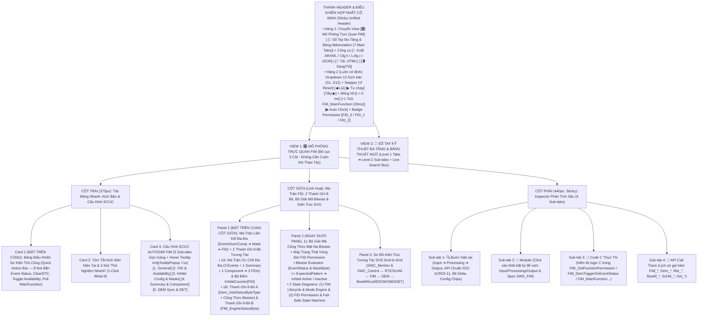
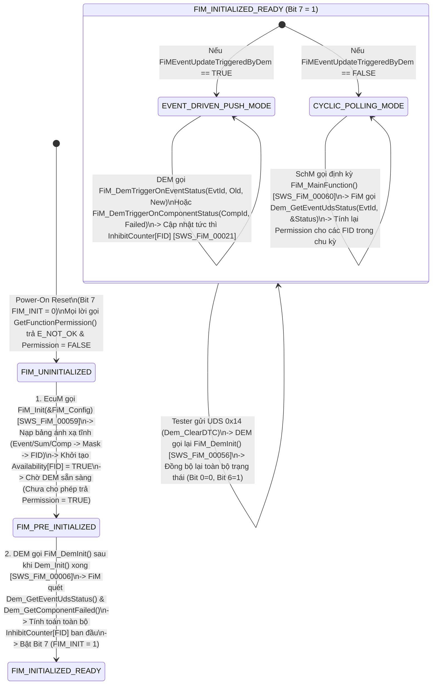
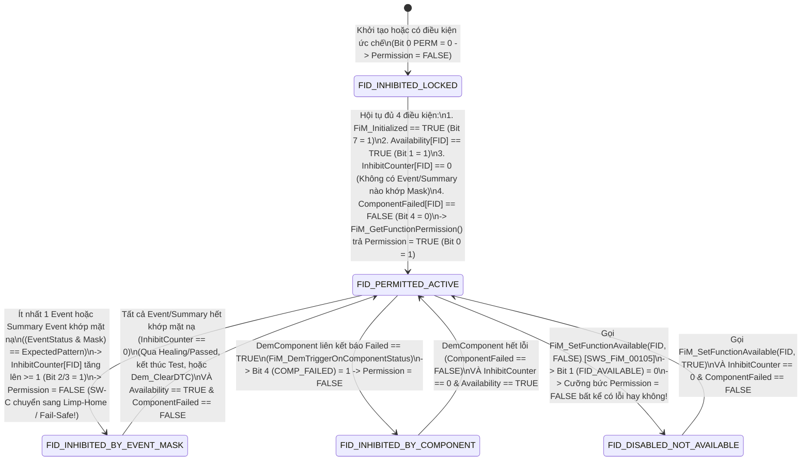

# Tài Liệu Thiết Kế Chi Tiết Trình Mô Phỏng AUTOSAR FiM (`FiM_Simulation_design.md`)

> **Trạng thái tài liệu:** Bản thiết kế chi tiết đã cập nhật theo xác nhận `A1`–`A4` của User — Sẵn sàng để User review trước khi triển khai code.  
> **File đích dự kiến xuất bản:** `d:\__Personal\AntiGravity\Simulation\AUTOSAR_FiM.html` (Ứng dụng Web Tương tác 1 file HTML độc lập, 100% Offline, Pure CSS, có nút tải `.HTML` kèm cấu hình nhúng & xuất code `ARXML / FiM_Cfg.h / FiM_Lcfg.c / JSON`).  
> **Chuẩn tham chiếu:** **AUTOSAR Classic Platform R20-11 / R22-11 / R23-11 (`SWS_FiM`, `SWS_Dem`, `SWS_BswM`, `SWS_EcuM`, `SWS_Dcm`, `SWS_Det`, `SWS_Rte`) & ISO 26262 (Functional Safety — Degraded / Fail-Safe Mode)**, đính kèm mã requirement chuẩn **`SWS_FiM_xxxxx`** tại từng bước xử lý, Ma trận Ánh xạ Đa-Đa (`Events / Summary Events / DemComponents ➔ 4 Inhibit Masks ➔ FIDs`), 2 thanh ghi 8-Bit tương tác, tooltip cấu hình và sổ tay tra cứu đa tầng.

---

## 1. Tổng Quan Định Hướng Thiết Kế Đã Chốt (`A1` – `A4`)

| Hạng mục | Nội dung thiết kế đã xác nhận với User |
| :--- | :--- |
| **1. Bố cục giao diện & Ưu tiên Không Cuộn Trang — Zero-Scroll (`A1`)** | Kết hợp tinh hoa của **`AUTOSAR_DEM.html`** và **`AUTOSAR_ComM.html`**, tối ưu hóa **Above-the-Fold (Zero-Scroll)** để các khối thao tác và giám sát tần suất cao nhất luôn nằm ngay phần đầu mỗi cột trong khung màn hình:<br>• **Thanh Điều Khiển Hợp Nhất Cố Định (Sticky Unified Header)**:<br>  - **Hàng 1**: Chuyển View `[🎛️ Mô Phỏng Trực Quan FiM]` \| `[📖 Sổ Tay Đa Tầng & Bảng Abbreviation (7 Main Tabs)]` + Công cụ `[🧾 Xuất ARXML / FiM_Cfg.h / FiM_Lcfg.c / JSON]` \| `[💾 Tải .HTML]` \| `[🌗 Sáng/Tối]`.<br>  - **Hàng 2 (Luôn cố định)**: Dropdown chọn 12 Kịch bản (`S1`–`S12`), Stepper (`↺ Reset`, `◀ Lùi`, `▶ Tự chạy`, `Tiếp ▶`), Đồng hồ (`t = 0 ms`, `+1 Tick FiM_MainFunction (20ms)`, `▶ Auto Clock`) và Badge Trạng thái `FID_0 / FID_1 / FID_2 Permission`.<br>• **Bố cục 3 cột hiện đại (Mỗi cột tự cuộn độc lập trong khung Viewport)**:<br>  - **Cột Trái (`375px`)**: Đưa **Card 1: Bảng Điều Khiển Sự Kiện Thủ Công (`Quick Action Bar` — 8 nút tác động trực tiếp)** và **Card 2: Tóm tắt kịch bản & 3 nút 1-Click What-If** lên trên cùng, tiếp theo là **Card 3: 5 Sub-tabs Cấu hình ECUC FiM** (hỗ trợ Floating Hover Tooltip `#cfgTooltipPopup` sau `>1s` giống hệt `AUTOSAR_DEM.html`).<br>  - **Cột Giữa (`Linh hoạt`)**: Đưa **Panel 1: Ma Trận Ánh Xạ Đa-Đa (`Events / Summary Events / DemComponents ➔ Inhibit Masks ➔ FIDs`) + 2 Thanh Ghi 8-Bit Tương Tác** và **Panel 2: Bộ Giải Mã Công Thức Bitwise `(Status & Mask) == Pattern` & Máy Trạng Thái Vòng Đời `FiM / FID Permission`** lên ngay đầu cột giữa, bên dưới là **Panel 3: Sơ Đồ Kiến Trúc Tương Tác SVG End-to-End** (`SWC_Monitor / SWC_Controller ↔ RTE/SchM ↔ FiM ↔ DEM ↔ BswM/EcuM/DCM/OBD/DET`).<br>  - **Cột Phải (`440px, Sticky`)**: Inspector 4 Sub-tabs (`🔍 Bước hiện tại`, `🧩 Module`, `📄 Code C Thực Thi`, `📜 API Call Trace`).<br>• **Config Hover Tooltip (`> 1s` delay)** giống hệt `AUTOSAR_DEM.html` (`#cfgTooltipPopup` hiển thị tên tham số, đường dẫn ECUC, mã `SWS_FiM_xxxxx`, mô tả, dải giá trị, giá trị typical và lưu ý kỹ thuật). |
| **2. Khu vực Giám sát Bit-level & Ma trận Ức chế 2 Tầng (`A2`)** | Đặt **cố định và nổi bật ở đầu Cột Giữa** gồm **2 tầng trực quan hóa Bit & Logic Ức chế**:<br>• **Tầng 1 — Ma Trận Liên Kết Đa-Đa (`FiMInhibitionConfiguration Matrix`)**: Hiển thị trực quan mối liên kết từ `DemEventId` (`Evt_RadarSignal`, `Evt_SensorSupply5V`, `Evt_BrakeSwitch`), `FiMSummaryEvent` (`Sum_PowerSupplyFaults`) và `DemComponent` (`Comp_RadarCluster`) qua **4 Mặt nạ chuẩn (`FiMInhInhibitionMask`)** tới **3 `FID` đích** (`FID_0: AdaptiveCruiseControl`, `FID_1: AutoEmergencyBraking`, `FID_2: SecondaryDiagMonitor`), kèm bộ đếm **`Inhibition Counter`** và cờ **`Availability`** của từng `FID`.<br>• **Tầng 2 — 2 Thanh ghi 8-Bit tương tác song song**:<br>  1. **Thanh A (`8-Bit UDS DTC Event Status Byte` — `Dem_UdsStatusByteType` từ `DEM`)**: Hiển thị 8 bit chuẩn ISO 14229-1 (`Bit 7 WIR`, `Bit 6 TNCTOC`, `Bit 5 TFSLC`, `Bit 4 TNCSLC`, `Bit 3 CDTC`, `Bit 2 PDTC`, `Bit 1 TFTOC`, `Bit 0 TF`) kèm **hộp so khớp Bitwise trực tiếp `(Status & Mask) == ExpectedPattern`**.<br>  2. **Thanh B (`8-Bit FiM Engine, Trigger, Availability & FID Permission Status Byte` — `FiM_EngineStatusByte`)**: Theo dõi trực quan các cờ điều khiển và đầu ra của `FiM` (`FIM_INITIALIZED`, `EVENT_TRIG_BY_DEM`, `AVAILABILITY_SUPP`, `COMP_FAILED_INH`, `SUM_EVENT_INH`, `MASK_MATCH_ACTIVE`, `FID_AVAILABLE`, `FID_PERMISSION`). Cho phép click trực tiếp vào từng bit trên cả 2 thanh để thử nghiệm tức thì! |
| **3. Hệ thống 12 Kịch bản mẫu (`A3`)** | Thiết kế sẵn **12 Kịch bản (`S1`–`S12`)** chia làm 4 nhóm lớn:<br>• **Nhóm 1 (`S1`–`S4`)**: Giải phẫu 4 Mặt nạ ức chế chuẩn AUTOSAR (`FIM_LAST_FAILED`, `FIM_NOT_TESTED`, `FIM_TESTED`, `FIM_TESTED_AND_FAILED`) và sự dịch chuyển của `Bit 0 (TF)` & `Bit 6 (TNCTOC)`.<br>• **Nhóm 2 (`S5`–`S7`)**: Đối chiếu 2 kiến trúc cập nhật trạng thái (`Event-Driven / Push Mode` qua `FiM_DemTriggerOnEventStatus` vs `Cyclic Polling Mode` qua `FiM_MainFunction` & `Dem_GetEventUdsStatus`) và Khôi phục toàn cục qua `Dem_ClearDTC() ➔ FiM_DemInit()`.<br>• **Nhóm 3 (`S8`–`S10`)**: Liên kết Đa-Đa nâng cao với `FiMSummaryEvent`, Đồ thị phụ thuộc phần cứng `DemComponent` (`FiM_DemTriggerOnComponentStatus`), và Cơ chế **Chặn Lỗi Dây Chuyền (`Cascading / Secondary Fault Suppression`)** giữa `DEM ↔ FiM`.<br>• **Nhóm 4 (`S11`–`S12`)**: Điều khiển Tính Khả Dụng Động (`FiM_SetFunctionAvailable` — `SWS_FiM_00105`) & Kiểm thử Bảo vệ Tham số / Báo lỗi `DET` (`FIM_E_UNINIT`, `FIM_E_FID_OUT_OF_RANGE`, `FIM_E_EVENTID_OUT_OF_RANGE`, `FIM_E_PARAM_POINTER`, `FIM_E_INIT_FAILED`). |
| **4. Sổ tay tra cứu đa tầng & Bảng Abbreviation (`A4`)** | **View 2 (`📖 Sổ Tay Kỹ Thuật FiM & Từ Điển Thuật Ngữ`)** được tổ chức theo cấu trúc **Đa Tầng (Multi-level Tabs)**:<br>• **6 Main Sub-tabs (Level 1) × 4 Chủ đề con (Level 2 Pills/Tabs = 24 chuyên đề)** phân tích sâu kiến trúc FiM & ISO 26262, bảng chân trị 4 mặt nạ ức chế, Push vs Polling, Summary Event & DemComponent DAG, Chống lỗi dây chuyền & OBD IUMPR, và Từ điển API/ECUC R23-11.<br>• **Tab 7 chuyên biệt: `🔤 Bảng Thuật Ngữ & Từ Viết Tắt (Abbreviation Table)`** trình bày dưới dạng bảng chuẩn 4 cột, tích hợp **Search Box tìm kiếm tức thời (Live Search + Highlight `<mark>`)** và 5 nút lọc nhanh theo phân nhóm (`FiM Core & FID`, `Inhibition Masks & Bits`, `DEM & Component Graph`, `ISO 26262 & OBD`, `AUTOSAR BSW & RTE`). |

---

## 2. Bố Cục Giao Diện 3 Cột Ưu Tiên Zero-Scroll & Hệ Thống Sub-Tabs (UI Wireframe)

Để giải quyết triệt để yêu cầu **"đưa các khối được dùng thường xuyên hơn lên phía trên để người dùng không cần cuộn chuột lên xuống mỗi lần thao tác"**, giao diện được thiết kế theo nguyên lý **Viewport-First (Zero-Scroll)**:



### Điểm Cải Tiến Đột Phá Về Trải Nghiệm "Zero-Scroll" Cho Module `FiM`:
1. **Thanh Điều Khiển Hợp Nhất (`Sticky Unified Header`)**: Gộp chọn kịch bản (`S1`–`S12`), nút bấm `Bước tiếp / Lùi / Tự chạy`, nút nhịp đồng hồ `+1 Tick FiM_MainFunction (20ms)` và 3 đèn báo trạng thái `FID_0 (ACC)`, `FID_1 (AEB)`, `FID_2 (DiagMonitor)` vào ngay thanh Header cố định.
2. **Đưa `Quick Action Bar` (8 nút tác động nhanh) lên vị trí Card 1 (Đầu Cột Trái)** và đưa **Ma Trận Đa-Đa (`Event/Component ➔ Mask ➔ FID`) + 2 Thanh Ghi 8-Bit + Bộ Giải Mã Bitwise `(Status & Mask) == Pattern`** lên đầu Cột Giữa: Khi người dùng bấm `Báo lỗi Event FAILED (Bit 0=1, Bit 6=0)` hoặc đổi `FiMInhInhibitionMask` sang `FIM_NOT_TESTED`, mắt người dùng lập tức thấy ngay phép toán `AND` bit, số lượng `InhibitCounter` tăng/giảm và đèn `Permission` chuyển từ `TRUE (PERMITTED)` sang `FALSE (INHIBITED / FAIL-SAFE)` mà **không phải cuộn trang**.
3. **Gom 28 tham số ECUC vào 5 Sub-tabs gọn gàng**: Chiều cao Card Cấu hình được giữ cố định (~270px), kèm hộp thoại giải thích nổi `#cfgTooltipPopup` khi hover quá `1000ms` giống hệt `AUTOSAR_DEM.html`.

---

## 3. Thiết Kế Chi Tiết Panel 1 & Panel 2 (Đầu Cột Giữa): Ma Trận Ức Chế Đa-Đa + Bộ Giải Mã Mặt Nạ Bitwise & 2 Thanh Ghi 8-Bit Tương Tác

Trong `AUTOSAR FiM`, trái tim của thuật toán nằm ở **hai cơ chế cốt lõi**: (1) **Đánh giá công thức mặt nạ bit `FiMInhInhibitionMask` trên `8-Bit UDS DTC Status Byte` nhận từ `DEM` (kết hợp với trạng thái `DemComponentFailed`)**, và (2) **Tổng hợp quan hệ Đa-Đa (`Many-to-Many`) từ nhiều `Event / Summary Event / Component` cộng dồn vào `Inhibition Counter` (hoặc trạng thái OR) cùng cờ `Availability` để quyết định `Permission (TRUE / FALSE)` của từng `FID`**.

### 3.1. Phần 1A — Ma Trận Ánh Xạ Đa-Đa (`FiMInhibitionConfiguration Matrix`) & Bộ Đếm `InhibitCounter[FID]`

```text
+-------------------------------------------------------------------------------------------------------------------+
| 🧬 MA TRẬN ÁNH XẠ ỨC CHẾ ĐA-ĐA (`FiMInhibitionConfiguration` — [`SWS_FiM_00011`, `SWS_FiM_00012`])                |
| Chế độ cập nhật: [EVENT-DRIVEN (Push từ DEM)] | Availability Support: [TRUE] | Tổng số FID đang bị khóa: [ 2 / 3 ]|
+-------------------------------------------------------------------------------------------------------------------+
| 1. BẢNG QUY TẮC ỨC CHẾ (INHIBITION RULES & BITWISE MATCHING):                                                     |
|  +---------+-------------------------------+----------------------+-------------------+------------+------------+ |
|  | Rule ID | Nguồn Kích Hoạt (Event/Comp)  | Status Hiện Tại      | Mặt Nạ Cấu Hình   | Công Thức  | Kết Quả    | |
|  +---------+-------------------------------+----------------------+-------------------+------------+------------+ |
|  | InhCfg0 | Evt_01: RadarSignalErr        | 0x2F (TF=1,TNCTOC=0) | FIM_LAST_FAILED   | (S&01)==01 | 🔴 MATCH=1 | |
|  | InhCfg1 | Evt_02: SensorSupply5V_UnderV | 0x40 (TF=0,TNCTOC=1) | FIM_NOT_TESTED    | (S&40)==40 | 🔴 MATCH=1 | |
|  | InhCfg2 | Sum_01: PowerSupplySum (E2,E3)| 0x00 (TF=0,TNCTOC=0) | FIM_TEST_AND_FAIL | (S&41)==01 | 🟢 CLEAR=0 | |
|  | InhCfg3 | Comp_01: RadarHwCluster       | Failed = FALSE       | DEM_COMP_FAILED   | Failed==1  | 🟢 CLEAR=0 | |
|  +---------+-------------------------------+----------------------+-------------------+------------+------------+ |
+-------------------------------------------------------------------------------------------------------------------+
| 2. BẢNG TRẠNG THÁI ĐẦU RA CÁC FUNCTION ID (`FID Permission Table` — `FiM_GetFunctionPermission()`):               |
|  +-------------------------+-----------------------+--------------+----------------+----------------------------+ |
|  | Function ID (FID)       | Các Rule Liên Kết     | InhibitCount | Availability   | Permission Output (RTE)    | |
|  +-------------------------+-----------------------+--------------+----------------+----------------------------+ |
|  | FID_0: AdaptiveCruise   | InhCfg0, InhCfg2, Cmp1|   1 (> 0)    | TRUE (Avail)   | 🚫 FALSE (LIMP-HOME MODE)  | |
|  | FID_1: AutoEmergBraking | InhCfg0, Comp_01      |   1 (> 0)    | TRUE (Avail)   | 🚫 FALSE (FAIL-SAFE OFF)   | |
|  | FID_2: RadarDiagMonitor | InhCfg1 (Supply5V)    |   1 (> 0)    | TRUE (Avail)   | 🚫 FALSE (BLOCK SEC. DTC)  | |
|  +-------------------------+-----------------------+--------------+----------------+----------------------------+ |
+-------------------------------------------------------------------------------------------------------------------+
```

- **Tính năng tương tác trực tiếp trên Phần 1A**:
  - Người dùng có thể click vào từng hàng `Rule (InhCfg0..InhCfg3)` để chọn Event/Component đang hiển thị trên Thanh ghi 8-Bit bên dưới, hoặc đổi nhanh `FiMInhInhibitionMask` ngay trên bảng để thấy tức thì kết quả `MATCH (1)` hay `CLEAR (0)`!
  - Người dùng nhìn thấy rõ **tại sao một `FID` vẫn bị khóa (`Permission = FALSE`)**: Ví dụ `Evt_01 (Radar)` đã hết lỗi (`InhCfg0 = 0`), nhưng `Comp_01` vẫn `Failed` hoặc `Availability` đang bị đặt `FALSE` bởi `FiM_SetFunctionAvailable(FID_0, FALSE)`.

### 3.2. Phần 1B — 2 Thanh Ghi 8-Bit Trạng Thái Tương Tác Luôn Hiển Thị Nổi Bật

Ngay bên dưới Phần 1A là **2 Thanh ghi 8-Bit tương tác** theo đúng phong cách chuẩn của `AUTOSAR_DEM.html` và `AUTOSAR_ComM.html`:

```text
+-------------------------------------------------------------------------------------------------------------------+
| 🔢 BẢNG GIÁM SÁT BITFIELD 8-BIT UDS STATUS & FIM ENGINE (LIVE 8-BIT INSPECTOR)  [Click vào từng ô Bit để thử nghiệm]|
| Đang chọn: Evt_01 (RadarSignalErr) ➔ FID_0 (ACC) | Mask: FIM_TESTED_AND_FAILED ((Status & 0x41) == 0x01) ➔ MATCH! |
+-------------------------------------------------------------------------------------------------------------------+
| A. THANH GHI 8-BIT UDS DTC EVENT STATUS BYTE (`Dem_UdsStatusByteType`) — Hex: [ 0x2F ] Bin: [0010 1111b]          |
|    Bitwise Check: (Status [0x2F] & Mask [0x41]) = [0x01] == Expected [0x01] ➔ KẾT QUẢ: 🔴 INHIBITED (KHỚP MẶT NẠ)  |
|  +-------------+ +-------------+ +-------------+ +-------------+ +-------------+ +-------------+ +-------+ +-----+|
|  | Bit 7 (0x80)| | Bit 6 (0x40)| | Bit 5 (0x20)| | Bit 4 (0x10)| | Bit 3 (0x08)| | Bit 2 (0x04)| |Bit1(2)| |Bit 0||
|  |     WIR     | |   TNCTOC    | |    TFSLC    | |   TNCSLC    | |    CDTC     | |    PDTC     | | TFTOC | | TF  ||
|  |      0      | |      0      | |      1      | |      0      | |      1      | |      1      | |   1   | |  1  ||
|  | MIL Off     | | ★ TESTED(0) | | FailedSLC   | | TestedSLC   | | Confirmed   | | Pending     | |FailCyc| |★FAIL||
|  +-------------+ +-------------+ +-------------+ +-------------+ +-------------+ +-------------+ +-------+ +-----+|
+-------------------------------------------------------------------------------------------------------------------+
| B. THANH GHI 8-BIT TRẠNG THÁI ĐỘNG CƠ FIM & QUYỀN FID (`FiM_EngineStatusByte`) — Hex: [ 0xE6 ] Bin: [1110 0110b]  |
|    Active FID: [ FID_0 (AdaptiveCruise) ] | InhibitCounter[FID_0]: [ 1 ] | Effective Permission: [ FALSE (LOCKED)]|
|  +-------------+ +-------------+ +-------------+ +-------------+ +-------------+ +-------------+ +-------+ +-----+|
|  | Bit 7 (0x80)| | Bit 6 (0x40)| | Bit 5 (0x20)| | Bit 4 (0x10)| | Bit 3 (0x08)| | Bit 2 (0x04)| |Bit1(2)| |Bit 0||
|  |  FIM_INIT   | | TRIG_BY_DEM | | AVAIL_SUPP  | | COMP_FAILED | | SUM_EVT_ACT | | MASK_MATCH  | |FID_AVL| |PERM ||
|  |      1      | |      1      | |      1      | |      0      | |      0      | |      1      | |   1   | |  0  ||
|  | Initialized | | Push Mode   | | Avail On    | | Comp OK     | | Sum Clear   | | Mask Matched| |Avail=1| |LOCK!||
|  +-------------+ +-------------+ +-------------+ +-------------+ +-------------+ +-------------+ +-------+ +-----+|
+-------------------------------------------------------------------------------------------------------------------+
```

#### 3.2.1. Giải Mã Chi Tiết Thanh A (`8-Bit UDS DTC Event Status Byte` — `Dem_UdsStatusByteType`) & Bảng Chân Trị 4 Mặt Nạ Ức Chế Chuẩn AUTOSAR (`SWS_FiM_00012`)

Trong chuẩn AUTOSAR `SWS_FiM` (từ R4.0 đến R22-11 / R23-11), `FiM` đánh giá trạng thái của một `DemEventParameter` thông qua phép toán mặt nạ bit (`Bitwise AND` & `Compare`) trên byte `Dem_UdsStatusByteType` nhận từ `DEM` (qua tham số `EventStatusNew` của `FiM_DemTriggerOnEventStatus()` hoặc đọc bằng `Dem_GetEventUdsStatus()`):

| Tên Mặt Nạ Chuẩn (`FiMInhInhibitionMask`) | Các Bit Được Kiểm Tra Trên Thanh A | Công Thức Bitwise Chính Xác Trong Code C (`SWS_FiM_00012`) | Khi Nào Mặt Nạ Khớp (`Inhibit = TRUE` ➔ Khóa `FID`)? | Ứng Dụng Thực Tế Trong Hệ Thống Xe (Automotive Use Case) |
| :--- | :--- | :--- | :--- | :--- |
| **`FIM_LAST_FAILED`** | **`Bit 0 (TF - testFailed)`**<br>Mask = `0x01` | `(EventStatus & 0x01u) == 0x01u` | Khi **`Bit 0 (TF) == 1`** (bất kể `Bit 6 TNCTOC` bằng `0` hay `1`). | **Phản ứng tức thời (Fast Fail-Safe)**: Ngay khi cảm biến (như Radar, Cảm biến góc lái, Áp suất phanh) vừa báo lỗi (`FAILED`), khóa ngay lập tức chức năng điều khiển (`FID_ACC`, `FID_AEB`) để bảo vệ an toàn ISO 26262. |
| **`FIM_NOT_TESTED`** | **`Bit 6 (TNCTOC - testNotCompletedThisOperationCycle)`**<br>Mask = `0x40` | `(EventStatus & 0x40u) == 0x40u` | Khi **`Bit 6 (TNCTOC) == 1`** (tức bài kiểm tra của Event trong chu kỳ vận hành hiện tại **CHƯA chạy xong**). | **Chờ điều kiện tiền đề & Chặn lỗi dây chuyền (Pre-condition Gate / Cascading Fault Suppression)**: Khi vừa bật khóa điện IG ON (`Status = 0x50`, `TNCTOC = 1`), khóa tính năng điều khiển hoặc khóa các Diagnostic Monitor phụ thuộc cho đến khi cảm biến nguồn (`5V Supply`) chạy xong bài tự kiểm tra lần đầu (`TNCTOC: 1 ➔ 0`)! |
| **`FIM_TESTED`** | **`Bit 6 (TNCTOC - testNotCompletedThisOperationCycle)`**<br>Mask = `0x40` | `(EventStatus & 0x40u) == 0x00u` | Khi **`Bit 6 (TNCTOC) == 0`** (tức Event **ĐÃ hoàn tất ít nhất 1 lần kiểm tra** trong chu kỳ hiện tại, dù `PASSED` hay `FAILED`). | **Chạy bài kiểm tra 1 lần duy nhất mỗi chu kỳ (Once-Per-Trip Monitor Lock)**: Dùng cho các bài chẩn đoán xâm lấn (như kiểm tra rò rỉ bình nhiên liệu EVAP hoặc tự test van EGR): một khi Monitor đã test xong trong chu kỳ lái này (`TNCTOC == 0`), `FiM` khóa `FID` của bài test đó lại để không chạy lặp lại gây hao tổn cơ khí. |
| **`FIM_TESTED_AND_FAILED`** | **`Bit 0 (TF)` & `Bit 6 (TNCTOC)`**<br>Mask = `0x41` | `(EventStatus & 0x41u) == 0x01u` | Khi **`Bit 0 (TF) == 1` VÀ `Bit 6 (TNCTOC) == 0`**. | **Xác nhận lỗi trong chu kỳ hiện tại (Current Cycle Verified Fault)**: Tránh trường hợp vừa khởi động chu kỳ mới (`TNCTOC == 1`) mà cờ `Bit 0 (TF)` lưu từ chu kỳ trước chưa được xóa bởi bài test mới (`DemStatusBitHandlingTestFailedSinceLastClear`). Chỉ khóa `FID` khi chính chu kỳ hiện tại đã chạy test xong (`TNCTOC == 0`) và kết luận lỗi (`TF == 1`). |

> 💡 **Mở rộng trực quan trên Thanh A**: Toàn bộ 8 bit của `Dem_UdsStatusByteType` (`Bit 7 WIR`, `Bit 6 TNCTOC`, `Bit 5 TFSLC`, `Bit 4 TNCSLC`, `Bit 3 CDTC`, `Bit 2 PDTC`, `Bit 1 TFTOC`, `Bit 0 TF`) đều có thể click để bật/tắt; trong đó **`Bit 6 (TNCTOC)`** và **`Bit 0 (TF)`** được đánh dấu nổi bật `★` kèm đường nối trực quan vào bộ tính `(Status & Mask) == ExpectedPattern`.

#### 3.2.2. Giải Mã Chi Tiết Thanh B: `8-Bit FiM Engine, Trigger, Availability & FID Permission Status Byte` (`FiM_EngineStatusByte`)

| Bit | Mask | Tên Cờ (`FiM Engine Bit`) | Ý nghĩa kỹ thuật & Khi nào bật lên `1` (`0 ➔ 1`) | Khi nào hạ về `0` (`1 ➔ 0`) |
| :-: | :-: | :--- | :--- | :--- |
| **Bit 7** | `0x80` | **`FIM_INITIALIZED`** | Bật lên `1` sau khi `FiM_Init(&FiM_Config)` và `FiM_DemInit()` hoàn tất khởi tạo bảng trạng thái (`SWS_FiM_00059`). | Hạ về `0` khi chưa khởi tạo (`FIM_UNINIT`); nếu gọi `FiM_GetFunctionPermission()` lúc `Bit 7 == 0`, `FiM` trả về `E_NOT_OK`, gán `*Permission = FALSE` và báo `Det_ReportError(FIM_E_UNINIT = 0x01)`. |
| **Bit 6** | `0x40` | **`EVENT_TRIG_BY_DEM`** | Bật lên `1` khi cấu hình **`FiMEventUpdateTriggeredByDem = TRUE`** (`ECUC_FiM_00086` — chế độ Event-Driven / Push): `DEM` gọi trực tiếp `FiM_DemTriggerOnEventStatus()` ngay khi bit trạng thái thay đổi. | Hạ về `0` khi **`FiMEventUpdateTriggeredByDem = FALSE`** (chế độ Cyclic Polling): `FiM` không nhận trigger tức thời mà đợi đến chu kỳ `FiM_MainFunction()` để gọi `Dem_GetEventUdsStatus()` quét lại các Event! |
| **Bit 5** | `0x20` | **`AVAILABILITY_SUPP`** | Bật lên `1` khi cấu hình **`FiMAvailabilitySupport = TRUE`** (`ECUC_FiM_00097`), cho phép sử dụng API `FiM_SetFunctionAvailable(FID, Availability)`. | Hạ về `0` khi tắt `FiMAvailabilitySupport = FALSE` (lúc này mọi lời gọi `FiM_SetFunctionAvailable` bị vô hiệu hóa). |
| **Bit 4** | `0x10` | **`COMP_FAILED_INH`** | Bật lên `1` khi một `DemComponent` liên kết với `FID` bị báo hỏng qua `FiM_DemTriggerOnComponentStatus(CompId, TRUE)` hoặc `Dem_GetComponentFailed()` trả về `TRUE` (`SWS_FiM_00099`). | Hạ về `0` khi tất cả các `DemComponent` liên kết với `FID` đều ở trạng thái hoạt động tốt (`ComponentFailed == FALSE`). |
| **Bit 3** | `0x08` | **`SUM_EVENT_INH`** | Bật lên `1` khi ít nhất 1 `DemEventParameter` nằm trong nhóm **`FiMSummaryEvent`** liên kết với `FID` thỏa mãn mặt nạ ức chế (`SWS_FiM_00063`). | Hạ về `0` khi toàn bộ các Event con thuộc `FiMSummaryEvent` đều không còn khớp mặt nạ ức chế. |
| **Bit 2** | `0x04` | **`MASK_MATCH_ACTIVE`** | Bật lên `1` khi công thức mặt nạ `(EventStatus & Mask) == ExpectedPattern` của Event đơn lẻ (hoặc Summary Event) trả về `TRUE`, làm tăng bộ đếm **`InhibitCounter[FID] > 0`**. | Hạ về `0` khi không còn bất kỳ quy tắc mặt nạ Event nào khớp (`InhibitCounter[FID] == 0`). |
| **Bit 1** | `0x02` | **`FID_AVAILABLE`** | Bật lên `1` (mặc định khi `FiM_Init`) khi chức năng `FID` đang được phép hiện diện trên xe (`Availability == TRUE`). | Hạ về `0` khi `SW-C` hoặc `BswM` gọi **`FiM_SetFunctionAvailable(FID, FALSE)`** (`SWS_FiM_00105` — ví dụ tắt tính năng do cấu hình Variant hoặc chế độ Transport Mode). |
| **Bit 0** | `0x01` | **`FID_PERMISSION`**<br>*(Đầu ra cuối cùng)* | Bật lên `1` (**`Permission = TRUE` — Cho phép chạy bình thường**) CHỈ KHI hội tụ đủ 4 điều kiện: `Bit 7 (FIM_INIT) == 1` **VÀ** `Bit 1 (FID_AVAILABLE) == 1` **VÀ** `Bit 2 (MASK_MATCH) == 0` **VÀ** `Bit 4 (COMP_FAILED) == 0` (`InhibitCounter[FID] == 0`). | Hạ về `0` (**`Permission = FALSE` — Khóa chức năng / Chuyển sang Fail-Safe**) ngay khi có bất kỳ 1 điều kiện ức chế nào xảy ra (`MASK_MATCH == 1`, `SUM_EVENT == 1`, `COMP_FAILED == 1`, `FID_AVAILABLE == 0`, hoặc `FIM_INIT == 0`)! |

---

## 4. Phân Tích Xử Lý Từng Module: Input Lấy Từ Đâu, Xử Lý Gì, Output Route Đến Đâu

Mọi khối trên sơ đồ kiến trúc SVG đều có thể **click vào để xem giải thích chi tiết** ở cột phải (Tab `🧩 Module`) và được tổng hợp đầy đủ trong **Tab 1 của Sổ tay**:

| # | Module / Phân khối | Lớp AUTOSAR | 📥 Input lấy từ đâu? | ⚙️ Cách xử lý nội bộ (Processing, Bitwise & State) | 📤 Output route đến đâu & Hàm API chuẩn (R20-11 / R22-11 / R23-11) |
| :-: | :--- | :--- | :--- | :--- | :--- |
| **1** | **`SWC_DiagMonitor`**<br>*(Sensor / Pre-condition Monitor SW-C)* | Application Layer | • Đọc tín hiệu vật lý từ cảm biến (điện áp nguồn 5V, tín hiệu Radar, công tắc bàn đạp phanh) qua `IoHwAb / RTE`.<br>• Hoặc hỏi quyền thực thi bài chẩn đoán phụ thuộc từ `FiM` qua `RTE` (`Rte_Call_FunctionInhibition_GetFunctionPermission`). | • **Kiểm tra điều kiện tiền đề (Chống Cascading Faults)**: Trước khi chạy thuật toán chẩn đoán của cảm biến phụ thuộc (ví dụ `Radar Monitor` phụ thuộc vào `5V Sensor Supply`), `SWC_DiagMonitor` gọi `GetFunctionPermission(FID_RadarDiagMonitor, &Perm)`. Nếu `Perm == FALSE` (do nguồn 5V đang lỗi hoặc chưa test xong), nó **tạm dừng báo lỗi** để tránh sinh ra hàng loạt mã DTC giả (Secondary DTCs)!<br>• Nếu `Perm == TRUE`, chạy thuật toán kiểm tra và báo `PASSED / FAILED` xuống `DEM`. | • Gọi qua **RTE** xuống **FiM**:<br>`Rte_Call_FunctionInhibition_GetFunctionPermission(&Permission)` [`SWS_FiM_00011`]<br>• Gọi qua **RTE** xuống **DEM**:<br>`Rte_Call_DiagnosticMonitor_SetEventStatus(EventStatus)` |
| **2** | **`SWC_Controller`**<br>*(Actuator / Feature Control SW-C: ACC, AEB, Torque)* | Application Layer | • Nhận yêu cầu điều khiển từ người lái (bật Cruise Control, giữ khoảng cách, phanh tự động).<br>• Nhận kết quả `Permission (TRUE / FALSE)` từ `FiM` thông qua cổng Client-Server `FunctionInhibition` trên `RTE`. | • **Tách biệt hoàn toàn khỏi mã lỗi phần cứng (`Decoupling`)**: `SWC_Controller` **không cần biết** hệ thống có bao nhiêu cảm biến hay mã DTC nào đang lỗi. Nó chỉ hỏi duy nhất 1 câu: *"Chức năng `FID_AdaptiveCruise` của tôi có được phép chạy không?"*<br>• Nếu `Permission == TRUE`: Thực thi điều khiển bình thường (`Normal Mode`).<br>• Nếu `Permission == FALSE`: Lập tức cắt điều khiển chủ động và chuyển sang **Chế độ Suy giảm An toàn (`Degraded / Limp-Home / Fail-Safe Mode`)** theo chuẩn ISO 26262! | • Gọi qua **RTE** xuống **FiM**:<br>`Rte_Call_UR_FID_x_GetFunctionPermission(&Permission)`<br>• Gọi qua **RTE** điều khiển tính khả dụng (nếu được phân quyền):<br>`Rte_Call_UR_FID_x_SetFunctionAvailable(Availability)` [`SWS_FiM_00106`] |
| **3** | **`RTE` & `SchM`**<br>*(Runtime Environment & BSW Scheduler)* | RTE Layer | • Lời gọi `Rte_Call` từ các `SW-C` thông qua Port `FunctionInhibition` (`GetFunctionPermission`) và `ControlFunctionAvailable` (`SetFunctionAvailable`).<br>• Xung nhịp định kỳ từ `AUTOSAR OS` (`Task_Bsw_20ms`). | • **RTE**: Ánh xạ đối tượng `FID` tĩnh (qua `PortDefinedArgumentValue`) vào tham số đầu tiên `FiM_FunctionIdType FID` của hàm C `FiM_GetFunctionPermission(FID, &Permission)` [`SWS_FiM_00043`].<br>• **SchM**: Gọi định kỳ hàm **`FiM_MainFunction()`** mỗi `FiMMainFunctionPeriod` (khi chạy chế độ Polling hoặc tính toán lại bảng FID) và cung cấp cặp khóa **`SchM_Enter_FiM_...` / `SchM_Exit_FiM_...`** để bảo vệ tính toàn vẹn của mảng `InhibitCounter[FID]` khi vừa có ngắt từ `DEM` vừa có truy vấn từ `SW-C`. | • Định tuyến từ **RTE** vào **FiM**:<br>`FiM_GetFunctionPermission(FID, &Permission)`<br>`FiM_SetFunctionAvailable(FID, Availability)`<br>• Gọi định kỳ từ **SchM**:<br>`FiM_MainFunction()` [`SWS_FiM_00060`]<br>`SchM_Enter_FiM_FIM_EXCLUSIVE_AREA_0()` |
| **4** | **`FiM Core Engine`**<br>*(Function Inhibition Manager)* | System / Diag Services | • Nhận thông báo đổi trạng thái Event từ `DEM` (`FiM_DemTriggerOnEventStatus`) và Component (`FiM_DemTriggerOnComponentStatus`), hoặc lệnh tái đồng bộ `FiM_DemInit()`.<br>• Hoặc chủ động đọc `Dem_GetEventUdsStatus()` / `Dem_GetComponentFailed()` trong `FiM_MainFunction()`.<br>• Nhận lệnh `FiM_SetFunctionAvailable()` và truy vấn `FiM_GetFunctionPermission()`. | • **1. Bộ Giải Mã Mặt Nạ Ức Chế (`Inhibition Mask Evaluator`)**: Áp dụng 4 công thức bitwise (`FIM_LAST_FAILED`, `FIM_NOT_TESTED`, `FIM_TESTED`, `FIM_TESTED_AND_FAILED`) trên byte `Dem_UdsStatusByteType`.<br>• **2. Bộ Hợp Nhất Đa-Đa (`Many-to-Many Aggregator`)**: Ánh xạ kết quả từ các `DemEventId` đơn lẻ, các nhóm `FiMSummaryEvent` (`SWS_FiM_00063`) và các `DemComponent` (`SWS_FiM_00099`) vào mảng bộ đếm `InhibitCounter[FID]` của từng `FID` (tối đa `FiMMaxHandledFidEventLinksPerSchedulableStep` liên kết mỗi chu kỳ nếu giới hạn tải CPU).<br>• **3. Bộ Quyết Định Quyền Thực Thi (`Permission Gate`)**: Trả về `Permission = (FiM_Initialized && Availability[FID] && (InhibitCounter[FID] == 0))` trong thời gian `O(1)` cực nhanh! | • Trả kết quả cho **SW-C / DEM / OBD**:<br>`FiM_GetFunctionPermission(FID, &Permission)` [`SWS_FiM_00011`]<br>• Gọi sang **DEM** (khi Polling hoặc `FiM_DemInit`):<br>`Dem_GetEventUdsStatus(EventId, &Status)` [`SWS_FiM_00065`]<br>`Dem_GetComponentFailed(CompId, &Failed)` [`SWS_FiM_00100`]<br>• Báo lỗi sang **Det**:<br>`Det_ReportError(ModuleId=11, ...)` |
| **5** | **`DEM`**<br>*(Diagnostic Event Manager)* | Diagnostic Services | • Nhận báo cáo `Dem_SetEventStatus` từ các `SWC_DiagMonitor` hoặc BSW.<br>• Nhận lệnh xóa lỗi `Dem_ClearDTC()` từ `DCM` (UDS `0x14`) hoặc chuyển chu kỳ `Dem_SetOperationCycleState()` từ `BswM`.<br>• Quản lý đồ thị phụ thuộc phần cứng `DemComponent`. | • **Chiều đẩy sang FiM (Push Mode)**: Mỗi khi byte `UDS DTC Status` của một Event thay đổi (`EventStatusOld != EventStatusNew`), `DEM` gọi ngay **`FiM_DemTriggerOnEventStatus(EventId, Old, New)`** (`SWS_Dem_00346`). Khi một `DemComponent` đổi trạng thái hỏng, `DEM` gọi **`FiM_DemTriggerOnComponentStatus(ComponentId, Failed)`**.<br>• **Khi xóa DTC hoặc Khởi tạo lại**: Sau khi hoàn tất `Dem_ClearDTC()` hoặc `Dem_Init()`, `DEM` gọi **`FiM_DemInit()`** để `FiM` tính toán lại toàn bộ bảng quyền từ đầu.<br>• **Chiều hỏi ngược FiM**: `DEM` cũng có thể truy vấn `FiM_GetFunctionPermission()` để khóa Storage/Enable Condition của Event phụ thuộc. | • Gọi trực tiếp sang **FiM** (`FiM_Dem.h`):<br>`FiM_DemTriggerOnEventStatus(EventId, EventStatusOld, EventStatusNew)` [`SWS_FiM_00021`]<br>`FiM_DemTriggerOnComponentStatus(ComponentId, ComponentFailedStatus)` [`SWS_FiM_00099`]<br>`FiM_DemInit()` [`SWS_FiM_00006`]<br>• Phục vụ truy vấn từ **FiM**:<br>`Dem_GetEventUdsStatus(EventId, &EventStatusByte)`<br>`Dem_GetComponentFailed(ComponentId, &ComponentFailed)` |
| **6** | **`EcuM` & `BswM`**<br>*(ECU State & BSW Mode Manager)* | System Services | • Trạng thái khởi động ECU (`Startup Two`) và chế độ vận hành của xe (`Normal`, `Transport Mode`, `Factory Mode`, `Variant Coding`). | • **Thứ tự khởi tạo sống còn (`Initialization Sequence`)**: `EcuM / BswM` gọi `FiM_Init(&FiM_Config)` để nạp cấu hình tĩnh, sau đó khi `DEM` đã khởi tạo xong (`Dem_Init`), `DEM` (hoặc `EcuM`) gọi **`FiM_DemInit()`** để đồng bộ trạng thái lỗi từ `NvM/DEM` vào `FiM`.<br>• **Điều khiển tính khả dụng (`Availability`)**: Khi xe ở chế độ `Transport Mode` hoặc một tùy chọn phần cứng không được trang bị trên biến thể xe hiện tại, `BswM / SW-C` gọi **`FiM_SetFunctionAvailable(FID, FALSE)`** để khóa cứng `FID` đó. | • Gọi vào **FiM**:<br>`FiM_Init(FiMConfigPtr)` [`SWS_FiM_00059`]<br>`FiM_DemInit()` [`SWS_FiM_00006`]<br>`FiM_SetFunctionAvailable(FID, Availability)` [`SWS_FiM_00106`]<br>• Điều khiển chu kỳ **DEM**:<br>`Dem_SetOperationCycleState(CycleId, START)` |
| **7** | **`DCM` & `OBD / IUMPR`**<br>*(Diagnostic Communication & On-Board Diagnostics)* | Diagnostic Services | • Nhận dịch vụ UDS `0x14 ClearDiagnosticInformation`, hoặc truy vấn OBD Service `$06` (DTR), `$09` / `IUMPR` (In-Use Monitor Performance Ratio). | • **Khi nhận UDS `0x14 ClearDTC`**: `DCM` gọi `Dem_ClearDTC()`. Sau khi `DEM` xóa sạch các bit lỗi về `0x50` (`TNCTOC=1, TNCSLC=1, TF=0`), `DEM` gọi `FiM_DemInit()` làm mở khóa các `FID` đang bị chặn bởi `FIM_LAST_FAILED`, nhưng **tự động khóa các `FID` cấu hình `FIM_NOT_TESTED`** (vì `Bit 6 TNCTOC` vừa bật lại lên `1` sau khi xóa lỗi!).<br>• **Trong OBD / IUMPR**: `FiM` khóa mẫu số/tử số `IUMPR` (`Denominator / Numerator Inhibition`) khi một `FID` giám sát bị vô hiệu hóa để tuân thủ luật khí thải OBD-II / Euro 6. | • Kích hoạt chuỗi qua **DEM ➔ FiM**:<br>`Dem_ClearDTC() ➔ FiM_DemInit()`<br>• Truy vấn trạng thái khóa **OBD Monitor**:<br>`FiM_GetFunctionPermission(FID_ObdMonitor, &Permission)` |
| **8** | **`Det`**<br>*(Default Error Tracer)* | System Services | • Nhận báo cáo lỗi phát triển (`Det_ReportError`) và lỗi runtime từ `FiM` (`ModuleId = 11 / 0x000B`). | • Ghi nhận mã API (`ServiceId`) và 5 mã lỗi chuẩn AUTOSAR R22-11/R23-11:<br>  - `FIM_E_UNINIT (0x01)`: Gọi API khi `FiM` chưa được khởi tạo hoàn chỉnh.<br>  - `FIM_E_FID_OUT_OF_RANGE (0x02)`: Tham số `FID` vượt ngoài dải cấu hình (`1 .. N`).<br>  - `FIM_E_EVENTID_OUT_OF_RANGE (0x03)`: `EventId` truyền vào `FiM_DemTriggerOnEventStatus` không hợp lệ.<br>  - `FIM_E_PARAM_POINTER (0x04)`: Truyền con trỏ `NULL_PTR` vào `Permission` hoặc `versioninfo`.<br>  - `FIM_E_INIT_FAILED (0x05)`: Cấu hình truyền vào `FiM_Init()` không hợp lệ. | • Hiển thị cảnh báo trực tiếp trên **API Call Trace** & **Inspector**:<br>`Det_ReportError(ModuleId=11, InstanceId=0, ApiId, ErrorId)` |

---

## 5. Thiết Kế Chi Tiết 2 Sơ Đồ Máy Trạng Thái Của `FiM` (Panel 2)

Trên Panel 2 của Cột Giữa, bên cạnh **Bộ Giải Mã Công Thức Bitwise**, trình mô phỏng hiển thị trực quan **2 sơ đồ trạng thái liên kết chặt chẽ**:

### 5.1. Máy Trạng Thái Vòng Đời Khởi Tạo & Chế Độ Cập Nhật Của `FiM` (`FiM Lifecycle & Update Mode State Machine`)



### 5.2. Máy Trạng Thái Quyền Thực Thi Chức Năng `FID` & Chuyển Đổi `Fail-Safe` (`FID Permission State Machine`)



---

## 6. Danh Mục Đầy Đủ 28 Trường Cấu Hình (Checkboxes, Textboxes & Dropdowns — 5 Sub-Tabs) & Thiết Kế Hover Tooltip Giống File `DEM`

Ở Cột Trái (Card 3), toàn bộ 28 tham số cấu hình chuẩn ECUC `FiM` (kèm các tham số liên kết `DEM`) được bố trí thành **Checkboxes, Textboxes, Number Spinners và Dropdowns** chia gọn vào **5 Sub-tabs**.  
Đặc biệt, **mọi ô cấu hình đều gắn thuộc tính `data-cfg-key` và hỗ trợ Floating Tooltip on Hover (`> 1s` delay hoặc click icon `ⓘ`) giống hệt `AUTOSAR_DEM.html`**.

### 6.1. Giao Diện & Cấu Trúc Dữ Liệu Của Floating Config Hover Tooltip (`#cfgTooltipPopup`)

Khi người dùng rê chuột giữ trên một ô cấu hình quá `1000ms` (hoặc bấm vào biểu tượng `ⓘ`), hộp thoại nổi `#cfgTooltipPopup` sẽ xuất hiện cạnh ô cấu hình với bố cục chuẩn của `AUTOSAR_DEM.html`:

```text
+----------------------------------------------------------------------------------------------------+
| 📘 Mặt Nạ Ức Chế Chức Năng (Function Inhibition Mask)                [SWS_FiM_00012 | ECUC_00090]|
| FiMConfigSet / FiMInhibitionConfiguration / FiMInhInhibitionMask                                   |
+----------------------------------------------------------------------------------------------------+
| Quy định công thức mặt nạ bit (Bitwise Mask & Expected Pattern) áp dụng lên byte trạng thái UDS    |
| (Dem_UdsStatusByteType) của DemEventParameter hoặc FiMSummaryEvent để quyết định khi nào khóa FID: |
| • FIM_LAST_FAILED       : (Status & 0x01) == 0x01 (Khóa ngay khi Bit 0 TF == 1)                    |
| • FIM_NOT_TESTED        : (Status & 0x40) == 0x40 (Khóa khi Bit 6 TNCTOC == 1 — chưa test xong)    |
| • FIM_TESTED            : (Status & 0x40) == 0x00 (Khóa khi Bit 6 TNCTOC == 0 — đã test xong)      |
| • FIM_TESTED_AND_FAILED : (Status & 0x41) == 0x01 (Khóa khi Bit 0 == 1 VÀ Bit 6 == 0)              |
+-------------------------------------------------+--------------------------------------------------+
| Dải giá trị cho phép (Range):                   | Giá trị thường dùng (Typical):                   |
| FIM_LAST_FAILED | FIM_NOT_TESTED |              | FIM_LAST_FAILED (cho Actuator/Safety SWC)        |
| FIM_TESTED | FIM_TESTED_AND_FAILED              | FIM_NOT_TESTED (cho Pre-condition Diag Monitor)  |
+-------------------------------------------------+--------------------------------------------------+
| 💡 Lưu ý kỹ thuật: Sau khi gọi Dem_ClearDTC(), DEM đặt lại Status = 0x50 (Bit 0=0, Bit 6 TNCTOC=1).|
| Do đó các FID dùng FIM_LAST_FAILED sẽ được mở khóa ngay, nhưng các FID dùng FIM_NOT_TESTED sẽ lập  |
| tức bị khóa lại cho đến khi cảm biến hoàn thành bài kiểm tra đầu tiên trong chu kỳ mới!            |
+----------------------------------------------------------------------------------------------------+
```

### 6.2. Danh Sách Chi Tiết 28 Trường Cấu Hình Trong 5 Sub-Tabs

#### Sub-tab 1: `1. General` (`FiMGeneral` — Cấu hình Chung, Chế độ Cập nhật & Giới hạn Tải CPU)
1. **Checkbox ☑️ `FiMInitialized` (`FiM_Init` & `FiM_DemInit` State)**: Bật/tắt trạng thái đã khởi tạo hoàn chỉnh của module `FiM` (`SWS_FiM_00059`; nếu tắt, mọi truy vấn `FiM_GetFunctionPermission()` trả về `E_NOT_OK`, `Permission = FALSE` và báo `Det_ReportError(FIM_E_UNINIT = 0x01)`).
2. **Checkbox ☑️ `FiMDevErrorDetect` (`ECUC_FiM_00087`)**: Bật/tắt cơ chế phát hiện và báo lỗi phát triển qua `Det_ReportError()`.
3. **Checkbox ☑️ `FiMVersionInfoApi` (`ECUC_FiM_00094`)**: Cho phép gọi hàm `FiM_GetVersionInfo(&versioninfo)`.
4. **Checkbox ☑️ `FiMEventUpdateTriggeredByDem` (`ECUC_FiM_00086`)**: Chọn kiến trúc cập nhật trạng thái lỗi giữa `DEM` và `FiM`:
   - `TRUE` (**Event-Driven / Push Mode**): `DEM` gọi trực tiếp `FiM_DemTriggerOnEventStatus()` ngay khi byte trạng thái Event thay đổi (`SWS_FiM_00021`).
   - `FALSE` (**Cyclic Polling Mode**): `FiM` không nhận callback tức thời mà tự quét `Dem_GetEventUdsStatus()` định kỳ bên trong `FiM_MainFunction()` (`SWS_FiM_00065`).
5. **Checkbox ☑️ `FiMAvailabilitySupport` (`ECUC_FiM_00097`)**: Bật/tắt hỗ trợ API `FiM_SetFunctionAvailable(FID, Availability)` để đóng/mở tính khả dụng động của một `FID` (`SWS_FiM_00105`).
6. **Number / Textbox `FiMMainFunctionPeriod` (`ECUC_FiM_00095`)**: Chu kỳ gọi `FiM_MainFunction()` từ `SchM` tính bằng `ms` (Mặc định: `20 ms`, dải `1 .. 100 ms`).
7. **Number `FiMMaxHandledFidEventLinksPerSchedulableStep` (`ECUC_FiM_00098` — R20-11/R22-11)**: Số lượng liên kết `FID-Event` tối đa được `FiM_MainFunction()` xử lý trong 1 chu kỳ để giới hạn tải CPU (Mặc định: `64`, có thể hạ xuống `1` hoặc `2` để quan sát tính toán chia nhiều bước `Multi-step Cyclic Evaluation`).

#### Sub-tab 2: `2. FID & Availability` (`FiMFID` — Định danh Chức năng & Trạng thái Khả dụng)
8. **Textbox `FID0_Name` (`ECUC_FiM_00039` — `FID = 0`)**: Tên định danh của `FID_0` (Mặc định: `FID_0_AdaptiveCruiseControl` — điều khiển ga tự động thích ứng ACC).
9. **Checkbox ☑️ `FID0_Available` (`FiM_SetFunctionAvailable(0, ...)` State)**: Trạng thái khả dụng hiện tại của `FID_0` (`TRUE` = Available; `FALSE` = bị cưỡng bức khóa bởi Variant/Mode).
10. **Textbox `FID1_Name` (`ECUC_FiM_00039` — `FID = 1`)**: Tên định danh của `FID_1` (Mặc định: `FID_1_AutoEmergencyBraking` — phanh khẩn cấp tự động AEB).
11. **Checkbox ☑️ `FID1_Available` (`FiM_SetFunctionAvailable(1, ...)` State)**: Trạng thái khả dụng hiện tại của `FID_1`.
12. **Textbox `FID2_Name` (`ECUC_FiM_00039` — `FID = 2`)**: Tên định danh của `FID_2` (Mặc định: `FID_2_RadarDiagMonitor` — bài chẩn đoán cảm biến phụ thuộc dùng để minh họa chặn lỗi dây chuyền `Cascading Fault Suppression`).
13. **Checkbox ☑️ `FID2_Available` (`FiM_SetFunctionAvailable(2, ...)` State)**: Trạng thái khả dụng hiện tại của `FID_2`.

#### Sub-tab 3: `3. Inhibit Config & Masks` (`FiMInhibitionConfiguration` — Cấu hình Mặt nạ & Liên kết `Event ➔ FID`)
14. **Dropdown `InhCfg0_Mask` (`ECUC_FiM_00090` — `Evt_01: RadarSignalErr ➔ FID_0 & FID_1`)**: Chọn mặt nạ ức chế cho `InhCfg0` (`FIM_LAST_FAILED`, `FIM_NOT_TESTED`, `FIM_TESTED`, `FIM_TESTED_AND_FAILED` — Mặc định: `FIM_LAST_FAILED`).
15. **Textbox `Evt01_UdsStatusHex` (`Dem_UdsStatusByteType` cho `Evt_01: RadarSignalErr`)**: Giá trị Hex 1-byte của `Evt_01` (Mặc định: `0x00` hoặc `0x50`; ví dụ `0x2F` khi lỗi). Đồng bộ hai chiều với Thanh ghi 8-Bit A khi đang chọn `Evt_01`.
16. **Dropdown `InhCfg1_Mask` (`ECUC_FiM_00090` — `Evt_02: SensorSupply5V_UnderV ➔ FID_2`)**: Chọn mặt nạ ức chế cho `InhCfg1` (Mặc định: `FIM_NOT_TESTED` để khóa `FID_2_RadarDiagMonitor` chừng nào nguồn 5V chưa kiểm tra xong!).
17. **Textbox `Evt02_UdsStatusHex` (`Dem_UdsStatusByteType` cho `Evt_02: SensorSupply5V_UnderV`)**: Giá trị Hex 1-byte của `Evt_02` (Mặc định khi mới bật IG: `0x50` có `Bit 6 TNCTOC = 1`).
18. **Dropdown `InhCfg2_Mask` (`ECUC_FiM_00090` — `Sum_01: PowerSupplySum ➔ FID_0`)**: Chọn mặt nạ ức chế áp dụng cho nhóm sự kiện tổng hợp `Sum_01` (Mặc định: `FIM_TESTED_AND_FAILED`).
19. **Textbox `Evt03_UdsStatusHex` (`Dem_UdsStatusByteType` cho `Evt_03: BatteryOverVoltage`)**: Giá trị Hex 1-byte của `Evt_03` (Event thành viên thứ 2 trong nhóm `Sum_01`).

#### Sub-tab 4: `4. Summary & Component` (`FiMSummaryEvent` & `DemComponent` — Gom nhóm Sự kiện & Đồ thị Phần cứng)
20. **Checkbox ☑️ `SummaryEvent_Sum01_Enabled` (`ECUC_FiM_00063`)**: Bật/tắt liên kết nhóm sự kiện tổng hợp `Sum_01 (PowerSupplySummary)` gồm `[Evt_02_SensorSupply5V, Evt_03_BatteryOverVoltage]` vào `FID_0`. Chỉ cần 1 Event trong nhóm khớp mặt nạ `InhCfg2_Mask` thì toàn bộ `Sum_01` kích hoạt khóa `FID_0`!
21. **Checkbox ☑️ `ComponentInhibition_Enabled` (`ECUC_FiM_00102` — `FiMInhComponentRef`)**: Bật/tắt liên kết ức chế theo nút phần cứng `Comp_01 (DemComponent_RadarCluster)` vào `FID_0` và `FID_1`.
22. **Checkbox ☑️ `Comp01_FailedStatus` (`Dem_GetComponentFailed(Comp_01)` State)**: Trạng thái hỏng hiện tại của `Comp_01` (`TRUE` = Component Failed ➔ khóa ngay các `FID` phụ thuộc qua `FiM_DemTriggerOnComponentStatus`; `FALSE` = Component OK).
23. **Number `FiMMaxSummaryEvents` & `FiMMaxEventsPerFidInhibitionConfiguration` (`ECUC_FiM_00091`, `ECUC_FiM_00092`)**: Giới hạn cấu hình tĩnh số lượng `SummaryEvent` và số lượng `Event` tối đa trong một cấu hình ức chế (Mặc định: `16`).

#### Sub-tab 5: `5. DEM Sync & DET` (`DEM Integration`, `Cascading Fault Prevention` & `Post-Build / Pre-Compile`)
24. **Checkbox ☑️ `CascadingFaultSuppressionEnabled` (`DEM ↔ FiM Monitor Gate`)**: Khi bật `TRUE`, `SWC_DiagMonitor` (hoặc `DEM`) bắt buộc kiểm tra `FiM_GetFunctionPermission(FID_2_RadarDiagMonitor)` trước khi ghi nhận lỗi `Evt_01_RadarSignalErr`. Nếu `FID_2 == FALSE` (do nguồn 5V đang lỗi/chưa test), lỗi `Evt_01` sẽ được **chặn lại không báo xuống DEM**!
25. **Dropdown `ConfigVariantType` (`Pre-Compile` vs `Post-Build Loadable`)**: Chọn kiểu biên dịch cấu hình (`FiM_Init(NULL_PTR)` cho Pre-Compile hoặc `FiM_Init(&FiM_Config)` cho Post-Build — kiểm thử lỗi `FIM_E_INIT_FAILED = 0x05`).
26. **Checkbox ☑️ `FiMDataFixed` (`ECUC_FiM_00096`)**: Cho phép khóa cố định dữ liệu cấu hình калиб (Calibration) trong ROM/Flash.
27. **Checkbox ☑️ `ObdIumprInhibitionSupport` (`OBD Service $09 / IUMPR Integration`)**: Hiển thị đồng bộ trạng thái khóa bộ đếm tỷ lệ giám sát `IUMPR Numerator / Denominator` khi `FID` bị ức chế.
28. **Dropdown `SimulateDetFaultType` (`Inject Invalid API Call`)**: Chọn loại lỗi lập trình muốn giả lập (`None`, `Uninit Call -> 0x01`, `Invalid FID=99 -> 0x02`, `Invalid EventId=999 -> 0x03`, `NULL Pointer -> 0x04`, `Invalid ConfigPtr -> 0x05`).

---

## 7. Thiết Kế Chi Tiết 12 Kịch Bản Chạy Mẫu (`S1` – `S12`)

Mỗi kịch bản được thiết kế để làm nổi bật rõ **sự thay đổi của từng Bit trên 2 Thanh ghi 8-Bit (`UDS DTC Status Byte` & `FiM Engine/Permission Byte`)**, **công thức so khớp mặt nạ `(Status & Mask) == ExpectedPattern`**, **Ma trận Đa-Đa (`InhibitCounter[FID]`)**, **tác động của các trường Config**, và **luồng gọi hàm API chuẩn AUTOSAR R22-11 / R23-11**:

| Mã | Nhóm chủ đề | Tên kịch bản | Luồng xử lý chính, API chuẩn & Các Bit / Config nổi bật | 3 Nút "Thử nghiệm nhanh" (1-Click What-If) |
| :-: | :--- | :--- | :--- | :--- |
| **S1** | **Nhóm 1: 4 Mặt Nạ Ức Chế Chuẩn (`FiMInhInhibitionMask`)** | **Mặt Nạ `FIM_LAST_FAILED` (`(Status & 0x01) == 0x01`): Khóa Tức Thời `FID_0 (ACC)` & `FID_1 (AEB)` Khi Cảm Biến Radar Báo Lỗi (`Bit 0 TF = 1`)** | • **Pha 1 (Bình thường)**: Sau `FiM_Init()` và `FiM_DemInit()`, `Evt_01 (RadarSignalErr)` có `Status = 0x00` (`Bit 0 TF = 0`). Công thức `(0x00 & 0x01) == 0x00 != 0x01` ➔ `InhibitCounter[FID_0] = 0`, `Bit 0 (FID_PERMISSION) = 1`. `SWC_Controller` gọi `Rte_Call_UR_FID_0_GetFunctionPermission(&Perm)` nhận `Perm = TRUE` (ACC hoạt động bình thường).<br>• **Pha 2 (Xảy ra lỗi — Push từ DEM)**: `SWC_DiagMonitor` phát hiện mất tín hiệu Radar, báo `Dem_SetEventStatus(Evt_01, FAILED)`. `DEM` chốt `Status = 0x2F` (**`Bit 0 TF = 1`**, `Bit 1 TFTOC = 1`, `Bit 2 PDTC = 1`, `Bit 3 CDTC = 1`, `Bit 5 TFSLC = 1`) và gọi ngay **`FiM_DemTriggerOnEventStatus(Evt_01, 0x00, 0x2F)`** [`SWS_FiM_00021`].<br>• **Pha 3 (FiM khớp mặt nạ & Khóa đa FID)**: `FiM` tính `(0x2F & 0x01) == 0x01` ➔ **MATCH!** Bật **`Bit 2 (MASK_MATCH = 1)`**, tăng `InhibitCounter[FID_0] = 1` và `InhibitCounter[FID_1] = 1`, hạ **`Bit 0 (FID_PERMISSION: 1 ➔ 0)`**.<br>• **Pha 4 (Chuyển sang Fail-Safe ISO 26262)**: Ở chu kỳ điều khiển kế tiếp, `SWC_Controller` gọi **`FiM_GetFunctionPermission(FID_0, &Perm)`** [`SWS_FiM_00011`] ➔ nhận `Perm = FALSE`, lập tức ngắt ga tự động ACC & AEB sang chế độ `Fail-Safe` và bật cảnh báo tài xế! | 1. **Cho cảm biến Radar hồi phục `PASSED` (`Bit 0 TF: 1 ➔ 0`, `Status = 0x2E`)** (xem `FIM_LAST_FAILED` nhả khóa ngay lập tức dù `Bit 3 Confirmed` vẫn bằng `1`!)<br>2. **Đổi mặt nạ sang `FIM_NOT_TESTED`** (xem kết quả đảo ngược)<br>3. **Click tắt/bật `Bit 0 (TF)` trực tiếp trên Thanh A** |
| **S2** | **Nhóm 1: 4 Mặt Nạ Ức Chế Chuẩn (`FiMInhInhibitionMask`)** | **Mặt Nạ `FIM_NOT_TESTED` (`(Status & 0x40) == 0x40`): Khóa Chức Năng Khi Mới Bật Khóa Điện IG ON (`Bit 6 TNCTOC = 1`) Cho Đến Khi Cảm Biến Tự Kiểm Tra Xong** | • **Pha 1 (Bật khóa điện IG ON — Chu kỳ mới)**: `BswM` gọi `Dem_SetOperationCycleState(IGNITION_CYCLE, START)`. `DEM` khởi tạo `Evt_02 (SensorSupply5V)` về trạng thái đầu chu kỳ **`Status = 0x50`** (**`Bit 6 TNCTOC = 1`**, `Bit 4 TNCSLC = 1`, `Bit 0 TF = 0` — nghĩa là trong chu kỳ lái mới này, mạch nguồn 5V **chưa chạy xong bài tự kiểm tra**).<br>• **Pha 2 (FiM chặn sớm bằng `FIM_NOT_TESTED`)**: Với cấu hình `InhCfg1_Mask = FIM_NOT_TESTED`, `FiM` tính `(0x50 & 0x40) == 0x40` ➔ **MATCH!** (`Bit 2 MASK_MATCH = 1`, `Bit 0 PERM = 0`). Chừng nào nguồn 5V chưa được xác nhận tốt, `FiM` giữ `FID_2 = FALSE` để ngăn các module phụ thuộc đọc dữ liệu rác lúc mới cấp nguồn!<br>• **Pha 3 (Hoàn tất bài kiểm tra — `TNCTOC: 1 ➔ 0`)**: Sau `100ms`, bài test nguồn 5V chạy xong và báo `Dem_SetEventStatus(Evt_02, PASSED)`. `DEM` hạ **`Bit 6 (TNCTOC: 1 ➔ 0)`** (`Status: 0x50 ➔ 0x00`) và gọi `FiM_DemTriggerOnEventStatus(Evt_02, 0x50, 0x00)`.<br>• **Pha 4 (Mở khóa chức năng)**: `FiM` tính `(0x00 & 0x40) == 0x00 != 0x40` ➔ **CLEAR!** Hạ `Bit 2 = 0`, bật **`Bit 0 (FID_PERMISSION = 1)`** cho phép hệ thống bắt đầu hoạt động! | 1. **Giả lập bài test nguồn 5V kết thúc nhưng báo `FAILED` (`Status = 0x03`, `TNCTOC = 0, TF = 1`)** (chứng minh riêng `FIM_NOT_TESTED` sẽ nhả khóa vì đã test xong!)<br>2. **Kết hợp thêm 1 Rule `FIM_LAST_FAILED`** để khóa cả lúc chưa test lẫn lúc test lỗi<br>3. **Khởi động lại Operation Cycle mới (`TNCTOC ➔ 1`)** |
| **S3** | **Nhóm 1: 4 Mặt Nạ Ức Chế Chuẩn (`FiMInhInhibitionMask`)** | **Mặt Nạ `FIM_TESTED` (`(Status & 0x40) == 0x00`): Cơ Chế Khóa Sau Khi Đã Hoàn Tất Bài Kiểm Tra Một Lần Trong Chu Kỳ (`Once-Per-Trip Monitor`)** | • Giải thích tại sao AUTOSAR lại có mặt nạ `FIM_TESTED` (ngược hoàn toàn với `FIM_NOT_TESTED`):<br>  1. Khi mới nổ máy (`Status = 0x50`, **`Bit 6 TNCTOC = 1`**): Công thức `(0x50 & 0x40) == 0x40 != 0x00` ➔ **KHÔNG KHỚP** (`Inhibit = FALSE`, **`Permission = TRUE`**). Nhờ đó bài kiểm tra xâm lấn định kỳ 1 lần/chuyến đi (ví dụ: `EVAP Leak Test` hoặc `Actuator Self-Test`) được phép chạy.<br>  2. Ngay khi bài kiểm tra hoàn tất lần đầu tiên trong chuyến đi (dù kết quả là `PASSED -> 0x00` hay `FAILED -> 0x03`), **`Bit 6 (TNCTOC)` hạ từ `1` xuống `0`**.<br>  3. `DEM` gọi `FiM_DemTriggerOnEventStatus()` ➔ `FiM` tính `(Status & 0x40) == 0x00` ➔ **MATCH!** (`Bit 2 MASK_MATCH = 1`, **`Bit 0 PERM = 0`**).<br>  4. Từ thời điểm đó cho đến hết chuyến đi, `FiM_GetFunctionPermission()` trả về **`FALSE`**, ngăn bài kiểm tra đó chạy lặp lại lần thứ 2 trong cùng một chu kỳ lái! | 1. **Cho Event báo `PASSED` (`Status: 0x50 ➔ 0x00`)** (xem `FIM_TESTED` lập tức khóa `FID`!)<br>2. **Bắt đầu Operation Cycle mới (`Dem_SetOperationCycleState(START)`)** (xem `Bit 6 TNCTOC` lên `1` và `FID` được mở khóa lại cho chuyến đi mới)<br>3. **So sánh trực tiếp bảng chân trị `FIM_TESTED` vs `FIM_NOT_TESTED`** |
| **S4** | **Nhóm 1: 4 Mặt Nạ Ức Chế Chuẩn (`FiMInhInhibitionMask`)** | **Mặt Nạ `FIM_TESTED_AND_FAILED` (`(Status & 0x41) == 0x01`) vs `FIM_LAST_FAILED`: Phân Biệt Lỗi Lưu Từ Chu Kỳ Trước (`0x6F`) Với Lỗi Đã Xác Minh Trong Chu Kỳ Hiện Tại (`0x2F`)** | • Tình huống cực kỳ thực tế trong chẩn đoán ô tô:<br>  1. Ở chu kỳ lái hôm qua, xe bị lỗi nên `Bit 0 (TF) = 1` và `Bit 3 (CDTC) = 1`. Sáng nay tài xế vừa bật khóa điện IG ON (khi cấu hình `DemStatusBitHandlingTestFailedSinceLastClear = DEM_STATUS_BIT_NORMAL`), `Bit 0 (TF)` vẫn giữ `1` từ hôm qua nhưng **`Bit 6 (TNCTOC) = 1`** (vì sáng nay chưa kịp chạy test), tạo ra byte **`Status = 0x6D` (`0110 1101b`)**.<br>  2. Nếu dùng `FIM_LAST_FAILED` (`(0x6D & 0x01) == 0x01`): Chức năng bị khóa ngay cả khi sáng nay chưa test lại.<br>  3. Nhưng với **`FIM_TESTED_AND_FAILED`** (`(Status & 0x41) == 0x01`): Tại `Status = 0x6D`, `(0x6D & 0x41) = 0x41 != 0x01` ➔ **CHƯA KHÓA** (`Permission = TRUE`), cho phép hệ thống thử vận hành và kiểm tra lại trong chu kỳ mới!<br>  4. Nếu bài kiểm tra sáng nay chạy xong (`Bit 6 TNCTOC: 1 ➔ 0`) và xác nhận lỗi vẫn còn (`Bit 0 TF = 1`, `Status = 0x2F`): Lúc này `(0x2F & 0x41) == 0x01` ➔ **MATCH!** `FiM` mới chính thức khóa `FID` (`Permission = FALSE`)! | 1. **Đặt `Status = 0x6D` (`TF=1, TNCTOC=1`)** và chuyển đổi qua lại giữa `FIM_LAST_FAILED` và `FIM_TESTED_AND_FAILED` để thấy sự khác biệt tức thì!<br>2. **Hạ `Bit 6 (TNCTOC: 1 ➔ 0)` (`Status = 0x2F`)** (xem `FIM_TESTED_AND_FAILED` kích hoạt khóa)<br>3. **Cho bài test sáng nay báo `PASSED` (`Status = 0x2C`, `TF=0, TNCTOC=0`)** |
| **S5** | **Nhóm 2: Push Mode vs Polling Mode & `Dem_ClearDTC`** | **Đối Chiếu Kiến Trúc `Event-Driven Push` (`FiMEventUpdateTriggeredByDem = TRUE`) Và `Cyclic Polling` (`FiMEventUpdateTriggeredByDem = FALSE` Qua `FiM_MainFunction`)** | • Minh họa rõ 2 cơ chế đồng bộ trạng thái giữa `DEM` và `FiM` theo chuẩn `SWS_FiM_00021` & `SWS_FiM_00060`:<br>  - **Nhánh A (`FiMEventUpdateTriggeredByDem = TRUE`, `Bit 6 = 1`)**: Khi `Evt_01` đổi sang `0x2F`, `DEM` gọi thẳng `FiM_DemTriggerOnEventStatus(Evt_01, 0x00, 0x2F)`. Độ trễ cập nhật bằng **`0 ms`** — ngay dòng lệnh tiếp theo `SWC` gọi `FiM_GetFunctionPermission()` đã nhận được `Permission = FALSE`!<br>  - **Nhánh B (`FiMEventUpdateTriggeredByDem = FALSE`, `Bit 6 = 0`)**: Khi `Evt_01` đổi sang `0x2F` tại `t = 5ms`, `DEM` **KHÔNG gọi** `FiM_DemTriggerOnEventStatus()`. Nếu `SWC` hỏi `FiM_GetFunctionPermission()` lúc `t = 10ms`, `FiM` vẫn trả về giá trị cũ `Permission = TRUE`! Phải đợi đến `t = 20ms` khi `SchM` gọi **`FiM_MainFunction()`**, `FiM` mới gọi **`Dem_GetEventUdsStatus(Evt_01, &Status)`** [`SWS_FiM_00065`], phát hiện `0x2F` và hạ `Permission` xuống `FALSE`! | 1. **Tắt `FiMEventUpdateTriggeredByDem = FALSE` rồi bắn lỗi `Evt_01`** (quan sát `Permission` chưa đổi cho đến khi bấm `+1 Tick FiM_MainFunction`!)<br>2. **Hạ `FiMMaxHandledFidEventLinksPerSchedulableStep = 1`** trong chế độ Polling (xem `FiM_MainFunction` chia việc qua 2 chu kỳ)<br>3. **Bật lại `FiMEventUpdateTriggeredByDem = TRUE`** (xem cập nhật tức thời `0 ms`) |
| **S6** | **Nhóm 2: Push Mode vs Polling Mode & `Dem_ClearDTC`** | **Trình Tự Khởi Động Chuẩn AUTOSAR (`FiM_Init` ➔ `Dem_Init` ➔ `FiM_DemInit`) & Khôi Phục Trạng Thái Từ Bộ Nhớ `NvM`** | • Giải thích trình tự khởi tạo bắt buộc trong `AUTOSAR EcuM / BswM` (`SWS_FiM_00059`, `SWS_FiM_00006`):<br>  1. **Bước 1 (`FiM_Init(&FiM_Config)`)**: Khởi tạo cấu trúc dữ liệu nội bộ của `FiM`, nhưng vì `DEM` chưa nạp xong dữ liệu `NvM`, `FiM` chưa biết Event nào đang lỗi.<br>  2. **Bước 2 (`NvM_ReadAll()` & `Dem_Init()`)**: `DEM` khôi phục các byte `UDS DTC Status` từ Flash/EEPROM (ví dụ `Evt_01` đang lưu lỗi `0x2F`).<br>  3. **Bước 3 (`FiM_DemInit()`)**: Ngay cuối hàm `Dem_Init()`, `DEM` gọi **`FiM_DemInit()`** [`SWS_FiM_00006`]. Bên trong `FiM_DemInit()`, `FiM` chủ động lặp qua tất cả `EventId` và `ComponentId` bằng **`Dem_GetEventUdsStatus()`** và **`Dem_GetComponentFailed()`**, tính toán xong toàn bộ `InhibitCounter[FID]` rồi mới bật **`Bit 7 (FIM_INITIALIZED = 1)`** sẵn sàng phục vụ `SW-C`! | 1. **Gọi thử `FiM_GetFunctionPermission()` sau `FiM_Init()` nhưng TRƯỚC `FiM_DemInit()`** (xem bị chặn để bảo vệ an toàn)<br>2. **Giả lập `NvM` lưu sẵn lỗi `0x2F` trước khi chạy `FiM_DemInit()`** (xem `FID_0` bị khóa ngay khi xe vừa khởi động)<br>3. **Giả lập `NvM` sạch lỗi (`0x50`) khi chạy `FiM_DemInit()`** |
| **S7** | **Nhóm 2: Push Mode vs Polling Mode & `Dem_ClearDTC`** | **Tác Động Kép Của Dịch Vụ UDS `0x14 ClearDiagnosticInformation` (`Dem_ClearDTC() ➔ FiM_DemInit()`): Mở Khóa `LAST_FAILED` Nhưng Tự Động Khóa `NOT_TESTED`!** | • Một kịch bản cực hay thường gặp khi phỏng vấn và thiết kế hệ thống chẩn đoán:<br>  1. Ban đầu `Evt_01` đang lỗi (`Status = 0x2F`: `Bit 0 TF = 1`, `Bit 6 TNCTOC = 0`). Do đó `FID_0` (dùng mặt nạ `FIM_LAST_FAILED`) đang bị **KHÓA (`FALSE`)**, còn `FID_2` (dùng mặt nạ `FIM_NOT_TESTED`) đang được **MỞ (`TRUE`)**.<br>  2. Máy chẩn đoán gửi lệnh **UDS `0x14 FF FF FF` (`ClearDiagnosticInformation`)** ➔ `DCM` gọi `Dem_ClearDTC()`.<br>  3. `DEM` xóa sạch các bit lỗi và đặt lại toàn bộ Event về **`Status = 0x50` (`Bit 0 TF = 0`, `Bit 6 TNCTOC = 1`, `Bit 4 TNCSLC = 1`)**, sau đó gọi **`FiM_DemInit()`** [`SWS_FiM_00056`].<br>  4. **Hiệu ứng ngược chiều thú vị**: Trong `FiM_DemInit()`, vì `Bit 0 (TF)` đã về `0`, **`FID_0` lập tức được MỞ KHÓA (`FALSE ➔ TRUE`)**; nhưng vì `Bit 6 (TNCTOC)` vừa bật lại lên `1`, **`FID_2` (cấu hình `FIM_NOT_TESTED`) lập tức chuyển sang BỊ KHÓA (`TRUE ➔ FALSE`)** cho đến khi cảm biến chạy lại bài kiểm tra sau khi xóa lỗi! | 1. **Thực thi `Dem_ClearDTC() ➔ FiM_DemInit()`** và quan sát đồng thời `FID_0` mở khóa còn `FID_2` bị khóa lại!<br>2. **Chạy 1 nhịp `Dem_SetEventStatus(PASSED)` sau khi Clear DTC** để hạ `Bit 6 TNCTOC = 0` và mở khóa cả hai `FID`<br>3. **So sánh trạng thái trước và sau `FiM_DemInit()`** |
| **S8** | **Nhóm 3: Summary Event, DemComponent & Chống Lỗi Dây Chuyền** | **Gom Nhóm Sự Kiện Với `FiMSummaryEvent` (`Sum_01: PowerSupplySummary` Gồm Nhiều `DemEventId` Cùng Ức Chế Đa `FID` — `SWS_FiM_00063`)** | • Trong thực tế, một cụm chức năng như `Hệ thống Nguồn Điện (Power Supply)` có thể gồm hàng chục mã lỗi nhỏ (`Evt_02: 5V UnderVoltage`, `Evt_03: Battery OverVoltage`, `Evt_04: Alternator Fault`). Thay vì phải cấu hình lặp lại từng Event cho 20 `FID` khác nhau:<br>  1. Kỹ sư gom `Evt_02` và `Evt_03` vào một **`FiMSummaryEvent` (`Sum_01`)** [`ECUC_FiM_00063`], rồi chỉ cần nối `Sum_01` vào `FID_0` và `FID_1` với mặt nạ `FIM_LAST_FAILED`.<br>  2. Khi **bất kỳ 1 Event con nào** trong nhóm (`Evt_02` hoặc `Evt_03`) báo lỗi, `FiM` bật **`Bit 3 (SUM_EVENT_INH = 1)`**, tăng `InhibitCounter` và khóa toàn bộ các `FID` gắn với `Sum_01`.<br>  3. Chỉ khi **TẤT CẢ các Event con** trong `Sum_01` đều đã hết lỗi (`Evt_02 == PASSED` **VÀ** `Evt_03 == PASSED`), cờ `Bit 3 (SUM_EVENT_INH)` mới hạ về `0` để mở khóa lại `FID`! | 1. **Báo lỗi cả `Evt_02` và `Evt_03`, sau đó chỉ sửa `Evt_02 = PASSED`** (xem `Sum_01` vẫn giữ khóa vì `Evt_03` còn lỗi!)<br>2. **Sửa nốt `Evt_03 = PASSED`** (xem `Sum_01` hạ `Bit 3 = 0` và mở khóa `FID_0`)<br>3. **Đổi mặt nạ của `Sum_01` sang `FIM_TESTED_AND_FAILED`** |
| **S9** | **Nhóm 3: Summary Event, DemComponent & Chống Lỗi Dây Chuyền** | **Ức Chế Theo Đồ Thị Phụ Thuộc Phần Cứng `DemComponent` (`FiM_DemTriggerOnComponentStatus` & `Dem_GetComponentFailed` — `SWS_FiM_00099`)** | • Minh họa tính năng phối hợp giữa đồ thị `DemComponent` của `DEM` và `FiM`:<br>  1. Các phần tử phần cứng trên xe được tổ chức thành cây phụ thuộc `DemComponent` (ví dụ `Comp_Parent: FuseBox_F12` ➔ `Comp_01: RadarHwCluster`).<br>  2. Khi cầu chì `FuseBox_F12` bị đứt, `DEM` đánh dấu cả nút cha lẫn nút con `Comp_01` sang trạng thái **`ComponentFailed = TRUE`** và gọi **`FiM_DemTriggerOnComponentStatus(Comp_01, TRUE)`** [`SWS_FiM_00099`].<br>  3. Không cần xét đến mặt nạ bit UDS, `FiM` lập tức bật **`Bit 4 (COMP_FAILED_INH = 1)`** trên Thanh B và khóa ngay toàn bộ các `FID` tham chiếu tới `Comp_01` (`FID_0_ACC` & `FID_1_AEB` chuyển sang `Permission = FALSE`)!<br>  4. Khi phần cứng được khôi phục (`FiM_DemTriggerOnComponentStatus(Comp_01, FALSE)`), `Bit 4` hạ về `0` và trả lại quyền `Permission = TRUE`. | 1. **Kích hoạt `FiM_DemTriggerOnComponentStatus(Comp_01, TRUE)`** khi mọi Event UDS đang bằng `0x00` (xem `Bit 4` khóa ngay `FID_0 & FID_1`!)<br>2. **Gọi `FiM_DemTriggerOnComponentStatus(Comp_01, FALSE)`** để mở khóa<br>3. **Tắt `FiMEventUpdateTriggeredByDem = FALSE`** để xem `FiM_MainFunction` gọi `Dem_GetComponentFailed()` |
| **S10** | **Nhóm 3: Summary Event, DemComponent & Chống Lỗi Dây Chuyền** | **Chặn Lỗi Dây Chuyền (`Cascading / Secondary Fault Suppression`) Giữa `DEM ↔ FiM`: Lỗi Nguồn 5V (`Evt_02`) Tự Động Khóa Bài Chẩn Đoán Radar (`FID_2`) Để Không Sinh DTC Giả (`Evt_01`)!** | • Đây là một trong những ứng dụng quan trọng nhất của `FiM` trong thực tế sản xuất ECU:<br>  1. Cảm biến Radar được cấp nguồn bởi đường nguồn `5V Sensor Supply (Evt_02)`. Nếu đường nguồn 5V bị sụt áp (`Evt_02 = FAILED`), đương nhiên tín hiệu Radar cũng mất theo. Nếu không có `FiM`, xe sẽ lưu cả 2 mã DTC (`DTC_5V_Supply` và `DTC_Radar_Broken`), khiến thợ sửa xe thay nhầm cụm Radar đắt tiền trong khi chỉ bị lỏng dây nguồn 5V!<br>  2. **Giải pháp chuẩn AUTOSAR với `FiM`**: Gắn bài chẩn đoán của Radar vào **`FID_2 (FID_RadarDiagMonitor)`**, và cấu hình `Evt_02 (5V Supply)` ức chế `FID_2` với cả `FIM_LAST_FAILED` và `FIM_NOT_TESTED`.<br>  3. Ngay khi `Evt_02` báo lỗi sụt áp (`0x2F`), `FiM` khóa **`FID_2 Permission = FALSE`**.<br>  4. Khi `SWC_DiagMonitor` của Radar thấy mất tín hiệu và định báo lỗi `Evt_01`, nó kiểm tra **`FiM_GetFunctionPermission(FID_2, &Perm)`** trước ➔ thấy **`Perm == FALSE`**, nó **bỏ qua không gọi `Dem_SetEventStatus(Evt_01, FAILED)`** (hoặc `DEM` chặn không lưu `Evt_01`)! Kết quả: Trong bộ nhớ lỗi chỉ lưu duy nhất lỗi gốc `Evt_02 (5V Supply)`! | 1. **Bật `CascadingFaultSuppression = TRUE`**: Bắn lỗi `Evt_02 (5V)` rồi thử bắn lỗi `Evt_01 (Radar)` ➔ Xem lỗi `Evt_01` bị chặn hoàn toàn!<br>2. **Tắt `CascadingFaultSuppression = FALSE`** ➔ Xem cả `Evt_02` lẫn `Evt_01` (DTC giả) cùng bị ghi vào DEM!<br>3. **Khôi phục `Evt_02 = PASSED`** để mở lại `FID_2` |
| **S11** | **Nhóm 4: `FiM_SetFunctionAvailable` & Bảo Vệ Lỗi `DET`** | **Điều Khiển Tính Khả Dụng Động Của Chức Năng (`FiM_SetFunctionAvailable(FID, Availability)` — `SWS_FiM_00105` & `FiMAvailabilitySupport = TRUE`)** | • Minh họa cách dùng `FiM` để bật/tắt chức năng phần mềm theo cấu hình xe (Variant Coding) hoặc chế độ vận hành (`Transport Mode / Dyno Mode`) mà không phụ thuộc vào lỗi DTC:<br>  1. Khi `FiMAvailabilitySupport = TRUE` (`Bit 5 = 1`), mặc định mọi `FID` có `Availability = TRUE` (`Bit 1 FID_AVAILABLE = 1`). Vì không có lỗi nào (`InhibitCounter == 0`), `FiM_GetFunctionPermission(FID_0)` trả về `TRUE`.<br>  2. Khi xe chuyển sang chế độ vận chuyển (`Transport Mode`) hoặc phát hiện biến thể xe Base không mua gói ACC, `SW-C / BswM` gọi **`FiM_SetFunctionAvailable(FID_0, FALSE)`** [`SWS_FiM_00106`].<br>  3. `FiM` lập tức hạ **`Bit 1 (FID_AVAILABLE: 1 ➔ 0)`** và cưỡng bức **`Bit 0 (FID_PERMISSION: 1 ➔ 0)`** (`Permission = FALSE`) mặc dù không hề có bất kỳ mã lỗi DTC nào trên xe (`SWS_FiM_00105`)!<br>  4. Khi gọi lại **`FiM_SetFunctionAvailable(FID_0, TRUE)`**, `Bit 1` bật lại lên `1` và `Permission` phục hồi `TRUE` (nếu `InhibitCounter == 0`). | 1. **Gọi `FiM_SetFunctionAvailable(FID_0, FALSE)` khi không có lỗi nào** (xem `Bit 1 = 0` và `Permission = FALSE`)<br>2. **Tắt `FiMAvailabilitySupport = FALSE` rồi gọi `FiM_SetFunctionAvailable()`** (xem API bị từ chối)<br>3. **Bật lại `FiM_SetFunctionAvailable(FID_0, TRUE)` trong khi đang có lỗi `Evt_01`** (chứng minh `Permission` vẫn giữ `FALSE` do `InhibitCounter > 0`) |
| **S12** | **Nhóm 4: `FiM_SetFunctionAvailable` & Bảo Vệ Lỗi `DET`** | **Kiểm Thử Bảo Vệ Tham Số & Báo Cáo Lỗi `DET` (`FIM_E_UNINIT`, `FIM_E_FID_OUT_OF_RANGE`, `FIM_E_EVENTID_OUT_OF_RANGE`, `FIM_E_PARAM_POINTER`, `FIM_E_INIT_FAILED`)** | • Kiểm chứng cơ chế phòng vệ an toàn của `FiM` (`FiMDevErrorDetect = TRUE`, `ModuleId = 11 / 0x000B` — `SWS_FiM_00076`):<br>  1. **`FIM_E_UNINIT (0x01)`**: Tắt `FiMInitialized = FALSE` (`Bit 7 = 0`) rồi gọi `FiM_GetFunctionPermission(FID_0, &Perm)` ➔ trả về `E_NOT_OK`, gán `*Perm = FALSE` và gọi `Det_ReportError(11, 0, 0x01, 0x01)`.<br>  2. **`FIM_E_FID_OUT_OF_RANGE (0x02)`**: Truyền `FID = 99` vượt quá số lượng `FID` cấu hình vào `FiM_GetFunctionPermission(99, &Perm)` hoặc `FiM_SetFunctionAvailable(99, TRUE)` ➔ báo `Det_ReportError(11, 0, ApiId, 0x02)`.<br>  3. **`FIM_E_EVENTID_OUT_OF_RANGE (0x03)`**: Truyền `EventId = 999` không hợp lệ vào `FiM_DemTriggerOnEventStatus(999, 0x00, 0x01)` ➔ báo `Det_ReportError(11, 0, 0x02, 0x03)`.<br>  4. **`FIM_E_PARAM_POINTER (0x04)`**: Truyền `NULL_PTR` vào `FiM_GetFunctionPermission(FID_0, NULL_PTR)` hoặc `FiM_GetVersionInfo(NULL_PTR)` ➔ báo `Det_ReportError(11, 0, ApiId, 0x04)`.<br>  5. **`FIM_E_INIT_FAILED (0x05)`**: Truyền cấu hình lỗi vào `FiM_Init(NULL_PTR)` (khi ở biến thể Post-Build) ➔ báo `Det_ReportError(11, 0, 0x00, 0x05)`. | 1. **Tắt `FiMInitialized = FALSE` rồi bấm `GetFunctionPermission`** ➔ xem `FIM_E_UNINIT (0x01)`<br>2. **Truyền `FID = 99` hoặc `EventId = 999`** ➔ xem `0x02 / 0x03` trên bảng Trace<br>3. **Gọi `FiM_GetFunctionPermission(0, NULL_PTR)`** ➔ xem `FIM_E_PARAM_POINTER (0x04)` |

---

## 8. Thiết Kế Bảng Điều Khiển Sự Kiện Thủ Công (Quick Action Bar — Đặt Ngay Đầu Cột Trái)

Đặt ở **Card 1 (Đầu Cột Trái)** để người dùng có thể bấm thao tác bất kỳ lúc nào mà không cần cuộn trang, đóng vai `DEM`, `SWC_DiagMonitor`, `SWC_Controller`, `DCM (0x14)` hoặc `BswM` để bắn trực tiếp các sự kiện vào `FiM`:

| Nút điều khiển | Tham số / Hành động | Hiệu ứng trực quan trên Ma trận FID, 2 Thanh ghi 8-Bit & Sơ đồ SVG |
| :--- | :--- | :--- |
| **`🔴 1. Báo Lỗi Event FAILED (DEM ➔ FiM)`** | Kèm Dropdown chọn `Evt_01 (Radar)`, `Evt_02 (5V Supply)` hoặc `Evt_03 (OverVolt)` ➔ đặt `Bit 0 TF = 1, Bit 6 TNCTOC = 0 (0x2F)` | Gọi `FiM_DemTriggerOnEventStatus(Evt, Old, 0x2F)` (nếu Push Mode); đánh giá lại công thức `(Status & Mask) == Pattern`, tăng `InhibitCounter[FID]` và chuyển `Permission` sang `FALSE (FAIL-SAFE)`! |
| **`🟢 2. Báo Event PASSED (Hồi Phục)`** | Đặt `Bit 0 TF = 0, Bit 6 TNCTOC = 0 (0x2E / 0x00)` cho Event đang chọn | Gọi `FiM_DemTriggerOnEventStatus()`; xóa trạng thái khớp mặt nạ `FIM_LAST_FAILED` / `FIM_TESTED_AND_FAILED`, giảm `InhibitCounter[FID]` và mở khóa `Permission = TRUE` (nhưng khóa nếu dùng `FIM_TESTED`!). |
| **`🔄 3. Bắt Đầu Chu Kỳ Mới (TNCTOC = 1)`** | `Dem_SetOperationCycleState(IGNITION_CYCLE, START)` ➔ đặt `Bit 6 TNCTOC = 1 (0x50)` | Đưa các Event về trạng thái **Chưa kiểm tra trong chu kỳ mới (`Bit 6 = 1`)**; kích hoạt ngay các quy tắc dùng mặt nạ **`FIM_NOT_TESTED`**! |
| **`🧹 4. Xóa Lỗi UDS 0x14 (Dem_ClearDTC)`** | `Dem_ClearDTC() ➔ FiM_DemInit()` (`Status = 0x50`: `TF = 0, TNCTOC = 1`) | Xóa toàn bộ bit lỗi `TF/CDTC` về `0` nhưng bật `TNCTOC = 1` và gọi `FiM_DemInit()`: Mở khóa ngay các `FID` dùng `LAST_FAILED`, đồng thời khóa lại các `FID` dùng `NOT_TESTED`! |
| **`🧩 5. Toggle Component Failed (Comp_01)`** | `FiM_DemTriggerOnComponentStatus(Comp_01, TRUE / FALSE)` | Bật/tắt `Bit 4 (COMP_FAILED_INH)` trên Thanh B; chứng minh cơ chế khóa dây chuyền theo nút phần cứng `DemComponent` độc lập với mặt nạ bit UDS. |
| **`🎚️ 6. Toggle FID Availability`** | `FiM_SetFunctionAvailable(Selected_FID, TRUE / FALSE)` | Bật/tắt `Bit 1 (FID_AVAILABLE)` trên Thanh B; cưỡng bức `Permission = FALSE` khi `Availability == FALSE` ngay cả khi hệ thống không có lỗi nào (`SWS_FiM_00105`). |
| **`🔍 7. Truy Vấn FiM_GetFunctionPermission`** | `SWC_Controller` gọi `FiM_GetFunctionPermission(Selected_FID, &Permission)` | Bắn tia truy vấn từ `SWC` qua `RTE` xuống `FiM`, hiển thị kết quả trả về `Permission = TRUE (PERMITTED)` hoặc `FALSE (INHIBITED)` kèm dòng log chi tiết trên API Call Trace. |
| **`⏱ 8. +1 Tick FiM_MainFunction (20ms)`** | Tiến đồng hồ thêm `+20ms` (`FiM_MainFunction()`) | Trong chế độ `Cyclic Polling (FiMEventUpdateTriggeredByDem = FALSE)`, kích hoạt `FiM` gọi `Dem_GetEventUdsStatus()` và `Dem_GetComponentFailed()` để đồng bộ lại toàn bộ bảng `Permission`. |

---

## 9. Cấu Trúc "Sổ Tay Kỹ Thuật AUTOSAR FiM" Đa Tầng (`📖 Sổ tay tra cứu` — 2 Levels) & Bảng Giải Thích Thuật Ngữ (`Abbreviation Table` + `Search Box`)

Đáp ứng trọn vẹn yêu cầu của User:
- *"Tạo các mục 'sổ tay' để có thể tra cứu thông tin nhanh. Các topic con có thể chia thành nhiều tabs với nhiều level khác nhau."*
- *"Thêm mục abbreviation để giải thích các thuật ngữ dưới dạng bảng, thêm search box để thuận tiện cho việc tìm kiếm thuật ngữ."*

View **`📖 Sổ tay tra cứu & Thuật ngữ`** được thiết kế với **Hệ thống Tabs 2 Tầng (Level 1: 7 Main Tabs ➔ Level 2: 4 Sub-topic Tabs trong mỗi mục = 24 chuyên đề kỹ thuật + Tab 7 Bảng Thuật Ngữ có Live Search Box riêng)**:

### 9.1. Sơ Đồ Phân Cấp 2 Tầng Của 6 Main Tabs Sổ Tay Kỹ Thuật (`Tab 1` – `Tab 6`)

| Tầng 1 (Main Handbook Tabs) | Tầng 2 (Sub-Topic Tabs / Pills bên trong mỗi Tab chính) | Nội dung kỹ thuật trọng tâm được trình bày |
| :--- | :--- | :--- |
| **Tab 1: `1. Kiến Trúc FiM, Vai Trò ISO 26262 & I/O Các Module`** | • **`1.1. Tại Sao Cần FiM? Nguyên Lý Tách Biệt Lỗi Phần Cứng Khỏi Chức Năng (Decoupling)`**<br>• **`1.2. Khái Niệm Function ID (FID) & Cơ Chế Cổng Bảo Vệ (Permission Gate)`**<br>• **`1.3. Bảng Phân Tích I/O Chi Tiết 8 Module Liên Quan (SWC, RTE, FiM, DEM, BswM, DCM, OBD, DET)`**<br>• **`1.4. Trình Tự Khởi Tạo Sống Còn: FiM_Init() ➔ Dem_Init() ➔ FiM_DemInit()`** | • Giải thích bài toán kiến trúc: Nếu không có `FiM`, mỗi `SW-C` điều khiển phải tự đọc hàng chục mã lỗi từ `DEM` (khi thay đổi cảm biến phải sửa code ứng dụng). Nhờ `FiM`, `SW-C` chỉ hỏi duy nhất `FiM_GetFunctionPermission(FID)`!<br>• Bảng 8 module: **Input từ đâu ➔ Xử lý gì ➔ Output đi đâu & API chuẩn R22-11/R23-11**.<br>• Phân tích chi tiết trình tự khởi tạo 3 bước cùng `DEM` và `NvM`. |
| **Tab 2: `2. Giải Phẫu 4 Mặt Nạ Ức Chế (Inhibition Masks) & Bitwise Logic`** | • **`2.1. Công Thức Toán Học Bitwise: (EventStatus & Mask) == ExpectedPattern`**<br>• **`2.2. Chi Tiết FIM_LAST_FAILED & FIM_TESTED_AND_FAILED (Khi Nào Dùng Cái Nào?)`**<br>• **`2.3. Chi Tiết FIM_NOT_TESTED & FIM_TESTED (Kiểm Soát Điều Kiện Tiền Đề & Once-Per-Trip)`**<br>• **`2.4. Bảng Chân Trị Toàn Diện 4 Mặt Nạ Theo Các Giá Trị Hex UDS Điển Hình (0x50, 0x00, 0x2F, 0x6D, 0x2E)`** | • Giải thích tường tận cách `FiM` trích xuất `Bit 0 (TF = 0x01)` và `Bit 6 (TNCTOC = 0x40)` từ byte `Dem_UdsStatusByteType`.<br>• Phân tích sự khác biệt sống còn giữa `0x6D` (lỗi lưu từ chu kỳ trước khi mới bật IG ON) và `0x2F` (lỗi đã xác nhận trong chu kỳ hiện tại).<br>• Giải thích hiệu ứng đảo trạng thái khi chạy lệnh xóa lỗi UDS `0x14 (Dem_ClearDTC ➔ 0x50)`. |
| **Tab 3: `3. Kiến Trúc Cập Nhật: Event-Driven (Push) vs Cyclic Polling`** | • **`3.1. Chế Độ Event-Driven Push (FiMEventUpdateTriggeredByDem = TRUE)`**<br>• **`3.2. Chế Độ Cyclic Polling (FiMEventUpdateTriggeredByDem = FALSE & FiM_MainFunction)`**<br>• **`3.3. Cơ Chế Bộ Đếm InhibitCounter[FID] & Bảo Vệ Vùng Găng (ExclusiveArea)`**<br>• **`3.4. Giới Hạn Tải CPU Với FiMMaxHandledFidEventLinksPerSchedulableStep`** | • So sánh ưu/nhược điểm giữa Push Mode (độ trễ `0 ms`, phù hợp cho hệ thống an toàn phanh/lái) và Polling Mode (tiết kiệm ngữ cảnh ngắt khi có hàng ngàn Event thay đổi đồng thời).<br>• Giải thích thuật toán bộ đếm `InhibitCounter[FID]` giúp `FiM_GetFunctionPermission()` luôn đạt độ phức tạp `O(1)`. |
| **Tab 4: `4. Liên Kết Đa-Đa, FiMSummaryEvent & Đồ Thị DemComponent`** | • **`4.1. Thiết Kế Ma Trận Đa-Đa (Many-to-Many: Nhiều Event ➔ Nhiều FID)`**<br>• **`4.2. Gom Nhóm Sự Kiện Với FiMSummaryEvent (SWS_FiM_00063)`**<br>• **`4.3. Đồ Thị Phụ Thuộc Phần Cứng DemComponent & FiM_DemTriggerOnComponentStatus`**<br>• **`4.4. Điều Khiển Tính Khả Dụng Động (FiM_SetFunctionAvailable — SWS_FiM_00105)`** | • Hướng dẫn cách dùng `FiMSummaryEvent` để giảm 80% dung lượng bảng cấu hình ROM khi một cụm lỗi nguồn/mạng cần khóa hàng loạt chức năng.<br>• Giải thích sự kết hợp giữa cây `DemComponent` (cha-con) và `FiM`.<br>• Cách dùng `FiM_SetFunctionAvailable()` cho Variant Coding và Transport Mode. |
| **Tab 5: `5. Chặn Lỗi Dây Chuyền (Cascading Faults), Fail-Safe & OBD IUMPR`** | • **`5.1. Bài Toán Lỗi Dây Chuyền (Cascading / Secondary DTCs) Trên Thực Tế Ô Tô`**<br>• **`5.2. Mẫu Thiết Kế Chuẩn: Dùng FiM Làm Cổng Chặn Cho Diagnostic Monitor`**<br>• **`5.3. Chiến Lược Chuyển Đổi Chế Độ Suy Giảm An Toàn (ISO 26262 Degraded / Limp-Home)`**<br>• **`5.4. Phối Hợp Giữa FiM Với OBD-II (Service $06 DTR & Service $09 IUMPR Inhibition)`** | • Phân tích sơ đồ khép kín `DEM ➔ FiM ➔ SWC_DiagMonitor ➔ DEM`: Cách lỗi gốc (`Root Cause Event`) khóa `FID` của các cảm biến hạ lưu để giữ bộ nhớ lỗi `DEM` chỉ chứa duy nhất nguyên nhân gốc.<br>• Vai trò của `FiM` trong việc tạm dừng bộ đếm `IUMPR Denominator/Numerator` theo chuẩn OBD-II. |
| **Tab 6: `6. Từ Điển API Chuẩn R23-11, Lỗi DET & 28 Tham Số ECUC`** | • **`6.1. Bảng API Chuẩn FiM & RTE Ports (FunctionInhibition & ControlFunctionAvailable)`**<br>• **`6.2. Bảng Callback & Giao Tiếp Với DEM (FiM_Dem.h & Dem.h)`**<br>• **`6.3. Bảng Mã Lỗi DET (FIM_E_*) & Quy Tắc Xử Lý Ngoại Lệ`**<br>• **`6.4. Từ Điển Đầy Đủ 28 Tham Số Cấu Hình ECUC FiM (R20-11 / R22-11 / R23-11)`** | • Bảng tra cứu đầy đủ chữ ký hàm (Function Prototype), `ServiceId (0x00..0x07)`, tham số vào/ra và mã `SWS_FiM_xxxxx`.<br>• Bảng 5 mã lỗi `FIM_E_UNINIT (0x01)` .. `FIM_E_INIT_FAILED (0x05)`.<br>• Bảng tổng hợp toàn bộ container ECUC (`FiMGeneral`, `FiMFID`, `FiMInhibitionConfiguration`, `FiMSummaryEvent`). |

---

### 9.2. Thiết Kế Chi Tiết Tab 7: `🔤 Bảng Giải Thích Thuật Ngữ & Từ Viết Tắt (Abbreviation Table + Live Search Box)`

Đáp ứng yêu cầu: *"Thêm mục abbreviation để giải thích các thuật ngữ dưới dạng bảng, thêm search box để thuận tiện cho việc tìm kiếm thuật ngữ"*, **Tab 7 (`🔤 Thuật Ngữ / Abbreviation`)** được thiết kế với giao diện tra cứu chuyên nghiệp:

```text
+-------------------------------------------------------------------------------------------------------------------+
| 🔤 TỪ ĐIỂN THUẬT NGỮ & TỪ VIẾT TẮT AUTOSAR FIM (ABBREVIATION & GLOSSARY TABLE)                                    |
+-------------------------------------------------------------------------------------------------------------------+
| [ 🔍 Nhập từ viết tắt, tên thuật ngữ tiếng Anh/Việt hoặc mã SWS để tìm kiếm nhanh... (VD: FID, TNCTOC, Mask, DEM)]|
| Bộ lọc nhanh: [ Tất cả (45) ] [ 🎛️ FiM Core & FID (12) ] [ 🎭 Masks & Status Bits (12) ] [ 🧩 DEM & Component (9) ] [ 🛡️ Safety & OBD (6) ] [ ⚙️ AUTOSAR Stack (6) ]|
+------------+----------------------------------+-----------------------+-------------------------------------------+
| Từ viết tắt| Tên đầy đủ (English Term)        | Phân nhóm             | Giải thích chi tiết & Vai trò trong FiM   |
+------------+----------------------------------+-----------------------+-------------------------------------------+
| FiM        | Function Inhibition Manager      | 🎛️ FiM Core & FID     | Module BSW thuộc cụm Diagnostic Services  |
|            |                                  |                       | có nhiệm vụ tổng hợp trạng thái lỗi từ DEM|
|            |                                  |                       | để cấp hoặc khóa quyền thực thi (FID) của |
|            |                                  |                       | các chức năng ứng dụng SW-C và Monitor.   |
+------------+----------------------------------+-----------------------+-------------------------------------------+
| FID        | Function Identifier              | 🎛️ FiM Core & FID     | Mã định danh đại diện cho một chức năng   |
|            | (`FiM_FunctionIdType`)           |                       | phần mềm hoặc một bài chẩn đoán được kiểm |
|            |                                  |                       | soát quyền chạy thông qua FiM.            |
+------------+----------------------------------+-----------------------+-------------------------------------------+
| Permission | Function Permission Status       | 🎛️ FiM Core & FID     | Đầu ra boolean của hàm FiM_GetFunction-   |
|            | (`TRUE` / `FALSE`)               |                       | Permission(): TRUE = được phép chạy;      |
|            |                                  |                       | FALSE = bị ức chế (chuyển sang Fail-Safe).|
+------------+----------------------------------+-----------------------+-------------------------------------------+
| FIM_LAST_  | Last Failed Inhibition Mask      | 🎭 Masks & Status Bits| Mặt nạ ức chế kiểm tra Bit 0 (TF == 1):   |
| FAILED     | (`(Status & 0x01) == 0x01`)      |                       | Khóa FID ngay khi Event đang báo lỗi.     |
+------------+----------------------------------+-----------------------+-------------------------------------------+
| FIM_NOT_   | Not Tested This Cycle Mask       | 🎭 Masks & Status Bits| Mặt nạ ức chế kiểm tra Bit 6 (TNCTOC == 1)|
| TESTED     | (`(Status & 0x40) == 0x40`)      |                       | Khóa FID chừng nào Event tiền đề chưa     |
|            |                                  |                       | hoàn tất bài kiểm tra trong chu kỳ này.   |
+------------+----------------------------------+-----------------------+-------------------------------------------+
| FIM_TESTED | Tested This Cycle Mask           | 🎭 Masks & Status Bits| Mặt nạ ức chế kiểm tra Bit 6 (TNCTOC == 0)|
|            | (`(Status & 0x40) == 0x00`)      |                       | Khóa FID sau khi bài kiểm tra đã chạy xong|
|            |                                  |                       | 1 lần trong chu kỳ vận hành hiện tại.     |
+------------+----------------------------------+-----------------------+-------------------------------------------+
| FIM_TESTED_| Tested And Failed Mask           | 🎭 Masks & Status Bits| Mặt nạ ức chế kiểm tra đồng thời Bit 0==1 |
| AND_FAILED | (`(Status & 0x41) == 0x01`)      |                       | VÀ Bit 6==0: Chỉ khóa FID khi đã kiểm tra |
|            |                                  |                       | xong trong chu kỳ hiện tại và kết quả lỗi.|
+------------+----------------------------------+-----------------------+-------------------------------------------+
| Summary    | FiM Summary Event                | 🧩 DEM & Component    | Nhóm gộp nhiều DemEventId có cùng tính    |
| Event      | (`FiMSummaryEvent`)              |                       | chất để cấu hình ức chế chung vào các FID |
|            |                                  |                       | giúp tiết kiệm bộ nhớ và đơn giản hóa.    |
+------------+----------------------------------+-----------------------+-------------------------------------------+
| Cascading  | Cascading / Secondary Fault      | 🛡️ Safety & OBD       | Hiện tượng 1 lỗi gốc (VD: mất nguồn 5V)   |
| Fault      | Suppression                      |                       | kéo theo hàng loạt lỗi giả ở các cảm biến |
|            |                                  |                       | phụ thuộc; được chặn bởi DEM <-> FiM.     |
+------------+----------------------------------+-----------------------+-------------------------------------------+
```

Danh sách đầy đủ trong Bảng Abbreviation sẽ bao gồm **45+ thuật ngữ chuyên ngành** (`FiM`, `FID`, `Permission`, `Availability`, `Inhibition Configuration`, `Inhibition Mask`, `Inhibition Counter`, `FIM_LAST_FAILED`, `FIM_NOT_TESTED`, `FIM_TESTED`, `FIM_TESTED_AND_FAILED`, `UDS Status Byte`, `TF (Bit 0 - testFailed)`, `TFTOC (Bit 1)`, `PDTC (Bit 2)`, `CDTC (Bit 3 - confirmedDTC)`, `TNCSLC (Bit 4)`, `TFSLC (Bit 5)`, `TNCTOC (Bit 6 - testNotCompletedThisOperationCycle)`, `WIR (Bit 7)`, `DEM`, `EventId`, `Summary Event (FiMSummaryEvent)`, `DemComponent`, `ComponentFailedStatus`, `Event-Driven (Push Mode)`, `Cyclic Polling Mode`, `FiM_DemTriggerOnEventStatus`, `FiM_DemTriggerOnComponentStatus`, `FiM_DemInit`, `FiM_GetFunctionPermission`, `FiM_SetFunctionAvailable`, `Cascading Fault / Secondary DTC`, `Root Cause Fault`, `Fail-Safe / Limp-Home / Degraded Mode`, `ISO 26262`, `OBD-II`, `IUMPR (In-Use Monitor Performance Ratio)`, `DTR (Diagnostic Test Results)`, `SW-C`, `RTE`, `FunctionInhibition Port`, `PortDefinedArgumentValue`, `BswM / EcuM`, `DCM (UDS 0x14)`, `NvM`, `DET`), hỗ trợ:
1. **Tìm kiếm tức thời (`Live Search Box`)**: Gõ bất kỳ ký tự nào sẽ lọc ngay các hàng khớp trong bảng và tô sáng (`<mark>`) từ khóa tìm thấy.
2. **Lọc theo nhóm chủ đề (`Category Filter Pills`)**: Giúp lọc nhanh theo 5 nhóm kiến thức chuyên sâu.

---

## 10. Kế Hoạch Triển Khai Chi Tiết (Sẵn Sàng Khi User Review & Phê Duyệt)

Sau khi User xem xét tài liệu thiết kế `FiM_Simulation_design.md` này và yêu cầu triển khai, quy trình thực hiện sẽ gồm 7 bước chuẩn hóa:

| Mã Task | Tên Task | Nội dung thực hiện chi tiết |
| :-: | :--- | :--- |
| **T1** | **Khung HTML & Hệ Thống CSS Sáng/Tối Zero-Scroll (`part1_head.html` & `part2_body.html`)** | Thiết kế giao diện 3 cột tối ưu không cần cuộn trang, Sticky Unified Header, hệ thống Sub-tabs, styling cho Ma trận Đa-Đa (`Event/Sum/Comp ➔ Mask ➔ FID`), Bộ Giải Mã Bitwise `(Status & Mask) == Pattern`, 2 Thanh ghi 8-Bit, sơ đồ SVG, 2 State Machines song song, Bảng Abbreviation và hộp thoại nổi `#cfgTooltipPopup` (Dark Mode & Light Mode, 100% Pure CSS Offline). |
| **T2** | **Cơ Sở Dữ Liệu Module, Bitfield & Config Tooltip (`part3_constants_and_cfg.js`)** | Xây dựng metadata cho 8 module (`MODULES_INFO`), 2 thanh ghi 8-Bit (`UDS_STATUS_BITS`, `FIM_ENGINE_BITS`), bảng chân trị 4 mặt nạ ức chế, và dữ liệu đầy đủ cho **28 trường cấu hình trong `configTooltipData`** (phục vụ Hover Tooltip `>1s` giống `AUTOSAR_DEM.html`). |
| **T3** | **Engine Mô Phỏng FiM, Bitwise Mask Evaluator & Many-to-Many Matrix (`part4_engine.js`)** | Lập trình bộ giải mã 4 mặt nạ `FIM_LAST_FAILED / FIM_NOT_TESTED / FIM_TESTED / FIM_TESTED_AND_FAILED`, bộ tổng hợp Đa-Đa (`Events + SummaryEvents + DemComponents ➔ InhibitCounter[FID]`), 2 chế độ `Push Mode` vs `Cyclic Polling Mode`, cơ chế chặn lỗi dây chuyền `Cascading Fault Suppression`, điều khiển `Availability`, kiểm tra lỗi `DET`, và bộ sinh code `ARXML / FiM_Cfg.h / FiM_Lcfg.c / JSON`. |
| **T4** | **12 Kịch Bản Mẫu (`S1`–`S12`) & 1-Click What-If (`part4_scenarios.js`)** | Xây dựng chi tiết 12 kịch bản thuộc 4 nhóm chủ đề cùng 36 nút "Thử nghiệm nhanh (1-Click What-If)". |
| **T5** | **Bộ Render Sơ Đồ SVG, Ma Trận FID, 2 Thanh 8-Bit & Tooltip (`part5_ui_and_exports.js`)** | Render sơ đồ kiến trúc End-to-End SVG có hiệu ứng tia gọi hàm/callback, 2 State Machines (`FiM Lifecycle` & `FID Permission`), Ma trận Đa-Đa, 2 thanh ghi 8-Bit tương tác, hộp công thức Bitwise, Inspector 4 Sub-tabs và sự kiện hover `>1000ms` cho `#cfgTooltipPopup`. |
| **T6** | **Sổ Tay Đa Tầng (6×4 Sub-Tabs) & Bảng Abbreviation + Search Box (`part6_handbook.js`)** | Biên soạn đầy đủ 6 Main Tabs × 4 Level-2 Sub-tabs (24 chuyên đề kỹ thuật chuyên sâu) + Tab 7 Bảng Thuật Ngữ (`Abbreviation Table` 45+ mục) kèm ô tìm kiếm tức thời (`Live Search Box`) và bộ lọc phân nhóm. |
| **T7** | **Đóng Gói `Simulation/AUTOSAR_FiM.html` & Kiểm Thử Tự Động** | Đóng gói thành 1 file độc lập `d:\__Personal\AntiGravity\Simulation\AUTOSAR_FiM.html` và kiểm thử toàn bộ 12 kịch bản, các Checkbox/Textbox/Dropdown, Hover Tooltip, Sổ tay đa tầng và Bảng Abbreviation. |
