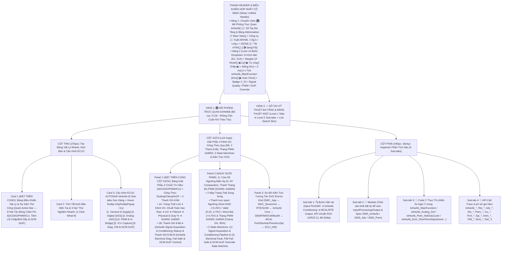
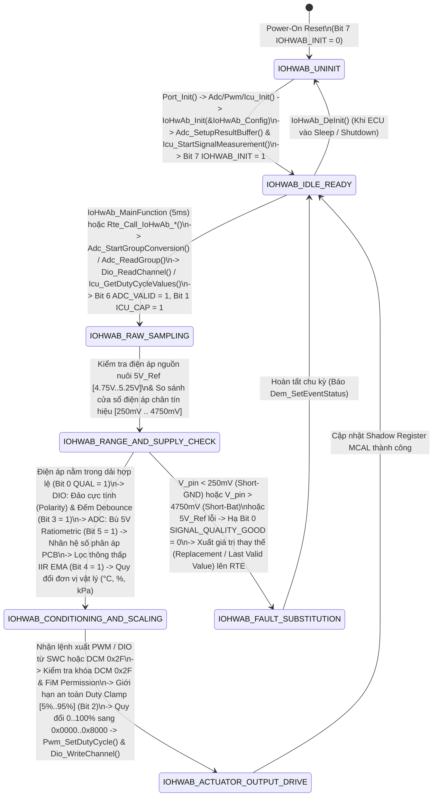
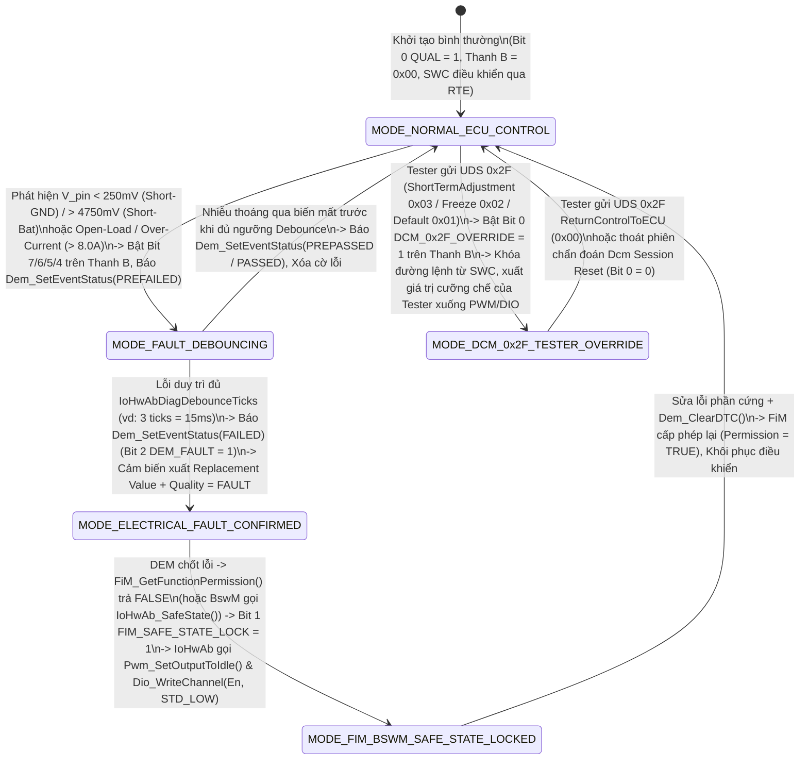

# Tài Liệu Thiết Kế Chi Tiết Trình Mô Phỏng AUTOSAR IoHwAb (`IoHwAb_Simulation_design.md`)

> **Trạng thái tài liệu:** Bản thiết kế chi tiết đã cập nhật theo xác nhận `A1`–`A4` của User — Sẵn sàng để User review trước khi triển khai code.  
> **File đích dự kiến xuất bản:** `d:\__Personal\AntiGravity\Simulation\04_ECU_Abstraction\AUTOSAR_IoHwAb.html` (Ứng dụng Web Tương tác 1 file HTML độc lập, 100% Offline, Pure CSS, có nút tải `.HTML` kèm cấu hình nhúng & xuất code `ARXML / IoHwAb_Cfg.h / IoHwAb_Lcfg.c / JSON`).  
> **Chuẩn tham chiếu:** **AUTOSAR Classic Platform R20-11 / R22-11 / R23-11 (`SWS_IoHwAb`, `AUTOSAR_EXP_AIMDesign`, `SWS_Port`, `SWS_Dio`, `SWS_Adc`, `SWS_Pwm`, `SWS_Icu`, `SWS_Spi`, `SWS_Ocu`, `SWS_Dem`, `SWS_Fim`, `SWS_Dcm`, `SWS_BswM`, `SWS_EcuM`, `SWS_Det`, `SWS_Rte`)**, đính kèm mã requirement chuẩn **`SWS_IoHwAb_xxxxx` / `SWS_Adc_xxxxx` / `SWS_Pwm_xxxxx` / `SWS_Dio_xxxxx` / `SWS_Icu_xxxxx`** tại từng bước xử lý, Bảng Giải Phẫu Chuỗi Chuyển Đổi Tín Hiệu 4 Kênh (`DIO / ADC / PWM 0x8000 / ICU`), Công thức Scaling / Ratiometric / IIR Filter / Duty Clamp, Bộ Multiplexer Cưỡng chế `DCM UDS 0x2F`, 2 thanh ghi 8-Bit tương tác, tooltip cấu hình và sổ tay tra cứu đa tầng.

---

## 1. Tổng Quan Định Hướng Thiết Kế Đã Chốt (`A1` – `A4`)

| Hạng mục | Nội dung thiết kế đã xác nhận với User |
| :--- | :--- |
| **1. Bố cục giao diện & Ưu tiên Không Cuộn Trang — Zero-Scroll (`A1`)** | Kết hợp tinh hoa của **`AUTOSAR_DEM.html`**, **`AUTOSAR_BswM.html`** và **`AUTOSAR_FiM.html`**, tối ưu hóa **Above-the-Fold (Zero-Scroll)** để các khối thao tác và giám sát tần suất cao nhất luôn nằm ngay phần đầu mỗi cột trong khung màn hình:<br>• **Thanh Điều Khiển Hợp Nhất Cố Định (Sticky Unified Header)**:<br>  - **Hàng 1**: Chuyển View `[🎛️ Mô Phỏng Trực Quan IoHwAb]` \| `[📖 Sổ Tay Đa Tầng & Bảng Abbreviation (7 Main Tabs)]` + Công cụ `[🧾 Xuất ARXML / IoHwAb_Cfg.h / IoHwAb_Lcfg.c / JSON]` \| `[💾 Tải .HTML]` \| `[🌗 Sáng/Tối]`.<br>  - **Hàng 2 (Luôn cố định)**: Dropdown chọn 14 Kịch bản (`S1`–`S14`), Stepper (`↺ Reset`, `◀ Lùi`, `▶ Tự chạy`, `Tiếp ▶`), Đồng hồ (`t = 0 ms`, `+1 Tick IoHwAb_MainFunction (5ms)`, `▶ Auto Clock`) và Badge Trạng thái `5V Sensor Supply`, `Signal Quality`, `PWM Output` & `DCM 0x2F Mode`.<br>• **Bố cục 3 cột hiện đại (Mỗi cột tự cuộn độc lập trong khung Viewport)**:<br>  - **Cột Trái (`375px`)**: Đưa **Card 1: Bảng Điều Khiển Vật Lý & Sự Kiện Thủ Công (`Quick Action Bar` — 8 nút/thanh tác động trực tiếp vào chân vật lý ADC/DIO/PWM/ICU, tiêm lỗi điện học & DCM 0x2F)** và **Card 2: Tóm tắt kịch bản & 3 nút 1-Click What-If** lên trên cùng, tiếp theo là **Card 3: 6 Sub-tabs Cấu hình ECUC IoHwAb** (hỗ trợ Floating Hover Tooltip `#cfgTooltipPopup` sau `>1s` giống hệt `AUTOSAR_DEM.html`).<br>  - **Cột Giữa (`Linh hoạt`)**: Đưa **Panel 1: Bảng Giải Phẫu Chuỗi Chuyển Đổi Tín Hiệu 4 Kênh (`ADC / DIO / PWM 0x8000 / ICU`) + Công Thức Quy Đổi (`Raw ↔ Physical`) + 2 Thanh Ghi 8-Bit Tương Tác** và **Panel 2: Cửa Sổ So Sánh Ngưỡng Điện Áp (`0V..5V Window Comparator`), Thanh Thang Đo `PWM 16-Bit (0x0000..0x8000)` & 2 Máy Trạng Thái Song Song (`Signal Conditioning Pipeline` + `Electrical Diag, Fail-Safe & DCM 0x2F Override`)** lên ngay đầu cột giữa; bên dưới là **Panel 3: Sơ Đồ Kiến Trúc Tương Tác SVG End-to-End** (`SWC_App ↔ SWC_SensorAct ↔ RTE/SchM ↔ IoHwAb Core ↔ DEM/FiM/DCM/BswM/EcuM/Det ↔ MCAL Port/Dio/Adc/Pwm/Icu/Spi ↔ PCB Hardware & SmartFET`).<br>  - **Cột Phải (`440px, Sticky`)**: Inspector 4 Sub-tabs (`🔍 Bước hiện tại`, `🧩 Module`, `📄 Code C Thực Thi`, `📜 API Call Trace`).<br>• **Vị trí xuất file**: `Simulation/04_ECU_Abstraction/AUTOSAR_IoHwAb.html` (đồng bộ trực tiếp với `AUTOSAR.html` và `autosar_modules.json`). |
| **2. Khu vực Giám sát Bit-level, Giải phẫu Chuỗi Tín hiệu & 2 Thanh ghi 8-Bit (`A2`)** | Đặt **cố định và nổi bật ở đầu Cột Giữa** gồm **2 tầng trực quan hóa**:<br>• **Tầng 1 — Bảng Giải Phẫu Trực Quan 4 Chuỗi Kênh I/O (`CH0_ADC_Pedal`, `CH1_DIO_BrakeSw`, `CH2_PWM_Throttle`, `CH3_ICU_WheelSpd`) & Bộ Công Thức Quy Đổi Trực Tiếp**:<br>  - Hiển thị trực tiếp luồng biến đổi số học từ chân MCU tới đơn vị vật lý: `Raw ADC (0..4095) ➔ V_pin (mV) ➔ Ratiometric 5V Compensation ➔ PCB Divider Ratio ➔ IIR Low-Pass Filter ➔ Physical Value (0..100.0% / °C)` và chiều ngược lại cho cơ cấu chấp hành: `SWC Target Duty (%) ➔ DCM 0x2F / FiM Safe-State Mux ➔ Safety Duty Clamp (5%..95%) ➔ AUTOSAR 16-Bit PWM Scale (0x0000..0x8000) + H-Bridge Direction DIO`.<br>• **Tầng 2 — 2 Thanh ghi 8-Bit tương tác song song**:<br>  1. **Thanh A (`8-Bit IoHwAb Signal Acquisition, Conditioning & Scaling Status Byte` — `IoHwAb_SignalStatusByte`)**: Theo dõi trạng thái thu thập và xử lý tín hiệu (`IOHWAB_INITIALIZED`, `ADC_CONV_VALID`, `RATIOMETRIC_COMP_ON`, `IIR_FILTER_SETTLED`, `DIO_DEBOUNCE_STABLE`, `PWM_DUTY_CLAMPED`, `ICU_EDGE_CAPTURED`, `SIGNAL_QUALITY_GOOD`).<br>  2. **Thanh B (`8-Bit IoHwAb Electrical Diagnostics, Fail-Safe & DCM 0x2F Control Byte` — `IoHwAb_DiagControlByte`)**: Theo dõi các cờ lỗi điện học, bảo vệ an toàn và cưỡng chế chẩn đoán (`SHORT_TO_GND_FLT`, `SHORT_TO_BAT_FLT`, `OPEN_LOAD_FLT`, `OVER_CURRENT_FLT`, `SENSOR_SUPPLY_FLT`, `DEM_FAULT_REPORTED`, `FIM_SAFE_STATE_LOCK`, `DCM_0x2F_OVERRIDE`). Cho phép click trực tiếp vào từng bit để giải mã hoặc thử nghiệm! |
| **3. Hệ thống 14 Kịch bản mẫu (`A3`)** | Thiết kế sẵn **14 Kịch bản (`S1`–`S14`)** chia làm 4 nhóm lớn:<br>• **Nhóm 1 (`S1`–`S3`) — Khởi Tạo Phần Cứng I/O (`Port ➔ Adc/Pwm/Dio/Icu ➔ IoHwAb_Init`) & Xử Lý Kênh Số `DIO` (`Active-Low Polarity`, `Switch Debouncing` & `SmartFET Output Readback`)**: Khởi tạo phân chân `Port_Init()`, thiết lập DMA buffer `Adc_SetupResultBuffer()`, đọc công tắc phanh có khử rung (`Debounce Counter`) kèm đảo cực tính (`Active Low ➔ Logical TRUE`), và điều khiển rơ-le/SmartFET qua `Dio_WriteChannel()` có đọc phản hồi kiểm chứng.<br>• **Nhóm 2 (`S4`–`S7`) — Chuỗi Tín Hiệu `ADC` (`SW/HW Trigger`, `Ratiometric 5V`, `IIR Filter`, `NTC Lookup`), Điều Khiển `PWM` (`0x0000..0x8000`, `Duty Clamp 5..95%`, `H-Bridge`) & Đo Tốc Độ `ICU`**: Chuỗi hoàn chỉnh `ADC ➔ IoHwAb ➔ RTE ➔ SWC_SensorAct ➔ SWC_App ➔ IoHwAb ➔ PWM` (tương thích luồng `F9` trên Hub), bù trôi nguồn `5V Ratiometric`, lọc nhiễu `IIR EMA`, quy đổi `0..100% ➔ 0x0000..0x8000` có cắt ngọn bảo vệ Bootstrap `5%..95%`, và đo tần số/góc mở từ cảm biến xung qua `Icu_GetDutyCycleValues()`.<br>• **Nhóm 3 (`S8`–`S11`) — Chẩn Đoán Lỗi Mạch Điện (`Short-to-GND`, `Short-to-Battery`, `Open-Load`, `Over-Current`, `5V Supply Undervoltage`), Báo Lỗi `DEM` & Cắt Tải An Toàn Qua `FiM / BswM`**: Phát hiện đứt dây / chập đất / chập nguồn trên cảm biến Analog (`< 250mV` hoặc `> 4750mV`), quá dòng cầu H qua `ADC Shunt / SPI SmartFET`, báo `Dem_SetEventStatus(PREFAILED / FAILED)` kèm đóng băng giá trị thay thế (`Replacement Value`), và nhận lệnh ức chế từ `FiM_GetFunctionPermission()` / `BswM` để ép cơ cấu chấp hành về `Pwm_SetOutputToIdle()`.<br>• **Nhóm 4 (`S12`–`S14`) — Cưỡng Chế Ngõ Ra Bằng Chẩn Đoán `DCM UDS 0x2F (InputOutputControlByIdentifier)`, Quản Lý Nguồn Tiết Kiệm (`DeInit / Sleep`) & Báo Lỗi `DET`**: Xử lý đủ 4 tiểu dịch vụ UDS `0x2F` (`ShortTermAdjustment 0x03`, `FreezeCurrentState 0x02`, `ResetToDefault 0x01`, `ReturnControlToECU 0x00`) khóa quyền điều khiển của `SWC` để Tester trực tiếp kích quạt/bướm ga, hạ chân I/O về mức tiết kiệm điện khi tắt máy, và kiểm thử các mã lỗi `DET` (`IOHWAB_E_UNINIT`, `IOHWAB_E_PARAM_SIGNAL`, `IOHWAB_E_PARAM_POINTER`, `IOHWAB_E_PARAM_DUTY`, `ADC_E_BUSY`). |
| **4. Sổ tay tra cứu đa tầng & Bảng Abbreviation (`A4`)** | **View 2 (`📖 Sổ Tay Kỹ Thuật IoHwAb & Từ Điển Thuật Ngữ`)** được tổ chức theo cấu trúc **Đa Tầng (Multi-level Tabs)**:<br>• **6 Main Sub-tabs (Level 1) × 4 Chủ đề con (Level 2 Pills/Tabs = 24 chuyên đề)** phân tích sâu kiến trúc `IoHwAb ↔ SWC_SensorAct ↔ MCAL`, toán học chuyển đổi Analog/Ratiometric/IIR Filter, chuẩn thang đo `PWM 0x8000` & `ICU Capture`, chẩn đoán mạch điện (`Short-GND/Bat, Open-Load`) kết hợp `DEM/FiM`, cơ chế `DCM UDS 0x2F` và từ điển API/ECUC.<br>• **Tab 7 chuyên biệt: `🔤 Bảng Thuật Ngữ & Từ Viết Tắt (Abbreviation Table)`** trình bày dưới dạng bảng chuẩn 4 cột, tích hợp **Search Box tìm kiếm tức thời (Live Search + Highlight `<mark>`)** và 5 nút lọc nhanh theo phân nhóm (`IoHwAb Core & VFB`, `Analog ADC & Conditioning`, `Digital DIO, PWM & ICU`, `Electrical Diag, DEM/FiM & 0x2F`). |

---

## 2. Bố Cục Giao Diện 3 Cột Ưu Tiên Zero-Scroll & Hệ Thống Sub-Tabs (UI Wireframe)

Để đảm bảo **"người dùng không cần cuộn chuột lên xuống mỗi lần thao tác"**, toàn bộ giao diện được thiết kế theo nguyên lý **Viewport-First (Đưa các khối tương tác vật lý và giám sát tín hiệu/bit tần suất cao nhất lên ngay phần đầu của mỗi cột, kết hợp hệ thống Sub-tabs gọn gàng)**:



### Điểm Cải Tiến Đột Phá Về Trải Nghiệm "Zero-Scroll" Cho Module `IoHwAb`:
1. **Thanh Điều Khiển Hợp Nhất (`Sticky Unified Header`)**: Gộp chọn kịch bản, nút bấm `Bước tiếp / Lùi / Tự chạy`, và nút nhịp đồng hồ `+1 Tick IoHwAb_MainFunction (5ms)` vào ngay thanh Header cố định. Người dùng ở bất kỳ vị trí nào cũng có thể bấm `+1 Tick IoHwAb_MainFunction (5ms)` để quan sát bộ lọc thông thấp **`IIR Filter`** hội tụ dần về giá trị đích, bộ đếm khử rung **`DIO Debounce Counter`** tăng dần qua ngưỡng ổn định, hoặc bộ đếm lỗi **`DEM Pre-failed Debounce`** chốt lỗi mạch điện!
2. **Đưa `Quick Action Bar` (8 nút tác động chân Pin vật lý, tiêm lỗi điện học & cưỡng chế `DCM 0x2F`) lên vị trí Card 1 (Đầu Cột Trái)** và đưa **Bảng Giải Phẫu 4 Kênh I/O (`ADC / DIO / PWM 0x8000 / ICU`) + Công Thức Quy Đổi + 2 Thanh Ghi 8-Bit** lên đầu Cột Giữa: Khi người dùng đổi điện áp cảm biến bàn đạp ga (`V_pin = 2.50V` hoặc kéo xuống `0.10V` giả lập chạm đất), mắt người dùng nhìn thấy ngay lập tức `Raw ADC (2048 ➔ 82)`, điện áp `mV`, trạng thái chất lượng tín hiệu (`GOOD ➔ SHORT_TO_GND`), giá trị thay thế `Fail-Safe Replacement Value`, và các Bit trên 2 Thanh ghi 8-Bit đổi màu mà **không phải cuộn trang**.
3. **Gom 36 tham số ECUC vào 6 Sub-tabs gọn gàng**: Chiều cao Card Cấu hình được giữ gọn cố định (~275px), kèm hộp thoại giải thích nổi `#cfgTooltipPopup` khi hover quá `1000ms` giống hệt `AUTOSAR_DEM.html`.

---

## 3. Thiết Kế Chi Tiết Panel 1 (Đầu Cột Giữa): Bảng Giải Phẫu Chuỗi Chuyển Đổi Tín Hiệu 4 Kênh (`ADC / DIO / PWM 0x8000 / ICU`), Công Thức Quy Đổi & 2 Thanh Ghi 8-Bit Tương Tác

Trong kiến trúc AUTOSAR Classic (`SWS_IoHwAb` & `AUTOSAR_EXP_AIMDesign`), **`IoHwAb` là lớp cầu nối duy nhất chuyển đổi giữa "Thế giới Tín hiệu Điện & Thanh ghi Phần cứng (Raw Counts, Logic Pin, Hex Ticks)" của MCAL và "Thế giới Đại lượng Vật lý Kỹ thuật (mV, °C, kPa, %, RPM, Boolean Logic)" của các `SWC` trên tầng VFB/RTE**. Đồng thời, `IoHwAb` gánh vác 3 trọng trách sống còn:
1. **Signal Conditioning & Physical Scaling**: Đảo cực tính logic (`Polarity`), khử rung phím (`Debounce`), bù trôi điện áp nguồn cảm biến (`5V Ratiometric Compensation`), nhân hệ số phân áp bo mạch (`PCB Divider Gain/Offset`), lọc thông thấp (`IIR/EMA Filter`), và quy đổi sang thang chuẩn AUTOSAR PWM (`0x0000 = 0.0% .. 0x8000 = 100.0%`) kèm khóa biên an toàn (`Duty Clamping 5%..95%`).
2. **Electrical Diagnostics & Fail-Safe Substitution**: Phát hiện chạm đất (`Short-to-GND`), chạm nguồn (`Short-to-Battery`), đứt dây (`Open-Load`), quá dòng (`Over-Current`) hoặc sụt áp nguồn nuôi cảm biến (`5V Sensor Supply Drift`), báo cáo sự kiện lỗi sang **`DEM`**, xuất giá trị dự phòng (`Replacement / Last Valid Value`) và nhận lệnh cắt tải an toàn từ **`FiM` / `BswM`**.
3. **Diagnostic I/O Control Multiplexer (`DCM UDS 0x2F`)**: Cắt ngang quyền điều khiển của `SWC` khi máy chẩn đoán gửi dịch vụ **`0x2F InputOutputControlByIdentifier`** (`ShortTermAdjustment`, `FreezeCurrentState`, `ResetToDefault`, `ReturnControlToECU`).

Do đó, Panel 1 ở đầu Cột Giữa được thiết kế gồm **2 tầng trực quan hóa liên thông**:

### 3.1. Phần 1A — Bảng Giải Phẫu Trực Quan 4 Chuỗi Tín Hiệu I/O & Công Thức Toán Học Live (`Raw ↔ Physical & 0x2F Mux`)

```text
+-------------------------------------------------------------------------------------------------------------------+
| ⚡ BẢNG GIẢI PHẪU CHUỖI XỬ LÝ TÍN HIỆU IOHWAB (`MCAL Raw ↔ Conditioning/Scaling ↔ RTE Physical & DCM 0x2F Mux`)   |
| Nguồn nuôi 5V_Ref: [ 5000 mV (OK) ] | Chu kỳ MainFunc: [ 5 ms ] | FiM Actuator Perm: [ PERMITTED ] | 0x2F: [ ECU ]|
+-------------------------------------------------------------------------------------------------------------------+
| 1. MA TRẬN 4 KÊNH TÍN HIỆU ĐIỂN HÌNH (`IoHwAbSignalDesc` — Click vào hàng bất kỳ để chọn kênh phân tích sâu):     |
|  +--------------------+------------------+--------------------+--------------------+---------------+-------------+|
|  | Kênh (Signal ID)   | Chân & MCAL API  | Giá Trị Thô (Raw)  | Xử Lý Tại IoHwAb   | Đơn Vị Vật Lý | Chất Lượng  ||
|  +--------------------+------------------+--------------------+--------------------+---------------+-------------+|
|  | CH0_ADC_PedalPos ★ | P02.3 / Adc_Grp0 | 2048 / 4095 (12b)  | 2500mV ➔ IIR ➔ Lin | 50.0 % Pedal  | 🟢 GOOD     ||
|  | CH1_DIO_BrakeSw    | P00.7 / Dio_Ch7  | Pin = STD_LOW (0V) | Active-Low + Deb15 | TRUE (Pressed)| 🟢 GOOD     ||
|  | CH2_PWM_Throttle   | P10.1 / Pwm_Ch2  | 0x4000 / 0x8000    | Clamp[5..95%]+Dir1 | 50.0 % (FWD)  | 🟢 GOOD     ||
|  | CH3_ICU_WheelSpeed | P01.4 / Icu_Ch1  | T=2000us, Ton=1000 | f=500Hz (20 Teeth) | 1500 RPM (50%)| 🟢 GOOD     ||
|  +--------------------+------------------+--------------------+--------------------+---------------+-------------+|
| 2. GIẢI PHẪU CÔNG THỨC CHUYỂN ĐỔI LIVE (`ADC Scaling & Ratiometric` + `AUTOSAR PWM 0x8000 & DCM 0x2F Multiplexer`):|
|  • [ADC Chain]: Raw(2048)/4095 × V_ref(5000mV) × Ratio(5000/5000) = 2500 mV ➔ Clamp[500..4500mV] ➔ Phys = 50.00%  |
|  • [PWM & 0x2F Mux]: SWC_Req(50.0%) ➔ [Mux: ECU_CTRL] ➔ [FiM: ALLOW] ➔ Clamp[5..95%](50.0%) ➔ 0x8000×0.5 = 0x4000 |
+-------------------------------------------------------------------------------------------------------------------+
```

- **Tính năng tương tác trực tiếp trên Phần 1A**:
  - Người dùng nhìn thấy ngay **con đường biến đổi từng con số** từ thanh ghi phần cứng (`Raw ADC = 2048`, `Pin = STD_LOW`, `PWM Hex = 0x4000`, `ICU Ticks = 2000 µs`) sang đại lượng vật lý chuẩn hóa (`2500 mV ➔ 50.0%`, `BrakePressed = TRUE`, `1500 RPM`)!
  - Khi xảy ra lỗi điện học (ví dụ `V_pin = 100 mV < 250 mV Short-to-GND`) hoặc khi kích hoạt **`DCM UDS 0x2F ShortTermAdjustment (80%)`**, sơ đồ Multiplexer trên Phần 1A đổi màu tức thì để chỉ rõ giá trị nào đang được chọn đẩy lên `RTE` hoặc xuất xuống `Pwm_SetDutyCycle()`.

### 3.2. Phần 1B — 2 Thanh Ghi 8-Bit Trạng Thái Tương Tác Luôn Hiển Thị Nổi Bật

Ngay bên dưới Phần 1A là **2 Thanh ghi 8-Bit tương tác** theo đúng phong cách trực quan của `AUTOSAR_DEM.html`, `AUTOSAR_BswM.html` và `AUTOSAR_FiM.html`:

```text
+-------------------------------------------------------------------------------------------------------------------+
| 🔢 BẢNG GIÁM SÁT BITFIELD 8-BIT IOHWAB SIGNAL & ELECTRICAL DIAGNOSIS (LIVE 8-BIT INSPECTOR) [Click ô Bit để thử]  |
| Bước #4: Rte_Call_IoHwAb_Analog_Get(CH0_Pedal) ➔ Raw=2048 (2500mV) ➔ Phys=50.0% | Thanh A: 0xFB | Thanh B: 0x00   |
+-------------------------------------------------------------------------------------------------------------------+
| A. THANH GHI 8-BIT THU THẬP, LỌC & QUY ĐỔI TÍN HIỆU (`IoHwAb_SignalStatusByte`) — Hex: [ 0xFB ] Bin: [1111 1011b] |
|    Module State: [ INITIALIZED ] | ADC Group: [ VALID ] | Filter/Debounce: [ SETTLED ] | Quality: [ IO_GOOD ]     |
|  +-------------+ +-------------+ +-------------+ +-------------+ +-------------+ +-------------+ +-------+ +-----+|
|  | Bit 7 (0x80)| | Bit 6 (0x40)| | Bit 5 (0x20)| | Bit 4 (0x10)| | Bit 3 (0x08)| | Bit 2 (0x04)| |Bit1(2)| |Bit 0||
|  | IOHWAB_INIT | | ADC_VALID   | | RATIO_COMP  | | IIR_SETTLED | | DIO_DEBOUNCE| | PWM_CLAMPED | |ICU_CAP| |QUAL ||
|  |      1      | |      1      | |      1      | |      1      | |      1      | |      0      | |   1   | |  1  ||
|  | Initialized | | DMA Conv OK | | 5V Comp ON  | | EMA Stable  | | Debounce OK | | Within 5-95%| |EdgeOK | |GOOD!||
|  +-------------+ +-------------+ +-------------+ +-------------+ +-------------+ +-------------+ +-------+ +-----+|
+-------------------------------------------------------------------------------------------------------------------+
| B. THANH GHI 8-BIT CHẨN ĐOÁN ĐIỆN HỌC, AN TOÀN & DCM 0x2F (`IoHwAb_DiagControlByte`) — Hex:[0x00] Bin:[0000 0000b]|
|    Electrical Fault: [ NONE (OK) ] | DEM Report: [ PASSED ] | FiM Safe-State: [ INACTIVE ] | DCM 0x2F: [ ECU ]    |
|  +-------------+ +-------------+ +-------------+ +-------------+ +-------------+ +-------------+ +-------+ +-----+|
|  | Bit 7 (0x80)| | Bit 6 (0x40)| | Bit 5 (0x20)| | Bit 4 (0x10)| | Bit 3 (0x08)| | Bit 2 (0x04)| |Bit1(2)| |Bit 0||
|  | SHORT_GND   | | SHORT_BAT   | | OPEN_LOAD   | | OVER_CURR   | | SUPPLY_5V_F | | DEM_FAULT   | |FIM_SAF| |0x2F ||
|  |      0      | |      0      | |      0      | |      0      | |      0      | |      0      | |   0   | |  0  ||
|  | > 250 mV OK | | < 4750mV OK | | Load Connected| < 8.0 A OK  | | 5.00V Normal| | Event PASSED| |Normal | |ECU  ||
|  +-------------+ +-------------+ +-------------+ +-------------+ +-------------+ +-------------+ +-------+ +-----+|
+-------------------------------------------------------------------------------------------------------------------+
```

#### 3.2.1. Giải Mã Chi Tiết Thanh A: `8-Bit IoHwAb Signal Acquisition, Conditioning & Scaling Status Byte` (`IoHwAb_SignalStatusByte`)

| Bit | Mask | Tên Cờ (`IoHwAb Signal Bit`) | Ý nghĩa kỹ thuật & Khi nào bật lên `1` (`0 ➔ 1`) | Khi nào hạ về `0` (`1 ➔ 0`) |
| :-: | :-: | :--- | :--- | :--- |
| **Bit 7** | `0x80` | **`IOHWAB_INITIALIZED`** | Bật lên `1` sau khi `EcuM / BswM` gọi **`IoHwAb_Init(&IoHwAb_Config)`** thành công (`SWS_IoHwAb_00001`), đăng ký xong bộ đệm kết quả DMA qua `Adc_SetupResultBuffer()`, khởi tạo giá trị lọc ban đầu và kích hoạt đo xung `Icu_StartSignalMeasurement()`. | Hạ về `0` khi gọi **`IoHwAb_DeInit()`** lúc chuẩn bị ngủ/tắt ECU, hoặc khi người dùng tắt Checkbox `IoHwAbInitialized` để kiểm thử báo lỗi `Det_ReportError(IOHWAB_E_UNINIT = 0x01)`. |
| **Bit 6** | `0x40` | **`ADC_CONV_VALID`** | Bật lên `1` khi nhóm kênh ADC (`Adc_Group0`) hoàn tất lấy mẫu (`ADC_STREAM_COMPLETED` / `ADC_COMPLETED`) và hàm **`Adc_ReadGroup(GroupId, DataBufferPtr)`** trả về `E_OK` (`SWS_Adc_00331`). | Hạ về `0` khi bộ chuyển đổi ADC đang bận (`ADC_BUSY`), chưa được kích hoạt (`ADC_IDLE`), hoặc `Adc_ReadGroup()` trả về `E_NOT_OK`. |
| **Bit 5** | `0x20` | **`RATIOMETRIC_COMP_ON`** | Bật lên `1` khi cấu hình **`IoHwAbEnableRatiometricCompensation = TRUE`** đang hoạt động: `IoHwAb` đo đồng thời kênh điện áp nguồn nuôi cảm biến $V_{\text{5V,meas}}$ và nhân tỷ lệ bù $\frac{5000\text{ mV}}{V_{\text{5V,meas}}}$ để triệt tiêu sai số do sụt áp nguồn 5V! | Hạ về `0` khi tắt chế độ bù Ratiometric (dùng cho cảm biến xuất áp tuyệt đối như đo điện áp ắc-quy `KL30` hoặc nhiệt điện trở có nguồn dòng riêng) hoặc khi nguồn 5V rơi ra ngoài dải cho phép. |
| **Bit 4** | `0x10` | **`IIR_FILTER_SETTLED`** | Bật lên `1` khi bộ lọc thông thấp số hạng bậc 1 **`IIR / EMA Low-Pass Filter`** ($y_k = \alpha x_k + (1-\alpha) y_{k-1}$) đã hội tụ ổn định quanh giá trị đầu vào mới (sai lệch $|y_k - x_k| < \varepsilon$) hoặc khi dùng chế độ đọc trực tiếp không trễ. | Hạ về `0` ngay khi tín hiệu Analog đầu vào thay đổi đột ngột (Step Change) và bộ lọc IIR đang trong quá trình quá độ hội tụ qua từng nhịp `IoHwAb_MainFunction(5ms)`. |
| **Bit 3** | `0x08` | **`DIO_DEBOUNCE_STABLE`** | Bật lên `1` khi tín hiệu đầu vào số từ **`Dio_ReadChannel()`** (sau khi xét đảo cực tính `IoHwAbDioActivePolarity`) đã giữ nguyên mức logic mới liên tục đủ số chu kỳ khử rung **`IoHwAbDioDebounceTimeMs`** (ví dụ `15ms = 3 ticks`), chính thức cập nhật trạng thái công tắc sạch nhiễu! | Hạ về `0` trong lúc tiếp điểm cơ khí của công tắc đang nảy (bouncing) hoặc chưa đủ số chu kỳ xác nhận `DebounceCounter < Threshold`. |
| **Bit 2** | `0x04` | **`PWM_DUTY_CLAMPED`** | Bật lên `1` khi `SWC` yêu cầu độ rộng xung nằm ngoài ngưỡng bảo vệ phần cứng (ví dụ yêu cầu `0%` hoặc `100%` trong khi mạch lái cầu H Bootstrap yêu cầu giữ trong khoảng **`[IoHwAbPwmMinDutyPct .. IoHwAbPwmMaxDutyPct]` = `[5.0% .. 95.0%]`**), buộc `IoHwAb` phải cắt ngọn (`Clamp`) trước khi quy đổi sang thang `0x0000..0x8000`! | Hạ về `0` khi giá trị Duty Cycle yêu cầu nằm hoàn toàn trong vùng tuyến tính an toàn (`5.0% <= Duty <= 95.0%`). |
| **Bit 1** | `0x02` | **`ICU_EDGE_CAPTURED`** | Bật lên `1` khi **`Icu_GetDutyCycleValues(IcuCh, &DutyValues)`** đọc được chu kỳ `PeriodTime > 0` hợp lệ từ cảm biến tốc độ bánh xe / quạt làm mát / cảm biến PWM, giúp `IoHwAb` tính ra tần số `Hz / RPM` và `% Duty` chính xác (`SWS_Icu_00342`). | Hạ về `0` khi không có xung đầu vào quá thời gian `IoHwAbIcuTimeoutMs` (`0 Hz / Stall` hoặc đứt dây cảm biến tốc độ). |
| **Bit 0** | `0x01` | **`SIGNAL_QUALITY_GOOD`** | Bật lên `1` khi tín hiệu I/O đang xét vượt qua toàn bộ các bước kiểm tra điện học (`Không chạm đất, Không chạm nguồn, Không đứt dây, Nguồn 5V ổn định`), được gắn nhãn chất lượng **`IOHWAB_SIG_QUALITY_GOOD`** cấp lên `SWC` qua `RTE`! | Hạ về `0` ngay khi phát hiện bất kỳ lỗi điện học nào trên Thanh B: chất lượng tín hiệu chuyển sang `IOHWAB_SIG_QUALITY_FAULT / SUBSTITUTED` và `IoHwAb` xuất giá trị dự phòng (`Replacement Value` hoặc `Last Valid Value`). |

#### 3.2.2. Giải Mã Chi Tiết Thanh B: `8-Bit IoHwAb Electrical Diagnostics, Fail-Safe & DCM 0x2F Control Byte` (`IoHwAb_DiagControlByte`)

| Bit | Mask | Tên Cờ (`IoHwAb Diag / Control Bit`) | Ý nghĩa kỹ thuật & Khi nào bật lên `1` (`0 ➔ 1`) | Khi nào hạ về `0` (`1 ➔ 0`) |
| :-: | :-: | :--- | :--- | :--- |
| **Bit 7** | `0x80` | **`SHORT_TO_GND_FLT`** | Bật lên `1` khi điện áp chân Analog tụt xuống dưới ngưỡng chạm đất **`V_pin < IoHwAbAdcShortToGndThrMv`** (mặc định `< 250 mV`, trong khi cảm biến bình thường hoạt động ở `500..4500 mV`), hoặc khi chân Output High-Side bị kéo sập về `0V` lúc đang kích `STD_HIGH`! | Hạ về `0` khi điện áp chân tín hiệu quay trở lại vùng hoạt động hợp lệ (`>= 250 mV`) và vượt qua bộ đếm hồi phục (Debounce Healing). |
| **Bit 6** | `0x40` | **`SHORT_TO_BAT_FLT`** | Bật lên `1` khi điện áp chân Analog vọt lên trên ngưỡng chạm nguồn **`V_pin > IoHwAbAdcShortToBatThrMv`** (mặc định `> 4750 mV` do chập lên dây 5V/12V hoặc do điện trở Pull-up kéo lên khi đứt dây mát cảm biến), hoặc khi chân Low-Side bị chập thẳng lên `+UBat`! | Hạ về `0` khi điện áp chân tín hiệu giảm xuống dưới ngưỡng `<= 4750 mV` trong vùng hợp lệ. |
| **Bit 5** | `0x20` | **`OPEN_LOAD_FLT`** | Bật lên `1` khi mạch giám sát dòng cơ cấu chấp hành (hoặc chân trạng thái chẩn đoán của IC SmartFET đọc qua `Spi_SyncTransmit` / `Dio_ReadChannel`) phát hiện **hở mạch tải (`Open-Load`: dòng tải $I_{\text{load}} \approx 0\text{ mA}$ dù đang xuất xung PWM/DIO kích tải)** hoặc đứt dây cảm biến có trở phân cực! | Hạ về `0` khi tải van điện từ / mô-tơ / cảm biến được nối lại bình thường và dòng điện phản hồi nằm trong dải định mức. |
| **Bit 4** | `0x10` | **`OVER_CURRENT_FLT`** | Bật lên `1` khi kênh ADC đo dòng Shunt của cầu H (`CH_CurrentSense`) hoặc cờ lỗi nhiệt/quá dòng của SmartFET phát hiện dòng tải vượt ngưỡng bảo vệ **`I_load > IoHwAbActuatorOverCurrentLimitMa`** (mặc định `> 8000 mA` do kẹt cơ khí mô-tơ bướm ga hoặc chập cuộn dây van)! | Hạ về `0` khi dòng tải giảm về mức an toàn và lỗi quá dòng đã được xóa/phục hồi. |
| **Bit 3** | `0x08` | **`SENSOR_SUPPLY_FLT`** | Bật lên `1` khi bộ ổn áp nguồn nuôi cảm biến `5V Tracker / LDO` trên bo mạch ECU bị sụt áp hoặc quá áp ra ngoài cửa sổ **`[4750 mV .. 5250 mV]`** (ví dụ tụt xuống `3800 mV` do một cảm biến bên ngoài làm sập nguồn 5V chung), làm mất độ tin cậy của toàn bộ nhóm cảm biến dùng chung nguồn đó! | Hạ về `0` khi điện áp nguồn nuôi cảm biến `5V_Ref` phục hồi về trong dải chuẩn `5000 mV ± 5%`. |
| **Bit 2** | `0x04` | **`DEM_FAULT_REPORTED`** | Bật lên `1` khi lỗi điện học trên bất kỳ kênh I/O nào kéo dài vượt ngưỡng khử nhiễu (`IoHwAbDiagDebounceTicks`) khiến `IoHwAb` gọi **`Dem_SetEventStatus(EventId, DEM_EVENT_STATUS_FAILED)`** chốt mã lỗi DTC vào **`AUTOSAR DEM`**! | Hạ về `0` khi tín hiệu trở lại bình thường và `IoHwAb` gọi **`Dem_SetEventStatus(EventId, DEM_EVENT_STATUS_PASSED)`** (hoặc sau lệnh `Dem_ClearDTC`). |
| **Bit 1** | `0x02` | **`FIM_SAFE_STATE_LOCK`** | Bật lên `1` khi **`FiM_GetFunctionPermission(FID_ThrottleActuator, &Permission)`** trả về **`Permission == FALSE`** (hoặc `BswM` gọi `IoHwAb_SafeState()`), buộc `IoHwAb` **cắt ngay xung điều khiển cơ cấu chấp hành về trạng thái an toàn (`Pwm_SetOutputToIdle(PwmCh)` & `Dio_WriteChannel(HBridge_En, STD_LOW)`)** bất chấp lệnh từ `SWC`! | Hạ về `0` khi `FiM` cấp phép trở lại (`Permission == TRUE`) và không có lệnh khóa an toàn từ `BswM`. |
| **Bit 0** | `0x01` | **`DCM_0x2F_OVERRIDE`** | Bật lên `1` khi máy chẩn đoán UDS kích hoạt dịch vụ **`0x2F InputOutputControlByIdentifier`** ở chế độ **`ShortTermAdjustment (0x03)`**, **`FreezeCurrentState (0x02)`** hoặc **`ResetToDefault (0x01)`**: Bộ Multiplexer trong `IoHwAb` khóa đường lệnh từ `SWC/RTE` và xuất trực tiếp giá trị cưỡng chế của Tester! | Hạ về `0` khi Tester gửi lệnh **`ReturnControlToECU (0x00)`** (hoặc khi phiên chẩn đoán `Extended/Safety Session` kết thúc, `Dcm` tự động gọi `IoHwAb_Dcm_ReturnControlToECU()`). |

---

## 4. Phân Tích Xử Lý Từng Module: Input Lấy Từ Đâu, Xử Lý Gì, Output Route Đến Đâu

Mọi khối trên sơ đồ kiến trúc SVG đều có thể **click vào để xem giải thích chi tiết** ở cột phải (Tab `🧩 Module`) và được tổng hợp đầy đủ trong **Tab 1 của Sổ tay**:

| # | Module / Phân khối | Lớp AUTOSAR | 📥 Input lấy từ đâu? | ⚙️ Cách xử lý nội bộ (Processing, Conditioning & State) | 📤 Output route đến đâu & Hàm API chuẩn (R20-11 / R22-11 / R23-11) |
| :-: | :--- | :--- | :--- | :--- | :--- |
| **1** | **`SWC_App`**<br>*(Core Control Application SW-C)* | Application Layer | • Nhận các đại lượng vật lý đã chuẩn hóa từ `SWC_SensorAct` qua `RTE` (`PedalPos_Pct`, `CoolantTemp_DegC`, `BrakePressed_Bool`, `WheelSpeed_Rpm`).<br>• Nhận quyền thực thi từ `FiM`. | • Thực thi thuật toán điều khiển vòng kín cốt lõi (ví dụ: PID điều khiển vị trí bướm ga điện tử, điều khiển quạt làm mát theo nhiệt độ nước, kiểm soát lực kéo).<br>• **Hoàn toàn độc lập phần cứng (Hardware-Independent)**: Không hề biết cảm biến dùng ADC mấy bit, nối vào chân nào của MCU hay cầu H dùng tần số PWM bao nhiêu! | • Ghi lệnh điều khiển mục tiêu sang **SWC_SensorAct** (hoặc gọi thẳng **IoHwAb** qua **RTE**):<br>`Rte_Write_PpThrottleTarget_DutyPct(TargetPct)`<br>`Rte_Call_RpIoHwAb_Pwm_SetDuty(CH2_Throttle, DutyPct, Dir)` |
| **2** | **`SWC_SensorAct`**<br>*(Sensor / Actuator Software Component)* | Application Layer | • Gọi Client-Server Port xuống `IoHwAb` qua `RTE` để đọc điện áp/đại lượng vật lý kèm cờ chất lượng (`Quality`).<br>• Nhận lệnh mục tiêu từ `SWC_App` qua `RTE`. | • Theo kiến trúc chuẩn **`AUTOSAR_EXP_AIMDesign`**:<br>  - **`IoHwAb`** chịu trách nhiệm **trừu tượng hóa bo mạch ECU (PCB/Electrical Abstraction)**: Đọc thanh ghi MCAL, nhân tỷ số cầu phân áp trở trên PCB, bù nguồn 5V và phát hiện chạm đất/chạm nguồn.<br>  - **`SWC_SensorAct`** chịu trách nhiệm **trừu tượng hóa đặc tính linh kiện cảm biến/cơ cấu chấp hành ngoài ECU (Sensor/Actuator Physics)**: Tra bảng nội suy phi tuyến (ví dụ đặc tuyến nhiệt điện trở NTC, so sánh chéo 2 rãnh cảm biến bàn đạp ga `Pedal Sensor A vs B Plausibility Check`) và điều phối chiều quay cầu H! | • Gọi xuống **IoHwAb** qua **RTE**:<br>`Rte_Call_RpIoHwAb_Analog_Get(SignalId, &PhysVal, &Quality)`<br>`Rte_Call_RpIoHwAb_Digital_Get(SignalId, &Level, &Quality)`<br>`Rte_Call_RpIoHwAb_Icu_GetDutyAndFreq(SignalId, &Hz, &Duty, &Quality)`<br>`Rte_Call_RpIoHwAb_Pwm_SetDutyCycle(SignalId, DutyPct)`<br>`Rte_Call_RpIoHwAb_Digital_Set(SignalId, Level)` |
| **3** | **`RTE` & `SchM`**<br>*(Runtime Environment & BSW Scheduler)* | RTE Layer | • Nhận các lời gọi `Rte_Call_RpIoHwAb_*` từ `SWC_SensorAct` / `SWC_App`.<br>• Nhận xung nhịp định kỳ từ `AUTOSAR OS` (`OsTask_IO_5ms`). | • Ánh xạ các cổng `Client-Server` (`IoHwAb_If_*`) và `Sender-Receiver` từ `SWC` trực tiếp thành lời gọi hàm C vào `IoHwAb`.<br>• **`SchM`**: Gọi định kỳ hàm **`IoHwAb_MainFunction()`** mỗi `IoHwAbMainFunctionPeriod` (`5ms`) để quét chuyển đổi `ADC`, chạy bộ lọc `IIR`, tăng bộ đếm khử rung `DIO Debounce` và giám sát lỗi điện học; đồng thời bảo vệ vùng găng `SchM_Enter_IoHwAb_IOHWAB_EXCLUSIVE_AREA_0()`. | • Gọi vào **IoHwAb**:<br>`IoHwAb_MainFunction(void)`<br>`IoHwAb_Digital_Get()` / `IoHwAb_Digital_Set()`<br>`IoHwAb_Analog_Get()`<br>`IoHwAb_Pwm_SetDutyCycle()` / `IoHwAb_Pwm_SetPeriodAndDuty()`<br>`IoHwAb_Icu_GetDutyAndFreq()` |
| **4** | **`IoHwAb Core Engine`**<br>*(I/O Hardware Abstraction — Conditioning, Scaling, Diag & 0x2F Mux)* | ECU Abstraction Layer | • Đọc dữ liệu thô từ các driver **MCAL** (`Adc`, `Dio`, `Icu`, `Spi`).<br>• Nhận yêu cầu đọc/ghi từ **RTE (`SWC`)**.<br>• Nhận lệnh cưỡng chế `0x2F` từ **DCM**, quyền thực thi từ **FiM** và lệnh `Init / SafeState` từ **EcuM / BswM**. | • **5 Khối Xử Lý Lõi bên trong `IoHwAb`**:<br>  1. **Khối Digital (`DIO`)**: Đọc `Dio_ReadChannel()`, đảo cực tính (`Active-Low / Active-High`), chạy bộ đếm khử rung `Debounce Counter`, xuất `Dio_WriteChannel()` và kiểm tra đọc ngược (`Readback Verification`).<br>  2. **Khối Analog (`ADC`)**: Kích hoạt/đọc `Adc_ReadGroup()`, bù trôi nguồn `5V Ratiometric`, nhân hệ số phân áp PCB, lọc thông thấp `IIR EMA`, kiểm tra ngưỡng điện áp `[Short-GND < 250mV .. Short-Bat > 4750mV]`, và cấp giá trị dự phòng `Replacement Value` nếu lỗi.<br>  3. **Khối PWM & Power Stage**: Kiểm tra khóa `DCM 0x2F Override` và `FiM Permission`, giới hạn an toàn `Duty Clamp [5%..95%]`, quy đổi `0..100% ➔ 0x0000..0x8000` (`(uint16)((DutyPct * 32768.0) / 100.0)`), gọi `Pwm_SetDutyCycle()` và `Dio_WriteChannel(Dir/En)`.<br>  4. **Khối Input Capture (`ICU`)**: Đọc `Icu_GetDutyCycleValues()`, tính tần số $f = \frac{f_{\text{tick}}}{\text{PeriodTicks}}$, tốc độ quay $\text{RPM} = \frac{f \times 60}{N_{\text{teeth}}}$ và kiểm tra Timeout.<br>  5. **Khối Chẩn Đoán & An Toàn**: Báo lỗi sang `DEM` (`Dem_SetEventStatus`), tra cứu `FiM_GetFunctionPermission()` và xử lý 4 callback `DCM UDS 0x2F`. | • Gọi xuống **MCAL Drivers**:<br>`Adc_StartGroupConversion()`, `Adc_ReadGroup()`, `Dio_ReadChannel()`, `Dio_WriteChannel()`, `Pwm_SetDutyCycle()`, `Pwm_SetPeriodAndDuty()`, `Pwm_SetOutputToIdle()`, `Icu_GetDutyCycleValues()`, `Port_SetPinDirection()`, `Spi_SyncTransmit()`<br>• Gọi sang **DEM, FiM & Det**:<br>`Dem_SetEventStatus(EventId, Status)`<br>`FiM_GetFunctionPermission(FID, &Perm)`<br>`Det_ReportError(ModuleId, InstanceId, ApiId, ErrorId)` |
| **5** | **`Port` & `Dio`**<br>*(Port Driver & DIO Driver)* | MCAL Layer | • `Port`: Nhận cấu hình phân chân (`Pin Muxing`), hướng chân (`IN/OUT`), điện trở kéo (`Pull-Up / Pull-Down`) từ `EcuM` & `IoHwAb`.<br>• `Dio`: Nhận lệnh đọc/ghi mức điện áp logic từ `IoHwAb`. | • **`Port` (`SWS_Port`)**: Khởi tạo toàn bộ bảng phân chân vi điều khiển qua `Port_Init(&Port_Config)` (ví dụ gán `P02.3 = ADC0_AN4`, `P00.7 = GPIO_IN_PULLUP`, `P10.1 = GTM_TOM0_PWM`, `P01.4 = TIM0_ICU`). Cho phép đổi hướng chân runtime qua `Port_SetPinDirection()` nếu `PortPinDirectionChangeable == TRUE`.<br>• **`Dio` (`SWS_Dio`)**: Đọc/ghi tức thời thanh ghi cổng GPIO phần cứng mà không cần đợi chu kỳ (`Synchronous, Non-buffered`). | • API chuẩn cung cấp cho **IoHwAb**:<br>`Port_Init(ConfigPtr)` [`SWS_Port_00140`]<br>`Port_SetPinDirection(Pin, Direction)` [`SWS_Port_00141`]<br>`Port_SetPinMode(Pin, Mode)` [`SWS_Port_00145`]<br>`Dio_ReadChannel(ChannelId)` [`SWS_Dio_00133`]<br>`Dio_WriteChannel(ChannelId, Level)` [`SWS_Dio_00134`]<br>`Dio_FlipChannel(ChannelId)` [`SWS_Dio_00190`] |
| **6** | **`Adc`**<br>*(ADC Driver)* | MCAL Layer | • Nhận điện áp tương tự (`0.00V .. 5.00V`) từ các chân cảm biến trên bo mạch ECU.<br>• Nhận lệnh cài đặt bộ đệm và kích hoạt chuyển đổi từ `IoHwAb`. | • Quản lý lấy mẫu theo **Nhóm kênh (`Adc_GroupType`)** (`SWS_Adc`):<br>  - Khởi tạo con trỏ RAM nhận kết quả DMA qua **`Adc_SetupResultBuffer(Group, DataBufferPtr)`** [`SWS_Adc_00420`].<br>  - Hỗ trợ 2 nguồn kích hoạt (`AdcGroupTriggSrc`): **SW Trigger** (`Adc_StartGroupConversion(Group)` gọi từ `IoHwAb_MainFunction`) hoặc **HW Trigger** (`Adc_EnableHardwareTrigger(Group)` đồng bộ trực tiếp với sườn giữa xung PWM của Timer GTM để tránh nhiễu đóng cắt MOSFET!).<br>  - Chuyển đổi điện áp `0..5.0V` thành giá trị nguyên 12-bit (`0..4095`) hoặc 10-bit (`0..1023`). | • API chuẩn cung cấp cho **IoHwAb**:<br>`Adc_Init(ConfigPtr)` [`SWS_Adc_00365`]<br>`Adc_SetupResultBuffer(Group, DataBufferPtr)` [`SWS_Adc_00420`]<br>`Adc_StartGroupConversion(Group)` [`SWS_Adc_00367`]<br>`Adc_ReadGroup(Group, DataBufferPtr)` [`SWS_Adc_00369`]<br>`Adc_GetGroupStatus(Group)` [`SWS_Adc_00372`]<br>`IoHwAb_AdcNotification_Grp0()` (Callback ngắt) |
| **7** | **`Pwm` (& `Ocu`)**<br>*(PWM Driver & Output Compare Driver)* | MCAL Layer | • Nhận lệnh đặt độ rộng xung (`DutyCycle`), chu kỳ (`Period`) hoặc đưa chân về trạng thái nghỉ (`Idle State`) từ `IoHwAb`. | • **`Pwm` (`SWS_Pwm`)**: Nhận giá trị `DutyCycle` theo **thang chuẩn hóa 16-bit cố định của AUTOSAR**:<br>  - **`0x0000` (`0`)** = `0.0%` Duty Cycle.<br>  - **`0x4000` (`16384`)** = `50.0%` Duty Cycle.<br>  - **`0x8000` (`32768`)** = `100.0%` Duty Cycle (`SWS_Pwm_00059`).<br>  - Nạp giá trị mới vào thanh ghi đệm (`Shadow Register`) của bộ định thời phần cứng (`GTM / eTimer`) để cập nhật đồng bộ ở cuối chu kỳ hiện tại (`PwmDutycycleUpdatedEndperiod = TRUE`), giúp xung không bao giờ bị gai (glitch)! | • API chuẩn cung cấp cho **IoHwAb**:<br>`Pwm_Init(ConfigPtr)` [`SWS_Pwm_00095`]<br>`Pwm_SetDutyCycle(ChannelNumber, DutyCycle)` [`SWS_Pwm_00097`]<br>`Pwm_SetPeriodAndDuty(ChannelNumber, Period, DutyCycle)` [`SWS_Pwm_00098`]<br>`Pwm_SetOutputToIdle(ChannelNumber)` [`SWS_Pwm_00099`]<br>`Pwm_GetOutputState(ChannelNumber)` [`SWS_Pwm_00100`] |
| **8** | **`Icu`**<br>*(Input Capture Unit Driver)* | MCAL Layer | • Nhận chuỗi xung vuông tốc độ cao từ cảm biến tốc độ bánh xe (`Wheel Speed`), cảm biến lưu lượng / vị trí PWM hoặc xung phản hồi quạt (`Tacho`). | • **`Icu` (`SWS_Icu`)**: Sử dụng phần cứng bắt cạnh Timer (`Input Capture`) để đo chính xác:<br>  - Thời gian mức hoạt động (`ActiveTime` ticks) và tổng chu kỳ (`PeriodTime` ticks) trong chế độ `ICU_MODE_SIGNAL_MEASUREMENT`.<br>  - Số lượng sườn xung (`ICU_MODE_EDGE_COUNTER`) hoặc kích hoạt đánh thức ECU (`ICU_MODE_SIGNAL_EDGE_DETECT`). | • API chuẩn cung cấp cho **IoHwAb**:<br>`Icu_Init(ConfigPtr)` [`SWS_Icu_00191`]<br>`Icu_StartSignalMeasurement(Channel)` [`SWS_Icu_00212`]<br>`Icu_GetDutyCycleValues(Channel, &DutyCycleValues)` [`SWS_Icu_00215`]<br>`Icu_GetTimeElapsed(Channel)` [`SWS_Icu_00214`]<br>`Icu_GetInputState(Channel)` [`SWS_Icu_00199`] |
| **9** | **`DEM` & `FiM`**<br>*(Diagnostic Event Manager & Function Inhibition Manager)* | Diagnostic Services | • **`DEM`**: Nhận báo cáo trạng thái lỗi phần cứng I/O (`PREFAILED / FAILED / PASSED`) từ `IoHwAb`.<br>• **`FiM`**: Cung cấp trạng thái cấp phép (`Permission = TRUE / FALSE`) cho từng `FID` khi `IoHwAb` hoặc `SWC` truy vấn. | • Khi `IoHwAb` phát hiện lỗi chạm đất, chạm nguồn, đứt dây hoặc quá dòng trên một kênh cảm biến/chấp hành, `IoHwAb` đóng vai trò **BSW Diagnostic Monitor** gọi `Dem_SetEventStatus()` (`SWS_Dem_00183`).<br>• Ngay khi `DEM` bật cờ `TestFailed (Bit 0 = 1)`, **`FiM`** ức chế `FID_ThrottleActuator` (`Permission = FALSE`), khiến `IoHwAb` tự động ngắt mạch công suất về `Safe-State`! | • Giao tiếp với **IoHwAb**:<br>`Dem_SetEventStatus(EventId, EventStatus)` [`SWS_Dem_00183`]<br>`FiM_GetFunctionPermission(FID, &Permission)` [`SWS_FiM_00011`] |
| **10** | **`DCM`, `BswM / EcuM` & `Det`**<br>*(UDS 0x2F I/O Control, Mode Mgr & Error Tracer)* | Diagnostic / System Services | • **`DCM`**: Nhận yêu cầu UDS **`0x2F InputOutputControlByIdentifier`** kèm `DataIdentifier (DID)` và `InputOutputControlParameter` (`0x00..0x03`) từ máy chẩn đoán Tester.<br>• **`Det`**: Nhận báo cáo lỗi tham số từ `IoHwAb`, `Adc`, `Pwm`, `Dio`, `Icu`. | • **`DCM` (`SWS_Dcm_00672`)**: Khi Tester gửi `2F F1 90 03 64` (cưỡng chế bướm ga mở `80%`), `DCM` gọi hàm callback của `IoHwAb` tương ứng với `DID 0xF190` để khóa đường điều khiển từ `SWC` và áp giá trị `80%` xuống `Pwm_SetDutyCycle()`. Khi Tester gửi `2F F1 90 00` (hoặc thoát phiên `Extended Session`), `DCM` gọi `ReturnControlToECU` trả quyền lại cho `SWC`!<br>• **`Det`**: Ghi nhận lỗi phát triển của `IoHwAb` (`IOHWAB_E_UNINIT`, `IOHWAB_E_PARAM_SIGNAL`, `IOHWAB_E_PARAM_POINTER`, `IOHWAB_E_PARAM_DUTY`, `IOHWAB_E_LOCKED_BY_DCM`). | • Gọi vào **IoHwAb**:<br>`IoHwAb_Dcm_<Signal>_ShortTermAdjustment(CtrlState, &ErrorCode)`<br>`IoHwAb_Dcm_<Signal>_FreezeCurrentState(&ErrorCode)`<br>`IoHwAb_Dcm_<Signal>_ResetToDefault(&ErrorCode)`<br>`IoHwAb_Dcm_<Signal>_ReturnControlToECU(&ErrorCode)`<br>`IoHwAb_Init()` / `IoHwAb_DeInit()` / `IoHwAb_SafeState()` |

---

## 5. Thiết Kế Chi Tiết 2 Máy Trạng Thái Của `IoHwAb`: `Signal Conditioning Pipeline State Machine` & `Electrical Diag, Fail-Safe & DCM 0x2F State Machine` (Panel 2)

Trên Panel 2 của Cột Giữa, luồng hoạt động của `IoHwAb` được hiển thị trực quan đồng thời qua **2 sơ đồ trạng thái liên kết chặt chẽ**:

### 5.1. Máy Trạng Thái Chuỗi Thu Thập, Lọc & Quy Đổi Tín Hiệu (`IoHwAb Signal Acquisition & Conditioning Pipeline State Machine`)



### 5.2. Máy Trạng Thái Chẩn Đoán Điện Học, Cắt Tải `FiM/BswM Fail-Safe` & Cưỡng Chế `DCM 0x2F` (`Electrical Fault, Fail-Safe & UDS 0x2F Override State Machine`)



---

## 6. Danh Mục Đầy Đủ 36 Trường Cấu Hình (Checkboxes, Textboxes & Dropdowns — 6 Sub-Tabs) & Thiết Kế Hover Tooltip Giống File `DEM`

Ở Cột Trái (Card 3), toàn bộ 36 tham số cấu hình chuẩn ECUC `IoHwAb` (kèm các tham số liên kết MCAL `Adc / Dio / Pwm / Icu`) được bố trí thành **Checkboxes, Textboxes, Number Spinners và Dropdowns** chia gọn vào **6 Sub-tabs**.  
Đặc biệt, **mọi ô cấu hình đều gắn thuộc tính `data-cfg-key` và hỗ trợ Floating Tooltip on Hover (`> 1s` delay hoặc click icon `ⓘ`) giống hệt `AUTOSAR_DEM.html`**.

### 6.1. Giao Diện & Cấu Trúc Dữ Liệu Của Floating Config Hover Tooltip (`#cfgTooltipPopup`)

Khi người dùng rê chuột giữ trên một ô cấu hình quá `1000ms` (hoặc bấm vào biểu tượng `ⓘ`), hộp thoại nổi `#cfgTooltipPopup` sẽ xuất hiện cạnh ô cấu hình với bố cục chuẩn của `AUTOSAR_DEM.html`:

```text
+----------------------------------------------------------------------------------------------------+
| 📘 Bù Trôi Điện Áp Nguồn Nuôi Cảm Biến Tỷ Lệ (5V Ratiometric Compensation) [SWS_IoHwAb_00001 | ECUC]|
| IoHwAb / IoHwAbConfigSet / IoHwAbAnalogSignal / IoHwAbEnableRatiometricCompensation                |
+----------------------------------------------------------------------------------------------------+
| Bật/tắt thuật toán bù tỷ lệ theo điện áp nguồn nuôi thực tế 5V_SensorSupply cho các cảm biến       |
| ratiometric (như chiết áp bàn đạp ga, cảm biến áp suất ratiometric):                               |
| • Khi TRUE : V_comp = V_pin_meas * (V_ref_nominal_5000mV / V_supply_5V_meas). Giúp kết quả đo %    |
|   hành trình hoàn toàn chính xác ngay cả khi nguồn 5V bị sụt nhẹ xuống 4.85V hoặc dâng lên 5.12V.  |
| • Khi FALSE: Dùng trực tiếp V_pin_meas (áp dụng cho cảm biến nhiệt NTC hoặc đo điện áp ắc-quy KL30)|
+-------------------------------------------------+--------------------------------------------------+
| Dải giá trị cho phép (Range):                   | Giá trị thường dùng (Typical):                   |
| TRUE (Enabled) | FALSE (Disabled)               | TRUE cho Pedal/Pressure; FALSE cho NTC/Battery   |
+-------------------------------------------------+--------------------------------------------------+
| 💡 Lưu ý kỹ thuật: Nếu điện áp nguồn 5V_Supply tụt quá ngưỡng IoHwAbSupplyUndervoltageThrMv        |
| (< 4750mV), IoHwAb phải dừng bù, bật cờ SENSOR_SUPPLY_FLT và báo lỗi sang DEM!                     |
+----------------------------------------------------------------------------------------------------+
```

### 6.2. Danh Sách Chi Tiết 36 Trường Cấu Hình Trong 6 Sub-Tabs

#### Sub-tab 1: `1. General & Supply` (`IoHwAbGeneral` — Khởi Tạo, Chu Kỳ & Giám Sát Nguồn `5V_Ref`)
1. **Checkbox ☑️ `IoHwAbInitialized` (`IoHwAb_Init()` State)**: Bật/tắt trạng thái đã khởi tạo module `IoHwAb` (`SWS_IoHwAb_00001`; nếu tắt, mọi lời gọi API đều bị từ chối và báo `Det_ReportError(IOHWAB_E_UNINIT = 0x01)`).
2. **Checkbox ☑️ `IoHwAbDevErrorDetect` (`ECUC_IoHwAb_00002`)**: Bật/tắt phát hiện và báo lỗi Development Error qua `Det_ReportError()` (`ModuleId = 254 / 0x00FE`).
3. **Checkbox ☑️ `IoHwAbVersionInfoApi` (`ECUC_IoHwAb_00003`)**: Cho phép gọi hàm `IoHwAb_GetVersionInfo(&VersionInfo)`.
4. **Number / Textbox `IoHwAbMainFunctionPeriodMs` (`ECUC_IoHwAb_00004`)**: Chu kỳ gọi `IoHwAb_MainFunction()` từ `SchM` tính bằng `ms` (Mặc định: `5 ms`, dải `1 .. 50 ms`).
5. **Number / Textbox `IoHwAbSensorSupplyMeasuredMv` (`Live 5V Tracker Supply Voltage`)**: Điện áp thực tế của nguồn nuôi cảm biến `5V_Ref` đo được trên PCB tính bằng `mV` (Mặc định: `5000 mV`; thử giảm xuống `4850 mV` để xem bù Ratiometric, hoặc `< 4750 mV` để kích hoạt lỗi nguồn nuôi!).
6. **Textbox `IoHwAbSupplyValidWindowMv` (`[Min .. Max mV]`)**: Cửa sổ điện áp hợp lệ của nguồn nuôi cảm biến 5V (Mặc định: `4750 .. 5250 mV`, tức `5.0V ± 5%`).

#### Sub-tab 2: `2. Digital (DIO)` (`IoHwAbDiscrete` — Cực Tính Logic, Khử Rung Công Tắc & Kiểm Chứng Ngõ Ra)
7. **Dropdown `IoHwAbDioActivePolarity` (`CH1_DIO_BrakeSw Polarity`)**: Chọn cực tính hoạt động của chân công tắc đầu vào (`ACTIVE_LOW` — mặc định cho công tắc nối đất có trở kéo lên `Pull-Up`: khi đạp phanh chân MCU xuống `STD_LOW (0V)` ➔ `IoHwAb` trả về `TRUE`; hoặc `ACTIVE_HIGH`).
8. **Checkbox ☑️ `IoHwAbDioDebounceEnable` (`Software Switch Debouncing`)**: Bật/tắt thuật toán khử rung tiếp điểm cơ khí cho đầu vào số `DIO`.
9. **Number / Textbox `IoHwAbDioDebounceTimeMs` (`Debounce Threshold ms`)**: Thời gian tín hiệu `DIO` phải giữ ổn định liên tục trước khi công nhận đổi trạng thái (Mặc định: `15 ms` = `3 ticks` của `IoHwAb_MainFunction`).
10. **Dropdown `IoHwAbPortPinPullMode` (`PortPinInputPullResistor`)**: Cấu hình điện trở kéo nội bộ trên chân `Port` (`PORT_PIN_IN_PULL_UP` — mặc định, `PORT_PIN_IN_PULL_DOWN`, `PORT_PIN_IN_NO_PULL`).
11. **Checkbox ☑️ `IoHwAbDioOutputReadbackVerify` (`Output Pin Readback Diagnostic`)**: Sau khi gọi `Dio_WriteChannel(OutCh, Level)`, tự động gọi `Dio_ReadChannel(OutCh)` kiểm tra xem mức điện áp thực tế trên chân có khớp với lệnh xuất hay bị chập đất/chập nguồn!
12. **Checkbox ☑️ `PortPinDirectionChangeable` (`SWS_Port_00063`)**: Cho phép `IoHwAb` đổi hướng chân `Port_SetPinDirection(Pin, PORT_PIN_IN / OUT)` lúc runtime.

#### Sub-tab 3: `3. Analog (ADC)` (`IoHwAbAnalog` — Độ Phân Giải, Trigger, Ratiometric, Scaling & Bộ Lọc `IIR`)
13. **Dropdown `AdcGroupTriggSrc` (`SWS_Adc_00356` — `SW vs HW Trigger`)**: Chọn nguồn kích hoạt lấy mẫu cho `Adc_Group0` (`ADC_TRIGG_SRC_SW` — gọi `Adc_StartGroupConversion()` từ phần mềm, hoặc `ADC_TRIGG_SRC_HW` — kích hoạt tự động từ sườn giữa xung PWM của Timer GTM).
14. **Dropdown `AdcResolutionBits` (`12-bit vs 10-bit SAR ADC`)**: Chọn độ phân giải bộ ADC (`12-bit: 0..4095 counts` — mặc định, hoặc `10-bit: 0..1023 counts`).
15. **Checkbox ☑️ `IoHwAbEnableRatiometricCompensation` (`5V Ratiometric Scaling`)**: Bật/tắt nhân hệ số bù nguồn nuôi $\frac{5000\text{ mV}}{V_{\text{5V,meas}}}$ khi tính điện áp cảm biến.
16. **Textbox `IoHwAbPcbVoltageDividerGainOffset` (`Gain & Offset`)**: Hệ số chuyển đổi tuyến tính từ điện áp chân (`mV`) sang đơn vị vật lý: `Gain = 0.025 (%/mV), Offset = -12.5 (%)` (sao cho `500 mV ➔ 0.0%`, `2500 mV ➔ 50.0%`, `4500 mV ➔ 100.0%`).
17. **Checkbox ☑️ `IoHwAbAdcIirFilterEnable` (`1st-Order EMA Low-Pass Filter`)**: Bật/tắt bộ lọc thông thấp số hạng $y_k = \alpha x_k + (1-\alpha) y_{k-1}$ trong `IoHwAb_MainFunction()`.
18. **Number / Textbox `IoHwAbAdcIirAlphaCoeff` (`Filter Alpha 0.10 .. 1.00`)**: Hệ số làm mượt $\alpha$ của bộ lọc IIR (Mặc định: `0.40`; nếu đặt `1.00` thì không trễ, đặt `0.20` thì lọc nhiễu rất mạnh qua nhiều chu kỳ).

#### Sub-tab 4: `4. PWM & H-Bridge` (`IoHwAbPwm` — Thang `0x8000`, Khóa Biên `Duty Clamp`, Cực Tính & Cầu H)
19. **Number / Textbox `IoHwAbPwmDefaultPeriodHz` (`Carrier Frequency Hz`)**: Tần số sóng mang PWM mặc định xuất ra cầu H / van điện từ (Mặc định: `2000 Hz` = chu kỳ `500 µs`).
20. **Checkbox ☑️ `IoHwAbPwmDutyClampEnable` (`Bootstrap / Power Stage Safety Clamp`)**: Bật/tắt giới hạn biên độ Duty Cycle trước khi nạp xuống `Pwm_SetDutyCycle()`.
21. **Textbox `IoHwAbPwmDutyClampRangePct` (`[Min% .. Max%]`)**: Khoảng giới hạn Duty Cycle an toàn (Mặc định: `5.0 .. 95.0 %`, tương ứng `0x0666 .. 0x799A` trên thang `0x8000`, giúp tụ Bootstrap của MOSFET High-Side luôn có thời gian nạp điện).
22. **Dropdown `PwmPolarityAndIdleState` (`SWS_Pwm_00060`)**: Chọn cực tính xung và mức nghỉ khi gọi `Pwm_SetOutputToIdle()` (`PWM_HIGH_POLARITY / IDLE_LOW` — mặc định, hoặc `PWM_LOW_POLARITY / IDLE_HIGH`).
23. **Checkbox ☑️ `PwmDutycycleUpdatedEndperiod` (`SWS_Pwm_00061` — Shadow Register Sync)**: Cập nhật độ rộng xung đồng bộ ở cuối chu kỳ Timer hiện tại để chống tạo gai xung (Glitch-free).
24. **Dropdown `IoHwAbHBridgeDriveMode` (`H-Bridge Direction & Enable Mapping`)**: Chọn chế độ lái cầu H (`PWM_PLUS_DIR_AND_EN` — 1 chân PWM + 1 chân DIO Direction + 1 chân DIO Enable, hoặc `DUAL_PWM_HALF_BRIDGE`).

#### Sub-tab 5: `5. ICU Capture` (`IoHwAbIcu` — Đo Tần Số, Độ Rộng Xung, Số Răng Xung & Timeout)
25. **Dropdown `IcuMeasurementMode` (`SWS_Icu_00205`)**: Chọn chế độ đo của kênh `Icu_Ch1` (`ICU_MODE_SIGNAL_MEASUREMENT` — đo `ActiveTime` & `PeriodTime`, hoặc `ICU_MODE_EDGE_COUNTER` — đếm số sườn xung).
26. **Dropdown `IcuDefaultStartEdge` (`SWS_Icu_00206`)**: Chọn sườn bắt đầu đo (`ICU_RISING_EDGE` — mặc định, `ICU_FALLING_EDGE`, `ICU_BOTH_EDGES`).
27. **Number / Textbox `IoHwAbSpeedSensorTeethCount` (`Pulses Per Revolution`)**: Số răng của vành xung cảm biến tốc độ bánh xe / trục cơ để quy đổi từ `Hz` sang `RPM` ($\text{RPM} = \frac{f_{\text{Hz}} \times 60}{N_{\text{teeth}}}$, mặc định: `20 teeth`).
28. **Number / Textbox `IoHwAbIcuTimeoutMs` (`Zero-Speed / Stall Timeout ms`)**: Thời gian tối đa không nhận được sườn xung trước khi `IoHwAb` kết luận tốc độ bằng `0 RPM` (hoặc báo lỗi đứt dây cảm biến nếu xe đang chạy, mặc định: `50 ms`).

#### Sub-tab 6: `6. Diag, FiM & DCM 0x2F` (`Electrical Faults`, `Replacement Strategy`, `DEM/FiM` & `UDS 0x2F`)
29. **Number / Textbox `IoHwAbAdcShortToGndThrMv` (`Short-to-GND Threshold mV`)**: Ngưỡng điện áp dưới để kết luận chập đất cảm biến Analog (Mặc định: `250 mV`).
30. **Number / Textbox `IoHwAbAdcShortToBatThrMv` (`Short-to-Bat / Open-Load Threshold mV`)**: Ngưỡng điện áp trên để kết luận chập nguồn hoặc đứt dây kéo lên (Mặc định: `4750 mV`).
31. **Number / Textbox `IoHwAbActuatorOverCurrentLimitMa` (`SmartFET / Shunt Over-Current Limit mA`)**: Ngưỡng dòng tải tối đa cho phép trước khi cắt bảo vệ quá dòng cầu H (Mặc định: `8000 mA` = `8.0 A`).
32. **Dropdown `IoHwAbFaultSubstStrategy` (`Sensor Fault Substitution Policy`)**: Chính sách xuất giá trị lên `RTE` khi kênh cảm biến bị lỗi điện học (`USE_REPLACEMENT_VALUE` — xuất giá trị cố định an toàn `IoHwAbReplacementValue`, `HOLD_LAST_VALID_VALUE` — giữ nguyên mẫu hợp lệ cuối cùng, hoặc `PASS_RAW_WITH_FAULT_FLAG`).
33. **Number / Textbox `IoHwAbSensorReplacementValuePct` (`Fail-Safe Default Value`)**: Giá trị dự phòng xuất lên `RTE` khi cảm biến bàn đạp ga bị lỗi và chọn `USE_REPLACEMENT_VALUE` (Mặc định: `10.0 %` — chế độ bò `Limp-Home` an toàn).
34. **Number / Textbox `IoHwAbDiagDebounceTicks` (`Internal Fault Confirmation Ticks`)**: Số chu kỳ `IoHwAb_MainFunction` liên tiếp lỗi điện học phải tồn tại trước khi chốt lỗi `DEM_EVENT_STATUS_FAILED` (Mặc định: `3 ticks` = `15 ms`).
35. **Checkbox ☑️ `IoHwAbEnableFiMSafeStateCheck` (`FiM Permission Enforcement`)**: Tự động gọi `FiM_GetFunctionPermission(FID_ThrottleActuator)` trước khi xuất PWM; nếu `Permission == FALSE`, lập tức gọi `Pwm_SetOutputToIdle()` ngắt cơ cấu chấp hành!
36. **Checkbox ☑️ `IoHwAbEnableDcm0x2FControl` (`UDS 0x2F InputOutputControlByIdentifier`)**: Cho phép `DCM` gọi các hàm cưỡng chế ngõ ra `ShortTermAdjustment / FreezeCurrentState / ResetToDefault / ReturnControlToECU` trên các kênh `IoHwAb`.

---

## 7. Thiết Kế Chi Tiết 14 Kịch Bản Chạy Mẫu (`S1` – `S14`)

Mỗi kịch bản được thiết kế để làm nổi bật rõ **sự thay đổi của từng Bit trên 2 Thanh ghi 8-Bit (`IoHwAb_SignalStatusByte` & `IoHwAb_DiagControlByte`)**, **Bảng Giải Phẫu 4 Kênh I/O (`Raw ↔ Physical`)**, **Thang đo `AUTOSAR PWM 0x0000..0x8000`**, **tác động của các trường Config**, và **luồng gọi hàm API chuẩn AUTOSAR R22-11 / R23-11** giữa các module:

| Mã | Nhóm chủ đề | Tên kịch bản | Luồng xử lý chính, API chuẩn & Các Bit / Config nổi bật | 3 Nút "Thử nghiệm nhanh" (1-Click What-If) |
| :-: | :--- | :--- | :--- | :--- |
| **S1** | **Nhóm 1: Khởi Tạo I/O & Xử Lý Kênh Số DIO** | **Chu Trình Khởi Tạo Ngăn Xếp I/O Chuẩn AUTOSAR (`Port_Init ➔ Dio/Adc/Pwm/Icu_Init ➔ Adc_SetupResultBuffer ➔ IoHwAb_Init`)** | • **Pha 1 (`Port_Init`)**: Trong pha khởi động `EcuM_StartupOne`, `EcuM` gọi **`Port_Init(&Port_Config)`** [`SWS_Port_00140`] để thiết lập Pin Multiplexing cho toàn bộ chân vi điều khiển (`P02.3 = ADC0_AN4`, `P00.7 = GPIO_IN_PULLUP`, `P10.1 = GTM_TOM0_PWM`, `P01.4 = TIM0_ICU`).<br>• **Pha 2 (`MCAL Drivers Init`)**: Gọi **`Adc_Init(&Adc_Config)`** [`SWS_Adc_00365`], **`Pwm_Init(&Pwm_Config)`** [`SWS_Pwm_00095`] (đặt xung mặc định `0x0000`), và **`Icu_Init(&Icu_Config)`** [`SWS_Icu_00191`].<br>• **Pha 3 (`IoHwAb_Init`)**: `BswM / EcuM` gọi **`IoHwAb_Init(&IoHwAb_Config)`** [`SWS_IoHwAb_00001`]. Bên trong, `IoHwAb` gọi **`Adc_SetupResultBuffer(AdcGroup_0, IoHwAb_AdcDmaBuffer)`** [`SWS_Adc_00420`] để gắn mảng RAM nhận kết quả DMA và gọi **`Icu_StartSignalMeasurement(IcuCh_WheelSpeed)`** [`SWS_Icu_00212`].<br>• **Trạng thái Bit**: Bật **`Bit 7 (IOHWAB_INITIALIZED = 1)`** và **`Bit 0 (SIGNAL_QUALITY_GOOD = 1)`** trên Thanh A! | 1. **Đổi `PortPinDirectionChangeable = TRUE` và gọi `Port_SetPinDirection()` runtime**<br>2. **Xem chuyện gì xảy ra nếu quên gọi `Adc_SetupResultBuffer()` trước khi `Adc_StartGroupConversion()`** (báo lỗi `ADC_E_UNINIT_BUFFER`)<br>3. **Gọi `IoHwAb_GetVersionInfo(&ver)`** để kiểm tra phiên bản module |
| **S2** | **Nhóm 1: Khởi Tạo I/O & Xử Lý Kênh Số DIO** | **Đọc Công Tắc Đầu Vào Số `DIO` Có Đảo Cực Tính (`Active-Low Pull-Up`) & Khử Rung Tiếp Điểm (`Software Switch Debouncing` — `15ms / 3 Ticks`)** | • Minh họa tại sao `SWC` không bao giờ nên gọi thẳng `Dio_ReadChannel()` mà phải đi qua `IoHwAb`:<br>  1. Công tắc bàn đạp phanh (`CH1_DIO_BrakeSw`) trên bo mạch dùng mạch **Active-Low có điện trở kéo lên 5V (`Pull-Up`)**: Khi nhả phanh, chân MCU ở mức `STD_HIGH (5V)`; khi đạp phanh, công tắc nối đất kéo chân MCU về **`STD_LOW (0V)`**.<br>  2. Khi người lái vừa đạp phanh, tiếp điểm cơ khí bị nảy (bouncing): Tại Tick #1 (`t = 5ms`), **`Dio_ReadChannel(DIO_CH_BRAKE_SW)`** [`SWS_Dio_00133`] trả về `STD_LOW`. `IoHwAb` đảo cực tính (`Active-Low ➔ RawLogical = TRUE`), nhưng vì `DebounceCounter = 1 < 3 (15ms)` nên hạ **`Bit 3 (DIO_DEBOUNCE_STABLE = 0)`** và vẫn giữ giá trị báo lên `RTE` là `FALSE`!<br>  3. Sau 3 chu kỳ `IoHwAb_MainFunction (5ms)` liên tiếp giữ `STD_LOW` (`t = 15ms`), `DebounceCounter == 3` ➔ `IoHwAb` bật **`Bit 3 (DIO_DEBOUNCE_STABLE = 1)`** và khi `SWC` gọi **`Rte_Call_IoHwAb_Digital_Get(CH1_BrakeSw, &isPressed, &quality)`**, kết quả trả về **`isPressed = TRUE, quality = GOOD`**! | 1. **Giả lập nhiễu gai (Glitch 1 tick rồi quay lại `STD_HIGH`)** (xem bộ đếm Debounce lọc sạch nhiễu, không làm đèn phanh nháy giả!)<br>2. **Đổi `IoHwAbDioActivePolarity` sang `ACTIVE_HIGH`** (xem logic bị đảo ngược ngay lập tức)<br>3. **Tắt `IoHwAbDioDebounceEnable = FALSE`** (xem tín hiệu đổi tức thì ngay ở Tick #1) |
| **S3** | **Nhóm 1: Khởi Tạo I/O & Xử Lý Kênh Số DIO** | **Điều Khiển Ngõ Ra Số `DIO` (`Dio_WriteChannel` / `Dio_FlipChannel`) Kèm Kiểm Chứng Đọc Ngược (`Output Readback Verification` Phát Hiện Chập Mạch)** | • Minh họa luồng xuất tín hiệu số điều khiển Rơ-le quạt / Chân Enable cầu H:<br>  1. `SWC_SensorAct` gọi **`Rte_Call_IoHwAb_Digital_Set(CH_RelayEnable, TRUE)`**.<br>  2. `IoHwAb` xét cực tính cấu hình và gọi **`Dio_WriteChannel(DIO_CH_RELAY_EN, STD_HIGH)`** [`SWS_Dio_00134`].<br>  3. Vì **`IoHwAbDioOutputReadbackVerify = TRUE`**, ngay sau đó `IoHwAb` gọi **`Dio_ReadChannel(DIO_CH_RELAY_EN)`** để đọc lại mức điện áp thực tế trên chân vật lý (hoặc đọc chân chẩn đoán của SmartFET).<br>  4. Nếu chân vật lý lên `STD_HIGH` khớp lệnh: xác nhận **`GOOD`**. Nếu dây dẫn ngoài ECU bị chập xuống vỏ xe (`Short-to-GND`), dù thanh ghi xuất `STD_HIGH` nhưng đọc ngược về vẫn là `STD_LOW` ➔ `IoHwAb` lập tức bật **`Bit 7 (SHORT_TO_GND_FLT = 1)`** trên Thanh B, cắt lệnh kích để bảo vệ mạch và báo lỗi **`Dem_SetEventStatus(Evt_RelayShortGnd, FAILED)`**! | 1. **Tiêm lỗi `Output Pin Short-to-GND` khi đang kích `TRUE`** (xem `Readback Verification` bắt lỗi ngay lập tức!)<br>2. **Gọi `Dio_FlipChannel()`** [`SWS_Dio_00190`] để đảo trạng thái chân đầu ra<br>3. **Tắt `IoHwAbDioOutputReadbackVerify = FALSE`** để so sánh |
| **S4** | **Nhóm 2: Chuỗi ADC, Ratiometric, IIR, PWM 0x8000 & ICU** | **Luồng End-to-End Chuẩn (`F9` Hub): Thu Thập Cảm Biến Analog (`Adc_StartGroupConversion ➔ Adc_ReadGroup`) ➔ Quy Đổi Vật Lý Tại `IoHwAb` ➔ `SWC` PID ➔ Xuất `PWM` (`0x4000`)** | • Kịch bản xương sống kết nối trực tiếp với luồng **`F9_IO_ACQUISITION`** trên trang chủ `AUTOSAR.html`:<br>  1. **Lấy mẫu ADC**: Cảm biến bàn đạp ga xuất `2.50 V` vào chân `P02.3`. `IoHwAb_MainFunction()` gọi **`Adc_StartGroupConversion(AdcGroup_0)`** [`SWS_Adc_00367`]. Khi DMA hoàn tất, **`Adc_ReadGroup(AdcGroup_0, RawBuf)`** [`SWS_Adc_00369`] trả về `Raw = 2048` (trên thang 12-bit `0..4095`), bật **`Bit 6 (ADC_CONV_VALID = 1)`**.<br>  2. **Quy đổi tại `IoHwAb`**: `IoHwAb` tính $V_{\text{pin}} = \frac{2048}{4095} \times 5000 = 2500\text{ mV}$, kiểm tra nằm trong cửa sổ hợp lệ `[250..4750 mV]`, áp công thức tuyến tính $\text{PedalPct} = 0.025 \times 2500 - 12.5 = \mathbf{50.0\%}$ kèm `Quality = IOHWAB_GOOD` (`Bit 0 = 1`).<br>  3. **Chuyển lên `SWC_SensorAct` & `SWC_App`**: Qua `Rte_Call_RpIoHwAb_Analog_Get()`, `SWC_SensorAct` lấy `50.0%`, kiểm tra hợp lý kép rồi ghi `Rte_Write_PpPedalPos_Pct(50.0f)`. `SWC_App` đọc giá trị này, chạy bộ điều khiển PID và yêu cầu mở bướm ga `50.0%` theo chiều thuận (`FWD`).<br>  4. **Xuất `PWM` & `DIO` xuống MCAL**: `IoHwAb_Pwm_SetDutyCycle(CH2_Throttle, 50.0%)` quy đổi `50.0%` sang thang chuẩn AUTOSAR 16-bit: $\text{Ticks} = 0\text{x}8000 \times 0.50 = \mathbf{0\text{x}4000\text{ (16384)}}$, rồi gọi **`Pwm_SetDutyCycle(PwmCh_Throttle, 0x4000)`** [`SWS_Pwm_00097`] và **`Dio_WriteChannel(DioCh_HBridgeEn, STD_HIGH)`**! | 1. **Kéo điện áp bàn đạp ga lên `3.50 V` (`Raw = 2867`)** (xem toàn bộ chuỗi tự động cập nhật sang `75.0%` ➔ `PWM = 0x6000`)<br>2. **Đổi `AdcResolutionBits` từ `12-bit (4095)` sang `10-bit (1023)`** (xem `Raw` đổi thành `512` nhưng giá trị vật lý `50.0%` lên `SWC` vẫn giữ nguyên không đổi!)<br>3. **Đổi `AdcGroupTriggSrc` sang `ADC_TRIGG_SRC_HW`** (đồng bộ theo Timer PWM) |
| **S5** | **Nhóm 2: Chuỗi ADC, Ratiometric, IIR, PWM 0x8000 & ICU** | **Bù Trôi Điện Áp Nguồn Nuôi `5V Ratiometric Compensation` & Bộ Lọc Thông Thấp Số Hạng `IIR / EMA Low-Pass Filter` Trong `IoHwAb_MainFunction`** | • Minh họa 2 kỹ thuật xử lý tín hiệu quan trọng bậc nhất trong `IoHwAb`:<br>  1. **Bài toán sụt áp nguồn 5V (`Ratiometric Compensation`)**: Bàn đạp ga vẫn giữ nguyên ở vị trí **`50.0%`**, nhưng do nhiệt độ khoang máy tăng cao, IC nguồn 5V bị sụt nhẹ từ `5000 mV` xuống **`4800 mV`**. Do cảm biến là chiết áp tỷ lệ, điện áp chân đo được tụt xuống chỉ còn `2400 mV` (`Raw = 1966`).<br>     - Nếu **không bù Ratiometric (`Bit 5 = 0`)**: Phần mềm hiểu nhầm người lái nhả ga về `47.5%` (sai số `2.5%`!).<br>     - Khi **bật `IoHwAbEnableRatiometricCompensation = TRUE` (`Bit 5 = 1`)**: `IoHwAb` lấy kênh đo nguồn `V_5V_meas = 4800 mV` và tính $V_{\text{comp}} = 2400 \times \frac{5000}{4800} = \mathbf{2500\text{ mV}} \implies \mathbf{50.0\%}$ chính xác tuyệt đối!<br>  2. **Bài toán lọc nhiễu (`IIR EMA Filter`)**: Khi tín hiệu nhảy bậc từ `0% ➔ 50%` (hoặc có nhiễu cao tần trên đường dây), ở Tick #1 (`Bit 4 IIR_SETTLED = 0`), đầu ra bộ lọc tăng mượt theo công thức $y_k = \alpha x_k + (1-\alpha) y_{k-1}$ qua từng nhịp `+1 Tick IoHwAb_MainFunction (5ms)` cho đến khi hội tụ hoàn toàn (`Bit 4 = 1`)! | 1. **Giữ `V_5V = 4800 mV` và tắt `IoHwAbEnableRatiometricCompensation = FALSE`** (thấy ngay sai số tụt xuống `47.5%`!)<br>2. **Bật lại `IoHwAbEnableRatiometricCompensation = TRUE`** (thấy giá trị khôi phục chuẩn `50.0%`)<br>3. **Bấm `+1 Tick IoHwAb_MainFunction (5ms)` liên tiếp** để quan sát đường hội tụ của bộ lọc `IIR Filter` với `Alpha = 0.40` |
| **S6** | **Nhóm 2: Chuỗi ADC, Ratiometric, IIR, PWM 0x8000 & ICU** | **Điều Khiển Cơ Cấu Chấp Hành `PWM` Chuyên Sâu: Quy Đổi Thang `0x0000..0x8000`, Khóa Biên An Toàn `Duty Clamp [5%..95%]` & Thay Đổi Tần Số `Pwm_SetPeriodAndDuty`** | • Giải phẫu chi tiết nhánh xuất xung điều khiển cơ cấu chấp hành từ `IoHwAb` xuống `MCAL Pwm`:<br>  1. **Thang đo chuẩn AUTOSAR (`SWS_Pwm_00059`)**: Mọi giá trị phần trăm từ `SWC` (`0.0% .. 100.0%`) được `IoHwAb` ánh xạ sang số nguyên 16-bit không dấu `0x0000` (`0%`) .. `0x8000` (`32768 = 100%`).<br>  2. **Bảo vệ mạch công suất (`Safety Duty Clamping`)**: Khi `SWC_App` yêu cầu mở bướm ga cực đại **`99.0%`** (hoặc `100.0%`), nếu xuất thẳng `100%` thì tụ Bootstrap của MOSFET High-Side trên mạch cầu H sẽ mất chu kỳ xả/nạp và bị sập áp kích cổng! Do đó, `IoHwAb` kiểm tra cấu hình **`IoHwAbPwmDutyClampRangePct = [5.0% .. 95.0%]`**, lập tức bật **`Bit 2 (PWM_DUTY_CLAMPED = 1)`** trên Thanh A, cắt ngọn giá trị về **`95.0%`** và gọi **`Pwm_SetDutyCycle(PwmCh_Throttle, 0x799A)`** (`31130 / 32768`)!<br>  3. **Điều khiển đồng thời Chu kỳ & Độ rộng xung**: Khi điều khiển van điều áp hoặc còi báo cần đổi cả tần số sóng mang, `IoHwAb` gọi **`Pwm_SetPeriodAndDuty(Channel, PeriodTicks, DutyHex)`** [`SWS_Pwm_00098`]. | 1. **Gửi yêu cầu `Duty = 99.0%` từ `SWC`** (xem `Bit 2 PWM_CLAMPED` bật lên `1` và ngõ ra khóa ở `95.0% = 0x799A`)<br>2. **Gửi yêu cầu `Duty = 1.0%` từ `SWC`** (xem `IoHwAb` nâng lên ngưỡng tối thiểu `5.0% = 0x0666` hoặc cắt hẳn về `0x0000` nếu ở chế độ Idle)<br>3. **Đổi `PwmPolarityAndIdleState` sang `PWM_LOW_POLARITY`** để xem đảo mức xung |
| **S7** | **Nhóm 2: Chuỗi ADC, Ratiometric, IIR, PWM 0x8000 & ICU** | **Đo Tần Số, Tốc Độ Quay (`RPM`) & Độ Rộng Xung Cảm Biến Qua `MCAL ICU` (`Icu_GetDutyCycleValues` & Phát Hiện `Stall / Timeout`)** | • Minh họa cách `IoHwAb` trừu tượng hóa các chân bắt xung tốc độ cao (`Input Capture Unit — SWS_Icu`):<br>  1. Cảm biến tốc độ bánh xe (`CH3_ICU_WheelSpeed`, vành răng `20 teeth`) hoặc cảm biến vị trí dùng xung PWM gửi chuỗi xung vuông vào chân `P01.4`.<br>  2. Khi `SWC` gọi **`Rte_Call_IoHwAb_Icu_GetDutyAndFreq(CH3_WheelSpd, &freqHz, &dutyPct, &rpm, &quality)`**, `IoHwAb` gọi xuống MCAL: **`Icu_GetDutyCycleValues(IcuCh_1, &IcuDutyVals)`** [`SWS_Icu_00215`].<br>  3. Giả sử Timer ICU đếm với xung nhịp `1 MHz (1 tick = 1 µs)` và trả về `PeriodTime = 2000 ticks (2000 µs)`, `ActiveTime = 1000 ticks (1000 µs)`:<br>     - `IoHwAb` bật **`Bit 1 (ICU_EDGE_CAPTURED = 1)`** trên Thanh A.<br>     - Tính tần số: $f = \frac{10^6}{2000} = \mathbf{500.0\text{ Hz}}$.<br>     - Tính độ rộng xung: $\text{Duty} = \frac{1000}{2000} \times 100 = \mathbf{50.0\%}$.<br>     - Quy đổi tốc độ bánh xe: $\text{RPM} = \frac{500 \times 60}{20} = \mathbf{1500\text{ RPM}}$ và trả lên `RTE`!<br>  4. Nếu quá `IoHwAbIcuTimeoutMs (50ms)` không có xung mới (`PeriodTime == 0`), `IoHwAb` hạ `Bit 1 = 0` và trả về `0 RPM`. | 1. **Giảm `PeriodTime` xuống `1000 µs` (`1000 Hz`)** (xem tốc độ bánh xe tăng gấp đôi lên `3000 RPM`!)<br>2. **Giả lập mất xung (`PeriodTime = 0` quá `50ms`)** (xem `Bit 1 ICU_CAP` hạ về `0` và báo `0 RPM`)<br>3. **Đổi `IoHwAbSpeedSensorTeethCount` từ `20` sang `60` răng** (xem công thức RPM tự động cập nhật) |
| **S8** | **Nhóm 3: Chẩn Đoán Lỗi Điện Học, DEM & FiM Fail-Safe** | **Chẩn Đoán Chạm Đất (`Short-to-GND < 250mV`) Trên Kênh Cảm Biến Analog: Khử Nhiễu Lỗi, Báo `Dem_SetEventStatus(FAILED)` & Xuất Giá Trị Dự Phòng (`Replacement Value`)** | • Minh họa luồng xử lý lỗi điện học kinh điển tại `IoHwAb`:<br>  1. Dây tín hiệu cảm biến bàn đạp ga (`CH0_ADC_PedalPos`, dải chuẩn `500..4500 mV`) bị cọ xát chạm vào sườn xe (`GND`), làm điện áp tại chân MCU sập xuống còn **`80 mV` (`Raw ADC = 65`)**.<br>  2. Trong `IoHwAb_MainFunction()`, bộ so sánh ngưỡng phát hiện $V_{\text{pin}} = 80\text{ mV} < \text{ShortToGndThr (250 mV)}$ ➔ Lập tức bật **`Bit 7 (SHORT_TO_GND_FLT = 1)`** trên Thanh B, hạ **`Bit 0 (SIGNAL_QUALITY_GOOD = 0)`** trên Thanh A, và gọi **`Dem_SetEventStatus(DemEvt_PedalShortGnd, DEM_EVENT_STATUS_PREFAILED)`** [`SWS_Dem_00183`].<br>  3. Ngay lập tức, để ngăn `SWC_App` tính toán sai từ giá trị `80 mV`, `IoHwAb` kích hoạt chính sách **`IoHwAbFaultSubstStrategy = USE_REPLACEMENT_VALUE`**: xuất giá trị dự phòng an toàn **`10.0% (Limp-Home)`** (hoặc giữ nguyên giá trị hợp lệ cuối cùng `50.0%` nếu chọn `HOLD_LAST_VALID_VALUE`) kèm cờ **`Quality = IOHWAB_SIG_FAULT`** lên `RTE`!<br>  4. Sau `3 ticks (15ms)` lỗi chạm đất duy trì liên tục, `IoHwAb` gọi **`Dem_SetEventStatus(DemEvt_PedalShortGnd, DEM_EVENT_STATUS_FAILED)`**, bật **`Bit 2 (DEM_FAULT_REPORTED = 1)`** trên Thanh B! | 1. **Đổi `IoHwAbFaultSubstStrategy` từ `USE_REPLACEMENT_VALUE (10%)` sang `HOLD_LAST_VALID_VALUE (50%)`** (so sánh ngay giá trị xuất lên `RTE`!)<br>2. **Khôi phục điện áp cảm biến về `2500 mV`** (xem `IoHwAb` gọi `Dem_SetEventStatus(PASSED)`, xóa `Bit 7` và trả `Quality = GOOD`)<br>3. **Thay đổi `IoHwAbDiagDebounceTicks`** để xem thời gian xác nhận lỗi |
| **S9** | **Nhóm 3: Chẩn Đoán Lỗi Điện Học, DEM & FiM Fail-Safe** | **Chẩn Đoán Chạm Nguồn / Đứt Dây Kéo Lên (`Short-to-Battery / Open-Wire > 4750mV`) & Sụt Áp Nguồn Nuôi Cảm Biến Chung (`5V Sensor Supply Undervoltage < 4750mV`)** | • Minh họa 2 trường hợp lỗi nguồn và đường dây phức tạp trên bo mạch ECU:<br>  1. **Trường hợp A (`Short-to-Bat / Open-Wire > 4750 mV`)**: Dây tín hiệu cảm biến bị đứt rời trong khi mạch đầu vào ECU có điện trở `Pull-Up` kéo lên `5V` (hoặc dây tín hiệu chạm vào dây `+5V / +12V`), khiến điện áp chân vọt lên **`4920 mV` (`Raw = 4030`)**. `IoHwAb` phát hiện $V_{\text{pin}} > 4750\text{ mV}$ ➔ Bật **`Bit 6 (SHORT_TO_BAT_FLT = 1)`** trên Thanh B, hạ `Bit 0 = 0`, xuất `Replacement Value` và báo `Dem_SetEventStatus(DemEvt_PedalShortBat, FAILED)`!<br>  2. **Trường hợp B (`5V Sensor Supply Fault < 4750 mV`)**: Bản thân dây cảm biến bàn đạp ga không đứt, nhưng một cảm biến áp suất khác dùng chung đường nguồn nuôi `5V_SensorSupply_A` bị chập làm sập nguồn `5V` xuống còn **`3900 mV`**! `IoHwAb` kiểm tra kênh giám sát nguồn nuôi thấy $3900\text{ mV} \notin [4750..5250\text{ mV}]$ ➔ Bật **`Bit 3 (SENSOR_SUPPLY_FLT = 1)`** trên Thanh B, **đánh dấu toàn bộ các cảm biến dùng chung nguồn `5V_Supply_A` là `Quality = FAULT`** và báo `Dem_SetEventStatus(DemEvt_SensorSupply5V_A, FAILED)` (giúp `FiM` chặn lỗi dây chuyền cho các cảm biến con)! | 1. **Kéo điện áp chân lên `4920 mV`** để kích hoạt `SHORT_TO_BAT_FLT (Bit 6 = 1)`<br>2. **Hạ nguồn nuôi `IoHwAbSensorSupplyMeasuredMv` xuống `3900 mV`** để kích hoạt `SENSOR_SUPPLY_FLT (Bit 3 = 1)`<br>3. **Khôi phục nguồn `5V` về `5000 mV`** (xem toàn bộ kênh cảm biến con tự động phục hồi `Quality = GOOD`) |
| **S10** | **Nhóm 3: Chẩn Đoán Lỗi Điện Học, DEM & FiM Fail-Safe** | **Chẩn Đoán Mạch Công Suất Cơ Cấu Chấp Hành: Phát Hiện Hở Tải (`Open-Load`) & Quá Dòng Cầu H (`Over-Current > 8.0A` Qua `ADC Shunt / SPI SmartFET`)** | • Minh họa cách `IoHwAb` bảo vệ tầng công suất lái mô-tơ bướm ga / van điện từ / quạt làm mát:<br>  1. **Giám sát Hở tải (`Open-Load`)**: `IoHwAb` đang xuất xung `PWM = 50% (0x4000)` để lái mô-tơ, nhưng giắc cắm mô-tơ bị tuột ra! Khi `IoHwAb` đọc dòng phản hồi qua kênh `ADC Current Sense` thấy $I_{\text{load}} = 0\text{ mA}$ (hoặc đọc thanh ghi trạng thái chẩn đoán của IC SmartFET qua **`Spi_SyncTransmit(SpiSeq_SmartFetDiag)`** báo cờ `OL = 1`), `IoHwAb` bật **`Bit 5 (OPEN_LOAD_FLT = 1)`** trên Thanh B và báo `Dem_SetEventStatus(DemEvt_ActuatorOpenLoad, FAILED)`!<br>  2. **Giám sát Quá dòng / Kẹt cơ khí (`Over-Current > 8000 mA`)**: Bướm ga bị kẹt dị vật khiến dòng điện qua cầu H vọt lên **`11500 mA (11.5 A) > 8000 mA`**. Ngay lập tức `IoHwAb` bật **`Bit 4 (OVER_CURRENT_FLT = 1)`**, tự động cắt khẩn cấp xung PWM về nghỉ qua **`Pwm_SetOutputToIdle(PwmCh_Throttle)`** [`SWS_Pwm_00099`] và hạ **`Dio_WriteChannel(DioCh_HBridgeEn, STD_LOW)`** để chống cháy MOSFET, đồng thời báo lỗi `Dem_SetEventStatus(DemEvt_ActuatorOverCurrent, FAILED)`! | 1. **Tiêm sự cố `Open-Load (I_load = 0 mA)` khi đang chạy PWM 50%** (xem `Bit 5 OPEN_LOAD_FLT = 1` và gói `Spi_SyncTransmit` đọc lỗi SmartFET)<br>2. **Tiêm sự cố `Over-Current (I_load = 11.5 A)`** (xem `Bit 4 OVER_CURR = 1` và `IoHwAb` ngắt `Pwm_SetOutputToIdle` tức thì!)<br>3. **Điều chỉnh ngưỡng `IoHwAbActuatorOverCurrentLimitMa`** để kiểm thử độ nhạy bảo vệ |
| **S11** | **Nhóm 3: Chẩn Đoán Lỗi Điện Học, DEM & FiM Fail-Safe** | **Phối Hợp An Toàn Chức Năng ISO 26262 (`IoHwAb ↔ DEM ↔ FiM ↔ BswM`): Khi `FiM` Thu Hồi Quyền (`Permission = FALSE`), `IoHwAb` Khóa Cứng Cơ Cấu Chấp Hành Về `Fail-Safe Idle`** | • Minh họa vòng lặp an toàn khép kín giữa `IoHwAb`, `DEM`, `FiM` và `BswM`:<br>  1. Khi xảy ra lỗi nghiêm trọng (ví dụ lỗi nguồn nuôi cảm biến `5V` hoặc lỗi quá dòng/chập mạch đã được `DEM` xác nhận ở `Bit 2 = 1`), module **`FiM`** tự động thu hồi quyền của chức năng điều khiển bướm ga (`FID_ThrottleActuator ➔ Permission = FALSE`).<br>  2. Ở chu kỳ tiếp theo, dù `SWC_App` vẫn gọi `Rte_Call_IoHwAb_Pwm_SetDutyCycle(CH2_Throttle, 65.0%)`, bên trong `IoHwAb` gọi **`FiM_GetFunctionPermission(FID_ThrottleActuator, &perm)`** [`SWS_FiM_00011`] (hoặc nhận lệnh `IoHwAb_SafeState()` từ `BswM`).<br>  3. Thấy **`perm == FALSE`**, `IoHwAb` bật **`Bit 1 (FIM_SAFE_STATE_LOCK = 1)`** trên Thanh B, **từ chối xuất xung 65% của `SWC`**, ép cứng đầu ra về **`Pwm_SetOutputToIdle(PwmCh_Throttle)` (`0x0000`)** và hạ chân `HBridge_En = STD_LOW` (để lò xo cơ khí đưa bướm ga về vị trí an toàn `Limp-Home`)!<br>  4. Chỉ khi lỗi phần cứng được khắc phục và gọi `Dem_ClearDTC()`, `FiM` trả lại `Permission = TRUE` (`Bit 1: 1 ➔ 0`), `IoHwAb` mới cho phép `SWC` điều khiển lại cầu H. | 1. **Thử gửi lệnh `SetDutyCycle(80%)` từ `SWC` khi `FIM_SAFE_STATE_LOCK == 1`** (chứng minh `IoHwAb` chặn hoàn toàn lệnh xuất xung!)<br>2. **Tắt `IoHwAbEnableFiMSafeStateCheck = FALSE`** (thấy nguy cơ xuất xung mất kiểm soát nếu thiếu chốt chặn tại `IoHwAb`)<br>3. **Gọi `Dem_ClearDTC()`** để giải phóng khóa `FiM` và khôi phục hoạt động bình thường |
| **S12** | **Nhóm 4: Cưỡng Chế DCM UDS 0x2F, Sleep & Báo Lỗi DET** | **Dịch Vụ Chẩn Đoán UDS `0x2F InputOutputControlByIdentifier`: Cưỡng Chế Ngõ Ra Bằng Tester (`ShortTermAdjustment 0x03`, `FreezeCurrentState 0x02`, `ResetToDefault 0x01`)** | • Minh họa tính năng cực kỳ thực tế tại xưởng dịch vụ và dây chuyền sản xuất EOL (`SWS_Dcm_00672`):<br>  1. Kỹ thuật viên dùng máy chẩn đoán muốn kiểm tra xem quạt làm mát / bướm ga (`DID 0xF190`) có hoạt động tốt không, nên gửi bản tin UDS **`2F F1 90 03 50`** (`InputOutputControlByIdentifier: ShortTermAdjustment = 80%`).<br>  2. `DCM` xác thực phiên `Extended Session` & `SecurityAccess`, sau đó gọi thẳng vào callback của `IoHwAb`: **`IoHwAb_Dcm_ThrottlePwm_ShortTermAdjustment(80%, &ErrorCode)`**.<br>  3. Ngay lập tức, `IoHwAb` bật **`Bit 0 (DCM_0x2F_OVERRIDE = 1)`** trên Thanh B, chuyển bộ **Multiplexer** từ nhánh `ECU_SWC` sang nhánh **`DCM_TESTER_OVERRIDE`**, và gọi **`Pwm_SetDutyCycle(PwmCh_Throttle, 0x6666)` (`80.0%`)**!<br>  4. Trong suốt thời gian `Bit 0 == 1`, mọi lệnh `Rte_Call_IoHwAb_Pwm_SetDutyCycle(20%)` từ `SWC_App` gửi xuống đều chỉ được lưu vào biến bóng (`Shadow ECU Request`) chứ **không được phép ghi đè lên phần cứng**!<br>  5. Khi Tester gửi **`2F F1 90 02` (`FreezeCurrentState`)**, `IoHwAb` giữ cố định mức xung hiện tại; khi gửi **`2F F1 90 01` (`ResetToDefault`)**, `IoHwAb` đưa về giá trị mặc định cấu hình (`0%`). | 1. **Đang ở `0x2F ShortTermAdjustment (80%)`, thử bắn lệnh `SWC Request = 15%`** (xem Multiplexer giữ cứng `80%` của Tester và bỏ qua lệnh `15%` của `SWC`!)<br>2. **Gửi lệnh `2F F1 90 02 (FreezeCurrentState)`** để đóng băng trạng thái cơ cấu chấp hành<br>3. **Gửi lệnh `2F F1 90 01 (ResetToDefault)`** để đưa cơ cấu chấp hành về mặc định |
| **S13** | **Nhóm 4: Cưỡng Chế DCM UDS 0x2F, Sleep & Báo Lỗi DET** | **Trả Quyền Điều Khiển Về ECU (`0x2F ReturnControlToECU 0x00` / Thoát Phiên `DCM`) & Chu Trình Đưa Chân I/O Về Trạng Thái Tiết Kiệm Điện (`IoHwAb_DeInit`)** | • Minh họa quá trình thoát khỏi chế độ cưỡng chế chẩn đoán và quy trình tắt máy an toàn:<br>  1. **Trả quyền điều khiển (`ReturnControlToECU`)**: Khi Tester gửi **`2F F1 90 00`** (hoặc khi rút cáp Tester làm hết hạn `S3 Server Timeout`, `DCM` tự động chuyển về `Default Session`), `DCM` gọi **`IoHwAb_Dcm_ThrottlePwm_ReturnControlToECU(&ErrorCode)`**.<br>  2. `IoHwAb` hạ **`Bit 0 (DCM_0x2F_OVERRIDE: 1 ➔ 0)`** trên Thanh B, chuyển bộ Multiplexer về lại nhánh **`ECU_SWC`**, và lập tức áp giá trị `Shadow ECU Request` mới nhất của `SWC_App` xuống `Pwm_SetDutyCycle()` một cách mượt mà!<br>  3. **Chu trình tắt máy / Ngủ (`IoHwAb_DeInit`)**: Khi ECU chuẩn bị vào `SLEEP / OFF`, `BswM / EcuM` gọi **`IoHwAb_DeInit()`**. `IoHwAb` gọi `Icu_StopSignalMeasurement()`, `Pwm_SetOutputToIdle()`, hạ các chân kích nguồn cảm biến `Dio_WriteChannel(SensorSupplyEn, STD_LOW)` để cắt dòng rò (`Quiescent Current < 100 µA`), và hạ **`Bit 7 (IOHWAB_INITIALIZED: 1 ➔ 0)`**! | 1. **Gửi `2F F1 90 00 (ReturnControlToECU)`** (xem `Bit 0` về `0` và ngõ ra PWM lập tức đồng bộ lại theo giá trị của `SWC_App`)<br>2. **Giả lập `DCM Session Timeout (S3 Timeout ➔ Default Session)`** (xem `DCM` tự động gọi `ReturnControlToECU` để không bao giờ bỏ quên cơ cấu chấp hành ở trạng thái cưỡng chế!)<br>3. **Gọi `IoHwAb_DeInit()`** để quan sát quá trình hạ chân I/O tiết kiệm điện |
| **S14** | **Nhóm 4: Cưỡng Chế DCM UDS 0x2F, Sleep & Báo Lỗi DET** | **Kiểm Thử Bảo Vệ Tham Số & Báo Cáo Lỗi `DET` (`IOHWAB_E_UNINIT`, `IOHWAB_E_PARAM_SIGNAL`, `IOHWAB_E_PARAM_POINTER`, `IOHWAB_E_PARAM_DUTY`, `ADC_E_BUSY`)** | • Kiểm chứng cơ chế phòng vệ của `IoHwAb` và các driver `MCAL` (`IoHwAbDevErrorDetect = TRUE`, `ModuleId = 254 / 0x00FE`):<br>  1. **`IOHWAB_E_UNINIT (0x01)`**: Tắt `IoHwAbInitialized = FALSE` (`Bit 7 = 0` trên Thanh A) rồi gọi `IoHwAb_Analog_Get()` hoặc `IoHwAb_Pwm_SetDutyCycle()` ➔ `IoHwAb` từ chối thực thi và gọi `Det_ReportError(254, 0, ApiId, 0x01)`.<br>  2. **`IOHWAB_E_PARAM_SIGNAL (0x02)`**: Truyền mã kênh `SignalId = 99` vượt ngoài bảng cấu hình ➔ báo `Det_ReportError(254, 0, ApiId, 0x02)`.<br>  3. **`IOHWAB_E_PARAM_POINTER (0x03)`**: Truyền con trỏ `NULL_PTR` vào `IoHwAb_Analog_Get(CH0, NULL_PTR, &qual)` hoặc `IoHwAb_GetVersionInfo(NULL_PTR)` ➔ báo `Det_ReportError(254, 0, ApiId, 0x03)`.<br>  4. **`IOHWAB_E_PARAM_DUTY / ADC_E_BUSY (0x04 / 0x0B)`**: Truyền giá trị Duty Cycle âm hoặc `> 100%` khi tắt Clamp, hoặc gọi `Adc_StartGroupConversion()` khi nhóm ADC đang bận chuyển đổi! | 1. **Tắt `IoHwAbInitialized = FALSE` rồi gọi `IoHwAb_Analog_Get`** ➔ xem `IOHWAB_E_UNINIT (0x01)` trên Trace!<br>2. **Bắn `IoHwAb_Digital_Get(SignalId = 99)`** ➔ xem `IOHWAB_E_PARAM_SIGNAL (0x02)`<br>3. **Truyền `NULL_PTR` vào `IoHwAb_Analog_Get`** ➔ xem `IOHWAB_E_PARAM_POINTER (0x03)` |

---

## 8. Thiết Kế Bảng Điều Khiển Vật Lý & Sự Kiện Thủ Công (`Quick Action Bar` — Đặt Ngay Đầu Cột Trái)

Đặt ở **Card 1 (Đầu Cột Trái)** để người dùng có thể bấm thao tác bất kỳ lúc nào mà không cần cuộn trang, đóng vai môi trường vật lý (thay đổi điện áp cảm biến, gạt công tắc, đổi tốc độ bánh xe), đóng vai `SWC_App` điều khiển cơ cấu chấp hành, hoặc tiêm lỗi chập/đứt dây & cưỡng chế `DCM 0x2F`:

| Nút điều khiển | Tham số / Hành động | Hiệu ứng trực quan trên Bảng 4 Kênh I/O, Công thức Quy đổi, 2 Thanh ghi 8-Bit & State Machines |
| :--- | :--- | :--- |
| **`🎚️ 1. Điện Áp Cảm Biến ADC (P02.3)`** | Chọn nhanh `0.10V (Short-GND)` / `0.50V (0%)` / `2.50V (50%)` / `4.50V (100%)` / `4.92V (Short-Bat)` | Cập nhật ngay `Raw ADC (0..4095)`, chạy công thức `Ratiometric + IIR Filter + Linear Scaling`, cập nhật `CH0_ADC_PedalPos (%)` và bật/tắt cờ lỗi `Bit 7 (SHORT_GND)` / `Bit 6 (SHORT_BAT)` trên Thanh B! |
| **`🔘 2. Gạt Công Tắc Số DIO (P00.7)`** | Chuyển chân vật lý `STD_LOW (0V - Đạp phanh)` ↔ `STD_HIGH (5V - Nhả phanh)` | Đảo cực tính `Active-Low`, kích hoạt bộ đếm khử rung `Debounce Counter` (`Bit 3 DIO_DEBOUNCE` chuyển `0 ➔ 1` sau `3 ticks`) và cập nhật `CH1_DIO_BrakeSw`! |
| **`⚙️ 3. Đặt Lệnh PWM Bướm Ga (SWC)`** | Chọn `0% (Idle)` / `50% (0x4000)` / `80% (0x6666)` / `99% (Test Clamp 95%)` | Đi qua bộ Multiplexer `0x2F` và chốt `FiM`, kiểm tra khóa biên `Duty Clamp [5..95%]` (`Bit 2 PWM_CLAMPED`), quy đổi sang Hex `0x0000..0x8000` và gọi `Pwm_SetDutyCycle()`! |
| **`🛞 4. Tần Số Xung ICU (P01.4)`** | Chọn `0 Hz (Stall)` / `250 Hz (750 RPM)` / `500 Hz (1500 RPM)` / `1000 Hz (3000 RPM)` | Cập nhật `Icu_GetDutyCycleValues()` (`PeriodTime`, `ActiveTime`), bật `Bit 1 (ICU_EDGE_CAPTURED)` và tính tốc độ quay `RPM` trực tiếp! |
| **`⚡ 5. Tiêm Lỗi Điện Học & Nguồn 5V`** | Chọn `Open-Load (0mA)` / `Over-Current (11.5A)` / `5V Supply Drop (3.9V)` / `Clear All Faults` | Kích hoạt các cờ `Bit 5 (OPEN_LOAD)`, `Bit 4 (OVER_CURR)`, `Bit 3 (SUPPLY_5V_FLT)`, báo `Dem_SetEventStatus(FAILED)` (`Bit 2 = 1`) và khóa `FiM Safe-State` (`Bit 1 = 1`)! |
| **`🩺 6. Cưỡng Chế Chẩn Đoán DCM 0x2F`** | Chọn `ShortTermAdj (80%)` / `FreezeState` / `ResetDefault` / `ReturnControlToECU` | Bật/tắt `Bit 0 (DCM_0x2F_OVERRIDE)` trên Thanh B, đổi hướng bộ Multiplexer sang Tester và khóa đường điều khiển từ `SWC`! |
| **`⏱ 7. +1 Tick IoHwAb_MainFunction`** | Tiến đồng hồ thêm `+5ms` (`IoHwAb_MainFunction()`) | Quét chu kỳ lấy mẫu `ADC`, cập nhật bước lọc `IIR EMA`, tăng bộ đếm `DIO Debounce Counter` và bộ đếm xác nhận lỗi `DEM Debounce`! |
| **`🧹 8. Reset Về Mặc Định`** | `IoHwAb_Init(&IoHwAb_Config)` | Đưa toàn bộ 4 kênh I/O, nguồn `5V_Ref`, bộ lọc `IIR`, trạng thái `DEM/FiM/0x2F` và 2 Thanh ghi 8-Bit về trạng thái khởi tạo sạch sẽ. |

---

## 9. Cấu Trúc "Sổ Tay Kỹ Thuật AUTOSAR IoHwAb" Đa Tầng (`📖 Sổ tay tra cứu` — 2 Levels) & Bảng Giải Thích Thuật Ngữ (`Abbreviation Table` + `Search Box`)

Đáp ứng trọn vẹn yêu cầu của User:
- *"Tạo các mục 'sổ tay' để có thể tra cứu thông tin nhanh. Các topic con có thể chia thành nhiều tabs với nhiều level khác nhau."*
- *"Thêm mục abbreviation để giải thích các thuật ngữ dưới dạng bảng, thêm search box để thuận tiện cho việc tìm kiếm thuật ngữ."*

View **`📖 Sổ tay tra cứu & Thuật ngữ`** được thiết kế với **Hệ thống Tabs 2 Tầng (Level 1: 7 Main Tabs ➔ Level 2: 4 Sub-topic Tabs trong mỗi mục = 24 chuyên đề kỹ thuật + Tab 7 Bảng Thuật Ngữ có Live Search Box riêng)**:

### 9.1. Sơ Đồ Phân Cấp 2 Tầng Của 6 Main Tabs Sổ Tay Kỹ Thuật (`Tab 1` – `Tab 6`)

| Tầng 1 (Main Handbook Tabs) | Tầng 2 (Sub-Topic Tabs / Pills bên trong mỗi Tab chính) | Nội dung kỹ thuật trọng tâm được trình bày |
| :--- | :--- | :--- |
| **Tab 1: `1. Kiến Trúc IoHwAb & Phân Định Trách Nhiệm Với SWC / MCAL`** | • **`1.1. Tại Sao AUTOSAR Cần Lớp IoHwAb? (Tách Biệt Bo Mạch PCB Khỏi Thuật Toán Ứng Dụng)`**<br>• **`1.2. Phân Biệt Rạch Ròi: MCAL Drivers vs IoHwAb vs Sensor/Actuator SW-C vs Application SW-C`**<br>• **`1.3. Bảng Phân Tích I/O Chi Tiết 10 Module Tương Tác Với IoHwAb`**<br>• **`1.4. Tại Sao SWS_IoHwAb Không Đóng Cứng Tên Hàm Nội Bộ Mà Chuẩn Hóa Qua RTE Ports?`** | • Giải thích triết lý thiết kế chuẩn **`AUTOSAR_EXP_AIMDesign`**: Khi đổi vi điều khiển (ví dụ từ Infineon Aurix TC3xx sang NXP S32K3) hoặc đổi điện trở phân áp trên PCB, chỉ cần cập nhật `MCAL` và `IoHwAb` mà không phải sửa một dòng code nào trong `SWC_SensorAct` hay `SWC_App`!<br>• Sơ đồ phân tầng 4 lớp cho một tín hiệu cảm biến/chấp hành.<br>• Bảng 10 module: **Input từ đâu ➔ Xử lý gì ➔ Output đi đâu & API chuẩn R22-11/R23-11**. |
| **Tab 2: `2. Chuỗi Tín Hiệu Analog (ADC): Trigger, Ratiometric, Scaling & Lọc IIR`** | • **`2.1. Quản Lý Nhóm Kênh ADC: DMA Result Buffer, SW Trigger vs HW PWM-Sync Trigger`**<br>• **`2.2. Toán Học Bù Trôi Nguồn Nuôi Tỷ Lệ (5V Ratiometric Compensation) & Cầu Phân Áp PCB`**<br>• **`2.3. Thiết Kế Bộ Lọc Thông Thấp Số Hạng (1st-Order IIR / EMA Filter) & Nội Suy Bảng NTC`**<br>• **`2.4. Xử Lý Điểm Dừng, Dải Chết (Deadband) & So Sánh Chéo 2 Kênh Cảm Biến (Redundant Pedal A/B)`** | • Công thức toán học đầy đủ từ `Raw ADC Counts (0..4095)` sang `Pin Voltage (mV)` ➔ `Compensated Sensor Voltage` ➔ `Engineering Physical Value (°C, kPa, %, A)`.<br>• Tại sao lấy mẫu ADC đồng bộ theo sườn giữa xung PWM (`HW Trigger`) lại loại bỏ hoàn toàn nhiễu chuyển mạch MOSFET.<br>• Cách chọn hệ số lọc $\alpha$ theo tần số cắt $f_c$ và chu kỳ `IoHwAb_MainFunction`. |
| **Tab 3: `3. Chuỗi Tín Hiệu Digital (DIO), Xuất Xung PWM (0x8000) & Đo Xung ICU`** | • **`3.1. Xử Lý Đầu Vào/Ra Số (DIO): Cực Tính Active-Low/High, Khử Rung Debounce & Output Readback`**<br>• **`3.2. Chuẩn Thang Đo AUTOSAR PWM 16-Bit (0x0000 = 0% .. 0x8000 = 100%) & Shadow Register`**<br>• **`3.3. Kỹ Thuật Khóa Biên An Toàn (Safety Duty Clamping 5%..95%) & Điều Khiển Cầu H (H-Bridge)`**<br>• **`3.4. Đo Tần Số, Tốc Độ Quay (RPM) & Độ Rộng Xung Qua MCAL ICU (Input Capture Unit)`** | • Giải thích chi tiết công thức quy đổi `DutyHex = (uint16)((DutyPct * 32768.0f) / 100.0f)` và tại sao AUTOSAR chọn `0x8000` (`2^15`) thay vì `10000` (giúp phép nhân/dịch bit nhị phân `>> 15` trên CPU 16/32-bit cực nhanh không cần phép chia!).<br>• Cơ chế nạp tụ Bootstrap trên mạch lái High-Side MOSFET và lý do phải khóa biên `Duty Clamp`.<br>• Công thức tính tốc độ `RPM` và phát hiện `Stall / Timeout` trên kênh `ICU`. |
| **Tab 4: `4. Chẩn Đoán Lỗi Mạch Điện (Short-GND/Bat, Open-Load) & Tích Hợp DEM / FiM`** | • **`4.1. Nguyên Lý Cửa Sổ Điện Áp Cảm Biến (0.5V..4.5V) Để Bắt Lỗi Short-to-GND (<0.25V) & Short-to-Bat (>4.75V)`**<br>• **`4.2. Chẩn Đoán Mạch Công Suất SmartFET / H-Bridge: Open-Load, Over-Current & Over-Temperature Qua SPI/ADC`**<br>• **`4.3. Chiến Lược Giá Trị Dự Phòng (Replacement Value vs Hold Last Valid) & Cờ Chất Lượng (Signal Quality)`**<br>• **`4.4. Vòng Lặp An Toàn Chức Năng ISO 26262: IoHwAb ➔ DEM (DTC) ➔ FiM (FID Inhibit) ➔ Cắt Tải Safe-State`** | • Sơ đồ mạch điện giải thích tại sao cảm biến ôtô luôn thiết kế dải hoạt động hiệu dụng nằm gọn trong `10% .. 90% V_Supply` (`0.5V .. 4.5V`), dành riêng vùng `< 0.25V` và `> 4.75V` cho vùng phát hiện đứt dây / chập mạch (`Diagnostic Bands`).<br>• Phối hợp `IoHwAb` với `DEM` (`Dem_SetEventStatus`) và `FiM` (`FiM_GetFunctionPermission`) để ngắt cơ cấu chấp hành khi có lỗi. |
| **Tab 5: `5. Cưỡng Chế Chẩn Đoán DCM UDS 0x2F (InputOutputControl) & Vòng Đời I/O`** | • **`5.1. Kiến Trúc Bộ Multiplexer Cưỡng Chế Ngõ Ra Trong IoHwAb Cho Dịch Vụ UDS 0x2F`**<br>• **`5.2. Giải Phẫu 4 Tiểu Dịch Vụ UDS 0x2F (ShortTermAdjustment 0x03, Freeze 0x02, ResetDefault 0x01, ReturnToECU 0x00)`**<br>• **`5.3. Tự Động Thu Hồi Cưỡng Chế Khi Thoát Phiên Chẩn Đoán (Session/Security Change Safety Reset)`**<br>• **`5.4. Quản Lý Thứ Tự Khởi Tạo (Port ➔ MCAL ➔ IoHwAb) & Hạ Chân Tiết Kiệm Điện Khi ECU Sleep`** | • Sequence Diagram chi tiết từ lúc Tester gửi `2F F1 90 03 50` ➔ `Dcm` ➔ `IoHwAb_Dcm_ShortTermAdjustment()` ➔ khóa lệnh `SWC` ➔ `Pwm_SetDutyCycle()` cho đến khi gọi `ReturnControlToECU()`.<br>• Cách quản lý chân cấp nguồn cảm biến (`Sensor Supply Switch`) để giảm dòng ngủ (`Quiescent Current`) khi tắt máy. |
| **Tab 6: `6. Từ Điển API Chuẩn R23-11, Lỗi DET & 36 Tham Số ECUC`** | • **`6.1. Bảng API Khởi Tạo, Chu Kỳ & Các Cổng Giao Tiếp RTE Của IoHwAb (Digital / Analog / PWM / ICU)`**<br>• **`6.2. Bảng API Chuẩn Của Các Driver MCAL Liên Quan (Port, Dio, Adc, Pwm, Icu, Spi)`**<br>• **`6.3. Bảng Mã Lỗi DET & Runtime Errors (IoHwAb, Adc, Pwm, Dio, Icu)`**<br>• **`6.4. Từ Điển Đầy Đủ 36 Tham Số Cấu Hình ECUC IoHwAb & MCAL I/O`** | • Bảng tra cứu đầy đủ chữ ký hàm (Function Prototype), `ServiceId`, tham số vào/ra và mã `SWS_*` của tất cả API chuẩn R22-11/R23-11.<br>• Bảng mã lỗi `IOHWAB_E_UNINIT`, `IOHWAB_E_PARAM_SIGNAL`, `ADC_E_BUSY`, `PWM_E_PARAM_CHANNEL`...<br>• Bảng tổng hợp toàn bộ 36 tham số cấu hình. |

---

### 9.2. Thiết Kế Chi Tiết Tab 7: `🔤 Bảng Giải Thích Thuật Ngữ & Từ Viết Tắt (Abbreviation Table + Live Search Box)`

Đáp ứng yêu cầu: *"Thêm mục abbreviation để giải thích các thuật ngữ dưới dạng bảng, thêm search box để thuận tiện cho việc tìm kiếm thuật ngữ"*, **Tab 7 (`🔤 Thuật Ngữ / Abbreviation`)** được thiết kế với giao diện tra cứu chuyên nghiệp:

```text
+-------------------------------------------------------------------------------------------------------------------+
| 🔤 TỪ ĐIỂN THUẬT NGỮ & TỪ VIẾT TẮT AUTOSAR IOHWAB & MCAL I/O (ABBREVIATION & GLOSSARY TABLE)                      |
+-------------------------------------------------------------------------------------------------------------------+
| [ 🔍 Nhập từ viết tắt, tên thuật ngữ tiếng Anh/Việt hoặc mã SWS để tìm kiếm nhanh... (VD: 0x8000, Ratiometric, 0x2F)]|
| Bộ lọc nhanh: [ Tất cả (52) ] [ 🧩 IoHwAb Core & VFB (13) ] [ 📈 Analog ADC & Scaling (13) ] [ ⚡ DIO, PWM & ICU (13) ] [ 🩺 Diag, DEM/FiM & 0x2F (13) ]|
+------------+----------------------------------+-----------------------+-------------------------------------------+
| Từ viết tắt| Tên đầy đủ (English Term)        | Phân nhóm             | Giải thích chi tiết & Vai trò trong IoHwAb|
+------------+----------------------------------+-----------------------+-------------------------------------------+
| IoHwAb     | I/O Hardware Abstraction         | 🧩 IoHwAb Core & VFB  | Module thuộc tầng ECU Abstraction làm cầu |
|            |                                  |                       | nối chuyển đổi giữa các giá trị thanh ghi |
|            |                                  |                       | thô của MCAL (Adc/Dio/Pwm/Icu) và đơn vị  |
|            |                                  |                       | vật lý kỹ thuật (mV, °C, %, RPM) trên RTE.|
+------------+----------------------------------+-----------------------+-------------------------------------------+
| SWC_Sensor | Sensor / Actuator Software       | 🧩 IoHwAb Core & VFB  | Thành phần phần mềm nằm trên tầng ASW     |
| Act        | Component                        |                       | chuyên xử lý đặc tính vật lý của cảm biến/|
|            |                                  |                       | cơ cấu chấp hành, giao tiếp trực tiếp với |
|            |                                  |                       | IoHwAb qua các cổng Client-Server của RTE.|
+------------+----------------------------------+-----------------------+-------------------------------------------+
| Ratiometric| Ratiometric Supply Voltage       | 📈 Analog ADC &       | Kỹ thuật bù sai số cho cảm biến có điện áp|
| Comp       | Compensation                     |    Scaling            | ra tỷ lệ thuận với nguồn nuôi 5V: nhân kết|
|            |                                  |                       | quả đo với (5000mV / V_5V_meas) để triệt  |
|            |                                  |                       | tiêu ảnh hưởng khi nguồn 5V bị sụt/dâng.  |
+------------+----------------------------------+-----------------------+-------------------------------------------+
| IIR / EMA  | Infinite Impulse Response /      | 📈 Analog ADC &       | Bộ lọc thông thấp số hạng bậc 1 chạy định |
| Filter     | Exponential Moving Average       |    Scaling            | kỳ trong IoHwAb_MainFunction: y[k] =      |
|            |                                  |                       | alpha*x[k] + (1-alpha)*y[k-1] giúp khử    |
|            |                                  |                       | nhiễu cao tần trên đường dây Analog.      |
+------------+----------------------------------+-----------------------+-------------------------------------------+
| 0x8000     | AUTOSAR Standard 16-Bit PWM      | ⚡ DIO, PWM & ICU     | Trong chuẩn SWS_Pwm, 0x0000 (0) biểu diễn |
| Scale      | Duty Cycle Scale (32768 = 100%)  |                       | 0.0% Duty Cycle và 0x8000 (32768 = 2^15)  |
|            |                                  |                       | biểu diễn 100.0% Duty Cycle, giúp phép    |
|            |                                  |                       | tính phần trăm thực hiện bằng dịch bit >>15|
+------------+----------------------------------+-----------------------+-------------------------------------------+
| Duty Clamp | Actuator Safety Duty Cycle       | ⚡ DIO, PWM & ICU     | Cơ chế giới hạn biên độ xung PWM (ví dụ   |
|            | Clamping (e.g., 5% .. 95%)       |                       | giữ trong dải 5%..95%) tại IoHwAb để bảo  |
|            |                                  |                       | vệ tụ nạp Bootstrap của cầu H MOSFET.     |
+------------+----------------------------------+-----------------------+-------------------------------------------+
| Diagnostic | Electrical Fault Diagnostic      | 🩺 Diag, DEM/FiM &    | Hai dải điện áp biên (< 0.25V và > 4.75V  |
| Bands      | Voltage Bands                    |    0x2F               | trên thang 0..5V) được dành riêng để      |
|            |                                  |                       | IoHwAb phát hiện lỗi chạm đất (Short-GND) |
|            |                                  |                       | và chạm nguồn/đứt dây (Short-Bat/Open).   |
+------------+----------------------------------+-----------------------+-------------------------------------------+
| UDS 0x2F   | InputOutputControlByIdentifier   | 🩺 Diag, DEM/FiM &    | Dịch vụ chẩn đoán UDS (ISO 14229-1) cho   |
|            | (ISO 14229-1 Service 0x2F)       |    0x2F               | phép Tester tạm thời cắt quyền điều khiển |
|            |                                  |                       | của SWC để cưỡng chế ngõ ra tại IoHwAb    |
|            |                                  |                       | (ShortTermAdjustment, Freeze, Default).   |
+------------+----------------------------------+-----------------------+-------------------------------------------+
```

Danh sách đầy đủ trong Bảng Abbreviation sẽ bao gồm **52 thuật ngữ chuyên ngành** (`IoHwAb`, `SWC_SensorAct`, `ECU Abstraction Layer`, `MCAL (Microcontroller Abstraction Layer)`, `VFB (Virtual Functional Bus)`, `Port Driver`, `Pin Multiplexing`, `Dio Driver`, `Active-Low / Active-High Polarity`, `Switch Debouncing`, `Output Readback Verification`, `Adc Driver`, `Adc_GroupType`, `DMA Result Buffer`, `SW Trigger vs HW Trigger`, `SAR ADC`, `Ratiometric Compensation`, `Voltage Divider Ratio`, `IIR / EMA Low-Pass Filter`, `NTC Lookup Table`, `Pwm Driver`, `0x8000 PWM Scale`, `Shadow Register Update`, `Duty Cycle Clamping`, `Bootstrap Capacitor`, `H-Bridge Driver`, `SmartFET (High-Side / Low-Side Switch)`, `Icu Driver`, `Signal Measurement Mode`, `Edge Counter Mode`, `Ocu Driver`, `Spi Driver`, `Diagnostic Voltage Bands`, `Short-to-GND`, `Short-to-Battery`, `Open-Load Fault`, `Over-Current Protection`, `Shunt Current Sensing`, `5V Sensor Supply Tracker`, `Signal Quality Flag`, `Fault Replacement Value`, `Hold Last Valid Value`, `DEM (Diagnostic Event Manager)`, `Pre-failed / Failed Debounce`, `FiM (Function Inhibition Manager)`, `FID (Function Identifier)`, `Fail-Safe / Limp-Home State`, `UDS 0x2F (InputOutputControlByIdentifier)`, `ShortTermAdjustment (0x03)`, `FreezeCurrentState (0x02)`, `ReturnControlToECU (0x00)`, `DET (Default Error Tracer)`), hỗ trợ:
1. **Tìm kiếm tức thời (`Live Search Box`)**: Gõ bất kỳ ký tự nào sẽ lọc ngay các hàng khớp trong bảng và tô sáng (`<mark>`) từ khóa tìm thấy.
2. **Lọc theo nhóm chủ đề (`Category Filter Pills`)**: Giúp lọc nhanh theo 4 nhóm kiến thức chuyên sâu.

---

## 10. Kế Hoạch Triển Khai Chi Tiết (Sẵn Sàng Khi User Review & Phê Duyệt)

Sau khi User xem xét tài liệu thiết kế `IoHwAb_Simulation_design.md` này và yêu cầu triển khai, quy trình thực hiện sẽ gồm 7 bước chuẩn hóa:

| Mã Task | Tên Task | Nội dung thực hiện chi tiết |
| :-: | :--- | :--- |
| **T1** | **Khung HTML & Hệ Thống CSS Sáng/Tối Zero-Scroll (`part1_head_and_styles.html` & `part2_body_structure.html`)** | Thiết kế giao diện 3 cột tối ưu không cần cuộn trang, Sticky Unified Header, hệ thống Sub-tabs, styling cho Bảng Giải Phẫu 4 Kênh I/O (`ADC / DIO / PWM 0x8000 / ICU`), Công thức quy đổi & Multiplexer `0x2F`, 2 Thanh ghi 8-Bit, Cửa sổ ngưỡng điện áp `0..5V` & Thang đo `PWM 0x0000..0x8000`, sơ đồ SVG, 2 State Machines song song, Bảng Abbreviation và hộp thoại nổi `#cfgTooltipPopup` (Dark Mode & Light Mode, 100% Pure CSS Offline). |
| **T2** | **Cơ Sở Dữ Liệu Module, Bitfield & Config Tooltip (`part3_constants_and_cfg.js`)** | Xây dựng metadata cho 10 module (`MODULES_INFO`), 2 thanh ghi 8-Bit (`IOHWAB_SIG_BITS`, `IOHWAB_DIAG_BITS`), cấu hình 4 kênh I/O mẫu, và dữ liệu đầy đủ cho **36 trường cấu hình trong `configTooltipData`** (phục vụ Hover Tooltip `>1s` giống `AUTOSAR_DEM.html`). |
| **T3** | **Engine Mô Phỏng IoHwAb Signal Conditioning, Electrical Diag, 0x2F Mux & Code Gen (`part4_engine.js`)** | Lập trình bộ xử lý 4 chuỗi tín hiệu (`DIO Polarity + Debounce + Readback`, `ADC Ratiometric + Divider + IIR Filter + Fault Substitution`, `PWM 0x8000 Scale + Duty Clamp + H-Bridge`, `ICU Frequency + RPM + Timeout`), bộ chẩn đoán mạch điện (`Short-GND / Short-Bat / Open-Load / Over-Current / 5V Supply`) kết nối `DEM` & `FiM`, bộ Multiplexer cưỡng chế `DCM UDS 0x2F`, và bộ sinh code `ARXML / IoHwAb_Cfg.h / IoHwAb_Lcfg.c / JSON`. |
| **T4** | **14 Kịch Bản Mẫu (`S1`–`S14`) & 1-Click What-If (`part4_scenarios.js`)** | Xây dựng chi tiết 14 kịch bản thuộc 4 nhóm chủ đề cùng 42 nút "Thử nghiệm nhanh (1-Click What-If)". |
| **T5** | **Bộ Render Sơ Đồ SVG, Bảng 4 Kênh I/O, 2 Thanh 8-Bit & Tooltip (`part5_ui_and_exports.js`)** | Render sơ đồ kiến trúc End-to-End SVG có hiệu ứng gói lệnh/dữ liệu, 2 State Machines song song (`Signal Conditioning Pipeline` & `Electrical Diag / Fail-Safe / 0x2F Override`), Bảng 4 kênh I/O & Công thức quy đổi live, 2 thanh ghi 8-Bit tương tác, thanh cửa sổ điện áp `0..5V` & thang `PWM 0x8000`, Inspector 4 Sub-tabs và sự kiện hover `>1000ms` cho `#cfgTooltipPopup`. |
| **T6** | **Sổ Tay Đa Tầng (6×4 Sub-Tabs) & Bảng Abbreviation + Search Box (`part6_handbook.js`)** | Biên soạn đầy đủ 6 Main Tabs × 4 Level-2 Sub-tabs (24 chuyên đề kỹ thuật chuyên sâu kèm sơ đồ SVG trực quan) + Tab 7 Bảng Thuật Ngữ (`Abbreviation Table` 52 mục) kèm ô tìm kiếm tức thời (`Live Search Box`) và bộ lọc phân nhóm. |
| **T7** | **Đóng Gói `Simulation/04_ECU_Abstraction/AUTOSAR_IoHwAb.html`, Cập Nhật Hub & Kiểm Thử Tự Động** | Đóng gói thành 1 file độc lập `d:\__Personal\AntiGravity\Simulation\04_ECU_Abstraction\AUTOSAR_IoHwAb.html`, liên kết vào `autosar_modules.json` / `AUTOSAR.html` và kiểm thử tự động toàn bộ 14 kịch bản, các Checkbox/Textbox/Dropdown, Hover Tooltip, Sổ tay đa tầng và Bảng Abbreviation. |
