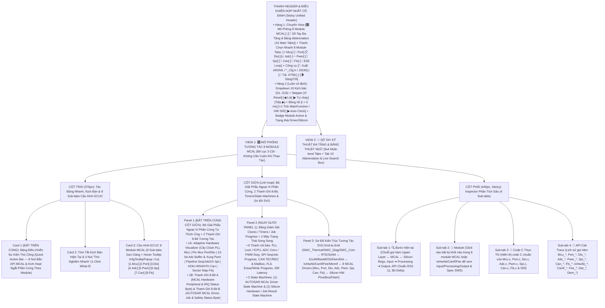
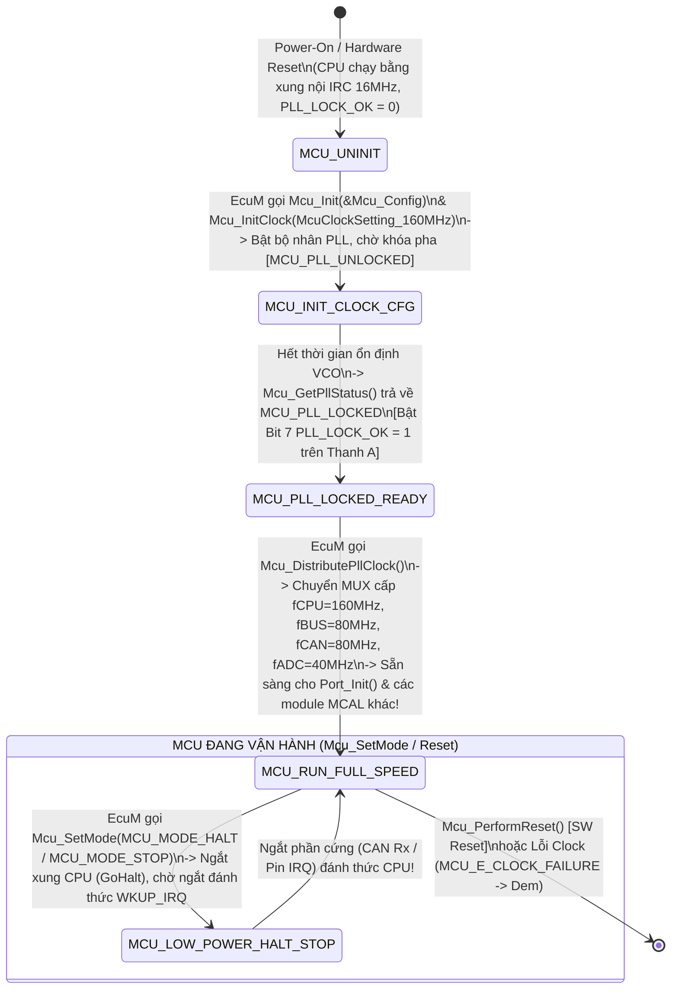
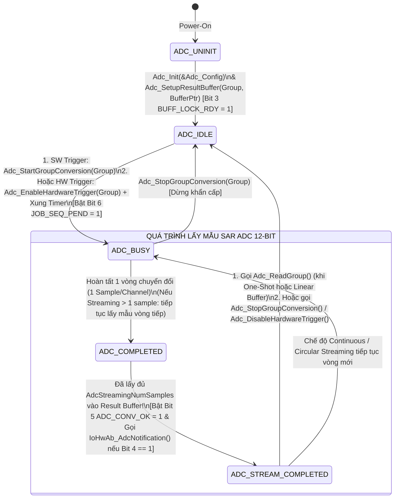
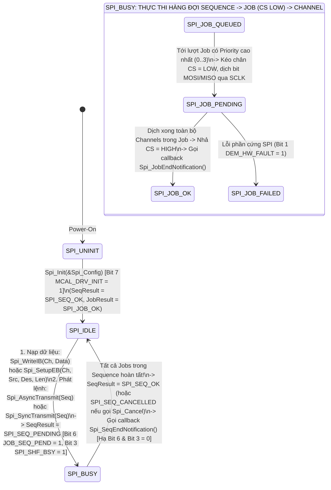
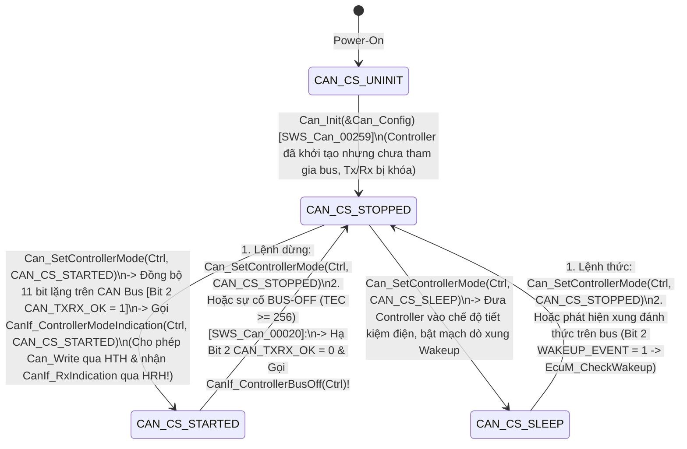
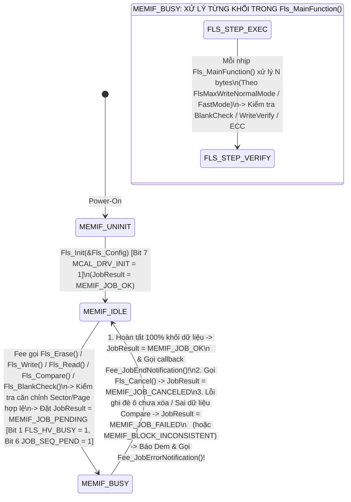

# Tài Liệu Thiết Kế Chi Tiết Trình Mô Phỏng Cụm 8 Module AUTOSAR MCAL Cốt Lõi (`MCAL_Simulation_design.md`)

> **Trạng thái tài liệu:** Bản thiết kế chi tiết đã cập nhật theo xác nhận `A1`–`A4` của User — Sẵn sàng để User review trước khi triển khai code.  
> **File đích dự kiến xuất bản:** `d:\__Personal\AntiGravity\Simulation\05_MCAL\AUTOSAR_MCAL.html` (Ứng dụng Web Tương tác 1 file HTML độc lập, 100% Offline, Pure CSS, tích hợp 8 Module Tabs `Mcu`, `Port`, `Dio`, `Adc`, `Pwm`, `Spi`, `Can`, `Fls` + Deep-link `#Mcu`, `#Port`, `#Dio`, `#Adc`, `#Pwm`, `#Spi`, `#Can`, `#Fls` liên kết trực tiếp từ `AUTOSAR.html` / `autosar_modules.json`; có nút tải `.HTML` kèm cấu hình nhúng & xuất code `ARXML / Mcu_Cfg.h / Port_Cfg.h / Dio_Cfg.h / Adc_Cfg.h / Pwm_Cfg.h / Spi_Cfg.h / Can_Cfg.h / Fls_Cfg.h / JSON`).  
> **Chuẩn tham chiếu:** **AUTOSAR Classic Platform R20-11 / R22-11 / R23-11 (`SWS_Mcu`, `SWS_Port`, `SWS_Dio`, `SWS_Adc`, `SWS_Pwm`, `SWS_Spi`, `SWS_Can`, `SWS_Fls`, `SWS_IoHwAb`, `SWS_CanIf`, `SWS_Fee`, `SWS_MemIf`, `SWS_EcuM`, `SWS_BswM`, `SWS_SchM`, `SWS_Os`, `SWS_Dem`, `SWS_Det`)**, đính kèm mã requirement chuẩn **`SWS_<Module>_xxxxx`** tại từng bước xử lý, Bộ trực quan hóa Thanh ghi & Ngoại vi phần cứng tự thích ứng theo 8 module, 2 Thanh ghi 8-Bit tương tác, Hover Tooltip cấu hình giống file `DEM`, và Sổ tay tra cứu đa tầng (9×4 Sub-tabs) kèm Bảng Abbreviation (68+ thuật ngữ) có Live Search Box.

---

## 1. Tổng Quan Định Hướng Thiết Kế Đã Chốt (`A1` – `A4`)

| Hạng mục | Nội dung thiết kế đã xác nhận với User |
| :--- | :--- |
| **1. Cấu trúc đóng gói File, Phân chia 8 Module Tabs & Bố cục Không Cuộn Trang — Zero-Scroll (`A1`)** | • **Đóng gói 1 File Web App hợp nhất kèm Deep-Link 8 Module**: Lưu tài liệu thiết kế tại `Design_docs/MCAL_Simulation_design.md` và xuất Web App tại `Simulation/05_MCAL/AUTOSAR_MCAL.html`. Khi người dùng click đúp vào bất kỳ card nào trong 8 module (`Mcu`, `Port`, `Dio`, `Adc`, `Pwm`, `Spi`, `Can`, `Fls`) trên trang Hub `AUTOSAR.html`, trình duyệt sẽ mở thẳng đúng Tab module tương ứng qua URL Hash (`AUTOSAR_MCAL.html#Mcu`, `#Port`, `#Dio`, `#Adc`, `#Pwm`, `#Spi`, `#Can`, `#Fls`).<br>• **Tối ưu hóa Above-the-Fold (Zero-Scroll)** theo chuẩn `AUTOSAR_DEM.html`, `AUTOSAR_EcuM.html` và `AUTOSAR_Nm_CanNm.html` để các khối thao tác/quan sát thường xuyên nhất luôn nằm ngay phần đầu mỗi cột trong khung màn hình:<br>  - **Thanh Điều Khiển Hợp Nhất Cố Định (Sticky Unified Header)**: Tích hợp thanh **8 Module Tabs (`⚡ Mcu`, `🔌 Port`, `💡 Dio`, `📈 Adc`, `〰️ Pwm`, `🔄 Spi`, `🚌 Can`, `💾 Fls` + `🔗 E2E Loop`)**, Dropdown chọn 16 Kịch bản (`S1`–`S16`), nút điều khiển từng bước (`↺ Reset`, `◀ Lùi`, `▶ Tự chạy`, `Tiếp ▶`), nút nhịp đồng hồ & ngắt phần cứng (`+1 Tick MainFunction / HW ISR (1ms)`, `▶ Auto Clock`) và Badge Trạng thái Driver + Silicon HW.<br>  - **Cột Trái (`375px`)**: Đưa **Card 1: Bảng Điều Khiển Sự Kiện Thủ Công (`Quick Action Bar` — 8 nút bắn API MCAL & kích hoạt Ngắt/Sự kiện phần cứng)** và **Card 2: Tóm tắt Kịch bản + 3 Nút 1-Click What-If** lên trên cùng, tiếp theo là **Card 3: 8 Sub-tabs Cấu hình ECUC cho 8 module MCAL (`48 tham số`)**.<br>  - **Cột Giữa (`Linh hoạt`)**: Đưa **Panel 1: Bộ Trực Quan Hóa Ngoại Vi Phần Cứng Tự Thích Ứng Theo Module (`Adaptive Hardware Peripheral Visualizer`) + 2 Thanh Ghi 8-Bit Tương Tác (`Mcal_HwStatusByte` & `Mcal_DrvEngineByte`)** và **Panel 2: Bảng Clocks/Timers/Buffers + 2 Máy Trạng Thái Đồng Bộ (`MCAL Driver State Machine` & `Hardware Peripheral/Job State Machine`)** lên ngay đầu cột giữa, bên dưới là **Panel 3: Sơ Đồ Kiến Trúc Tương Tác SVG End-to-End** (`SWC ↔ RTE ↔ IoHwAb / CanIf / Fee / EcuM ↔ 8 MCAL Drivers ↔ Silicon Peripherals`).<br>  - **Cột Phải (`440px, Sticky`)**: Inspector 4 Sub-tabs (`🔍 Bước hiện tại`, `🧩 Module`, `📄 Code C Thực Thi (MCAL & Upper Layer)`, `📜 API Call Trace`).<br>• **Config Hover Tooltip (`> 1s` delay)** giống hệt `AUTOSAR_DEM.html` (`#cfgTooltipPopup` hiển thị tên tham số, đường dẫn ECUC, mã `SWS_<Module>_xxxxx` / `ECUC_<Module>_xxxxx`, mô tả, dải giá trị, giá trị typical và lưu ý kỹ thuật). |
| **2. Khu vực Giám sát Bit-level & Giải Phẫu Ngoại Vi Phần Cứng 2 Tầng (`A2`)** | Đặt **cố định và nổi bật ở đầu Cột Giữa** gồm **2 tầng trực quan hóa liên thông**:<br>• **Tầng 1 — Bộ Trực Quan Hóa Phần Cứng Tự Thích Ứng Theo Từng Module (`Adaptive Hardware Peripheral Visualizer`)**:<br>  1. **`Mcu`**: Sơ đồ Cây xung nhịp `PLL Clock Tree` (`fOSC 16MHz ➔ PLL 320MHz ➔ fCPU 160MHz / fBUS 80MHz / fCAN 80MHz / fADC 40MHz`), Thanh ghi `MCU_RAW_RESET_STAT` (`POR`, `WDG`, `SW_RST`, `PIN_RST`) & `Mcu_ModeType` (`RUN / HALT / STOP`).<br>  2. **`Port` & `Dio`**: Ma trận Pin Multiplexer (`PCR[0..7]`: `Mode ALT0..ALT7`, `Dir IN/OUT`, `DirChangeable`, `Pull UP/DOWN`, `Level HIGH/LOW`) + Thanh ghi `GPIO_PDIR / PDOR / PTOR` & `Dio_ChannelGroup` Bitmask.<br>  3. **`Adc` & `Pwm`**: Bảng `SAR 12-bit ADC Group Result Buffer` (`Ch0 Temp: 2048 = 2.50V`, `Ch1 Vbat: 3276 = 4.00V`, `Single/Streaming`, `SW/HW Trigger`) + Đồ thị dạng sóng `PWM Duty Cycle (0x0000..0x8000)` & `Period/Polarity/IdleState`.<br>  4. **`Spi`**: Chuỗi phân cấp `SpiSequence ➔ SpiJob (CS, Baudrate, Priority) ➔ SpiChannel (IB Internal Buffer vs EB External Buffer)` & Thanh ghi dịch `MOSI / MISO Shift Register`.<br>  5. **`Can`**: Bảng `Hardware Object Handles (HRH #0..1 Rx Mailboxes + Mask Filter & HTH #2..3 Tx Mailboxes + Multiplexed Tx)`, Khung `Can_PduType (CAN / CAN FD 64B, BRS)` & `Can_ErrorStateType (ACTIVE / PASSIVE / BUSOFF, TEC/REC)`.<br>  6. **`Fls`**: Bản đồ Sector/Page Flash Memory (`0x00080000`: `ERASED 0xFF ➔ PROGRAMMING ➔ PROGRAMMED / VERIFIED`), Thanh tiến trình `Fls_MainFunction` (`Erase / Write / Read / Compare`).<br>• **Tầng 2 — 2 Thanh ghi 8-Bit tương tác song song (Click từng bit để thử nghiệm)**:<br>  1. **Thanh A (`8-Bit MCAL Hardware Peripheral & Interrupt Status Register` — `Mcal_HwStatusByte`)**: Giải mã 8 cờ phần cứng đại diện (`PLL_LOCK_OK`, `PIN_DIO_LVL`, `ADC_CONV_EOC`, `PWM_OUT_ACTV`, `SPI_SHIFT_BSY`, `CAN_TXRX_OK`, `FLS_HV_BUSY`, `HW_IRQ_PEND`).<br>  2. **Thanh B (`8-Bit AUTOSAR MCAL Driver, Job Engine & Safety Status Byte` — `Mcal_DrvEngineByte`)**: Theo dõi trạng thái quản lý của Driver AUTOSAR (`MCAL_DRV_INIT`, `JOB_SEQ_PEND`, `ASYNC_IRQ_MODE`, `NOTIF_CBK_EN`, `BUFF_LOCK_RDY`, `WAKEUP_EVENT`, `DEM_HW_FAULT`, `DET_ERR_TRAP`). |
| **3. Hệ thống 16 Kịch bản mẫu xuyên tầng `SWC ↔ ECU Abstraction ↔ MCAL ↔ Silicon` (`A3`)** | Thiết kế sẵn **16 Kịch bản (`S1`–`S16`)** chia theo 8 module MCAL và kịch bản liên tầng, làm rõ nguyên tắc kiến trúc AUTOSAR (**SWC không gọi trực tiếp MCAL mà đi qua `RTE ➔ IoHwAb / CanIf / Fee / EcuM`**):<br>• **`Mcu` (`S1`–`S2`)**: Khởi tạo Clock & Khóa PLL (`EcuM` ➔ `Mcu_Init` ➔ `Mcu_InitClock` ➔ `Mcu_GetPllStatus` ➔ `Mcu_DistributePllClock`) & Đọc nguyên nhân Reset / Chuyển chế độ ngủ (`Mcu_GetResetReason`, `Mcu_SetMode`, `Mcu_PerformReset`).<br>• **`Port` & `Dio` (`S3`–`S5`)**: Khởi tạo Pin Mux & Đổi hướng/chế độ chân runtime (`Port_Init`, `Port_SetPinDirection`, `Port_SetPinMode`, `Port_RefreshPortDirection`), Đọc/Ghi/Đảo chân IO qua `SWC ↔ RTE ↔ IoHwAb ↔ Dio` (`Dio_ReadChannel`, `Dio_WriteChannel`, `Dio_FlipChannel`), và Xuất cụm bit song song qua `Dio_WriteChannelGroup` / `Dio_MaskedWritePort`.<br>• **`Adc` & `Pwm` (`S6`–`S9`)**: Chuyển đổi ADC One-Shot/Streaming qua SW & HW Trigger (`Adc_SetupResultBuffer`, `Adc_StartGroupConversion`, `Adc_EnableHardwareTrigger`, ISR `IoHwAb_AdcNotification`, `Adc_ReadGroup`), Điều chế xung PWM (`Pwm_SetDutyCycle`, `Pwm_SetPeriodAndDuty`, `Pwm_SetOutputToIdle`, `Pwm_EnableNotification`), và **Vòng lặp điều khiển kín End-to-End `SWC_ThermalCtrl`: Cảm biến nhiệt ➔ `Adc` ➔ `IoHwAb` ➔ `RTE` ➔ `SWC` ➔ `IoHwAb` ➔ `Pwm` (Quạt làm mát) + `Dio` (Đèn cảnh báo)**.<br>• **`Spi` (`S10`–`S11`)**: Truyền nhận bất đồng bộ theo phân cấp `Sequence ➔ Job ➔ Channel` với `IB` (`Spi_WriteIB` ➔ `Spi_AsyncTransmit` ➔ `Spi_ReadIB`) và Truyền khối dữ liệu lớn qua `EB` (`Spi_SetupEB` ➔ `Spi_SyncTransmit` / Priority Queue).<br>• **`Can` (`S12`–`S13`)**: Khởi động `Can Controller`, Truyền khung CAN FD 64-byte có `Multiplexed Transmission` qua `HTH` & Nhận khung qua `HRH` (`Can_SetControllerMode`, `Can_Write` ➔ `CanIf_TxConfirmation`, Rx ISR ➔ `CanIf_RxIndication`), cùng xử lý lỗi `Bus-Off` & `Wakeup` (`CanIf_ControllerBusOff`).<br>• **`Fls` & Faults (`S14`–`S16`)**: Chu trình Xóa – Ghi – Đọc – So sánh Flash bất đồng bộ qua `Fls_MainFunction` (`NvM_WriteBlock` ➔ `Fee_Write` ➔ `Fls_Erase` ➔ `Fls_Write` ➔ `Fls_Read` / `Fls_Compare` ➔ `Fee_JobEndNotification`), Hủy lệnh Flash khẩn cấp (`Fls_Cancel`), và Kiểm thử tổng hợp lỗi `DET` / `DEM` của cả 8 module MCAL. |
| **4. Sổ tay tra cứu đa tầng & Bảng Abbreviation (`A4`)** | **View 2 (`📖 Sổ Tay Kỹ Thuật 8 Module MCAL & Từ Điển Thuật Ngữ`)** được tổ chức theo cấu trúc **Đa Tầng (Multi-level Tabs)**:<br>• **9 Main Tabs (Level 1) × 4 Chủ đề con (Level 2 Pills/Tabs = 36 chuyên đề)**: Tab 1 giải thích kiến trúc tổng thể MCAL & cách kết nối với `SWC` qua `IoHwAb / CanIf / Fee / EcuM`; Tab 2..9 đi sâu vào từng module (`Mcu`, `Port`, `Dio`, `Adc`, `Pwm`, `Spi`, `Can`, `Fls`).<br>• **Tab 10 chuyên biệt: `🔤 Bảng Thuật Ngữ & Từ Viết Tắt (Abbreviation Table)`** trình bày dưới dạng bảng chuẩn 4 cột (**68+ thuật ngữ MCAL & AUTOSAR**), tích hợp **Search Box tìm kiếm tức thời (Live Search + Highlight `<mark>`)** và 9 nút lọc nhanh theo từng module. |

---

## 2. Bố Cục Giao Diện 3 Cột Ưu Tiên Zero-Scroll, Thanh Chọn 8 Module MCAL & Hệ Thống Sub-Tabs (UI Wireframe)

Để đáp ứng triệt để yêu cầu **"chia nhỏ tab riêng cho từng module nếu cần"** và **"đưa các khối được dùng thường xuyên hơn lên phía trên để người dùng không cần cuộn chuột lên xuống mỗi lần thao tác"**, giao diện được thiết kế theo nguyên lý **Viewport-First (Không Cuộn Trang)**:



### Điểm Cải Tiến Đột Phá Về Trải Nghiệm "Zero-Scroll" & Chuyển Đổi Giữa 8 Module MCAL:
1. **Thanh Chọn Nhanh 8 Module (`Module Workspace Switcher`) ngay trên Sticky Header**: Cho phép người dùng chuyển tức thời giữa **`⚡ Mcu`**, **`🔌 Port`**, **`💡 Dio`**, **`📈 Adc`**, **`〰️ Pwm`**, **`🔄 Spi`**, **`🚌 Can`**, **`💾 Fls`** và **`🔗 E2E Loop`**. Khi chọn một module:
   - Sub-tab cấu hình ECUC ở Cột Trái (Card 3) tự động nhảy sang đúng module đó.
   - Bảng Giải Phẫu Ngoại Vi Phần Cứng ở đầu Cột Giữa (Panel 1A) và 2 Máy Trạng Thái (Panel 2) tự động hiển thị đúng thanh ghi silicon và sơ đồ trạng thái của module đó.
   - Khối module tương ứng trên sơ đồ SVG (Panel 3) được tô sáng nổi bật.
2. **Liên kết Deep-Link liền mạch từ `AUTOSAR.html`**: Trong file `autosar_modules.json`, cả 8 module MCAL sẽ được gắn đường dẫn `Simulation/05_MCAL/AUTOSAR_MCAL.html#Mcu`, `#Port`, `#Dio`, `#Adc`, `#Pwm`, `#Spi`, `#Can`, `#Fls` để khi mở từ trang kiến trúc tổng thể sẽ nhảy vào đúng module người dùng vừa bấm.
3. **Đưa `Quick Action Bar` (8 nút tác động nhanh) lên vị trí Card 1 (Đầu Cột Trái)** và đưa **Bộ Giải Phẫu Phần Cứng + 2 Thanh Ghi 8-Bit + 2 Máy Trạng Thái** lên đầu Cột Giữa: Mọi thao tác kích hoạt phần cứng và quan sát kết quả đều diễn ra trong cùng một tầm mắt mà **không cần cuộn chuột**.

---

## 3. Thiết Kế Chi Tiết Panel 1 (Đầu Cột Giữa): Bộ Giải Phẫu Ngoại Vi Phần Cứng Tự Thích Ứng Cho 8 Module MCAL & 2 Thanh Ghi 8-Bit Tương Tác

Khác với các module tầng Services chỉ xử lý máy trạng thái phần mềm, tầng **MCAL (Microcontroller Abstraction Layer)** là lớp phần mềm duy nhất trong AUTOSAR truy cập trực tiếp vào **các thanh ghi điều khiển ngoại vi trên chip vi điều khiển (Memory-Mapped Peripherals / Silicon Registers)**. Do đó, Panel 1 ở đầu Cột Giữa được thiết kế gồm **2 tầng trực quan hóa liên thông**:

### 3.1. Phần 1A — Bộ Giải Phẫu Ngoại Vi Phần Cứng Tự Thích Ứng Theo Module (`Adaptive Hardware Peripheral Visualizer`)

Tùy theo Tab module MCAL (hoặc kịch bản) đang chọn, Phần 1A sẽ hiển thị trực quan thanh ghi phần cứng đặc trưng của nhóm module đó (người dùng cũng có thể bấm chuyển tự do giữa 5 chế độ xem phần cứng ngay trên góc phải của Panel 1A):

#### Chế độ xem 1: Module `Mcu` — Cây Xung Nhịp `PLL Clock Tree`, Thanh Ghi `RawResetReason` & `Power Mode` (`SWS_Mcu`)
```text
+-------------------------------------------------------------------------------------------------------------------+
| ⚡ BỘ GIẢI PHẪU PHẦN CỨNG MCU: CÂY XUNG NHỊP PLL (`McuClockSettingConfig`), RESET REASON & MCU POWER MODE          |
| Mcu State: [ INITIALIZED ] | PLL Status: [ MCU_PLL_LOCKED (1) ] | Power Mode: [ MCU_MODE_RUN ] | RamSect: [0x00]  |
+-------------------------------------------------------------------------------------------------------------------+
| 1. CÂY PHÂN PHỐI XUNG NHỊP VI ĐIỀU KHIỂN (`Mcu_InitClock` ➔ `Mcu_GetPllStatus` ➔ `Mcu_DistributePllClock`):      |
|   [Thạch anh fOSC: 16 MHz] ➔ [Bộ nhân PLL VCO (x20 / ÷2)] ➔ [MUX: PLL_CLK = 160 MHz] ➔┬➔ fCPU (Core0/1) : 160 MHz |
|                               (Lock Counter: 512/512 OK!)     (SWitched fromIRC 16MHz)├➔ fBUS / PORT/DIO:  80 MHz |
|                                                                                       ├➔ fCAN (FlexCAN) :  80 MHz |
|                                                                                       └➔ fADC / fFLASH  :  40 MHz |
+-------------------------------------------------------------------------------------------------------------------+
| 2. THANH GHI NGUYÊN NHÂN RESET (`MCU_RGM_DES/FES` ➔ `Mcu_GetResetReason()` — `SWS_Mcu_00005`, `SWS_Mcu_00134`):   |
|  +--------------------+--------------------+--------------------+--------------------+--------------------------+ |
|  | Bit 0: POR_RST     | Bit 1: WDG_RST     | Bit 2: SW_RST      | Bit 3: PIN_EXT_RST | Kết quả trả về EcuM      | |
|  | [ 1 ] (0x01) Active| [ 0 ] (0x02)       | [ 0 ] (0x04)       | [ 0 ] (0x08)       | MCU_POWER_ON_RESET (0x00)| |
|  +--------------------+--------------------+--------------------+--------------------+--------------------------+ |
+-------------------------------------------------------------------------------------------------------------------+
```

#### Chế độ xem 2: Module `Port` & `Dio` — Ma Trận Pin Multiplexer (`PCR[0..7]`) & Thanh Ghi Cổng IO (`GPIO_PDIR / PDOR`) (`SWS_Port`, `SWS_Dio`)
```text
+-------------------------------------------------------------------------------------------------------------------+
| 🔌💡 BỘ GIẢI PHẪU PHẦN CỨNG PORT & DIO: MA TRẬN PIN MULTIPLEXER (`PCR[n]`) & THANH GHI MỨC LOGIC (`GPIO_PDOR/PDIR`)|
| Port State: [ PORT_INITIALIZED ] | DioPort_0 Hex: [ 0xA5 (1010 0101b) ] | ChannelGroup LedBar (Mask 0xF0): [0xA]  |
+-------------------------------------------------------------------------------------------------------------------+
|  +--------------+----------------+------------+-------------+-------------+--------------+----------------------+ |
|  | Chân Vật Lý  | Chức Năng Mux  | Hướng Chân | Đổi Hướng   | Điện Trở Kéo| Mức Điện Áp  | Ánh Xạ Ngoại Vi MCAL | |
|  | (PhysicalPin)| (PortPinMode)  | (Direction)| (DirChange) | (PullUp/Dn) | (Dio_Level)  | (Signal Routing)     | |
|  +--------------+----------------+------------+-------------+-------------+--------------+----------------------+ |
|  | PA0 (Pin #0) | ALT0: PORT_DIO | PORT_IN    | TRUE (R/W)  | PULL_UP     | STD_HIGH (1) | DioConf_IgnSw_Ch0    | |
|  | PA1 (Pin #1) | ALT0: PORT_DIO | PORT_OUT   | FALSE(Fixed)| PULL_NONE   | STD_HIGH (1) | DioConf_WarnLed_Ch1  | |
|  | PA2 (Pin #2) | ALT1: PORT_ADC | PORT_IN    | FALSE(Fixed)| PULL_NONE   | Analog 2.50V | AdcChannel_Temp_AN0  | |
|  | PA3 (Pin #3) | ALT2: PORT_PWM | PORT_OUT   | FALSE(Fixed)| PULL_DOWN   | PWM 75% Duty | PwmChannel_Fan_Ch0   | |
|  | PB0..3(#4..7)| ALT3/4:SPI/CAN | IN / OUT   | TRUE / FALSE| PULL_UP     | Bus Active   | Spi_CS0 / Can0_TxRx  | |
|  +--------------+----------------+------------+-------------+-------------+--------------+----------------------+ |
|  💡 Click trực tiếp vào ô [STD_HIGH / STD_LOW] hoặc [PORT_IN / PORT_OUT] để thử nghiệm Dio_FlipChannel & Port_Set! |
+-------------------------------------------------------------------------------------------------------------------+
```

#### Chế độ xem 3: Module `Adc` & `Pwm` — Bộ Chuyển Đổi `12-Bit SAR ADC Result Buffer` & Đồ Thị Điều Chế Xung `PWM Waveform` (`SWS_Adc`, `SWS_Pwm`)
```text
+-------------------------------------------------------------------------------------------------------------------+
| 📈〰️ BỘ GIẢI PHẪU PHẦN CỨNG ADC & PWM: BỘ ĐỆM KẾT QUẢ `12-BIT SAR ADC` & ĐỒ THỊ XUNG `PWM DUTY CYCLE (0..0x8000)` |
| AdcGroup_0: [ ADC_STREAM_COMPLETED ] | Trigger: [ HW_TRIG_TIM0 ] | PwmCh_0: [ Duty = 0x6000 (75.0%) | f = 20kHz ] |
+-------------------------------------------------------------------------------------------------------------------+
| 1. BỘ ĐỆM KẾT QUẢ CHUYỂN ĐỔI ANALOG-TO-DIGITAL (`Adc_SetupResultBuffer` ➔ `Adc_ReadGroup` — Độ phân giải 12-Bit): |
|  +--------------------+---------------+----------------+---------------+-------------------+--------------------+ |
|  | Kênh Trong Group   | Điện Áp Vật Lý| Thanh Ghi SAR  | Giá Trị Đổi Ra| Chế Độ Truy Cập   | Callback Lên Trên  | |
|  | (AdcChannel)       | (Pin Input V) | (0..4095 Raw)  | (IoHwAb mV/°C)| (Access/ConvMode) | (Adc_GroupNotif)   | |
|  +--------------------+---------------+----------------+---------------+-------------------+--------------------+ |
|  | Ch0: AN0_TempSens  | 2.50 V / 5.0V | 2048 (0x0800)  | 2500 mV (85°C)| STREAMING (3 Samples) | IoHwAb_AdcNotif_0()| |
|  | Ch1: AN1_VbatSense | 4.00 V / 5.0V | 3276 (0x0CCC)  | 4000 mV(13.8V)| CONTINUOUS / HW   | DMA / IRQ Ready    | |
|  +--------------------+---------------+----------------+---------------+-------------------+--------------------+ |
| 2. ĐỒ THỊ XUNG PWM TRỰC QUAN (`Pwm_SetDutyCycle(Ch0, 0x6000)` — Chuẩn AUTOSAR: `0x0000 = 0%`, `0x8000 = 100%`):   |
|    Mức HIGH (1) :  ██████████████████████████████__________██████████████████████████████__________ (Duty: 75.0%) |
|    Mức LOW  (0) :  |<-------- T_on = 37.5 us ------->|<12.5us>|<-------- Chu kỳ Period = 50 us (20 kHz) ------->| |
+-------------------------------------------------------------------------------------------------------------------+
```

#### Chế độ xem 4: Module `Spi` & `Can` — Pipeline `Spi Sequence ➔ Job ➔ Channel (IB/EB)` & Hộp Thư `Can HOH (HRH/HTH) / CAN-FD Frame` (`SWS_Spi`, `SWS_Can`)
```text
+-------------------------------------------------------------------------------------------------------------------+
| 🔄🚌 BỘ GIẢI PHẪU PHẦN CỨNG SPI & CAN: PIPELINE `SPI SEQ/JOB/CH` & HỘP THƯ `CAN HOH (HRH/HTH) + CAN-FD 64B FRAME` |
| Spi Status: [ SPI_IDLE (SEQ_OK) ] | CanCtrl_0: [ CAN_CS_STARTED ] | ErrorState: [ ACTIVE (TEC=0, REC=0) ]         |
+-------------------------------------------------------------------------------------------------------------------+
| 1. ĐƯỜNG ỐNG PHÂN CẤP SPI (`SpiSequence_0` ➔ `SpiJob_0 [CS_SBC, 4MHz, Prio 2]` ➔ `SpiChannel_0 [IB/EB Buffer]`):  |
|   [SpiSequence_0: SPI_SEQ_OK] ➔ [SpiJob_0 (CS_0=LOW): SPI_JOB_OK] ➔ [Ch0 (IB 4B): Tx 0xA5 0x01 ⇄ Rx 0x5A 0xFF]    |
+-------------------------------------------------------------------------------------------------------------------+
| 2. BẢNG HỘP THƯ PHẦN CỨNG CAN (`CanHardwareObject: HRH & HTH`) & KHUNG BẢN TIN `Can_PduType` (`SWS_Can_00416`):   |
|  +----------------+---------------+------------------+-------------------+--------------------------------------+ |
|  | HOH Handle     | Loại Mailbox  | Bộ Lọc / Cơ Chế  | CAN ID & Flags    | Dữ Liệu SDU & Trạng Thái Hộp Thư     | |
|  +----------------+---------------+------------------+-------------------+--------------------------------------+ |
|  | HOH_0 (HRH_0)  | Rx BasicCAN   | Code:0x100/0x7F0 | 0x105 (Std CAN)   | [12 34 56 78 9A BC DE F0] ➔ CanIf_Rx | |
|  | HOH_1 (HTH_0)  | Tx FullCAN+Mux| 3 HW Tx Buffers  | 0x40000201(CAN-FD)| DLC=16B, BRS=1, TxPduId=0x01 ➔ Sent! | |
|  +----------------+---------------+------------------+-------------------+--------------------------------------+ |
+-------------------------------------------------------------------------------------------------------------------+
```

#### Chế độ xem 5: Module `Fls` — Bản Đồ Bộ Nhớ `Flash Sector / Page Memory Map` & Tiến Trình `Fls_MainFunction` (`SWS_Fls`)
```text
+-------------------------------------------------------------------------------------------------------------------+
| 💾 BỘ GIẢI PHẪU PHẦN CỨNG FLASH (`Fls`): BẢN ĐỒ SECTOR/PAGE DATA FLASH & TIẾN TRÌNH BẤT ĐỒNG BỘ `Fls_MainFunction`|
| Fls State: [ MEMIF_IDLE ] | JobResult: [ MEMIF_JOB_OK ] | Mode: [ MEMIF_MODE_FAST (64B/Tick) ] | Fee Notify: [ON] |
+-------------------------------------------------------------------------------------------------------------------+
| 1. BẢN ĐỒ VÙNG NHỚ DATA FLASH VẬT LÝ (`FlsBaseAddress = 0x00080000`, `FlsSectorSize = 2048B`, `FlsPageSize = 8B`):|
|  +------------------------+-----------------------+-----------------------------------+-------------------------+ |
|  | Địa Chỉ Vật Lý (Offset)| Trạng Thái Ô Nhớ      | Nội Dung Dữ Liệu 8-Byte Page (Hex)| Kiểm Tra ECC & So Sánh  | |
|  +------------------------+-----------------------+-----------------------------------+-------------------------+ |
|  | Page #0 (0x080000+0x00)| PROGRAMMED & VERIFIED | [ 5A A5 01 02 10 27 DE AD ]       | ECC OK | Compare == TRUE| |
|  | Page #1 (0x080000+0x08)| PROGRAMMED & VERIFIED | [ C0 FF EE 00 11 22 33 44 ]       | ECC OK | Compare == TRUE| |
|  | Page #2..255 (+0x10..) | ERASED (Sẵn sàng ghi) | [ FF FF FF FF FF FF FF FF ]       | Blank Check == ERASED   | |
|  +------------------------+-----------------------+-----------------------------------+-------------------------+ |
| 2. TIẾN TRÌNH JOB BẤT ĐỒNG BỘ (`Fls_Erase` / `Fls_Write` / `Fls_Read` / `Fls_Compare` qua `Fls_MainFunction()`):  |
|    [Job: FLS_WRITE_JOB (16 Bytes)] ➔ Tiến độ: ████████████████████████████████ 16 / 16 Bytes (100%) ➔ Fee_JobEnd! |
+-------------------------------------------------------------------------------------------------------------------+
```

---

### 3.2. Phần 1B — 2 Thanh Ghi 8-Bit Trạng Thái Tương Tác Luôn Hiển Thị Nổi Bật (`Live 8-Bit Register Inspector`)

Ngay bên dưới Phần 1A là **2 Thanh ghi 8-Bit tương tác** theo đúng phong cách của `AUTOSAR_DEM.html`, `AUTOSAR_EcuM.html` và `AUTOSAR_Nm_CanNm.html`, cho phép người dùng **click trực tiếp vào từng ô bit để bật/tắt (`0 ⇄ 1`)** và quan sát phản ứng tức thời của các module MCAL:

```text
+-------------------------------------------------------------------------------------------------------------------+
| 🔢 BẢNG GIÁM SÁT BITFIELD 8-BIT THANH GHI NGOẠI VI SILICON & TRẠNG THÁI DRIVER MCAL [Click vào từng Bit để thử]   |
| Module đang xem: [ ADC + PWM ] | Bước #4: Ngắt ADC EOC hoàn tất & xuất xung PWM | Thanh A: 0xB5 | Thanh B: 0xD8   |
+-------------------------------------------------------------------------------------------------------------------+
| A. THANH GHI 8-BIT TRẠNG THÁI NGOẠI VI PHẦN CỨNG & NGẮT SILICON (`Mcal_HwStatusByte`) — Hex:[0xB5] Bin:[10110101b]|
|    Clock PLL: [ LOCKED (160MHz) ] | DIO/PORT: [ HIGH ] | ADC/PWM: [ EOC=1, PWM=1 ] | CAN/SPI/FLS: [ READY ]       |
|  +-------------+ +-------------+ +-------------+ +-------------+ +-------------+ +-------------+ +-------+ +-----+|
|  | Bit 7 (0x80)| | Bit 6 (0x40)| | Bit 5 (0x20)| | Bit 4 (0x10)| | Bit 3 (0x08)| | Bit 2 (0x04)| |Bit1(2)| |Bit 0||
|  | PLL_LOCK_OK | | PIN_DIO_LVL | | ADC_CONV_OK | | PWM_OUT_ACT | | SPI_SHF_BSY | | CAN_TXRX_OK | |FLS_BSY| |IRQ_P||
|  |      1      | |      0      | |   1 (0➔1)   | |   1 (0➔1)   | |      0      | |      1      | |   0   | |  1  ||
|  | 160MHz Lock | | Pin LOW/HIGH| | EOC Ready!  | | Duty Active | | Shift Idle  | | Bus Online  | |Idle   | |ISR! ||
|  +-------------+ +-------------+ +-------------+ +-------------+ +-------------+ +-------------+ +-------+ +-----+|
+-------------------------------------------------------------------------------------------------------------------+
| B. THANH GHI 8-BIT QUẢN LÝ DRIVER, JOB ENGINE & AN TOÀN MCAL (`Mcal_DrvEngineByte`) — Hex: [0xD8] Bin:[11011000b] |
|    Driver State: [ INITIALIZED ] | Job Engine: [ COMPLETED ] | Mode: [ ASYNC_INTERRUPT ] | Safety: [ NO_ERROR ]   |
|  +-------------+ +-------------+ +-------------+ +-------------+ +-------------+ +-------------+ +-------+ +-----+|
|  | Bit 7 (0x80)| | Bit 6 (0x40)| | Bit 5 (0x20)| | Bit 4 (0x10)| | Bit 3 (0x08)| | Bit 2 (0x04)| |Bit1(2)| |Bit 0||
|  | MCAL_INIT   | | JOB_PENDING | | ASYNC_MODE  | | NOTIF_ENABL | | BUFF_READY  | | WAKEUP_DET  | |DEM_FLT| |DET_E||
|  |      1      | |   0 (1➔0)   | |      1      | |      1      | |      1      | |      0      | |   0   | |  0  ||
|  | Drv Ready   | | Job Done!   | | IRQ / Poll  | | Cbk Active  | | EB/ADC/FlsOK| | No Wakeup   | |HW OK  | |NoErr||
|  +-------------+ +-------------+ +-------------+ +-------------+ +-------------+ +-------------+ +-------+ +-----+|
+-------------------------------------------------------------------------------------------------------------------+
```

#### 3.2.1. Giải Mã Chi Tiết Thanh A: `8-Bit MCAL Hardware Peripheral & Interrupt Status Register` (`Mcal_HwStatusByte`)

| Bit | Mask | Tên Cờ Phần Cứng (`Silicon Bit`) | Module MCAL Gắn Liền | Ý nghĩa kỹ thuật phần cứng & Khi nào bật lên `1` (`0 ➔ 1`) | Khi nào hạ về `0` (`1 ➔ 0`) |
| :-: | :-: | :--- | :---: | :--- | :--- |
| **Bit 7** | `0x80` | **`PLL_LOCK_OK`** | **`Mcu`** | Phản ánh bit `LOCK` trong thanh ghi bộ nhân tần số `PLL_SR` của vi điều khiển (`SWS_Mcu_00008`). Sau khi `Mcu_InitClock()` kích hoạt mạch vòng khóa pha PLL và chờ hết thời gian ổn định, bit này bật lên `1` (`Mcu_GetPllStatus() == MCU_PLL_LOCKED`), cho phép gọi `Mcu_DistributePllClock()` để cấp xung nhịp tốc độ cao `160 MHz` cho toàn bộ các ngoại vi MCAL khác! | Hạ về `0` khi chưa gọi `Mcu_InitClock()`, khi MCU vào chế độ ngủ sâu tắt PLL (`Mcu_SetMode(MCU_MODE_STOP)`), hoặc khi giả lập lỗi mất khóa xung nhịp (`Clock Loss / PLL Unlock` ➔ báo lỗi `MCU_E_CLOCK_FAILURE` lên `Dem`). |
| **Bit 6** | `0x40` | **`PIN_DIO_LVL`** | **`Port` & `Dio`** | Phản ánh trực tiếp mức điện áp vật lý trên chân vi điều khiển (`GPIO_PDIR` / `GPIO_PDOR` — `SWS_Dio_00011`). Bật lên `1` (`STD_HIGH = 5V / 3.3V`) khi gọi `Dio_WriteChannel(Ch, STD_HIGH)`, `Dio_FlipChannel()`, hoặc khi chân Input nhận mức áp cao từ công tắc ngoài. | Hạ về `0` (`STD_LOW = 0V`) khi gọi `Dio_WriteChannel(Ch, STD_LOW)`, `Dio_FlipChannel()`, hoặc khi chân Input được kéo xuống GND. |
| **Bit 5** | `0x20` | **`ADC_CONV_OK` *(EOC)*** | **`Adc`** | Cờ phần cứng **End-of-Conversion (`ADC_ISR_EOC` / `EOS`)** của bộ chuyển đổi SAR ADC (`SWS_Adc_00060`). Bật lên `1` ngay khi phần cứng ADC lấy mẫu và lượng tử hóa xong các kênh trong `AdcGroup`, nạp giá trị `12-bit (0..4095)` vào bộ đệm kết quả (`Adc_SetupResultBuffer`) và chuyển trạng thái sang `ADC_COMPLETED` / `ADC_STREAM_COMPLETED`. | Hạ về `0` khi gọi `Adc_ReadGroup()` (trong chế độ One-Shot tự động đưa nhóm về `ADC_IDLE` theo `SWS_Adc_00329`) hoặc khi gọi `Adc_StopGroupConversion()`. |
| **Bit 4** | `0x10` | **`PWM_OUT_ACT`** | **`Pwm`** | Cờ báo bộ đếm phần cứng Timer/PWM (`eMIOS / FTM / GTM`) đang phát xung điều chế độ rộng (`DutyCycle > 0x0000` — `SWS_Pwm_00013`). Bật lên `1` sau `Pwm_Init()`, `Pwm_SetDutyCycle(Ch, Duty > 0)` hoặc `Pwm_SetPeriodAndDuty()`. | Hạ về `0` khi gọi **`Pwm_SetOutputToIdle(ChannelNumber)`** (`SWS_Pwm_00021`), `Pwm_DeInit()`, hoặc khi đặt `DutyCycle = 0x0000 (0%)`. |
| **Bit 3** | `0x08` | **`SPI_SHF_BSY`** | **`Spi`** | Cờ báo thanh ghi dịch nối tiếp phần cứng (`QSPI_SR[BUSY]`) đang kéo chân `CS (Chip Select)` và đẩy các bit qua đường `SCLK / MOSI / MISO` (`SWS_Spi_00177`). Bật lên `1` khi bắt đầu truyền `Spi_AsyncTransmit(Sequence)` hoặc `Spi_SyncTransmit(Sequence)`. | Hạ về `0` ngay khi toàn bộ các `SpiJob` trong `SpiSequence` đã dịch xong bit cuối cùng, nhả chân `CS` và gọi callback `Spi_SeqEndNotification()`. |
| **Bit 2** | `0x04` | **`CAN_TXRX_OK`** | **`Can`** | Cờ báo bộ điều khiển phần cứng CAN (`FlexCAN / M_CAN`) đã đồng bộ với bus (`CAN_CS_STARTED`), ở trạng thái `CAN_ERRORSTATE_ACTIVE` và vừa hoàn tất truyền/nhận khung CAN/CAN-FD hợp lệ qua `HTH` / `HRH` (`SWS_Can_00272`). | Hạ về `0` khi `Can Controller` ở trạng thái `CAN_CS_STOPPED` / `CAN_CS_SLEEP` hoặc khi bộ đếm lỗi `TEC >= 256` đẩy phần cứng vào trạng thái ngắt bus **`CAN_ERRORSTATE_BUSOFF`**! |
| **Bit 1** | `0x02` | **`FLS_HV_BUSY`** | **`Fls`** | Cờ phần cứng bộ điều khiển Flash (`FLASH_MCR[EHV / BUSY]`) báo bơm điện áp cao nội bộ đang thực thi lệnh xóa Sector (`Fls_Erase`) hoặc ghi Page (`Fls_Write`) vào các ô nhớ Non-Volatile (`SWS_Fls_00220`). Trong lúc `Bit 1 == 1`, phần cứng Flash đang bận (`MEMIF_BUSY`). | Hạ về `0` khi chu trình xóa/ghi/đọc/so sánh qua các nhịp `Fls_MainFunction()` đã hoàn tất (`MEMIF_IDLE`), hoặc khi bị dừng bởi `Fls_Cancel()`. |
| **Bit 0** | `0x01` | **`HW_IRQ_PEND`** | **Chung 8 Module** | Cờ báo có yêu cầu ngắt phần cứng (`Hardware Interrupt Request — ISR Cat 2`) từ ngoại vi (`ADC_EOC_ISR`, `PWM_CMP_ISR`, `SPI_QEND_ISR`, `CAN_RX_TX_ISR`, `FLS_DONE_ISR`) đang kích hoạt để đánh thức hàm xử lý ngắt của MCAL đẩy callback lên tầng `IoHwAb` / `CanIf` / `Fee`. | Hạ về `0` sau khi trình phục vụ ngắt ISR của MCAL đã xóa cờ ngắt phần cứng (`Clear IRQ Flag`) và hoàn tất gọi callback lên tầng trên. |

#### 3.2.2. Giải Mã Chi Tiết Thanh B: `8-Bit AUTOSAR MCAL Driver, Job Engine & Safety Status Byte` (`Mcal_DrvEngineByte`)

| Bit | Mask | Tên Cờ Driver (`AUTOSAR Bit`) | Ý nghĩa kỹ thuật trong Driver MCAL & Khi nào bật lên `1` (`0 ➔ 1`) | Khi nào hạ về `0` (`1 ➔ 0`) |
| :-: | :-: | :--- | :--- | :--- |
| **Bit 7** | `0x80` | **`MCAL_DRV_INIT`** | Bật lên `1` sau khi hàm khởi tạo của module đang chọn (`Mcu_Init`, `Port_Init`, `Adc_Init`, `Pwm_Init`, `Spi_Init`, `Can_Init`, `Fls_Init`) đã chạy thành công. Theo chuẩn AUTOSAR, đây là điều kiện tiên quyết trước khi gọi bất kỳ API dịch vụ nào khác của module đó. | Hạ về `0` khi gọi hàm `*_DeInit()` (`Adc_DeInit`, `Pwm_DeInit`, `Spi_DeInit`, `Can_DeInit`) hoặc khi người dùng tắt Checkbox `McalDriverInitialized` để kiểm thử bẫy lỗi `DET` (`*_E_UNINIT`). |
| **Bit 6** | `0x40` | **`JOB_SEQ_PEND`** | Bật lên `1` khi một tác vụ bất đồng bộ của MCAL đang ở trạng thái chờ xử lý: `Adc_GetGroupStatus() == ADC_BUSY`, `Spi_GetSequenceResult() == SPI_SEQ_PENDING`, `Fls_GetJobResult() == MEMIF_JOB_PENDING`, hoặc khung `Can_Write()` đang nằm trong hộp thư `HTH` chờ phát lên bus. | Hạ về `0` ngay khi tác vụ hoàn tất thành công (`ADC_COMPLETED`, `SPI_SEQ_OK`, `MEMIF_JOB_OK`, `CanIf_TxConfirmation`), bị hủy (`Spi_Cancel`, `Fls_Cancel`), hoặc thất bại. |
| **Bit 5** | `0x20` | **`ASYNC_IRQ_MODE`** | Cho biết cơ chế vận hành hiện tại của các module MCAL hỗ trợ bất đồng bộ (`Adc`, `Spi`, `Can`, `Fls`):<br>• `1`: Chế độ **Interrupt-driven / Asynchronous** (ví dụ `Spi_SetAsyncMode(SPI_INTERRUPT_MODE)`, `CanTxProcessing = INTERRUPT`, `Adc` báo ngắt EOC).<br>• `0`: Chế độ **Polling / Synchronous** (quét qua `Spi_MainFunction_Handling()`, `Can_MainFunction_Write/Read()`, `Fls_MainFunction()`). | Hạ về `0` khi chuyển sang chế độ Polling (`Spi_SetAsyncMode(SPI_POLLING_MODE)`) hoặc dùng hàm đồng bộ `Spi_SyncTransmit()`. |
| **Bit 4** | `0x10` | **`NOTIF_CBK_EN`** | Bật lên `1` khi cơ chế gọi hàm thông báo ngược (Callback Notification) từ MCAL lên tầng trên đã được kích hoạt thông qua API runtime: **`Adc_EnableGroupNotification(Group)`**, **`Pwm_EnableNotification(Ch, Edge)`**, hoặc cấu hình `SpiSeqEndNotification`, `FlsJobEndNotification`. | Hạ về `0` khi gọi **`Adc_DisableGroupNotification(Group)`**, **`Pwm_DisableNotification(Ch)`**, hoặc tắt cấu hình Notification trong ECUC. |
| **Bit 3** | `0x08` | **`BUFF_LOCK_RDY`** | Bật lên `1` khi bộ đệm dữ liệu trao đổi giữa tầng trên và MCAL đã được khởi tạo hợp lệ: đã gọi **`Adc_SetupResultBuffer(Group, DataBufferPtr)`** (`SWS_Adc_00419`), đã nạp **`Spi_WriteIB()` / `Spi_SetupEB()`**, hoặc đã cấp con trỏ vùng nhớ cho `Fls_Read/Write/Compare()`. | Hạ về `0` khi chưa gọi `Adc_SetupResultBuffer()` (nếu gọi `Adc_StartGroupConversion()` khi `Bit 3 == 0` sẽ lập tức bị bắt lỗi `ADC_E_BUFFER_UNINIT`!), hoặc khi bộ đệm Streaming đầy mà chưa đọc. |
| **Bit 2** | `0x04` | **`WAKEUP_EVENT`** | Bật lên `1` khi ngoại vi MCAL phát hiện tín hiệu đánh thức phần cứng (ví dụ: `Can` nhận xung trội trên bus trong lúc `CAN_CS_SLEEP` ➔ gọi `EcuM_CheckWakeup(CanWakeupSource)` ➔ `Can_CheckWakeup()`; hoặc chân `Port/Dio/Icu` phát hiện sườn xung đánh thức ECU). | Hạ về `0` khi xóa cờ đánh thức hoặc khởi động lại chu trình hoạt động bình thường. |
| **Bit 1** | `0x02` | **`DEM_HW_FAULT`** | Bật lên `1` khi phần cứng silicon gặp lỗi vật lý hoặc quá thời gian chờ phần cứng (`Hardware Timeout / Silicon Failure`) và MCAL gọi **`Dem_SetEventStatus(EventId, DEM_EVENT_STATUS_FAILED)`**: ví dụ `MCU_E_CLOCK_FAILURE`, `SPI_E_HARDWARE_ERROR`, `FLS_E_ERASE_FAILED`, `FLS_E_WRITE_FAILED`, `FLS_E_READ_FAILED`, `FLS_E_COMPARE_FAILED`. | Hạ về `0` khi phần cứng khôi phục và báo `DEM_EVENT_STATUS_PASSED` hoặc khi bấm `Reset`. |
| **Bit 0** | `0x01` | **`DET_ERR_TRAP`** | Bật lên `1` ngay khi bất kỳ hàm API nào của 8 module MCAL phát hiện lỗi tham số / trình tự gọi hàm lúc phát triển và gọi **`Det_ReportError(ModuleId, InstanceId, ApiId, ErrorId)`** hoặc **`Det_ReportRuntimeError()`** (ví dụ `MCU_E_PLL_NOT_LOCKED`, `PORT_E_DIRECTION_UNCHANGEABLE`, `DIO_E_PARAM_INVALID_CHANNEL_ID`, `ADC_E_UNINIT`, `PWM_E_PERIOD_UNCHANGEABLE`, `SPI_E_SEQ_PENDING`, `CAN_E_TRANSITION`, `FLS_E_BUSY`). | Hạ về `0` khi người dùng sửa lại cấu hình/trình tự gọi hàm hợp lệ hoặc bấm `Reset`. |

---

## 4. Phân Tích Xử Lý Từng Module: Input Lấy Từ Đâu, Xử Lý Gì, Output Route Đến Đâu (Kèm Nguyên Tắc Tương Tác Giữa MCAL Và SWC)

> [!IMPORTANT]
> **Nguyên tắc kiến trúc cốt lõi của AUTOSAR về tương tác giữa `SWC` và `MCAL`:**
> Trong kiến trúc phân tầng chuẩn của AUTOSAR Classic, **các Software Components (`SWC` ở tầng Application) TUYỆT ĐỐI KHÔNG gọi trực tiếp các hàm API của tầng `MCAL`** (để đảm bảo `SWC` hoàn toàn độc lập với vi điều khiển phần cứng). Thay vào đó, dữ liệu từ `SWC` đi xuống `MCAL` và từ `MCAL` đi lên `SWC` luôn đi qua **3 đường ống trung gian chuẩn hóa**:
> 1. **Nhóm I/O (`Port`, `Dio`, `Adc`, `Pwm`, và `Spi` cho IC ngoại vi)**: `SWC` ⇄ `RTE` (`Rte_Call_RP_IoHwAb_*`) ⇄ **`IoHwAb` (I/O Hardware Abstraction)** ⇄ `Port / Dio / Adc / Pwm / Spi` ⇄ Chân Pin / Cảm biến / Cơ cấu chấp hành.
> 2. **Nhóm Truyền thông (`Can`)**: `SWC` ⇄ `RTE` (`Rte_Write / Rte_Read`) ⇄ `COM` ⇄ `PduR` ⇄ **`CanIf` (CAN Interface) & `CanSM`** ⇄ `Can (CAN Driver)` ⇄ `CanTrcv` & CAN Bus.
> 3. **Nhóm Bộ nhớ (`Fls` và `Spi` cho External EEPROM)**: `SWC` ⇄ `RTE` (`Rte_Call_NvMService_*`) ⇄ `NvM` ⇄ `MemIf` ⇄ **`Fee` (Flash EEPROM Emulation) / `Ea` (EEPROM Abstraction)** ⇄ `Fls / Spi` ⇄ Bộ nhớ Flash/EEPROM vật lý.
> 4. **Nhóm Hệ thống (`Mcu` & Khởi tạo toàn bộ MCAL)**: Được điều khiển trực tiếp bởi **`EcuM` (ECU State Manager)** và **`BswM` (BSW Mode Manager)** trong các pha `Startup`, `Sleep`, `Wakeup`, `Shutdown`.

Mọi khối trên sơ đồ kiến trúc SVG đều có thể **click vào để xem giải thích chi tiết** ở Cột Phải (Tab `🧩 Module`) và được tổng hợp đầy đủ trong bảng dưới đây:

| # | Module / Phân khối | Lớp AUTOSAR & Module ID | 📥 Input lấy từ đâu? | ⚙️ Cách xử lý nội bộ (Processing, Registers, State & Timers) | 📤 Output route đến đâu & Hàm API chuẩn (R20-11 / R22-11 / R23-11) |
| :-: | :--- | :--- | :--- | :--- | :--- |
| **1** | **`Mcu` (Microcontroller Driver)** | MCAL — Microcontroller Drivers<br>(`ModuleId = 101 / 0x065`, `SWS_Mcu`) | • Nhận lệnh khởi tạo chip, cấu hình Clock/PLL, RAM, Mode và truy vấn Reset từ **`EcuM`** (`EcuM_AL_DriverInitOne`, `EcuM_GoHalt`, `EcuM_AL_Reset`) và **`BswM`**.<br>• Đọc thanh ghi trạng thái khóa pha `PLL_SR` và thanh ghi nguyên nhân Reset `RGM_DES/FES` từ phần cứng vi điều khiển. | • **1. Khởi tạo Clock & Mạch vòng khóa pha PLL (`SWS_Mcu_00137`, `00140`)**:<br>  - `Mcu_Init(&Mcu_Config)`: Nạp cấu hình tổng thể.<br>  - `Mcu_InitClock(McuClockSettingId)`: Cấu hình bộ chia tần số (Prescalers) và bật bộ nhân tần PLL nhưng **chưa nối PLL vào hệ thống** (CPU vẫn chạy bằng xung nội IRC/thạch anh để tránh sốc xung nhịp).<br>  - `Mcu_GetPllStatus()`: Kiểm tra bit phần cứng `PLL_LOCK_OK` (`MCU_PLL_LOCKED` vs `MCU_PLL_UNLOCKED`).<br>  - `Mcu_DistributePllClock()`: Khi PLL đã khóa (`Bit 7 = 1`), chuyển mạch Multiplexer cấp xung `fCPU = 160MHz`, `fBUS = 80MHz`, `fCAN = 80MHz`, `fADC = 40MHz` cho toàn bộ các module MCAL khác!<br>• **2. Quản lý Reset, RAM Section & Power Modes (`SWS_Mcu_00005`, `00147`)**:<br>  - `Mcu_GetResetReason()` / `Mcu_GetResetRawValue()`: Đọc và giải mã nguyên nhân vừa làm MCU khởi động lại (`MCU_POWER_ON_RESET`, `MCU_WATCHDOG_RESET`, `MCU_SW_RESET`, `MCU_RESET_UNDEFINED`).<br>  - `Mcu_InitRamSection()`: Xóa/nạp giá trị mặc định cho vùng RAM đặc biệt.<br>  - `Mcu_SetMode(McuMode)`: Đưa CPU vào chế độ tiết kiệm điện (`MCU_MODE_RUN`, `MCU_MODE_HALT`, `MCU_MODE_STOP`).<br>  - `Mcu_PerformReset()`: Ghi mã khóa vào thanh ghi phần cứng để kích hoạt Software Reset (khi tắt `McuPerformResetApi = FALSE` sẽ bị khóa). | • **API cung cấp cho `EcuM` / `BswM` (`Mcu.h`)**:<br>`Mcu_Init()`, `Mcu_InitRamSection()`, `Mcu_InitClock()`, `Mcu_DistributePllClock()`, `Mcu_GetPllStatus()`, `Mcu_GetResetReason()`, `Mcu_GetResetRawValue()`, `Mcu_PerformReset()`, `Mcu_SetMode()`, `Mcu_GetRamState()`<br>• **Output phần cứng & Báo lỗi**:<br>- Cấp xung nhịp chuẩn cho `Port`, `Adc`, `Pwm`, `Spi`, `Can`, `Fls`.<br>- Báo lỗi mất xung nhịp `Dem_SetEventStatus(MCU_E_CLOCK_FAILURE, FAILED)` và `Det_ReportError(MCU_E_PLL_NOT_LOCKED = 0x0E, MCU_E_UNINIT = 0x0F)`. |
| **2** | **`Port` (Port Driver)** | MCAL — I/O Drivers<br>(`ModuleId = 124 / 0x07C`, `SWS_Port`) | • Nhận lệnh khởi tạo cấu hình toàn bộ chân Pin của MCU từ **`EcuM`** (`Port_Init`) lúc khởi động.<br>• Nhận lệnh đổi hướng chân (`IN ⇄ OUT`) hoặc đổi chức năng ngoại vi (`DIO ⇄ ADC/PWM/SPI/CAN`) lúc runtime từ **`IoHwAb`** hoặc **`BswM`**. | • **1. Khởi tạo Ma trận Pin Multiplexer & Điện trở kéo (`SWS_Port_00001`, `00041`)**:<br>  - `Port_Init(&Port_Config)`: Ghi cấu hình ban đầu vào tất cả các thanh ghi `PCR[n]` (Pin Control Register): Chức năng chân (`ALT0: DIO`, `ALT1: ADC`, `ALT2: PWM`, `ALT3: SPI`, `ALT4: CAN`), hướng chân (`PORT_PIN_IN` / `PORT_PIN_OUT`), mức logic khởi đầu (`PortPinLevelValue` để tránh nháy rơ-le lúc bật nguồn!), điện trở kéo (`Pull-Up / Pull-Down`), tốc độ sườn xung (`Slew Rate`).<br>• **2. Thay đổi Hướng & Chế độ chân lúc Runtime (`SWS_Port_00063`, `00125`)**:<br>  - `Port_SetPinDirection(Pin, Direction)`: Chỉ cho phép đổi hướng nếu chân đó có cấu hình **`PortPinDirectionChangeable == TRUE`** (nếu `FALSE`, báo lỗi `PORT_E_DIRECTION_UNCHANGEABLE = 0x0B` lên `Det`!).<br>  - `Port_SetPinMode(Pin, Mode)`: Đổi chức năng Multiplexer nếu **`PortPinModeChangeable == TRUE`** (nếu `FALSE`, báo `PORT_E_MODE_UNCHANGEABLE = 0x0E`).<br>  - `Port_RefreshPortDirection()`: Khôi phục lại hướng chuẩn từ cấu hình gốc cho tất cả các chân cố định (`PortPinDirectionChangeable == FALSE`) để chống nhiễu EMC làm lật bit thanh ghi hướng (`SWS_Port_00060`)! | • **API cung cấp cho `EcuM` / `IoHwAb` (`Port.h`)**:<br>`Port_Init()`, `Port_SetPinDirection()`, `Port_RefreshPortDirection()`, `Port_GetVersionInfo()`, `Port_SetPinMode()`<br>• **Output phần cứng & Báo lỗi**:<br>- Định tuyến tín hiệu vật lý của từng chân Pin trên chip về đúng bộ ngoại vi `Dio`, `Adc`, `Pwm`, `Spi`, `Can`.<br>- Báo lỗi `Det_ReportError` (`PORT_E_PARAM_PIN = 0x0A`, `PORT_E_DIRECTION_UNCHANGEABLE = 0x0B`, `PORT_E_INIT_FAILED = 0x0C`, `PORT_E_PARAM_INVALID_MODE = 0x0D`, `PORT_E_MODE_UNCHANGEABLE = 0x0E`, `PORT_E_UNINIT = 0x0F`). |
| **3** | **`Dio` (Digital I/O Driver)** | MCAL — I/O Drivers<br>(`ModuleId = 120 / 0x078`, `SWS_Dio`) | • Nhận lệnh đọc/ghi/đảo mức logic từ **`IoHwAb`** (do `SWC` yêu cầu qua `RTE`, ví dụ bật đèn cảnh báo, đóng rơ-le quạt, đọc trạng thái chân công tắc IG/Phanh) hoặc từ `CanTrcv` / `Spi`.<br>• Đọc mức điện áp thực tế từ thanh ghi `GPIO_PDIR` của chân Pin (đã được `Port_Init` cấu hình ở chế độ `PORT_PIN_MODE_DIO`). | • **Đặc trưng kiến trúc `Dio` (Stateless & Synchronous — `SWS_Dio_00005`, `00065`)**:<br>  - Từ AUTOSAR 4.x / R20-11 / R23-11, module `Dio` **không có hàm `Dio_Init()`** (vì việc khởi tạo hướng và mức ban đầu của chân Pin đã do `Port_Init()` đảm nhiệm hoàn toàn!).<br>  - Mọi thao tác đọc/ghi của `Dio` đều là **đồng bộ tức thời (Synchronous)** và **nguyên tử (Atomic / Reentrant)** trên 3 cấp độ:<br>    1. **Channel (1 chân đơn lẻ)**: `Dio_ReadChannel(ChannelId)`, `Dio_WriteChannel(ChannelId, Level)` (chỉ tác động lên chân Output; nếu chân đang là Input thì lệnh ghi bị bỏ qua an toàn theo `SWS_Dio_00028`!), và `Dio_FlipChannel(ChannelId)` (đảo mức `STD_HIGH ⇄ STD_LOW` và trả về mức mới).<br>    2. **Port (Cổng 8/16/32 chân)**: `Dio_ReadPort(PortId)`, `Dio_WritePort(PortId, Level)`, `Dio_MaskedWritePort(PortId, Level, Mask)` (ghi có mặt nạ bảo vệ các chân không liên quan).<br>    3. **Channel Group (Nhóm chân liền kề định nghĩa bởi `Mask` & `Offset`)**: `Dio_ReadChannelGroup(ChannelGroupIdPtr)` và `Dio_WriteChannelGroup(ChannelGroupIdPtr, Level)` — tự động dịch bit `<< Offset` và che mặt nạ `& Mask` để xuất số nhị phân nhiều bit ra dải đèn LED / bộ chọn kênh MUX! | • **API cung cấp cho `IoHwAb` (`Dio.h`)**:<br>`Dio_ReadChannel()`, `Dio_WriteChannel()`, `Dio_ReadPort()`, `Dio_WritePort()`, `Dio_ReadChannelGroup()`, `Dio_WriteChannelGroup()`, `Dio_FlipChannel()`, `Dio_MaskedWritePort()`, `Dio_GetVersionInfo()`<br>• **Output phần cứng & Báo lỗi**:<br>- Thay đổi tức thời mức áp vật lý (`0V / 5V`) trên chân Pin (`Bit 6 PIN_DIO_LVL` trên Thanh A) và trả giá trị đọc về `IoHwAb ➔ RTE ➔ SWC`.<br>- Báo lỗi `Det_ReportError` (`DIO_E_PARAM_INVALID_CHANNEL_ID = 0x0A`, `DIO_E_PARAM_INVALID_PORT_ID = 0x14`, `DIO_E_PARAM_INVALID_GROUP = 0x1F`, `DIO_E_PARAM_POINTER = 0x20`). |
| **4** | **`Adc` (Analog-to-Digital Driver)** | MCAL — I/O Drivers<br>(`ModuleId = 123 / 0x07B`, `SWS_Adc`) | • Nhận lệnh khởi tạo từ **`EcuM`** (`Adc_Init`), lệnh cài đặt bộ đệm và kích hoạt chuyển đổi từ **`IoHwAb`**.<br>• Nhận xung kích phần cứng (`HW Trigger` từ Timer `Gpt / Pwm`) và điện áp tương tự (`0.0V .. 5.0V`) từ cảm biến nhiệt độ, áp suất, điện áp ắc-quy tại các chân `AN0, AN1...`. | • **1. Quản lý theo Nhóm Kênh (`AdcGroup`) & Cài đặt Bộ đệm (`SWS_Adc_00419`)**:<br>  - `Adc` không đọc từng kênh rời rạc mà gom các kênh cảm biến vào các **`AdcGroup`** (mỗi nhóm có cùng nguồn kích `ADC_TRIGG_SRC_SW / HW`, chế độ chuyển đổi `ADC_CONV_MODE_ONESHOT / CONTINUOUS`, và chế độ truy cập bộ đệm `ADC_ACCESS_MODE_SINGLE / STREAMING`).<br>  - Trước khi chạy chuyển đổi, tầng trên bắt buộc phải gọi **`Adc_SetupResultBuffer(Group, DataBufferPtr)`** (`Bit 3 BUFF_LOCK_RDY = 1`).<br>• **2. Máy trạng thái 4 bước của `AdcGroup` (`SWS_Adc_00307`)**:<br>  - `ADC_IDLE` ➔ khi gọi `Adc_StartGroupConversion(Group)` hoặc có xung `Adc_EnableHardwareTrigger(Group)` sẽ chuyển sang **`ADC_BUSY`** (`Bit 6 JOB_SEQ_PEND = 1`).<br>  - Khi bộ biến đổi SAR ADC hoàn tất lấy mẫu 1 vòng: chuyển sang **`ADC_COMPLETED`**; khi lấp đầy đủ `AdcStreamingNumSamples` vòng: chuyển sang **`ADC_STREAM_COMPLETED`** (`Bit 5 ADC_CONV_OK = 1`).<br>  - Nếu đã bật **`Adc_EnableGroupNotification(Group)`** (`Bit 4 NOTIF_CBK_EN = 1`), trình phục vụ ngắt `ADC_EOC_ISR` gọi ngay callback **`IoHwAb_AdcNotification_<Group>()`** báo lên `IoHwAb`!<br>  - Khi `IoHwAb` gọi **`Adc_ReadGroup(Group, DataBufferPtr)`** (hoặc `Adc_GetStreamLastPointer()`), dữ liệu `12-bit (0..4095)` được trao cho `IoHwAb` để quy đổi sang đơn vị vật lý (`mV`, `°C`, `kPa`) gửi qua `RTE` lên `SWC`! | • **API cung cấp cho `IoHwAb` (`Adc.h`)**:<br>`Adc_Init()`, `Adc_SetupResultBuffer()`, `Adc_DeInit()`, `Adc_StartGroupConversion()`, `Adc_StopGroupConversion()`, `Adc_ReadGroup()`, `Adc_EnableHardwareTrigger()`, `Adc_DisableHardwareTrigger()`, `Adc_EnableGroupNotification()`, `Adc_DisableGroupNotification()`, `Adc_GetGroupStatus()`, `Adc_GetStreamLastPointer()`<br>• **Callback gọi lên `IoHwAb`**:<br>`IoHwAb_AdcNotification_<Group>()` [`SWS_Adc_00060`]<br>• **Báo lỗi `DET`**:<br>`ADC_E_UNINIT (0x0A)`, `ADC_E_BUSY (0x0B)`, `ADC_E_IDLE (0x0C)`, `ADC_E_ALREADY_INITIALIZED (0x0D)`, `ADC_E_PARAM_GROUP (0x15)`, `ADC_E_WRONG_CONV_MODE (0x16)`, `ADC_E_WRONG_TRIGG_SRC (0x17)`, `ADC_E_NOTIF_CAPABILITY (0x18)`, `ADC_E_BUFFER_UNINIT (0x19)`. |
| **5** | **`Pwm` (Pulse Width Modulation Driver)** | MCAL — I/O Drivers<br>(`ModuleId = 121 / 0x079`, `SWS_Pwm`) | • Nhận lệnh khởi tạo từ **`EcuM`** (`Pwm_Init`).<br>• Nhận lệnh điều chỉnh độ rộng xung (`DutyCycle`), tần số (`Period`), đưa về mức nghỉ (`Idle`) hoặc bật ngắt sườn xung từ **`IoHwAb`** (do `SWC` tính toán gửi xuống qua `RTE` để điều khiển tốc độ quạt làm mát, van tuyến tính, bơm nhiên liệu, độ sáng đèn). | • **1. Quy ước thang đo Độ rộng xung chuẩn AUTOSAR 16-bit (`SWS_Pwm_00013`, `00059`)**:<br>  - AUTOSAR chuẩn hóa giá trị `DutyCycle` độc lập với độ phân giải phần cứng theo thang hệ cơ số 16 từ **`0x0000` (`0%`) đến `0x8000` (`32768 = 100%`)**:<br>    $$\text{Hardware Compare Ticks} = \frac{\text{PeriodTicks} \times \text{DutyCycle}}{32768 \text{ (tức } \gg 15)}$$<br>    Ví dụ: `0x0000 = 0%`, `0x2000 = 25%`, `0x4000 = 50%`, `0x6000 = 75%`, `0x8000 = 100%`.<br>• **2. Phân loại Kênh PWM & Cập nhật chống nhiễu (`SWS_Pwm_00041`, `00017`)**:<br>  - `PWM_FIXED_PERIOD`: Chỉ cho phép đổi `DutyCycle` qua `Pwm_SetDutyCycle(Ch, Duty)`. Nếu gọi `Pwm_SetPeriodAndDuty()` trên kênh Fixed Period sẽ bị bắt lỗi **`PWM_E_PERIOD_UNCHANGEABLE = 0x12`**!<br>  - `PWM_VARIABLE_PERIOD`: Cho phép đổi đồng thời cả chu kỳ `Period` và `DutyCycle` qua `Pwm_SetPeriodAndDuty(Ch, Period, Duty)`.<br>  - Nếu bật `PwmDutycycleUpdatedEndperiod = TRUE` / `PwmPeriodUpdatedEndperiod = TRUE`, thanh ghi bóng (Shadow Register) của Timer chỉ nạp giá trị mới khi kết thúc chu kỳ xung hiện tại để không tạo ra xung gai (Glitch)!<br>• **3. Đưa về mức nghỉ & Thông báo sườn xung (`SWS_Pwm_00021`, `00023`)**:<br>  - `Pwm_SetOutputToIdle(Ch)`: Ngắt xung ngay lập tức, đưa chân Pin về mức an toàn `PwmIdleState` (`PWM_LOW` hoặc `PWM_HIGH`, hạ `Bit 4 PWM_OUT_ACT = 0`).<br>  - `Pwm_EnableNotification(Ch, PWM_RISING_EDGE / PWM_FALLING_EDGE / PWM_BOTH_EDGES)`: Kích hoạt ngắt sườn xung gọi `PwmNotification()`. | • **API cung cấp cho `IoHwAb` (`Pwm.h`)**:<br>`Pwm_Init()`, `Pwm_DeInit()`, `Pwm_SetDutyCycle()`, `Pwm_SetPeriodAndDuty()`, `Pwm_SetOutputToIdle()`, `Pwm_GetOutputState()`, `Pwm_DisableNotification()`, `Pwm_EnableNotification()`, `Pwm_SetPowerState()`<br>• **Callback gọi lên tầng trên**:<br>`Pwm_Notification_<Channel>()`<br>• **Báo lỗi `DET`**:<br>`PWM_E_INIT_FAILED (0x10)`, `PWM_E_UNINIT (0x11)`, `PWM_E_PARAM_CHANNEL (0x12)`, `PWM_E_PERIOD_UNCHANGEABLE (0x13)`, `PWM_E_ALREADY_INITIALIZED (0x14)`. |
| **6** | **`Spi` (SPI Handler / Driver)** | MCAL — Communication Drivers<br>(`ModuleId = 83 / 0x053`, `SWS_Spi`) | • Nhận lệnh khởi tạo từ **`EcuM`** (`Spi_Init`).<br>• Nhận lệnh nạp dữ liệu và truyền/nhận theo chuỗi `SpiSequence` từ **`CanTrcv`**, **`Wdg` (External SBC Watchdog)**, **`Ea` (External SPI EEPROM)** hoặc **`IoHwAb / CDD`**. | • **1. Kiến trúc phân cấp 3 tầng chuẩn AUTOSAR: `Sequence ➔ Job ➔ Channel` (`SWS_Spi_00008`)**:<br>  - **`SpiChannel`**: Đơn vị dữ liệu cơ bản gắn với bộ đệm **IB (Internal Buffer — cấp phát tĩnh trong Driver, tối ưu cho lệnh ngắn ≤ 16B qua `Spi_WriteIB` / `Spi_ReadIB`)** hoặc **EB (External Buffer — con trỏ vùng nhớ của tầng trên truyền vào qua `Spi_SetupEB(Ch, SrcPtr, DesPtr, Length)` cho khối dữ liệu lớn)**. Hỗ trợ cấu hình `SpiTransferStart = LSB / MSB` và `SpiDataWidth = 8 / 16 / 32 bit`.<br>  - **`SpiJob`**: Gom 1 hoặc nhiều `SpiChannel` truyền liên tiếp trong **1 lần kéo chân `CS (Chip Select)`** của 1 IC ngoại vi (`SpiHwUnit`, `Baudrate`, `Clock Polarity CPOL / Phase CPHA`, độ ưu tiên **`SpiJobPriority = 0 (Thấp nhất) .. 3 (Cao nhất)`**, callback `SpiJobEndNotification`).<br>  - **`SpiSequence`**: Gom 1 hoặc nhiều `SpiJob` thực thi kế tiếp nhau, có thể cấu hình `SpiInterruptibleSequence = TRUE/FALSE` (cho phép Job có Priority cao hơn của Sequence khác chèn ngang giữa các Job của Sequence hiện tại!) và callback `SpiSeqEndNotification`.<br>• **2. 3 Mức độ mở rộng (`SpiLevelDelivered = 0 / 1 / 2` — `SWS_Spi_00110`)**:<br>  - `LEVEL 0`: Chỉ truyền đồng bộ `Spi_SyncTransmit(Sequence)`.<br>  - `LEVEL 1`: Chỉ truyền bất đồng bộ `Spi_AsyncTransmit(Sequence)` (hỗ trợ chuyển đổi `Spi_SetAsyncMode(SPI_POLLING_MODE / SPI_INTERRUPT_MODE)`).<br>  - `LEVEL 2`: Hỗ trợ cả `SyncTransmit` và `AsyncTransmit` cùng cơ chế hàng đợi ưu tiên! | • **API cung cấp cho `Ea / CanTrcv / Wdg / IoHwAb` (`Spi.h`)**:<br>`Spi_Init()`, `Spi_DeInit()`, `Spi_WriteIB()`, `Spi_AsyncTransmit()`, `Spi_ReadIB()`, `Spi_SetupEB()`, `Spi_GetStatus()`, `Spi_GetJobResult()`, `Spi_GetSequenceResult()`, `Spi_SyncTransmit()`, `Spi_GetHWUnitStatus()`, `Spi_Cancel()`, `Spi_SetAsyncMode()`, `Spi_MainFunction_Handling()`<br>• **Callbacks & Báo lỗi**:<br>- `Spi_JobEndNotification()`, `Spi_SeqEndNotification()`<br>- `Dem_SetEventStatus(SPI_E_HARDWARE_ERROR)`<br>- `Det_ReportError` (`SPI_E_PARAM_CHANNEL = 0x0A`, `SPI_E_PARAM_JOB = 0x0B`, `SPI_E_PARAM_SEQ = 0x0C`, `SPI_E_UNINIT = 0x1A`, `SPI_E_SEQ_PENDING = 0x2A`, `SPI_E_SEQ_IN_PROCESS = 0x3A`). |
| **7** | **`Can` (CAN / CAN-FD Driver)** | MCAL — Communication Drivers<br>(`ModuleId = 80 / 0x050`, `SWS_Can`) | • Nhận lệnh khởi tạo từ **`EcuM`** (`Can_Init`).<br>• Nhận lệnh chuyển trạng thái Controller, đổi Baudrate và ghi khung tin `Can_Write(Hth, PduInfo)` từ **`CanIf` (CAN Interface)**.<br>• Nhận khung tin vật lý và sự kiện lỗi/đánh thức từ bus CAN qua `CanTrcv`. | • **1. Máy trạng thái Controller (`CAN_CS_UNINIT ➔ CAN_CS_STOPPED ➔ CAN_CS_STARTED ➔ CAN_CS_SLEEP` — `SWS_Can_00414`)**:<br>  - Khi `CanIf` gọi `Can_SetControllerMode(Controller, CAN_CS_STARTED)`, `Can` kích hoạt bộ điều khiển phần cứng tham gia bus (`Bit 2 CAN_TXRX_OK = 1`) và báo xác nhận **`CanIf_ControllerModeIndication(ControllerId, CAN_CS_STARTED)`**.<br>• **2. Quản lý Hộp thư phần cứng (`HOH = HRH + HTH`) & Multiplexed Transmission (`SWS_Can_00416`, `00276`)**:<br>  - **`HTH (Hardware Transmit Handle)`**: Khi `CanIf` gọi `Can_Write(Hth, &PduInfo)` (trong đó `PduInfo.id` mang 2 bit MSB phân biệt `Standard / Extended` và `CAN 2.0 / CAN FD (0x40000000)`, `PduInfo.length` lên tới `64 bytes`), `Can` kiểm tra hộp thư phần cứng. Nếu bật **`CanMultiplexedTransmission = TRUE`**, 1 `HTH` quản lý nhiều hộp thư vật lý xếp theo độ ưu tiên CAN ID để chống nghẽn **Priority Inversion**! Nếu mọi hộp thư đều đầy, trả về **`CAN_BUSY`** để `CanIf` lưu vào hàng đợi phần mềm (`Tx Buffer`).<br>  - Ngay khi truyền xong lên bus, `Can` gọi **`CanIf_TxConfirmation(swPduHandle)`**.<br>  - **`HRH (Hardware Receive Handle)`**: Khi nhận khung khớp bộ lọc phần cứng (`CanHwFilterCode & CanHwFilterMask`), `Can` đóng gói `Can_HwType (CanId, Hoh, ControllerId)` và `PduInfoType` gọi **`CanIf_RxIndication(&Mailbox, &PduInfoPtr)`** đẩy lên `CanIf ➔ PduR ➔ COM ➔ RTE ➔ SWC`!<br>• **3. Giám sát `ErrorState` & `Bus-Off` (`SWS_Can_00020`)**:<br>  - Theo dõi bộ đếm lỗi phần cứng `TEC / REC` (`Can_GetControllerErrorState`, `Can_GetControllerTxErrorCounter`). Khi `TEC >= 256` (Bus-Off), tự động đưa Controller về `CAN_CS_STOPPED` và gọi **`CanIf_ControllerBusOff(ControllerId)`** để `CanSM` thực hiện khôi phục! | • **API cung cấp cho `CanIf` (`Can.h`)**:<br>`Can_Init()`, `Can_DeInit()`, `Can_SetBaudrate()`, `Can_SetControllerMode()`, `Can_DisableControllerInterrupts()`, `Can_EnableControllerInterrupts()`, `Can_CheckWakeup()`, `Can_GetControllerErrorState()`, `Can_GetControllerMode()`, `Can_GetControllerRxErrorCounter()`, `Can_GetControllerTxErrorCounter()`, `Can_Write()`, `Can_MainFunction_Write()`, `Can_MainFunction_Read()`, `Can_MainFunction_BusOff()`, `Can_MainFunction_Wakeup()`, `Can_MainFunction_Mode()`<br>• **Callbacks gọi lên `CanIf`**:<br>`CanIf_TxConfirmation()`, `CanIf_RxIndication()`, `CanIf_ControllerBusOff()`, `CanIf_ControllerModeIndication()`<br>• **Báo lỗi `DET`**:<br>`CAN_E_PARAM_POINTER (0x01)`, `CAN_E_PARAM_HANDLE (0x02)`, `CAN_E_PARAM_DATA_LENGTH (0x03)`, `CAN_E_PARAM_CONTROLLER (0x04)`, `CAN_E_UNINIT (0x05)`, `CAN_E_TRANSITION (0x06)`. |
| **8** | **`Fls` (Flash Driver)** | MCAL — Memory Drivers<br>(`ModuleId = 92 / 0x05C`, `SWS_Fls`) | • Nhận lệnh khởi tạo từ **`EcuM`** (`Fls_Init`).<br>• Nhận các yêu cầu Xóa Sector (`Fls_Erase`), Ghi Page (`Fls_Write`), Đọc (`Fls_Read`), So sánh (`Fls_Compare`), Kiểm tra vùng trống (`Fls_BlankCheck`) hoặc Hủy (`Fls_Cancel`) từ **`Fee` (Flash EEPROM Emulation)** (do `SWC ➔ RTE ➔ NvM ➔ MemIf ➔ Fee` gọi xuống).<br>• Nhận nhịp thực thi định kỳ `Fls_MainFunction()` từ `SchM`. | • **1. Xử lý Bất đồng bộ chia nhỏ theo `Fls_MainFunction()` (`SWS_Fls_00037`, `00104`)**:<br>  - Do thao tác xóa/ghi bộ nhớ Flash vật lý tốn hàng chục mili-giây, các hàm `Fls_Erase(TargetAddress, Length)`, `Fls_Write(TargetAddress, SourceAddressPtr, Length)`, `Fls_Read()`, `Fls_Compare()` **không bao giờ chặn CPU (Non-Blocking)**: chúng chỉ kiểm tra căn chỉnh địa chỉ (`FlsSectorSize` cho Erase, `FlsPageSize` cho Write), lưu thông tin Job vào biến nội bộ, đặt trạng thái **`MEMIF_BUSY`** + **`MEMIF_JOB_PENDING`** (`Bit 1 FLS_HV_BUSY = 1`, `Bit 6 JOB_SEQ_PEND = 1`) và trả về `E_OK` ngay lập tức!<br>  - Tại mỗi chu kỳ **`Fls_MainFunction()`**, Driver xử lý từng khối nhỏ theo hạn mức **`FlsMaxReadNormalMode` / `FlsMaxWriteNormalMode`** (khi `Fls_SetMode(MEMIF_MODE_SLOW)`) hoặc **`FlsMaxReadFastMode` / `FlsMaxWriteFastMode`** (khi `Fls_SetMode(MEMIF_MODE_FAST)` lúc Startup/Shutdown).<br>• **2. Ràng buộc vật lý của bộ nhớ Flash (`0xFF ➔ 0x00`) & Xác thực dữ liệu**:<br>  - Ô nhớ Flash chỉ có thể ghi từ bit `1` (`0xFF` — trạng thái đã xóa `ERASED`) xuống bit `0`. Do đó, nếu gọi `Fls_Write()` đè lên vùng Page chưa được `Fls_Erase()` (khi bật `FlsWriteVerificationEnabled`), `Fls` sẽ phát hiện lỗi ghi đè, đặt `MEMIF_JOB_FAILED`, báo **`Dem_SetEventStatus(FLS_E_WRITE_FAILED, FAILED)`** và gọi **`Fee_JobErrorNotification()`**!<br>  - Khi Job hoàn tất trọn vẹn, `Fls` chuyển về `MEMIF_IDLE` + `MEMIF_JOB_OK` và gọi **`Fee_JobEndNotification()`** báo lên `Fee ➔ NvM ➔ RTE ➔ SWC`! | • **API cung cấp cho `Fee` (`Fls.h`)**:<br>`Fls_Init()`, `Fls_Erase()`, `Fls_Write()`, `Fls_Cancel()`, `Fls_GetStatus()`, `Fls_GetJobResult()`, `Fls_Read()`, `Fls_Compare()`, `Fls_SetMode()`, `Fls_BlankCheck()`, `Fls_MainFunction()`<br>• **Callbacks gọi lên `Fee` (`Fee_Cbk.h`)**:<br>`Fee_JobEndNotification()`, `Fee_JobErrorNotification()`<br>• **Báo lỗi `DEM` & `DET`**:<br>- `DEM`: `FLS_E_ERASE_FAILED`, `FLS_E_WRITE_FAILED`, `FLS_E_READ_FAILED`, `FLS_E_COMPARE_FAILED`<br>- `DET`: `FLS_E_PARAM_CONFIG (0x01)`, `FLS_E_PARAM_ADDRESS (0x02)`, `FLS_E_PARAM_LENGTH (0x03)`, `FLS_E_PARAM_DATA (0x04)`, `FLS_E_UNINIT (0x05)`, `FLS_E_BUSY (0x06)`, `FLS_E_VERIFY_ERASE_FAILED (0x07)`, `FLS_E_VERIFY_WRITE_FAILED (0x08)`, `FLS_E_TIMEOUT (0x09)`. |
| **9** | **`IoHwAb` (I/O Hardware Abstraction)** | ECU Abstraction Layer<br>(`SWS_IoHwAb`) | • Nhận lời gọi Client-Server từ `SWC` qua `RTE` (`Rte_Call_IoHwAb_ReadTemp`, `Rte_Call_IoHwAb_SetFanDuty`, `Rte_Call_IoHwAb_SetWarnLed`).<br>• Nhận callback ngắt `IoHwAb_AdcNotification` từ `Adc` và dữ liệu thô từ `Dio / Adc / Spi`. | • **Cầu nối bắt buộc giữa `SWC` và các module I/O của `MCAL` (`Port`, `Dio`, `Adc`, `Pwm`, `Spi`)**:<br>  - Che giấu hoàn toàn mã chân Pin (`Dio_ChannelType`), mã nhóm kênh (`Adc_GroupType`) và quy ước thanh ghi phần cứng khỏi `SWC`.<br>  - Thực hiện **chuyển đổi đơn vị vật lý & đảo cực tính (Signal Inversion / Scaling)**: Đổi giá trị `12-bit ADC Raw (0..4095)` sang điện áp `mV (0..5000 mV)` và nhiệt độ `°C`; đổi phần trăm tốc độ quạt `0..100%` từ `SWC` sang thang `0x0000..0x8000` để gọi `Pwm_SetDutyCycle()`. | • Gọi xuống **`Port / Dio / Adc / Pwm / Spi`**.<br>• Trả kết quả vật lý hoặc kích sự kiện qua **`RTE`** lên **`SWC`**. |
| **10** | **`CanIf` & `CanSM`**<br>*(CAN Interface & State Manager)* | ECU Abstraction / Comm Services<br>(`SWS_CanIf`, `SWS_CanSM`) | • Nhận lệnh gửi PDU từ `SWC ➔ RTE ➔ COM ➔ PduR ➔ CanIf_Transmit()`.<br>• Nhận các callbacks `CanIf_TxConfirmation`, `CanIf_RxIndication`, `CanIf_ControllerBusOff`, `CanIf_ControllerModeIndication` từ `Can`. | • **Cầu nối bắt buộc giữa `SWC / COM / PduR` và module `Can` (MCAL)**:<br>  - Ánh xạ `CanTxPduId` của tầng trên sang `HTH (Hardware Transmit Handle)` và `CAN ID` vật lý để gọi `Can_Write(Hth, &PduInfo)`.<br>  - Khi `Can_Write()` trả về `CAN_BUSY`, `CanIf` lưu gói tin vào hàng đợi phần mềm (`CanIfTxBuffer`) và tự động nạp lại ngay khi nhận `CanIf_TxConfirmation()`.<br>  - Lọc phần mềm (`Software Acceptance Filtering`) các khung nhận từ `CanIf_RxIndication()` và đẩy lên `PduR_CanIfRxIndication() ➔ COM ➔ RTE ➔ SWC`. | • Gọi xuống **`Can`**: `Can_SetControllerMode()`, `Can_Write()`, `Can_SetBaudrate()`.<br>• Gọi lên **`PduR / CanSM / EcuM`**: `PduR_CanIfRxIndication()`, `PduR_CanIfTxConfirmation()`, `CanSM_ControllerBusOff()`. |
| **11** | **`Fee`, `Ea`, `MemIf` & `NvM`**<br>*(Memory Stack)* | ECU Abstraction / Memory Services<br>(`SWS_Fee`, `SWS_NvM`) | • Nhận lệnh `NvM_ReadBlock()` / `NvM_WriteBlock()` từ `SWC` qua `RTE` hoặc `NvM_ReadAll()` / `NvM_WriteAll()` từ `EcuM / BswM`.<br>• Nhận `Fee_JobEndNotification()` / `Fee_JobErrorNotification()` từ `Fls` (hoặc `Spi_SeqEndNotification()` cho `Ea`). | • **Cầu nối bắt buộc giữa `SWC / NvM` và module `Fls` / `Spi` (MCAL)**:<br>  - `SWC` làm việc với các `NvM Block ID` trừu tượng; `Fee` ánh xạ `BlockNumber` thành địa chỉ Flash vật lý (`TargetAddress`), quản lý cân bằng hao mòn ô nhớ (**Wear Leveling**) và chuyển các lệnh ghi logic thành chuỗi gọi `Fls_Erase()`, `Fls_Write()`, `Fls_Read()`, `Fls_Compare()`. | • Gọi xuống **`Fls`** (`Fls_Erase`, `Fls_Write`, `Fls_Read`, `Fls_Compare`, `Fls_GetStatus`, `Fls_GetJobResult`) và **`Spi`** (cho External EEPROM).<br>• Báo hoàn tất lên **`NvM ➔ RTE ➔ SWC`**. |
| **12** | **`EcuM`, `BswM`, `OS / SchM`, `Dem` & `Det`** | System & Diagnostic Services | • `EcuM` điều phối khởi tạo và tắt nguồn.<br>• `OS / SchM` cung cấp nhịp Timer và quản lý ISR.<br>• `Dem` & `Det` nhận mã lỗi từ cả 8 module MCAL. | • **`EcuM_AL_DriverInitOne()`**: Gọi tuần tự `Mcu_Init()` ➔ `Mcu_InitClock()` ➔ `Port_Init()` ➔ `Adc_Init()` ➔ `Pwm_Init()` ➔ `Spi_Init()` ➔ `Can_Init()` ➔ `Fls_Init()`.<br>• **`SchM`**: Gọi định kỳ `Spi_MainFunction_Handling()`, `Can_MainFunction_*()`, `Fls_MainFunction()` và bảo vệ vùng dữ liệu găng (`SchM_Enter_<Mcal>_EXCLUSIVE_AREA_0`). | • Khởi chạy toàn bộ 8 module MCAL và hiển thị chi tiết mã lỗi `DET / DEM` trên bảng **API Call Trace**. |

---

## 5. Thiết Kế Chi Tiết Hệ Thống Máy Trạng Thái Chuẩn AUTOSAR Của Các Module MCAL (Panel 2)

Trên Panel 2 của Cột Giữa, **2 sơ đồ máy trạng thái** được đặt cạnh nhau và tự động chuyển đổi/tô sáng đồng bộ theo Module Tab hoặc Kịch bản đang chạy:

### 5.1. Máy Trạng Thái Nhóm 1 (`Mcu`, `Port` & `Dio`): `Mcu Clock/PLL & Power Mode State Machine` (`SWS_Mcu`)



### 5.2. Máy Trạng Thái Nhóm 2 (`Adc` & `Pwm`): `Adc Group Status State Machine` (`SWS_Adc_00307`) & `Pwm Channel State Machine` (`SWS_Pwm`)



### 5.3. Máy Trạng Thái Nhóm 3 (`Spi`): `Spi Driver, Sequence & Job Hierarchical State Machine` (`SWS_Spi_00011`, `00259`)



### 5.4. Máy Trạng Thái Nhóm 4 (`Can`): `Can Controller State Machine` (`SWS_Can_00414`)



### 5.5. Máy Trạng Thái Nhóm 5 (`Fls`): `Fls Driver Status & Asynchronous Job Result State Machine` (`SWS_Fls_00037`)



---

## 6. Danh Mục Đầy Đủ 48 Trường Cấu Hình ECUC Của 8 Module MCAL (Checkboxes & Textboxes — 8 Sub-Tabs) & Thiết Kế Hover Tooltip Giống File `DEM`

Ở Cột Trái (Card 3), toàn bộ **48 tham số cấu hình chuẩn ECUC** của cả 8 module MCAL (`ECUC_Mcu_xxxxx`, `ECUC_Port_xxxxx`, `ECUC_Dio_xxxxx`, `ECUC_Adc_xxxxx`, `ECUC_Pwm_xxxxx`, `ECUC_Spi_xxxxx`, `ECUC_Can_xxxxx`, `ECUC_Fls_xxxxx`) được bố trí thành **Checkboxes, Textboxes, Number Spinners và Dropdowns** chia gọn vào **8 Sub-tabs** (mỗi module 1 Sub-tab gồm 6 tham số cốt lõi nhất, tự động đồng bộ khi người dùng chuyển Module Tab trên Header).  
Mọi ô cấu hình đều gắn thuộc tính `data-cfg-key` và hỗ trợ **Floating Tooltip on Hover (`> 1s` delay hoặc click icon `ⓘ`) giống hệt `AUTOSAR_DEM.html`**.

### 6.1. Giao Diện & Cấu Trúc Dữ Liệu Của Floating Config Hover Tooltip (`#cfgTooltipPopup`)

Khi người dùng giữ chuột trên một trường cấu hình quá `1000ms` (hoặc bấm vào icon `ⓘ`), hộp thoại nổi `#cfgTooltipPopup` sẽ hiển thị ngay cạnh ô cấu hình theo đúng chuẩn của `AUTOSAR_DEM.html`:

```text
+----------------------------------------------------------------------------------------------------+
| 📘 Cho Phép Đổi Hướng Chân Pin Lúc Runtime (`Port_SetPinDirection`)   [SWS_Port_00063 | ECUC_00126]|
| Port / PortConfigSet / PortContainer / PortPin / PortPinDirectionChangeable                        |
+----------------------------------------------------------------------------------------------------+
| Xác định xem hướng của chân Pin vật lý (PORT_PIN_IN / PORT_PIN_OUT) có được phép thay đổi trong    |
| lúc chương trình đang chạy thông qua hàm API Port_SetPinDirection() hay không. Nếu cấu hình là     |
| FALSE, hướng của chân sẽ bị khóa cố định theo giá trị khởi tạo trong Port_Init(), và mọi lời gọi   |
| Port_SetPinDirection() vào chân này sẽ lập tức báo lỗi PORT_E_DIRECTION_UNCHANGEABLE (0x0B) lên    |
| module Det!                                                                                        |
+-------------------------------------------------+--------------------------------------------------+
| Dải giá trị cho phép (Range):                   | Giá trị thường dùng (Typical):                   |
| Boolean (TRUE / FALSE)                          | FALSE (Chỉ bật TRUE cho chân giao tiếp 1-Wire)   |
+-------------------------------------------------+--------------------------------------------------+
| 💡 Lưu ý kỹ thuật: Theo SWS_Port_00060, hàm Port_RefreshPortDirection() sẽ chỉ làm tươi lại hướng  |
| của các chân có PortPinDirectionChangeable = FALSE để bảo vệ chống nhiễu EMC mà không làm mất      |
| trạng thái hướng mới của các chân đang được phép đổi hướng động (TRUE)!                            |
+----------------------------------------------------------------------------------------------------+
```

### 6.2. Danh Sách Chi Tiết 48 Trường Cấu Hình Trong 8 Sub-Tabs (`1. Mcu` ➔ `8. Fls`)

#### Sub-tab 1: `1. ⚡ Mcu` (`McuGeneralConfiguration` & `McuModuleConfiguration` — `SWS_Mcu`)
1. **Checkbox ☑️ `McuDriverInitialized` & `McuDevErrorDetect` (`ECUC_Mcu_00166`)**: Bật/tắt trạng thái đã gọi `Mcu_Init()` (`Bit 7 MCAL_DRV_INIT`) và kiểm tra lỗi `DET` (`MCU_E_UNINIT = 0x0F`, `MCU_E_PLL_NOT_LOCKED = 0x0E`, `MCU_E_PARAM_CLOCK = 0x0A`).
2. **Checkbox ☑️ `McuInitClock` (`ECUC_Mcu_00182`)**: Cho phép sử dụng API `Mcu_InitClock()` để khởi tạo mạch tạo xung nhịp.
3. **Checkbox ☑️ `McuNoPll` (`ECUC_Mcu_00180`)**: Nếu bật `TRUE` (phần cứng không có PLL), hàm `Mcu_DistributePllClock()` bị vô hiệu hóa và `Mcu_GetPllStatus()` luôn trả về `MCU_PLL_STATUS_UNDEFINED` (`SWS_Mcu_00206`). Mặc định: `FALSE` (Có PLL).
4. **Checkbox ☑️ `McuPerformResetApi` (`ECUC_Mcu_00167`)**: Cho phép gọi hàm `Mcu_PerformReset()` để kích hoạt Software Reset vi điều khiển (`SWS_Mcu_00145`).
5. **Number `McuClockReferencePointFrequencyMhz` (`ECUC_Mcu_00175`)**: Tần số đích của `fCPU` sau khi khóa PLL (Mặc định: `160 MHz` từ thạch anh `fOSC = 16 MHz`, cấp `fBUS = 80 MHz`, `fCAN = 80 MHz`, `fADC = 40 MHz`).
6. **Dropdown `McuPowerModeSetting` (`ECUC_Mcu_00176`)**: Chế độ năng lượng mục tiêu khi gọi `Mcu_SetMode()` (`MCU_MODE_RUN` [0], `MCU_MODE_HALT` [1 - Tắt xung CPU, giữ PLL], `MCU_MODE_STOP` [2 - Tắt cả PLL, tiết kiệm điện sâu]).

#### Sub-tab 2: `2. 🔌 Port` (`PortGeneral` & `PortPin` — `SWS_Port`)
7. **Checkbox ☑️ `PortDriverInitialized` & `PortDevErrorDetect` (`ECUC_Port_00123`)**: Bật/tắt trạng thái `Port_Init()` và báo lỗi `DET` (`PORT_E_UNINIT = 0x0F`, `PORT_E_DIRECTION_UNCHANGEABLE = 0x0B`, `PORT_E_MODE_UNCHANGEABLE = 0x0E`).
8. **Checkbox ☑️ `PortSetPinDirectionApi` (`ECUC_Port_00131`) & `PortPinDirectionChangeable` (`ECUC_Port_00126`)**: Cho phép gọi `Port_SetPinDirection(Pin, Dir)` để đổi hướng chân `IN ⇄ OUT` lúc runtime. Nếu `PortPinDirectionChangeable = FALSE`, gọi hàm sẽ báo lỗi `PORT_E_DIRECTION_UNCHANGEABLE`!
9. **Checkbox ☑️ `PortSetPinModeApi` (`ECUC_Port_00132`) & `PortPinModeChangeable` (`ECUC_Port_00134`)**: Cho phép gọi `Port_SetPinMode(Pin, Mode)` để đổi chức năng Multiplexer (`ALT0: DIO ⇄ ALT1: ADC ⇄ ALT2: PWM ⇄ ALT3: SPI ⇄ ALT4: CAN`) lúc runtime.
10. **Dropdown `PortPinDirection` (`ECUC_Port_00125`)**: Hướng khởi tạo ban đầu của chân Pin đang chọn (`PORT_PIN_IN` / `PORT_PIN_OUT`).
11. **Dropdown `PortPinInitialMode` & `PortPinLevelValue` (`ECUC_Port_00128` / `00129`)**: Chế độ khởi tạo (`PORT_PIN_MODE_DIO / ADC / PWM / SPI / CAN`) và mức áp ban đầu (`PORT_PIN_LEVEL_LOW / HIGH` — giúp chống nháy cơ cấu chấp hành trước khi `Port_Init` hoàn tất).
12. **Dropdown `PortPinInternalResistor` (`ECUC_Port_00127`)**: Cấu hình điện trở kéo nội bộ trên chân Pin (`PORT_PIN_IN_PULL_UP`, `PORT_PIN_IN_PULL_DOWN`, `PORT_PIN_IN_NO_PULL`).

#### Sub-tab 3: `3. 💡 Dio` (`DioGeneral` & `DioConfig` — `SWS_Dio`)
13. **Checkbox ☑️ `DioDevErrorDetect` (`ECUC_Dio_00142`)**: Bật/tắt kiểm tra mã kênh/cổng/nhóm hợp lệ và báo lỗi `DET` (`DIO_E_PARAM_INVALID_CHANNEL_ID = 0x0A`, `DIO_E_PARAM_INVALID_PORT_ID = 0x14`, `DIO_E_PARAM_INVALID_GROUP = 0x1F`, `DIO_E_PARAM_POINTER = 0x20`).
14. **Checkbox ☑️ `DioFlipChannelApi` (`ECUC_Dio_00153`)**: Bật/tắt hàm `Dio_FlipChannel(ChannelId)` để đảo trạng thái chân Output (`STD_HIGH ⇄ STD_LOW`) trong 1 lệnh nguyên tử (`SWS_Dio_00190`).
15. **Checkbox ☑️ `DioMaskedWritePortApi` (`ECUC_Dio_00155`)**: Bật/tắt hàm `Dio_MaskedWritePort(PortId, Level, Mask)` cho phép ghi đồng thời nhiều chân trong 1 Port theo mặt nạ bit mà không làm ảnh hưởng các chân khác.
16. **Textbox `DioChannelIdSelected` (`ECUC_Dio_00146`)**: Mã kênh `Dio_ChannelType` đang thao tác (`0: DioConf_IgnSw_PA0 [IN]`, `1: DioConf_WarnLed_PA1 [OUT]`; nhập `99` để test lỗi `DIO_E_PARAM_INVALID_CHANNEL_ID`).
17. **Textbox `DioPortMaskHex` & `DioPortOffset` (`ECUC_Dio_00149` / `00150` — `Dio_ChannelGroupType`)**: Cấu hình mặt nạ bit (Mặc định: `0xF0` = 4 chân cao `Pin 4..7`) và độ dịch bit (`Offset = 4`) cho nhóm chân `Dio_WriteChannelGroup()` / `Dio_ReadChannelGroup()`.
18. **Textbox `DioPortWriteValueHex` (`Dio_PortLevelType`)**: Giá trị 8-bit xuất ra cổng `DioPort_0` hoặc `ChannelGroup` (Mặc định: `0xA5`).

#### Sub-tab 4: `4. 📈 Adc` (`AdcGeneral` & `AdcGroup` — `SWS_Adc`)
19. **Checkbox ☑️ `AdcDriverInitialized` & `AdcDevErrorDetect` (`ECUC_Adc_00450`)**: Bật/tắt trạng thái `Adc_Init()` và kiểm tra lỗi `DET` (`ADC_E_UNINIT = 0x0A`, `ADC_E_BUSY = 0x0B`, `ADC_E_BUFFER_UNINIT = 0x19`).
20. **Checkbox ☑️ `AdcGrpNotifCapability` & `AdcEnableStartStopGroupApi` (`ECUC_Adc_00454` / `00452`)**: Cho phép bật thông báo ngắt `Adc_EnableGroupNotification(Group)` gọi `IoHwAb_AdcNotification_0()` khi lấy mẫu xong.
21. **Dropdown `AdcGroupTriggSrc` (`ECUC_Adc_00481`)**: Nguồn kích hoạt chuyển đổi của `AdcGroup_0`:
    - `ADC_TRIGG_SRC_SW`: Kích bằng phần mềm qua `Adc_StartGroupConversion()`.
    - `ADC_TRIGG_SRC_HW`: Kích bằng xung phần cứng từ Timer (`Adc_EnableHardwareTrigger()`). Nếu gọi `Adc_StartGroupConversion()` trên nhóm `HW Trigger` sẽ bị bắt lỗi `ADC_E_WRONG_TRIGG_SRC (0x17)`!
22. **Dropdown `AdcGroupConversionMode` & `AdcGroupAccessMode` (`ECUC_Adc_00480` / `00478`)**: Chế độ lấy mẫu (`ADC_CONV_MODE_ONESHOT` / `ADC_CONV_MODE_CONTINUOUS`) kết hợp chế độ bộ đệm (`ADC_ACCESS_MODE_SINGLE` / `ADC_ACCESS_MODE_STREAMING` kèm `AdcStreamingBufferMode = LINEAR / CIRCULAR`).
23. **Number `AdcStreamingNumSamples` (`ECUC_Adc_00485`)**: Số lượng mẫu thu thập trên mỗi kênh trong chế độ Streaming trước khi chuyển sang `ADC_STREAM_COMPLETED` (Mặc định: `3 mẫu`).
24. **Number `AdcSimInputVoltageMv` (Điện áp giả lập tại chân cảm biến `AN0_TempSens`)**: Cho phép nhập trực tiếp điện áp đầu vào từ `0 .. 5000 mV` (Mặc định: `2500 mV` ➔ bộ SAR 12-bit lượng tử hóa thành `2048 = 0x0800`, tương ứng nhiệt độ động cơ `85.0 °C`!).

#### Sub-tab 5: `5. 〰️ Pwm` (`PwmGeneral` & `PwmChannel` — `SWS_Pwm`)
25. **Checkbox ☑️ `PwmDriverInitialized` & `PwmDevErrorDetect` (`ECUC_Pwm_00131`)**: Bật/tắt trạng thái `Pwm_Init()` và báo lỗi `DET` (`PWM_E_UNINIT = 0x11`, `PWM_E_PERIOD_UNCHANGEABLE = 0x13`).
26. **Dropdown `PwmChannelClass` (`ECUC_Pwm_00137`)**: Phân lớp kênh PWM (`PWM_FIXED_PERIOD` [Mặc định — chỉ đổi được DutyCycle] hoặc `PWM_VARIABLE_PERIOD` [cho phép gọi `Pwm_SetPeriodAndDuty()` đổi cả tần số]).
27. **Textbox `PwmDutycycleDefaultHex` (`ECUC_Pwm_00138` — Thang chuẩn `0x0000..0x8000`)**: Giá trị độ rộng xung `16-bit` theo chuẩn AUTOSAR (`0x0000 = 0%`, `0x2000 = 25%`, `0x4000 = 50%`, `0x6000 = 75%`, `0x8000 = 100%`).
28. **Number `PwmPeriodDefaultUs` (`ECUC_Pwm_00140`)**: Chu kỳ xung PWM tính bằng micro-giây (Mặc định: `50 us` tương ứng tần số điều khiển quạt/motor `f = 20 kHz`).
29. **Dropdown `PwmPolarity` & `PwmIdleState` (`ECUC_Pwm_00141` / `00139`)**: Mức logic khởi đầu chu kỳ (`PWM_HIGH / PWM_LOW`) và mức điện áp an toàn khi gọi `Pwm_SetOutputToIdle()` (`PWM_LOW`).
30. **Checkbox ☑️ `PwmDutycycleUpdatedEndperiod` & `PwmNotificationSupported` (`ECUC_Pwm_00133` / `00134`)**: Cập nhật thanh ghi so sánh ở cuối chu kỳ xung để chống xung gai (Glitch-free Shadow Update) và hỗ trợ ngắt sườn xung `Pwm_EnableNotification()`.

#### Sub-tab 6: `6. 🔄 Spi` (`SpiGeneral`, `SpiSequence`, `SpiJob` & `SpiChannel` — `SWS_Spi`)
31. **Checkbox ☑️ `SpiDriverInitialized` & `SpiDevErrorDetect` (`ECUC_Spi_00195`)**: Bật/tắt trạng thái `Spi_Init()` và báo lỗi `DET` (`SPI_E_UNINIT = 0x1A`, `SPI_E_SEQ_PENDING = 0x2A`, `SPI_E_SEQ_IN_PROCESS = 0x3A`).
32. **Dropdown `SpiLevelDelivered` (`ECUC_Spi_00201`)**: Cấp độ chức năng của Driver SPI:
    - `0 (LEVEL 0)`: Chỉ đồng bộ (`Spi_SyncTransmit`).
    - `1 (LEVEL 1)`: Chỉ bất đồng bộ (`Spi_AsyncTransmit`).
    - `2 (LEVEL 2 - Mặc định)`: Hỗ trợ cả `SyncTransmit`, `AsyncTransmit` và Hàng đợi ưu tiên!
33. **Dropdown `SpiChannelBuffersAllowed` (`ECUC_Spi_00199`)**: Loại bộ đệm cho phép: `0 (IB - Internal Buffer Only)`, `1 (EB - External Buffer Only)`, `2 (IB & EB Allowed - Mặc định)`.
34. **Checkbox ☑️ `SpiInterruptibleSequence` (`ECUC_Spi_00215`)** kèm **Number `SpiJobPriority` (`0..3`, `ECUC_Spi_00211`)**: Cho phép một `SpiSequence` khác có `SpiJobPriority` cao hơn (ví dụ `Prio 3 - Khẩn cấp SBC Watchdog`) chèn ngang vào giữa các Job của Sequence đang chạy (`Prio 1 - Đọc EEPROM`)!
35. **Dropdown `SpiAsyncMode` (`Spi_AsyncModeType`)**: Chế độ thực thi bất đồng bộ hiện tại qua `Spi_SetAsyncMode()`: `SPI_INTERRUPT_MODE` (Dùng ngắt phần cứng) hoặc `SPI_POLLING_MODE` (Quét qua `Spi_MainFunction_Handling()`).
36. **Textbox `SpiTxDataHex` (`Spi_DataBufferType`)**: Chuỗi byte dữ liệu nạp vào bộ đệm `IB / EB` để đẩy ra đường `MOSI` (Mặc định: `A5 01 55 FF`).

#### Sub-tab 7: `7. 🚌 Can` (`CanGeneral`, `CanController` & `CanHardwareObject` — `SWS_Can`)
37. **Checkbox ☑️ `CanDriverInitialized` & `CanDevErrorDetect` (`ECUC_Can_00064`)**: Bật/tắt trạng thái `Can_Init()` và báo lỗi `DET` (`CAN_E_UNINIT = 0x05`, `CAN_E_TRANSITION = 0x06`, `CAN_E_PARAM_DATA_LENGTH = 0x03`).
38. **Checkbox ☑️ `CanMultiplexedTransmission` (`ECUC_Can_00095`)** kèm **Number `CanHwObjectCount` (`3 Tx Mailboxes`)**: Khi bật `TRUE`, cho phép 1 `HTH` điều phối nhiều hộp thư phần cứng song song để tránh trả về `CAN_BUSY` và chống đảo ngược độ ưu tiên (`Priority Inversion`) trên CAN Bus.
39. **Checkbox ☑️ `CanFdBaudrateConfig` (`ECUC_Can_00473` — Hỗ trợ CAN FD 64 Bytes & BRS)**: Bật chế độ CAN Flexible Data-Rate (`Arbitration = 500 kbps`, `Data Phase BRS = 2000 kbps`, kích thước khung lên tới `64 bytes` khi `CanId` bật bit `0x40000000`). Nếu tắt `FALSE` mà gửi khung `> 8 bytes` sẽ báo lỗi `CAN_E_PARAM_DATA_LENGTH`!
40. **Dropdown `CanTxRxProcessingMode` (`ECUC_Can_00067` / `00066`)**: Chế độ xử lý truyền/nhận/BusOff (`INTERRUPT` [Ngắt tức thời], `POLLING` [Quét qua `Can_MainFunction_Write / Read / BusOff`], hoặc `MIXED`).
41. **Textbox `CanHwFilterCodeHex` & `CanHwFilterMaskHex` (`ECUC_Can_00469` / `00470`)**: Bộ lọc phần cứng trên hộp thư nhận `HRH_0`: chỉ nhận các khung có `(RxCanId & Mask) == (Code & Mask)` (Mặc định: `Code = 0x100`, `Mask = 0x7F0` ➔ nhận dải `0x100..0x10F`).
42. **Textbox `CanTxFrameIdHex` & `CanTxPayloadHex`**: Mã `Can_IdType` (ví dụ `0x40000201` cho CAN FD Standard ID `0x201`) và dữ liệu Payload gửi xuống `Can_Write()`.

#### Sub-tab 8: `8. 💾 Fls` (`FlsGeneral`, `FlsSectorList` & `FlsPublishedInformation` — `SWS_Fls`)
43. **Checkbox ☑️ `FlsDriverInitialized` & `FlsDevErrorDetect` (`ECUC_Fls_00168`)**: Bật/tắt trạng thái `Fls_Init()` và báo lỗi `DET` (`FLS_E_UNINIT = 0x05`, `FLS_E_BUSY = 0x06`, `FLS_E_PARAM_ADDRESS = 0x02`, `FLS_E_PARAM_LENGTH = 0x03`).
44. **Dropdown `FlsDefaultMode` (`ECUC_Fls_00171` — `MemIf_ModeType`)**: Chế độ tốc độ xử lý của `Fls_MainFunction()`:
    - `MEMIF_MODE_SLOW (Normal Mode)`: Xử lý `FlsMaxWriteNormalMode = 8 Bytes/Tick`, `FlsMaxReadNormalMode = 16 Bytes/Tick` để không chiếm dụng CPU lúc xe đang chạy.
    - `MEMIF_MODE_FAST (Fast Mode)`: Xử lý `FlsMaxWriteFastMode = 32 Bytes/Tick`, `FlsMaxReadFastMode = 64 Bytes/Tick` (dùng khi `NvM_ReadAll` lúc khởi động hoặc `NvM_WriteAll` lúc tắt máy!).
45. **Number `FlsSectorSize` (`2048 B`) & `FlsPageSize` (`8 B`) (`ECUC_Fls_00202` / `00201`)**: Kích thước căn chỉnh bắt buộc cho lệnh `Fls_Erase()` (phải chia hết cho `FlsSectorSize`) và `Fls_Write()` (phải chia hết cho `FlsPageSize`, nếu lệch sẽ báo lỗi `FLS_E_PARAM_ADDRESS / LENGTH`!).
46. **Checkbox ☑️ `FlsEraseVerificationEnabled` & `FlsWriteVerificationEnabled` (`ECUC_Fls_00173` / `00174`)**: Tự động kiểm tra các ô nhớ phải bằng `0xFF (ERASED)` trước và sau khi xóa, và đối chiếu dữ liệu đọc lại từ Flash ngay sau khi ghi (`Write Verify`). Nếu cố tình gọi `Fls_Write()` vào vùng chưa `Fls_Erase()`, sẽ bắt lỗi `FLS_E_VERIFY_WRITE_FAILED` & `Dem_SetEventStatus(FLS_E_WRITE_FAILED, FAILED)`!
47. **Checkbox ☑️ `FlsUseInterrupts` & `FlsJobEndNotification` (`ECUC_Fls_00175` / `00176`)**: Bật thông báo `Fee_JobEndNotification()` và `Fee_JobErrorNotification()` gọi lên `Fee` ngay khi Job kết thúc.
48. **Textbox `FlsTargetAddressHex` & `FlsWriteDataHex`**: Địa chỉ offset trong Data Flash (Mặc định: `0x0000` tương ứng `0x00080000`) và chuỗi 16-byte dữ liệu cần ghi xuống Flash.

---

## 7. Thiết Kế Chi Tiết 16 Kịch Bản Chạy Mẫu Nêu Bật Chức Năng Bit, Cấu Hình & Luồng Phối Hợp Liên Tầng (`S1` – `S16`)

Mỗi kịch bản được thiết kế để làm nổi bật **luồng xử lý từ tầng trên (`EcuM / BswM / SWC ↔ RTE ↔ IoHwAb / CanIf / Fee`) xuống 8 module MCAL và thanh ghi phần cứng Silicon**, **sự biến đổi của từng bit trên `Mcal_HwStatusByte` (Thanh A) và `Mcal_DrvEngineByte` (Thanh B)**, và **các hàm API chuẩn AUTOSAR R22-11 / R23-11**:

| Mã | Module Trọng Tâm | Tên Kịch Bản | Luồng Xử Lý Chi Tiết, Hàm API Chuẩn AUTOSAR R23-11 & Các Bit / Config Nổi Bật | 3 Nút "Thử Nghiệm Nhanh" (1-Click What-If) |
| :-: | :---: | :--- | :--- | :--- |
| **S1** | **`⚡ Mcu`** | **Khởi Tạo Hệ Thống Clock, Khóa Vòng Pha PLL & Phân Phối Xung Nhịp Toàn Chip (`EcuM` ➔ `Mcu_Init` ➔ `Mcu_InitClock` ➔ `Mcu_GetPllStatus` ➔ `Mcu_DistributePllClock` — `SWS_Mcu_00137`)** | • **Bước 1 (`EcuM_AL_DriverInitOne` ➔ `Mcu_Init`)**: `EcuM` gọi **`Mcu_Init(&Mcu_Config)`** [`SWS_Mcu_00026`]. Bật `Bit 7 (MCAL_DRV_INIT = 1)` trên Thanh B.<br>• **Bước 2 (`Mcu_InitClock`)**: `EcuM` gọi **`Mcu_InitClock(McuClockSetting_160MHz)`** [`SWS_Mcu_00137`]. `Mcu` cấu hình bộ chia tần số và kích hoạt mạch VCO của PLL từ thạch anh `fOSC = 16 MHz`. Lúc này PLL chưa khóa (`Bit 7 PLL_LOCK_OK = 0` trên Thanh A), CPU vẫn chạy an toàn bằng xung nội IRC `16 MHz`.<br>• **Bước 3 (Vòng lặp chờ `Mcu_GetPllStatus`)**: `EcuM` gọi **`Mcu_GetPllStatus()`** [`SWS_Mcu_00008`]. Ban đầu hàm trả về `MCU_PLL_UNLOCKED`; sau khi bộ đếm khóa pha hoàn tất, phần cứng bật **`Bit 7 (PLL_LOCK_OK = 1)`** trên Thanh A và hàm trả về **`MCU_PLL_LOCKED`**!<br>• **Bước 4 (`Mcu_DistributePllClock` & `Mcu_InitRamSection`)**: `EcuM` gọi **`Mcu_DistributePllClock()`** [`SWS_Mcu_00140`] chuyển kênh MUX cấp xung nhịp `fCPU = 160 MHz`, `fBUS = 80 MHz`, `fCAN = 80 MHz`, `fADC = 40 MHz` cho toàn bộ các ngoại vi MCAL khác, tiếp theo gọi **`Mcu_InitRamSection(0)`**. | 1. **Gọi `Mcu_DistributePllClock()` sớm khi `PLL_LOCK_OK == 0`** (xem `Mcu` chặn lệnh và báo lỗi `Det_ReportError(MCU_E_PLL_NOT_LOCKED = 0x0E)`!)<br>2. **Bật `McuNoPll = TRUE`** (xem `Mcu_GetPllStatus()` trả về `MCU_PLL_STATUS_UNDEFINED`)<br>3. **Giả lập lỗi sập thạch anh (`Clock Loss`)** ➔ xem `Dem_SetEventStatus(MCU_E_CLOCK_FAILURE, FAILED)` |
| **S2** | **`⚡ Mcu`** | **Truy Vấn Nguyên Nhân Reset Phần Cứng, Chuyển Chế Độ Ngủ `MCU_MODE_HALT / STOP` & Kích Hoạt Software Reset (`Mcu_GetResetReason`, `Mcu_SetMode`, `Mcu_PerformReset` — `SWS_Mcu_00005`)** | • **Bước 1 (Đọc nguyên nhân Reset cho `EcuM`)**: Ngay khi khởi động, `EcuM` gọi **`Mcu_GetResetReason()`** [`SWS_Mcu_00005`] và **`Mcu_GetResetRawValue()`** [`SWS_Mcu_00006`]. `Mcu` đọc thanh ghi phần cứng `MCU_RGM_DES/FES`, trả về `MCU_POWER_ON_RESET` (hoặc `MCU_WATCHDOG_RESET` / `MCU_SW_RESET`) để `EcuM` ghi nhận nguồn đánh thức `ECUM_WKSOURCE_POWER` / `RESET`.<br>• **Bước 2 (Đưa CPU vào chế độ ngủ tiết kiệm điện `GoHalt`)**: Khi ECU đi ngủ, `EcuM` gọi **`Mcu_SetMode(MCU_MODE_HALT)`** [`SWS_Mcu_00147`]. `Mcu` thực thi lệnh `WFI (Wait For Interrupt)` ngắt xung nhịp CPU trong khi vẫn duy trì nguồn RAM và mạch đánh thức.<br>• **Bước 3 (Kích hoạt Software Reset khi nhận UDS `0x11 ECUReset`)**: Khi `Dcm ➔ BswM ➔ EcuM` yêu cầu khởi động lại ECU, `EcuM` gọi **`Mcu_PerformReset()`** [`SWS_Mcu_00143`]. `Mcu` ghi mã mở khóa vào thanh ghi Reset phần cứng, lập tức khởi động lại chip với `ResetReason = MCU_SW_RESET`! | 1. **Đổi cờ phần cứng sang `WATCHDOG_RESET`** rồi gọi `Mcu_GetResetReason()`<br>2. **Chuyển `Mcu_SetMode` sang `MCU_MODE_STOP` (Deep Sleep)** ➔ xem `Bit 7 (PLL_LOCK_OK)` hạ về `0`!<br>3. **Tắt `McuPerformResetApi = FALSE`** rồi thử gọi `Mcu_PerformReset()` |
| **S3** | **`🔌 Port`** | **Khởi Tạo Ma Trận Pin Multiplexer Toàn Chip, Đổi Hướng/Chế Độ Chân Động & Bảo Vệ Chống Nhiễu EMC (`Port_Init`, `Port_SetPinDirection`, `Port_SetPinMode`, `Port_RefreshPortDirection` — `SWS_Port_00001`)** | • **Bước 1 (`Port_Init`)**: `EcuM` gọi **`Port_Init(&Port_Config)`** [`SWS_Port_00041`]. `Port` ghi mức điện áp khởi tạo (`PortPinLevelValue`) trước vào thanh ghi dữ liệu rồi mới cấu hình thanh ghi điều khiển `PCR[0..7]` (gán `PA0..1 = DIO`, `PA2 = ADC`, `PA3 = PWM`, `PB0..1 = SPI`, `PB2..3 = CAN`) để chống hiện tượng nháy chân Output lúc bật nguồn (`SWS_Port_00055`).<br>• **Bước 2 (`Port_SetPinDirection` & `Port_SetPinMode` lúc Runtime)**: `IoHwAb` gọi **`Port_SetPinDirection(PA0, PORT_PIN_OUT)`** [`SWS_Port_00063`] (hợp lệ vì `PA0` có `PortPinDirectionChangeable == TRUE`) và gọi **`Port_SetPinMode(PA0, PORT_PIN_MODE_PWM)`** [`SWS_Port_00125`].<br>• **Bước 3 (`Port_RefreshPortDirection` chống nhiễu EMC)**: Định kỳ, `SchM / IoHwAb` gọi **`Port_RefreshPortDirection()`** [`SWS_Port_00060`]. Hàm này quét và khôi phục lại hướng chuẩn cho tất cả các chân cố định (`PortPinDirectionChangeable == FALSE`) nhưng **giữ nguyên hướng mới của `PA0`**! | 1. **Gọi `Port_SetPinDirection(PA1, PORT_PIN_IN)` trên chân `PA1` có `PortPinDirectionChangeable = FALSE`** ➔ xem báo lỗi `PORT_E_DIRECTION_UNCHANGEABLE (0x0B)`!<br>2. **Tắt `PortPinModeChangeable = FALSE` rồi gọi `Port_SetPinMode()`** ➔ xem báo lỗi `PORT_E_MODE_UNCHANGEABLE (0x0E)`!<br>3. **Giả lập nhiễu EMC làm lật hướng chân `PA1`** rồi gọi `Port_RefreshPortDirection()` để xem tự phục hồi! |
| **S4** | **`💡 Dio`** | **Đọc/Ghi/Đảo Trạng Thái Chân IO Tức Thời Từ `SWC` Xuyên Qua `RTE` & `IoHwAb` Xuống `Dio` (`Dio_ReadChannel`, `Dio_WriteChannel`, `Dio_FlipChannel` — `SWS_Dio_00011`)** | • Minh họa rõ nét cách `SWC` tương tác với chân Digital I/O thông qua `IoHwAb` và `Dio`:<br>  1. **Đọc công tắc đầu vào (`SWC ➔ RTE ➔ IoHwAb ➔ Dio_ReadChannel`)**: `SWC_BodyCtrl` gọi `Rte_Call_RP_IoHwAb_IgnSw_Read(&state)` ➔ `IoHwAb` gọi **`Dio_ReadChannel(DioConf_IgnSw_PA0)`** [`SWS_Dio_00027`]. `Dio` đọc trực tiếp thanh ghi `GPIO_PDIR[0]`, trả về `STD_HIGH (1)` (`Bit 6 PIN_DIO_LVL = 1`).<br>  2. **Ghi mức logic đầu ra (`Dio_WriteChannel`)**: `SWC_BodyCtrl` yêu cầu bật đèn cảnh báo ➔ `IoHwAb` gọi **`Dio_WriteChannel(DioConf_WarnLed_PA1, STD_HIGH)`** [`SWS_Dio_00028`]. `Dio` ghi nguyên tử vào thanh ghi `GPIO_PDOR[1] = 1`.<br>  3. **Đảo trạng thái nhấp nháy đèn (`Dio_FlipChannel`)**: Trong mỗi chu kỳ nháy đèn, `IoHwAb` gọi **`Dio_FlipChannel(DioConf_WarnLed_PA1)`** [`SWS_Dio_00190`]. `Dio` đảo mức chân `PA1` (`STD_HIGH ⇄ STD_LOW`, làm `Bit 6 PIN_DIO_LVL` lật `1 ⇄ 0`) và trả về ngay mức mới! | 1. **Thử gọi `Dio_WriteChannel(DioConf_IgnSw_PA0, STD_LOW)` vào chân đang cấu hình là `PORT_PIN_IN`** (xem `Dio` bỏ qua lệnh ghi an toàn, không làm hỏng thanh ghi theo `SWS_Dio_00028`!)<br>2. **Gọi `Dio_FlipChannel()` liên tiếp** để xem chân `PA1` nhấp nháy trực quan<br>3. **Nhập `DioChannelId = 99` (Không tồn tại)** ➔ xem báo lỗi `DIO_E_PARAM_INVALID_CHANNEL_ID (0x0A)` |
| **S5** | **`💡 Dio`** | **Xuất Dữ Liệu Song Song Qua Nhóm Chân `Dio_ChannelGroup` & Ghi Cổng Có Mặt Nạ Bảo Vệ (`Dio_WriteChannelGroup`, `Dio_ReadChannelGroup`, `Dio_MaskedWritePort` — `SWS_Dio_00039`)** | • Trình diễn kỹ thuật điều khiển nhiều chân IO đồng thời trong 1 chu kỳ lệnh CPU mà không ảnh hưởng đến các chân khác trên cùng Port:<br>  1. **`Dio_WriteChannelGroup(&LedBarGroup, 0x0A)`** [`SWS_Dio_00039`]: Với `LedBarGroup` có `Mask = 0xF0` (4 chân `Pin 4..7` của `Port 0`) và `Offset = 4`, `Dio` tự động dịch trái `(0x0A << 4) & 0xF0 = 0xA0` và cập nhật nguyên tử 4 chân cao thành `1010b` trong khi 4 chân thấp `Pin 0..3` giữ nguyên `0101b` (`Port 0 = 0xA5`)!<br>  2. **`Dio_ReadChannelGroup(&LedBarGroup)`** [`SWS_Dio_00037`]: Đọc thanh ghi Port `0xA5`, che mặt nạ `& 0xF0` và dịch phải `>> 4`, trả về đúng giá trị `0x0A`!<br>  3. **`Dio_MaskedWritePort(Port_0, 0x0F, 0x0C)`**: Chỉ ghi các bit thuộc mặt nạ `0x0C` (`Pin 2..3`). | 1. **Đổi `DioPortMaskHex` sang `0x3C` (`Offset = 2`)** rồi gọi `Dio_WriteChannelGroup()`<br>2. **So sánh `Dio_WritePort(Port_0, 0xA0)` (ghi đè toàn bộ 8 chân) với `Dio_MaskedWritePort()` (bảo vệ các chân ngoài Mask)**<br>3. **Truyền con trỏ `NULL_PTR` vào `Dio_ReadChannelGroup(NULL_PTR)`** ➔ xem bắt lỗi `DIO_E_PARAM_POINTER (0x20)` |
| **S6** | **`📈 Adc`** | **Chuyển Đổi Tín Hiệu Cảm Biến Tương Tự Bằng Phần Mềm (`SW Trigger` + `One-Shot`): `Adc_SetupResultBuffer` ➔ `Adc_StartGroupConversion` ➔ Ngắt `IoHwAb_AdcNotification` ➔ `Adc_ReadGroup` (`SWS_Adc_00060`)** | • **Bước 1 (Khởi tạo & Đăng ký Result Buffer)**: Sau `Adc_Init()`, `IoHwAb` gọi **`Adc_SetupResultBuffer(AdcGroup_0, &AdcRawBuffer[0])`** [`SWS_Adc_00419`] (bật `Bit 3 BUFF_LOCK_RDY = 1`) và gọi **`Adc_EnableGroupNotification(AdcGroup_0)`** [`SWS_Adc_00057`] (bật `Bit 4 NOTIF_CBK_EN = 1`).<br>• **Bước 2 (`Adc_StartGroupConversion`)**: Khi `SWC` yêu cầu đo điện áp cảm biến, `IoHwAb` gọi **`Adc_StartGroupConversion(AdcGroup_0)`** [`SWS_Adc_00061`]. `AdcGroup_0` chuyển từ `ADC_IDLE` sang **`ADC_BUSY`** (`Bit 6 JOB_SEQ_PEND = 1`).<br>• **Bước 3 (Bộ biến đổi SAR 12-bit lấy mẫu & Báo ngắt EOC)**: Mạch SAR lấy mẫu chân `AN0 (2.50V ➔ 2048)` và `AN1 (4.00V ➔ 3276)`, ghi vào `AdcRawBuffer`, bật **`Bit 5 (ADC_CONV_OK = 1)`** & `Bit 0 (HW_IRQ_PEND = 1)` trên Thanh A, chuyển trạng thái sang **`ADC_STREAM_COMPLETED`** và gọi callback **`IoHwAb_AdcNotification_0()`**!<br>• **Bước 4 (`Adc_ReadGroup`)**: `IoHwAb` gọi **`Adc_ReadGroup(AdcGroup_0, &AppValues[0])`** [`SWS_Adc_00075`]. Vì là chế độ `One-Shot`, ngay sau khi đọc xong, `AdcGroup_0` tự động quay về **`ADC_IDLE`** (`SWS_Adc_00329`)! | 1. **Thử gọi `Adc_StartGroupConversion()` khi CHƯA gọi `Adc_SetupResultBuffer()`** ➔ xem bắt lỗi `ADC_E_BUFFER_UNINIT (0x19)`!<br>2. **Thay đổi điện áp giả lập `AdcSimInputVoltageMv` (`2500 mV` ➔ `3750 mV`)** ➔ xem giá trị SAR 12-bit nhảy lên `3072 (0x0C00)`!<br>3. **Gọi tiếp `Adc_StartGroupConversion()` khi đang `ADC_BUSY`** ➔ xem bắt lỗi `ADC_E_BUSY (0x0B)`! |
| **S7** | **`📈 Adc`** | **Lấy Mẫu Liên Tục Bằng Xung Kích Phần Cứng & Bộ Đệm Streaming (`HW Trigger` + `Streaming Buffer`: `Adc_EnableHardwareTrigger` ➔ `Adc_GetStreamLastPointer` — `SWS_Adc_00114`, `00214`)** | • Trong các bài toán điều khiển động cơ cần lấy mẫu chính xác theo chu kỳ xung PWM/Timer mà không tốn tải CPU gọi lệnh:  <br>  1. `AdcGroup_0` được cấu hình `AdcGroupTriggSrc = ADC_TRIGG_SRC_HW` và `AdcGroupAccessMode = ADC_ACCESS_MODE_STREAMING` (`AdcStreamingNumSamples = 3`).<br>  2. `IoHwAb` gọi **`Adc_EnableHardwareTrigger(AdcGroup_0)`** [`SWS_Adc_00114`].<br>  3. Mỗi khi Timer phần cứng phát 1 xung Trigger: bộ ADC tự động lấy mẫu lần 1 (`ADC_COMPLETED`), lần 2 (`ADC_COMPLETED`), và ở lần thứ 3 lấp đầy bộ đệm Streaming thì chuyển sang **`ADC_STREAM_COMPLETED`** và gọi `IoHwAb_AdcNotification_0()`!<br>  4. `IoHwAb` gọi **`Adc_GetStreamLastPointer(AdcGroup_0, &PtrToSample)`** [`SWS_Adc_00214`] để lấy trực tiếp con trỏ trỏ tới mẫu mới nhất trong bộ đệm mà không cần copy mảng! | 1. **Thử gọi `Adc_StartGroupConversion()` trên nhóm đang cấu hình `ADC_TRIGG_SRC_HW`** ➔ xem bắt lỗi `ADC_E_WRONG_TRIGG_SRC (0x17)`!<br>2. **Chuyển giữa `STREAM_BUFFER_LINEAR` (đầy 3 mẫu thì dừng về `ADC_IDLE`) và `STREAM_BUFFER_CIRCULAR` (ghi vòng tròn liên tục)**<br>3. **Gọi `Adc_DisableHardwareTrigger(AdcGroup_0)`** để dừng nhận xung kích phần cứng |
| **S8** | **`〰️ Pwm`** | **Điều Chế Độ Rộng Xung `PWM` Điều Khiển Cơ Cấu Chấp Hành, Đổi Tần Số & Đưa Về Mức Nghỉ An Toàn (`Pwm_SetDutyCycle`, `Pwm_SetPeriodAndDuty`, `Pwm_SetOutputToIdle`, `Pwm_EnableNotification` — `SWS_Pwm_00013`)** | • **Bước 1 (`Pwm_Init`)**: `EcuM` gọi **`Pwm_Init(&Pwm_Config)`** [`SWS_Pwm_00007`]. Kênh `PwmCh_0 (Fan_Ctrl)` phát xung mặc định `Period = 50 us (20 kHz)`, `DutyCycle = 0x4000 (50.0%)`, bật `Bit 4 (PWM_OUT_ACT = 1)` trên Thanh A.<br>• **Bước 2 (`Pwm_SetDutyCycle`)**: `SWC` yêu cầu tăng tốc quạt lên `75%` ➔ `IoHwAb` quy đổi `75% = 0x6000 (24576 / 32768)` và gọi **`Pwm_SetDutyCycle(PwmCh_0, 0x6000)`** [`SWS_Pwm_00013`]. Đồ thị sóng trên Panel 1A lập tức mở rộng `T_on = 37.5 us / 50 us` ở cuối chu kỳ hiện tại (`PwmDutycycleUpdatedEndperiod = TRUE`).<br>• **Bước 3 (`Pwm_SetPeriodAndDuty` & `Pwm_EnableNotification`)**: Khi kênh thuộc lớp `PWM_VARIABLE_PERIOD`, `IoHwAb` gọi **`Pwm_SetPeriodAndDuty(PwmCh_0, 100us, 0x2000)`** [`SWS_Pwm_00019`] đổi tần số sang `10 kHz`, `Duty = 25%`, và bật ngắt sườn xung **`Pwm_EnableNotification(PwmCh_0, PWM_RISING_EDGE)`** [`SWS_Pwm_00023`].<br>• **Bước 4 (`Pwm_SetOutputToIdle`)**: Khi tắt quạt khẩn cấp, gọi **`Pwm_SetOutputToIdle(PwmCh_0)`** [`SWS_Pwm_00021`] đưa chân Pin về `PwmIdleState = PWM_LOW` (`Bit 4 PWM_OUT_ACT = 0`). | 1. **Gọi `Pwm_SetPeriodAndDuty()` khi `PwmChannelClass == PWM_FIXED_PERIOD`** ➔ xem bắt lỗi `PWM_E_PERIOD_UNCHANGEABLE (0x13)`!<br>2. **Thử đặt `DutyCycle = 0x0000 (0%)` và `0x8000 (100%)`** để xem đồ thị sóng chuyển thành đường thẳng mức LOW / HIGH!<br>3. **Gọi `Pwm_GetOutputState(PwmCh_0)`** để đọc mức logic hiện tại của chân PWM |
| **S9** | **`🔗 E2E: Adc + Dio + Pwm`** | **Vòng Lặp Điều Khiển Kín Liên Tầng End-to-End: Cảm Biến Nhiệt Độ Động Cơ ➔ `Adc` ➔ `IoHwAb` ➔ `RTE` ➔ `SWC_ThermalCtrl` ➔ `RTE` ➔ `IoHwAb` ➔ `Pwm` (Quạt Làm Mát) + `Dio` (Đèn Cảnh Báo Quá Nhiệt)** | • **Kịch bản tiêu biểu nhất minh họa cách `SWC` phối hợp nhịp nhàng với 4 module MCAL (`Port`, `Adc`, `Pwm`, `Dio`) thông qua `RTE` và `IoHwAb`**:<br>  1. **Cấu hình chân Pin (`Port_Init`)**: `PA2` làm ngõ vào tương tự `PORT_PIN_MODE_ADC`, `PA3` làm ngõ ra xung `PORT_PIN_MODE_PWM`, `PA1` làm ngõ ra số `PORT_PIN_MODE_DIO`.<br>  2. **Đo nhiệt độ (`Adc ➔ IoHwAb ➔ RTE ➔ SWC`)**: Nhiệt độ nước làm mát tăng cao làm điện áp chân `PA2 (AN0)` đạt `4.00 V`. `Adc_StartGroupConversion()` lấy mẫu trả về `Raw = 3276 (0x0CCC)` ➔ gọi `IoHwAb_AdcNotification_0()`. Khi `SWC_ThermalCtrl` chạy runnable `RE_ThermalMain_10ms()` và gọi `Rte_Call_RP_TempSens_Read(&tempDegC)`, `IoHwAb` gọi `Adc_ReadGroup()` rồi quy đổi `3276 ➔ 105.0 °C (Quá nhiệt!)` trả về cho `SWC`.<br>  3. **Xử lý thuật toán tại `SWC_ThermalCtrl`**: Phát hiện `tempDegC (105°C) > Ngưỡng (95°C)`, `SWC` ra lệnh tăng tốc quạt làm mát lên `90%` và bật đèn cảnh báo đỏ trên táp-lô!<br>  4. **Xuất điều khiển (`SWC ➔ RTE ➔ IoHwAb ➔ Pwm + Dio`)**:<br>     - `SWC` gọi `Rte_Call_RP_CoolingFan_SetSpeed(90)` ➔ `IoHwAb` tính `Duty = 0x7333 (90%)` và gọi **`Pwm_SetDutyCycle(PwmCh_Fan, 0x7333)`**.<br>     - `SWC` gọi `Rte_Call_RP_OverTempLed_Write(TRUE)` ➔ `IoHwAb` gọi **`Dio_WriteChannel(DioConf_WarnLed_PA1, STD_HIGH)`** (`Bit 6 = 1`, `Bit 4 = 1`, `Bit 5 = 1`)! | 1. **Hạ điện áp cảm biến `AdcSimInputVoltageMv` từ `4000 mV (105°C)` xuống `2000 mV (65°C - Mát)`** ➔ xem `SWC` tự động giảm `Pwm_SetDutyCycle` về `25% (0x2000)` và tắt đèn `Dio_WriteChannel(STD_LOW)`!<br>2. **Đẩy điện áp lên `4800 mV (Ngắn mạch lên nguồn Vbat)`** ➔ xem `IoHwAb` báo lỗi chẩn đoán cảm biến!<br>3. **Ngắt khẩn cấp quạt qua `Pwm_SetOutputToIdle()`** |
| **S10** | **`🔄 Spi`** | **Truyền Nhận Bất Đồng Bộ Theo Phân Cấp `Sequence ➔ Job ➔ Channel` Với Bộ Đệm Nội Bộ `IB` Giao Tiếp Chip Nguồn SBC (`Spi_WriteIB` ➔ `Spi_AsyncTransmit` ➔ `Spi_JobEndNotification` ➔ `Spi_SeqEndNotification` ➔ `Spi_ReadIB` — `SWS_Spi_00177`)** | • **Bước 1 (`Spi_WriteIB`)**: Để cấu hình và làm tươi Watchdog trên chip nguồn hệ thống (SBC) nối qua SPI, driver `Wdg / CDD_Sbc` gọi **`Spi_WriteIB(SpiCh_SbcCmd, &TxCmdBuffer)`** [`SWS_Spi_00018`] nạp 4 bytes `0xA5 0x01 0x55 0xFF` vào bộ đệm nội bộ (`Bit 3 BUFF_LOCK_RDY = 1`).<br>• **Bước 2 (`Spi_AsyncTransmit`)**: Gọi **`Spi_AsyncTransmit(SpiSeq_SbcControl)`** [`SWS_Spi_00177`]. `Spi` chuyển sang `SPI_BUSY`, đặt `SpiSeq_SbcControl = SPI_SEQ_PENDING` (`Bit 6 JOB_SEQ_PEND = 1`, `Bit 3 SPI_SHF_BSY = 1`).<br>• **Bước 3 (Kéo chân `CS` & Dịch bit qua `MOSI / MISO`)**: Phần cứng QSPI kéo chân `CS_SBC = LOW`, phát xung `SCLK 4 MHz` dịch đồng thời 4 bytes đi qua `MOSI` và nhận 4 bytes trạng thái `0x5A 0x00 0xAA 0x01` từ `MISO` vào bộ đệm Rx IB.<br>• **Bước 4 (Chuỗi Callbacks & `Spi_ReadIB`)**: Khi dịch xong, phần cứng nhả `CS_SBC = HIGH`, kích ngắt `SPI_QEND_ISR` gọi lần lượt **`Spi_JobEndNotification()`** (`SPI_JOB_OK`) và **`Spi_SeqEndNotification()`** (`SPI_SEQ_OK`, hạ `Bit 6` & `Bit 3 = 0`). Cuối cùng tầng trên gọi **`Spi_ReadIB(SpiCh_SbcCmd, &RxStatusBuffer)`** [`SWS_Spi_00027`] lấy dữ liệu phản hồi! | 1. **Chuyển `SpiAsyncMode` sang `SPI_POLLING_MODE` qua `Spi_SetAsyncMode()`** (xem quá trình truyền được xử lý qua `Spi_MainFunction_Handling()` thay vì ISR)<br>2. **Gọi `Spi_Cancel(SpiSeq_SbcControl)` ngay khi đang truyền** ➔ xem Sequence dừng sau Job hiện tại và báo `SPI_SEQ_CANCELLED`!<br>3. **Gọi trùng `Spi_AsyncTransmit(SpiSeq_SbcControl)` khi đang `SPI_SEQ_PENDING`** ➔ xem bắt lỗi `SPI_E_SEQ_PENDING (0x2A)`! |
| **S11** | **`🔄 Spi`** | **Truyền Khối Dữ Liệu Lớn Qua Bộ Đệm Ngoài `EB (External Buffer)` & Cơ Chế Chèn Ngang Ưu Tiên `Interruptible Sequence` (`Spi_SetupEB`, `Spi_SyncTransmit` & `SpiJobPriority 0..3` — `SWS_Spi_00053`, `00008`)** | • Trình diễn 2 tính năng nâng cao của `AUTOSAR Spi` (`SpiLevelDelivered = 2`):<br>  1. **Sử dụng `External Buffer (EB)` cho khối dữ liệu lớn**: Khi module `Ea (EEPROM Abstraction)` cần đọc/ghi 64 bytes với chip SPI EEPROM ngoài, nó gọi **`Spi_SetupEB(SpiCh_EepromData, SrcPtr, DesPtr, 64)`** [`SWS_Spi_00053`] (truyền thẳng con trỏ vùng nhớ mà không tốn RAM copy vào Driver) rồi gọi `Spi_AsyncTransmit(SpiSeq_Eeprom_LowPrio)` (chứa `Job_A` và `Job_B` có **`SpiJobPriority = 1`**).<br>  2. **Chèn ngang theo độ ưu tiên (`SpiInterruptibleSequence = TRUE`)**: Ngay khi `Job_A` đang chạy, hệ thống phát lệnh khẩn cấp `Spi_AsyncTransmit(SpiSeq_SbcWdg_HighPrio)` chứa `Job_Urgent` có **`SpiJobPriority = 3 (Cao nhất)`**! Ngay khi `Job_A` vừa nhả chân `CS`, bộ lập lịch của `Spi` lập tức **tạm hoãn `Job_B` để chèn `Job_Urgent (Prio 3)` chạy trước**, sau đó mới quay lại hoàn tất `Job_B (Prio 1)`! | 1. **Tắt `SpiInterruptibleSequence = FALSE`** (xem `Job_Urgent Prio 3` phải xếp hàng đợi toàn bộ `SpiSeq_Eeprom` chạy xong mới được chạy)<br>2. **Gọi `Spi_SyncTransmit(SpiSeq_0)`** để so sánh truyền đồng bộ Blocking với `Spi_AsyncTransmit`<br>3. **Giả lập lỗi phần cứng SPI (`Bit Collision / Timeout`)** ➔ xem báo `SPI_JOB_FAILED`, `SPI_SEQ_FAILED` & `Dem_SetEventStatus(SPI_E_HARDWARE_ERROR, FAILED)` |
| **S12** | **`🚌 Can`** | **Khởi Động `Can Controller`, Truyền Khung `CAN / CAN FD 64-Byte` Có `Multiplexed Transmission` Qua `HTH` & Nhận Khung Qua `HRH` (`Can_SetControllerMode`, `Can_Write` ➔ `CanIf_TxConfirmation` & `CanIf_RxIndication` — `SWS_Can_00272`)** | • Minh họa luồng truyền thông End-to-End từ **`SWC ➔ RTE ➔ COM ➔ PduR ➔ CanIf ➔ Can (MCAL) ➔ CAN Bus`** và chiều ngược lại:<br>  1. **Khởi động Controller**: `CanSM ➔ CanIf` gọi **`Can_SetControllerMode(Ctrl_0, CAN_CS_STARTED)`** [`SWS_Can_00260`]. `Can` đồng bộ bus, bật `Bit 2 (CAN_TXRX_OK = 1)` trên Thanh A và báo **`CanIf_ControllerModeIndication(Ctrl_0, CAN_CS_STARTED)`**.<br>  2. **Chiều Truyền (`CanIf_Transmit` ➔ `Can_Write`)**: `CanIf` đóng gói `Can_PduType` (`swPduHandle = 0x01`, `id = 0x40000201` [bật cờ CAN FD `0x40000000`], `length = 16 bytes`, `sdu = Ptr`) và gọi **`Can_Write(HTH_0, &PduInfo)`** [`SWS_Can_00276`]. Nhờ bật `CanMultiplexedTransmission = TRUE`, `Can` chọn hộp thư trống trong cụm 3 Mailboxes của `HTH_0`, phát khung CAN FD (với `BRS = 2 Mbps` ở vùng Data) và ngay khi hoàn tất gọi **`CanIf_TxConfirmation(0x01)`** [`SWS_Can_00016`] báo ngược lên `CanIf ➔ PduR ➔ COM ➔ SWC`!<br>  3. **Chiều Nhận (`HRH_0` ➔ `CanIf_RxIndication`)**: Khi nhận khung `ID = 0x105` trên bus khớp bộ lọc phần cứng `HRH_0` (`Code 0x100 / Mask 0x7F0`), ngắt Rx của `Can` gọi **`CanIf_RxIndication(&Mailbox, &PduInfo)`** [`SWS_Can_00279`] đẩy dữ liệu lên `CanIf ➔ PduR ➔ COM ➔ RTE ➔ SWC`! | 1. **Bắn liên tiếp 4 gói `Can_Write()` làm đầy cả 3 Tx Mailboxes của `HTH_0`** ➔ xem gói thứ 4 trả về **`CAN_BUSY`** để `CanIf` tự động xếp vào hàng đợi phần mềm!<br>2. **Bắn gói Rx `ID = 0x350` (Không khớp bộ lọc `HRH_0: 0x100/0x7F0`)** ➔ xem phần cứng CAN tự động loại bỏ ngay tại tầng Silicon mà không làm tốn ngắt CPU!<br>3. **Tắt `CanFdBaudrateConfig = FALSE` rồi gửi gói `16 bytes`** ➔ xem bắt lỗi `CAN_E_PARAM_DATA_LENGTH (0x03)`! |
| **S13** | **`🚌 Can`** | **Xử Lý Sự Cố Ngắt Bus Tự Động `CAN Bus-Off` (`TEC >= 256` ➔ `CanIf_ControllerBusOff`), Chuyển Chế Độ Ngủ `CAN_CS_SLEEP` & Phát Hiện Xung Đánh Thức (`Can_CheckWakeup` — `SWS_Can_00020`)** | • **Phần 1 (Sự cố `Bus-Off` & Phối hợp phục hồi với `CanIf / CanSM`)**:<br>  1. Khi đường dây `CAN_H / CAN_L` bị chập hoặc nhiễu nặng, bộ đếm lỗi truyền phần cứng `TEC (Transmit Error Counter)` tăng từ `0` vượt qua `128` (`CAN_ERRORSTATE_PASSIVE`) và chạm ngưỡng **`256` (`CAN_ERRORSTATE_BUSOFF`)**.<br>  2. Theo chuẩn `SWS_Can_00020`, phần cứng `Can` tự động ngắt khỏi bus, chuyển trạng thái Controller từ `CAN_CS_STARTED` về **`CAN_CS_STOPPED`** (hạ `Bit 2 CAN_TXRX_OK = 0`), và gọi ngay callback **`CanIf_ControllerBusOff(Ctrl_0)`** ➔ `CanSM_ControllerBusOff(Ctrl_0)`!<br>  3. `CanSM` đợi hết thời gian khôi phục `BorTimeL1` rồi gọi lại `Can_SetControllerMode(Ctrl_0, CAN_CS_STARTED)` để đưa `Can` hoạt động trở lại (`TEC = 0`, `CAN_ERRORSTATE_ACTIVE`).<br>• **Phần 2 (Ngủ & Đánh thức `Wakeup`)**: Khi gọi `Can_SetControllerMode(Ctrl_0, CAN_CS_SLEEP)` rồi có xung truyền thông trên bus, `Can` bật `Bit 2 (WAKEUP_EVENT = 1)` trên Thanh B và xác nhận qua **`Can_CheckWakeup(Ctrl_0) == E_OK`** báo cho `EcuM`! | 1. **Gọi `Can_GetControllerErrorState()` và `Can_GetControllerTxErrorCounter()`** khi `TEC = 140` (`PASSIVE`) vs `TEC = 256` (`BUSOFF`)<br>2. **Thử chuyển trực tiếp từ `CAN_CS_STARTED` sang `CAN_CS_SLEEP` (không qua `CAN_CS_STOPPED`)** ➔ xem bắt lỗi `CAN_E_TRANSITION (0x06)`!<br>3. **Giả lập xung đánh thức trên bus khi đang ở `CAN_CS_SLEEP`** |
| **S14** | **`💾 Fls`** | **Chu Trình Xóa Sector – Ghi Page – Đọc & So Sánh Flash Bất Đồng Bộ Hoàn Chỉnh Từ `SWC` Qua `NvM ➔ Fee ➔ Fls` (`Fls_Erase` ➔ `Fls_Write` ➔ `Fls_Read` / `Fls_Compare` Qua `Fls_MainFunction` — `SWS_Fls_00037`)** | • Giải thích trọn vẹn đường đi khi `SWC` lưu dữ liệu cấu hình/lỗi xuống bộ nhớ Flash nội bộ thông qua **`NvM ➔ MemIf ➔ Fee ➔ Fls`**:<br>  1. **Giai đoạn 1 — Xóa Sector (`Fls_Erase`)**: Trước khi ghi dữ liệu mới vào vùng Flash, `Fee` gọi **`Fls_Erase(TargetAddress=0x0000, Length=2048)`** [`SWS_Fls_00218`]. `Fls` đặt `MEMIF_BUSY` + `MEMIF_JOB_PENDING` (`Bit 1 FLS_HV_BUSY = 1`, `Bit 6 JOB_SEQ_PEND = 1`) và trả về `E_OK` ngay. Trong nhịp `Fls_MainFunction()`, phần cứng xóa toàn bộ Sector về `0xFF (ERASED)`, kiểm tra `BlankCheck` rồi gọi **`Fee_JobEndNotification()`**!<br>  2. **Giai đoạn 2 — Ghi Page chia nhỏ theo `Fls_MainFunction` (`Fls_Write`)**: `Fee` gọi **`Fls_Write(0x0000, &DataBuffer, 16)`** [`SWS_Fls_00223`]. Ở chế độ `MEMIF_MODE_SLOW` (`FlsMaxWriteNormalMode = 8 Bytes/Tick`), nhịp `Fls_MainFunction()` thứ nhất ghi `Page #0 (8 Bytes đầu)`, nhịp thứ hai ghi `Page #1 (8 Bytes tiếp)`, thực hiện `Write Verification` đối chiếu phần cứng, chuyển về `MEMIF_IDLE` + `MEMIF_JOB_OK` và gọi **`Fee_JobEndNotification()`**!<br>  3. **Giai đoạn 3 — Đọc & So sánh xác thực (`Fls_Read` & `Fls_Compare`)**: `Fee` gọi **`Fls_Read(0x0000, &ReadBuf, 16)`** [`SWS_Fls_00236`] và **`Fls_Compare(0x0000, &ExpectedBuf, 16)`** [`SWS_Fls_00241`] để xác nhận dữ liệu toàn vẹn 100% trước khi báo `NvM_JobEndNotification()` lên `SWC`! | 1. **Chuyển `Fls_SetMode(MEMIF_MODE_FAST)`** (`32 Bytes/Tick`) ➔ xem toàn bộ `16 Bytes` được ghi xong ngay trong 1 nhịp `Fls_MainFunction()` duy nhất!<br>2. **Thử gọi `Fls_Write()` đè trực tiếp lên Page #0 khi CHƯA gọi `Fls_Erase()`** ➔ xem `Fls` phát hiện lỗi ghi đè ô khác `0xFF`, báo `MEMIF_JOB_FAILED`, `Dem_SetEventStatus(FLS_E_WRITE_FAILED)` và gọi `Fee_JobErrorNotification()`!<br>3. **Sửa 1 byte trong RAM rồi gọi `Fls_Compare()`** ➔ xem kết quả trả về **`MEMIF_BLOCK_INCONSISTENT`**! |
| **S15** | **`💾 Fls`** | **Kiểm Tra Vùng Trống `Fls_BlankCheck`, Hủy Tác Vụ Đang Chạy Khẩn Cấp `Fls_Cancel` & Kiểm Tra Ràng Buộc Căn Chỉnh Địa Chỉ `Sector / Page Alignment` (`SWS_Fls_00371`, `00229`)** | • **Bước 1 (`Fls_BlankCheck`)**: Trước khi quyết định có cần xóa Sector hay không, `Fee` gọi **`Fls_BlankCheck(TargetAddress=0x0010, Length=8)`** [`SWS_Fls_00371`] để kiểm tra xem Page #2 đã ở trạng thái `0xFF (ERASED)` sẵn chưa.<br>• **Bước 2 (Hủy lệnh khẩn cấp bằng `Fls_Cancel`)**: Khi `Fls` đang ở giữa tiến trình `Fls_Write` dài (`MEMIF_BUSY`, mới ghi được `50%`), hệ thống cần ưu tiên đọc khẩn cấp hoặc tắt nguồn nên `Fee` gọi **`Fls_Cancel()`** [`SWS_Fls_00229`]. Ngay lập tức, `Fls` dừng bơm cao áp phần cứng (`Bit 1 FLS_HV_BUSY: 1 ➔ 0`), đặt trạng thái về `MEMIF_IDLE`, đặt kết quả **`MEMIF_JOB_CANCELED`** và gọi `Fee_JobErrorNotification()`!<br>• **Bước 3 (Kiểm tra căn chỉnh `PageSize = 8B` & `SectorSize = 2048B`)**: Minh họa cách `Fls` chặn các lời gọi có địa chỉ hoặc độ dài lẻ (ví dụ `Fls_Write(0x0003, Ptr, 5)` không chia hết cho `8`) và báo lỗi `FLS_E_PARAM_ADDRESS (0x02)` / `FLS_E_PARAM_LENGTH (0x03)`! | 1. **Gọi `Fls_BlankCheck()` trên Page #0 (Đã ghi dữ liệu != `0xFF`)** vs **Page #2 (Đang là `0xFF`)**<br>2. **Gọi `Fls_Cancel()` ngay giữa nhịp `Fls_MainFunction()` thứ nhất**<br>3. **Nhập `FlsTargetAddressHex = 0x0003` (Không chia hết cho `FlsPageSize = 8`)** ➔ xem bắt lỗi `FLS_E_PARAM_ADDRESS (0x02)`! |
| **S16** | **`🛡️ Tổng Hợp 8 Module`** | **Kiểm Thử Tổng Hợp Lỗi Phát Triển (`DET`) & Lỗi Phần Cứng Sản Xuất (`DEM`) Trên Cả 8 Module MCAL (`Mcu`, `Port`, `Dio`, `Adc`, `Pwm`, `Spi`, `Can`, `Fls`)** | • Kịch bản chuyên biệt giúp kỹ sư nắm vững cơ chế tự bảo vệ và báo lỗi chuẩn AUTOSAR của toàn bộ 8 module MCAL:<br>  1. **Kiểm tra lỗi `*_E_UNINIT` khi chưa gọi hàm `*_Init()`**: Tắt `Bit 7 (MCAL_DRV_INIT = 0)` và thử gọi API của từng module ➔ quan sát `Det_ReportError` hiển thị chính xác `ModuleId` (`Mcu: 101`, `Port: 124`, `Dio: 120`, `Adc: 123`, `Pwm: 121`, `Spi: 83`, `Can: 80`, `Fls: 92`) kèm mã lỗi chuẩn.<br>  2. **Kiểm tra lỗi xung đột trạng thái (`BUSY / PENDING / TRANSITION`)**: Gọi `Fls_Write()` khi Flash đang `MEMIF_BUSY` (`FLS_E_BUSY = 0x06`), gọi `Adc_StartGroupConversion()` khi đang `ADC_BUSY` (`ADC_E_BUSY = 0x0B`), gọi `Spi_AsyncTransmit()` trên Sequence đang chờ (`SPI_E_SEQ_PENDING = 0x2A`), chuyển mode `Can` sai quy tắc (`CAN_E_TRANSITION = 0x06`).<br>  3. **Kiểm tra lỗi phần cứng báo lên `DEM` (`Bit 1 DEM_HW_FAULT = 1`)**: Giả lập mất khóa PLL (`MCU_E_CLOCK_FAILURE`), kẹt thanh ghi dịch SPI (`SPI_E_HARDWARE_ERROR`), và lỗi ô nhớ Flash hỏng không xóa/ghi được (`FLS_E_ERASE_FAILED`, `FLS_E_WRITE_FAILED`)! | 1. **Kích hoạt chuỗi kiểm tra `DET Uninit & Param Check` qua cả 8 module MCAL**<br>2. **Kích hoạt chuỗi kiểm tra `Busy / State Conflict Check`**<br>3. **Kích hoạt lỗi phần cứng vật lý báo lên `Dem_SetEventStatus(..., DEM_EVENT_STATUS_FAILED)`** |

---

## 8. Thiết Kế Bảng Điều Khiển Sự Kiện Thủ Công (`Quick Action Bar` — Đặt Ngay Đầu Cột Trái)

Đặt ở **Card 1 (Đầu Cột Trái)** để người dùng có thể bấm thao tác bất kỳ lúc nào mà không cần cuộn trang, đóng vai `EcuM / IoHwAb / CanIf / Fee` gọi xuống 8 module MCAL hoặc đóng vai **Môi trường Vật lý / Silicon Peripherals** kích hoạt ngắt và sự kiện phần cứng:

| Nút điều khiển | Tham số / Hành động | Hiệu ứng trực quan trên Bảng Ngoại Vi Phần Cứng (Panel 1A), 2 Thanh ghi 8-Bit (Panel 1B) & Máy Trạng Thái |
| :--- | :--- | :--- |
| **`⚡ 1. Init All 8 MCAL & Lock PLL`** | Gọi chuỗi `Mcu_Init` ➔ `Mcu_InitClock` ➔ `DistributePllClock` ➔ `Port / Adc / Pwm / Spi / Can / Fls_Init` | Khóa PLL ở `160 MHz` (`Bit 7 PLL_LOCK_OK = 1` trên Thanh A), bật `Bit 7 (MCAL_DRV_INIT = 1)` trên Thanh B, cấu hình Pin Mux và đưa cả 8 module về trạng thái sẵn sàng! |
| **`🔌💡 2. Dio_FlipChannel & Port_Refresh`** | Đảo mức logic chân `PA1 (WarnLed)` & Làm tươi hướng Port | Lật trực tiếp **`Bit 6 (PIN_DIO_LVL: 0 ⇄ 1)`** trên Thanh A, đổi màu chân Pin trên Ma trận `Port/Dio` và ghi nhận `Dio_FlipChannel()` / `Port_RefreshPortDirection()` vào Call Trace. |
| **`📈 3. Trigger Adc Conversion (SW/HW)`** | Chạy `Adc_StartGroupConversion(0)` + Ngắt `ADC_EOC_ISR` | Lấy mẫu điện áp `AdcSimInputVoltageMv` qua bộ SAR 12-bit (`0..4095`), bật **`Bit 5 (ADC_CONV_OK = 1)`**, gọi `IoHwAb_AdcNotification_0()` và cập nhật bảng Result Buffer! |
| **`〰️ 4. Update Pwm Duty & Period`** | Gọi `Pwm_SetDutyCycle(0, Duty)` theo ô cấu hình | Bật **`Bit 4 (PWM_OUT_ACT = 1)`**, vẽ lại ngay lập tức đồ thị dạng sóng xung vuông (`T_on / T_off`) theo tỷ lệ `Duty / 0x8000` trên Panel 1A! |
| **`🔄 5. Spi_AsyncTransmit (Seq -> Job -> Ch)`** | Nạp `IB/EB` & phát chuỗi `SpiSequence_0` qua `MOSI/MISO` | Bật `Bit 3 (SPI_SHF_BSY = 1)` & `Bit 6 (JOB_SEQ_PEND = 1)`, chạy hiệu ứng dịch bit qua thanh ghi `MOSI ⇄ MISO` và gọi `Spi_JobEndNotification()` ➔ `Spi_SeqEndNotification()`. |
| **`🚌 6. Can_Write (HTH) & Inject Rx (HRH)`** | Truyền khung CAN/CAN-FD ra bus & Giả lập nhận khung từ bus | Kiểm tra lọc `HRH Filter Mask`, nạp hộp thư `HTH`, bật `Bit 2 (CAN_TXRX_OK = 1)` và gọi `CanIf_TxConfirmation()` / `CanIf_RxIndication()` (kèm tùy chọn giả lập `Bus-Off`!). |
| **`💾 7. Fls_Erase & Fls_Write Sector/Page`** | Gọi `Fls_Erase()` / `Fls_Write()` từ `Fee` | Bật `Bit 1 (FLS_HV_BUSY = 1)` & `Bit 6 (JOB_SEQ_PEND = 1)`, đưa `Fls` vào `MEMIF_BUSY` để người dùng bấm `+1 Tick` xem từng Page `8-Byte` đổi từ `0xFF` sang dữ liệu mới! |
| **`⏱ 8. +1 Tick MainFunction / HW ISR`** | Chạy `Fls_MainFunction()`, `Spi_MainFunction_Handling()`, `Can_MainFunction_*()` & Hoàn tất ISR | Tiến 1 nhịp xử lý cho mọi tác vụ bất đồng bộ đang `PENDING`, cập nhật thanh tiến trình Flash/SPI/ADC và gọi callback hoàn tất lên `Fee / CanIf / IoHwAb`. |

---

## 9. Cấu Trúc "Sổ Tay Kỹ Thuật 8 Module AUTOSAR MCAL" Đa Tầng (`📖 Sổ tay tra cứu` — 2 Levels: 9 Main Tabs × 4 Sub-Tabs = 36 Chuyên Đề) & Bảng Giải Thích Thuật Ngữ (`Tab 10: Abbreviation Table` + `Search Box`)

Đáp ứng trọn vẹn yêu cầu của User:
- *"Tạo các mục 'sổ tay' để có thể tra cứu thông tin nhanh. Các topic con có thể chia thành nhiều tabs với nhiều level khác nhau."*
- *"Thêm mục abbreviation để giải thích các thuật ngữ dưới dạng bảng, thêm search box để thuận tiện cho việc tìm kiếm thuật ngữ."*
- *"Chia nhỏ tab riêng cho từng module nếu cần"*

View **`📖 Sổ tay tra cứu & Thuật ngữ`** được thiết kế với **Hệ thống Tabs 2 Tầng (Level 1: 9 Main Tabs [1 Tab Tổng quan Kiến trúc + 8 Tab riêng cho từng module MCAL] ➔ Level 2: 4 Sub-topic Tabs trong mỗi mục = 36 chuyên đề kỹ thuật chuyên sâu + Tab 10 Bảng Thuật Ngữ có Search Box riêng)**:

### 9.1. Sơ Đồ Phân Cấp 2 Tầng Của 9 Main Tabs Sổ Tay Kỹ Thuật (`Tab 1` – `Tab 9`)

| Tầng 1 (Main Handbook Tabs) | Tầng 2 (Sub-Topic Tabs / Pills bên trong mỗi Tab chính) | Nội dung kỹ thuật trọng tâm được trình bày |
| :--- | :--- | :--- |
| **Tab 1: `1. 🏛️ Kiến Trúc Tổng Thể MCAL & Tương Tác Với SWC`** | • **`1.1. Vị Trí Của 4 Nhóm MCAL (Microcontroller, Memory, Comm, I/O) Trong AUTOSAR`**<br>• **`1.2. Nguyên Tắc Vàng: Tại Sao SWC Không Gọi Trực Tiếp MCAL Mà Qua IoHwAb / CanIf / Fee?`**<br>• **`1.3. Trình Tự Khởi Tạo Chuẩn 8 Module MCAL Trong EcuM_AL_DriverInitOne()`**<br>• **`1.4. So Sánh Cơ Chế Đồng Bộ (Synchronous) vs Bất Đồng Bộ (Interrupt / Polling MainFunction)`** | • Sơ đồ phân tầng đầy đủ từ `SWC ↔ RTE ↔ Services ↔ ECU Abstraction (IoHwAb, CanIf, Fee, Ea) ↔ 8 MCAL Drivers ↔ Silicon Hardware`.<br>• Phân tích tại sao `Mcu_InitClock()` và `Port_Init()` bắt buộc phải chạy trước khi khởi tạo `Adc`, `Pwm`, `Spi`, `Can`, `Fls`.<br>• Bảng tổng hợp 12 phân khối: **Input lấy từ đâu ➔ Xử lý nội bộ gì ➔ Output route đến đâu**. |
| **Tab 2: `2. ⚡ Module Mcu (Microcontroller Driver)`** | • **`2.1. Kiến Trúc Cây Xung Nhịp (Clock Tree) & Quy Trình 3 Bước Khóa Pha PLL`**<br>• **`2.2. Giải Mã Thanh Ghi Nguyên Nhân Reset (Mcu_GetResetReason vs RawResetValue)`**<br>• **`2.3. Quản Lý Chế Độ Năng Lượng (Mcu_SetMode: RUN / HALT / STOP) & Khởi Tạo RAM`**<br>• **`2.4. Từ Điển API Chuẩn SWS_Mcu R23-11, Tham Số ECUC & Mã Lỗi DET/DEM`** | • Giải thích tại sao `Mcu_InitClock()` không được phép nối thẳng PLL vào CPU ngay mà phải đợi `Mcu_GetPllStatus() == MCU_PLL_LOCKED` rồi mới gọi `Mcu_DistributePllClock()`.<br>• Phân biệt `MCU_POWER_ON_RESET`, `MCU_WATCHDOG_RESET`, `MCU_SW_RESET` và cách `EcuM` sử dụng kết quả này.<br>• Bảng đầy đủ chữ ký hàm C, `ServiceId`, mã `SWS_Mcu_xxxxx` và `ECUC_Mcu_xxxxx`. |
| **Tab 3: `3. 🔌 Module Port (Port Driver)`** | • **`3.1. Nguyên Lý Ma Trận Pin Multiplexer (PCR) & Cấu Hình Điện Trở Kéo / Slew Rate`**<br>• **`3.2. Quy Tắc Chống Nháy Chân Output Lúc Khởi Động (PortPinLevelValue Trước Direction)`**<br>• **`3.3. Đổi Hướng / Chế Độ Chân Runtime & Cơ Chế Chống Nhiễu EMC (Port_RefreshPortDirection)`**<br>• **`3.4. Từ Điển API Chuẩn SWS_Port R23-11, Tham Số ECUC & Mã Lỗi DET`** | • Phân tích thanh ghi điều khiển chân vật lý (`ALT0..ALT7`) giúp 1 chân vi điều khiển có thể ánh xạ vào `Dio`, `Adc`, `Pwm`, `Spi` hoặc `Can`.<br>• Giải thích sự kết hợp giữa `PortPinDirectionChangeable` và `Port_RefreshPortDirection()` (`SWS_Port_00060`). |
| **Tab 4: `4. 💡 Module Dio (Digital I/O Driver)`** | • **`4.1. Tại Sao Module Dio Không Có Hàm Dio_Init()? (Triết Lý Stateless & Atomic)`**<br>• **`4.2. Phân Biệt 3 Cấp Độ Truy Cập: Dio_Channel, Dio_Port & Dio_ChannelGroup`**<br>• **`4.3. Phép Toán Mặt Nạ Bit (Mask & Offset) Trong Dio_WriteChannelGroup & MaskedWritePort`**<br>• **`4.4. Từ Điển API Chuẩn SWS_Dio R23-11, Tham Số ECUC & Mã Lỗi DET`** | • Giải thích cách `Dio` thực thi các thao tác đọc/ghi nguyên tử (Read-Modify-Write / Bit-Banding) trên thanh ghi `GPIO_PDIR / PDOR / PTOR`.<br>• Ví dụ minh họa từng bit của `Dio_ChannelGroupType` (`Mask = 0xF0, Offset = 4`) và cơ chế bảo vệ khi gọi `Dio_WriteChannel()` trên chân Input (`SWS_Dio_00028`). |
| **Tab 5: `5. 📈 Module Adc (Analog-to-Digital Driver)`** | • **`5.1. Kiến Trúc Gom Nhóm Kênh (AdcGroup) & Máy Trạng Thái 4 Bước Chuẩn SWS_Adc`**<br>• **`5.2. So Sánh SW Trigger vs HW Trigger & One-Shot vs Continuous Conversion`**<br>• **`5.3. Quản Lý Bộ Đệm Kết Quả: Single vs Streaming (Linear / Circular) & Adc_SetupResultBuffer`**<br>• **`5.4. Từ Điển API Chuẩn SWS_Adc R23-11, Callback IoHwAb & Mã Lỗi DET`** | • Công thức lượng tử hóa của bộ biến đổi SAR ADC 10-bit / 12-bit và cách `IoHwAb` chuyển đổi giá trị thô sang đơn vị vật lý (`mV`, `°C`, `Bar`).<br>• Phân tích chi tiết sự khác biệt giữa `Adc_ReadGroup()` và `Adc_GetStreamLastPointer()`. |
| **Tab 6: `6. 〰️ Module Pwm (Pulse Width Modulation Driver)`** | • **`6.1. Nguyên Lý Điều Chế Độ Rộng Xung & Quy Ước Thang Đo 16-Bit Chuẩn (0x0000 .. 0x8000)`**<br>• **`6.2. Phân Loại Kênh PWM_FIXED_PERIOD vs PWM_VARIABLE_PERIOD & Polarity / IdleState`**<br>• **`6.3. Kỹ Thuật Cập Nhật Cuối Chu Kỳ Chống Xung Gai (Shadow Register End-of-Period Update)`**<br>• **`6.4. Từ Điển API Chuẩn SWS_Pwm R23-11, Notification & Mã Lỗi DET`** | • Chứng minh công thức dịch bit `Ticks = (Period * DutyCycle) >> 15` giúp tầng trên không phụ thuộc vào độ phân giải bộ đếm phần cứng.<br>• Giải thích tại sao cần `PwmDutycycleUpdatedEndperiod = TRUE` khi điều khiển cầu H / van tuyến tính. |
| **Tab 7: `7. 🔄 Module Spi (SPI Handler / Driver)`** | • **`7.1. Kiến Trúc Phân Cấp 3 Tầng Cốt Lõi: SpiSequence ➔ SpiJob ➔ SpiChannel`**<br>• **`7.2. So Sánh Bộ Đệm Nội Bộ (IB - Internal Buffer) vs Bộ Đệm Ngoài (EB - External Buffer)`**<br>• **`7.3. 3 Cấp Độ Mở Rộng (SpiLevelDelivered 0/1/2) & Lập Lịch Chèn Ngang Ưu Tiên (Priority 0..3)`**<br>• **`7.4. Từ Điển API Chuẩn SWS_Spi R23-11, Callbacks & Mã Lỗi DET/DEM`** | • Sơ đồ chi tiết cách 1 `SpiSequence` gom nhiều `SpiJob` (mỗi Job giữ 1 chân `CS` riêng) và cách mỗi `SpiJob` gom nhiều `SpiChannel`.<br>• Phân tích quy tắc ưu tiên `SpiJobPriority` khi bật `SpiInterruptibleSequence = TRUE`. |
| **Tab 8: `8. 🚌 Module Can (CAN / CAN-FD Driver)`** | • **`8.1. Máy Trạng Thái Can Controller (UNINIT / STOPPED / STARTED / SLEEP)`**<br>• **`8.2. Kiến Trúc Hộp Thư Phần Cứng HOH (HRH & HTH), FullCAN vs BasicCAN & Multiplexed Tx`**<br>• **`8.3. Cấu Trúc Can_PduType, Hỗ Trợ CAN FD (64 Bytes + BRS) & Xử Lý Lỗi Bus-Off (TEC/REC)`**<br>• **`8.4. Từ Điển API Chuẩn SWS_Can R23-11, Callbacks CanIf & Mã Lỗi DET`** | • Giải thích tại sao `CanMultiplexedTransmission = TRUE` giải quyết triệt để hiện tượng đảo ngược độ ưu tiên (Priority Inversion) trên hộp thư phần cứng.<br>• Cách mã hóa 2 bit cao nhất (`Bit 31: Extended ID`, `Bit 30: CAN FD Flag`) trong `Can_IdType` theo chuẩn R22-11/R23-11. |
| **Tab 9: `9. 💾 Module Fls (Flash Driver)`** | • **`9.1. Đặc Tính Vật Lý Của Bộ Nhớ Flash (Xóa Theo Sector 0xFF, Ghi Theo Page) & Bất Đồng Bộ`**<br>• **`9.2. Cơ Chế Chia Nhỏ Tác Vụ Trong Fls_MainFunction (MEMIF_MODE_SLOW vs MEMIF_MODE_FAST)`**<br>• **`9.3. Sự Phối Hợp Giữa NvM ➔ MemIf ➔ Fee ➔ Fls (Wear Leveling, Verify & BlankCheck)`**<br>• **`9.4. Từ Điển API Chuẩn SWS_Fls R23-11, Callbacks Fee & Mã Lỗi DET/DEM`** | • Giải thích tại sao `Fls_Erase()` và `Fls_Write()` không được phép chạy đồng bộ chặn CPU (vì thời gian xóa Sector kéo dài 5–20ms sẽ làm trễ mọi Task thời gian thực!).<br>• Quy trình kiểm tra `Erase Verification`, `Write Verification` và xử lý lỗi `MEMIF_BLOCK_INCONSISTENT` / `FLS_E_WRITE_FAILED`. |

---

### 9.2. Thiết Kế Chi Tiết Tab 10: `🔤 Bảng Giải Thích Thuật Ngữ & Từ Viết Tắt (Abbreviation Table + Live Search Box)`

Đáp ứng yêu cầu: *"Thêm mục abbreviation để giải thích các thuật ngữ dưới dạng bảng, thêm search box để thuận tiện cho việc tìm kiếm thuật ngữ"*, **Tab 10 (`🔤 Thuật Ngữ / Abbreviation`)** được thiết kế với giao diện bảng 4 cột chuẩn, hỗ trợ tìm kiếm tức thời và 9 nút lọc nhanh theo từng module MCAL:

```text
+-------------------------------------------------------------------------------------------------------------------+
| 🔤 TỪ ĐIỂN THUẬT NGỮ & TỪ VIẾT TẮT 8 MODULE AUTOSAR MCAL (ABBREVIATION & GLOSSARY TABLE)                          |
+-------------------------------------------------------------------------------------------------------------------+
| [ 🔍 Nhập từ viết tắt, tên thuật ngữ tiếng Anh/Việt hoặc mã SWS để tìm kiếm nhanh... (VD: PLL, PCR, SAR, HOH, EB)]|
| Bộ lọc: [ Tất cả (68) ] [ ⚡ Mcu (8) ] [ 🔌 Port (7) ] [ 💡 Dio (7) ] [ 📈 Adc (9) ] [ 〰️ Pwm (7) ] [ 🔄 Spi (9) ] [ 🚌 Can (11) ] [ 💾 Fls & Mem (10) ]|
+------------+----------------------------------+-----------------------+-------------------------------------------+
| Từ viết tắt| Tên đầy đủ (English Term)        | Phân nhóm Module      | Giải thích chi tiết & Vai trò trong MCAL  |
+------------+----------------------------------+-----------------------+-------------------------------------------+
| MCAL       | Microcontroller Abstraction      | 🏛️ Kiến trúc chung     | Lớp phần mềm thấp nhất của Basic Software |
|            | Layer                            |    (All 8 Modules)    | (BSW) truy cập trực tiếp vào các thanh    |
|            |                                  |                       | ghi ngoại vi trên chip vi điều khiển,     |
|            |                                  |                       | giúp các tầng trên độc lập với phần cứng. |
+------------+----------------------------------+-----------------------+-------------------------------------------+
| IoHwAb     | I/O Hardware Abstraction         | 🏛️ Kiến trúc chung     | Module thuộc tầng ECU Abstraction đóng    |
|            |                                  |    (Port/Dio/Adc/Pwm) | vai trò cầu nối giữa SWC (qua RTE) và các |
|            |                                  |                       | driver I/O của MCAL, thực hiện quy đổi    |
|            |                                  |                       | đơn vị vật lý (mV, °C, %) và đảo cực tính.|
+------------+----------------------------------+-----------------------+-------------------------------------------+
| PLL        | Phase-Locked Loop                | ⚡ Mcu Driver          | Mạch vòng khóa pha nhân tần số xung nhịp  |
|            |                                  |                       | từ thạch anh ngoại vi (VD: 16MHz) lên tần |
|            |                                  |                       | số hoạt động cao của CPU (VD: 160MHz),    |
|            |                                  |                       | được kiểm tra qua Mcu_GetPllStatus().     |
+------------+----------------------------------+-----------------------+-------------------------------------------+
| PCR        | Pin Control Register /           | 🔌 Port Driver         | Thanh ghi phần cứng điều khiển từng chân  |
|            | Pin Multiplexer                  |                       | Pin của MCU: chọn chức năng ngoại vi      |
|            |                                  |                       | (ALT0..ALT7), hướng IN/OUT, Pull-up/down. |
+------------+----------------------------------+-----------------------+-------------------------------------------+
| SAR ADC    | Successive Approximation         | 📈 Adc Driver          | Bộ chuyển đổi tương tự - số xấp xỉ liên   |
|            | Register ADC                     |                       | tiếp (thường 10-bit hoặc 12-bit 0..4095)  |
|            |                                  |                       | biến đổi điện áp 0..5V thành số nhị phân. |
+------------+----------------------------------+-----------------------+-------------------------------------------+
| EOC / EOS  | End of Conversion /              | 📈 Adc Driver          | Cờ ngắt phần cứng báo hiệu bộ ADC đã hoàn |
|            | End of Sequence                  |                       | tất chuyển đổi 1 kênh hoặc toàn bộ chuỗi  |
|            |                                  |                       | kênh trong AdcGroup.                      |
+------------+----------------------------------+-----------------------+-------------------------------------------+
| Duty Cycle | Pulse Width Modulation           | 〰️ Pwm Driver          | Tỷ lệ thời gian mức tích cực (T_on) trên  |
| (0x8000)   | Duty Cycle Ratio                 |                       | tổng chu kỳ xung (Period). Trong AUTOSAR  |
|            |                                  |                       | Pwm, 0x0000 = 0%, 0x4000 = 50%, 0x8000=100%|
+------------+----------------------------------+-----------------------+-------------------------------------------+
| IB / EB    | Internal Buffer /                | 🔄 Spi Driver          | Hai loại bộ đệm dữ liệu của SpiChannel:   |
|            | External Buffer                  |                       | IB nằm sẵn trong Spi Driver (dùng WriteIB/|
|            |                                  |                       | ReadIB); EB nằm ở tầng trên (dùng SetupEB)|
+------------+----------------------------------+-----------------------+-------------------------------------------+
| HOH        | Hardware Object Handle           | 🚌 Can Driver          | Định danh trừu tượng cho hộp thư phần cứng|
| (HRH / HTH)| (Receive / Transmit Handle)      |                       | (Mailbox/Message Buffer) trong bộ điều    |
|            |                                  |                       | khiển CAN: HRH cho nhận và HTH cho truyền.|
+------------+----------------------------------+-----------------------+-------------------------------------------+
| FEE        | Flash EEPROM Emulation           | 💾 Fls & Memory        | Module tầng ECU Abstraction giả lập bộ    |
|            |                                  |                       | nhớ EEPROM trên nền tảng Data Flash (Fls) |
|            |                                  |                       | kèm thuật toán cân bằng hao mòn ô nhớ.    |
+------------+----------------------------------+-----------------------+-------------------------------------------+
```

Danh sách đầy đủ trong Bảng Abbreviation sẽ bao gồm **68+ thuật ngữ chuyên ngành** của cả 8 module MCAL và các tầng liên quan:
- **Kiến trúc chung & Thượng tầng**: `MCAL`, `BSW`, `SWC`, `RTE`, `IoHwAb`, `EcuM`, `BswM`, `SchM`, `ISR (Cat 1 / Cat 2)`, `DET`, `DEM`, `ECUC`, `ARXML`.
- **Module `Mcu`**: `Mcu`, `PLL (Phase-Locked Loop)`, `VCO (Voltage-Controlled Oscillator)`, `fOSC / IRC`, `Clock Tree / Prescaler`, `POR (Power-On Reset)`, `MCU_MODE_HALT / STOP`, `RAM Section`.
- **Module `Port` & `Dio`**: `Port`, `Dio`, `PCR (Pin Control Register)`, `Pin Multiplexing (ALT0..ALT7)`, `Pull-Up / Pull-Down Resistor`, `Slew Rate`, `Open-Drain / Push-Pull`, `Dio_Channel`, `Dio_Port`, `Dio_ChannelGroup (Mask & Offset)`, `Atomic FlipChannel`.
- **Module `Adc` & `Pwm`**: `Adc`, `SAR (Successive Approximation Register)`, `AdcGroup`, `EOC (End of Conversion)`, `SW Trigger vs HW Trigger`, `One-Shot vs Continuous`, `Single vs Streaming Buffer (Linear / Circular)`, `DMA`, `Pwm`, `Duty Cycle (0x0000..0x8000)`, `Period / Frequency`, `Polarity & IdleState`, `Shadow Register (End-of-Period Update)`.
- **Module `Spi`**: `Spi`, `MOSI / MISO / SCLK / CS (Chip Select)`, `CPOL (Clock Polarity) & CPHA (Clock Phase)`, `SpiSequence`, `SpiJob`, `SpiChannel`, `IB (Internal Buffer)`, `EB (External Buffer)`, `SpiLevelDelivered (Level 0/1/2)`, `Interruptible Sequence & Job Priority`.
- **Module `Can`**: `Can`, `CanIf`, `CanSM`, `CanTrcv`, `HOH (Hardware Object Handle)`, `HRH (Hardware Receive Handle)`, `HTH (Hardware Transmit Handle)`, `FullCAN vs BasicCAN`, `Multiplexed Transmission`, `CAN FD (Flexible Data-Rate 64B)`, `BRS (Bit Rate Switch)`, `TEC / REC (Error Counters)`, `Bus-Off`.
- **Module `Fls`**: `Fls`, `Fee (Flash EEPROM Emulation)`, `Ea (EEPROM Abstraction)`, `MemIf`, `NvM`, `Flash Sector (Erase Unit 0xFF)`, `Flash Page (Write Unit)`, `Blank Check`, `Write / Erase Verification`, `ECC (Error Correction Code)`, `MEMIF_MODE_SLOW / FAST`.

Hỗ trợ:
1. **Tìm kiếm tức thời (`Live Search Box`)**: Gõ bất kỳ ký tự nào sẽ lọc ngay các hàng khớp trong bảng và tô sáng (`<mark>`) từ khóa tìm thấy.
2. **Lọc theo 8 module MCAL (`Category Filter Pills`)**: Giúp lọc nhanh thuật ngữ của đúng module người dùng đang quan tâm.

---

## 10. Kế Hoạch Triển Khai Chi Tiết (Sẵn Sàng Khi User Review & Phê Duyệt)

Sau khi User xem xét tài liệu thiết kế `MCAL_Simulation_design.md` này và yêu cầu triển khai, quy trình thực hiện sẽ gồm 7 bước chuẩn hóa:

| Mã Task | Tên Task | Nội dung thực hiện chi tiết |
| :-: | :--- | :--- |
| **T1** | **Khung HTML & Hệ Thống CSS Sáng/Tối Zero-Scroll (`part1_head_and_styles.html` & `part2_body_structure.html`)** | Thiết kế giao diện 3 cột tối ưu không cần cuộn trang, Sticky Unified Header tích hợp **8 Module Workspace Tabs (`Mcu`, `Port`, `Dio`, `Adc`, `Pwm`, `Spi`, `Can`, `Fls` + `E2E`)**, styling cho Bộ Giải Phẫu Ngoại Vi Phần Cứng Tự Thích Ứng (5 chế độ xem: PLL Clock Tree, Pin Mux Table, ADC Buffer & PWM Waveform, SPI Pipeline & CAN HOH, Flash Sector Map), 2 Thanh ghi 8-Bit, 2 Máy trạng thái song song, sơ đồ SVG, Bảng Abbreviation và hộp thoại nổi `#cfgTooltipPopup` (Dark Mode & Light Mode, 100% Pure CSS Offline). |
| **T2** | **Cơ Sở Dữ Liệu 8 Module MCAL, Bitfield & 48 Config Tooltips (`part3_constants_and_cfg.js`)** | Xây dựng metadata chi tiết cho 12 phân khối (`MODULES_INFO`: 8 module MCAL + `IoHwAb`, `CanIf`, `Fee`, `EcuM/SchM/SWC`), 2 thanh ghi 8-Bit (`MCAL_HW_STATUS_BITS`, `MCAL_DRV_ENGINE_BITS`), và dữ liệu đầy đủ cho **48 trường cấu hình ECUC trong `configTooltipData`** (phục vụ Hover Tooltip `>1s` giống `AUTOSAR_DEM.html`). |
| **T3** | **Engine Mô Phỏng 8 Module MCAL & Ngoại Vi Silicon (`part4_engine.js`)** | Lập trình bộ máy mô phỏng cho cả 8 module MCAL (`Mcu` PLL/Reset/Mode, `Port` PCR Mux/Direction, `Dio` Channel/Port/Group, `Adc` SAR 12-bit/Streaming, `Pwm` Duty `0..0x8000` Waveform, `Spi` Seq/Job/Ch IB/EB & Priority Queue, `Can` HOH HRH/HTH/CAN-FD/Bus-Off, `Fls` Sector Erase/Page Write/Read/Compare qua `Fls_MainFunction`), kèm bộ sinh code `ARXML / Mcu_Cfg.h / Port_Cfg.h / Dio_Cfg.h / Adc_Cfg.h / Pwm_Cfg.h / Spi_Cfg.h / Can_Cfg.h / Fls_Cfg.h / JSON`. |
| **T4** | **16 Kịch Bản Mẫu (`S1`–`S16`) & 48 Nút 1-Click What-If (`part4_scenarios.js`)** | Xây dựng chi tiết 16 kịch bản bao quát toàn bộ 8 module MCAL và luồng điều khiển khép kín `SWC ↔ RTE ↔ IoHwAb / CanIf / Fee ↔ MCAL ↔ Silicon`, cùng 48 nút "Thử nghiệm nhanh (1-Click What-If)". |
| **T5** | **Bộ Render Sơ Đồ SVG, Adaptive Hardware Panel, 2 Thanh 8-Bit & Tooltip (`part5_ui_and_exports.js`)** | Render sơ đồ kiến trúc End-to-End SVG, 5 sơ đồ State Machine tự động chuyển theo module, Bộ giải phẫu phần cứng tự thích ứng (Panel 1A), 2 thanh ghi 8-Bit tương tác (Panel 1B), Inspector 4 Sub-tabs, xử lý URL Hash `#Mcu..#Fls` và sự kiện hover `>1000ms` cho `#cfgTooltipPopup`. |
| **T6** | **Sổ Tay Đa Tầng (9x4 Sub-Tabs = 36 Chuyên Đề) & Bảng Abbreviation + Search Box (`part6_handbook.js`)** | Biên soạn đầy đủ 9 Main Tabs × 4 Level-2 Sub-tabs (36 chuyên đề kỹ thuật chuyên sâu cho cả 8 module MCAL) + Tab 10 Bảng Thuật Ngữ (`Abbreviation Table` 68+ mục) kèm ô tìm kiếm tức thời (`Search Box`) và 9 nút lọc theo từng module. |
| **T7** | **Đóng Gói `Simulation/05_MCAL/AUTOSAR_MCAL.html`, Liên Kết `autosar_modules.json` & Kiểm Thử** | Đóng gói thành 1 file độc lập `d:\__Personal\AntiGravity\Simulation\05_MCAL\AUTOSAR_MCAL.html`, cập nhật đường dẫn `#Mcu..#Fls` trong `autosar_modules.json` / `AUTOSAR.html` và kiểm thử tự động toàn bộ 16 kịch bản, 48 trường cấu hình, Hover Tooltip, Sổ tay đa tầng và Bảng Abbreviation. |
