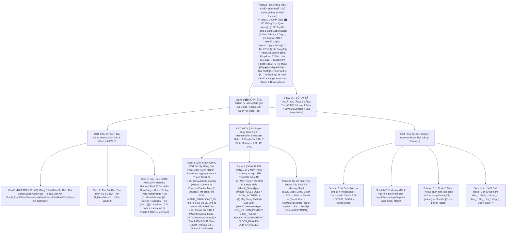
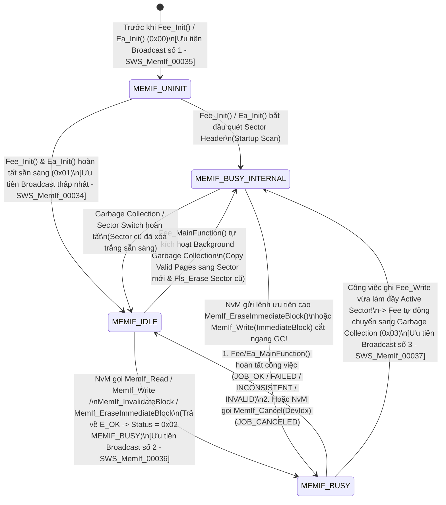
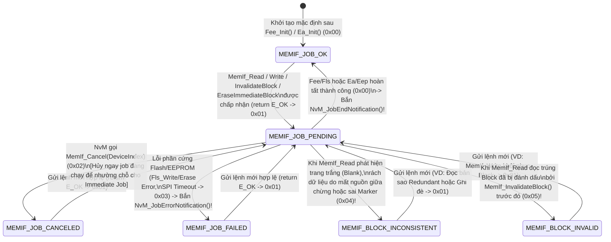

# Tài Liệu Thiết Kế Chi Tiết Trình Mô Phỏng AUTOSAR MemIf (`MemIf_Simulation_design.md`)

> **Trạng thái tài liệu:** Bản thiết kế chi tiết đã cập nhật theo xác nhận `A1`–`A4` của User — Sẵn sàng để User review trước khi triển khai code.  
> **File đích dự kiến xuất bản:** `d:\__Personal\AntiGravity\Simulation\04_ECU_Abstraction\AUTOSAR_MemIf.html` (Ứng dụng Web Tương tác 1 file HTML độc lập, 100% Offline, Pure CSS, có nút tải `.HTML` kèm cấu hình nhúng & xuất code `ARXML / MemIf_Cfg.h / MemIf_Cfg.c / JSON`).  
> **Chuẩn tham chiếu:** **AUTOSAR Classic Platform R20-11 / R22-11 / R23-11 (`SWS_MemIf`, `SWS_NvM`, `SWS_Fee`, `SWS_Ea`, `SWS_Fls`, `SWS_Eep`, `SWS_MemAcc`, `SWS_Mem`, `SWS_Dem`, `SWS_Det`, `SWS_EcuM`, `SWS_BswM`, `SWS_Rte`)**, đính kèm mã requirement chuẩn **`SWS_MemIf_xxxxx`** tại từng bước xử lý, Bảng Giải Phẫu Cơ Chế Định Tuyến (`Macro Expansion 1-Device` vs `Function Pointer Array N-Devices`), Ma Trận Hợp Nhất Trạng Thái Quảng Bá (`MEMIF_BROADCAST_ID = 0xFF`), 2 thanh ghi 8-Bit tương tác, tooltip cấu hình và sổ tay tra cứu đa tầng.

---

## 1. Tổng Quan Định Hướng Thiết Kế Đã Chốt (`A1` – `A4`)

| Hạng mục | Nội dung thiết kế đã xác nhận với User |
| :--- | :--- |
| **1. Bố cục giao diện & Ưu tiên Không Cuộn Trang — Zero-Scroll (`A1`)** | Kế thừa tinh hoa của **`AUTOSAR_DEM.html`**, **`AUTOSAR_WdgM.html`** và **`AUTOSAR_BswM.html`**, tối ưu hóa **Above-the-Fold (Zero-Scroll)** để các khối thao tác và giám sát tần suất cao nhất luôn nằm ngay phần đầu mỗi cột trong khung màn hình:<br>• **Thanh Điều Khiển Hợp Nhất Cố Định (Sticky Unified Header)**:<br>  - **Hàng 1**: Chuyển View `[🎛️ Mô Phỏng Trực Quan MemIf]` \| `[📖 Sổ Tay Đa Tầng & Bảng Abbreviation (7 Main Tabs)]` + Công cụ `[🧾 Xuất ARXML / MemIf_Cfg.h / MemIf_Cfg.c / JSON]` \| `[💾 Tải .HTML]` \| `[🌗 Sáng/Tối]`.<br>  - **Hàng 2 (Luôn cố định)**: Dropdown chọn 12 Kịch bản (`S1`–`S12`), Stepper (`↺ Reset`, `◀ Lùi`, `▶ Tự chạy`, `Tiếp ▶`), Bộ tạo nhịp BSW bất đồng bộ (`+1 Tick NvM_MainFunction`, `+1 Tick Fee/Fls_MainFunction`, `+1 Tick Ea/Eep_MainFunction`, `▶ Auto MainFunction Clock`) và Badge Trạng thái `MemIf Broadcast Status` & `Active Routing Mode (Macro vs FctPtr)`.<br>• **Bố cục 3 cột hiện đại (Mỗi cột tự cuộn độc lập trong khung Viewport)**:<br>  - **Cột Trái (`375px`)**: Đưa **Card 1: Bảng Điều Khiển Sự Kiện Thủ Công (`Quick Action Bar` — 8 nút bắn trực tiếp 9 API chuẩn của `MemIf`, yêu cầu từ `SWC/NvM`, kích hoạt Garbage Collection của `Fee` & bơm lỗi)** và **Card 2: Tóm tắt kịch bản & 3 nút 1-Click What-If** lên trên cùng, tiếp theo là **Card 3: 6 Sub-tabs Cấu hình ECUC MemIf & Memory Stack** (hỗ trợ Floating Hover Tooltip `#cfgTooltipPopup` sau `>1s` giống hệt `AUTOSAR_DEM.html`).<br>  - **Cột Giữa (`Linh hoạt`)**: Đưa **Panel 1: Bảng Giải Phẫu Định Tuyến `MemIf` (`Macro 1-Device` vs `Function Pointer Table N-Devices`) + Ma Trận Hợp Nhất `MEMIF_BROADCAST_ID (0xFF)` + Bộ Giải Mã Địa Chỉ Vật Lý `Fee/Ea` + 2 Thanh Ghi 8-Bit Tương Tác** và **Panel 2: 2 Máy Trạng Thái Song Song (`MemIf_StatusType` & `MemIf_JobResultType`)** lên ngay đầu cột giữa; bên dưới là **Panel 3: Sơ Đồ Kiến Trúc Tương Tác SVG Full Memory Stack** (`SWC_App / Dem / EcuM ↔ RTE ↔ NvM ↔ MemIf ↔ [Device 0: Fee ↔ Fls/MemAcc (Data Flash)] & [Device 1: Ea ↔ Eep/Spi (EEPROM)]`).<br>  - **Cột Phải (`440px, Sticky`)**: Inspector 4 Sub-tabs (`🔍 Bước hiện tại`, `🧩 Module`, `📄 Code C Thực Thi (#define Macro vs Const FctPtr)`, `📜 API Call Trace`). |
| **2. Khu vực Giám sát Bit-level & Giải phẫu Định tuyến Đa thiết bị 2 Tầng (`A2`)** | Đặt **cố định và nổi bật ở đầu Cột Giữa** gồm **2 tầng trực quan hóa**:<br>• **Tầng 1 — Bảng Giải Phẫu Trực Quan Cơ Chế Định Tuyến `MemIf`, Hợp Nhất `MEMIF_BROADCAST_ID` & Ánh Xạ `BlockNumber`**:<br>  - Hiển thị trực tiếp sự khác biệt kiến trúc cốt lõi của `MemIf` theo `MemIfNumberOfDevices`:<br>    1. Khi **`MemIfNumberOfDevices == 1` (`Macro Optimization Mode` — `SWS_MemIf_00019`)**: Tiền xử lý C ánh xạ thẳng `#define MemIf_Read(DevIdx, ...) Fee_Read(...)` (bỏ qua tham số `DeviceIndex`, **Zero CPU Overhead**).<br>    2. Khi **`MemIfNumberOfDevices >= 2` (`Function Pointer Array Mode` — `SWS_MemIf_00020`)**: Kiểm tra `DET (DeviceIndex < MEMIF_NUMBER_OF_DEVICES)` rồi tra mảng hằng `MemIf_ReadFctPtr[DeviceIndex](BlockNumber, ...)` để rẽ nhánh xuống **`Device 0: Fee (Flash)`** hoặc **`Device 1: Ea (EEPROM)`**.<br>  - Hiển thị trực tiếp quy tắc hợp nhất trạng thái khi gọi **`MemIf_GetStatus(MEMIF_BROADCAST_ID = 0xFF)`** (`SWS_MemIf_00035`..`00037`): Ưu tiên `MEMIF_UNINIT (0x00)` $\succ$ `MEMIF_BUSY (0x02)` $\succ$ `MEMIF_BUSY_INTERNAL (0x03)` $\succ$ `MEMIF_IDLE (0x01)`.<br>  - Hiển thị bộ giải mã địa chỉ logic sang vật lý: `NvMBlockDescriptor` ➔ `(DeviceIndex, BlockNumber)` ➔ `Fee Virtual Page / Sector Header (Active vs Erase/GC)` hoặc `Ea Physical EEPROM Offset`.<br>• **Tầng 2 — 2 Thanh ghi 8-Bit tương tác song song**:<br>  1. **Thanh A (`8-Bit MemIf Routing, Mode, DET & Broadcast Status Byte` — `MemIf_CoreStatusByte`)**: Theo dõi chế độ biên dịch/định tuyến, tốc độ `MemIf_ModeType` (`FAST`/`SLOW`), cờ lỗi `DET` và trạng thái hợp nhất toàn cục (`FCT_PTR_MODE`, `ACTIVE_DEV_IDX`, `FAST_MODE_ACTV`, `BROADCAST_QUERY`, `DET_ERR_FLAG`, `GLB_UNINIT`, `GLB_BUSY_INT`, `GLB_BUSY`).<br>  2. **Thanh B (`8-Bit Dual-Device Fee [Dev0] & Ea [Dev1] Status & JobResult Byte` — `MemIf_DeviceJobByte`)**: Theo dõi trạng thái bận, Garbage Collection nội bộ và kết quả công việc (`MemIf_JobResultType`) của cả 2 nhánh thiết bị (`FEE_DEV0_BUSY`, `FEE_BUSY_INT_GC`, `EA_DEV1_BUSY`, `IMMEDIATE_BLK`, `NVM_CBK_NOTIF`, cùng 3 bit mã hóa `MemIf_JobResultType`: `JOB_OK`, `JOB_PENDING`, `JOB_FAILED`, `BLOCK_INCONSISTENT`, `BLOCK_INVALID`, `JOB_CANCELED`). Cho phép click trực tiếp vào từng bit để giải mã hoặc thử nghiệm! |
| **3. Hệ thống 12 Kịch bản mẫu (`A3`)** | Thiết kế sẵn **12 Kịch bản (`S1`–`S12`)** chia làm 4 nhóm lớn:<br>• **Nhóm 1 (`S1`–`S3`) — Định tuyến Đọc/Ghi Đa Thiết Bị & So Sánh Macro vs Function Pointer**: Đọc/Ghi qua `DeviceIndex = 0 (Fee ➔ Fls Data Flash)` (`S1`); Đọc/Ghi qua `DeviceIndex = 1 (Ea ➔ Eep SPI EEPROM)` (`S2`); So sánh trực tiếp chế độ `MemIfNumberOfDevices = 1 (#define Macro, 0 cycle overhead)` vs `MemIfNumberOfDevices = 2 (Const Function Pointer Table)` (`S3`).<br>• **Nhóm 2 (`S4`–`S6`) — Quản lý Block Khẩn cấp, Vô hiệu hóa & Hủy Lệnh**: Ghi khẩn cấp dữ liệu va chạm (`Crash DTC`) với `MemIf_EraseImmediateBlock()` & `FeeImmediateData = TRUE` (`S4`); Vô hiệu hóa block logic bằng `MemIf_InvalidateBlock()` & đọc trả về `MEMIF_BLOCK_INVALID` (`S5`); Hủy lệnh đang chạy dở bằng `MemIf_Cancel(DeviceIndex)` & chuyển sang `MEMIF_JOB_CANCELED` (`S6`).<br>• **Nhóm 3 (`S7`–`S9`) — Hợp Nhất Trạng Thái `MEMIF_BROADCAST_ID`, Garbage Collection & Broadcast `MemIf_SetMode`**: Quy tắc ưu tiên của `MemIf_GetStatus(MEMIF_BROADCAST_ID = 0xFF)` khi `Fee` đang chạy ngầm `Garbage Collection (MEMIF_BUSY_INTERNAL)` còn `Ea` đang `IDLE` hoặc `BUSY` (`S7`); Phát quảng bá `MemIf_SetMode(MEMIF_MODE_FAST ➔ MEMIF_MODE_SLOW)` xuống toàn bộ thiết bị trong `NvM_ReadAll()` / `NvM_WriteAll()` (`S8`); Đối chiếu cơ chế **Callback Notification (`Fee/Ea ➔ NvM_JobEndNotification` bỏ qua `MemIf`)** vs **Polling Mode (`NvM ➔ MemIf_GetStatus / MemIf_GetJobResult`)** (`S9`).<br>• **Nhóm 4 (`S10`–`S12`) — Xử Lý Lỗi Dữ Liệu/Phần Cứng, Chuẩn R22-11/R23-11 `MemAcc` & Hàng Rào Bảo Vệ `DET`**: Phát hiện dữ liệu hỏng CRC/Page rách (`MEMIF_BLOCK_INCONSISTENT`) & tự động khôi phục từ bản sao `NvM Redundant Block` (`S10`); Lỗi phần cứng Flash/EEPROM (`MEMIF_JOB_FAILED`), báo `Dem_SetEventStatus` & kiến trúc mới `Fee/Ea ➔ MemAcc ➔ Mem` trong R22-11/R23-11 (`S11`); Kiểm thử toàn diện hàng rào lỗi `DET` (`MEMIF_E_PARAM_DEVICE = 0x01`, `MEMIF_E_PARAM_POINTER = 0x02`) & `MemIf_GetVersionInfo()` (`S12`). |
| **4. Sổ tay tra cứu đa tầng & Bảng Abbreviation (`A4`)** | **View 2 (`📖 Sổ Tay Kỹ Thuật MemIf & Từ Điển Thuật Ngữ`)** được tổ chức theo cấu trúc **Đa Tầng (Multi-level Tabs)**:<br>• **6 Main Sub-tabs (Level 1) × 4 Chủ đề con (Level 2 Pills/Tabs = 24 chuyên đề)** phân tích sâu kiến trúc Memory Stack (`SWC-RTE-NvM-MemIf-Fee/Ea-Fls/Eep/MemAcc`), cơ chế sinh mã Macro vs Function Pointer Table, giải phẫu 9 hàm API chuẩn, quy tắc hợp nhất `MEMIF_BROADCAST_ID`, cơ chế Wear-Leveling / Garbage Collection của `Fee` vs `Ea`, đường đi bất đồng bộ (Downward Request qua `MemIf` vs Upward Callback trực tiếp lên `NvM`) và ECUC.<br>• **Tab 7 chuyên biệt: `🔤 Bảng Thuật Ngữ & Từ Viết Tắt (Abbreviation Table)`** trình bày dưới dạng bảng chuẩn 4 cột, tích hợp **Search Box tìm kiếm tức thời (Live Search + Highlight `<mark>`)** và 5 nút lọc nhanh theo phân nhóm (`MemIf Core & Routing`, `9 Standard APIs & Status/JobResult`, `Fee & Flash (Fls/MemAcc)`, `Ea & EEPROM (Eep/SPI)`, `NvM, RTE, Safety & DET/DEM`). |

---

## 2. Bố Cục Giao Diện 3 Cột Ưu Tiên Zero-Scroll & Hệ Thống Sub-Tabs (UI Wireframe)

Để đáp ứng triệt để yêu cầu **"đưa các khối được dùng thường xuyên hơn lên phía trên để người dùng không cần cuộn chuột lên xuống mỗi lần thao tác"**, giao diện được thiết kế theo nguyên lý **Viewport-First (Toàn bộ 8 nút gọi nhanh API `MemIf`, nút nhịp `MainFunction`, Bảng Giải Phẫu Định Tuyến `Macro / Function Pointer`, Ma Trận Hợp Nhất `MEMIF_BROADCAST_ID`, 2 Thanh Ghi 8-Bit và 2 Máy Trạng Thái đều nằm ngay trong tầm mắt đầu trang)**:



### Điểm Cải Tiến Đột Phá Về Trải Nghiệm "Zero-Scroll" Cho Module `MemIf`:
1. **Thanh Điều Khiển Hợp Nhất (`Sticky Unified Header`) Với Các Nút Nhịp `MainFunction` Bất Đồng Bộ**:
   - Bản chất của `MemIf` là **Asynchronous Interface**: Các hàm `MemIf_Read()`, `MemIf_Write()`, `MemIf_EraseImmediateBlock()`, `MemIf_InvalidateBlock()` chỉ mất vài micro-giây để kiểm tra `DeviceIndex` rồi chuyển giao công việc xuống `Fee`/`Ea` (trả về `E_OK` và đặt trạng thái `MEMIF_BUSY` + `MEMIF_JOB_PENDING`). Công việc xóa/ghi vật lý thực sự diễn ra qua nhiều chu kỳ **`Fee_MainFunction()` + `Fls_MainFunction()`** (hoặc **`Ea_MainFunction()` + `Eep_MainFunction()`**). Việc đặt các nút nhịp `+1 Tick Fee/Fls` và `+1 Tick Ea/Eep` ngay trên thanh Header cố định giúp người dùng chủ động điều khiển tiến trình đọc/ghi từng trang Flash/EEPROM mà không cần cuộn chuột.
2. **Đưa `Quick Action Bar` (8 nút tác động nhanh) lên vị trí Card 1 (Đầu Cột Trái)** và đưa **Bảng Giải Phẫu Định Tuyến + Ma Trận `MEMIF_BROADCAST_ID` + 2 Thanh Ghi 8-Bit** lên đầu Cột Giữa: Khi người dùng đổi `DeviceIndex` (`0: Fee` ↔ `1: Ea`) hoặc bật/tắt chế độ `MemIfNumberOfDevices (1: Macro ↔ 2: Function Pointer)`, cả bảng ánh xạ con trỏ hàm, code C thực thi và 2 thanh ghi 8-bit đổi trạng thái tức thời ngay trước mắt.
3. **Gom 36 tham số ECUC vào 6 Sub-tabs gọn gàng**: Chiều cao Card Cấu hình được giữ gọn cố định (~275px), kèm hộp thoại giải thích nổi `#cfgTooltipPopup` khi hover quá `1000ms` giống hệt file `AUTOSAR_DEM.html`.

---

## 3. Thiết Kế Chi Tiết Panel 1 (Đầu Cột Giữa): Bảng Giải Phẫu Định Tuyến `MemIf`, Hợp Nhất `MEMIF_BROADCAST_ID` & 2 Thanh Ghi 8-Bit Tương Tác

Trong `AUTOSAR Classic`, giá trị kỹ thuật đặc sắc nhất của `MemIf` (`SWS_MemIf`) nằm ở **3 cơ chế cốt lõi**:
1. **Định tuyến đa thiết bị bộ nhớ (`DeviceIndex` Dispatching)**: Cho phép một `NvM` duy nhất truy cập trong suốt cả **Data Flash nội bộ (`Fee`, `DeviceIndex = 0`)** lẫn **EEPROM ngoại vi (`Ea`, `DeviceIndex = 1`)** qua bảng con trỏ hàm hằng số (`MemIfNumberOfDevices > 1`), hoặc tự động rút gọn thành **Macro C chi phí bằng 0 (`MemIfNumberOfDevices == 1`)**.
2. **Hợp nhất trạng thái toàn cục (`MemIf_GetStatus(MEMIF_BROADCAST_ID = 0xFF)`)**: Khi `NvM` hỏi trạng thái chung của toàn bộ hệ thống bộ nhớ bằng mã quảng bá `0xFF`, `MemIf` phải tổng hợp trạng thái của mọi thiết bị theo thứ tự ưu tiên nghiêm ngặt (`UNINIT > BUSY > BUSY_INTERNAL > IDLE`).
3. **Sự bất đối xứng giữa Đường đi (Request) và Đường về (Notification vs Polling)**: Lệnh yêu cầu đi từ `NvM ➔ MemIf ➔ Fee/Ea`, nhưng khi xong việc, nếu dùng **Callback Mode**, `Fee/Ea` lại gọi thẳng `NvM_JobEndNotification()` lên `NvM` (bỏ qua `MemIf`); còn nếu dùng **Polling Mode**, `NvM` sẽ gọi `MemIf_GetStatus()` và `MemIf_GetJobResult()` xuyên qua `MemIf`.

Do đó, Panel 1 ở đầu Cột Giữa được thiết kế gồm **2 phần trực quan hóa liên thông**:

### 3.1. Phần 1A — Bảng Giải Phẫu Trực Quan Cơ Chế Định Tuyến `MemIf`, Ma Trận Hợp Nhất `MEMIF_BROADCAST_ID` & Bố Cục Vật Lý `Fee / Ea`

```text
+-------------------------------------------------------------------------------------------------------------------+
| 🔀 BẢNG GIẢI PHẪU ĐỊNH TUYẾN MEMIF & HỢP NHẤT TRẠNG THÁI (`SWS_MemIf_00019`, `00020`, `00035`, `00036`, `00037`)   |
| Kiến trúc: [ 2 Devices: Function Pointer Array ] | Mode: [ MEMIF_MODE_FAST ] | Broadcast(0xFF): [ MEMIF_BUSY ]    |
+-------------------------------------------------------------------------------------------------------------------+
| 1. BỘ ĐỊNH TUYẾN LỜI GỌI MEMIF (MEMIF API DISPATCHER — Click để chọn DeviceIndex hoặc đổi chế độ Macro/FctPtr):   |
|  • Lệnh đang gọi : MemIf_Write(DeviceIndex = 0, BlockNumber = 0x0004, DataBufferPtr = &RamBlock_Calib)            |
|  • Kiểm tra DET  : (DeviceIndex(0) < MEMIF_NUMBER_OF_DEVICES(2)) && (DataBufferPtr != NULL_PTR) ➔ [ PASS ]        |
|  • Ánh xạ thực thi: MemIf_WriteFctPtr[0](0x0004, DataBufferPtr) ──► ĐỊNH TUYẾN TỚI: [ Fee_Write(0x0004, Ptr) ]    |
+-------------------------------------------------------------------------------------------------------------------+
| 2. SO SÁNH 2 NHÁNH THIẾT BỊ BỘ NHỚ & HỢP NHẤT TRẠNG THÁI QUẢNG BÁ (`MemIf_GetStatus(MEMIF_BROADCAST_ID = 0xFF)`): |
|  +-----------------------+-----------------------------------+-------------------------+------------------------+ |
|  | Nhánh Thiết Bị (Idx)  | Cấu Trúc Vật Lý & Tiến Trình Ngầm | Trạng Thái (`GetStatus`)| Kết Quả (`GetJobResult`)| |
|  +-----------------------+-----------------------------------+-------------------------+------------------------+ |
|  | ▶ DeviceIndex = 0     | • Driver: Fee ➔ Fls (Data Flash)  | [ 0x02: MEMIF_BUSY    ] | [ 0x01: MEMIF_JOB_     | |
|  |   [ FEE - Internal    | • Sector 0: ACTIVE (VP #12..#15)  | (Đang ghi Block 0x0004) |         PENDING      ] | |
|  |     Data Flash ]      | • Sector 1: ERASING / GC Ready    | Mode: MEMIF_MODE_FAST   | (Fls_Write Page 2/4)   | |
|  +-----------------------+-----------------------------------+-------------------------+------------------------+ |
|  |   DeviceIndex = 1     | • Driver: Ea ➔ Eep (SPI EEPROM)   | [ 0x01: MEMIF_IDLE    ] | [ 0x00: MEMIF_JOB_OK ] | |
|  |   [ EA - External     | • Địa chỉ: Offset 0x0180 (64 Byte)| (Sẵn sàng nhận lệnh mới)|                        | |
|  |     SPI EEPROM ]      | • Kênh truyền: SPI_Channel_Eep    | Mode: MEMIF_MODE_FAST   | (Hoàn tất Block 0x0010)| |
|  +-----------------------+-----------------------------------+-------------------------+------------------------+ |
|  | 🌐 HỢP NHẤT TOÀN CỤC  | Công thức ưu tiên (`SWS_MemIf_00035..00037`):                                        | |
|  | DeviceIndex = 0xFF    | UNINIT(0) > BUSY(2) > BUSY_INTERNAL(3) > IDLE(1)                                     | |
|  | (MEMIF_BROADCAST_ID)  | ➔ max_prio(Dev0=MEMIF_BUSY, Dev1=MEMIF_IDLE) = [ 0x02: MEMIF_BUSY ]                  | |
|  +-----------------------+--------------------------------------------------------------------------------------+ |
+-------------------------------------------------------------------------------------------------------------------+
```

- **Tính năng tương tác trực tiếp trên Phần 1A**:
  - Người dùng có thể click chọn trực tiếp vào dòng **`DeviceIndex = 0 (Fee - Flash)`**, **`DeviceIndex = 1 (Ea - EEPROM)`** hoặc **`DeviceIndex = 0xFF (MEMIF_BROADCAST_ID)`** để đổi đích tác động của các nút trên Quick Action Bar.
  - Có nút gạt nhanh **`[Chế độ biên dịch: 1 Device (#define Macro) ↔ 2 Devices (Const FctPtr Array)]`** ngay trên tiêu đề bảng để người dùng nhìn thấy sự biến đổi tức thời giữa Macro C không đối số `DeviceIndex` và mảng con trỏ hàm có kiểm tra `DET`!

### 3.2. Phần 1B — 2 Thanh Ghi 8-Bit Trạng Thái Tương Tác Luôn Hiển Thị Nổi Bật

Ngay bên dưới Phần 1A là **2 Thanh ghi 8-Bit tương tác** theo đúng phong cách chuẩn của `AUTOSAR_DEM.html` và `AUTOSAR_WdgM.html`:

```text
+-------------------------------------------------------------------------------------------------------------------+
| 🔢 BẢNG GIÁM SÁT BITFIELD 8-BIT MEMIF ROUTING & DUAL-DEVICE STATUS (LIVE 8-BIT INSPECTOR) [Click từng Bit để thử] |
| Bước #3: MemIf_Write(0, 0x0004, Ptr) định tuyến qua MemIf_WriteFctPtr[0] xuống Fee_Write() | A: 0xA1 | B: 0x89    |
+-------------------------------------------------------------------------------------------------------------------+
| A. THANH GHI 8-BIT ĐỊNH TUYẾN, CHẾ ĐỘ, DET & TRẠNG THÁI HỢP NHẤT (`MemIf_CoreStatusByte`) — Hex:[0xA1] Bin:[10100001]|
|    Kiến trúc: [ 2 Devices (FctPtr) ] | Active DevIdx: [ 0 (Fee) ] | Broadcast Status: [ 0x02 - MEMIF_BUSY ]       |
|  +-------------+ +-------------+ +-------------+ +-------------+ +-------------+ +-------------+ +-------+ +-----+|
|  | Bit 7 (0x80)| | Bit 6 (0x40)| | Bit 5 (0x20)| | Bit 4 (0x10)| | Bit 3 (0x08)| | Bit 2 (0x04)| |Bit1(2)| |Bit 0||
|  | FCT_PTR_MOD | | ACTV_DEV_1  | | FAST_MODE   | | BCAST_QUERY | | DET_ERR_FLG | | GLB_UNINIT  | |GLB_INT| |GLB_B||
|  |      1      | |      0      | |      1      | |      0      | |      0      | |      0      | |   0   | |  1  ||
|  | FctPtr Arr  | | Dev 0 (Fee) | | FAST Mode   | | Specific Dev| | No DET Err  | | All Init OK | |No GC  | |BUSY ||
|  +-------------+ +-------------+ +-------------+ +-------------+ +-------------+ +-------------+ +-------+ +-----+|
+-------------------------------------------------------------------------------------------------------------------+
| B. THANH GHI 8-BIT TRẠNG THÁI 2 THIẾT BỊ FEE/EA & KẾT QUẢ JOB (`MemIf_DeviceJobByte`) — Hex: [0x89] Bin:[10001001] |
|    Dev0 (Fee): [BUSY] | Dev1 (Ea): [IDLE] | Active JobResult (SWS_MemIf_00065): [ 0x01 - MEMIF_JOB_PENDING ]      |
|  +-------------+ +-------------+ +-------------+ +-------------+ +-------------+ +-------------+ +-------+ +-----+|
|  | Bit 7 (0x80)| | Bit 6 (0x40)| | Bit 5 (0x20)| | Bit 4 (0x10)| | Bit 3 (0x08)| | Bit 2 (0x04)| |Bit1(2)| |Bit 0||
|  | FEE0_BUSY   | | FEE0_GC_INT | | EA1_BUSY    | | IMMED_BLOCK | | NVM_CBK_OK  | | JOB_RES_B2  | |JOB_B1 | |JOB_0||
|  |      1      | |      0      | |      0      | |      0      | |      1      | |      0      | |   0   | |  1  ||
|  | Fee Busy    | | No Flash GC | | Ea Idle     | | Normal Blk  | | Cbk Mode ON | | 001b = MEMIF_JOB_PENDING (01) ||
|  +-------------+ +-------------+ +-------------+ +-------------+ +-------------+ +-------------+ +-------+ +-----+|
+-------------------------------------------------------------------------------------------------------------------+
```

#### 3.2.1. Giải Mã Chi Tiết Thanh A: `8-Bit MemIf Routing, Mode, DET & Broadcast Status Byte` (`MemIf_CoreStatusByte`)

| Bit | Mask | Tên Cờ (`MemIf Core Bit`) | Ý nghĩa kỹ thuật & Khi nào bật lên `1` (`0 ➔ 1`) | Khi nào hạ về `0` (`1 ➔ 0`) |
| :-: | :-: | :--- | :--- | :--- |
| **Bit 7** | `0x80` | **`FCT_PTR_MOD`** | Bật lên `1` khi cấu hình **`MemIfNumberOfDevices > 1`** (`SWS_MemIf_00020`): `MemIf` biên dịch dưới dạng **Bảng con trỏ hàm (`Function Pointer Array`)** để định tuyến động giữa `Fee` (`DeviceIndex = 0`) và `Ea` (`DeviceIndex = 1`), đồng thời kích hoạt bộ kiểm tra `DeviceIndex` trong `DET`. | Hạ về `0` khi **`MemIfNumberOfDevices == 1`** (`SWS_MemIf_00019`): `MemIf` chuyển sang chế độ **Direct Macro Expansion (`#define MemIf_Read(...) Fee_Read(...)`)**, loại bỏ hoàn toàn tầng gọi hàm trung gian. |
| **Bit 6** | `0x40` | **`ACTV_DEV_1`** | Bật lên `1` khi lời gọi API hiện tại truyền vào **`DeviceIndex == 1`**, định tuyến yêu cầu sang nhánh **`Ea` (EEPROM Abstraction ➔ `Eep` Driver)**. | Hạ về `0` khi lời gọi API nhắm tới **`DeviceIndex == 0`**, định tuyến yêu cầu sang nhánh **`Fee` (Flash EEPROM Emulation ➔ `Fls` Driver)**. |
| **Bit 5** | `0x20` | **`FAST_MODE`** | Bật lên `1` khi `NvM` (hoặc `BswM`) gọi **`MemIf_SetMode(MEMIF_MODE_FAST)`** (`SWS_MemIf_00038`) — thường dùng trong pha khởi động `NvM_ReadAll()` hoặc tắt máy `NvM_WriteAll()` để cho phép `Fls`/`Eep` đọc/ghi kích thước khối lớn (Burst Mode) trong mỗi chu kỳ `MainFunction`. | Hạ về `0` (`MEMIF_MODE_SLOW`) khi hệ thống vào trạng thái vận hành bình thường (`RUN`), giảm số byte xử lý mỗi chu kỳ để không chiếm dụng CPU và bus SPI/Flash quá lâu. |
| **Bit 4** | `0x10` | **`BCAST_QUERY`** | Bật lên `1` khi tầng trên gọi **`MemIf_GetStatus(MEMIF_BROADCAST_ID)`** (`DeviceIndex = 0xFF` — `SWS_MemIf_00035`) hoặc khi `MemIf_SetMode()` phát lệnh quảng bá đồng thời tới tất cả các thiết bị bộ nhớ bên dưới. | Hạ về `0` khi truy vấn hoặc thao tác trên một `DeviceIndex` đơn lẻ (`0` hoặc `1`). |
| **Bit 3** | `0x08` | **`DET_ERR_FLG`** | Bật lên `1` ngay khi `MemIf` (`MemIfDevErrorDetect == TRUE`) bắt được lỗi tham số đầu vào và gọi **`Det_ReportError()`**:<br>• `MEMIF_E_PARAM_DEVICE (0x01)`: Truyền `DeviceIndex >= MEMIF_NUMBER_OF_DEVICES` (và khác `MEMIF_BROADCAST_ID` đối với `MemIf_GetStatus`) [`SWS_MemIf_00022`].<br>• `MEMIF_E_PARAM_POINTER (0x02)`: Truyền con trỏ `NULL_PTR` vào `MemIf_Read`, `MemIf_Write` hoặc `MemIf_GetVersionInfo` [`SWS_MemIf_00023`]. | Hạ về `0` khi người dùng thực hiện một lời gọi API hợp lệ mới hoặc bấm Reset. |
| **Bit 2** | `0x04` | **`GLB_UNINIT`** | Bật lên `1` khi kết quả hợp nhất trạng thái toàn cục (`MemIf_GetStatus(MEMIF_BROADCAST_ID)`) trả về **`MEMIF_UNINIT (0x00)`** — xảy ra khi **ít nhất 1 thiết bị** (`Fee` hoặc `Ea`) chưa được khởi tạo (`Fee_Init` / `Ea_Init` chưa chạy) [`SWS_MemIf_00035`]. | Hạ về `0` ngay khi tất cả các module trừu tượng hóa bộ nhớ đã khởi tạo xong (`Fee_Init()` & `Ea_Init()`). |
| **Bit 1** | `0x02` | **`GLB_BUSY_INT`** | Bật lên `1` khi trạng thái hợp nhất toàn cục là **`MEMIF_BUSY_INTERNAL (0x03)`** — không có thiết bị nào `UNINIT` hay `BUSY` (xử lý job bên ngoài), nhưng có ít nhất 1 thiết bị đang bận xử lý nội bộ (ví dụ: `Fee` đang chạy **Garbage Collection / Sector Switch / Copy Valid Blocks**) [`SWS_MemIf_00037`]. | Hạ về `0` khi tiến trình nội bộ (`Garbage Collection`) hoàn tất (về `MEMIF_IDLE = 000b`) hoặc khi có một lệnh mới chiếm quyền sang `GLB_BUSY (Bit 0 = 1)`. |
| **Bit 0** | `0x01` | **`GLB_BUSY`** | Bật lên `1` khi trạng thái hợp nhất toàn cục là **`MEMIF_BUSY (0x02)`** — có ít nhất 1 thiết bị (`Fee` hoặc `Ea`) đang thực thi công việc đọc/ghi/xóa/vô hiệu hóa do `NvM` giao xuống [`SWS_MemIf_00036`]. *(Lưu ý: Khi cả `Bit 2 = 0`, `Bit 1 = 0`, `Bit 0 = 0`, toàn bộ hệ thống ở trạng thái sẵn sàng **`MEMIF_IDLE (0x01)`**!)* | Hạ về `0` khi mọi thiết bị hoàn tất công việc được giao và quay về `MEMIF_IDLE`. |

#### 3.2.2. Giải Mã Chi Tiết Thanh B: `8-Bit Dual-Device Fee [Dev0] & Ea [Dev1] Status & JobResult Byte` (`MemIf_DeviceJobByte`)

> **Lưu ý chuẩn AUTOSAR (`SWS_MemIf_00065`)**: Ba bit thấp nhất (**`Bit 2..0`**) của Thanh B mã hóa chính xác 6 giá trị kết quả công việc của kiểu **`MemIf_JobResultType`** trả về bởi hàm `MemIf_GetJobResult(DeviceIndex)`:
> - `000b (0x00)` = `MEMIF_JOB_OK` (Công việc gần nhất hoàn tất thành công)
> - `001b (0x01)` = `MEMIF_JOB_PENDING` (Công việc đang được `Fee/Fls` hoặc `Ea/Eep` xử lý bất đồng bộ)
> - `010b (0x02)` = `MEMIF_JOB_CANCELED` (Công việc đã bị hủy chủ động bởi `MemIf_Cancel()`)
> - `011b (0x03)` = `MEMIF_JOB_FAILED` (Lỗi phần cứng Flash/EEPROM hoặc thao tác thất bại)
> - `100b (0x04)` = `MEMIF_BLOCK_INCONSISTENT` (Dữ liệu đọc lên bị rách trang / sai Checksum / chưa từng được ghi)
> - `101b (0x05)` = `MEMIF_BLOCK_INVALID` (Block đã bị đánh dấu vô hiệu hóa bởi `MemIf_InvalidateBlock()`)

| Bit | Mask | Tên Cờ (`MemIf Device/Job Bit`) | Ý nghĩa kỹ thuật & Khi nào bật lên `1` (`0 ➔ 1`) | Khi nào hạ về `0` (`1 ➔ 0`) |
| :-: | :-: | :--- | :--- | :--- |
| **Bit 7** | `0x80` | **`FEE0_BUSY`** | Bật lên `1` khi nhánh **`DeviceIndex = 0 (Fee - Flash EEPROM Emulation)`** đang ở trạng thái **`MEMIF_BUSY`** (đang thực thi `Fee_Read`, `Fee_Write`, `Fee_InvalidateBlock` hoặc `Fee_EraseImmediateBlock` xuống `Fls`). | Hạ về `0` khi `Fee_MainFunction()` và `Fls_MainFunction()` hoàn tất công việc (hoặc bị `MemIf_Cancel(0)` hủy), đưa `Fee` về `MEMIF_IDLE`. |
| **Bit 6** | `0x40` | **`FEE0_GC_INT`** | Bật lên `1` khi **`DeviceIndex = 0 (Fee)`** chuyển sang trạng thái **`MEMIF_BUSY_INTERNAL (0x03)`**: `Fee` phát hiện Sector Flash hiện tại đã đầy và tự động kích hoạt **Garbage Collection (Sector Switch)** — sao chép các Virtual Page còn hiệu lực sang Sector mới và gọi `Fls_Erase()` xóa Sector cũ! Trong lúc bit này bằng `1`, `NvM` kiểm tra `MemIf_GetStatus(0)` sẽ biết `Fee` đang bận nội bộ để tạm hoãn gửi lệnh mới. | Hạ về `0` sau khi `Fee` hoàn tất sao chép dữ liệu và xóa xong Sector Flash cũ, trở về `MEMIF_IDLE`. |
| **Bit 5** | `0x20` | **`EA1_BUSY`** | Bật lên `1` khi nhánh **`DeviceIndex = 1 (Ea - EEPROM Abstraction)`** đang ở trạng thái **`MEMIF_BUSY`** (đang thực thi `Ea_Read`, `Ea_Write`, `Ea_InvalidateBlock` xuống `Eep` qua giao tiếp SPI/nội bộ). | Hạ về `0` khi `Ea_MainFunction()` và `Eep_MainFunction()` hoàn tất truyền nhận dữ liệu EEPROM, đưa `Ea` về `MEMIF_IDLE`. |
| **Bit 4** | `0x10` | **`IMMED_BLOCK`** | Bật lên `1` khi thao tác đang xử lý nhắm vào một **Immediate Block (`FeeImmediateData = TRUE` / `EaImmediateData = TRUE`)** thông qua `MemIf_EraseImmediateBlock()` hoặc `MemIf_Write()` dữ liệu khẩn cấp (ví dụ: Crash Data / Airbag Deployment DTC từ `Dem`). Cho phép ghi ngay vào vùng Sector dự trữ sẵn mà không bị chặn bởi Garbage Collection! | Hạ về `0` khi chuyển sang thao tác trên các Block dữ liệu thông thường (`Standard / Non-Immediate Block`). |
| **Bit 3** | `0x08` | **`NVM_CBK_OK`** | Bật lên `1` khi hệ thống bật cơ chế **Callback Notification (`NvMPollingMode = FALSE`)**: Ngay khi `Fee` hoặc `Ea` hoàn tất công việc, chúng gọi ngược trực tiếp hàm callback **`NvM_JobEndNotification()`** (hoặc **`NvM_JobErrorNotification()`**) lên thẳng `NvM` mà không cần đi qua `MemIf`! | Hạ về `0` khi cấu hình **`NvMPollingMode = TRUE`**: `Fee`/`Ea` không gọi callback, buộc `NvM_MainFunction()` phải chủ động gọi **`MemIf_GetStatus()`** và **`MemIf_GetJobResult()`** định kỳ để thăm dò kết quả. |
| **Bit 2..0** | `0x07` | **`JOB_RESULT`**<br>*(`Bit 2..0` = `MemIf_JobResultType`)* | Tổ hợp 3 bit thấp nhất biểu diễn trực tiếp kết quả công việc **`MemIf_JobResultType`** của thiết bị đang chọn (`SWS_MemIf_00065`):<br>• `000b (0x00)`: **`MEMIF_JOB_OK`** (Đọc/Ghi/Xóa/Invalidate thành công).<br>• `001b (0x01)`: **`MEMIF_JOB_PENDING`** (Đang chạy dở trong `Fee/Fls` hoặc `Ea/Eep`).<br>• `010b (0x02)`: **`MEMIF_JOB_CANCELED`** (Đã hủy theo lệnh `MemIf_Cancel()`).<br>• `011b (0x03)`: **`MEMIF_JOB_FAILED`** (Lỗi phần cứng Flash Write/Erase Error hoặc SPI EEPROM Timeout).<br>• `100b (0x04)`: **`MEMIF_BLOCK_INCONSISTENT`** (Header/Trailer của Block trong Flash/EEPROM không khớp hoặc trang trắng chưa từng ghi).<br>• `101b (0x05)`: **`MEMIF_BLOCK_INVALID`** (Block có cờ `INVALID` do đã gọi `MemIf_InvalidateBlock()`). | Cập nhật tức thời khi gọi `MemIf_Read / Write / EraseImmediateBlock / InvalidateBlock` (chuyển sang `001b PENDING`), khi gọi `MemIf_Cancel` (chuyển sang `010b CANCELED`), và khi chu kỳ `Fee/Ea_MainFunction()` kết thúc công việc (`000b OK`, `011b FAILED`, `100b INCONSISTENT`, `101b INVALID`). |

---

## 4. Phân Tích Xử Lý Từng Module: Input Lấy Từ Đâu, Xử Lý Gì, Output Route Đến Đâu

Mọi khối trên sơ đồ kiến trúc SVG đều có thể **click vào để xem giải thích chi tiết** ở cột phải (Tab `🧩 Module`) và được tổng hợp đầy đủ trong **Tab 1 của Sổ tay**:

| # | Module / Phân khối | Lớp AUTOSAR | 📥 Input lấy từ đâu? | ⚙️ Cách xử lý nội bộ (Processing, State & Addressing) | 📤 Output route đến đâu & Hàm API chuẩn (R20-11 / R22-11 / R23-11) |
| :-: | :--- | :--- | :--- | :--- | :--- |
| **1** | **`SWC_App`, `Dem` & `EcuM / BswM`**<br>*(NVRAM Users)* | Application & System/Diag Services | • Yêu cầu lưu/đọc thông số hiệu chuẩn (Calibration), Odometer từ `SWC_App`.<br>• Yêu cầu lưu mã lỗi DTC / Crash Data khẩn cấp từ `Dem`.<br>• Lệnh `ReadAll` (Startup) & `WriteAll` (Shutdown) từ `EcuM / BswM`. | • **Lưu ý kiến trúc quan trọng**: Không có bất kỳ `SWC` nào được phép gọi trực tiếp `MemIf`! Mọi yêu cầu đọc/ghi bộ nhớ bất khả biến từ tầng Application (`SWC`) hoặc `Dem`/`EcuM` đều phải gửi vào **`NvM` (NVRAM Manager)** theo mã **`NvM_BlockIdType`**. | • Từ `SWC` qua **RTE** xuống **NvM**:<br>`Rte_Call_NvMService_ReadBlock(DstPtr)`<br>`Rte_Call_NvMService_WriteBlock(SrcPtr)`<br>`Rte_Call_NvMService_InvalidateNvBlock()`<br>`Rte_Call_NvMService_EraseNvBlock()`<br>• Từ **EcuM/BswM/Dem** xuống **NvM**:<br>`NvM_ReadAll()` / `NvM_WriteAll()` |
| **2** | **`RTE` & `SchM`**<br>*(Runtime Environment & BSW Scheduler)* | RTE Layer | • Lời gọi Client-Server Port `NvMService` từ `SWC_App`.<br>• Thông báo `JobFinished` từ `NvM`.<br>• Xung nhịp hệ thống (`5 ms` / `10 ms`) từ `AUTOSAR OS`. | • **RTE**: Gắn tự động tham số `BlockId` (`Port-Defined Argument Value`) vào lời gọi `NvM_ReadBlock(BlockId, DstPtr)` / `NvM_WriteBlock(BlockId, SrcPtr)`.<br>• **SchM**: Kích hoạt định kỳ chuỗi hàm xử lý nền của Memory Stack theo đúng thứ tự phân tầng: **`NvM_MainFunction()` ➔ `Fee_MainFunction()` / `Ea_MainFunction()` ➔ `Fls_MainFunction()` / `Eep_MainFunction()`**! | • Gọi định kỳ các hàm `MainFunction`:<br>`NvM_MainFunction()`<br>`Fee_MainFunction()` / `Ea_MainFunction()`<br>`Fls_MainFunction()` / `Eep_MainFunction()`<br>• Trả kết quả về **SWC**:<br>`Rte_Call_NvMNotifyJobFinished_JobFinished()` |
| **3** | **`NvM`**<br>*(NVRAM Manager)* | Memory Services (`03_Services`) | • Yêu cầu đọc/ghi theo `NvM_BlockIdType` từ `RTE`, `Dem`, `EcuM`, `BswM`.<br>• Nhận Callback `NvM_JobEndNotification()` / `NvM_JobErrorNotification()` từ `Fee` / `Ea`.<br>• Nhận `MemIf_StatusType` & `MemIf_JobResultType` từ `MemIf`. | • **1. Quản lý hàng đợi ưu tiên (`Standard Queue` vs `Immediate Queue`)**: Nếu có yêu cầu ghi `Immediate Block` (như Crash DTC), `NvM` có thể gọi `MemIf_Cancel()` hủy job thường đang chạy và gọi `MemIf_EraseImmediateBlock()` / `MemIf_Write()` ngay.<br>• **2. Tính toán & Kiểm tra CRC (`CRC16 / CRC32`)**, quản lý kiểu khối (`NATIVE`, `REDUNDANT`, `DATASET`).<br>• **3. Ánh xạ `NvMBlockDescriptor` sang tham số của `MemIf`**:<br>  - Lấy **`DeviceIndex = NvMTargetBlockReference (0 = Fee, 1 = Ea)`**.<br>  - Tính **`BlockNumber = (NvMNvBlockBaseNumber << DatasetSelectionBits) + DataIndex`**.<br>  - Gọi xuống **`MemIf_*`**! | • Gọi toàn bộ 8 API điều khiển xuống **MemIf** (`SWS_NvM_00341`):<br>`MemIf_Read(DevIdx, BlkNum, Offset, Ptr, Len)`<br>`MemIf_Write(DevIdx, BlkNum, Ptr)`<br>`MemIf_InvalidateBlock(DevIdx, BlkNum)`<br>`MemIf_EraseImmediateBlock(DevIdx, BlkNum)`<br>`MemIf_Cancel(DevIdx)`<br>`MemIf_SetMode(Mode)`<br>`MemIf_GetStatus(DevIdx / 0xFF)`<br>`MemIf_GetJobResult(DevIdx)` |
| **4** | **`MemIf`**<br>*(Memory Abstraction Interface — Trọng tâm mô phỏng)* | ECU Abstraction Layer (`04_ECU_Abstraction`) | • Nhận các lời gọi API đọc/ghi/xóa/truy vấn trạng thái từ `NvM` kèm chỉ số thiết bị **`DeviceIndex`** (`0`, `1`, hoặc `MEMIF_BROADCAST_ID = 0xFF`). | • **1. Kiểm tra lỗi tham số đầu vào (`DET`)** khi `MemIfDevErrorDetect == TRUE`:<br>  - Nếu `DeviceIndex >= MEMIF_NUMBER_OF_DEVICES` (trừ trường hợp `DeviceIndex == MEMIF_BROADCAST_ID` trong `MemIf_GetStatus`) ➔ báo `Det_ReportError(MEMIF_MODULE_ID=22, 0, ApiId, MEMIF_E_PARAM_DEVICE=0x01)` [`SWS_MemIf_00022`].<br>  - Nếu `DataBufferPtr == NULL_PTR` hoặc `VersionInfoPtr == NULL_PTR` ➔ báo `MEMIF_E_PARAM_POINTER (0x02)` [`SWS_MemIf_00023`].<br>• **2. Định tuyến lời gọi theo `MemIfNumberOfDevices`**:<br>  - Nếu **`MemIfNumberOfDevices == 1`**: Ánh xạ trực tiếp bằng Macro C (`#define MemIf_Read(...) Fee_Read(...)`), loại bỏ `DeviceIndex` [`SWS_MemIf_00019`].<br>  - Nếu **`MemIfNumberOfDevices >= 2`**: Tra mảng con trỏ hàm hằng `MemIf_ReadFctPtr[DeviceIndex](...)` để gọi đúng `Fee_*` (`DevIdx = 0`) hoặc `Ea_*` (`DevIdx = 1`) [`SWS_MemIf_00020`].<br>• **3. Xử lý Quảng bá (`Broadcast`)**:<br>  - `MemIf_SetMode(Mode)`: Lặp qua toàn bộ `0 .. MEMIF_NUMBER_OF_DEVICES-1` gọi `Fee_SetMode(Mode)` và `Ea_SetMode(Mode)` [`SWS_MemIf_00038`].<br>  - `MemIf_GetStatus(MEMIF_BROADCAST_ID)`: Quét trạng thái mọi thiết bị và trả về mức ưu tiên cao nhất: `UNINIT > BUSY > BUSY_INTERNAL > IDLE` [`SWS_MemIf_00035`..`00037`]. | • Định tuyến xuống **Fee (`DeviceIndex = 0`)**:<br>`Fee_Read()`, `Fee_Write()`, `Fee_Cancel()`, `Fee_GetStatus()`, `Fee_GetJobResult()`, `Fee_InvalidateBlock()`, `Fee_EraseImmediateBlock()`, `Fee_SetMode()`<br>• Định tuyến xuống **Ea (`DeviceIndex = 1`)**:<br>`Ea_Read()`, `Ea_Write()`, `Ea_Cancel()`, `Ea_GetStatus()`, `Ea_GetJobResult()`, `Ea_InvalidateBlock()`, `Ea_EraseImmediateBlock()`, `Ea_SetMode()`<br>• Báo lỗi sang **Det**:<br>`Det_ReportError(22, 0, ApiId, ErrId)` |
| **5** | **`Fee` (`DeviceIndex = 0`)**<br>*(Flash EEPROM Emulation)* | ECU Abstraction Layer (`04_ECU_Abstraction`) | • Nhận các lệnh đọc/ghi theo `BlockNumber` từ `MemIf`.<br>• Nhận kết quả thao tác Flash vật lý từ `Fls` (`Fls_GetJobResult` / Callback). | • **Giả lập EEPROM trên bộ nhớ Data Flash vật lý**:<br>  - Bộ nhớ Flash không thể ghi đè trực tiếp từng byte mà phải xóa theo cả Sector lớn (`Erase Sector = 32KB/64KB`) và ghi theo `Virtual Page (8/16 bytes)`.<br>  - Khi `Fee_Write(BlockNumber, DataPtr)` được gọi, `Fee` **không xóa vị trí cũ** mà cấp phát một **Virtual Page mới tiếp theo còn trống** trong `Active Sector`, gắn Header (`BlockNumber`, `BlockLength`, `Status = VALID`, `Consistent Marker`) và gọi `Fls_Write()` (**Wear-Leveling**).<br>  - Khi `Active Sector` đầy vượt ngưỡng, `Fee` chuyển sang **`MEMIF_BUSY_INTERNAL`** để chạy **Garbage Collection (Sector Switch)**: copy các Block mới nhất sang Sector mới rồi gọi `Fls_Erase()` xóa Sector cũ!<br>  - Giữ sẵn vùng trống cho **Immediate Block (`FeeImmediateData = TRUE`)** để có thể ghi khẩn cấp qua `Fee_EraseImmediateBlock()`. | • Gọi xuống **Fls** (hoặc **MemAcc** trong R22-11/R23-11):<br>`Fls_Read(SourceAddress, TargetAddressPtr, Length)`<br>`Fls_Write(TargetAddress, SourceAddressPtr, Length)`<br>`Fls_Erase(TargetAddress, Length)`<br>`Fls_Compare()` / `Fls_Cancel()`<br>• Gọi Callback **trực tiếp lên NvM** (bỏ qua `MemIf`!):<br>`NvM_JobEndNotification()`<br>`NvM_JobErrorNotification()` |
| **6** | **`Ea` (`DeviceIndex = 1`)**<br>*(EEPROM Abstraction)* | ECU Abstraction Layer (`04_ECU_Abstraction`) | • Nhận các lệnh đọc/ghi theo `BlockNumber` từ `MemIf`.<br>• Nhận kết quả thao tác từ `Eep` Driver. | • **Trừu tượng hóa địa chỉ EEPROM vật lý**:<br>  - Khác với Flash, EEPROM cho phép xóa/ghi ở mức trang nhỏ hoặc từng byte với độ bền chu kỳ ghi rất cao (`100.000 – 1.000.000 cycles`).<br>  - `Ea` tra bảng cấu hình `EaBlockConfiguration` để ánh xạ `BlockNumber` thành **địa chỉ vật lý cố định (`Physical EEPROM Offset`)** (hoặc nhân bản nếu cấu hình `EaBlockWriteCycles` cao), gắn cờ Header (`VALID` / `INVALID` / `INCONSISTENT`) rồi gọi `Eep_Read()` / `Eep_Write()` / `Eep_Erase()`. | • Gọi xuống **Eep** (hoặc **MemAcc**):<br>`Eep_Read(EepromAddress, DataBufferPtr, Length)`<br>`Eep_Write(EepromAddress, DataBufferPtr, Length)`<br>`Eep_Erase(EepromAddress, Length)`<br>`Eep_Cancel()`<br>• Gọi Callback **trực tiếp lên NvM**:<br>`NvM_JobEndNotification()` / `NvM_JobErrorNotification()` |
| **7** | **`Fls` (`Data Flash Driver`) & `MemAcc / Mem`**<br>*(MCAL Flash / Memory Access)* | MCAL Layer (`05_MCAL`) | • Nhận lệnh đọc/ghi/xóa theo địa chỉ vật lý (`Fls_AddressType`) từ `Fee`. | • Điều khiển trực tiếp bộ điều khiển bộ nhớ Data Flash nội bộ của MCU (`DFlash Controller Registers`):<br>  - Chia nhỏ dữ liệu lớn thành từng chùm (`FlsMaxReadNormalMode` / `FlsMaxReadFastMode`, `FlsMaxWriteNormalMode` / `FlsMaxWriteFastMode`) thực thi trong mỗi nhịp `Fls_MainFunction()`.<br>  - Kiểm tra ECC (Error Correction Code) phát hiện lỗi bit đơn/kép trên Flash.<br>  - *(Hỗ trợ hiển thị thêm lớp **`MemAcc` & `Mem`** theo chuẩn AUTOSAR R22-11/R23-11 mới nhất khi bật tùy chọn).* | • Ghi/đọc thanh ghi phần cứng **MCU Data Flash (`DFlash`)**.<br>• Báo kết quả lên **Fee**:<br>`Fee_JobEndNotification()`<br>`Fee_JobErrorNotification()`<br>• Báo lỗi phần cứng sang **Dem**:<br>`Dem_SetEventStatus(FLS_E_WRITE_FAILED / FLS_E_ERASE_FAILED, FAILED)` |
| **8** | **`Eep` (`EEPROM Driver`) & `Spi`**<br>*(MCAL EEPROM & SPI Driver)* | MCAL Layer (`05_MCAL`) | • Nhận lệnh đọc/ghi/xóa theo địa chỉ `Eep_AddressType` từ `Ea`. | • Điều khiển EEPROM nội bộ hoặc đóng gói khung lệnh (`Instruction: READ 0x03 / WRITE 0x02 / WREN 0x06 + Address 16-bit + Data`) gửi qua **`Spi_AsyncTransmit()`** tới chip EEPROM ngoại vi trên bo mạch ECU.<br>• Dựa vào chế độ `MEMIF_MODE_SLOW` hay `MEMIF_MODE_FAST` để quyết định kích thước khối truyền trong mỗi chu kỳ `Eep_MainFunction()`. | • Truyền nhận qua **SPI Bus** tới chip **External EEPROM**.<br>• Báo kết quả lên **Ea**:<br>`Ea_JobEndNotification()`<br>`Ea_JobErrorNotification()`<br>• Báo lỗi phần cứng sang **Dem**:<br>`Dem_SetEventStatus(EEP_E_WRITE_FAILED / EEP_E_READ_FAILED, FAILED)` |
| **9** | **`Det` & `Dem`**<br>*(Error Tracer & Diagnostic Event Manager)* | System & Diagnostic Services | • Nhận lỗi tham số lập trình (`Det_ReportError`) từ `MemIf / Fee / Ea / NvM`.<br>• Nhận lỗi phần cứng/dữ liệu (`Dem_SetEventStatus`) từ `Fls / Eep / NvM`. | • **`Det`**: Bắt và hiển thị tức thời các vi phạm gọi hàm `MemIf` (`MEMIF_E_PARAM_DEVICE = 0x01`, `MEMIF_E_PARAM_POINTER = 0x02`).<br>• **`Dem`**: Ghi nhận lỗi phần cứng bộ nhớ (`FLS_E_ERASE_FAILED`, `FLS_E_WRITE_FAILED`, `EEP_E_WRITE_FAILED`, `NVM_E_INTEGRITY_FAILED`, `NVM_E_REQ_FAILED`) vào bộ nhớ chẩn đoán. | • Hiển thị cảnh báo trực tiếp trên **API Call Trace**, **Thanh ghi 8-Bit** & **Inspector**. |

---

## 5. Thiết Kế Chi Tiết 2 Máy Trạng Thái Của `MemIf`: `MemIf_StatusType` (Bao Gồm Hợp Nhất `MEMIF_BROADCAST_ID`) & `MemIf_JobResultType` (Panel 2)

Trên Panel 2 của Cột Giữa, 2 sơ đồ máy trạng thái chuẩn của `MemIf` (`SWS_MemIf_00064` & `SWS_MemIf_00065`) được hiển thị trực quan song song:

### 5.1. Máy Trạng Thái Hoạt Động Của Thiết Bị & Hợp Nhất Quảng Bá (`MemIf_StatusType` — `SWS_MemIf_00064`, `00035`..`00037`)

> **Điểm mấu chốt theo chuẩn AUTOSAR cần làm nổi bật trên giao diện**:
> - Sự khác biệt giữa **`MEMIF_BUSY (0x02)`** và **`MEMIF_BUSY_INTERNAL (0x03)`**:
>   - `MEMIF_BUSY`: Thiết bị đang bận thực thi một lệnh cụ thể do `NvM` yêu cầu (`MemIf_Read`, `MemIf_Write`, `MemIf_InvalidateBlock`, `MemIf_EraseImmediateBlock`).
>   - `MEMIF_BUSY_INTERNAL`: Thiết bị không thực hiện lệnh nào từ `NvM`, nhưng đang tự chạy quy trình quản lý nội bộ (như `Fee` đang chạy **Garbage Collection / Sector Switch** hoặc kiểm tra tính toàn vẹn Header khi mới khởi động).
> - Khi gọi **`MemIf_GetStatus(MEMIF_BROADCAST_ID = 0xFF)`**, `MemIf` hợp nhất trạng thái của tất cả các thiết bị (`Fee` và `Ea`) theo công thức ưu tiên:
>   $$\text{BroadcastStatus} = \max_{\text{prio}}\big(\text{Status}(\text{Dev}_0), \text{Status}(\text{Dev}_1)\big) \quad \text{với thứ tự: } \text{UNINIT} \succ \text{BUSY} \succ \text{BUSY\_INTERNAL} \succ \text{IDLE}$$



### 5.2. Máy Trạng Thái Kết Quả Công Việc (`MemIf_JobResultType` — `SWS_MemIf_00065`)



---

## 6. Danh Mục Đầy Đủ 36 Trường Cấu Hình (Checkboxes & Textboxes — 6 Sub-Tabs) & Thiết Kế Hover Tooltip Giống File `DEM`

Ở Cột Trái (Card 3), toàn bộ 36 tham số cấu hình chuẩn ECUC `MemIf` cùng các tham số liên kết trọng yếu của `Fee`, `Ea`, `Fls`, `Eep`, `NvM` được bố trí thành **Checkboxes, Textboxes, Number Spinners và Dropdowns** chia gọn vào **6 Sub-tabs**.  
Đặc biệt, **mọi ô cấu hình đều gắn thuộc tính `data-cfg-key` và hỗ trợ Floating Tooltip on Hover (`> 1s` delay hoặc click icon `ⓘ`) giống hệt `AUTOSAR_DEM.html`**.

### 6.1. Giao Diện & Cấu Trúc Dữ Liệu Của Floating Config Hover Tooltip (`#cfgTooltipPopup`)

Khi người dùng rê chuột giữ trên một ô cấu hình quá `1000ms` (hoặc bấm vào biểu tượng `ⓘ`), hộp thoại nổi `#cfgTooltipPopup` sẽ xuất hiện cạnh ô cấu hình với bố cục chuẩn của `AUTOSAR_DEM.html`:

```text
+----------------------------------------------------------------------------------------------------+
| 📘 Số Lượng Thiết Bị Trừu Tượng Hóa Bộ Nhớ Dưới MemIf               [SWS_MemIf_00018 | ECUC_00033]|
| MemIf / MemIfGeneral / MemIfNumberOfDevices                                                        |
+----------------------------------------------------------------------------------------------------+
| Quy định tổng số module trừu tượng hóa bộ nhớ phần cứng (Memory Hardware Abstraction Modules: Fee  |
| và/hoặc Ea) được quản lý bên dưới lớp MemIf. Tham số này quyết định trực tiếp kiến trúc sinh mã C  |
| của bộ công cụ cấu hình AUTOSAR (Macro Expansion vs Function Pointer Array).                       |
+-------------------------------------------------+--------------------------------------------------+
| Dải giá trị cho phép (Range):                   | Giá trị thường dùng (Typical):                   |
| 1 .. 254 (uint8, mã 0xFF dành cho BROADCAST_ID) | 1 (Chỉ dùng Fee hoặc Ea) | 2 (Dùng cả Fee và Ea) |
+-------------------------------------------------+--------------------------------------------------+
| 💡 Lưu ý kỹ thuật:                                                                                  |
| • Nếu MemIfNumberOfDevices == 1 (SWS_MemIf_00019): MemIf sinh ra các Macro #define gọi thẳng xuống |
|   Fee_* hoặc Ea_* (bỏ qua tham số DeviceIndex, tốn 0 chu kỳ lệnh CPU).                             |
| • Nếu MemIfNumberOfDevices > 1 (SWS_MemIf_00020): MemIf sử dụng mảng con trỏ hàm hằng số           |
|   MemIf_*FctPtr[DeviceIndex] và kiểm tra lỗi DET MEMIF_E_PARAM_DEVICE (0x01).                      |
+----------------------------------------------------------------------------------------------------+
```

### 6.2. Danh Sách Chi Tiết 36 Trường Cấu Hình Trong 6 Sub-Tabs

#### Sub-tab 1: `1. MemIf General` (`MemIfGeneral` — Cấu hình Lõi, Chế Độ Biên Dịch & Kiểm Tra Lỗi DET)
1. **Dropdown / Number `MemIfNumberOfDevices` (`ECUC_MemIf_00033` — `SWS_MemIf_00018`)**: Số lượng thiết bị trừu tượng hóa bộ nhớ dưới `MemIf`:
   - `1 Device (Macro Expansion Mode — Chỉ dùng Fee [Dev 0])`: Sinh mã `#define MemIf_Read(...) Fee_Read(...)` (`SWS_MemIf_00019`).
   - `2 Devices (Function Pointer Array — Fee [Dev 0] + Ea [Dev 1])`: Sinh bảng con trỏ hàm `MemIf_*FctPtr[2]` (`SWS_MemIf_00020`).
2. **Checkbox ☑️ `MemIfDevErrorDetect` (`ECUC_MemIf_00035`)**: Bật/tắt kiểm tra và báo lỗi Development Error qua `Det_ReportError()` (`MEMIF_E_PARAM_DEVICE = 0x01`, `MEMIF_E_PARAM_POINTER = 0x02`).
3. **Checkbox ☑️ `MemIfVersionInfoApi` (`ECUC_MemIf_00032`)**: Cho phép gọi hàm `MemIf_GetVersionInfo(&VersionInfo)` (`ServiceId = 0x08`).
4. **Dropdown `ActiveMemIfMode` (`MemIf_ModeType` — `SWS_MemIf_00066`)**: Chế độ tốc độ xử lý hiện tại của các driver bộ nhớ bên dưới:
   - `MEMIF_MODE_SLOW (0x00)`: Chế độ vận hành bình thường (giới hạn số byte mỗi chu kỳ `MainFunction` để tiết kiệm tải CPU).
   - `MEMIF_MODE_FAST (0x01)`: Chế độ tốc độ cao (dùng trong `NvM_ReadAll()` / `NvM_WriteAll()`, tăng gấp 4–8 lần số byte mỗi chu kỳ).
5. **Checkbox ☑️ `FeeDev0Initialized` (`Fee_Init()` State cho `DeviceIndex = 0`)**: Bật/tắt trạng thái đã khởi tạo của `Fee`. Nếu tắt, `MemIf_GetStatus(0)` và `MemIf_GetStatus(MEMIF_BROADCAST_ID = 0xFF)` sẽ trả về ngay `MEMIF_UNINIT (0x00)` (`SWS_MemIf_00035`)!
6. **Checkbox ☑️ `EaDev1Initialized` (`Ea_Init()` State cho `DeviceIndex = 1`)**: Bật/tắt trạng thái đã khởi tạo của `Ea`. Dùng để kiểm chứng chỉ cần 1 thiết bị `UNINIT` là `MEMIF_BROADCAST_ID` trả về `MEMIF_UNINIT`!

#### Sub-tab 2: `2. Device Routing & Blocks` (Định Tuyến `DeviceIndex` & Cấu Hình `BlockNumber` Đang Chọn)
7. **Dropdown `SelectedDeviceIndex` (`DeviceIndex` truyền vào API `MemIf`)**: Chọn thiết bị mục tiêu khi bấm nút trên Quick Action Bar:
   - `0: Device 0 — Fee (Internal Data Flash via Fls)`
   - `1: Device 1 — Ea (External SPI EEPROM via Eep)`
   - `255 (0xFF): MEMIF_BROADCAST_ID (Quảng bá cho MemIf_GetStatus)`
   - `99 (0x63): Invalid DeviceIndex (Dùng để test lỗi DET MEMIF_E_PARAM_DEVICE)`
8. **Dropdown `SelectedLogicalBlock` (`BlockNumber` & Kiểu Block)**: Chọn Block mẫu để thao tác:
   - `Block 0x0004 (Dev 0 - Fee): NvM_CalibData (Native Block, 32 Bytes, Standard)`
   - `Block 0x0008 (Dev 0 - Fee): NvM_VinRedundant_0 (Redundant Copy 1, 16 Bytes)`
   - `Block 0x0009 (Dev 0 - Fee): NvM_VinRedundant_1 (Redundant Copy 2, 16 Bytes)`
   - `Block 0x000F (Dev 0 - Fee): Dem_CrashEventImmediate (Immediate Block, 64 Bytes, High Priority)`
   - `Block 0x0010 (Dev 1 - Ea): NvM_OdometerEep (EEPROM Block, 16 Bytes)`
   - `Block 0x0020 (Dev 1 - Ea): NvM_ImmobilizerKey (EEPROM Block, 32 Bytes)`
9. **Number `MemIfReadBlockOffset` (`BlockOffset` — `uint16`)**: Độ lệch byte bên trong Block khi gọi `MemIf_Read(DeviceIndex, BlockNumber, BlockOffset, DataBufferPtr, Length)` (Mặc định: `0`, dải `0 .. 63`).
10. **Number `MemIfReadLength` (`Length` — `uint16`)**: Số lượng byte cần đọc khi gọi `MemIf_Read()` (Mặc định: `32` bytes).
11. **Textbox `WritePayloadHex` (`DataBufferPtr` Content)**: Chuỗi dữ liệu Hex hoặc ASCII nằm trong RAM Buffer để ghi xuống Flash/EEPROM qua `MemIf_Write()` (Mặc định: `DE AD BE EF 20 26 AA 55`).
12. **Checkbox ☑️ `PassNullPointerTest` (`DataBufferPtr = NULL_PTR`)**: Khi bật, cố tình truyền `NULL_PTR` vào `MemIf_Read` / `MemIf_Write` / `MemIf_GetVersionInfo` để kiểm thử hàng rào `Det_ReportError(MEMIF_E_PARAM_POINTER = 0x02)` (`SWS_MemIf_00023`).

#### Sub-tab 3: `3. Fee & Fls (Device 0)` (`FeeGeneral`, `FeeBlockConfiguration` & `Fls` — Nhánh Data Flash)
13. **Checkbox ☑️ `FeeDevErrorDetect` (`ECUC_Fee_00039`)**: Bật/tắt kiểm tra lỗi DET tại tầng `Fee`.
14. **Checkbox ☑️ `FeePollingMode` (`ECUC_Fee_00040`)**: Khi bật `TRUE`, `Fee` thăm dò kết quả của `Fls` qua `Fls_GetJobResult()` thay vì nhận callback `Fee_JobEndNotification()`.
15. **Checkbox ☑️ `FeeSetModeSupported` (`ECUC_Fee_00041`)**: Cho phép `Fee_SetMode(Mode)` chuyển tiếp lệnh đổi tốc độ `MEMIF_MODE_FAST / SLOW` xuống `Fls_SetMode(Mode)`.
16. **Number `FeeVirtualPageSize` (`ECUC_Fee_00043`)**: Kích thước 1 trang ảo (Virtual Page) của `Fee` tính bằng byte (Mặc định: `8` bytes; mọi Block trong `Fee` đều được căn lề theo bội số của `FeeVirtualPageSize`).
17. **Checkbox ☑️ `FeeImmediateData` (`ECUC_Fee_00048` cho Block đang chọn)**: Đánh dấu Block chứa dữ liệu khẩn cấp (`Immediate Data = TRUE`), được phép dùng `MemIf_EraseImmediateBlock()` và sử dụng vùng Sector dự trữ riêng không bị chặn bởi Garbage Collection.
18. **Number `FeeActiveSectorUsagePct` (`Flash Sector Fill Level %`)**: Mức độ đầy hiện tại của Sector Flash đang hoạt động (Mặc định: `75%`; khi tăng vượt ngưỡng `90%` hoặc bấm nút kích hoạt, `Fee` sẽ chuyển sang **`MEMIF_BUSY_INTERNAL`** để chạy **Garbage Collection / Sector Switch**!).

#### Sub-tab 4: `4. Ea & Eep (Device 1)` (`EaGeneral`, `EaBlockConfiguration` & `Eep` — Nhánh EEPROM)
19. **Checkbox ☑️ `EaDevErrorDetect` (`ECUC_Ea_00039`)**: Bật/tắt kiểm tra lỗi DET tại tầng `Ea`.
20. **Checkbox ☑️ `EaPollingMode` (`ECUC_Ea_00040`)**: Khi bật `TRUE`, `Ea` thăm dò `Eep_GetJobResult()` thay vì dùng callback.
21. **Checkbox ☑️ `EaSetModeSupported` (`ECUC_Ea_00041`)**: Cho phép `Ea_SetMode(Mode)` đổi tốc độ truyền dữ liệu của `Eep_SetMode(Mode)`.
22. **Number `EaVirtualPageSize` (`ECUC_Ea_00043`)**: Kích thước trang căn lề của `Ea` trên EEPROM (Mặc định: `4` bytes).
23. **Number `FlsEepBytesPerCycleSlow` (`Max Bytes/Cycle in MEMIF_MODE_SLOW`)**: Số byte tối đa mà `Fls_MainFunction()` / `Eep_MainFunction()` xử lý trong 1 chu kỳ ở chế độ `SLOW` (Mặc định: `8` bytes/tick ➔ Block 32 bytes cần `4` nhịp `MainFunction`).
24. **Number `FlsEepBytesPerCycleFast` (`Max Bytes/Cycle in MEMIF_MODE_FAST`)**: Số byte tối đa xử lý trong 1 chu kỳ ở chế độ `FAST` (Mặc định: `32` bytes/tick ➔ Block 32 bytes hoàn tất ngay trong `1` nhịp `MainFunction`!).

#### Sub-tab 5: `5. NvM & Callbacks` (`NvMCommon`, `Callback vs Polling` & `Redundant Block`)
25. **Checkbox ☑️ `NvMPollingMode` (`ECUC_NvM_00490` — Chế độ Thăm dò qua `MemIf` vs Callback trực tiếp)**:
   - Khi **`FALSE` (Mặc định — Callback Mode)**: `Fee`/`Ea` hoàn tất công việc sẽ gọi thẳng `NvM_JobEndNotification()` / `NvM_JobErrorNotification()` lên `NvM` (bỏ qua `MemIf`, bật `Bit 3 NVM_CBK_OK = 1` trên Thanh B).
   - Khi **`TRUE` (Polling Mode)**: `Fee`/`Ea` không gọi callback; `NvM_MainFunction()` phải gọi `MemIf_GetStatus(DevIdx)` và `MemIf_GetJobResult(DevIdx)` xuyên qua `MemIf` ở mỗi chu kỳ!
26. **Checkbox ☑️ `NvMSetRamBlockStatusApi` (`ECUC_NvM_00491`)**: Cho phép đánh dấu RAM Block đã thay đổi (`CHANGED & VALID`) để đưa vào danh sách cần ghi khi chạy `NvM_WriteAll()`.
27. **Checkbox ☑️ `NvMDynamicConfiguration` (`ECUC_NvM_00488`)**: Cho phép `NvM_ReadAll()` bỏ qua các Block không tương thích cấu hình khi nâng cấp phần mềm.
28. **Dropdown `NvMBlockManagementType` (`ECUC_NvM_00062`)**: Kiểu quản lý Block của `NvM` (`NVM_BLOCK_NATIVE`, `NVM_BLOCK_REDUNDANT` [2 bản sao vật lý liên tiếp], `NVM_BLOCK_DATASET` [Mảng nhiều bản ghi theo `DataIndex`]).
29. **Number `NvMDataSelectionBits` (`ECUC_NvM_00479`)**: Số bit dịch trái (`Bit Shift`) dùng để ghép `NvMNvBlockBaseNumber` và `DataIndex` thành tham số `BlockNumber` truyền xuống `MemIf` (Mặc định: `2` bits).
30. **Checkbox ☑️ `NvMBswMMultiBlockJobStatusInformation` (`ECUC_NvM_00516`)**: Khi hoàn tất `NvM_ReadAll()` hoặc `NvM_WriteAll()`, `NvM` báo cáo trạng thái lên `BswM_NvM_CurrentJobMode()` để `BswM/EcuM` chuyển pha khởi động/tắt máy.

#### Sub-tab 6: `6. Faults & R23-11 MemAcc` (Giả Lập Lỗi Vật Lý, Dữ Liệu Rách & Kiến Trúc Mới `MemAcc`)
31. **Checkbox ☑️ `InjectBlockInconsistent` (`Simulate Blank / Torn Page / Bad Checksum`)**: Khi bật, lệnh `MemIf_Read()` tiếp theo sẽ phát hiện Header/Trailer của Block trong Flash/EEPROM không khớp và trả về **`MEMIF_BLOCK_INCONSISTENT (0x04)`**!
32. **Checkbox ☑️ `InjectBlockInvalid` (`Simulate Invalidated Block`)**: Khi bật (hoặc sau khi gọi `MemIf_InvalidateBlock`), lệnh `MemIf_Read()` trả về **`MEMIF_BLOCK_INVALID (0x05)`**.
33. **Checkbox ☑️ `InjectHardwareWriteEraseFail` (`Simulate Flash/EEPROM Hardware Error`)**: Giả lập lỗi phần cứng tế bào nhớ Flash bị hỏng hoặc đứt dây SPI tới EEPROM khiến `Fls_Write`/`Eep_Write` thất bại, trả về **`MEMIF_JOB_FAILED (0x03)`** và bắn `Dem_SetEventStatus(FLS_E_WRITE_FAILED, FAILED)`!
34. **Checkbox ☑️ `ForceFeeGarbageCollection` (`Trigger MEMIF_BUSY_INTERNAL on Dev 0`)**: Cưỡng bức `Fee (Device 0)` bước vào trạng thái **`MEMIF_BUSY_INTERNAL (0x03)`** (chạy Garbage Collection sao chép Sector) để thử nghiệm quy tắc hợp nhất `MemIf_GetStatus(MEMIF_BROADCAST_ID = 0xFF)`.
35. **Checkbox ☑️ `EnableR2311MemAccLayer` (`AUTOSAR R21-11 / R22-11 / R23-11 MemAcc & Mem Driver Architecture`)**: Khi bật, sơ đồ kiến trúc và Call Trace sẽ hiển thị thêm lớp **`MemAcc` (Memory Access)** và **`Mem` (Unified Memory Driver)** nằm dưới `Fee`/`Ea` theo chuẩn AUTOSAR R22-11/R23-11 mới nhất!
36. **Checkbox ☑️ `MemIfDemEventReporting` (`Enable DEM Production Errors`)**: Bật/tắt việc báo cáo các lỗi phần cứng bộ nhớ (`FLS_E_WRITE_FAILED`, `FLS_E_ERASE_FAILED`, `EEP_E_WRITE_FAILED`, `NVM_E_INTEGRITY_FAILED`) sang module `Dem`.

---

## 7. Thiết Kế Chi Tiết 12 Kịch Bản Chạy Mẫu (`S1` – `S12`)

Mỗi kịch bản được thiết kế để làm nổi bật rõ **sự thay đổi của từng Bit trên 2 Thanh ghi 8-Bit (`MemIf_CoreStatusByte` & `MemIf_DeviceJobByte`)**, **Bảng Giải Phẫu Định Tuyến `Macro / Function Pointer` & Ma Trận `MEMIF_BROADCAST_ID`**, **tác động của các trường Config**, và **luồng gọi hàm API chuẩn AUTOSAR R20-11 / R22-11 / R23-11** xuyên suốt Memory Stack:

| Mã | Nhóm chủ đề | Tên kịch bản | Luồng xử lý chính, API chuẩn & Các Bit / Config nổi bật | 3 Nút "Thử nghiệm nhanh" (1-Click What-If) |
| :-: | :--- | :--- | :--- | :--- |
| **S1** | **Nhóm 1: Định Tuyến Đa Thiết Bị & Macro vs FctPtr** | **Luồng Đọc & Ghi Chuẩn Qua `DeviceIndex = 0` (`SWC ➔ RTE ➔ NvM ➔ MemIf ➔ Fee ➔ Fls [Data Flash]`)** | • **Pha 1 (Yêu cầu từ SWC xuống NvM)**: `SWC_App` gọi `Rte_Call_NvMService_WriteBlock(&RamBlock_Calib)` ➔ `NvM_WriteBlock(BlockId=4, Ptr)`. Trong `NvM_MainFunction()`, `NvM` tra `NvMBlockDescriptor`: thấy `NvMTargetBlockReference = Fee (DeviceIndex = 0)` và `BlockNumber = 0x0004`.<br>• **Pha 2 (Định tuyến tại `MemIf_Write`)**: `NvM` gọi **`MemIf_Write(0, 0x0004, DataBufferPtr)`** [`SWS_MemIf_00040`]. Với `MemIfNumberOfDevices = 2` (`Bit 7 FCT_PTR_MOD = 1`), `MemIf` kiểm tra `0 < 2` (Hợp lệ), giữ **`Bit 6 (ACTV_DEV_1 = 0: Dev 0 Fee)`**, và gọi qua con trỏ hàm **`MemIf_WriteFctPtr[0](0x0004, DataBufferPtr)` ➔ `Fee_Write(0x0004, DataBufferPtr)`**.<br>• **Pha 3 (Bất đồng bộ & Ghi Virtual Page trên Data Flash)**: `Fee` cấp phát trang ảo mới trên `Sector 0`, đặt trạng thái `MEMIF_BUSY` (bật **`Bit 0 GLB_BUSY = 1`** trên Thanh A, **`Bit 7 FEE0_BUSY = 1`** trên Thanh B) và `MEMIF_JOB_PENDING` (**`Bit 2..0 = 001b`** trên Thanh B), rồi gọi **`Fls_Write()`**. Qua các nhịp `Fee_MainFunction()` & `Fls_MainFunction()`, dữ liệu được ghi xuống Data Flash.<br>• **Pha 4 (Hoàn tất & Callback)**: `Fls` báo `Fee_JobEndNotification()` ➔ `Fee` chuyển về `MEMIF_IDLE` (`Bit 0 = 0, Bit 7 = 0`), đặt `JobResult = MEMIF_JOB_OK (000b)` và gọi thẳng **`NvM_JobEndNotification()`** lên `NvM` (`Bit 3 NVM_CBK_OK = 1`)! Tiếp theo thực hiện `MemIf_Read(0, 0x0004, 0, DstPtr, 32)` đọc lại dữ liệu vừa ghi. | 1. **Chuyển `ActiveMemIfMode` từ `SLOW` sang `FAST`** (quan sát số nhịp `Fls_MainFunction()` cần thiết giảm từ 4 nhịp xuống 1 nhịp!)<br>2. **Bật `NvMPollingMode = TRUE`** (xem `Fee` ngừng gọi callback, thay vào đó `NvM` gọi `MemIf_GetStatus(0)` & `MemIf_GetJobResult(0)`)<br>3. **Đổi `MemIfReadBlockOffset = 8` và `Length = 16`** (kiểm tra đọc một phần Block qua `MemIf_Read`) |
| **S2** | **Nhóm 1: Định Tuyến Đa Thiết Bị & Macro vs FctPtr** | **Luồng Đọc & Ghi Qua `DeviceIndex = 1` (`SWC ➔ RTE ➔ NvM ➔ MemIf ➔ Ea ➔ Eep [External SPI EEPROM]`)** | • Minh họa cách `MemIf` giúp `NvM` giao tiếp với phần cứng bộ nhớ thứ 2 hoàn toàn khác biệt (EEPROM ngoài qua SPI) chỉ bằng việc đổi tham số `DeviceIndex = 1`:<br>  1. `SWC_Odometer` yêu cầu lưu số km hành trình (`BlockId = 10` ánh xạ tới **`DeviceIndex = 1 [Ea]`, `BlockNumber = 0x0010`**).<br>  2. `NvM` gọi **`MemIf_Write(1, 0x0010, DataBufferPtr)`** [`SWS_MemIf_00040`].<br>  3. Tại `MemIf`: Kiểm tra `DeviceIndex(1) < 2`, bật **`Bit 6 (ACTV_DEV_1 = 1)`** trên Thanh A, tra bảng con trỏ hàm phần tử thứ 2: **`MemIf_WriteFctPtr[1](0x0010, DataBufferPtr)` ➔ `Ea_Write(0x0010, DataBufferPtr)`**!<br>  4. Tại `Ea` & `Eep`: `Ea` tính toán địa chỉ vật lý cố định trên EEPROM (`Physical Offset = 0x0180`), bật **`Bit 5 (EA1_BUSY = 1)`** và **`Bit 2..0 = 001b (MEMIF_JOB_PENDING)`** trên Thanh B (trong khi `Bit 7 FEE0_BUSY = 0` vì `Fee` vẫn đang `IDLE`!). `Eep` đóng gói khung lệnh SPI gửi ra chip EEPROM ngoài.<br>  5. Khi `Eep_MainFunction()` và `Ea_MainFunction()` hoàn tất: `Ea` hạ `Bit 5 = 0`, đặt `MEMIF_JOB_OK (000b)` và gọi `NvM_JobEndNotification()`. | 1. **Trong khi `Ea (Dev 1)` đang `BUSY`, gọi `MemIf_GetStatus(0)` cho `Fee`** (chứng minh `Fee` vẫn `MEMIF_IDLE`, hai nhánh độc lập hoàn toàn!)<br>2. **Trong khi `Ea (Dev 1)` đang `BUSY`, gọi `MemIf_GetStatus(0xFF)`** (thấy kết quả hợp nhất toàn cục trả về `MEMIF_BUSY`!)<br>3. **Thực hiện `MemIf_Read(1, 0x0010, 0, DstPtr, 16)` từ EEPROM** |
| **S3** | **Nhóm 1: Định Tuyến Đa Thiết Bị & Macro vs FctPtr** | **So Sánh Kiến Trúc Sinh Mã Của `MemIf`: `MemIfNumberOfDevices = 1` (`#define Macro`, Zero Overhead) vs `MemIfNumberOfDevices = 2` (`Const Function Pointer Array`)** | • Kịch bản đặc biệt làm sáng tỏ hai yêu cầu cốt lõi **`SWS_MemIf_00019`** và **`SWS_MemIf_00020`** của chuẩn AUTOSAR:<br>  - **Pha 1 (`MemIfNumberOfDevices = 1` — Chế độ Macro tối ưu tuyệt đối)**: Khi ECU chỉ sử dụng duy nhất `Fee` (không có chip EEPROM), việc dùng bảng con trỏ hàm là lãng phí bộ nhớ ROM và chu kỳ CPU. Do đó, `MemIf` hạ **`Bit 7 (FCT_PTR_MOD = 0)`** trên Thanh A và sinh ra các Macro trong `MemIf_Cfg.h`:<br>    `#define MemIf_Read(DeviceIndex, BlockNumber, BlockOffset, DataBufferPtr, Length) Fee_Read(BlockNumber, BlockOffset, DataBufferPtr, Length)`<br>    Tham số `DeviceIndex` bị loại bỏ ngay lúc tiền xử lý (Pre-compile), lệnh gọi từ `NvM` biến thành lệnh nhảy trực tiếp (`BL Fee_Read`) xuống `Fee` với **0 byte RAM/ROM phụ trội và 0 chu kỳ trễ**!<br>  - **Pha 2 (`MemIfNumberOfDevices = 2` — Chế độ Bảng Con Trỏ Hàm Đa Thiết Bị)**: Khi bật `MemIfNumberOfDevices = 2`, **`Bit 7 (FCT_PTR_MOD = 1)`** bật sáng. Tab `📄 Code C Thực Thi` hiển thị mảng `const MemIf_ReadFctPtrType MemIf_ReadFctPtr[2] = { &Fee_Read, &Ea_Read };` kèm hàm wrapper kiểm tra `DET` và gọi gián tiếp qua chỉ số `DeviceIndex`! | 1. **Gạt nhanh `MemIfNumberOfDevices` giữa `1` và `2`** (quan sát Tab `📄 Code C Thực Thi` và Bảng Giải Phẫu chuyển đổi trực tiếp giữa `#define Macro` và `FctPtr Array`!)<br>2. **Ở chế độ `1 Device (Macro)`, thử truyền `DeviceIndex = 99`** (xem Macro bỏ qua `DeviceIndex`, trong khi ở chế độ `2 Devices` sẽ bị `DET` chặn ngay!)<br>3. **Xem so sánh số chu kỳ lệnh Assembly (CPU Cycles) giữa 2 chế độ** |
| **S4** | **Nhóm 2: Block Khẩn Cấp, Vô Hiệu Hóa & Hủy Lệnh** | **Ghi Khẩn Cấp Dữ Liệu Va Chạm (`Crash DTC`) Với `MemIf_EraseImmediateBlock()` & `FeeImmediateData = TRUE`** | • Giải thích tại sao AUTOSAR phải cung cấp riêng API **`MemIf_EraseImmediateBlock(DeviceIndex, BlockNumber)`** (`ServiceId = 0x09` — `SWS_MemIf_00045`):<br>  1. **Bối cảnh thực tế**: Khi xảy ra tai nạn nổ túi khí (Airbag Crash Event), nguồn điện 12V của xe có thể mất chỉ sau vài mili-giây. Nếu lúc đó `Dem` yêu cầu `NvM` ghi dữ liệu va chạm (`Block 0x000F`, `FeeImmediateData = TRUE`) mà Flash chưa được xóa sẵn, việc đợi xóa Sector sẽ làm mất dữ liệu!<br>  2. **Pha 1 (Xóa trước vùng dự trữ — `MemIf_EraseImmediateBlock`)**: Trước đó, để chuẩn bị sẵn vùng Flash trắng cho Block khẩn cấp, `NvM` gọi **`MemIf_EraseImmediateBlock(0, 0x000F)`** ➔ định tuyến tới **`Fee_EraseImmediateBlock(0x000F)`**. Bật **`Bit 4 (IMMED_BLOCK = 1)`** trên Thanh B. `Fee` đảm bảo vùng trang ảo dành riêng cho `Block 0x000F` đã ở trạng thái xóa trắng sẵn sàng (`ERASED`).<br>  3. **Pha 2 (Ghi tức thời khi xảy ra va chạm)**: Khi `Dem` kích hoạt lưu Crash Data, `NvM` gọi **`MemIf_Write(0, 0x000F, CrashDataPtr)`** ➔ `Fee_Write()` ghi thẳng vào vùng đã xóa sẵn với tốc độ nhanh nhất mà không bị bất kỳ tiến trình Garbage Collection nào làm trễ! | 1. **Thử gọi `MemIf_EraseImmediateBlock()` cho một Block thường (`FeeImmediateData = FALSE`)** (xem `Fee` từ chối và báo lỗi `FEE_E_INVALID_BLOCK_NO`!)<br>2. **Kích hoạt Crash Event khi `Fee` đang chạy Garbage Collection (`MEMIF_BUSY_INTERNAL`)** (xem `Immediate Block` được ưu tiên ghi ngay!)<br>3. **Đọc lại `Block 0x000F` bằng `MemIf_Read(0, 0x000F, ...)`** |
| **S5** | **Nhóm 2: Block Khẩn Cấp, Vô Hiệu Hóa & Hủy Lệnh** | **Vô Hiệu Hóa Block Logic Bằng `MemIf_InvalidateBlock()` & Kiểm Chứng Đọc Lại Trả Về `MEMIF_BLOCK_INVALID (0x05)`** | • Minh họa dịch vụ **`MemIf_InvalidateBlock(DeviceIndex, BlockNumber)`** (`ServiceId = 0x07` — `SWS_MemIf_00043`):<br>  1. **Khi nào dùng?**: Khi người dùng thực hiện lệnh xóa lỗi/reset cấu hình qua UDS (`DCM $2E / $31` hoặc `Dem_ClearDTC`), thay vì tốn thời gian xóa cả Sector Flash, phần mềm chỉ cần đánh dấu Block đó là "Không còn giá trị" (`INVALID`).<br>  2. **Pha 1 (Gọi `MemIf_InvalidateBlock`)**: `SWC/DCM` gọi `NvM_InvalidateNvBlock()` ➔ `NvM` gọi **`MemIf_InvalidateBlock(0, 0x0004)`** ➔ định tuyến xuống **`Fee_InvalidateBlock(0x0004)`** (hoặc `Ea_InvalidateBlock` nếu `DevIdx = 1`).<br>  3. **Pha 2 (Cập nhật Header trong Flash/EEPROM)**: `Fee` ghi một Header mới cho `Block 0x0004` với cờ trạng thái **`STATUS = INVALID`** rồi hoàn tất với `MEMIF_JOB_OK (000b)`.<br>  4. **Pha 3 (Kiểm chứng bằng `MemIf_Read`)**: Ngay sau đó, khi `NvM` gọi **`MemIf_Read(0, 0x0004, 0, DstPtr, 32)`**, `Fee` tìm thấy bản ghi mới nhất của `Block 0x0004` mang cờ `INVALID` ➔ lập tức trả về kết quả **`MemIf_GetJobResult(0) = MEMIF_BLOCK_INVALID (0x05)`** (bật **`Bit 2..0 = 101b`** trên Thanh B) để `NvM` biết phải nạp giá trị mặc định từ ROM (`NvMRomBlockDataAddress`)! | 1. **Gọi `MemIf_Write(0, 0x0004, NewDataPtr)` đè lên Block đang `INVALID`** (xem Block sống lại thành `VALID` và đọc trả về `MEMIF_JOB_OK`!)<br>2. **Thử `MemIf_InvalidateBlock(1, 0x0010)` trên nhánh `Ea (EEPROM)`** (so sánh cách `Ea` đánh dấu cờ Invalid tại địa chỉ cố định)<br>3. **Xem `NvM` tự động copy `ROM Default Data` vào RAM khi gặp `MEMIF_BLOCK_INVALID`** |
| **S6** | **Nhóm 2: Block Khẩn Cấp, Vô Hiệu Hóa & Hủy Lệnh** | **Hủy Lệnh Đang Chạy Dở Bằng `MemIf_Cancel(DeviceIndex)` Để Nhường Quyền Cho Tác Vụ Ưu Tiên Cao (`MEMIF_JOB_CANCELED = 0x02`)** | • Minh họa cơ chế **`MemIf_Cancel(DeviceIndex)`** (`ServiceId = 0x04` — `SWS_MemIf_00041`) khi có sự tranh chấp ưu tiên:<br>  1. **Pha 1 (Job thường đang chạy dở)**: `NvM` đang thực hiện ghi một Block dung lượng lớn (`Block 0x0004`, 128 bytes) ở chế độ `MEMIF_MODE_SLOW`. `Fee` đang ở trạng thái `MEMIF_BUSY` (`Bit 7 = 1`) và `MEMIF_JOB_PENDING` (`Bit 2..0 = 001b`), mới ghi được `2/8` trang Flash.<br>  2. **Pha 2 (Xuất hiện yêu cầu khẩn cấp Immediate Job)**: Một sự kiện ưu tiên cao (`Immediate Priority`) được đẩy vào `NvM Immediate Queue`. Để không phải chờ job thường kết thúc, `NvM` lập tức gọi **`MemIf_Cancel(0)`**!<br>  3. **Pha 3 (Hủy job tại `Fee` & `Fls`)**: `MemIf` định tuyến tới **`Fee_Cancel()`** ➔ gọi **`Fls_Cancel()`**. Ngay lập tức, `Fee` dừng công việc hiện tại, trả trạng thái thiết bị về **`MEMIF_IDLE`** (`Bit 0 = 0, Bit 7 = 0`), chuyển kết quả công việc sang **`MEMIF_JOB_CANCELED (0x02)`** (bật **`Bit 2..0 = 010b`** trên Thanh B) và gọi `NvM_JobErrorNotification()`!<br>  4. **Pha 4 (Chèn Immediate Job & Tự động xếp hàng lại Job bị hủy)**: `NvM` lập tức gửi lệnh ghi `Immediate Block (0x000F)` xuống `MemIf_Write()`, sau khi xong sẽ tự động chạy lại `Block 0x0004` đã bị hủy trước đó! | 1. **Bấm nút `🛑 MemIf_Cancel(0)` ngay khi thanh tiến trình Flash đang ở 50%** (quan sát `JobResult` nhảy từ `001b PENDING` sang `010b CANCELED`)<br>2. **Thử gọi `MemIf_Cancel(1)` trên nhánh `Ea (EEPROM)` khi đang đọc/ghi SPI**<br>3. **Đọc lại Block vừa bị `MemIf_Cancel` khi đang ghi dở** (xem `Fee` vẫn trả về dữ liệu phiên bản cũ an toàn hoặc báo `INCONSISTENT` cho trang ghi dở!) |
| **S7** | **Nhóm 3: Hợp Nhất `MEMIF_BROADCAST_ID`, Garbage Collection & `SetMode`** | **Giải Phẫu Quy Tắc Hợp Nhất Trạng Thái Quảng Bá `MemIf_GetStatus(MEMIF_BROADCAST_ID = 0xFF)` & Tiến Trình `Garbage Collection (MEMIF_BUSY_INTERNAL)`** | • Kịch bản trọng tâm minh họa đầy đủ bộ quy tắc **`SWS_MemIf_00035`, `00036`, `00037`** khi `NvM` truyền **`DeviceIndex = MEMIF_BROADCAST_ID (0xFF)`** vào `MemIf_GetStatus(0xFF)`:<br>  1. **Bước 1 (Tất cả rảnh ➔ `MEMIF_IDLE`)**: Cả `Fee (Dev 0)` và `Ea (Dev 1)` đều ở `MEMIF_IDLE`. `MemIf_GetStatus(0xFF)` bật **`Bit 4 (BCAST_QUERY = 1)`** trên Thanh A, quét cả 2 thiết bị và trả về **`MEMIF_IDLE (0x01)`** (`Bit 2..0 = 000b` trên Thanh A).<br>  2. **Bước 2 (`Fee` chạy Garbage Collection ➔ `MEMIF_BUSY_INTERNAL`)**: Khi `Sector 0` của Data Flash đầy (`95%`), `Fee_MainFunction()` tự động kích hoạt **Sector Switch / Garbage Collection** (copy các Virtual Page hợp lệ sang `Sector 1` và xóa `Sector 0`). Lúc này `Fee (Dev 0) = MEMIF_BUSY_INTERNAL (0x03)` (`Bit 6 FEE0_GC_INT = 1` trên Thanh B), trong khi `Ea (Dev 1) = MEMIF_IDLE (0x01)`. Khi gọi **`MemIf_GetStatus(0xFF)`**, `MemIf` áp dụng quy tắc ưu tiên `BUSY_INTERNAL > IDLE` và trả về **`MEMIF_BUSY_INTERNAL (0x03)`** (bật **`Bit 1 GLB_BUSY_INT = 1`** trên Thanh A) [`SWS_MemIf_00037`]!<br>  3. **Bước 3 (`Ea` nhận lệnh ghi trong lúc `Fee` đang GC ➔ `MEMIF_BUSY` thắng thế!)**: Trong lúc `Fee (Dev 0)` vẫn đang `MEMIF_BUSY_INTERNAL`, `NvM` gửi lệnh `MemIf_Write(1, 0x0010, Ptr)` sang `Ea (Dev 1)` làm `Ea = MEMIF_BUSY (0x02)` (`Bit 5 EA1_BUSY = 1`). Ngay lập tức, **`MemIf_GetStatus(0xFF)`** so sánh `Dev0 (BUSY_INTERNAL)` vs `Dev1 (BUSY)` ➔ theo **`SWS_MemIf_00036`**, `MEMIF_BUSY` có độ ưu tiên cao hơn `MEMIF_BUSY_INTERNAL`, nên hàm trả về **`MEMIF_BUSY (0x02)`** (hạ `Bit 1 = 0`, bật **`Bit 0 GLB_BUSY = 1`**)!<br>  4. **Bước 4 (Nếu 1 thiết bị `UNINIT` ➔ `MEMIF_UNINIT` thắng tuyệt đối!)**: Nếu tắt `EaDev1Initialized = FALSE` (`Ea = MEMIF_UNINIT`), dù `Fee` đang `BUSY` hay `BUSY_INTERNAL`, `MemIf_GetStatus(0xFF)` luôn trả về **`MEMIF_UNINIT (0x00)`** (`Bit 2 GLB_UNINIT = 1`) [`SWS_MemIf_00035`]! | 1. **Bấm nút `♻️ Kích hoạt Fee Garbage Collection`** (quan sát sơ đồ Sector Switch copy các trang `VALID` sang Sector mới và xóa các trang `SUPERSEDED / INVALID`)<br>2. **Thử thay đổi tổ hợp trạng thái `(Dev0, Dev1)` trên Bảng Ma Trận** để kiểm chứng trực tiếp công thức `UNINIT > BUSY > BUSY_INTERNAL > IDLE`!<br>3. **Tắt `FeeDev0Initialized = FALSE` rồi gọi `MemIf_GetStatus(0xFF)`** (thấy `GLB_UNINIT` bật ngay lập tức) |
| **S8** | **Nhóm 3: Hợp Nhất `MEMIF_BROADCAST_ID`, Garbage Collection & `SetMode`** | **Phát Quảng Bá `MemIf_SetMode(MEMIF_MODE_FAST ➔ MEMIF_MODE_SLOW)` Xuống Toàn Bộ Thiết Bị Trong Chu Trình `NvM_ReadAll()` & `NvM_WriteAll()`** | • Minh họa tại sao **`MemIf_SetMode(MemIf_ModeType Mode)`** (`ServiceId = 0x01` — `SWS_MemIf_00038`) là hàm duy nhất trong `MemIf` **KHÔNG có tham số `DeviceIndex`**:<br>  1. **Pha 1 (Khởi động ECU — `EcuM_StartupTwo` gọi `NvM_ReadAll`)**: Khi bật chìa khóa xe (`IGN ON`), `NvM` phải đọc hàng chục Block từ cả Flash (`Fee`) và EEPROM (`Ea`) trong thời gian ngắn nhất. Do đó, bước đầu tiên của `NvM_ReadAll()` là gọi **`MemIf_SetMode(MEMIF_MODE_FAST)`**.<br>  2. **Pha 2 (Quảng bá `SetMode` trong `MemIf`)**: `MemIf` bật **`Bit 5 (FAST_MODE = 1)`** và **`Bit 4 (BCAST_QUERY = 1)`** trên Thanh A, tự động lặp qua tất cả thiết bị bên dưới: gọi đồng thời **`Fee_SetMode(MEMIF_MODE_FAST)`** (➔ `Fls_SetMode(MEMIF_MODE_FAST)`, tăng tốc đọc lên `32 bytes/cycle`) VÀ **`Ea_SetMode(MEMIF_MODE_FAST)`** (➔ `Eep_SetMode(MEMIF_MODE_FAST)`) [`SWS_MemIf_00038`]!<br>  3. **Pha 3 (Đọc liên hoàn Đa Thiết Bị)**: `NvM` lần lượt gọi `MemIf_Read(0, 0x0004, ...)` trên `Fee` và `MemIf_Read(1, 0x0010, ...)` trên `Ea` với tốc độ Burst cực nhanh.<br>  4. **Pha 4 (Hoàn tất `ReadAll` & Về `MEMIF_MODE_SLOW`)**: Khi đọc xong toàn bộ Block, `NvM` gọi **`MemIf_SetMode(MEMIF_MODE_SLOW)`** (hạ **`Bit 5 FAST_MODE = 0`**) để trả `Fls` và `Eep` về chế độ tiết kiệm tài nguyên CPU trong suốt quá trình xe chạy, đồng thời báo `BswM_NvM_CurrentJobMode(NVM_READ_ALL, NVM_REQ_OK)`! | 1. **So sánh tổng thời gian hoàn tất `NvM_ReadAll()` khi `FAST_MODE` (3 ticks) vs khi giữ ở `SLOW_MODE` (12 ticks)**<br>2. **Tắt `FeeSetModeSupported = FALSE` hoặc `EaSetModeSupported = FALSE`** (xem `MemIf` chỉ đổi mode cho thiết bị nào có hỗ trợ!)<br>3. **Chạy chu trình tắt máy `NvM_WriteAll()` với `MemIf_SetMode(MEMIF_MODE_FAST)`** |
| **S9** | **Nhóm 3: Hợp Nhất `MEMIF_BROADCAST_ID`, Garbage Collection & `SetMode`** | **Đối Chiếu Cơ Chế Phối Hợp Bất Đồng Bộ: `Callback Notification Mode` (`Fee/Ea ➔ NvM` Bỏ Qua `MemIf`) vs `Polling Mode` (`NvM ➔ MemIf_GetStatus & GetJobResult`)** | • Giải quyết câu hỏi kinh điển trong phỏng vấn và thiết kế kiến trúc AUTOSAR Memory Stack: *"Tại sao trong `SWS_MemIf` không hề có bất kỳ hàm Callback `MemIf_JobEndNotification()` nào?"*:<br>  - **Nhánh A (`NvMPollingMode = FALSE` — Chế độ Callback Notification, `Bit 3 NVM_CBK_OK = 1`)**:<br>    1. Đường đi (Downward): `NvM` gọi `MemIf_Write(0, 0x0004, Ptr)` ➔ đi qua `MemIf` xuống `Fee_Write()` ➔ `Fls_Write()`.<br>    2. Đường về (Upward): Khi `Fls` ghi xong và báo `Fee_JobEndNotification()`, `Fee` **KHÔNG gọi qua `MemIf`** mà gọi trực tiếp hàm callback đã cấu hình trong `FeeNvmJobEndNotification`: **`NvM_JobEndNotification()`** thẳng lên `NvM`! Nhờ vậy tiết kiệm được 1 tầng nhảy hàm trong ngắt/task hoàn tất.<br>  - **Nhánh B (`NvMPollingMode = TRUE` — Chế độ Thăm Dò Định Kỳ qua `MemIf`, `Bit 3 NVM_CBK_OK = 0`)**:<br>    1. Đường đi: `NvM` gọi `MemIf_Write(0, 0x0004, Ptr)`.<br>    2. Đường về: `Fee` hoàn tất nhưng không phát callback. Ở mỗi nhịp `NvM_MainFunction()`, `NvM` chủ động gọi **`MemIf_GetStatus(0)`** (đợi chuyển từ `MEMIF_BUSY` về `MEMIF_IDLE`), sau đó gọi tiếp **`MemIf_GetJobResult(0)`** xuyên qua `MemIf` xuống `Fee_GetJobResult()` để lấy kết quả `MEMIF_JOB_OK`! | 1. **Chuyển đổi qua lại `NvMPollingMode` (`FALSE` ↔ `TRUE`)** và quan sát đường mũi tên màu cam trên sơ đồ SVG đổi từ nhánh tắt `Fee ➔ NvM` sang nhánh thăm dò `NvM ➔ MemIf ➔ Fee`!<br>2. **Xem sự khác biệt trên bảng `📜 API Call Trace` giữa 2 chế độ**<br>3. **Bật thêm `FeePollingMode = TRUE` ở tầng dưới** (để cả `Fee ↔ Fls` cũng chuyển sang Polling!) |
| **S10** | **Nhóm 4: Xử Lý Lỗi, Chuẩn R23-11 `MemAcc` & Hàng Rào `DET`** | **Phát Hiện Dữ Liệu Rách / Trang Trắng (`MEMIF_BLOCK_INCONSISTENT = 0x04`) & Tự Động Cứu Dữ Liệu Từ Bản Sao Thứ 2 Của `NvM Redundant Block`** | • Minh họa ý nghĩa sống còn của mã kết quả **`MEMIF_BLOCK_INCONSISTENT (0x04)`** và sự phối hợp giữa `Fee` – `MemIf` – `NvM`:<br>  1. **Bối cảnh**: `BlockId = 8 (NvM_VinNumber)` được cấu hình kiểu **`NVM_BLOCK_REDUNDANT`**, gồm 2 Block vật lý liên tiếp dưới `Fee`: Bản sao 1 (`BlockNumber = 0x0008`) và Bản sao 2 (`BlockNumber = 0x0009`). Trong lần tắt máy trước, xe bị sập nguồn đột ngột đúng lúc đang ghi dở Bản sao 1 (`0x0008`) nên Trailer Marker của trang Flash này bị mất!<br>  2. **Pha 1 (Đọc Bản sao 1 bị lỗi `INCONSISTENT`)**: `NvM` gọi **`MemIf_Read(0, 0x0008, 0, DstPtr, 16)`** ➔ `Fee_Read(0x0008, ...)`. Khi `Fee_MainFunction()` kiểm tra trang Flash của `0x0008`, phát hiện Header có nhưng Trailer bị rách ➔ Đặt kết quả **`MEMIF_BLOCK_INCONSISTENT (0x04)`** (bật **`Bit 2..0 = 100b`** trên Thanh B) và gọi **`NvM_JobErrorNotification()`**!<br>  3. **Pha 2 (`NvM` hỏi `MemIf_GetJobResult` & Chuyển sang Bản sao 2)**: `NvM` gọi **`MemIf_GetJobResult(0)`** nhận về `MEMIF_BLOCK_INCONSISTENT`. Thay vì báo lỗi ngay, `NvM` tự động gọi tiếp **`MemIf_Read(0, 0x0009, 0, DstPtr, 16)`** để đọc Bản sao dự phòng thứ 2!<br>  4. **Pha 3 (Cứu dữ liệu thành công)**: Bản sao 2 (`0x0009`) nguyên vẹn ➔ `Fee` trả về **`MEMIF_JOB_OK (0x00)`** (`Bit 2..0 = 000b`), khôi phục hoàn hảo số VIN của xe và lên lịch ghi sửa lại Bản sao 1! | 1. **Cho hỏng cả Bản sao 1 (`0x0008`) lẫn Bản sao 2 (`0x0009`)** (xem lúc này `NvM` mới báo `Dem_SetEventStatus(NVM_E_INTEGRITY_FAILED, FAILED)` và nạp ROM Default!)<br>2. **Thử đọc một Block mới tinh chưa từng được ghi lên Flash bao giờ (Blank Flash = `0xFF`)** (xem `Fee` cũng trả về `MEMIF_BLOCK_INCONSISTENT`)<br>3. **Ghi đè lại `Block 0x0008` bằng `MemIf_Write()` để xóa lỗi `INCONSISTENT`** |
| **S11** | **Nhóm 4: Xử Lý Lỗi, Chuẩn R23-11 `MemAcc` & Hàng Rào `DET`** | **Xử Lý Lỗi Phần Cứng Bộ Nhớ (`MEMIF_JOB_FAILED = 0x03`), Báo Lỗi `DEM` & Trải Nghiệm Kiến Trúc Mới `Fee/Ea ➔ MemAcc ➔ Mem` (AUTOSAR R22-11 / R23-11)** | • Kết hợp kiểm thử lỗi phần cứng vật lý và khám phá kiến trúc Memory Stack thế hệ mới của AUTOSAR R21-11 / R22-11 / R23-11:<br>  1. **Pha 1 (Lỗi phần cứng `MEMIF_JOB_FAILED`)**: Khi `InjectHardwareWriteEraseFail = TRUE` (ô nhớ Flash bị lão hóa không thể lập trình hoặc lỗi đường truyền SPI tới EEPROM), lệnh `MemIf_Write(0, 0x0004, Ptr)` đi xuống `Fee_Write()` ➔ `Fls_Write()`. Phần cứng báo lỗi Verify/Write Error ➔ `Fls` gọi **`Dem_SetEventStatus(FLS_E_WRITE_FAILED, DEM_EVENT_STATUS_FAILED)`** và báo `Fee_JobErrorNotification()`. `Fee` đặt kết quả **`MEMIF_JOB_FAILED (0x03)`** (bật **`Bit 2..0 = 011b`** trên Thanh B) và báo `NvM_JobErrorNotification()`!<br>  2. **Pha 2 (Kích hoạt kiến trúc chuẩn mới `EnableR2311MemAccLayer = TRUE`)**: Trong các bản phát hành AUTOSAR mới nhất (`R21-11 / R22-11 / R23-11`), trong khi giao diện giữa `NvM ↔ MemIf ↔ Fee/Ea` được giữ ổn định để tương thích ngược, tầng dưới `Fee/Ea` được chuẩn hóa qua module **`MemAcc` (Memory Access — đồng bộ hóa truy cập đa nhân, chia sẻ Flash giữa Code/Data/OTA)** và **`Mem` (Unified Memory Driver)** thay cho `Fls`/`Eep` truyền thống. Khi bật cờ này, luồng chạy hiển thị rõ chuỗi **`NvM ➔ MemIf ➔ Fee ➔ MemAcc_Write() ➔ Mem_Write()`**! | 1. **Bật `EnableR2311MemAccLayer = TRUE`** (quan sát sơ đồ SVG và Call Trace hiển thị lớp `MemAcc` & `Mem` chuẩn R23-11 bên dưới `Fee/Ea`!)<br>2. **Gây lỗi `InjectHardwareWriteEraseFail` trên nhánh `Ea (Device 1)`** (xem `EEP_E_WRITE_FAILED` báo sang `DEM` và `MemIf_GetJobResult(1)` trả về `MEMIF_JOB_FAILED`)<br>3. **Xóa lỗi phần cứng và thực hiện Retry từ `NvM`** |
| **S12** | **Nhóm 4: Xử Lý Lỗi, Chuẩn R23-11 `MemAcc` & Hàng Rào `DET`** | **Kiểm Thử Hàng Rào Bảo Vệ Tham Số `DET` (`MEMIF_E_PARAM_DEVICE = 0x01`, `MEMIF_E_PARAM_POINTER = 0x02`) & Truy Vấn `MemIf_GetVersionInfo()`** | • Kiểm chứng toàn diện cơ chế phòng vệ lỗi lập trình của `MemIf` (`MemIfDevErrorDetect = TRUE`, `ModuleId = 22 / 0x0016`) theo đúng **`SWS_MemIf_00022`** và **`SWS_MemIf_00023`**:<br>  1. **Lỗi 1 — `MEMIF_E_PARAM_DEVICE (0x01)` khi truyền `DeviceIndex` vượt ngưỡng**: Với `MemIfNumberOfDevices = 2` (chỉ có `DeviceIndex = 0` và `1`), gọi `MemIf_Read(99, 0x0004, 0, Ptr, 32)` ➔ `MemIf` bật **`Bit 3 (DET_ERR_FLG = 1)`** trên Thanh A, chặn không gọi mảng con trỏ hàm (tránh lỗi nhảy vào vùng nhớ rác gây HardFault!), gọi **`Det_ReportError(22, 0, 0x02, 0x01)`** và trả về `E_NOT_OK`!<br>  2. **Lỗi 2 — Truyền `MEMIF_BROADCAST_ID (0xFF)` vào hàm KHÔNG phải `MemIf_GetStatus`**: Mã `0xFF` chỉ hợp lệ duy nhất cho `MemIf_GetStatus(0xFF)`. Nếu truyền `0xFF` vào `MemIf_GetJobResult(0xFF)`, `MemIf_Write(0xFF, ...)` hoặc `MemIf_Cancel(0xFF)`, `MemIf` cũng lập tức bắt lỗi **`MEMIF_E_PARAM_DEVICE (0x01)`**!<br>  3. **Lỗi 3 — `MEMIF_E_PARAM_POINTER (0x02)` khi truyền `NULL_PTR`**: Gọi `MemIf_Read(0, 0x0004, 0, NULL_PTR, 32)`, `MemIf_Write(0, 0x0004, NULL_PTR)` hoặc `MemIf_GetVersionInfo(NULL_PTR)` ➔ `MemIf` báo **`Det_ReportError(22, 0, ApiId, 0x02)`**!<br>  4. **Bước 4 — Gọi hợp lệ `MemIf_GetVersionInfo(&VerInfo)` (`ServiceId = 0x08`)**: Trả về `moduleID = 22 (0x0016)`, `vendorID`, `sw_major_version`, `sw_minor_version`, `sw_patch_version`. | 1. **Gọi `MemIf_GetStatus(0xFF)` (Hợp lệ) rồi gọi ngay `MemIf_GetJobResult(0xFF)` (Báo lỗi DET `0x01`!)** — minh họa sự khác biệt giữa 2 API!<br>2. **Bật `PassNullPointerTest = TRUE` rồi bấm `MemIf_Write`** (xem bắt lỗi `MEMIF_E_PARAM_POINTER = 0x02`)<br>3. **Tắt `MemIfDevErrorDetect = FALSE` rồi truyền tham số sai** (so sánh rủi ro khi tắt DET) |

---

## 8. Thiết Kế Bảng Điều Khiển Sự Kiện Thủ Công (Quick Action Bar — Đặt Ngay Đầu Cột Trái)

Đặt ở **Card 1 (Đầu Cột Trái)** để người dùng có thể bấm thao tác bất kỳ lúc nào mà không cần cuộn trang, đóng vai `NvM / SWC` để bắn trực tiếp toàn bộ 9 hàm API chuẩn của `MemIf` cùng các sự kiện phần cứng:

| Nút điều khiển | Tham số / Hành động | Hiệu ứng trực quan trên Bảng Định Tuyến, 2 Thanh ghi 8-Bit & 2 Máy Trạng Thái |
| :--- | :--- | :--- |
| **`📖 1. Gọi MemIf_Read(DevIdx, Blk)`** | `MemIf_Read(SelectedDev, BlockNum, Offset, DstPtr, Len)` (`0x02`) | Kiểm tra `DET`, định tuyến qua Macro hoặc `MemIf_ReadFctPtr[DevIdx]` xuống `Fee_Read` / `Ea_Read`; bật `MEMIF_BUSY` (`Bit 0 = 1`) & `MEMIF_JOB_PENDING` (`001b`)! |
| **`✍️ 2. Gọi MemIf_Write(DevIdx, Blk)`** | `MemIf_Write(SelectedDev, BlockNum, SrcPtr)` (`0x03`) | Định tuyến xuống `Fee_Write` (cấp phát Virtual Page mới trên Flash) hoặc `Ea_Write` (ghi vào Offset EEPROM); bật `FEE0_BUSY` / `EA1_BUSY` và `MEMIF_JOB_PENDING`! |
| **`⚡ 3. Gọi MemIf_EraseImmediateBlock`** | `MemIf_EraseImmediateBlock(SelectedDev, BlockNum)` (`0x09`) | Kiểm tra `FeeImmediateData == TRUE`, bật `Bit 4 (IMMED_BLOCK = 1)` trên Thanh B và xóa sẵn vùng Flash dự trữ cho Block khẩn cấp! |
| **`🚫 4. Gọi MemIf_InvalidateBlock`** | `MemIf_InvalidateBlock(SelectedDev, BlockNum)` (`0x07`) | Ghi Header đánh dấu Block là `INVALID`; lần gọi `MemIf_Read` kế tiếp sẽ trả về `MEMIF_BLOCK_INVALID (101b = 0x05)`! |
| **`🛑 5. Hủy Lệnh MemIf_Cancel(DevIdx)`** | `MemIf_Cancel(SelectedDev)` (`0x04`) | Cắt ngang công việc đang `PENDING` tại `Fee/Fls` hoặc `Ea/Eep`, đưa thiết bị về `MEMIF_IDLE` và đổi `JobResult` sang `MEMIF_JOB_CANCELED (010b = 0x02)`! |
| **`📡 6. Truy Vấn Broadcast Status (0xFF)`** | `MemIf_GetStatus(MEMIF_BROADCAST_ID)` & `MemIf_GetJobResult(DevIdx)` (`0x05`, `0x06`) | Bật `Bit 4 (BCAST_QUERY = 1)`, quét cả `Fee (Dev 0)` và `Ea (Dev 1)` để tính toán trạng thái hợp nhất theo ưu tiên `UNINIT > BUSY > BUSY_INTERNAL > IDLE`! |
| **`🚀 7. Quảng Bá MemIf_SetMode(FAST/SLOW)`** | Đổi giữa `MEMIF_MODE_FAST` và `MEMIF_MODE_SLOW` (`0x01`) | Phát lệnh quảng bá xuống cả `Fee_SetMode` và `Ea_SetMode`, bật/tắt `Bit 5 (FAST_MODE)` trên Thanh A và thay đổi tốc độ byte/chu kỳ của `Fls/Eep`! |
| **`💥 8. Bơm Lỗi / Kích Hoạt Flash GC`** | Menu nhanh: `[Kích hoạt Fee GC (BUSY_INTERNAL)]`, `[Bơm lỗi INCONSISTENT]`, `[Bơm lỗi HW FAILED]`, `[Test DET DevIdx=99]` | Cho phép tạo ngay tình huống `Fee` chạy Garbage Collection, rách trang Flash, lỗi phần cứng hoặc lỗi tham số `DET` chỉ với 1 cú click! |

---

## 9. Cấu Trúc "Sổ Tay Kỹ Thuật AUTOSAR MemIf" Đa Tầng (`📖 Sổ tay tra cứu` — 2 Levels) & Bảng Giải Thích Thuật Ngữ (`Abbreviation Table` + `Search Box`)

Đáp ứng trọn vẹn yêu cầu của User:
- *"Tạo các mục 'sổ tay' để có thể tra cứu thông tin nhanh. Các topic con có thể chia thành nhiều tabs với nhiều level khác nhau."*
- *"Thêm mục abbreviation để giải thích các thuật ngữ dưới dạng bảng, thêm search box để thuận tiện cho việc tìm kiếm thuật ngữ."*

View **`📖 Sổ tay tra cứu & Thuật ngữ`** được thiết kế với **Hệ thống Tabs 2 Tầng (Level 1: 7 Main Tabs ➔ Level 2: 4 Sub-topic Tabs trong mỗi mục = 24 chuyên đề kỹ thuật + Tab 7 Bảng Thuật Ngữ có Live Search Box riêng)**:

### 9.1. Sơ Đồ Phân Cấp 2 Tầng Của 6 Main Tabs Sổ Tay Kỹ Thuật (`Tab 1` – `Tab 6`)

| Tầng 1 (Main Handbook Tabs) | Tầng 2 (Sub-Topic Tabs / Pills bên trong mỗi Tab chính) | Nội dung kỹ thuật trọng tâm được trình bày |
| :--- | :--- | :--- |
| **Tab 1: `1. Kiến Trúc Memory Stack & Vai Trò Của MemIf`** | • **`1.1. Tổng Quan Kiến Trúc AUTOSAR Memory Stack (ASW ➔ RTE ➔ NvM ➔ MemIf ➔ Fee/Ea ➔ Fls/Eep)`**<br>• **`1.2. Tại Sao Cần Lớp Trừu Tượng Hóa MemIf Giữa NvM Và Fee/Ea?`**<br>• **`1.3. Cách SWC Tương Tác Gián Tiếp Với MemIf Qua NvM & Ánh Xạ BlockNumber`**<br>• **`1.4. Bảng Phân Tích I/O Chi Tiết 9 Module Trong Memory Stack (Input ➔ Processing ➔ Output)`** | • Giải thích cách `MemIf` tách biệt hoàn toàn thuật toán quản lý NVRAM của `NvM` khỏi công nghệ phần cứng bộ nhớ bên dưới (dù ECU dùng Data Flash nội bộ, EEPROM ngoài qua SPI hay kết hợp cả hai thì mã nguồn của `NvM` vẫn giữ nguyên 100%).<br>• Công thức ánh xạ từ `NvM_BlockIdType` sang cặp `(DeviceIndex, BlockNumber)` có xét tới `NvMDataSelectionBits` cho kiểu `REDUNDANT` và `DATASET`.<br>• Bảng 9 module: **Input từ đâu ➔ Xử lý gì ➔ Output đi đâu & API chuẩn R22-11/R23-11**. |
| **Tab 2: `2. Cơ Chế Định Tuyến: Macro Expansion vs Function Pointer Array`** | • **`2.1. Chế Độ 1 Thiết Bị (MemIfNumberOfDevices == 1): Direct Macro Mapping & Zero Overhead`**<br>• **`2.2. Chế Độ Đa Thiết Bị (MemIfNumberOfDevices > 1): Bảng Con Trỏ Hàm Hằng Số (Const FctPtr Table)`**<br>• **`2.3. Giải Phẫu Mã Nguồn C Thực Tế Của MemIf_Cfg.h & MemIf.c`**<br>• **`2.4. Cơ Chế Kiểm Tra Hàng Rào Bảo Vệ DET Trong Chế Độ Đa Thiết Bị`** | • Phân tích chi tiết yêu cầu `SWS_MemIf_00019` và `SWS_MemIf_00020` kèm đoạn code C minh họa song song.<br>• Giải thích cách trình biên dịch tối ưu hóa lời gọi khi `MemIfNumberOfDevices == 1` và cách tổ chức mảng 2 chiều / mảng cấu trúc con trỏ hàm khi `MemIfNumberOfDevices >= 2`.<br>• Tại sao lỗi `MEMIF_E_PARAM_DEVICE (0x01)` chỉ có ý nghĩa khi dùng Function Pointer Array hoặc gọi `MemIf_GetStatus`. |
| **Tab 3: `3. Giải Phẫu 9 Hàm API Chuẩn & Quy Tắc Hợp Nhất MEMIF_BROADCAST_ID`** | • **`3.1. Nhóm API Thao Tác Dữ Liệu Bất Đồng Bộ: Read, Write, InvalidateBlock, EraseImmediateBlock`**<br>• **`3.2. Nhóm API Điều Khiển: MemIf_SetMode (Broadcast) & MemIf_Cancel`**<br>• **`3.3. Quy Tắc Hợp Nhất Trạng Thái Khi Gọi MemIf_GetStatus(MEMIF_BROADCAST_ID = 0xFF)`**<br>• **`3.4. Giải Mã 6 Giá Trị Kết Quả Của MemIf_GetJobResult (MemIf_JobResultType)`** | • Bảng tra cứu đầy đủ 9 hàm API của `MemIf` (`ServiceId 0x01..0x09`), kiểu trả về và điều kiện gọi.<br>• Chứng minh công thức hợp nhất trạng thái `UNINIT (0x00) > BUSY (0x02) > BUSY_INTERNAL (0x03) > IDLE (0x01)` theo `SWS_MemIf_00035`..`00037` kèm bảng chân trị đầy đủ.<br>• Phân biệt rõ ràng giữa `MEMIF_BLOCK_INCONSISTENT (0x04)` (dữ liệu hỏng/trang trắng) và `MEMIF_BLOCK_INVALID (0x05)` (đã chủ động vô hiệu hóa). |
| **Tab 4: `4. So Sánh Chuyên Sâu: Fee (Flash Emulation) vs Ea (EEPROM) & MemAcc Mới`** | • **`4.1. Đặc Tính Vật Lý Của Data Flash (Fls) vs EEPROM (Eep) & Lý Do Ra Đời Fee`**<br>• **`4.2. Cơ Chế Virtual Page, Wear-Leveling & Garbage Collection (Sector Switch) Trong Fee`**<br>• **`4.3. Quản Lý Immediate Block (FeeImmediateData) Cho Dữ Liệu Khẩn Cấp (Crash DTC)`**<br>• **`4.4. Tiến Hóa Lên AUTOSAR R21-11 / R22-11 / R23-11: Kiến Trúc MemAcc & Mem Driver`** | • Minh họa bằng sơ đồ trực quan cách `Fee` ghi nối tiếp các phiên bản mới của một Block vào các `Virtual Page` tiếp theo và khi nào `Fee` chuyển sang trạng thái `MEMIF_BUSY_INTERNAL` để dọn rác (`Garbage Collection`).<br>• Tại sao `MemIf_EraseImmediateBlock()` lại bắt buộc phải có để đảm bảo thời gian ghi tức thời khi sập nguồn.<br>• Giới thiệu sự thay đổi trong các bản AUTOSAR mới nhất (`MemAcc` và `Mem` thay thế `Fls`/`Eep` truyền thống). |
| **Tab 5: `5. Luồng Phối Hợp Bất Đồng Bộ: Downward Request vs Upward Callback / Polling`** | • **`5.1. Tại Sao MemIf Không Có Hàm Callback Notification (`MemIf_JobEndNotification`)?`**<br>• **`5.2. So Sánh Luồng Callback Trực Tiếp (`Fee/Ea ➔ NvM`) vs Luồng Polling Qua `MemIf`**<br>• **`5.3. Phối Hợp Đa Tầng Trong Chu Trình Khởi Động (`NvM_ReadAll`) & Tắt Máy (`NvM_WriteAll`)`**<br>• **`5.4. Chiến Lược Tự Phục Hồi Dữ Liệu Với NvM Redundant Block Khi Gặp `MEMIF_BLOCK_INCONSISTENT`** | • Giải thích thiết kế bất đối xứng của AUTOSAR Memory Stack: đường đi xuống đi qua `MemIf` để phân nhánh theo `DeviceIndex`, nhưng đường báo hoàn tất đi thẳng từ `Fee`/`Ea` lên `NvM` vì cả hai đều chỉ phục vụ duy nhất 1 ông chủ là `NvM`!<br>• Trình tự phối hợp nhịp nhàng giữa `NvM_MainFunction()`, `Fee_MainFunction()` và `Fls_MainFunction()` trong OS Task nền (`BSW Background Task`). |
| **Tab 6: `6. Từ Điển Cấu Hình ECUC, Bảng Mã Lỗi DET/DEM & Kinh Nghiệm Thực Chiến`** | • **`6.1. Bảng Tra Cứu Đầy Đủ Các Tham Số Cấu Hình ECUC Của MemIf, Fee, Ea & NvM`**<br>• **`6.2. Bảng Mã Lỗi DET (`MEMIF_E_*`, `FEE_E_*`, `EA_E_*`) & Sự Kiện Chẩn Đoán DEM`**<br>• **`6.3. 6 Bẫy Lỗi Cấu Hình Thực Tế Thường Gặp Khi Tích Hợp Memory Stack`**<br>• **`6.4. Checklist Kiểm Thử Tích Hợp (Integration Testing) Cho MemIf – Fee/Ea – NvM`** | • Tổng hợp các lỗi thực tế kỹ sư thường gặp: lệch cấu hình `NvMNvBlockLength` và `FeeBlockSize`, quên dự trữ diện tích cho `FeeImmediateData`, gọi `MemIf_GetJobResult(MEMIF_BROADCAST_ID)` gây lỗi `DET`, hoặc đặt thứ tự gọi `MainFunction` ngược chiều làm tăng gấp đôi độ trễ đọc/ghi! |

---

### 9.2. Thiết Kế Chi Tiết Tab 7: `🔤 Bảng Giải Thích Thuật Ngữ & Từ Viết Tắt (Abbreviation Table + Live Search Box)`

Đáp ứng yêu cầu: *"Thêm mục abbreviation để giải thích các thuật ngữ dưới dạng bảng, thêm search box để thuận tiện cho việc tìm kiếm thuật ngữ"*, **Tab 7 (`🔤 Thuật Ngữ / Abbreviation`)** được thiết kế với giao diện tra cứu chuyên nghiệp:

```text
+-------------------------------------------------------------------------------------------------------------------+
| 🔤 TỪ ĐIỂN THUẬT NGỮ & TỪ VIẾT TẮT AUTOSAR MEMIF & MEMORY STACK (ABBREVIATION & GLOSSARY TABLE)                   |
+-------------------------------------------------------------------------------------------------------------------+
| [ 🔍 Nhập từ viết tắt, tên hàm API, thuật ngữ Anh/Việt hoặc mã SWS để tìm nhanh... (VD: Fee, Ea, Broadcast, GC) ] |
| Bộ lọc nhanh: [ Tất cả (52) ] [ 🔀 MemIf Core & Routing (12) ] [ ⚡ 9 APIs, Status & JobResult (14) ] [ 💾 Fee & Flash/MemAcc (12) ] [ 📟 Ea, EEPROM & NvM/DET (14) ]|
+------------------+----------------------------------+-----------------------+-------------------------------------+
| Từ viết tắt      | Tên đầy đủ (English Term)        | Phân nhóm             | Giải thích chi tiết & Vai trò       |
+------------------+----------------------------------+-----------------------+-------------------------------------+
| MemIf            | Memory Abstraction Interface     | 🔀 MemIf Core         | Module thuộc tầng ECU Abstraction   |
|                  |                                  |                       | cung cấp giao diện đồng nhất cho NvM|
|                  |                                  |                       | truy cập nhiều thiết bị Fee và Ea   |
|                  |                                  |                       | thông qua chỉ số DeviceIndex.       |
+------------------+----------------------------------+-----------------------+-------------------------------------+
| DeviceIndex      | Memory Abstraction Device Index  | 🔀 MemIf Core         | Chỉ số định danh thiết bị trừu tượng|
|                  |                                  |                       | hóa bộ nhớ (VD: 0 = Fee, 1 = Ea,    |
|                  |                                  |                       | 0xFF = MEMIF_BROADCAST_ID).         |
+------------------+----------------------------------+-----------------------+-------------------------------------+
| MEMIF_           | Memory Interface Broadcast ID    | 🔀 MemIf Core         | Mã định danh đặc biệt dùng riêng cho|
| BROADCAST_ID     | (0xFF)                           |                       | MemIf_GetStatus(0xFF) để hợp nhất   |
|                  |                                  |                       | trạng thái của tất cả Fee và Ea.    |
+------------------+----------------------------------+-----------------------+-------------------------------------+
| Macro Expansion  | Pre-compile Macro Optimization   | 🔀 MemIf Core         | Cơ chế sinh mã #define gọi thẳng    |
| Mode             | (MemIfNumberOfDevices == 1)      |                       | xuống Fee/Ea không tốn CPU overhead |
|                  |                                  |                       | khi ECU chỉ có 1 thiết bị bộ nhớ.   |
+------------------+----------------------------------+-----------------------+-------------------------------------+
| Function Pointer | Constant Function Pointer Table  | 🔀 MemIf Core         | Bảng mảng con trỏ hàm hằng số dùng  |
| Array Mode       | (MemIfNumberOfDevices > 1)       |                       | để định tuyến động lời gọi theo     |
|                  |                                  |                       | DeviceIndex khi có từ 2 thiết bị.   |
+------------------+----------------------------------+-----------------------+-------------------------------------+
| MEMIF_BUSY_      | Memory Interface Busy Internal   | ⚡ Status & JobResult | Trạng thái báo hiệu thiết bị (như   |
| INTERNAL         | Status (0x03)                    |                       | Fee) đang bận chạy tác vụ nội bộ    |
|                  |                                  |                       | (Garbage Collection / Sector Switch)|
+------------------+----------------------------------+-----------------------+-------------------------------------+
| MEMIF_BLOCK_     | Block Inconsistent Job Result    | ⚡ Status & JobResult | Kết quả đọc báo hiệu Block chưa từng|
| INCONSISTENT     | (0x04)                           |                       | được ghi (Blank) hoặc bị rách dữ    |
|                  |                                  |                       | liệu do sập nguồn giữa chừng.       |
+------------------+----------------------------------+-----------------------+-------------------------------------+
| MEMIF_BLOCK_     | Block Invalidated Job Result     | ⚡ Status & JobResult | Kết quả đọc báo hiệu Block đã bị vô |
| INVALID          | (0x05)                           |                       | hiệu hóa chủ động bằng lệnh         |
|                  |                                  |                       | MemIf_InvalidateBlock().            |
+------------------+----------------------------------+-----------------------+-------------------------------------+
| Fee              | Flash EEPROM Emulation           | 💾 Fee & Flash        | Module giả lập cơ chế đọc/ghi theo  |
|                  |                                  |                       | Logical Block trên bộ nhớ Data Flash|
|                  |                                  |                       | vật lý (kèm Wear-Leveling & GC).    |
+------------------+----------------------------------+-----------------------+-------------------------------------+
| Ea               | EEPROM Abstraction               | 📟 Ea, EEPROM & NvM   | Module trừu tượng hóa truy cập theo |
|                  |                                  |                       | Logical Block trên bộ nhớ EEPROM nội|
|                  |                                  |                       | bộ hoặc EEPROM ngoại vi qua SPI.    |
+------------------+----------------------------------+-----------------------+-------------------------------------+
```

Danh sách đầy đủ trong Bảng Abbreviation sẽ bao gồm **52+ thuật ngữ chuyên ngành** (`MemIf`, `NvM`, `Fee`, `Ea`, `Fls`, `Eep`, `MemAcc`, `Mem`, `Spi`, `DeviceIndex`, `BlockNumber`, `BlockOffset`, `Length`, `DataBufferPtr`, `MEMIF_BROADCAST_ID (0xFF)`, `MemIfNumberOfDevices`, `Macro Expansion Mode`, `Function Pointer Array`, `MemIf_StatusType`, `MEMIF_UNINIT`, `MEMIF_IDLE`, `MEMIF_BUSY`, `MEMIF_BUSY_INTERNAL`, `MemIf_JobResultType`, `MEMIF_JOB_OK`, `MEMIF_JOB_PENDING`, `MEMIF_JOB_CANCELED`, `MEMIF_JOB_FAILED`, `MEMIF_BLOCK_INCONSISTENT`, `MEMIF_BLOCK_INVALID`, `MemIf_ModeType`, `MEMIF_MODE_SLOW`, `MEMIF_MODE_FAST`, `MemIf_Read`, `MemIf_Write`, `MemIf_Cancel`, `MemIf_GetStatus`, `MemIf_GetJobResult`, `MemIf_InvalidateBlock`, `MemIf_EraseImmediateBlock`, `MemIf_SetMode`, `MemIf_GetVersionInfo`, `Virtual Page (VP)`, `Active Sector`, `Garbage Collection (GC / Sector Switch)`, `Wear-Leveling`, `Immediate Block (FeeImmediateData)`, `Native Block`, `Redundant Block`, `Dataset Block`, `NvMDataSelectionBits`, `Callback Notification Mode`, `Polling Mode`, `MEMIF_E_PARAM_DEVICE`, `MEMIF_E_PARAM_POINTER`), hỗ trợ:
1. **Tìm kiếm tức thời (`Live Search Box`)**: Gõ bất kỳ ký tự nào sẽ lọc ngay các hàng khớp trong bảng và tô sáng (`<mark>`) từ khóa tìm thấy.
2. **Lọc theo nhóm chủ đề (`Category Filter Pills`)**: Giúp lọc nhanh theo 4 nhóm kiến thức chuyên sâu.

---

## 10. Kế Hoạch Triển Khai Chi Tiết (Sẵn Sàng Khi User Review & Phê Duyệt)

Sau khi User xem xét tài liệu thiết kế `MemIf_Simulation_design.md` này và yêu cầu triển khai, quy trình thực hiện sẽ gồm 7 bước chuẩn hóa:

| Mã Task | Tên Task | Nội dung thực hiện chi tiết |
| :-: | :--- | :--- |
| **T1** | **Khung HTML & Hệ Thống CSS Sáng/Tối Zero-Scroll (`part1_head.html` & `part2_body.html`)** | Thiết kế giao diện 3 cột tối ưu không cần cuộn trang, Sticky Unified Header (có nút nhịp `+1 Tick NvM`, `+1 Tick Fee/Fls`, `+1 Tick Ea/Eep` & `Auto Clock`), hệ thống Sub-tabs, styling cho Bảng Giải Phẫu Định Tuyến `Macro / Function Pointer`, Ma Trận Hợp Nhất `MEMIF_BROADCAST_ID`, 2 Thanh ghi 8-Bit, sơ đồ Sector Flash & EEPROM Offset, sơ đồ SVG Full Memory Stack, 2 State Machines song song (`MemIf_StatusType` & `MemIf_JobResultType`), Bảng Abbreviation và hộp thoại nổi `#cfgTooltipPopup` (Dark Mode & Light Mode, 100% Pure CSS Offline). |
| **T2** | **Cơ Sở Dữ Liệu Module, Bitfield & Config Tooltip (`part3_constants_and_cfg.js`)** | Xây dựng metadata cho 9 module trong Memory Stack (`MODULES_INFO`), 2 thanh ghi 8-Bit (`MEMIF_CORE_BITS`, `MEMIF_DEV_JOB_BITS`), danh mục các Logical Blocks mẫu trên `Fee` và `Ea`, và dữ liệu đầy đủ cho **36 trường cấu hình trong `configTooltipData`** (phục vụ Hover Tooltip `>1s` giống `AUTOSAR_DEM.html`). |
| **T3** | **Engine Mô Phỏng MemIf, Fee/Fls, Ea/Eep, Broadcast Aggregation & Code Generator (`part4_engine.js`)** | Lập trình bộ định tuyến 9 API chuẩn của `MemIf` (chuyển đổi linh hoạt giữa `Macro Mode` và `Function Pointer Array Mode`), bộ hợp nhất trạng thái `MemIf_GetStatus(MEMIF_BROADCAST_ID = 0xFF)`, bộ mô phỏng trang ảo & Garbage Collection của `Fee/Fls`, bộ mô phỏng `Ea/Eep`, cơ chế `Callback vs Polling`, khôi phục `NvM Redundant Block`, kiểm tra lỗi `DET` (`0x01`, `0x02`) và bộ sinh code `ARXML / MemIf_Cfg.h / MemIf_Cfg.c / JSON`. |
| **T4** | **12 Kịch Bản Mẫu (`S1`–`S12`) & 1-Click What-If (`part4_scenarios.js`)** | Xây dựng chi tiết 12 kịch bản thuộc 4 nhóm chủ đề cùng 36 nút "Thử nghiệm nhanh (1-Click What-If)". |
| **T5** | **Bộ Render Sơ Đồ SVG, Bảng Định Tuyến, 2 Thanh 8-Bit & Tooltip (`part5_ui_and_exports.js`)** | Render sơ đồ kiến trúc End-to-End SVG Full Memory Stack có hiệu ứng xung đường đi (Request qua `MemIf`) và đường về (Callback `Fee/Ea ➔ NvM` vs Polling `NvM ➔ MemIf`), 2 State Machines song song (`Status` & `JobResult`), Bảng Giải Phẫu Định Tuyến & Broadcast Matrix tương tác, 2 thanh ghi 8-Bit, Inspector 4 Sub-tabs và sự kiện hover `>1000ms` cho `#cfgTooltipPopup`. |
| **T6** | **Sổ Tay Đa Tầng (6×4 Sub-Tabs) & Bảng Abbreviation + Search Box (`part6_handbook.js`)** | Biên soạn đầy đủ 6 Main Tabs × 4 Level-2 Sub-tabs (24 chuyên đề kỹ thuật chuyên sâu có sơ đồ minh họa) + Tab 7 Bảng Thuật Ngữ (`Abbreviation Table` 52+ mục) kèm ô tìm kiếm tức thời (`Live Search Box`) và bộ lọc phân nhóm. |
| **T7** | **Đóng Gói `Simulation/04_ECU_Abstraction/AUTOSAR_MemIf.html` & Cập Nhật Hub** | Đóng gói thành 1 file độc lập `d:\__Personal\AntiGravity\Simulation\04_ECU_Abstraction\AUTOSAR_MemIf.html`, liên kết vào `autosar_modules.json` / `AUTOSAR.html` và kiểm thử toàn bộ 12 kịch bản, các Checkbox/Textbox/Dropdown, Hover Tooltip, Sổ tay đa tầng và Bảng Abbreviation. |
