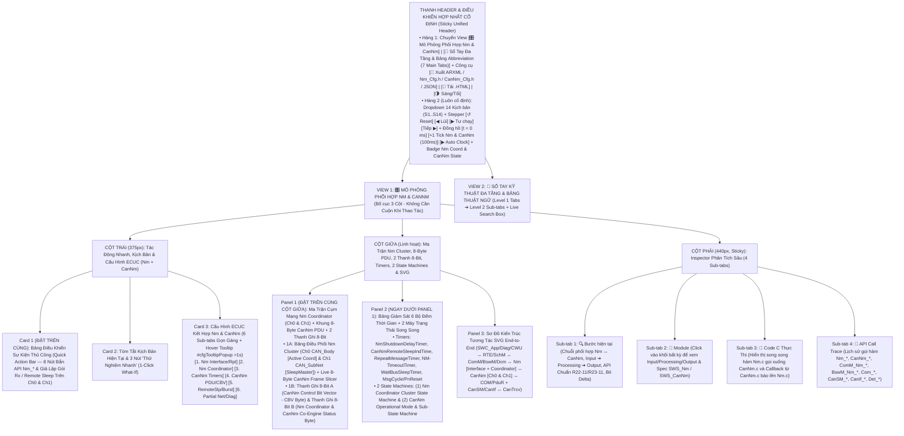
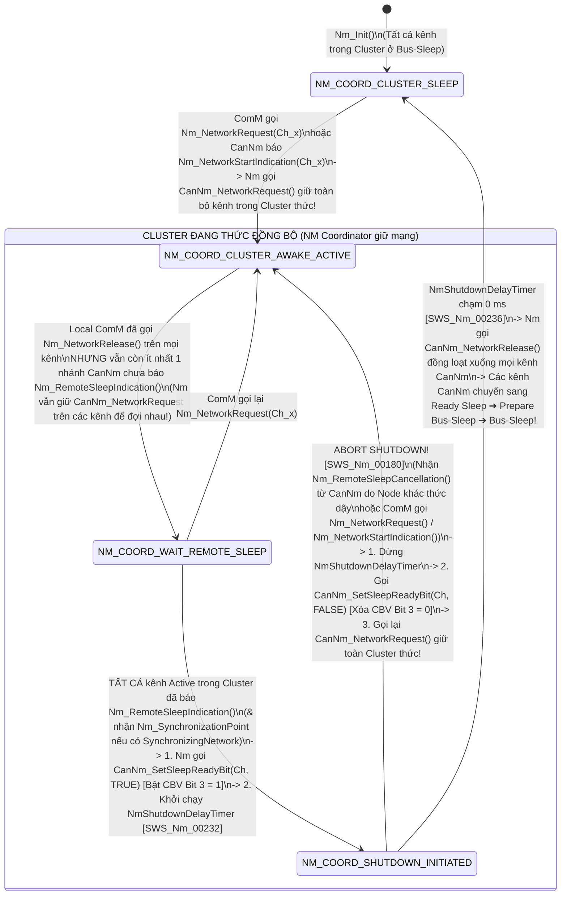
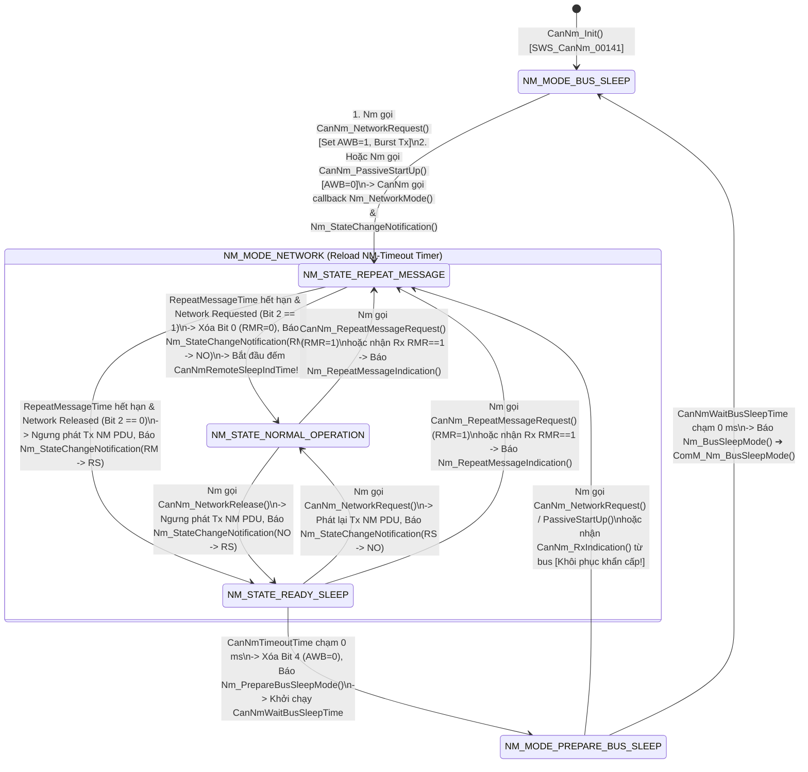

# Tài Liệu Thiết Kế Chi Tiết Trình Mô Phỏng Sự Phối Hợp AUTOSAR `Nm` & `CanNm` (`Nm_CanNm_Simulation_design.md`)

> **Trạng thái tài liệu:** Bản thiết kế chi tiết đã cập nhật theo xác nhận `A1`–`A4` của User — Sẵn sàng để User review trước khi triển khai code.  
> **File đích dự kiến xuất bản:** `d:\__Personal\AntiGravity\Simulation\AUTOSAR_Nm_CanNm.html` (Tạo mới hoàn toàn để song hành cùng bộ `AUTOSAR_CanNM.html` hiện có; là Ứng dụng Web Tương tác 1 file HTML độc lập, 100% Offline, Pure CSS, có nút tải `.HTML` kèm cấu hình nhúng & xuất code `ARXML / Nm_Cfg.h / CanNm_Cfg.h / JSON`).  
> **Chuẩn tham chiếu:** **AUTOSAR Classic Platform R20-11 / R22-11 / R23-11 (`SWS_Nm`, `SWS_CanNm`, `SWS_ComM`, `SWS_CanSM`, `SWS_BswM`, `SWS_CanIf`, `SWS_PduR`, `SWS_COM`, `SWS_Dcm`, `SWS_Det`)**, đính kèm mã requirement chuẩn **`SWS_Nm_xxxxx`** và **`SWS_CanNm_xxxxx`** tại từng bước xử lý, Ma trận điều phối cụm mạng (`NM Coordinator Cluster`), Khung 8-Byte NM PDU, 2 Thanh ghi 8-Bit (`CBV Byte` + `Nm/CanNm Co-Engine Byte`), Hover Tooltip cấu hình giống file `DEM`, và Sổ tay tra cứu đa tầng kèm Bảng Abbreviation có Live Search.

---

## 1. Tổng Quan Định Hướng Thiết Kế Đã Chốt (`A1` – `A4`)

| Hạng mục | Nội dung thiết kế đã xác nhận với User |
| :--- | :--- |
| **1. Định danh bộ file & Bố cục giao diện Không Cuộn Trang — Zero-Scroll (`A1`)** | • **Tách bộ file độc lập**: Lưu thiết kế tại `Design_docs/Nm_CanNm_Simulation_design.md` và xuất Web App tại `Simulation/AUTOSAR_Nm_CanNm.html` (giữ nguyên bộ `AUTOSAR_CanNM.html` đơn kênh để đối chiếu).<br>• **Tối ưu hóa Above-the-Fold (Zero-Scroll)** theo chuẩn `AUTOSAR_DEM.html`, `AUTOSAR_CanNM.html` và `AUTOSAR_ComM.html` để các khối thao tác/quan sát thường xuyên nhất luôn nằm ngay phần đầu mỗi cột trong khung màn hình:<br>  - **Thanh Điều Khiển Hợp Nhất Cố Định (Sticky Unified Header)**: Tích hợp chọn 14 Kịch bản (`S1`–`S14`), nút điều khiển từng bước (`↺ Reset`, `◀ Lùi`, `▶ Tự chạy`, `Tiếp ▶`), nút nhịp đồng hồ kép (`+1 Tick Nm & CanNm MainFunction (100ms)`, `▶ Auto Clock`) và Badge Trạng thái `Nm Coordinator` + `CanNm Mode/State`.<br>  - **Cột Trái (`375px`)**: Đưa **Card 1: Bảng Điều Khiển Sự Kiện Thủ Công (`Quick Action Bar` — 8 nút bắn API `Nm_*` & giả lập gói Rx / Remote Sleep trên `Ch0`/`Ch1`)** và **Card 2: Tóm tắt Kịch bản + 3 Nút 1-Click What-If** lên trên cùng, tiếp theo là **Card 3: 6 Sub-tabs Cấu hình ECUC kết hợp `Nm` & `CanNm`**.<br>  - **Cột Giữa (`Linh hoạt`)**: Đưa **Panel 1: Ma Trận Điều Phối Cụm Mạng `Nm Coordinator Cluster (Ch0 & Ch1)` + Khung `8-Byte CanNm PDU` + 2 Thanh Ghi 8-Bit (`CBV Byte` & `Nm/CanNm Co-State Byte`)** và **Panel 2: 6 Thanh Tiến Trình Timers + 2 Máy Trạng Thái Song Song (`Nm Coordinator State Machine` & `CanNm State Machine`)** lên ngay đầu cột giữa, bên dưới là **Panel 3: Sơ Đồ Kiến Trúc Tương Tác SVG End-to-End**.<br>  - **Cột Phải (`440px, Sticky`)**: Inspector 4 Sub-tabs (`🔍 Bước hiện tại`, `🧩 Module`, `📄 Code C Thực Thi (Nm.c & CanNm.c)`, `📜 API Call Trace`).<br>• **Config Hover Tooltip (`> 1s` delay)** giống hệt `AUTOSAR_DEM.html` (`#cfgTooltipPopup` hiển thị tên tham số, đường dẫn ECUC `Nm`/`CanNm`, mã `SWS_Nm_xxxxx` / `SWS_CanNm_xxxxx`, mô tả, dải giá trị, giá trị typical và lưu ý kỹ thuật). |
| **2. Kiến trúc Dual-Layer `Nm ↔ CanNm` & 2 Thanh ghi 8-Bit (`A2`)** | Đặt **cố định và nổi bật ở đầu Cột Giữa** gồm **2 tầng trực quan hóa liên thông**:<br>• **Tầng 1 — Ma Trận Điều Phối Đa Kênh `Nm Interface & NM Coordinator Cluster (Ch0: CAN_Body [Active Coord] & Ch1: CAN_SubNet [Passive/SleepMaster])` + Thanh Giải Phẫu Khung `8-Byte CanNm PDU`**:<br>  - Hiển thị trực quan cách `Nm` nhận lệnh từ `ComM` / `BswM` / `SWC_Diag`, tra bảng `NmChannelConfig` để ánh xạ xuống `CanNm Ch0 / Ch1`, đồng thời giám sát trạng thái `ComM Req`, `RemoteSleepInd`, `SleepReadyBit` và `CanNm State` của từng kênh trong Cluster.<br>  - Thanh `8-Byte CanNm PDU` bóc tách trực tiếp `Byte 0 (SNI)`, `Byte 1 (CBV)`, `Byte 2..3 (PNI Mask / NmStateReport Signal)` và `Byte 4..7 (User Data)`.<br>• **Tầng 2 — 2 Thanh ghi 8-Bit tương tác song song**:<br>  1. **Thanh A (`8-Bit CanNm Control Bit Vector — CBV Byte`, chuẩn `SWS_CanNm_00045` & `SWS_CanNm_00342`)**: Giải mã `Bit 0 (RMR - Repeat Message Request)`, `Bit 3 (CSR / CoordReadyToSleep / CarWakeUp Bit)`, `Bit 4 (AWB - Active Wakeup Bit)`, `Bit 5 (PNSR - Sync PNC Shutdown Request)`, `Bit 6 (PNI - Partial Network Info)` và các bit Reserved (`Bit 1, 2, 7`).<br>  2. **Thanh B (`8-Bit Nm Interface, Coordinator & CanNm Co-Engine Status Byte`)**: Theo dõi trực quan các cờ phối hợp `Nm ↔ CanNm` (`NM_COORD_SHUTDOWN_ACTV`, `CH0_REMOTE_SLP_IND`, `CH1_REMOTE_SLP_IND`, `COORD_SLP_RDY_BIT`, `NM_STATE_RPT_SENT`, `CANNM_NET_REQ_HOLD`, `CANNM_TIMEOUT_RUN`, `NM_CANNM_INITIALIZED`). Cho phép click trực tiếp vào từng bit để thử nghiệm! |
| **3. Hệ thống 14 Kịch bản phối hợp `Nm & CanNm` (`A3`)** | Thiết kế sẵn **14 Kịch bản (`S1`–`S14`)** chia làm 4 nhóm lớn làm nổi bật **tại sao cần cả `Nm` và `CanNm` cùng phối hợp**:<br>• **Nhóm 1 (`S1`–`S4` — Ánh xạ API 2 chiều `ComM ↔ Nm ↔ CanNm` & Báo cáo trạng thái `NmStateReport`)**: Khởi động chủ động (`Nm_NetworkRequest` ➔ `CanNm_NetworkRequest`, `AWB=1`, `Burst Tx`), Khởi động thụ động (`CanNm_RxIndication` ➔ `Nm_NetworkStartIndication` ➔ `ComM` ➔ `Nm_PassiveStartUp` ➔ `CanNm_PassiveStartUp`), Chu trình ngủ 4 pha với chuỗi Callbacks (`Nm_PrepareBusSleepMode` ➔ `Nm_BusSleepMode`), và Báo cáo sự thay đổi trạng thái tự động qua `COM` (`CanNm` gọi `Nm_StateChangeNotification(prev, curr)` ➔ `Nm` đóng gói `NMS Signal` gọi `Com_SendSignal` [`SWS_Nm_00154`]).<br>• **Nhóm 2 (`S5`–`S7` — Điểm danh Node, User Data, Car WakeUp & Điều khiển truyền thông qua `Nm`)**: Điểm danh toàn mạng (`Nm_RepeatMessageRequest` ➔ `CanNm_RepeatMessageRequest` bật `RMR=1` & callback `Nm_RepeatMessageIndication`), Đồng bộ `User Data` & Định danh Node qua `Nm` (`Nm_SetUserData` / `PduR_CanNmTriggerTransmit` & `Nm_GetNodeIdentifier` / `Nm_GetPduData`), và Đánh thức toàn xe (`CanNm` nhận `CBV Bit 3 = 1` ➔ `Nm_CarWakeUpIndication` ➔ `BswM_Nm_CarWakeUpIndication`).<br>• **Nhóm 3 (`S8`–`S11` — Trái tim của `Nm`: Thuật toán `NM Coordinator` điều phối ngủ/thức đồng bộ cụm đa kênh `CanNm Ch0 & Ch1`)**: Phát hiện ngủ từ xa (`CanNmRemoteSleepIndTime` hết hạn ➔ `Nm_RemoteSleepIndication`), Quy trình tắt đồng bộ cụm mạng (`Coordinated Shutdown` với `NmShutdownDelayTimer`, `Nm_SynchronizationPoint`, `CanNm_SetSleepReadyBit(TRUE)` đặt `CBV Bit 3 = 1` & `Nm_CoordReadyToSleepIndication`), **Hủy khẩn cấp quy trình ngủ (`Abort Coordinated Shutdown` / Wakeup Ping-Pong Prevention)** khi 1 nhánh bất ngờ thức dậy lại (`Nm_RemoteSleepCancellation` ➔ `Nm` gọi `CanNm_SetSleepReadyBit(FALSE)` & `CanNm_NetworkRequest` giữ toàn cụm thức!), và Phối hợp `Active Coordinator` vs `Passive Coordinator` (`NmChannelSleepMaster`).<br>• **Nhóm 4 (`S12`–`S14` — Partial Networking, Synchronized PNC Shutdown R22-11/R23-11 & Xử lý lỗi `TxTimeout` / `DET`)**: Lọc `PNI` & `ERA/EIRA` giữa `CanNm` và `ComM`, Đồng bộ tắt PNC từ thượng tầng (`ComM` ➔ `Nm_RequestSynchronizedPncShutdown` ➔ `CanNm_RequestSynchronizedPncShutdown` & chiều nhận `CanNm` ➔ `Nm_ForwardSynchronizedPncShutdown` ➔ `ComM`), Khóa truyền thông UDS `0x28` (`Nm_DisableCommunication` / `Nm_EnableCommunication`) & Xử lý lỗi `Nm_TxTimeoutException` / `DET` (`NM_E_UNINIT`, `CANNM_E_UNINIT`). |
| **4. Sổ tay tra cứu đa tầng & Bảng Abbreviation (`A4`)** | **View 2 (`📖 Sổ Tay Kỹ Thuật Nm & CanNm + Từ Điển Thuật Ngữ`)** được tổ chức theo cấu trúc **Đa Tầng (Multi-level Tabs)**:<br>• **6 Main Sub-tabs (Level 1) × 4 Chủ đề con (Level 2 Pills/Tabs = 24 chuyên đề)** phân tích sâu sự phân vai `Nm` vs `CanNm`, bảng ánh xạ API & Callbacks 2 chiều, thuật toán `NM Coordinator` & công thức tính `NmShutdownDelayTimer`, `Remote Sleep Indication`, `NmStateReport`, `Synchronized PNC Shutdown` và sơ đồ `Figure 7-1 SWS_CanNm`.<br>• **Tab 7 chuyên biệt: `🔤 Bảng Thuật Ngữ & Từ Viết Tắt (Abbreviation Table)`** trình bày dưới dạng bảng chuẩn 4 cột (52+ thuật ngữ của cả `Nm` và `CanNm`), tích hợp **Search Box tìm kiếm tức thời (Live Search + Highlight `<mark>`)** và 5 nút lọc nhanh theo phân nhóm (`Nm Interface & Coordinator`, `CanNm Core & States`, `CBV Bits & Timers`, `Partial Net & Sync PNC`, `AUTOSAR Comm Stack`). |

---

## 2. Bố Cục Giao Diện 3 Cột Ưu Tiên Zero-Scroll & Hệ Thống Sub-Tabs (UI Wireframe)

Để giải quyết triệt để yêu cầu **"đưa các khối được dùng thường xuyên hơn lên phía trên để người dùng không cần cuộn chuột lên xuống mỗi lần thao tác"**, giao diện được thiết kế theo nguyên lý **Viewport-First (Tất cả bảng điều khiển nhanh, Ma trận `Nm Coordinator ↔ CanNm`, Khung 8-Byte PDU, 2 Thanh ghi 8-Bit và 2 Máy trạng thái đều nằm ngay nửa trên màn hình)**:



### Điểm Cải Tiến Đột Phá Về Trải Nghiệm "Zero-Scroll" Cho Bộ Mô Phỏng Phối Hợp `Nm & CanNm`:
1. **Thanh Điều Khiển Hợp Nhất (`Sticky Unified Header`)**: Gộp chọn kịch bản, nút bấm `Bước tiếp / Lùi / Tự chạy`, và nút nhịp đồng hồ kép `+1 Tick Nm & CanNm (100ms)` ngay trên thanh Header cố định.
2. **Đưa `Quick Action Bar` (8 nút tác động nhanh vào `Nm` & `CanNm`) lên vị trí Card 1 (Đầu Cột Trái)** và đưa **Ma Trận `Nm Coordinator Cluster (Ch0 & Ch1)` + Khung `8-Byte CanNm PDU` + 2 Thanh Ghi 8-Bit + 6 Timers + 2 Máy Trạng Thái** lên đầu Cột Giữa: Khi bấm `Nm_NetworkRequest()`, `Nm_RepeatMessageRequest()`, `Trigger RemoteSleep (Ch0 & Ch1)` hoặc `Bắn Rx NM PDU (Wakeup Ch1)`, mắt người dùng nhìn thấy ngay lập tức cách `Nm` dịch lệnh xuống `CanNm`, cách `CanNm` bật/tắt các bit trong `CBV Byte` (`RMR`, `CSR/SleepReady`, `AWB`, `PNSR`, `PNI`) và cách `Nm Coordinator` điều khiển `NmShutdownDelayTimer` mà **không phải cuộn trang**.
3. **Gom 36 tham số ECUC của cả `Nm` và `CanNm` vào 6 Sub-tabs gọn gàng**: Chiều cao của Card Cấu hình luôn cố định (~270px), đi kèm hộp thoại giải thích nổi `#cfgTooltipPopup` khi hover chuột quá `1000ms` giống hệt `AUTOSAR_DEM.html`.

---

## 3. Thiết Kế Chi Tiết Panel 1 (Đầu Cột Giữa): Ma Trận Điều Phối `Nm Coordinator Cluster` + Khung `8-Byte CanNm PDU` & 2 Thanh Ghi 8-Bit Tương Tác

Sự phối hợp giữa **`Nm` (Generic Network Management Interface)** và **`CanNm` (CAN Network Management)** thể hiện rõ nhất ở **2 cơ chế**:
1. **Chuyển tiếp lệnh & tổng hợp trạng thái đa kênh (`Nm Interface & NM Coordinator`)**: `Nm` nhận yêu cầu từ `ComM` và nhận các callback `Nm_RemoteSleepIndication()` / `Nm_RemoteSleepCancellation()` / `Nm_StateChangeNotification()` từ các kênh `CanNm` (`Ch0`, `Ch1`) để quyết định thời điểm đóng/mở đồng bộ toàn cụm mạng (`NmCoordCluster`).
2. **Biểu diễn tín hiệu điều phối xuống khung truyền vật lý (`8-Byte CanNm PDU` & `CBV Byte`)**: Mọi quyết định của `Nm` (như `CanNm_SetSleepReadyBit(TRUE)` đặt `Bit 3 CBV = 1`, `Nm_RepeatMessageRequest()` đặt `Bit 0 CBV = 1`, `Nm_RequestSynchronizedPncShutdown()` đặt `Bit 5 CBV = 1`) đều được `CanNm` đóng gói vào khung 8-Byte truyền trên CAN Bus!

Do đó, Panel 1 ở đầu Cột Giữa được thiết kế gồm **2 phần trực quan hóa liên thông**:

### 3.1. Phần 1A — Ma Trận Điều Phối Cụm Mạng `Nm Coordinator Cluster (Ch0 & Ch1)` & Thanh Giải Phẫu Khung `8-Byte CanNm PDU`

```text
+-------------------------------------------------------------------------------------------------------------------+
| 🧭 MA TRẬN PHỐI HỢP NM INTERFACE & NM COORDINATOR CLUSTER (`NmCoordClusterIndex = 0` — [`SWS_Nm_00232`, `00238`]) |
| Coord State: [ SHUTDOWN_INITIATED ] | ShutdownDelayTimer: [ 900 / 1500 ms ] | SyncNet: [ READY ] | NMS: [ 0x08 ]  |
+-------------------------------------------------------------------------------------------------------------------+
|  +----------------------+-------------------+-------------------+-------------------+-------------------+-------+ |
|  | Kênh Trong Cluster   | Vai Trò Nm Coord  | ComM Request      | CanNm Mode/State  | RemoteNode Status |Bit3SRB| |
|  +----------------------+-------------------+-------------------+-------------------+-------------------+-------+ |
|  | Ch0: CAN_Body (0x00) | ACTIVE Coord      | RELEASED (NO_COM) | NORMAL_OPERATION  | RemoteSleep = YES | [ 1 ] | |
|  | Ch1: CAN_Sub  (0x01) |ACTIVE+SleepMaster | RELEASED (NO_COM) | READY_SLEEP       | All Quiet (Master)| [ 1 ] | |
|  +----------------------+-------------------+-------------------+-------------------+-------------------+-------+ |
+-------------------------------------------------------------------------------------------------------------------+
| 🧬 GIẢI PHẪU KHUNG BẢN TIN 8-BYTE CANNM PDU TRÊN KÊNH CH0 (`CanIf_Transmit` / `CanNm_RxIndication` — `ID: 0x51A`)  |
|  +---------------+---------------+---------------+---------------+---------------+---------------+-------+-------+ |
|  |    BYTE 0     |    BYTE 1     |    BYTE 2     |    BYTE 3     |    BYTE 4     |    BYTE 5     | BYTE 6| BYTE 7| |
|  |  SNI (NodeId) |   CBV Byte    |  PNI Mask #0  |  PNI Mask #1  |  NMS Report   |  User Data 1  | UDat 2| UDat 3| |
|  |   [ 0x1A ]    |   [ 0x18 ]    |   [ 0x05 ]    |   [ 0x00 ]    |   [ 0x08 ]    |   [ 0x22 ]    | [0x33]| [0x44]| |
|  |  ECU Node #26 | AWB=1 | SRB=1 | PNC #16, #18  |  PNC #24..31  | Prev->CurrSt  | Từ PduR / COM |  COM  |  COM  | |
|  +---------------+---------------+---------------+---------------+---------------+---------------+-------+-------+ |
+-------------------------------------------------------------------------------------------------------------------+
```

- **Tính năng tương tác trực tiếp trên Phần 1A**:
  - Người dùng nhìn thấy ngay **mối liên hệ nhân quả giữa `Nm` và `CanNm`**: Tại sao `ComM` đã gọi `Nm_NetworkRelease(Ch0)` nhưng `Nm Coordinator` vẫn giữ `CanNm Ch0` ở `NORMAL_OPERATION` cho đến khi cả `Ch0` và `Ch1` đều báo `RemoteSleep = YES`, sau đó `Nm` mới gọi `CanNm_SetSleepReadyBit(Ch0, TRUE)` làm **Byte 1 (`CBV`) bật `Bit 3 (SRB = 1)`** và đếm ngược `NmShutdownDelayTimer` trước khi gọi `CanNm_NetworkRelease(Ch0)`!
  - Ô `Byte 4 (NMS Report)` minh họa trực quan tính năng **`NmStateReportEnabled = TRUE`**: Khi `CanNm` chuyển trạng thái và gọi `Nm_StateChangeNotification(prev, curr)`, `Nm` tự động mã hóa mã chuyển trạng thái (ví dụ `0x01: RM_BSM`, `0x04: NO_RM`, `0x08: NO_RS`) gửi vào `Com_SendSignal(NmStateReportSignalRef)` để đính kèm vào gói tin!

### 3.2. Phần 1B — 2 Thanh Ghi 8-Bit Trạng Thái Tương Tác Luôn Hiển Thị Nổi Bật

Ngay bên dưới Phần 1A là **2 Thanh ghi 8-Bit tương tác** theo đúng phong cách của `AUTOSAR_DEM.html`, `AUTOSAR_CanNM.html` và `AUTOSAR_ComM.html`:

```text
+-------------------------------------------------------------------------------------------------------------------+
| 🔢 BẢNG GIÁM SÁT BITFIELD 8-BIT CANNM CBV & NM COORDINATOR ENGINE (LIVE 8-BIT INSPECTOR) [Click vào Bit để thử]   |
| Bước #4: Nm Coordinator gọi CanNm_SetSleepReadyBit(TRUE) ➔ Bật Bit 3 (CSR/SRB=1) | Thanh A: 0x18 | Thanh B: 0xFB  |
+-------------------------------------------------------------------------------------------------------------------+
| A. THANH GHI 8-BIT CONTROL BIT VECTOR (`CanNm CBV Byte` — Chuẩn `SWS_CanNm_00045` & `00342`) — Hex:[0x18] [00011000b]|
|    Vị trí CBV: [ CANNM_PDU_BYTE_1 ] | Nguồn đánh thức: [ Active (AWB=1) ] | Coord Sleep Ready / CWU: [ Bit 3 = 1 ]|
|  +-------------+ +-------------+ +-------------+ +-------------+ +-------------+ +-------------+ +-------+ +-----+|
|  | Bit 7 (0x80)| | Bit 6 (0x40)| | Bit 5 (0x20)| | Bit 4 (0x10)| | Bit 3 (0x08)| | Bit 2 (0x04)| |Bit1(2)| |Bit 0||
|  |  RESERVED   | |  PNI (PNet) | | PNSR (Sync) | | AWB (Active)| | CSR/SRB/CWU | |  RESERVED   | |RESRVD | | RMR ||
|  |      0      | |      0      | |      0      | |      1      | |   1 (0➔1)   | |      0      | |   0   | |  0  ||
|  | Luôn bằng 0 | | PN Filter=0 | | No SyncPNC  | | Active Wake!| | CoordSleep! | | Luôn bằng 0 | |   0   | |Idle ||
|  +-------------+ +-------------+ +-------------+ +-------------+ +-------------+ +-------------+ +-------+ +-----+|
+-------------------------------------------------------------------------------------------------------------------+
| B. THANH GHI 8-BIT TRẠNG THÁI PHỐI HỢP NM & CANNM (`Nm_CanNm_CoEngineByte`) — Hex: [ 0xFB ]  Bin: [ 1111 1011b ]  |
|    Nm Coord: [ SHUTDOWN_RUNNING ] | CanNm Mode: [ NM_MODE_NETWORK (NORMAL_OP) ] | RemoteSleep: [ Ch0=1, Ch1=1 ]   |
|  +-------------+ +-------------+ +-------------+ +-------------+ +-------------+ +-------------+ +-------+ +-----+|
|  | Bit 7 (0x80)| | Bit 6 (0x40)| | Bit 5 (0x20)| | Bit 4 (0x10)| | Bit 3 (0x08)| | Bit 2 (0x04)| |Bit1(2)| |Bit 0||
|  | COORD_SHDN  | | CH0_REM_SLP | | CH1_REM_SLP | | COORD_SRB   | | NMS_REPORT  | | CANNM_HOLD  | |TIMEOUT| |INIT ||
|  |   1 (0➔1)   | |      1      | |      1      | |   1 (0➔1)   | |      1      | |      0      | |   1   | |  1  ||
|  | DelayTmrRun | | Ch0 Quiet!  | | Ch1 Quiet!  | | SleepRdy=1  | | Com_SendSig | | Released    | |2000ms | |Ready||
|  +-------------+ +-------------+ +-------------+ +-------------+ +-------------+ +-------------+ +-------+ +-----+|
+-------------------------------------------------------------------------------------------------------------------+
```

#### 3.2.1. Giải Mã Chi Tiết Thanh A: `8-Bit CanNm Control Bit Vector — CBV Byte` (`SWS_CanNm_00045`, `SWS_CanNm_00342`, `SWS_CanNm_91003`)

| Bit | Mask | Tên Cờ Chuẩn AUTOSAR | Ý nghĩa kỹ thuật trong sự phối hợp `Nm ↔ CanNm` & Khi nào bật lên `1` (`0 ➔ 1`) | Khi nào hạ về `0` (`1 ➔ 0`) |
| :-: | :-: | :--- | :--- | :--- |
| **Bit 7** | `0x80` | **`RESERVED_BIT_7`** | Bit dự trữ theo chuẩn AUTOSAR (`SWS_CanNm_00045`). Khi khởi tạo `CanNm_Init()`, bit này luôn được đặt bằng `0`. | Luôn giữ bằng `0`. |
| **Bit 6** | `0x40` | **`PNI` *(Partial Network Information Bit)*** | Bật lên `1` khi **`CanNmPnEnabled = TRUE`** (`SWS_CanNm_00413`): Báo hiệu gói tin NM PDU có mang vector yêu cầu cụm mạng con (`PNC Bit Vector`) tại `Byte 2..3`. Khi nhận gói có `PNI=1`, `CanNm` lọc theo `CanNmPnFilterMaskByte` và đẩy `ERA/EIRA` qua `PduR` lên `ComM`. | Hạ về `0` khi `CanNmPnEnabled = FALSE`. |
| **Bit 5** | `0x20` | **`PNSR` *(Synchronized PNC Shutdown Request Bit)*** | Trong AUTOSAR R20-11 / R22-11 / R23-11 (`CanNmSynchronizedPncShutdownEnabled = TRUE`), khi `ComM` gọi **`Nm_RequestSynchronizedPncShutdown(Channel, pncId)`** ➔ **`CanNm_RequestSynchronizedPncShutdown()`** (`SWS_Nm_91009`, `SWS_CanNm_91003`), bit này bật lên `1` trong gói NM PDU phát ra từ Top-Level PNC Coordinator để yêu cầu đồng bộ tắt các PNC đang đặt=1 trong vùng PNI! Khi một node nhận gói có `PNSR = 1`, `CanNm` gọi **`Nm_ForwardSynchronizedPncShutdown()`** báo lên `ComM`. | Hạ về `0` ngay sau khi gói tin thông báo `Synchronized PNC Shutdown` đã được truyền đi thành công (hoặc luôn bằng `0` nếu không bật tính năng Sync PNC Shutdown). |
| **Bit 4** | `0x10` | **`AWB` *(Active Wakeup Bit)*** | Bật lên `1` khi **`CanNmActiveWakeupBitEnabled = TRUE`** và `Nm` gọi **`CanNm_NetworkRequest()`** đánh thức `CanNm` từ `Bus-Sleep Mode` hoặc `Prepare Bus-Sleep Mode` (`SWS_CanNm_00401`). Giúp nhận diện chính xác ECU nào đã chủ động đánh thức nhánh mạng CAN. | Giữ bằng `1` trong suốt `Network Mode` và chỉ hạ về `0` khi `CanNm` thoát khỏi `Network Mode` sang `Prepare Bus-Sleep Mode` (`SWS_CanNm_00402`). Nếu thức dậy thụ động qua `Nm_PassiveStartUp()` ➔ `CanNm_PassiveStartUp()`, `AWB` luôn bằng `0`. |
| **Bit 3** | `0x08` | **`CSR / SRB / CWU` *(Coord ReadyToSleep Bit / Car Wakeup Bit)*** | **Cầu nối quan trọng nhất giữa `Nm Coordinator` và `CanNm` (`SWS_Nm_00238`, `SWS_CanNm_00342`)**:<br>• **Vai trò 1 (`NM Coordinator Sleep Ready Bit — SRB`)**: Khi `Nm Coordinator` quyết định toàn bộ Cluster đã sẵn sàng ngủ, `Nm` gọi **`CanNm_SetSleepReadyBit(nmChannelHandle, TRUE)`** làm `CanNm` bật **`Bit 3 = 1`** và phát ngay 1 gói NM PDU thông báo cho các Coordinator thụ động trên bus biết Cluster sắp ngủ! Khi đầu nhận thấy `Bit 3` đổi trạng thái, `CanNm` gọi **`Nm_CoordReadyToSleepIndication()`** / **`Nm_CoordReadyToSleepCancellation()`** (`SWS_CanNm_00344`).<br>• **Vai trò 2 (`Car WakeUp Bit — CWU`)**: Khi bật `CanNmCarWakeUpRxEnabled = TRUE`, nhận gói có bit Car Wakeup = `1` sẽ khiến `CanNm` gọi **`Nm_CarWakeUpIndication()`** (`SWS_CanNm_00406`). | Hạ về `0` khi xảy ra **Abort Coordinated Shutdown** (`Nm` gọi **`CanNm_SetSleepReadyBit(nmChannelHandle, FALSE)`** do có node thức dậy lại qua `Nm_RemoteSleepCancellation()`), hoặc khi xóa yêu cầu Car Wakeup. |
| **Bit 2** | `0x04` | **`RESERVED_BIT_2`** | Bit dự trữ theo chuẩn AUTOSAR (`SWS_CanNm_00045`). Luôn bằng `0`. | Luôn giữ bằng `0`. |
| **Bit 1** | `0x02` | **`RESERVED_BIT_1`** | Bit dự trữ theo chuẩn AUTOSAR (`SWS_CanNm_00045`). Luôn bằng `0`. | Luôn giữ bằng `0`. |
| **Bit 0** | `0x01` | **`RMR` *(Repeat Message Request Bit)*** | Bật lên `1` khi `SWC_Diag` / `BswM` gọi **`Nm_RepeatMessageRequest()`** ➔ **`CanNm_RepeatMessageRequest()`** (`SWS_Nm_00035`, `SWS_CanNm_00113`). Khi gói tin có `Bit 0 (RMR = 1)` phát ra bus, mọi ECU nhận được sẽ nhảy về `NM_STATE_REPEAT_MESSAGE`, đồng thời `CanNm` gọi callback **`Nm_RepeatMessageIndication()`** báo lên `Nm` (`SWS_CanNm_00014`)! | Tự động hạ về `0` ngay khi bộ đếm `CanNmRepeatMessageTime` hết hạn và node rời khỏi `Repeat Message State` (`SWS_CanNm_00107`). |

#### 3.2.2. Giải Mã Chi Tiết Thanh B: `8-Bit Nm Interface, Coordinator & CanNm Co-Engine Status Byte` (`Nm_CanNm_CoEngineByte`)

| Bit | Mask | Tên Cờ (`Nm & CanNm Co-Bit`) | Ý nghĩa kỹ thuật & Khi nào bật lên `1` (`0 ➔ 1`) | Khi nào hạ về `0` (`1 ➔ 0`) |
| :-: | :-: | :--- | :--- | :--- |
| **Bit 7** | `0x80` | **`COORD_SHDN_RUN`** | Bật lên `1` khi **`NmCoordinatorSupportEnabled = TRUE`** và tất cả các kênh trong `NmCoordCluster` đã thỏa mãn điều kiện ngủ (Local `ComM` đã Release + tất cả các nhánh Active đã báo `Nm_RemoteSleepIndication()`), khiến `Nm Coordinator` chuyển sang trạng thái **`SHUTDOWN_INITIATED`** và khởi chạy bộ đếm **`NmShutdownDelayTimer`** trong `Nm_MainFunction()` (`SWS_Nm_00232`). | Hạ về `0` khi `NmShutdownDelayTimer` chạm `0 ms` (hoàn tất gọi `CanNm_NetworkRelease()` đưa toàn bộ Cluster đi ngủ) HOẶC khi quy trình ngủ bị hủy khẩn cấp (`Abort Coordinated Shutdown` do `Nm_RemoteSleepCancellation()` / `Nm_NetworkRequest()`). |
| **Bit 6** | `0x40` | **`CH0_REMOTE_SLP`** | Bật lên `1` khi kênh `CanNm Ch0 (CAN_Body)` đang ở `NM_STATE_NORMAL_OPERATION` và không nhận được bất kỳ gói NM nào từ các ECU khác suốt khoảng thời gian **`CanNmRemoteSleepIndTime`**, khiến `CanNm` gọi callback **`Nm_RemoteSleepIndication(Ch0)`** báo lên `Nm Coordinator` (`SWS_CanNm_00150`, `SWS_Nm_00175`). | Hạ về `0` ngay lập tức khi có một ECU khác trên nhánh `Ch0` phát lại bản tin NM (`CanNm_RxIndication`) hoặc khi chuyển về `Repeat Message State`, khiến `CanNm` gọi **`Nm_RemoteSleepCancellation(Ch0)`** (`SWS_CanNm_00151`, `SWS_Nm_00178`)! |
| **Bit 5** | `0x20` | **`CH1_REMOTE_SLP`** | Bật lên `1` khi nhánh thứ hai trong Cluster (`CanNm Ch1 - CAN_SubNet`) cũng đã sẵn sàng ngủ (nhận `Nm_RemoteSleepIndication(Ch1)` hoặc kênh được cấu hình **`NmChannelSleepMaster = TRUE`** và `ComM` đã gọi `Nm_NetworkRelease(Ch1)` [`SWS_Nm_00228`]). Chỉ khi cả **`Bit 6 == 1` và `Bit 5 == 1`** thì `Nm Coordinator` mới được phép bật `Bit 7 (COORD_SHDN_RUN)`! | Hạ về `0` khi nhánh `Ch1` có yêu cầu thức dậy mới (`Nm_NetworkRequest(Ch1)` hoặc `Nm_RemoteSleepCancellation(Ch1)`). |
| **Bit 4** | `0x10` | **`COORD_SRB_SET`** | Bật lên `1` khi `Nm Coordinator` đã gọi **`CanNm_SetSleepReadyBit(Channel, TRUE)`** (`SWS_Nm_00238`) hoặc khi một `Passive Coordinator` nhận được callback **`Nm_CoordReadyToSleepIndication(Channel)`** từ `CanNm` (`SWS_CanNm_00344`). | Hạ về `0` khi `Nm Coordinator` gọi `CanNm_SetSleepReadyBit(Channel, FALSE)` hoặc nhận `Nm_CoordReadyToSleepCancellation(Channel)` (`SWS_CanNm_00349`). |
| **Bit 3** | `0x08` | **`NMS_REPORT_SENT`** | Bật lên `1` khi **`CanNmStateChangeIndEnabled = TRUE`** và **`NmStateReportEnabled = TRUE`**: Mỗi khi `CanNm` chuyển trạng thái và gọi **`Nm_StateChangeNotification(nmNetworkHandle, prevState, currState)`**, module `Nm` tự động ánh xạ cặp `(prevState ➔ currState)` thành mã **`NMS (Network Management State Signal)`** và gọi **`Com_SendSignal(NmStateReportSignalRef, &nmsVal)`** (`SWS_Nm_00154`)! | Hạ về `0` khi tắt `NmStateReportEnabled` hoặc khi khởi tạo lại ở `Bus-Sleep Mode`. |
| **Bit 2** | `0x04` | **`CANNM_NET_HOLD`** | Bật lên `1` khi tầng dưới `CanNm` đang nhận lệnh giữ mạng thức (`CanNm_NetworkRequest()` đã được gọi bởi `Nm` — चाहे do `ComM` yêu cầu trực tiếp hay do `Nm Coordinator` chủ động giữ kênh thức trong lúc chờ nhánh kia ngủ!). | Hạ về `0` khi `Nm` thực sự gọi **`CanNm_NetworkRelease()`** xuống `CanNm` (đưa `CanNm` từ `Normal Operation` sang `Ready Sleep`). |
| **Bit 1** | `0x02` | **`CANNM_TMO_RUN`** | Bật lên `1` trong suốt thời gian `CanNm` đang nằm trong **`NM_MODE_NETWORK`** (`Repeat Message`, `Normal Operation`, `Ready Sleep`): Bộ đếm sinh tử **`CanNmTimeoutTime` (`NM-Timeout Timer`)** đang hoạt động và chưa bị khóa bởi `Nm_DisableCommunication()`. | Hạ về `0` khi `CanNmTimeoutTime` hết hạn (đưa `CanNm` sang `Prepare Bus-Sleep` ➔ gọi `Nm_PrepareBusSleepMode()`) hoặc khi gọi `Nm_DisableCommunication()`. |
| **Bit 0** | `0x01` | **`NM_CANNM_INIT`** | Bật lên `1` sau khi cả hai hàm **`Nm_Init(&Nm_Config)`** và **`CanNm_Init(&CanNm_Config)`** đã hoàn tất khởi tạo (`SWS_Nm_00030`, `SWS_CanNm_00060`). | Hạ về `0` khi tắt Checkbox `NmCanNmInitialized` để kiểm thử phát hiện lỗi `Det_ReportError` (`NM_E_UNINIT = 0x00` / `CANNM_E_UNINIT = 0x01`). |

---

## 4. Phân Tích Xử Lý Từng Module: Input Lấy Từ Đâu, Xử Lý Gì, Output Route Đến Đâu

Mọi khối trên sơ đồ kiến trúc SVG đều có thể **click vào để xem giải thích chi tiết** ở cột phải (Tab `🧩 Module`) và được tổng hợp đầy đủ trong **Tab 1 của Sổ tay**:

| # | Module / Phân khối | Lớp AUTOSAR | 📥 Input lấy từ đâu? | ⚙️ Cách xử lý nội bộ (Processing, State & Timers) | 📤 Output route đến đâu & Hàm API chuẩn (R20-11 / R22-11 / R23-11) |
| :-: | :--- | :--- | :--- | :--- | :--- |
| **1** | **`SWC_App`, `SWC_Diag` & `SWC_CarWakeup`**<br>*(Application Layer)* | Application Layer | • Sự kiện vận hành xe (IG_ON, mở cửa, sạc pin) hoặc lệnh chẩn đoán từ ứng dụng.<br>• Nhận tín hiệu `NMS (Network Management State)` hoặc `User Data` từ `COM` qua `RTE`. | • **Yêu cầu mạng chuẩn**: `SWC_App` gọi `Rte_Call_UR_ComMUser_RequestComMode(FULL_COM / NO_COM)` xuống `ComM`.<br>• **Tương tác với `Nm`**: `SWC_Diag` có thể yêu cầu điểm danh toàn mạng (`Nm_RepeatMessageRequest`), đọc trạng thái mạng hiện tại (`Nm_GetState`), đọc `Node ID` (`Nm_GetNodeIdentifier`), hoặc cập nhật dữ liệu `NM User Data` / `Car Wakeup` qua `Rte_Write` xuống `COM`. | • Gọi xuống **ComM**:<br>`Rte_Call_UR_ComMUser_0_RequestComMode(COMM_FULL_COMMUNICATION / COMM_NO_COMMUNICATION)`<br>• Gọi qua **RTE ➔ COM / Nm**:<br>`Rte_Write_PP_NmUserData_Signal(val)`<br>`Nm_RepeatMessageRequest(NetworkHandle)` |
| **2** | **`RTE` & `SchM`**<br>*(Runtime Environment & BSW Scheduler)* | RTE Layer | • Lời gọi từ `SWC` và thông báo chuyển Mode từ `ComM` / `BswM`.<br>• Xung nhịp định kỳ từ `AUTOSAR OS` (`Task_Bsw_100ms`). | • **Điều phối 2 hàm MainFunction**: Định kỳ mỗi chu kỳ cấu hình, `SchM` gọi lần lượt:<br>  1. **`Nm_MainFunction()`** (`SWS_Nm_00118` — chạy thuật toán `NM Coordinator` và giảm bộ đếm `NmShutdownDelayTimer` trên các Cluster).<br>  2. **`CanNm_MainFunction()`** (`SWS_CanNm_00234` — giảm các bộ đếm `RepeatMessageTimer`, `TimeoutTimer`, `WaitBusSleepTimer`, `MsgCycleTimer`, `RemoteSleepIndTimer`, `PnResetTimer`).<br>• Bảo vệ vùng dữ liệu găng (`SchM_Enter_Nm_EA_0` & `SchM_Enter_CanNm_EA_0`). | • Gọi định kỳ vào **Nm & CanNm**:<br>`Nm_MainFunction()` [`SWS_Nm_00118`]<br>`CanNm_MainFunction()` [`SWS_CanNm_00234`]<br>• Bảo vệ vùng găng:<br>`SchM_Enter_Nm_EA_0()` / `SchM_Enter_CanNm_EA_0()` |
| **3** | **`ComM`, `BswM` & `Dcm`**<br>*(Communication & Mode Managers + Diagnostic)* | System / Comm Services | • Nhận yêu cầu từ `SWC Users` (`ComM_RequestComMode`), từ `Dcm` (`UDS 0x28`), và từ `EcuM`.<br>• Nhận các callback báo trạng thái mạng từ **`Nm`** (`ComM_Nm_NetworkStartIndication`, `ComM_Nm_NetworkMode`, `ComM_Nm_PrepareBusSleepMode`, `ComM_Nm_BusSleepMode`, `ComM_Nm_RestartIndication`, `ComM_Nm_ForwardSynchronizedPncShutdown`, `BswM_Nm_StateChangeNotification`, `BswM_Nm_CarWakeUpIndication`). | • **`ComM` chỉ làm việc với `Nm` chứ KHÔNG gọi trực tiếp `CanNm`**:<br>  - Khi `ComM` cần đánh thức chủ động: gọi **`Nm_NetworkRequest(NetworkHandle)`**.<br>  - Khi `ComM` nhận `ComM_Nm_NetworkStartIndication()` hoặc `RestartIndication()`: gọi **`Nm_PassiveStartUp(NetworkHandle)`**.<br>  - Khi `ComM` không còn User nào cần mạng: gọi **`Nm_NetworkRelease(NetworkHandle)`** và đợi đến khi `Nm` báo ngược **`ComM_Nm_BusSleepMode()`** thì mới yêu cầu `CanSM` tắt phần cứng CAN (`NO_COM`).<br>  - Khi `ComM` là Top-Level PNC Coordinator cần tắt đồng bộ 1 PNC: gọi **`Nm_RequestSynchronizedPncShutdown(NetworkHandle, pncId)`**.<br>• **`BswM` / `Dcm`**: Khi nhận dịch vụ UDS `0x28 CommunicationControl`, gọi **`Nm_DisableCommunication()`** / **`Nm_EnableCommunication()`**. | • Gọi xuống **Nm** (`Nm.h`):<br>`Nm_PassiveStartUp(NetworkHandle)`<br>`Nm_NetworkRequest(NetworkHandle)`<br>`Nm_NetworkRelease(NetworkHandle)`<br>`Nm_DisableCommunication(NetworkHandle)`<br>`Nm_EnableCommunication(NetworkHandle)`<br>`Nm_RequestSynchronizedPncShutdown(NetworkHandle, PncId)` |
| **4** | **`Nm` (Generic Network Management Interface & NM Coordinator)**<br>*(Tâm điểm điều phối tầng trên)* | Communication Services | • **Từ tầng trên (`ComM`, `BswM`, `SWC`)**: Nhận tất cả lệnh `Nm_*`.<br>• **Từ tầng dưới (`CanNm` Callbacks — `Nm_Cbk.h`)**: Nhận `Nm_NetworkStartIndication`, `Nm_NetworkMode`, `Nm_PrepareBusSleepMode`, `Nm_BusSleepMode`, `Nm_RemoteSleepIndication`, `Nm_RemoteSleepCancellation`, `Nm_SynchronizationPoint`, `Nm_CoordReadyToSleepIndication`, `Nm_CoordReadyToSleepCancellation`, `Nm_StateChangeNotification`, `Nm_RepeatMessageIndication`, `Nm_PduRxIndication`, `Nm_TxTimeoutException`, `Nm_CarWakeUpIndication`, `Nm_ForwardSynchronizedPncShutdown`. | • **Chức năng 1 — Bus-Independent Dispatcher (`SWS_Nm_00020`)**: Tra cứu `NmBusType` của `NetworkHandle` (trong cấu hình `NmChannelConfig`). Với `NM_BUSNM_CANNM`, ánh xạ 1-1 hoặc thông qua bảng con trỏ hàm xuống `CanNm_*` tương ứng (nếu bật `NmPassiveModeEnabled = TRUE` thì chặn các API yêu cầu chủ động ngay tại `Nm`).<br>• **Chức năng 2 — Báo Cáo Trạng Thái Mạng Tự Động (`NmStateReportEnabled = TRUE`, `SWS_Nm_00154`)**: Khi nhận callback `Nm_StateChangeNotification(nmNetworkHandle, prevState, currState)` từ `CanNm`, `Nm` mã hóa sự chuyển trạng thái thành giá trị 6-bit (ví dụ `NMS_RM_BSM = 1`, `NMS_RM_PBSM = 2`, `NMS_NO_RM = 4`, `NMS_NO_RS = 8`, `NMS_RS_NO = 16`, `NMS_RS_RM = 32`) và gọi **`Com_SendSignal(NmStateReportSignalRef, &nmsValue)`**, đồng thời thông báo `BswM_Nm_StateChangeNotification()`!<br>• **Chức năng 3 — Thuật Toán `NM Coordinator` Đa Kênh (`NmCoordinatorSupportEnabled = TRUE`, `SWS_Nm_00232`)**:<br>  - Giữ toàn bộ các kênh trong cùng `NmCoordCluster` thức đồng bộ khi bất kỳ 1 kênh nào còn đang bận (ngay cả khi `ComM` đã gọi `Nm_NetworkRelease` trên kênh kia!).<br>  - Chỉ khi **tất cả các kênh trong Cluster** đều đã được `ComM` Release VÀ tất cả các kênh Active đều đã báo **`Nm_RemoteSleepIndication()`** từ `CanNm` (hoặc là `NmChannelSleepMaster = TRUE`), `Nm Coordinator` mới bắt đầu quy trình **Coordinated Shutdown**:<br>    1. Nếu có kênh cấu hình `NmSynchronizingNetwork = TRUE`, chờ callback **`Nm_SynchronizationPoint()`** từ `CanNm`.<br>    2. Gọi **`CanNm_SetSleepReadyBit(Channel, TRUE)`** để phát gói NM có `CBV Bit 3 = 1` báo cho các Coordinator thụ động.<br>    3. Khởi chạy bộ đếm **`NmShutdownDelayTimer`** (tính theo `NmGlobalCoordinatorTime - NmMsgCycleTime` của từng kênh). Khi timer chạm `0 ms`, `Nm` mới thực sự gọi **`CanNm_NetworkRelease()`** xuống `CanNm` để các nhánh cùng đi vào `Ready Sleep ➔ Prepare Bus-Sleep ➔ Bus-Sleep` một lượt!<br>    4. **Cơ chế Abort Shutdown (`SWS_Nm_00180`)**: Nếu đang đếm ngược `NmShutdownDelayTimer` mà bất kỳ kênh nào báo **`Nm_RemoteSleepCancellation()`** hoặc `ComM` gọi lại `Nm_NetworkRequest()`, `Nm Coordinator` lập tức dừng timer, gọi **`CanNm_SetSleepReadyBit(Channel, FALSE)`** và gọi lại **`CanNm_NetworkRequest()`** trên toàn bộ các kênh trong Cluster! | • Gọi xuống **CanNm** (`CanNm.h`):<br>`CanNm_PassiveStartUp()`, `CanNm_NetworkRequest()`, `CanNm_NetworkRelease()`, `CanNm_DisableCommunication()`, `CanNm_EnableCommunication()`, `CanNm_SetUserData()`, `CanNm_GetUserData()`, `CanNm_GetNodeIdentifier()`, `CanNm_GetLocalNodeIdentifier()`, `CanNm_RepeatMessageRequest()`, `CanNm_GetPduData()`, `CanNm_GetState()`, `CanNm_CheckRemoteSleepIndication()`, `CanNm_SetSleepReadyBit()`, `CanNm_RequestSynchronizedPncShutdown()`<br>• Báo ngược lên **ComM / BswM / COM**:<br>`ComM_Nm_NetworkStartIndication()`, `ComM_Nm_NetworkMode()`, `ComM_Nm_PrepareBusSleepMode()`, `ComM_Nm_BusSleepMode()`, `ComM_Nm_RestartIndication()`, `ComM_Nm_ForwardSynchronizedPncShutdown()`, `BswM_Nm_StateChangeNotification()`, `BswM_Nm_CarWakeUpIndication()`, `Com_SendSignal(NmStateReportSignalRef)` |
| **5** | **`CanNm` (CAN Network Management — `Ch0` & `Ch1`)**<br>*(Tâm điểm thực thi tầng dưới trên CAN Bus)* | Communication Services | • Nhận toàn bộ lệnh điều khiển từ `Nm` (`CanNm_NetworkRequest`, `CanNm_NetworkRelease`, `CanNm_PassiveStartUp`, `CanNm_SetSleepReadyBit`, `CanNm_RepeatMessageRequest`, `CanNm_DisableCommunication`, `CanNm_EnableCommunication`, `CanNm_RequestSynchronizedPncShutdown`).<br>• Nhận `CanNm_ConfirmPnAvailability` từ `CanSM`.<br>• Nhận `CanNm_RxIndication`, `CanNm_TxConfirmation`, `CanNm_TriggerTransmit` từ `CanIf`.<br>• Xung nhịp `CanNm_MainFunction()`. | • **1. Máy Trạng Thái 2 Cấp (`Bus-Sleep`, `Prepare Bus-Sleep`, `Network Mode: Repeat Message / Normal Operation / Ready Sleep`)**: Thực thi cơ chế đồng thuận phân tán trên bus CAN thông qua các bộ đếm `CanNmRepeatMessageTime`, `CanNmTimeoutTime`, `CanNmWaitBusSleepTime`, `CanNmMsgCycleTime`, `CanNmImmediateNmCycleTime`.<br>• **2. Giám sát Ngủ Từ Xa (`CanNmRemoteSleepIndTime`)**: Khi đang ở `Normal Operation`, nếu suốt khoảng thời gian `CanNmRemoteSleepIndTime` không nhận được gói `CanNm_RxIndication` nào từ các node khác, `CanNm` gọi **`Nm_RemoteSleepIndication()`** lên `Nm Coordinator`; hễ nhận lại 1 gói NM từ node khác (hoặc về `Repeat Message`), gọi ngay **`Nm_RemoteSleepCancellation()`**!<br>• **3. Xử lý `CoordReadyToSleepBit` (`CBV Bit 3`)**: Khi `Nm` gọi `CanNm_SetSleepReadyBit(TRUE/FALSE)`, `CanNm` cập nhật `Bit 3` trong `CBV Byte` và phát ngay một gói NM PDU thông báo.<br>• **4. Đóng gói Khung 8-Byte NM PDU, Lọc Partial Networking (`PNI` / `ERA` / `EIRA`) & Kéo `COM User Data`**: Tự động gọi `PduR_CanNmTriggerTransmit()` để lấy `User Data` (bao gồm cả tín hiệu `NmStateReport` vừa được `Nm` ghi xuống `COM`!) và gửi xuống `CanIf_Transmit()`. | • Gọi Callback lên **Nm** (`Nm_Cbk.h`):<br>`Nm_NetworkStartIndication()`, `Nm_NetworkMode()`, `Nm_PrepareBusSleepMode()`, `Nm_BusSleepMode()`, `Nm_StateChangeNotification()`, `Nm_RemoteSleepIndication()`, `Nm_RemoteSleepCancellation()`, `Nm_CoordReadyToSleepIndication()`, `Nm_CoordReadyToSleepCancellation()`, `Nm_SynchronizationPoint()`, `Nm_RepeatMessageIndication()`, `Nm_PduRxIndication()`, `Nm_CarWakeUpIndication()`, `Nm_TxTimeoutException()`, `Nm_ForwardSynchronizedPncShutdown()`<br>• Gọi xuống **CanIf & PduR**:<br>`CanIf_Transmit()`, `PduR_CanNmTriggerTransmit()`, `PduR_CanNmRxIndication()` |
| **6** | **`PduR` & `AUTOSAR COM`**<br>*(PDU Router & Interaction Layer)* | Communication Services | • Nhận lệnh `Com_SendSignal(NmStateReportSignalRef)` từ `Nm`.<br>• Nhận `PduR_CanNmTriggerTransmit`, `PduR_CanNmRxIndication`, `PduR_CanNmTxConfirmation` từ `CanNm`. | • **Cầu nối khép kín giữa `Nm`, `COM` và `CanNm`**:<br>  1. Khi `CanNm` đổi trạng thái ➔ báo `Nm_StateChangeNotification()` ➔ `Nm` gọi **`Com_SendSignal(NmStateReportSignalRef)`** cập nhật byte trạng thái vào bộ đệm I-PDU của `COM`.<br>  2. Ngay khi `CanNm` phát gói NM PDU, `CanNm` gọi **`PduR_CanNmTriggerTransmit()`** ➔ **`Com_TriggerTransmit()`** kéo toàn bộ `User Data` (trong đó có `NmStateReport`!) xuống khung 8-Byte NM PDU để phát lên CAN Bus!<br>  3. Với Partial Networking, `CanNm` đẩy vector `ERA/EIRA` qua **`PduR_CanNmRxIndication()`** ➔ `Com_RxIndication()` lên `ComM`. | • Giao tiếp **Nm ➔ COM ➔ PduR ➔ CanNm**:<br>`Com_SendSignal()` [`SWS_Nm_00154`]<br>`PduR_CanNmTriggerTransmit()` ➔ `Com_TriggerTransmit()` [`SWS_CanNm_00328`]<br>`PduR_CanNmRxIndication()` ➔ `Com_RxIndication()` |
| **7** | **`CanSM`, `CanIf` & `CanTrcv`**<br>*(CAN State Manager, Interface & HW)* | ECU Abstraction / MCAL | • `CanSM` nhận lệnh `CanSM_RequestComMode` từ `ComM` và nhận `CanSM_TxTimeoutException` từ `CanNm`.<br>• `CanIf` nhận `CanIf_Transmit` từ `CanNm` và ngắt khung CAN từ `CanDrv`. | • `CanSM` bật phần cứng CAN, mở `CanIf_SetPduMode(CANIF_ONLINE)` và gọi **`CanNm_ConfirmPnAvailability()`** để kích hoạt bộ lọc PN trong `CanNm`.<br>• `CanIf` định tuyến các gói NM PDU nhận được từ bus lên `CanNm_RxIndication()` và báo xác nhận truyền `CanNm_TxConfirmation()`. | • Giao tiếp **CanSM / CanIf ↔ CanNm**:<br>`CanNm_ConfirmPnAvailability(nmChannelHandle)`<br>`CanNm_RxIndication(RxPduId, &PduInfo)`<br>`CanNm_TxConfirmation(TxPduId, result)`<br>`CanSM_TxTimeoutException(network)` |
| **8** | **`Dem` & `Det`**<br>*(Diagnostic & Default Error Tracer)* | System / Diag Services | • Nhận báo cáo lỗi từ cả **`Nm` (`ModuleId = 29 / 0x001D`)** và **`CanNm` (`ModuleId = 31 / 0x001F`)**. | • Ghi nhận phân biệt rõ lỗi của từng module:<br>  - **Mã lỗi `Nm` (`SWS_Nm_00233`)**: `NM_E_UNINIT (0x00)`, `NM_E_INVALID_CHANNEL (0x01)`, `NM_E_PARAM_POINTER (0x02)`.<br>  - **Mã lỗi `CanNm` (`SWS_CanNm_00316`)**: `CANNM_E_UNINIT (0x01)`, `CANNM_E_INVALID_CHANNEL (0x02)`, `CANNM_E_INVALID_PDUID (0x03)`, `CANNM_E_NET_START_IND (0x04 - Runtime)`, `CANNM_E_INIT_FAILED (0x05)`, `CANNM_E_PARAM_POINTER (0x12)`. | • Hiển thị cảnh báo trực tiếp trên **API Call Trace** & **Inspector**. |

---

## 5. Thiết Kế Chi Tiết 2 Máy Trạng Thái Đồng Bộ Song Song: `Nm Coordinator State Machine` & `CanNm State Machine` (Panel 2)

Trên Panel 2 của Cột Giữa, **2 sơ đồ máy trạng thái** được đặt cạnh nhau và tự động tô sáng đồng bộ theo từng bước chạy để người dùng thấy rõ cách trạng thái của `Nm Coordinator` điều khiển trạng thái của `CanNm`:

### 5.1. Máy Trạng Thái 1: `Nm Coordinator Cluster State Machine` (`SWS_Nm` R22-11 / R23-11)



### 5.2. Máy Trạng Thái 2: `CanNm Operational Modes & Network Sub-States Machine` (`SWS_CanNm` R22-11 / R23-11)



---

## 6. Danh Mục Đầy Đủ 36 Trường Cấu Hình Kết Hợp `Nm` & `CanNm` (Checkboxes & Textboxes — 6 Sub-Tabs) & Thiết Kế Hover Tooltip Giống File `DEM`

Ở Cột Trái (Card 3), toàn bộ 36 tham số cấu hình chuẩn ECUC của cả **`Nm` (`ECUC_Nm_xxxxx`)** và **`CanNm` (`ECUC_CanNm_xxxxx`)** được bố trí thành **Checkboxes, Textboxes, Number Spinners và Dropdowns** chia gọn vào **6 Sub-tabs**.  
Mọi ô cấu hình đều gắn thuộc tính `data-cfg-key` và hỗ trợ **Floating Tooltip on Hover (`> 1s` delay hoặc click icon `ⓘ`) giống hệt `AUTOSAR_DEM.html`**, đồng thời tích hợp **Bộ Kiểm Tra Ràng Buộc Timing `Nm ↔ CanNm` Tự Động (`Nm/CanNm Timing Validator`)**.

### 6.1. Giao Diện & Cấu Trúc Dữ Liệu Của Floating Config Hover Tooltip (`#cfgTooltipPopup`)

Khi người dùng giữ chuột trên một trường cấu hình quá `1000ms` (hoặc bấm vào icon `ⓘ`), hộp thoại nổi `#cfgTooltipPopup` sẽ hiển thị ngay cạnh ô cấu hình theo đúng chuẩn của `AUTOSAR_DEM.html`:

```text
+----------------------------------------------------------------------------------------------------+
| 📘 Bật/Tắt Bộ Điều Phối Ngủ Đồng Bộ Đa Kênh (NM Coordinator)           [SWS_Nm_00232 | ECUC_00200]|
| Nm / NmGlobalConfig / NmGlobalFeatures / NmCoordinatorSupportEnabled                               |
+----------------------------------------------------------------------------------------------------+
| Kích hoạt thuật toán NM Coordinator trong module Nm (Nm_MainFunction) để điều phối việc thức và    |
| ngủ đồng bộ giữa nhiều kênh mạng thuộc cùng một cụm (NmCoordCluster). Khi bật TRUE, Nm sẽ giữ tất |
| cả các kênh trong Cluster thức cho đến khi mọi kênh đều được ComM giải phóng và báo                |
| Nm_RemoteSleepIndication() từ CanNm.                                                               |
+-------------------------------------------------+--------------------------------------------------+
| Dải giá trị cho phép (Range):                   | Giá trị thường dùng (Typical):                   |
| Boolean (TRUE / FALSE)                          | TRUE trên ECU Gateway / Domain Controller        |
+-------------------------------------------------+--------------------------------------------------+
| 💡 Lưu ý kỹ thuật: Theo SWS_Nm_00201, khi bật NmCoordinatorSupportEnabled = TRUE, các kênh CanNm   |
| thuộc Cluster (trừ kênh NmChannelSleepMaster = TRUE) bắt buộc phải bật CanNmRemoteSleepIndEnabled  |
| = TRUE để CanNm có thể phát hiện trạng thái sẵn sàng ngủ của các node từ xa báo lên Nm!            |
+----------------------------------------------------------------------------------------------------+
```

### 6.2. Danh Sách Chi Tiết 36 Trường Cấu Hình Trong 6 Sub-Tabs (`Nm` + `CanNm`)

#### Sub-tab 1: `1. Nm Interface/Rpt` (`NmGlobalConfig` & `NmChannelConfig` — Cấu hình Lớp Giao Diện `Nm` & Báo Cáo `NmStateReport`)
1. **Checkbox ☑️ `NmCanNmInitialized` (`Nm_Init` & `CanNm_Init` State)**: Bật/tắt trạng thái đã khởi tạo của `Nm` và `CanNm` (`Bit 0 NM_CANNM_INIT` trên Thanh B). Nếu tắt (`FALSE`), mọi lời gọi API vào `Nm_*` sẽ báo lỗi `Det_ReportError(NM_E_UNINIT = 0x00)` và vào `CanNm_*` báo `CANNM_E_UNINIT = 0x01`.
2. **Checkbox ☑️ `NmDevErrorDetect` & `CanNmDevErrorDetect` (`ECUC_Nm_00193` / `ECUC_CanNm_00002`)**: Bật/tắt kiểm tra và báo cáo lỗi Development Error qua `Det_ReportError()`.
3. **Dropdown `NmBusType` (`ECUC_Nm_00207`)**: Loại BusNM bên dưới kênh `Nm` hiện tại (`NM_BUSNM_CANNM` [Mặc định], `NM_BUSNM_FRNM`, `NM_BUSNM_UDPNM`, `NM_BUSNM_GENERICNM`). Quyết định bảng hàm mục tiêu mà `Nm` gọi xuống.
4. **Checkbox ☑️ `NmPassiveModeEnabled` (`ECUC_Nm_00196`)**: Nếu bật `TRUE`, khóa mọi API yêu cầu mạng chủ động ngay tại tầng `Nm` (`Nm_NetworkRequest`, `Nm_NetworkRelease`, `Nm_RepeatMessageRequest`, `Nm_SetUserData` đều không khả dụng / trả về `E_NOT_OK`).
5. **Checkbox ☑️ `NmStateChangeIndEnabled` (`ECUC_Nm_00197`) & `CanNmStateChangeIndEnabled` (`ECUC_CanNm_00009`)**: Bật cơ chế `CanNm` gọi callback `Nm_StateChangeNotification(nmNetworkHandle, nmPreviousState, nmCurrentState)` lên `Nm` mỗi khi chuyển trạng thái (`SWS_CanNm_00166`, `SWS_Nm_00099`).
6. **Checkbox ☑️ `NmStateReportEnabled` (`ECUC_Nm_00221`)** kèm **Textbox `NmStateReportSignalRef` (`ComSignal_NMS_Byte4`)**: Khi bật `TRUE`, mỗi khi nhận `Nm_StateChangeNotification()`, module `Nm` tự động gọi **`Com_SendSignal()`** ghi mã chuyển trạng thái 6-bit (`NMS`) vào tín hiệu COM để phát kèm trong gói 8-Byte NM PDU (`SWS_Nm_00154`).

#### Sub-tab 2: `2. Nm Coordinator` (`NmCoordinator` — Thuật Toán Điều Phối Ngủ Đồng Bộ Cụm Đa Kênh)
7. **Checkbox ☑️ `NmCoordinatorSupportEnabled` (`ECUC_Nm_00200`)**: Kích hoạt thuật toán **NM Coordinator** trong `Nm_MainFunction()` để đồng bộ hóa việc thức/ngủ giữa 2 kênh `Ch0 (CAN_Body)` và `Ch1 (CAN_SubNet)` thuộc cùng `NmCoordClusterIndex = 0` (`SWS_Nm_00232`).
8. **Number `NmCycletimeMainFunction` (`ECUC_Nm_00194`)**: Chu kỳ gọi hàm `Nm_MainFunction()` từ `SchM` tính bằng `ms` (Mặc định: `100 ms`).
9. **Number `NmGlobalCoordinatorTime` (`ECUC_Nm_00230` — `NmShutdownDelayTimer` Base)**: Tổng thời gian trễ điều phối tắt cụm mạng của `NM Coordinator` tính bằng `ms` (Mặc định: `1500 ms`). Khi bắt đầu `Coordinated Shutdown`, bộ đếm `NmShutdownDelayTimer` đếm ngược từ giá trị này về `0 ms` trước khi gọi `CanNm_NetworkRelease()`.
10. **Checkbox ☑️ `NmActiveCoordinator` (`ECUC_Nm_00234` — Vai trò của Coordinator trên Kênh `Ch0`)**:
    - `TRUE` (Mặc định: **Active Coordinator**): Chủ động giữ kênh thức và phát bit `CoordReadyToSleepBit = 1` (`CanNm_SetSleepReadyBit(TRUE)`) khi khởi đầu chu trình đóng Cluster.
    - `FALSE` (**Passive / Subordinate Coordinator**): Lắng nghe bit `CoordReadyToSleepBit` từ một Active Coordinator khác trên bus thông qua callback `Nm_CoordReadyToSleepIndication()` (`SWS_Nm_00242`).
11. **Checkbox ☑️ `NmChannelSleepMaster` (`ECUC_Nm_00228` — Cấu hình cho Kênh phụ `Ch1`)**: Nếu bật `TRUE` trên `Ch1`, `Nm Coordinator` coi ECU này là node duy nhất có quyền giữ `Ch1` thức (không cần đợi `Nm_RemoteSleepIndication(Ch1)` từ các node con trên `Ch1` nữa!).
12. **Checkbox ☑️ `NmSynchronizingNetwork` (`ECUC_Nm_00229`)**: Nếu bật `TRUE`, khi bắt đầu `Coordinated Shutdown`, `Nm Coordinator` phải đợi nhận được callback **`Nm_SynchronizationPoint()`** từ `CanNm` rồi mới bắt đầu đếm lùi `NmShutdownDelayTimer` (`SWS_Nm_00226`).

#### Sub-tab 3: `3. CanNm Timers` (`CanNmChannelConfig` — Các Bộ Định Thời Cốt Lõi Của `CanNm`)
13. **Number `CanNmMainFunctionPeriod` (`ECUC_CanNm_00032`)**: Chu kỳ gọi `CanNm_MainFunction()` tính bằng `ms` (Mặc định: `100 ms`).
14. **Number `CanNmMsgCycleTime` (`ECUC_CanNm_00028` / `NmMsgCycleTime` `ECUC_Nm_00231`)**: Chu kỳ phát bản tin NM PDU định kỳ trên CAN Bus (Mặc định: `1000 ms`).
15. **Number `CanNmMsgCycleOffset` (`ECUC_CanNm_00029`)**: Độ trễ lệch pha trước khi phát gói NM PDU đầu tiên khi khởi động thụ động (Mặc định: `100 ms`).
16. **Number `CanNmRepeatMessageTime` (`ECUC_CanNm_00022`)**: Thời gian lưu lại ở trạng thái `NM_STATE_REPEAT_MESSAGE` (Mặc định: `1500 ms`).
17. **Number `CanNmTimeoutTime` (`ECUC_CanNm_00020` — `NM-Timeout Timer`)**: Thời gian chờ tối đa không có bản tin NM trên bus trước khi rời `Ready Sleep` sang `Prepare Bus-Sleep` (Mặc định: `2000 ms`; bắt buộc `> CanNmMsgCycleTime`).
18. **Number `CanNmWaitBusSleepTime` (`ECUC_CanNm_00021`)**: Thời gian đếm ngược tại pha đệm `NM_MODE_PREPARE_BUS_SLEEP` trước khi về `Bus-Sleep Mode` và báo `Nm_BusSleepMode()` (Mặc định: `1500 ms`).

#### Sub-tab 4: `4. CanNm PDU/CBV` (Cấu trúc Khung 8-Byte NM PDU, `CBV`, `SNI` & Điểm Danh Node Qua `Nm`)
19. **Textbox `CanNmNodeId` (`ECUC_CanNm_00031`) & `CanNmBaseCanId`**: Mã định danh 8-bit của ECU cục bộ (`0x1A` = Node #26) và CAN ID cơ sở (`0x500` ➔ `CAN ID = 0x51A`).
20. **Dropdown `CanNmPduNidPosition` (`ECUC_CanNm_00025`)**: Vị trí byte chứa `SNI` (`CANNM_PDU_BYTE_0` [Mặc định], `CANNM_PDU_BYTE_1`, `CANNM_PDU_OFF`).
21. **Dropdown `CanNmPduCbvPosition` (`ECUC_CanNm_00026`)**: Vị trí byte chứa `CBV` (`CANNM_PDU_BYTE_1` [Mặc định], `CANNM_PDU_BYTE_0`, `CANNM_PDU_OFF`).
22. **Checkbox ☑️ `CanNmActiveWakeupBitEnabled` (`ECUC_CanNm_00084`)**: Tự động bật **`Bit 4 (AWB = 1)`** trong `CBV` khi `Nm` gọi `CanNm_NetworkRequest()` đánh thức kênh từ `Bus-Sleep` / `Prepare Bus-Sleep`.
23. **Checkbox ☑️ `NmNodeIdEnabled` & `CanNmNodeIdEnabled` (`ECUC_Nm_00199` / `ECUC_CanNm_00003`)**: Cho phép truy vấn `Node ID` qua cặp API `Nm_GetNodeIdentifier()` ➔ `CanNm_GetNodeIdentifier()` và `Nm_GetLocalNodeIdentifier()`.
24. **Checkbox ☑️ `NmNodeDetectionEnabled` & `CanNmNodeDetectionEnabled` (`ECUC_Nm_00198` / `ECUC_CanNm_00004`)** kèm **`NmRepeatMsgIndEnabled`**: Cho phép gọi **`Nm_RepeatMessageRequest()`** ➔ **`CanNm_RepeatMessageRequest()`** bật `Bit 0 (RMR = 1)` để điểm danh toàn mạng và báo callback `Nm_RepeatMessageIndication()`.

#### Sub-tab 5: `5. RemoteSlp/Burst` (`Remote Sleep Indication`, `Immediate Burst Tx`, `Immediate Restart` & `Bus Load Reduction`)
25. **Checkbox ☑️ `NmRemoteSleepIndEnabled` & `CanNmRemoteSleepIndEnabled` (`ECUC_Nm_00202` / `ECUC_CanNm_00011`)**: Bật cơ chế phát hiện ngủ từ xa — cầu nối bắt buộc để `CanNm` báo `Nm_RemoteSleepIndication()` và `Nm_RemoteSleepCancellation()` lên `Nm Coordinator`.
26. **Number `CanNmRemoteSleepIndTime` (`ECUC_CanNm_00023`)**: Thời gian im lặng tối thiểu của các node khác trên bus khi ECU đang ở `Normal Operation` để `CanNm` kết luận toàn bộ các node từ xa đã sẵn sàng ngủ và gọi `Nm_RemoteSleepIndication()` (Mặc định: `1500 ms`).
27. **Number `CanNmImmediateNmTransmissions` (`ECUC_CanNm_00056`) & `CanNmImmediateNmCycleTime` (`ECUC_CanNm_00057`)**: Số gói bắn chùm tốc độ cao khi Active Wakeup (Mặc định: `3 gói` × `100 ms`).
28. **Checkbox ☑️ `CanNmImmediateRestartEnabled` (`ECUC_CanNm_00008`)**: Phát ngay lập tức 1 gói NM PDU khi nhận `Nm_NetworkRequest()` tại pha đệm `Prepare Bus-Sleep Mode`.
29. **Checkbox ☑️ `NmBusLoadReductionEnabled` & `CanNmBusLoadReductionEnabled` (`ECUC_Nm_00203` / `ECUC_CanNm_00006`)** kèm `CanNmMsgReducedTime` (`600 ms`): Giảm tải đường truyền CAN khi ở `Normal Operation`.
30. **Checkbox ☑️ `NmPduRxIndicationEnabled` (`ECUC_Nm_00201`)**: Khi bật `TRUE`, mỗi khi `CanNm_RxIndication()` nhận được gói NM PDU hợp lệ, `CanNm` sẽ gọi callback **`Nm_PduRxIndication(nmNetworkHandle)`** báo lên `Nm` (`SWS_CanNm_00037`).

#### Sub-tab 6: `6. Partial Net/Diag` (`Partial Networking`, `Synchronized PNC Shutdown`, `COM User Data`, `Car WakeUp` & `UDS 0x28`)
31. **Checkbox ☑️ `CanNmPnEnabled` (`ECUC_CanNm_00060`) & `CanNmPnEiraCalcEnabled` (`ECUC_CanNm_00063`)** kèm **Textbox `CanNmPnFilterMaskHex` (`05 00` — PNC #16 & #18)** và `CanNmPnResetTime` (`1500 ms`): Bật `Bit 6 (PNI = 1)`, lọc gói tin theo mặt nạ PNC và tính toán `ERA/EIRA` gửi lên `ComM`.
32. **Checkbox ☑️ `NmSynchronizedPncShutdownEnabled` & `CanNmSynchronizedPncShutdownEnabled` (`ECUC_Nm_91001` / `ECUC_CanNm_00095` — R20-11/R22-11/R23-11)**: Cho phép thực thi luồng đồng bộ tắt PNC 2 chiều: `ComM` ➔ `Nm_RequestSynchronizedPncShutdown()` ➔ `CanNm_RequestSynchronizedPncShutdown()` (bật `Bit 5 PNSR = 1`) và chiều nhận `CanNm` ➔ `Nm_ForwardSynchronizedPncShutdown()` ➔ `ComM`.
33. **Checkbox ☑️ `NmUserDataEnabled` & `NmComUserDataSupport` (`ECUC_Nm_00195` / `ECUC_Nm_00215`)** kèm **Textbox `UserDataBytesHex` (`22 33 44`)**: Cho phép cập nhật dữ liệu ứng dụng qua `Nm_SetUserData()` hoặc tự động kéo từ `COM` qua `PduR_CanNmTriggerTransmit()`.
34. **Checkbox ☑️ `NmCarWakeUpRxEnabled` & `CanNmCarWakeUpFilterEnabled` (`ECUC_Nm_00218` / `ECUC_CanNm_00075`)** kèm `CanNmCarWakeUpFilterNodeId` (`0x2B`): Khi `CanNm` nhận gói tin có `Bit 3 (CWU = 1)` từ đúng Node ID, `CanNm` gọi **`Nm_CarWakeUpIndication()`** ➔ `Nm` gọi **`BswM_Nm_CarWakeUpIndication()`** (`SWS_Nm_00250`).
35. **Checkbox ☑️ `NmComControlEnabled` & `CanNmComControlEnabled` (`ECUC_Nm_00204` / `ECUC_CanNm_00013`)**: Cho phép `Dcm` / `BswM` gọi `Nm_DisableCommunication()` ➔ `CanNm_DisableCommunication()` và `Nm_EnableCommunication()` (UDS `0x28`).
36. **Number `CanNmMsgTimeoutTime` (`ECUC_CanNm_00030`, mặc định `500 ms`)**: Thời gian chờ `CanNm_TxConfirmation()`. Nếu quá hạn, `CanNm` gọi **`Nm_TxTimeoutException()`** và **`CanSM_TxTimeoutException()`**.

---

## 7. Thiết Kế Chi Tiết 14 Kịch Bản Chạy Mẫu Nêu Bật Sự Phối Hợp `Nm` & `CanNm` (`S1` – `S14`)

Mỗi kịch bản được thiết kế để làm nổi bật **luồng phối hợp 2 chiều giữa `Nm` và `CanNm`**, **sự biến đổi của từng bit trên `CBV Byte` (Thanh A) và `Nm/CanNm Co-Engine Byte` (Thanh B)**, **sự vận động của các bộ đếm thời gian (`NmShutdownDelayTimer`, `CanNmRemoteSleepIndTime`, `CanNmTimeoutTime`...)**, và **các hàm API chuẩn AUTOSAR R22-11 / R23-11**:

| Mã | Nhóm chủ đề | Tên kịch bản | Luồng phối hợp `Nm ↔ CanNm`, API chuẩn & Các Bit / Config nổi bật | 3 Nút "Thử nghiệm nhanh" (1-Click What-If) |
| :-: | :--- | :--- | :--- | :--- |
| **S1** | **Nhóm 1: Ánh Xạ 2 Chiều `ComM ↔ Nm ↔ CanNm` & `NmStateReport`** | **Đánh Thức Chủ Động Qua Lớp Giao Diện `Nm` (`ComM` ➔ `Nm_NetworkRequest` ➔ `CanNm_NetworkRequest`, Bật `AWB = 1`, Bắn Chùm `Burst Tx` & Callback `Nm_NetworkMode`)** | • **Bước 1 (SWC ➔ ComM ➔ Nm)**: `SWC_App` yêu cầu `FULL_COM` ➔ `ComM` gọi **`Nm_NetworkRequest(nmChannelHandle=0)`** [`SWS_Nm_00031`].<br>• **Bước 2 (Nm Dispatcher ➔ CanNm)**: `Nm` kiểm tra `NmBusType == NM_BUSNM_CANNM` và chuyển tiếp lệnh xuống **`CanNm_NetworkRequest(0)`** [`SWS_CanNm_00104`].<br>• **Bước 3 (CanNm Active Wakeup & Callbacks lên Nm)**: `CanNm` chuyển từ `NM_MODE_BUS_SLEEP` vào `NM_STATE_REPEAT_MESSAGE`, bật **`Bit 4 (AWB = 1)`** trên Thanh A (`CBV = 0x10`) và **`Bit 2 (CANNM_HOLD = 1)`** trên Thanh B. Ngay lập tức, `CanNm` gọi ngược 2 callbacks lên `Nm`:<br>  1. **`Nm_NetworkMode(0)`** ➔ `Nm` báo lên **`ComM_Nm_NetworkMode(0)`** [`SWS_Nm_00093`].<br>  2. **`Nm_StateChangeNotification(0, NM_STATE_BUS_SLEEP, NM_STATE_REPEAT_MESSAGE)`** [`SWS_CanNm_00166`].<br>• **Bước 4 (Burst Tx & Sang Normal Operation)**: `CanNm` bắn 3 gói `Immediate Burst Tx` (`100ms/gói`), sau đó hết `CanNmRepeatMessageTime (1500ms)` thì chuyển sang `NM_STATE_NORMAL_OPERATION` và báo `Nm_StateChangeNotification(RM ➔ NO)`. | 1. **Bật `NmPassiveModeEnabled = TRUE`** (xem `Nm_NetworkRequest()` bị chặn ngay tại tầng `Nm` trước khi xuống tới `CanNm`!)<br>2. **Đặt `CanNmImmediateNmTransmissions = 0`** (tắt bắn chùm Burst Tx)<br>3. **Tắt `CanNmActiveWakeupBitEnabled = FALSE`** (xem `Bit 4 AWB` giữ bằng `0`) |
| **S2** | **Nhóm 1: Ánh Xạ 2 Chiều `ComM ↔ Nm ↔ CanNm` & `NmStateReport`** | **Đánh Thức Thụ Động Khép Kín (`CanNm_RxIndication` ➔ `Nm_NetworkStartIndication` ➔ `ComM_Nm_NetworkStartIndication` ➔ `Nm_PassiveStartUp` ➔ `CanNm_PassiveStartUp`)** | • Minh họa vòng lặp phối hợp 5 bước chuẩn AUTOSAR khi ECU đang ngủ ở `Bus-Sleep Mode` và nhận được khung NM từ `Node #2 (0x2B)`:<br>  1. **Tầng dưới phát hiện**: `CanIf` gọi **`CanNm_RxIndication(0, &RxPdu)`**.<br>  2. **CanNm báo lên Nm**: Vì đang ở `NM_MODE_BUS_SLEEP`, `CanNm` KHÔNG tự ý nhảy trạng thái mà gọi callback **`Nm_NetworkStartIndication(0)`** [`SWS_CanNm_00127`].<br>  3. **Nm báo lên ComM**: `Nm` chuyển tiếp ngay lên **`ComM_Nm_NetworkStartIndication(0)`** [`SWS_Nm_00092`].<br>  4. **ComM ra lệnh xuống Nm**: `ComM` đánh thức kênh và gọi **`Nm_PassiveStartUp(0)`** [`SWS_Nm_00030`] ➔ `Nm` gọi xuống **`CanNm_PassiveStartUp(0)`** [`SWS_CanNm_00128`].<br>  5. **CanNm vào Repeat Message với `AWB = 0`**: `CanNm` vào `NM_STATE_REPEAT_MESSAGE` (giữ **`Bit 4 AWB = 0`** và **`Bit 2 CANNM_HOLD = 0`**), gọi `Nm_NetworkMode(0)` ➔ hết `1500ms` tự động rẽ sang **`NM_STATE_READY_SLEEP`**! | 1. **Gọi `Nm_NetworkRequest(0)` ngay khi đang ở `Ready Sleep`** (xem `Nm` ra lệnh cho `CanNm` nhảy sang `Normal Operation`)<br>2. **Bật `NmPduRxIndicationEnabled = TRUE`** (xem thêm callback `Nm_PduRxIndication(0)` mỗi khi nhận gói NM)<br>3. **Đổi `CanNmMsgCycleOffset` từ `100ms` lên `300ms`** |
| **S3** | **Nhóm 1: Ánh Xạ 2 Chiều `ComM ↔ Nm ↔ CanNm` & `NmStateReport`** | **Chu Trình Ngủ Đồng Bộ 4 Pha & Chuỗi Callbacks Ngược Từ `CanNm` Lên `Nm` ➔ `ComM` (`Nm_NetworkRelease` ➔ `Nm_PrepareBusSleepMode` ➔ `Nm_BusSleepMode`)** | • Làm rõ cách `Nm` và `CanNm` phối hợp bảo vệ phần cứng CAN không bị `ComM`/`CanSM` tắt đột ngột:<br>  1. **Pha 1 (`Normal Operation ➔ Ready Sleep`)**: `ComM` gọi **`Nm_NetworkRelease(0)`** ➔ `Nm` gọi **`CanNm_NetworkRelease(0)`** [`SWS_Nm_00032`, `SWS_CanNm_00105`]. `CanNm` hạ `Bit 2 (CANNM_HOLD = 0)`, chuyển sang `NM_STATE_READY_SLEEP` và ngưng phát NM PDU (nhưng `ComM` vẫn giữ `CanSM` ở `FULL_COM`!).<br>  2. **Pha 2 (`Ready Sleep ➔ Prepare Bus-Sleep`)**: Khi `CanNmTimeoutTime (2000ms)` chạm `0 ms`, `CanNm` xóa `Bit 4 (AWB: 1 ➔ 0)`, chuyển sang `NM_MODE_PREPARE_BUS_SLEEP` và gọi **`Nm_PrepareBusSleepMode(0)`** ➔ `Nm` gọi **`ComM_Nm_PrepareBusSleepMode(0)`** [`SWS_Nm_00094`] (đưa `ComM` vào `SILENT_COM`).<br>  3. **Pha 3 (`Prepare Bus-Sleep ➔ Bus-Sleep`)**: Khi `CanNmWaitBusSleepTime (1500ms)` chạm `0 ms`, `CanNm` vào `NM_MODE_BUS_SLEEP` và gọi **`Nm_BusSleepMode(0)`** ➔ `Nm` gọi **`ComM_Nm_BusSleepMode(0)`** [`SWS_Nm_00095`]. Lúc này `ComM` mới gọi `CanSM_RequestComMode(NO_COM)` để tắt hẳn phần cứng CAN! | 1. **Gọi `Nm_NetworkRequest(0)` ngay tại pha đệm `Prepare Bus-Sleep`** (xem `CanNmImmediateRestartEnabled` bắn gói khẩn cấp và báo `Nm_NetworkMode()`)<br>2. **Bắn gói `CanNm_RxIndication` tại `Prepare Bus-Sleep`** (xem `Nm` báo `ComM_Nm_RestartIndication()`)<br>3. **Bắn gói `CanNm_RxIndication` tại `Ready Sleep`** (nạp lại `CanNmTimeoutTime = 2000ms`) |
| **S4** | **Nhóm 1: Ánh Xạ 2 Chiều `ComM ↔ Nm ↔ CanNm` & `NmStateReport`** | **Báo Cáo Trạng Thái Mạng Tự Động Qua `AUTOSAR COM` (`NmStateReportEnabled = TRUE`: `Nm_StateChangeNotification` ➔ `Com_SendSignal(NMS)` ➔ `PduR_CanNmTriggerTransmit` — `SWS_Nm_00154`)** | • Kịch bản trình diễn sự phối hợp vòng tròn tuyệt đẹp **`CanNm ➔ Nm ➔ COM ➔ PduR ➔ CanNm`**:<br>  1. Khi `CanNm` chuyển trạng thái (ví dụ từ `Bus-Sleep` ➔ `Repeat Message`, hoặc từ `Repeat Message` ➔ `Normal Operation`), `CanNm` gọi callback **`Nm_StateChangeNotification(0, prevState, currState)`** [`SWS_CanNm_00166`].<br>  2. Tại tầng `Nm`: Vì bật **`NmStateReportEnabled = TRUE`**, `Nm` tra bảng mã hóa chuẩn AUTOSAR [`SWS_Nm_00154`]:<br>     - `Bus-Sleep ➔ Repeat Message`: `NMS = 0x01 (RM_BSM)`<br>     - `Prepare Bus-Sleep ➔ Repeat Message`: `NMS = 0x02 (RM_PBSM)`<br>     - `Repeat Message ➔ Normal Operation`: `NMS = 0x04 (NO_RM)`<br>     - `Ready Sleep ➔ Normal Operation`: `NMS = 0x08 (NO_RS)`<br>     - `Ready Sleep ➔ Repeat Message`: `NMS = 0x10 (RM_RS)`<br>     - `Normal Operation ➔ Repeat Message`: `NMS = 0x20 (RM_NO)`<br>  3. `Nm` bật **`Bit 3 (NMS_REPORT = 1)`** trên Thanh B, gọi **`Com_SendSignal(NmStateReportSignalRef, &nmsVal)`** ghi mã này vào `Byte 4` của COM I-PDU, đồng thời gọi **`BswM_Nm_StateChangeNotification()`**.<br>  4. Ngay khi `CanNm` chuẩn bị phát gói NM PDU ra bus, `CanNm` gọi **`PduR_CanNmTriggerTransmit()`** ➔ `Com_TriggerTransmit()` kéo `Byte 4 (NMS)` xuống đóng gói vào khung 8-Byte NM PDU truyền đi trên CAN Bus! | 1. **Tắt `NmStateReportEnabled = FALSE`** (xem `Byte 4 NMS` không còn được `Nm` cập nhật qua `Com_SendSignal`)<br>2. **Chuyển qua lại giữa `Ready Sleep ➔ Normal Operation` (`NMS = 0x08`) và `Normal Operation ➔ Repeat Message` (`NMS = 0x20`)** để xem `Byte 4` đổi giá trị trực tiếp trên khung 8-Byte PDU!<br>3. **Tắt `CanNmStateChangeIndEnabled = FALSE`** (cắt nguồn callback từ `CanNm` lên `Nm`) |
| **S5** | **Nhóm 2: Node Detection, User Data & Car WakeUp Qua `Nm`** | **Điểm Danh Toàn Mạng Qua `Nm` (`Nm_RepeatMessageRequest` ➔ `CanNm_RepeatMessageRequest`, Bật `Bit 0 RMR = 1` & Callback `Nm_RepeatMessageIndication`)** | • Minh họa cả 2 chiều điểm danh Node thông qua sự phối hợp `Nm ↔ CanNm`:<br>  1. **Chiều Phát Lệnh Điểm Danh (Local Request)**: `SWC_Diag` / `BswM` gọi **`Nm_RepeatMessageRequest(0)`** [`SWS_Nm_00035`] ➔ `Nm` gọi **`CanNm_RepeatMessageRequest(0)`** [`SWS_CanNm_00113`]. `CanNm` chuyển ngay về `NM_STATE_REPEAT_MESSAGE`, bật **`Bit 0 (RMR = 1)`** trong `CBV Byte` (`Byte 1 = 0x11`) và phát gói NM ra bus để kéo mọi ECU khác về `Repeat Message State`.<br>  2. **Chiều Nhận Lệnh Điểm Danh Từ Bus (Remote Request)**: Khi `CanNm_RxIndication()` nhận gói NM từ `Node #2 (0x2B)` có **`Rx CBV Bit 0 (RMR) == 1`**:<br>     - `CanNm` lập tức nhảy từ `Ready Sleep` / `Normal Operation` về **`NM_STATE_REPEAT_MESSAGE`** [`SWS_CanNm_00111`].<br>     - Vì bật `CanNmRepeatMsgIndEnabled = TRUE` và `NmRepeatMsgIndEnabled = TRUE`, `CanNm` gọi callback **`Nm_RepeatMessageIndication(0)`** [`SWS_CanNm_00014`, `SWS_Nm_00230`] báo lên `Nm`! | 1. **Bắn gói `Rx RMR = 1` từ Node `0x2B` khi đang ở `Ready Sleep`** ➔ xem `CanNm` nhảy về `Repeat Message` và gọi `Nm_RepeatMessageIndication()`!<br>2. **Tắt `NmNodeDetectionEnabled = FALSE`** (xem `Nm_RepeatMessageRequest` bị từ chối)<br>3. **Cho `CanNmRepeatMessageTime (1500ms)` hết hạn** ➔ xem `Bit 0 (RMR)` tự động xóa về `0` |
| **S6** | **Nhóm 2: Node Detection, User Data & Car WakeUp Qua `Nm`** | **Đồng Bộ `User Data` & Truy Vấn Định Danh Node Qua `Nm` (`Nm_SetUserData` / `Nm_GetUserData`, `Nm_GetNodeIdentifier`, `Nm_GetPduData` & `Nm_GetState`)** | • Trình diễn bộ API truy vấn & dữ liệu người dùng mà `Nm` cung cấp cho tầng ứng dụng / chẩn đoán:<br>  1. **Truy vấn trạng thái & Node ID**: Khi nhận gói NM từ `Node #2 (SNI = 0x2B, UserData = [AA BB CC DD EE FF])`, ứng dụng gọi:<br>     - **`Nm_GetNodeIdentifier(0, &nodeId)`** ➔ `CanNm_GetNodeIdentifier(0, &nodeId)` trả về `0x2B` [`SWS_Nm_00036`].<br>     - **`Nm_GetLocalNodeIdentifier(0, &localId)`** ➔ `CanNm_GetLocalNodeIdentifier(0, &localId)` trả về `0x1A` [`SWS_Nm_00037`].<br>     - **`Nm_GetState(0, &nmState, &nmMode)`** ➔ `CanNm_GetState(0, &nmState, &nmMode)` [`SWS_Nm_00043`].<br>     - **`Nm_GetPduData(0, &pduBuffer)`** ➔ `CanNm_GetPduData(0, &pduBuffer)` lấy toàn bộ 8 bytes của khung NM vừa nhận [`SWS_Nm_00040`].<br>  2. **So sánh 2 chế độ `User Data`**: Khi `NmComUserDataSupport = FALSE`, gọi `Nm_SetUserData()` ➔ `CanNm_SetUserData()`; khi `NmComUserDataSupport = TRUE`, `CanNm` tự động kéo dữ liệu từ `COM` qua `PduR_CanNmTriggerTransmit()`. | 1. **Đổi vị trí `CanNmPduNidPosition` và `CanNmPduCbvPosition`** (xem `Nm_GetPduData` và `Nm_GetUserData` tự động tách đúng vùng byte)<br>2. **Chuyển đổi giữa `NmComUserDataSupport = TRUE` (tự động qua PduR/COM) và `FALSE` (`Nm_SetUserData`)**<br>3. **Gọi `Nm_GetNodeIdentifier()` sau khi nhận gói từ Node `0x2B`** |
| **S7** | **Nhóm 2: Node Detection, User Data & Car WakeUp Qua `Nm`** | **Đánh Thức Toàn Xe Qua `Car WakeUp` (`CanNm` Nhận `Bit 3 CWU = 1` + Lọc `NodeId` ➔ `Nm_CarWakeUpIndication` ➔ `BswM_Nm_CarWakeUpIndication` — `SWS_Nm_00250`)** | • Minh họa luồng đánh thức liên mạng toàn xe (`Car WakeUp`) từ `CanNm` xuyên qua `Nm` lên `BswM`:<br>  1. `Remote ECU Node #2 (0x2B)` phát bản tin NM có **`Bit 3 (CWU = 1)`** trong `CBV Byte`.<br>  2. `CanNm_RxIndication()` kiểm tra `CanNmCarWakeUpRxEnabled == TRUE` và đối chiếu `Rx SNI (0x2B) == CanNmCarWakeUpFilterNodeId (0x2B)` [`SWS_CanNm_00408`].<br>  3. Khi hợp lệ, `CanNm` gọi ngay callback **`Nm_CarWakeUpIndication(0)`** [`SWS_CanNm_00406`].<br>  4. Module `Nm` nhận callback và lập tức gọi lên **`BswM_Nm_CarWakeUpIndication(0)`** (hoặc hàm cấu hình `NmCarWakeUpCallback`) [`SWS_Nm_00250`, `SWS_Nm_00251`] để `BswM`/`ComM` kích hoạt đánh thức tất cả các nhánh mạng trên xe! | 1. **Bắn gói `Rx CWU = 1` từ `Node 0x2B` (Khớp Filter)** ➔ xem chuỗi `CanNm ➔ Nm_CarWakeUpIndication ➔ BswM_Nm_CarWakeUpIndication`!<br>2. **Bắn gói `Rx CWU = 1` từ `Node 0x99` (Sai Node ID khi bật Filter)** ➔ xem `CanNm` chặn lại, không gọi lên `Nm`!<br>3. **Tắt `CanNmCarWakeUpFilterEnabled = FALSE`** |
| **S8** | **Nhóm 3: Thuật Toán `NM Coordinator` Điều Phối Cụm Đa Kênh (`Ch0 & Ch1`)** | **Giám Sát Ngủ Từ Xa & Giữ Cụm Mạng Thức Đồng Bộ (`CanNmRemoteSleepIndTime` ➔ `Nm_RemoteSleepIndication`: Nhánh `Ch0` Chờ Nhánh `Ch1` — `SWS_Nm_00232`)** | • Giải thích tại sao trên ECU Gateway có 2 nhánh CAN (`Ch0: CAN_Body` & `Ch1: CAN_SubNet`), dù `ComM` đã gọi `Nm_NetworkRelease(Ch0)` nhưng nhánh `Ch0` vẫn chưa được đi ngủ nếu nhánh `Ch1` còn đang bận:<br>  1. Ban đầu cả `Ch0` và `Ch1` đều đang thức trong `NmCoordClusterIndex = 0`.<br>  2. `ComM` gọi **`Nm_NetworkRelease(Ch0)`**: Thay vì gọi ngay `CanNm_NetworkRelease(Ch0)` xuống `CanNm`, **`Nm Coordinator` giữ lại lệnh Release** (giữ `Bit 2 CANNM_HOLD = 1` để `CanNm Ch0` tiếp tục phát NM PDU giữ nhánh `Ch0` thức!) vì nhánh `Ch1` vẫn đang hoạt động.<br>  3. Trên nhánh `Ch0`, các node con từ xa đã ngừng phát NM PDU suốt **`CanNmRemoteSleepIndTime (1500ms)`** ➔ `CanNm Ch0` gọi **`Nm_RemoteSleepIndication(Ch0)`** [`SWS_CanNm_00150`], bật **`Bit 6 (CH0_REMOTE_SLP = 1)`** trên Thanh B.<br>  4. Tuy nhiên, vì **`Bit 5 (CH1_REMOTE_SLP)` vẫn bằng `0`**, `Nm Coordinator` đứng ở trạng thái **`NM_COORD_WAIT_REMOTE_SLEEP`**, tiếp tục giữ cả Cluster thức để đảm bảo tính sẵn sàng định tuyến giữa 2 nhánh! | 1. **Gọi `Nm_CheckRemoteSleepIndication(Ch0, &isRemoteSleep)`** để kiểm tra trạng thái cờ ngủ từ xa qua `Nm` API<br>2. **Cho nhánh `Ch1` cũng đạt `RemoteSleep`** ➔ xem `Nm Coordinator` lập tức chuyển sang `SHUTDOWN_INITIATED`!<br>3. **Tắt `NmCoordinatorSupportEnabled = FALSE`** (xem `Nm` truyền thẳng `CanNm_NetworkRelease(Ch0)` ngay lập tức mà không chờ `Ch1`) |
| **S9** | **Nhóm 3: Thuật Toán `NM Coordinator` Điều Phối Cụm Đa Kênh (`Ch0 & Ch1`)** | **Quy Trình Đóng Cụm Mạng Đồng Bộ Hoàn Chỉnh (`Coordinated Shutdown`: `Nm_SynchronizationPoint`, `CanNm_SetSleepReadyBit(TRUE)` Đặt `CBV Bit 3 = 1` & `NmShutdownDelayTimer` — `SWS_Nm_00236`)** | • Trình diễn từng bước thuật toán **Coordinated Shutdown** của `Nm Coordinator` khi cả 2 nhánh `Ch0` và `Ch1` đều đã sẵn sàng ngủ:<br>  1. **Đủ điều kiện**: `ComM` đã gọi `Nm_NetworkRelease` trên cả `Ch0` và `Ch1`, đồng thời cả `Ch0` và `Ch1` đều đã có `RemoteSleep == TRUE` (`Bit 6 = 1`, `Bit 5 = 1`).<br>  2. **Điểm đồng bộ (`Synchronization Point`)**: Nếu `NmSynchronizingNetwork = TRUE`, `CanNm` gọi **`Nm_SynchronizationPoint(Ch0)`** [`SWS_Nm_00226`].<br>  3. **Bật cờ `SleepReadyBit` (`CBV Bit 3 = 1`)**: `Nm Coordinator` chuyển sang **`NM_COORD_SHUTDOWN_INITIATED`** (`Bit 7 COORD_SHDN_RUN = 1`), gọi **`CanNm_SetSleepReadyBit(Ch0, TRUE)`** [`SWS_Nm_00238`, `SWS_CanNm_00342`]. `CanNm` bật **`Bit 3 (SRB = 1)`** trên `CBV Byte` (`Byte 1 = 0x18`), bật `Bit 4 (COORD_SRB = 1)` trên Thanh B và phát ngay 1 gói NM PDU thông báo ra bus!<br>  4. **Đếm ngược `NmShutdownDelayTimer`**: Trong mỗi nhịp `Nm_MainFunction()`, bộ đếm **`NmShutdownDelayTimer`** đếm lùi từ `1500ms` về `0 ms`.<br>  5. **Giải phóng đồng loạt**: Ngay khi `NmShutdownDelayTimer == 0 ms`, `Nm Coordinator` gọi **`CanNm_NetworkRelease(Ch0)`** và **`CanNm_NetworkRelease(Ch1)`** [`SWS_Nm_00236`]. Cả 2 kênh `CanNm` cùng chuyển sang `Ready Sleep ➔ Prepare Bus-Sleep ➔ Bus-Sleep` đồng bộ tuyệt đối! | 1. **Bật/Tắt `NmSynchronizingNetwork = TRUE/FALSE`** để quan sát vai trò của callback `Nm_SynchronizationPoint()`<br>2. **Thay đổi `NmGlobalCoordinatorTime` (`1500ms` ➔ `2000ms`)** để xem thời gian đếm ngược `NmShutdownDelayTimer`<br>3. **Bắn gói Rx bất ngờ khi `NmShutdownDelayTimer` đang ở `600ms`** để xem kịch bản Abort Shutdown! |
| **S10** | **Nhóm 3: Thuật Toán `NM Coordinator` Điều Phối Cụm Đa Kênh (`Ch0 & Ch1`)** | **Hủy Khẩn Cấp Quy Trình Ngủ Cụm Mạng (`Abort Coordinated Shutdown`: `Nm_RemoteSleepCancellation` ➔ Xóa `CBV Bit 3 = 0` & Giữ Toàn Bộ Cluster Thức — `SWS_Nm_00180`)** | • Kịch bản đắt giá nhất giải thích cách `Nm` và `CanNm` chống lại lỗi **"Một nhánh đã sập nguồn ngủ trong khi nhánh kia vừa thức dậy lại (Asymmetric Sleep / Lost Gateway Frame)"**:<br>  1. Giả sử `Nm Coordinator` đang ở giữa pha **`NM_COORD_SHUTDOWN_INITIATED`** (`NmShutdownDelayTimer` đang đếm ngược tại `700 ms`, `CBV Bit 3 SRB = 1`).<br>  2. Đúng lúc này, trên nhánh `Ch0`, `Remote ECU Node #2 (0x2B)` bất ngờ thức dậy và phát 1 gói NM PDU lên bus!<br>  3. `CanNm Ch0` nhận `CanNm_RxIndication()`, lập tức xóa cờ Remote Sleep và gọi callback **`Nm_RemoteSleepCancellation(Ch0)`** [`SWS_CanNm_00151`, `SWS_Nm_00178`] báo lên `Nm Coordinator` (`Bit 6 CH0_REMOTE_SLP` hạ `1 ➔ 0`).<br>  4. **Phản ứng tức thời của `Nm Coordinator` (`SWS_Nm_00180`)**:<br>     - **Dừng ngay bộ đếm `NmShutdownDelayTimer`** (`Bit 7 COORD_SHDN_RUN: 1 ➔ 0`).<br>     - Gọi **`CanNm_SetSleepReadyBit(Ch0, FALSE)`** ➔ `CanNm` xóa **`Bit 3 (SRB: 1 ➔ 0)`** trong `CBV Byte` và phát gói NM thông báo hủy ngủ!<br>     - Gọi lại **`CanNm_NetworkRequest()`** trên tất cả các kênh trong Cluster (`Ch0` & `Ch1`) để kéo toàn bộ cụm mạng quay về trạng thái thức hoàn toàn (`NM_COORD_CLUSTER_AWAKE_ACTIVE`)! | 1. **Kích hoạt `Nm_RemoteSleepCancellation(Ch0)` bằng cách bắn gói Rx từ Node `0x2B` khi Timer đang đếm ngược**<br>2. **Kích hoạt Abort Shutdown bằng cách gọi `Nm_NetworkRequest(Ch1)` từ `ComM`** khi Timer đang đếm ngược<br>3. **Cho các node im lặng lại đủ `1500ms`** để xem `Nm Coordinator` tự động khởi động lại chu trình `Coordinated Shutdown` lần 2! |
| **S11** | **Nhóm 3: Thuật Toán `NM Coordinator` Điều Phối Cụm Đa Kênh (`Ch0 & Ch1`)** | **Phối Hợp Giữa `Active Coordinator` Và `Passive Coordinator` Qua `CBV Bit 3` (`NmActiveCoordinator = FALSE` ➔ `Nm_CoordReadyToSleepIndication` & `Cancellation` — `SWS_CanNm_00344`)** | • Trong mạng có 2 ECU Gateway nối với nhau, nếu ECU của chúng ta được cấu hình làm **Passive Coordinator (`NmActiveCoordinator = FALSE`)** trên kênh `Ch0`:<br>  1. Khi **Main Active Coordinator (Node `0x2B`)** trên bus phát gói NM PDU có **`Rx CBV Bit 3 (CSR/SRB) == 1`** (báo hiệu Main Coordinator muốn đóng Cluster):<br>     - `CanNm` phát hiện `Rx CBV Bit 3` chuyển từ `0 ➔ 1` và gọi ngay callback **`Nm_CoordReadyToSleepIndication(Ch0)`** [`SWS_CanNm_00344`] lên `Nm`.<br>     - `Nm` bật `Bit 4 (COORD_SRB = 1)` và khởi동 quy trình đóng các nhánh phụ thuộc của mình theo lệnh của Main Coordinator [`SWS_Nm_00242`]!<br>  2. Nếu sau đó Main Coordinator đổi ý và phát gói NM có **`Rx CBV Bit 3 == 0`**, `CanNm` phát hiện `Bit 3` chuyển từ `1 ➔ 0` và gọi ngay **`Nm_CoordReadyToSleepCancellation(Ch0)`** [`SWS_CanNm_00349`] để `Nm` hủy quy trình ngủ! | 1. **Bắn gói Rx có `CBV Bit 3 = 1` từ Main Coordinator `0x2B`** ➔ xem `CanNm` gọi `Nm_CoordReadyToSleepIndication()`!<br>2. **Bắn tiếp gói Rx có `CBV Bit 3 = 0` từ Main Coordinator `0x2B`** ➔ xem `CanNm` gọi `Nm_CoordReadyToSleepCancellation()`!<br>3. **Chuyển `NmActiveCoordinator` giữa `TRUE` (Active) và `FALSE` (Passive)** |
| **S12** | **Nhóm 4: Partial Networking, Sync PNC Shutdown & Fault Handling** | **Bộ Lọc Partial Networking (`CanNmPnEnabled = TRUE`, `CBV Bit 6 PNI = 1`), `CanNm_ConfirmPnAvailability` & Báo Cáo `ERA / EIRA` Lên `ComM` (`SWS_CanNm_00409`)** | • Trình diễn cách `CanNm` lọc bản tin NM theo cụm mạng con (`PNC`) và cập nhật vector `ERA/EIRA`:<br>  1. `CanSM` vào `FULL_COM` và gọi **`CanNm_ConfirmPnAvailability(0)`** [`SWS_CanNm_00404`].<br>  2. Với mặt nạ `CanNmPnFilterMaskByte = [0x05, 0x00]` (`PNC #16` & `PNC #18`):<br>     - Khi nhận gói NM có `CBV Bit 6 (PNI) = 1` nhưng `Byte 2..3 = [0x02, 0x00]` (`PNC #17`): Phép `AND == 0` ➔ `CanNm` lọc bỏ gói tin, không reset `CanNmTimeoutTime` và không báo `Nm_PduRxIndication()`.<br>     - Khi nhận gói NM có `Byte 2..3 = [0x01, 0x00]` (`PNC #16`): Khớp mặt nạ! `CanNm` nạp lại `CanNmTimeoutTime`, bật bit `PNC #16` trong mảng `EIRA / ERA`, khởi chạy `CanNmPnResetTime (1500ms)` và gọi **`PduR_CanNmRxIndication()`** ➔ `Com_RxIndication()` báo lên `ComM`! | 1. **Bắn gói Rx `PNI = [0x02, 0x00]` (PNC #17 — Không thuộc Mask `0x05`)** ➔ xem gói tin bị lọc bỏ!<br>2. **Bắn gói Rx `PNI = [0x05, 0x00]` (PNC #16 & #18 — Khớp Mask)** ➔ xem `EIRA/ERA` cập nhật và giữ mạng thức!<br>3. **Cho `CanNmPnResetTime (1500ms)` hết hạn** để xem bit PNC tự xóa về `0` |
| **S13** | **Nhóm 4: Partial Networking, Sync PNC Shutdown & Fault Handling** | **Đồng Bộ Tắt Cụm Mạng Con 2 Chiều Qua `Nm` & `CanNm` (`Synchronized PNC Shutdown` R22-11/R23-11: `Nm_RequestSynchronizedPncShutdown` & `Nm_ForwardSynchronizedPncShutdown` — `SWS_Nm_91009`)** | • Tính năng mới nổi bật trong AUTOSAR R20-11 / R22-11 / R23-11 giữa `ComM`, `Nm` và `CanNm`:<br>  1. **Chiều Phát Yêu Cầu Tắt Đồng Bộ (Top-Level PNC Coordinator)**:<br>     - Khi `PNC #16` trên Gateway sẵn sàng tắt, `ComM` gọi **`Nm_RequestSynchronizedPncShutdown(0, PNC_16)`** [`SWS_Nm_91009`].<br>     - `Nm` chuyển tiếp xuống **`CanNm_RequestSynchronizedPncShutdown(0, PNC_16)`** [`SWS_CanNm_91003`].<br>     - `CanNm` bật **`Bit 5 (PNSR = 1 — Synchronized PNC Shutdown Request)`** trong `CBV Byte`, đặt bit `PNC #16 = 1` trong `Byte 2 (PNI)` và phát gói NM thông báo ra bus!<br>  2. **Chiều Nhận Yêu Cầu Tắt Đồng Bộ (Subordinate PNC Node)**:<br>     - Khi `CanNm_RxIndication()` nhận gói NM có cả `CBV Bit 6 (PNI) == 1` và **`CBV Bit 5 (PNSR) == 1`**, `CanNm` trích xuất các bit PNC bị yêu cầu tắt và gọi ngay callback **`Nm_ForwardSynchronizedPncShutdown(0)`** [`SWS_CanNm_91007`] lên `Nm`.<br>     - `Nm` chuyển tiếp ngay lên **`ComM_Nm_ForwardSynchronizedPncShutdown(0)`** [`SWS_Nm_91010`] để `ComM` giải phóng `PNC #16` đồng loạt! | 1. **Gọi `Nm_RequestSynchronizedPncShutdown(0, PNC_16)`** (xem `Bit 5 PNSR` bật lên `1` trên Thanh A)<br>2. **Bắn gói Rx có `PNI=1` & `PNSR=1` từ Gateway** (xem chuỗi callback `CanNm ➔ Nm_ForwardSynchronizedPncShutdown ➔ ComM`)<br>3. **Tắt `NmSynchronizedPncShutdownEnabled = FALSE`** |
| **S14** | **Nhóm 4: Partial Networking, Sync PNC Shutdown & Fault Handling** | **Kiểm Soát Truyền Thông UDS `0x28` (`Nm_DisableCommunication` / `Nm_EnableCommunication`) & Xử Lý Lỗi `Nm_TxTimeoutException` / `DET` (`NM_E_UNINIT`, `CANNM_E_UNINIT`)** | • Tổng hợp các luồng điều khiển chẩn đoán và xử lý lỗi giữa `Nm`, `CanNm`, `CanSM` và `Det`:<br>  1. **UDS `0x28 CommunicationControl`**: `Dcm`/`BswM` gọi **`Nm_DisableCommunication(0)`** [`SWS_Nm_00033`] ➔ `Nm` gọi **`CanNm_DisableCommunication(0)`** [`SWS_CanNm_00170`] làm `CanNm` dừng phát NM PDU và đóng băng `CanNmTimeoutTime` (`Bit 1 CANNM_TMO_RUN = 0`). Khi gọi **`Nm_EnableCommunication(0)`**, đường truyền và timer hoạt động trở lại.<br>  2. **Lỗi `TxTimeoutException`**: Khi `CanIf_Transmit()` không nhận được `CanNm_TxConfirmation()` trong thời gian **`CanNmMsgTimeoutTime (500ms)`**, `CanNm` gọi đồng thời **`Nm_TxTimeoutException(0)`** [`SWS_CanNm_00066`] lên `Nm` và **`CanSM_TxTimeoutException(0)`** sang `CanSM`.<br>  3. **Kiểm thử lỗi `DET` phân tầng**: Khi tắt `NmCanNmInitialized = FALSE` hoặc truyền sai `NetworkHandle`, quan sát `Det_ReportError` phân biệt rõ `ModuleId = 29 (Nm: NM_E_UNINIT = 0x00, NM_E_INVALID_CHANNEL = 0x01)` và `ModuleId = 31 (CanNm: CANNM_E_UNINIT = 0x01, CANNM_E_NET_START_IND = 0x04)`. | 1. **Bật/Tắt `Nm_DisableCommunication(0)` / `Nm_EnableCommunication(0)`**<br>2. **Giả lập hết hạn `CanNmMsgTimeoutTime (500ms)`** ➔ xem `Nm_TxTimeoutException()` & `CanSM_TxTimeoutException()`<br>3. **Tắt `NmCanNmInitialized = FALSE` rồi gọi `Nm_NetworkRequest()`** ➔ xem lỗi `DET` của `Nm` và `CanNm` |

---

## 8. Thiết Kế Bảng Điều Khiển Sự Kiện Thủ Công (Quick Action Bar — Đặt Ngay Đầu Cột Trái)

Đặt ở **Card 1 (Đầu Cột Trái)** để người dùng có thể bấm thao tác bất kỳ lúc nào mà không cần cuộn trang, đóng vai `ComM / BswM / SWC_Diag` gọi xuống `Nm` hoặc đóng vai `Remote ECU Node #2 (0x2B)` trên nhánh `Ch0 / Ch1` tác động ngược lên `CanNm ➔ Nm`:

| Nút điều khiển | Tham số / Hành động | Hiệu ứng trực quan trên Ma trận Cluster, Khung 8-Byte PDU, 2 Thanh ghi 8-Bit & 2 Máy Trạng Thái |
| :--- | :--- | :--- |
| **`🟢 1. Nm_NetworkRequest(Ch0)`** | Từ `ComM` ➔ `Nm` ➔ `CanNm_NetworkRequest(Ch0)` | Đánh thức `CanNm Ch0` vào `Repeat Message`, bật **`Bit 4 (AWB = 1)`** trên Thanh A, bật **`Bit 2 (CANNM_HOLD = 1)`** trên Thanh B, bắn chùm `Burst Tx` và báo `Nm_NetworkMode()` + `Nm_StateChangeNotification()`. |
| **`🟡 2. Nm_NetworkRelease(Ch0 & Ch1)`** | Giải phóng yêu cầu mạng từ `ComM` xuống `Nm` | Nếu `NmCoordinatorSupportEnabled = TRUE` và chưa đủ `RemoteSleep`, `Nm` vẫn giữ `CanNm` ở `Normal Operation` (`WAIT_REMOTE_SLEEP`); nếu đã đủ `RemoteSleep`, kích hoạt ngay `Coordinated Shutdown`! |
| **`🔵 3. Nm_PassiveStartUp(Ch0)`** | Khởi động thụ động qua `Nm` ➔ `CanNm` | Đưa `CanNm` từ `Bus-Sleep` vào `Repeat Message` với **`Bit 4 (AWB = 0)`** và `Bit 2 (CANNM_HOLD = 0)`, sau đó tự rẽ sang `Ready Sleep`. |
| **`🟣 4. Nm_RepeatMessageRequest(Ch0)`** | Điểm danh Node qua `Nm` & Đồng bộ `PNSR` | Bật **`Bit 0 (RMR = 1)`** trong `CBV Byte`, ép `CanNm` nhảy về `Repeat Message State` và phát gói điểm danh ra bus. |
| **`🌙 5. Trigger RemoteSleep (Ch0 & Ch1)`** | Cho các node con trên `Ch0` & `Ch1` im lặng hết `CanNmRemoteSleepIndTime` | `CanNm` gọi **`Nm_RemoteSleepIndication(Ch0 & Ch1)`** (`Bit 6 = 1`, `Bit 5 = 1`), kích hoạt `Nm Coordinator` gọi **`CanNm_SetSleepReadyBit(TRUE)`** (`CBV Bit 3 = 1`) và chạy **`NmShutdownDelayTimer`**! |
| **`📡 6. Bắn CanNm_RxIndication() (Node 0x2B)`** | Kèm 5 Checkboxes chọn nhanh ngay trên nút: `[Rx RMR=1]` `[Rx SRB/CWU=1]` `[Rx PNI=1]` `[Rx PNSR=1]` + Ô nhập `Rx PNI (05 00)` | Giả lập `Remote ECU #2 (0x2B)` phát gói NM trên bus: Nếu đang ở `SHUTDOWN_INITIATED`, lập tức kích hoạt **`Nm_RemoteSleepCancellation()` (Abort Coordinated Shutdown)**; hoặc kiểm tra lọc `PNI`, `Car WakeUp`, `CoordReadyToSleepIndication`! |
| **`⏱ 7. +1 Tick Nm & CanNm (100ms)`** | Chạy `Nm_MainFunction()` + `CanNm_MainFunction()` | Giảm đồng loạt `NmShutdownDelayTimer`, `CanNmRemoteSleepIndTime`, `RepeatMessageTimer`, `TimeoutTimer`, `WaitBusSleepTimer`, `MsgCycleTimer`, `PnResetTimer`. |
| **`🧹 8. Reset Về Bus-Sleep Mặc Định`** | `Nm_Init()` + `CanNm_Init()` | Đưa toàn bộ Cluster (`Ch0`, `Ch1`), `Nm Coordinator` và `CanNm` về `BUS_SLEEP`, xóa sạch `CBV = 0x00` và làm mới bảng Trace. |

---

## 9. Cấu Trúc "Sổ Tay Kỹ Thuật AUTOSAR `Nm` & `CanNm`" Đa Tầng (`📖 Sổ tay tra cứu` — 2 Levels) & Bảng Giải Thích Thuật Ngữ (`Abbreviation Table` + `Search Box`)

Đáp ứng trọn vẹn yêu cầu của User:
- *"Tạo các mục 'sổ tay' để có thể tra cứu thông tin nhanh. Các topic con có thể chia thành nhiều tabs với nhiều level khác nhau."*
- *"Thêm mục abbreviation để giải thích các thuật ngữ dưới dạng bảng, thêm search box để thuận tiện cho việc tìm kiếm thuật ngữ."*

View **`📖 Sổ tay tra cứu & Thuật ngữ`** được thiết kế với **Hệ thống Tabs 2 Tầng (Level 1: 7 Main Tabs ➔ Level 2: 4 Sub-topic Tabs trong mỗi mục = 24 chuyên đề kỹ thuật chuyên sâu + Tab 7 Bảng Thuật Ngữ có Search Box riêng)**:

### 9.1. Sơ Đồ Phân Cấp 2 Tầng Của 6 Main Tabs Sổ Tay Kỹ Thuật (`Tab 1` – `Tab 6`)

| Tầng 1 (Main Handbook Tabs) | Tầng 2 (Sub-Topic Tabs / Pills bên trong mỗi Tab chính) | Nội dung kỹ thuật trọng tâm được trình bày |
| :--- | :--- | :--- |
| **Tab 1: `1. Kiến Trúc Phối Hợp Nm & CanNm Trong AUTOSAR`** | • **`1.1. Tại Sao Cần Tách Lớp Nm (Generic Interface) Và CanNm (Bus-Specific)?`**<br>• **`1.2. Chuỗi Tương Tác End-to-End: SWC ↔ RTE ↔ ComM/BswM ↔ Nm ↔ CanNm ↔ CanSM/CanIf`**<br>• **`1.3. Bảng Ma Trận Ánh Xạ API Chiều Xuống (ComM/BswM ➔ Nm ➔ CanNm)`**<br>• **`1.4. Bảng Ma Trận Callbacks Chiều Lên (CanNm ➔ Nm ➔ ComM/BswM/COM)`** | • Giải thích triết lý phân tầng của AUTOSAR: `ComM` quản lý yêu cầu truyền thông của ứng dụng, `Nm` điều phối độc lập đường truyền vật lý & đồng bộ đa kênh (CAN/FlexRay/Ethernet), còn `CanNm` thực thi máy trạng thái & định thời đặc thù cho CAN Bus.<br>• Bảng phân tích chi tiết 8 phân khối: **Input lấy từ đâu ➔ Xử lý nội bộ gì ➔ Output route đến đâu & API chuẩn R22-11/R23-11**. |
| **Tab 2: `2. Thuật Toán NM Coordinator & Ngủ Đồng Bộ Đa Kênh`** | • **`2.1. Bài Toán Gateway Đa Nhánh Mạng & Khái Niệm NmCoordCluster`**<br>• **`2.2. Cơ Chế Phát Hiện Ngủ Từ Xa (CanNmRemoteSleepIndTime ➔ Nm_RemoteSleepIndication)`**<br>• **`2.3. Quy Trình Coordinated Shutdown: SynchronizationPoint, SleepReadyBit & ShutdownDelayTimer`**<br>• **`2.4. Kịch Bản Abort Coordinated Shutdown (Chống Lỗi Ngủ Lệch Pha Giữa Các Nhánh)`** | • Phân tích chuyên sâu cách `NM Coordinator` giữ toàn bộ các kênh trong Cluster thức khi 1 nhánh còn bận.<br>• Công thức chuẩn AUTOSAR (`SWS_Nm_00232`) tính bộ đếm `NmShutdownDelayTimer` cho từng kênh dựa trên `NmGlobalCoordinatorTime` và `NmMsgCycleTime`.<br>• Phân biệt **`Active Coordinator`** (`NmActiveCoordinator = TRUE`, chủ động gọi `CanNm_SetSleepReadyBit`) và **`Passive Coordinator`** (`NmActiveCoordinator = FALSE`, lắng nghe `Nm_CoordReadyToSleepIndication`), cùng vai trò của **`NmChannelSleepMaster`**. |
| **Tab 3: `3. Máy Trạng Thái CanNm & Sơ Đồ Thuật Toán Figure 7-1`** | • **`3.1. 3 Chế Độ Vận Hành (Modes) & 3+1 Trạng Thái Con (Sub-States) Của CanNm`**<br>• **`3.2. Sơ Đồ Thuật Toán Chuẩn Figure 7-1 (AUTOSAR SWS_CanNm) & Giải Thích Từng Nhánh`**<br>• **`3.3. Phân Tích 6 Bộ Định Thời Của Nm & CanNm Và Quy Tắc Ràng Buộc Timing`**<br>• **`3.4. Active Wakeup (Burst Tx) vs Passive Wakeup & Immediate Restart`** | • Tích hợp trực tiếp sơ đồ thuật toán **`Figure 7-1: CanNM Algorithm`** kèm giải thích chi tiết từng điểm gọi Callback từ `CanNm` lên `Nm` (`Nm_NetworkStartIndication`, `Nm_NetworkMode`, `Nm_PrepareBusSleepMode`, `Nm_BusSleepMode`, `Nm_StateChangeNotification`).<br>• Bảng quy tắc ràng buộc giữa các bộ đếm thời gian (`CanNmTimeoutTime > CanNmMsgCycleTime`, `CanNmRemoteSleepIndTime > CanNmMsgCycleTime`, `NmGlobalCoordinatorTime`). |
| **Tab 4: `4. Giải Phẫu Khung 8-Byte NM PDU, CBV Byte & NmStateReport`** | • **`4.1. Cấu Trúc Khung 8-Byte CanNm PDU (SNI, CBV, PNI, NMS, User Data)`**<br>• **`4.2. Giải Mã Từng Bit Trong Thanh Ghi CBV (RMR, CSR/SRB/CWU, AWB, PNSR, PNI)`**<br>• **`4.3. Cơ Chế Báo Cáo Trạng Thái Mạng Tự Động (NmStateReport ➔ Com_SendSignal)`**<br>• **`4.4. Cơ Chế Truyền Nhận User Data Qua PduR_CanNmTriggerTransmit & Nm_GetPduData`** | • Giải mã chuyên sâu **Bit 3 của CBV (`CSR / SRB / CWU`)** — cách `Nm Coordinator` điều khiển bit này qua `CanNm_SetSleepReadyBit()` và cách `CanNm` báo `Nm_CoordReadyToSleepIndication()` / `Nm_CarWakeUpIndication()`.<br>• Bảng mã hóa 6 giá trị chuẩn của tín hiệu **`NMS (Network Management State Report)`** theo `SWS_Nm_00154` và vòng lặp khép kín `CanNm ➔ Nm ➔ COM ➔ PduR ➔ CanNm`. |
| **Tab 5: `5. Partial Networking (PN), ERA/EIRA & Synchronized PNC Shutdown`** | • **`5.1. Nguyên Lý Partial Networking & Thuật Toán Lọc CanNmPnFilterAlgorithm`**<br>• **`5.2. Cơ Chế Tính Toán ERA / EIRA & Bộ Đếm CanNmPnResetTime`**<br>• **`5.3. Đồng Bộ Tắt Cụm Mạng Con (Synchronized PNC Shutdown — R20-11/R22-11/R23-11)`**<br>• **`5.4. Đánh Thức Toàn Xe (Car WakeUp) & Kiểm Soát Truyền Thông UDS 0x28`** | • Phân tích luồng phối hợp 2 chiều của tính năng **Synchronized PNC Shutdown** mới nhất: Từ `ComM` ➔ `Nm_RequestSynchronizedPncShutdown()` ➔ `CanNm_RequestSynchronizedPncShutdown()` (đặt `Bit 5 PNSR = 1` trong CBV) tới chiều nhận `CanNm` ➔ `Nm_ForwardSynchronizedPncShutdown()` ➔ `ComM_Nm_ForwardSynchronizedPncShutdown()`. |
| **Tab 6: `6. Từ Điển API Chuẩn R23-11, Lỗi DET & Tham Số ECUC (Nm + CanNm)`** | • **`6.1. Bảng Đầy Đủ API Chuẩn Của Module Nm (SWS_Nm R22-11/R23-11)`**<br>• **`6.2. Bảng Đầy Đủ API & Callbacks Của Module CanNm (SWS_CanNm R22-11/R23-11)`**<br>• **`6.3. Bảng Mã Lỗi DET & Runtime Errors Của Cả Nm (0x001D) Và CanNm (0x001F)`**<br>• **`6.4. Từ Điển 36 Tham Số Cấu Hình ECUC Kết Hợp Nm & CanNm`** | • Bảng tra cứu đầy đủ chữ ký hàm C (Function Prototype), `ServiceId`, tham số vào/ra và mã `SWS_Nm_xxxxx` / `SWS_CanNm_xxxxx`.<br>• Bảng đối chiếu mã lỗi `NM_E_*` và `CANNM_E_*`.<br>• Bảng tổng hợp các container ECUC (`NmGlobalConfig`, `NmChannelConfig`, `CanNmGlobalConfig`, `CanNmChannelConfig`, `CanNmPnInfo`). |

---

### 9.2. Thiết Kế Chi Tiết Tab 7: `🔤 Bảng Giải Thích Thuật Ngữ & Từ Viết Tắt (Abbreviation Table + Live Search Box)`

Đáp ứng yêu cầu: *"Thêm mục abbreviation để giải thích các thuật ngữ dưới dạng bảng, thêm search box để thuận tiện cho việc tìm kiếm thuật ngữ"*, **Tab 7 (`🔤 Thuật Ngữ / Abbreviation`)** được thiết kế với giao diện bảng 4 cột chuẩn, hỗ trợ tìm kiếm tức thời và lọc theo nhóm:

```text
+-------------------------------------------------------------------------------------------------------------------+
| 🔤 TỪ ĐIỂN THUẬT NGỮ & TỪ VIẾT TẮT AUTOSAR NM & CANNM (ABBREVIATION & GLOSSARY TABLE)                             |
+-------------------------------------------------------------------------------------------------------------------+
| [ 🔍 Nhập từ viết tắt, tên thuật ngữ tiếng Anh/Việt hoặc mã SWS để tìm kiếm nhanh... (VD: Coord, SRB, NMS, CBV, RMR)]|
| Bộ lọc: [ Tất cả (54) ] [ 🧭 Nm Interface & Coord (14) ] [ 🎛️ CanNm Core & States (12) ] [ 🔢 CBV & Timers (12) ] [ 🌐 PN & Sync PNC (8) ] [ 🧩 AUTOSAR Stack (8) ]|
+------------+----------------------------------+-----------------------+-------------------------------------------+
| Từ viết tắt| Tên đầy đủ (English Term)        | Phân nhóm             | Giải thích chi tiết & Vai trò (Nm & CanNm)|
+------------+----------------------------------+-----------------------+-------------------------------------------+
| Nm         | Generic Network Management       | 🧭 Nm Interface &     | Module thuộc tầng Communication Services  |
|            | Interface                        |    Coordinator        | cung cấp giao diện quản lý mạng độc lập   |
|            |                                  |                       | với bus vật lý (ẩn CanNm/FrNm/UdpNm khỏi  |
|            |                                  |                       | ComM) và chứa thuật toán NM Coordinator.  |
+------------+----------------------------------+-----------------------+-------------------------------------------+
| CanNm      | CAN Network Management           | 🎛️ CanNm Core & States| Module quản lý mạng đặc thù cho đường     |
|            |                                  |                       | truyền CAN, thực thi máy trạng thái 2 cấp |
|            |                                  |                       | và đóng gói/giải mã khung 8-Byte NM PDU.  |
+------------+----------------------------------+-----------------------+-------------------------------------------+
| NM Coord   | Network Management Coordinator   | 🧭 Nm Interface &     | Chức năng trong module Nm điều phối việc  |
|            |                                  |    Coordinator        | thức và ngủ đồng bộ giữa nhiều kênh mạng  |
|            |                                  |                       | thuộc cùng một cụm (NmCoordCluster) trên  |
|            |                                  |                       | ECU Gateway.                              |
+------------+----------------------------------+-----------------------+-------------------------------------------+
| SRB / CSR  | Sleep Ready Bit /                | 🔢 CBV & Timers       | Bit 3 (0x08) trong byte CBV của gói NM    |
|            | Coord Ready To Sleep Bit         |                       | PDU. Được Nm Coordinator bật lên 1 qua    |
|            |                                  |                       | CanNm_SetSleepReadyBit(TRUE) để báo hiệu  |
|            |                                  |                       | toàn bộ Cluster sắp chuyển sang ngủ.      |
+------------+----------------------------------+-----------------------+-------------------------------------------+
| RSI / RSC  | Remote Sleep Indication &        | 🧭 Nm Interface &     | Cặp callback CanNm báo lên Nm Coordinator |
|            | Remote Sleep Cancellation        |    Coordinator        | khi tất cả các node khác trên nhánh CAN   |
|            |                                  |                       | đã ngừng phát NM PDU đủ thời gian         |
|            |                                  |                       | CanNmRemoteSleepIndTime (hoặc thức lại).  |
+------------+----------------------------------+-----------------------+-------------------------------------------+
| NMS        | Network Management State         | 🧭 Nm Interface &     | Tín hiệu 6-bit do module Nm tự động ghi   |
|            | Report Signal                    |    Coordinator        | xuống AUTOSAR COM (Com_SendSignal) mỗi    |
|            |                                  |                       | khi nhận Nm_StateChangeNotification() từ  |
|            |                                  |                       | CanNm (cấu hình NmStateReportEnabled).    |
+------------+----------------------------------+-----------------------+-------------------------------------------+
| PNSR       | Synchronized PNC Shutdown        | 🌐 PN & Sync PNC      | Bit 5 (0x20) trong byte CBV (R20-11/R22-  |
|            | Request Bit (CBV Bit 5)          |                       | 11). Bật lên 1 khi gọi Nm_RequestSynchro- |
|            |                                  |                       | nizedPncShutdown() để tắt đồng bộ PNC.    |
+------------+----------------------------------+-----------------------+-------------------------------------------+
| CBV        | Control Bit Vector               | 🔢 CBV & Timers       | Byte điều khiển 8-bit trong gói CanNm PDU |
|            |                                  |                       | chứa các cờ: Bit 0 (RMR), Bit 3 (SRB/CWU),|
|            |                                  |                       | Bit 4 (AWB), Bit 5 (PNSR), Bit 6 (PNI).   |
+------------+----------------------------------+-----------------------+-------------------------------------------+
| SNI / NID  | Source Node Identifier           | 🔢 CBV & Timers       | Mã định danh 8-bit duy nhất của ECU phát  |
|            |                                  |                       | bản tin NM (thường nằm ở Byte 0 của PDU). |
+------------+----------------------------------+-----------------------+-------------------------------------------+
| RMR        | Repeat Message Request Bit       | 🔢 CBV & Timers       | Bit 0 (0x01) của byte CBV. Yêu cầu toàn   |
|            | (CBV Bit 0)                      |                       | bộ các node trên bus nhảy về Repeat       |
|            |                                  |                       | Message State để điểm danh sự hiện diện.  |
+------------+----------------------------------+-----------------------+-------------------------------------------+
| AWB        | Active Wakeup Bit                | 🔢 CBV & Timers       | Bit 4 (0x10) của byte CBV. Bật bằng 1 khi |
|            | (CBV Bit 4)                      |                       | node thức dậy chủ động qua Nm_NetworkReq. |
+------------+----------------------------------+-----------------------+-------------------------------------------+
| PNI        | Partial Network Information Bit  | 🌐 PN & Sync PNC      | Bit 6 (0x40) của byte CBV. Báo hiệu gói   |
|            | (CBV Bit 6)                      |                       | NM PDU có mang mặt nạ PNC Bit Vector.     |
+------------+----------------------------------+-----------------------+-------------------------------------------+
```

Danh sách đầy đủ trong Bảng Abbreviation sẽ bao gồm **54+ thuật ngữ chuyên ngành** của cả `Nm` và `CanNm` (`Nm`, `CanNm`, `BusNm`, `NM Coordinator`, `NmCoordCluster`, `Active Coordinator`, `Passive Coordinator`, `NmChannelSleepMaster`, `NmSynchronizingNetwork`, `NmShutdownDelayTimer`, `NmGlobalCoordinatorTime`, `RSI (Remote Sleep Indication)`, `RSC (Remote Sleep Cancellation)`, `SRB / CSR (Coord Ready To Sleep Bit)`, `CWU (Car WakeUp)`, `NMS (Network Management State Signal)`, `PNSR (Synchronized PNC Shutdown Request)`, `CBV`, `SNI / NID`, `RMR`, `AWB`, `PNI`, `PNC`, `EIRA`, `ERA`, `WUF`, `RMS (Repeat Message State)`, `NOS (Normal Operation State)`, `RSS (Ready Sleep State)`, `PBSM (Prepare Bus-Sleep Mode)`, `BSM (Bus-Sleep Mode)`, `Active Wakeup`, `Passive Wakeup`, `Immediate Burst Tx`, `Immediate Restart`, `Bus Load Reduction`, `ComM`, `CanSM`, `CanIf`, `CanTrcv`, `PduR`, `COM`, `BswM`, `EcuM`, `Dcm`, `DET`, `ECUC`, `ARXML`...), hỗ trợ:
1. **Tìm kiếm tức thời (`Live Search Box`)**: Gõ bất kỳ ký tự nào sẽ lọc ngay các hàng khớp trong bảng và tô sáng (`<mark>`) từ khóa tìm thấy.
2. **Lọc theo nhóm chủ đề (`Category Filter Pills`)**: Giúp lọc nhanh theo 5 nhóm kiến thức.

---

## 10. Kế Hoạch Triển Khai Chi Tiết (Sẵn Sàng Khi User Review & Phê Duyệt)

Sau khi User xem xét tài liệu thiết kế `Nm_CanNm_Simulation_design.md` này và yêu cầu triển khai, quy trình thực hiện sẽ gồm 7 bước chuẩn hóa:

| Mã Task | Tên Task | Nội dung thực hiện chi tiết |
| :-: | :--- | :--- |
| **T1** | **Khung HTML & Hệ Thống CSS Sáng/Tối Zero-Scroll (`part1_head_and_styles.html` & `part2_body_structure.html`)** | Thiết kế giao diện 3 cột tối ưu không cần cuộn trang, Sticky Unified Header, hệ thống Sub-tabs, styling cho Ma trận `Nm Coordinator Cluster (Ch0 & Ch1)`, Thanh Giải Phẫu 8-Byte NM PDU, 2 Thanh ghi 8-Bit, 6 thanh tiến trình Timer, 2 Máy trạng thái song song, sơ đồ SVG, Bảng Abbreviation và hộp thoại nổi `#cfgTooltipPopup` (Dark Mode & Light Mode, 100% Pure CSS Offline). |
| **T2** | **Cơ Sở Dữ Liệu Module, Bitfield & Config Tooltip (`part3_constants_and_cfg.js`)** | Xây dựng metadata cho các phân khối (`MODULES_INFO`), 2 thanh ghi 8-Bit (`CANNM_CBV_BITS`, `NM_CANNM_ENGINE_BITS`), và dữ liệu đầy đủ cho **36 trường cấu hình kết hợp `Nm` & `CanNm` trong `configTooltipData`** (phục vụ Hover Tooltip `>1s` giống `AUTOSAR_DEM.html`). |
| **T3** | **Engine Đồng Mô Phỏng `Nm` (Dispatcher + Coordinator) & `CanNm` (`part4_engine.js`)** | Lập trình đồng thời bộ máy **`Nm Interface & NM Coordinator`** (`NmCoordCluster`, `NmShutdownDelayTimer`, `RemoteSleep` tracking cho `Ch0/Ch1`, `CanNm_SetSleepReadyBit`, `Abort Coordinated Shutdown`, `NmStateReport` ➔ `Com_SendSignal`, `Synchronized PNC Shutdown`) và bộ máy **`CanNm`** (3 Modes + 4 Sub-states, 5 Timers, 8-Byte NM PDU Slicer, `PN Filter`, `ERA/EIRA`), kèm bộ sinh code `ARXML / Nm_Cfg.h / CanNm_Cfg.h / JSON`. |
| **T4** | **14 Kịch Bản Mẫu (`S1`–`S14`) & 1-Click What-If (`part4_scenarios.js`)** | Xây dựng chi tiết 14 kịch bản thuộc 4 nhóm chủ đề nêu bật sự phối hợp `Nm ↔ CanNm` cùng 42 nút "Thử nghiệm nhanh (1-Click What-If)". |
| **T5** | **Bộ Render Sơ Đồ SVG, Ma Trận Cluster, 8-Byte Frame, 2 Thanh 8-Bit & Tooltip (`part5_ui_and_exports.js`)** | Render sơ đồ kiến trúc End-to-End SVG có hiệu ứng gói tin truyền/nhận xuyên qua `ComM ↔ Nm ↔ CanNm ↔ CanIf/PduR`, 2 sơ đồ State Machine song song (`Nm Coordinator` & `CanNm`), Ma trận Cluster + Khung 8-Byte NM PDU, 2 thanh ghi 8-Bit tương tác, bảng 6 Timers, Inspector 4 Sub-tabs và sự kiện hover `>1000ms` cho `#cfgTooltipPopup`. |
| **T6** | **Sổ Tay Đa Tầng (6x4 Sub-Tabs + Figure 7-1) & Bảng Abbreviation + Search Box (`part6_handbook.js`)** | Biên soạn đầy đủ 6 Main Tabs × 4 Level-2 Sub-tabs (24 chuyên đề + tích hợp sơ đồ chuẩn `Figure 7-1 SWS_CanNm` & lưu đồ `NM Coordinator`) + Tab 7 Bảng Thuật Ngữ (`Abbreviation Table` 54+ mục) kèm ô tìm kiếm tức thời (`Search Box`) và bộ lọc phân nhóm. |
| **T7** | **Đóng Gói `Simulation/AUTOSAR_Nm_CanNm.html` & Kiểm Thử Tự Động** | Đóng gói thành 1 file độc lập `d:\__Personal\AntiGravity\Simulation\AUTOSAR_Nm_CanNm.html` và kiểm thử tự động toàn bộ 14 kịch bản, các Checkbox/Textbox, Hover Tooltip, Sổ tay đa tầng và Bảng Abbreviation. |
