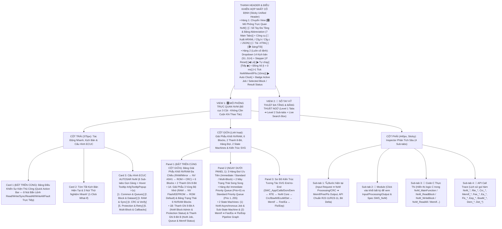
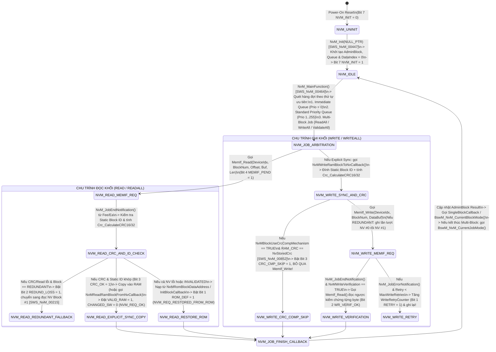
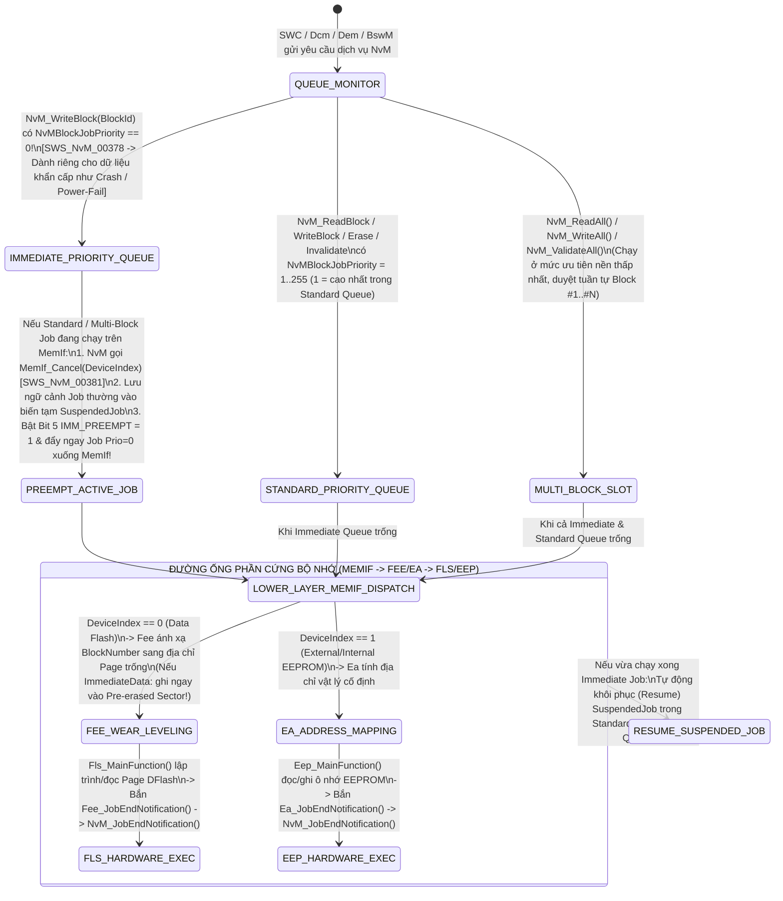

# Tài Liệu Thiết Kế Chi Tiết Trình Mô Phỏng AUTOSAR NvM (`NvM_Simulation_design.md`)

> **Trạng thái tài liệu:** Bản thiết kế chi tiết đã cập nhật theo xác nhận `A1`–`A4` của User — Sẵn sàng để User review trước khi triển khai code.  
> **File đích dự kiến xuất bản:** `d:\__Personal\AntiGravity\Simulation\03_Services\AUTOSAR_NvM.html` (Ứng dụng Web Tương tác 1 file HTML độc lập, 100% Offline, Pure CSS, có nút tải `.HTML` kèm cấu hình nhúng & xuất code `ARXML / NvM_Cfg.h / NvM_Cfg.c / JSON`).  
> **Chuẩn tham chiếu:** **AUTOSAR Classic Platform R20-11 / R22-11 / R23-11 (`SWS_NvM`, `SWS_MemIf`, `SWS_Fee`, `SWS_Ea`, `SWS_Fls`, `SWS_Eep`, `SWS_Crc`, `SWS_BswM`, `SWS_EcuM`, `SWS_Dcm`, `SWS_Dem`, `SWS_Det`, `SWS_Rte`)**, đính kèm mã requirement chuẩn **`SWS_NvM_xxxxx`** tại từng bước xử lý, Bảng Giải Phẫu Khối NVRAM Đa Chiều (`RAM / Mirror ↔ NV Block #0 / #1 ↔ ROM + Block Header / CRC`), 2 thanh ghi 8-Bit tương tác, hàng đợi ưu tiên `Immediate / Standard Queue`, tooltip cấu hình và sổ tay tra cứu đa tầng.

---

## 1. Tổng Quan Định Hướng Thiết Kế Đã Chốt (`A1` – `A4`)

| Hạng mục | Nội dung thiết kế đã xác nhận với User |
| :--- | :--- |
| **1. Bố cục giao diện & Ưu tiên Không Cuộn Trang — Zero-Scroll (`A1`)** | Kết hợp tinh hoa của **`AUTOSAR_DEM.html`**, **`AUTOSAR_BswM.html`** và **`AUTOSAR_EcuM.html`**, tối ưu hóa **Above-the-Fold (Zero-Scroll)** để các khối thao tác và giám sát tần suất cao nhất luôn nằm ngay phần đầu mỗi cột trong khung màn hình:<br>• **Thanh Điều Khiển Hợp Nhất Cố Định (Sticky Unified Header)**:<br>  - **Hàng 1**: Chuyển View `[🎛️ Mô Phỏng Trực Quan NvM]` \| `[📖 Sổ Tay Đa Tầng & Bảng Abbreviation (7 Main Tabs)]` + Công cụ `[🧾 Xuất ARXML / NvM_Cfg.h / NvM_Cfg.c / JSON]` \| `[💾 Tải .HTML]` \| `[🌗 Sáng/Tối]`.<br>  - **Hàng 2 (Luôn cố định)**: Dropdown chọn 14 Kịch bản (`S1`–`S14`), Stepper (`↺ Reset`, `◀ Lùi`, `▶ Tự chạy`, `Tiếp ▶`), Đồng hồ (`t = 0 ms`, `+1 Tick NvM_MainFunction / MemIf / Fls (10ms)`, `▶ Auto Clock`) và Badge Trạng thái Job / Khối đang chọn (`Block #`) / Kết quả `NvM_RequestResultType`.<br>• **Bố cục 3 cột hiện đại (Mỗi cột tự cuộn độc lập trong khung Viewport)**:<br>  - **Cột Trái (`375px`)**: Đưa **Card 1: Bảng Điều Khiển Sự Kiện Thủ Công (`Quick Action Bar` — 8 nút bắn lệnh Đọc/Ghi/Khôi phục/Gây lỗi trực tiếp)** và **Card 2: Tóm tắt kịch bản & 3 nút 1-Click What-If** lên trên cùng, tiếp theo là **Card 3: 6 Sub-tabs Cấu hình ECUC NvM** (hỗ trợ Floating Hover Tooltip `#cfgTooltipPopup` sau `>1s` giống hệt `AUTOSAR_DEM.html`).<br>  - **Cột Giữa (`Linh hoạt`)**: Đưa **Panel 1: Bảng Giải Phẫu Khối NVRAM Đa Chiều (`RAM / Mirror ↔ NV #0/#1 ↔ ROM + Block Header / CRC`) + Bảng 6 NVRAM Blocks + 2 Thanh Ghi 8-Bit Tương Tác** và **Panel 2: Hàng Đợi Ưu Tiên (`Immediate Queue`, `Standard Queue`, `Multi-Block Slot`) & 2 Máy Trạng Thái Song Song (`NvM Job State Machine` + `MemIf ➔ Fee/Ea ➔ Fls/Eep Pipeline`)** lên ngay đầu cột giữa, bên dưới là **Panel 3: Sơ Đồ Kiến Trúc Tương Tác SVG End-to-End** (`SWC_App/Calib/Dcm/Dem ↔ RTE ↔ NvM Core ↔ Crc/BswM/EcuM/Det ↔ MemIf ↔ Fee/Ea ↔ Fls/Eep ↔ Hardware Flash/EEPROM`).<br>  - **Cột Phải (`440px, Sticky`)**: Inspector 4 Sub-tabs (`🔍 Bước hiện tại`, `🧩 Module`, `📄 Code C Thực Thi`, `📜 API Call Trace`).<br>• **Config Hover Tooltip (`> 1s` delay)** giống hệt `AUTOSAR_DEM.html` (`#cfgTooltipPopup` hiển thị tên tham số, đường dẫn ECUC, mã `SWS_NvM_xxxxx`, mô tả, dải giá trị, giá trị typical và lưu ý kỹ thuật). |
| **2. Khu vực Giám sát Bit-level, Giải Phẫu Khối NVRAM & Hàng Đợi 2 Tầng (`A2`)** | Đặt **cố định và nổi bật ở đầu Cột Giữa** gồm **2 tầng trực quan hóa**:<br>• **Tầng 1 — Bảng Giải Phẫu Khối NVRAM Đa Chiều (`NVRAM Block Anatomy Inspector`) & Bảng Trạng Thái 6 Khối Tiêu Biểu**: Trực quan hóa song song 3 vùng bộ nhớ của một `NVRAM Block`: **(1) `RAM Block` (`Permanent RAM` / `Temporary RAM` / `Explicit Sync NvM Mirror`)**, **(2) `NV Block(s)` trên Flash/EEPROM (`NV Block #0` + `NV Block #1` cho `REDUNDANT`, hoặc `Dataset[0..N-1]` cho `DATASET`, kèm `Block Header`, `Static Block ID (2B)`, `Payload` & `CRC-16/32`)**, và **(3) `ROM Block` (`Default Data` / `InitBlockCallback`)**. Bên dưới là bảng 6 khối chuẩn (`Block #0 MultiBlock`, `Block #1 ConfigId`, `Block #2 Native_Calib`, `Block #3 Redundant_Odometer`, `Block #4 Dataset_Variant[3]`, `Block #5 Immediate_CrashData`) cho phép click chọn để soi chi tiết từng byte!<br>• **Tầng 2 — 2 Thanh ghi 8-Bit tương tác song song**:<br>  1. **Thanh A (`8-Bit NvM Block Administrative Status & Protection Byte` — `NvM_AdminStatusByte`)**: Theo dõi các bit quản trị của khối đang xét (`VALID_RAM`, `CHANGED_SW`, `WRITE_PROT`, `WR_ONCE_LOCKED`, `CRC_COMP_SKIP`, `REDUNDANCY_LOSS`, `ROM_DEFAULT_USED`, `EXPLICIT_SYNC_OK`).<br>  2. **Thanh B (`8-Bit NvM Job Processing, Queue & Lower-Layer Status Byte` — `NvM_JobControlByte`)**: Theo dõi trạng thái thực thi của động cơ `NvM` & tầng dưới (`NVM_INITIALIZED`, `MULTI_BLOCK_ACTV`, `IMM_PRIO_PREEMPT`, `MEMIF_JOB_PENDING`, `CRC_ENGINE_OK`, `WRITE_VERIFY_OK`, `RETRY_IN_PROGRESS`, `INTEGRITY_OR_REQ_ERR`). Cho phép click trực tiếp vào từng bit để giải mã hoặc thử nghiệm! |
| **3. Hệ thống 14 Kịch bản mẫu (`A3`)** | Thiết kế sẵn **14 Kịch bản (`S1`–`S14`)** chia làm 4 nhóm lớn:<br>• **Nhóm 1 (`S1`–`S4`) — Khởi Động, `NvM_ReadAll`, Đồng Bộ `Explicit Sync Mirror` & Quản Lý Kiểu Khối (`NATIVE` / `DATASET`)**: Khởi tạo `NvM_Init()`, chạy `NvM_ReadAll()` kiểm tra `Configuration ID (Block #1)` và nạp các khối về RAM kèm báo `BswM_NvM_CurrentJobMode`, đọc khối đơn `NvM_ReadBlock / NvM_ReadPRAMBlock`, cơ chế đồng bộ gương `NvMBlockUseSyncMechanism = TRUE` (`ReadRamBlockFromNvCallback / WriteRamBlockToNvCallback`), và chọn phần tử dữ liệu trong khối `NVM_BLOCK_DATASET` (`NvM_SetDataIndex`).<br>• **Nhóm 2 (`S5`–`S8`) — Ghi Dữ Liệu, So Sánh CRC Bỏ Qua Ghi (`CRC Compare`), `Write Verification`, Hàng Đợi Ưu Tiên (`Immediate Preemption`) & `NvM_WriteAll`**: Đánh dấu `NvM_SetRamBlockStatus(TRUE)` tính CRC nền và ghi `NvM_WriteBlock()`, tối ưu chống mòn Flash với `NvMBlockUseCrcCompMechanism = TRUE` + đọc ngược kiểm chứng `NvMWriteVerification = TRUE`, Job khẩn cấp `NvMBlockJobPriority = 0` (`Immediate Queue`) gọi `MemIf_Cancel()` cắt ngang Job thường, và chu trình tắt máy `NvM_WriteAll() / NvM_ValidateAll() / NvM_CancelWriteAll()`.<br>• **Nhóm 3 (`S9`–`S11`) — Khối Dự Phòng Kép (`NVM_BLOCK_REDUNDANT`), Khôi Phục `ROM Default` & Xóa/Vô Hiệu Hóa Khối (`Erase / Invalidate`)**: Phát hiện lỗi CRC ở bản sao `NV Block #0` của khối `REDUNDANT` để đọc cứu hộ từ `NV Block #1` và tự sửa lại bản sao hỏng, tự động khôi phục từ `ROM Block` / `InitBlockCallback` (`NVM_REQ_RESTORED_FROM_ROM`) kèm báo lỗi `Dem_SetEventStatus(NVM_E_INTEGRITY_FAILED)`, và thực thi `NvM_EraseNvBlock()` / `NvM_InvalidateNvBlock()`.<br>• **Nhóm 4 (`S12`–`S14`) — Kiểm Tra `Static Block ID`, Chống Ghi Đè (`Write Protection / Write Once`), Thử Lại (`Retries`) & Báo Lỗi `DEM / DET`**: Phát hiện sai lệch `NvMStaticBlockIDCheck` và nâng cấp phần mềm (`NvMResistantToChangedSw = FALSE`), khóa bảo vệ chống ghi động (`NvM_SetBlockProtection`) & ghi 1 lần (`NvMWriteBlockOnce = TRUE`), thử lại `NvMMaxNumOfWriteRetries` khi Flash lỗi rồi báo `DEM`, và kiểm thử toàn bộ mã lỗi `DET` (`NVM_E_UNINIT`, `NVM_E_PARAM_BLOCK_ID`, `NVM_E_BLOCK_PENDING`, `NVM_E_BLOCK_LOCKED`...). |
| **4. Sổ tay tra cứu đa tầng & Bảng Abbreviation (`A4`)** | **View 2 (`📖 Sổ Tay Kỹ Thuật NvM & Từ Điển Thuật Ngữ`)** được tổ chức theo cấu trúc **Đa Tầng (Multi-level Tabs)**:<br>• **6 Main Sub-tabs (Level 1) × 4 Chủ đề con (Level 2 Pills/Tabs = 24 chuyên đề)** phân tích sâu kiến trúc Memory Stack (`NvM ➔ MemIf ➔ Fee/Ea ➔ Fls/Eep`), giải phẫu 3 loại khối (`NATIVE`, `REDUNDANT`, `DATASET`), cơ chế đồng bộ `Implicit vs Explicit Sync (Mirror)`, thuật toán `CRC / Static ID / Write Verification / CRC Compare`, phân xử hàng đợi `Immediate vs Standard` & `ReadAll / WriteAll`, và từ điển API/ECUC.<br>• **Tab 7 chuyên biệt: `🔤 Bảng Thuật Ngữ & Từ Viết Tắt (Abbreviation Table)`** trình bày dưới dạng bảng chuẩn 4 cột, tích hợp **Search Box tìm kiếm tức thời (Live Search + Highlight `<mark>`)** và 5 nút lọc nhanh theo phân nhóm (`NVRAM Block Architecture`, `Jobs, Queues & Sync`, `CRC, Integrity & Protection`, `Memory Stack (MemIf/Fee/Ea/Fls)`). |

---

## 2. Bố Cục Giao Diện 3 Cột Ưu Tiên Zero-Scroll & Hệ Thống Sub-Tabs (UI Wireframe)

Để đảm bảo **"người dùng không cần cuộn chuột lên xuống mỗi lần thao tác"**, toàn bộ giao diện được thiết kế theo nguyên lý **Viewport-First (Đưa các khối tương tác và giám sát tần suất cao nhất lên ngay phần đầu của mỗi cột, kết hợp hệ thống Sub-tabs gọn gàng)**:



### Điểm Cải Tiến Đột Phá Về Trải Nghiệm "Zero-Scroll" Cho Module `NvM`:
1. **Thanh Điều Khiển Hợp Nhất (`Sticky Unified Header`)**: Gộp chọn kịch bản, nút bấm `Bước tiếp / Lùi / Tự chạy`, và nút nhịp đồng hồ `+1 Tick NvM_MainFunction / MemIf / Fls (10ms)` vào ngay thanh Header cố định. Vì mọi thao tác đọc/ghi Flash trong AUTOSAR đều là **Bất đồng bộ (Asynchronous)** trải qua nhiều chu kỳ `NvM_MainFunction()` và `Fls_MainFunction()`, việc đặt nút Tick ở Header giúp người dùng bấm tiến từng chu kỳ xử lý trạng thái con (tính CRC ➔ gửi xuống `MemIf` ➔ chờ `Fls` ghi trang vật lý ➔ đọc ngược `Write Verification` ➔ bắn `JobEndNotification`) ở bất kỳ đâu.
2. **Đưa `Quick Action Bar` (8 nút bắn lệnh NvM) lên vị trí Card 1 (Đầu Cột Trái)** và đưa **Bảng Giải Phẫu Khối NVRAM (`RAM / Mirror ↔ NV #0/#1 ↔ ROM`) + Bảng 6 Blocks + 2 Thanh Ghi 8-Bit** lên đầu Cột Giữa: Khi bấm `NvM_WriteBlock()`, `NvM_SetRamBlockStatus(TRUE)`, `NvM_ReadAll()`, hoặc `Inject CRC Mismatch`, mắt người dùng nhìn thấy ngay lập tức dữ liệu chạy từ `RAM Block` (hoặc `NvM Mirror`) qua bộ tính `CRC-16/32` xuống `NV Block #0 / #1` trên `Fee/Fls`, thấy rõ cờ `VALID_RAM`, `CHANGED_SW`, `CRC_COMP_SKIP`, `REDUNDANCY_LOSS` bật/tắt mà **không phải cuộn trang**.
3. **Gom 36 tham số ECUC vào 6 Sub-tabs gọn gàng**: Chiều cao Card Cấu hình được giữ gọn cố định (~275px), kèm hộp thoại giải thích nổi `#cfgTooltipPopup` khi hover quá `1000ms` giống hệt `AUTOSAR_DEM.html`.

---

## 3. Thiết Kế Chi Tiết Panel 1 (Đầu Cột Giữa): Bảng Giải Phẫu Khối NVRAM Đa Chiều (`RAM / Mirror ↔ NV #0/#1 ↔ ROM`) & 2 Thanh Ghi 8-Bit Tương Tác

Trong kiến trúc AUTOSAR Classic, một **`NVRAM Block`** không phải là một biến đơn lẻ mà là một **tổ hợp cấu trúc quản lý gồm 4 thành phần liên kết chặt chẽ (`SWS_NvM_00017`)**:
1. **`Administrative Block` (Khối Quản trị nội bộ của `NvM` trong RAM)**: Lưu trữ trạng thái hiện tại của khối (`NvM_RequestResultType`), các cờ thuộc tính (`VALID`, `CHANGED`, `WRITE_PROTECTED`, `WRITE_ONCE_LOCKED`), chỉ số `DataIndex` (nếu là khối `DATASET`), bộ đếm thử lại (`RetryCounter`) và giá trị `CRC` đã tính gần nhất.
2. **`RAM Block` (Vùng dữ liệu làm việc trên RAM)**: Có thể là `Permanent RAM Block` (địa chỉ cố định trong cấu hình `NvMRamBlockDataAddress`), `Temporary RAM Block` (con trỏ truyền lúc gọi hàm `NvM_ReadBlock(BlockId, DstPtr)`), hoặc `NvM Mirror` (bộ đệm nội bộ của `NvM` dùng trong cơ chế **Explicit Synchronization** với `SWC`).
3. **`NV Block(s)` (Vùng lưu trữ bất khả biến trên `Fee / Ea ➔ Fls / Eep`)**:
   - Với **`NVM_BLOCK_NATIVE`**: Gồm đúng **1 bản sao NV Block** (`NV Block #0`).
   - Với **`NVM_BLOCK_REDUNDANT`**: Gồm **2 bản sao giống hệt nhau nằm ở 2 vùng vật lý độc lập** (`NV Block #0` và `NV Block #1`) để chống mất dữ liệu khi sập nguồn hoặc lỗi ô nhớ Flash.
   - Với **`NVM_BLOCK_DATASET`**: Gồm **1 mảng từ `1..255` phần tử NV Block** được chọn thông qua chỉ số `DataIndex`.
   - Cấu trúc vật lý bên trong mỗi `NV Block` gồm: `[Block Header (Tuỳ chọn)] + [Static Block ID (2 Bytes)] + [NV User Data Payload (N Bytes)] + [NV CRC (1/2/4 Bytes)]`.
4. **`ROM Block` (Vùng dữ liệu mặc định chỉ đọc trong Flash chương trình — Tuỳ chọn)**: Chứa dữ liệu gốc của nhà sản xuất (`NvMRomBlockDataAddress`) hoặc hàm khởi tạo (`NvMInitBlockCallback`), được `NvM` tự động nạp vào `RAM Block` khi dữ liệu trong `NV Block` bị trống (ECU mới xuất xưởng) hoặc bị lỗi CRC không thể phục hồi!

Do đó, Panel 1 ở đầu Cột Giữa được thiết kế gồm **2 tầng trực quan hóa liên thông**:

### 3.1. Phần 1A — Bảng Giải Phẫu Khối NVRAM Đa Chiều (`NVRAM Block Anatomy Inspector`) & Bảng Trạng Thái 6 Khối Tiêu Biểu

```text
+-------------------------------------------------------------------------------------------------------------------+
| 💾 BẢNG GIẢI PHẪU KHỐI NVRAM ĐA CHIỀU (`RAM / Mirror ↔ NV Block #0 / #1 ↔ ROM`) & 6 KHỐI NVRAM TIÊU BIỂU          |
| Đang chọn: [Block #3: NvMBlock_Odometer] | Kiểu: [NVM_BLOCK_REDUNDANT] | CRC: [CRC-16 (0x84CF)] | KQ: [NVM_REQ_OK] |
+-------------------------------------------------------------------------------------------------------------------+
| 1. GIẢI PHẪU LIÊN THÔNG 3 VÙNG BỘ NHỚ CỦA KHỐI ĐANG CHỌN (`Block #3: NvMBlock_Odometer` — Size: 8B + 2BID + 2BCRC):|
|  +-----------------------------------+---------------------------------------+-----------------------------------+|
|  | 🧠 VÙNG RAM / EXPLICIT MIRROR     | 🔥 VÙNG BỘ NHỚ FLASH / EEPROM (Fee/Ea)| 📀 VÙNG ROM DEFAULT / INIT CBK    ||
|  | • Loại: Permanent RAM (&Ram_Odo)  | • Bản sao #0 (Fee_Block_0x0030):      | • Địa chỉ: &Rom_Odometer_Default  ||
|  | • Dữ liệu RAM: [00 01 E2 40 ...]  |   [ID:0003][Data:00 01 E2 40][CRC:84CF| • Dữ liệu gốc: [00 00 00 00 ...]  ||
|  | • Trạng thái : [VALID | CHANGED]  | • Bản sao #1 (Fee_Block_0x0031):      | • Callback: Rte_Call_InitOdo()    ||
|  | • RAM CRC-16 : [ 0x84CF (Match!)] |   [ID:0003][Data:00 01 E2 40][CRC:84CF| • Trạng thái: [Standby / Ready]   ||
|  +-----------------------------------+---------------------------------------+-----------------------------------+|
+-------------------------------------------------------------------------------------------------------------------+
| 2. BẢNG TRẠNG THÁI LIVE 6 KHỐI NVRAM TIÊU BIỂU (Click vào hàng bất kỳ để chọn khối & chỉnh sửa trực tiếp):        |
|  +-----+------------------------+-------------+---------+---------------+-------------+------------+-------------+|
|  | ID  | Tên Khối (Block Name)  | Kiểu Quản Lý| Prio/Sync| RAM State     | NV #0 / #1  | CRC (Hex)  | Kết Quả Cuối||
|  +-----+------------------------+-------------+---------+---------------+-------------+------------+-------------+|
|  | #0  | MultiBlock_Request     | MULTI_ADMIN | Sys/--- | VALID/CLEAN   | --- / ---   | ---        | NVM_REQ_OK  ||
|  | #1  | ConfigId_CompiledSw    | REDUNDANT   | Prio: 1 | VALID/CLEAN   | OK  / OK    | 0xA55A(16) | NVM_REQ_OK  ||
|  | #2  | Calib_EngineMap        | NATIVE      | Prio:10 | VALID/CLEAN   | OK  / ---   | 0x4F12(16) | NVM_REQ_OK  ||
|  | #3★ | Odometer_Redundant     | REDUNDANT   | Prio: 2 | VALID/CHANGED | OK  / OK    | 0x84CF(16) | NVM_REQ_OK  ||
|  | #4  | Variant_Coding[Idx=1]  | DATASET (3) | Prio:15 | VALID/CLEAN   | DS[1]: OK   | 0x99B1(16) | NVM_REQ_OK  ||
|  | #5  | Crash_EventRecord      | NATIVE (Imm)| Prio: 0!| VALID/CLEAN   | OK  / ---   | 0xDE01(32) | NVM_REQ_OK  ||
|  +-----+------------------------+-------------+---------+---------------+-------------+------------+-------------+|
+-------------------------------------------------------------------------------------------------------------------+
```

- **Tính năng tương tác trực tiếp trên Phần 1A**:
  - Người dùng có thể **click chọn bất kỳ khối nào trong 6 NVRAM Blocks (`#0 .. #5`)** để xem ngay sơ đồ giải phẫu của khối đó (ví dụ chọn `Block #3` sẽ thấy 2 bản sao `NV Block #0` & `NV Block #1`; chọn `Block #4` sẽ thấy 3 ngăn `Dataset[0]`, `Dataset[1]`, `Dataset[2]` trong NV và `Dataset[3..4]` trong ROM; chọn `Block #2` sẽ thấy bộ đệm trung gian `NvM Mirror` khi bật `Explicit Sync`).
  - Có nút bấm nhanh ngay trên ô `NV Block #0` để **cố tình làm lệch 1 byte dữ liệu/CRC trên Flash (`Corrupt NV #0 CRC`)** nhằm kiểm chứng trực quan cách `NvM` phát hiện lỗi và xử lý!

### 3.2. Phần 1B — 2 Thanh Ghi 8-Bit Trạng Thái Tương Tác Luôn Hiển Thị Nổi Bật

Ngay bên dưới Phần 1A là **2 Thanh ghi 8-Bit tương tác** theo đúng phong cách trực quan của `AUTOSAR_DEM.html`, `AUTOSAR_BswM.html` và `AUTOSAR_EcuM.html`:

```text
+-------------------------------------------------------------------------------------------------------------------+
| 🔢 BẢNG GIÁM SÁT BITFIELD 8-BIT NVM ADMIN & JOB CONTROL (LIVE 8-BIT INSPECTOR)     [Click vào ô Bit để thử nghiệm]|
| Bước #3: NvM_SetRamBlockStatus(#3, TRUE) ➔ Tính lại CRC-16 = 0x84CF | AdminByte: 0xC8 | JobControlByte: 0x88      |
+-------------------------------------------------------------------------------------------------------------------+
| A. THANH GHI 8-BIT TRẠNG THÁI QUẢN TRỊ & BẢO VỆ KHỐI (`NvM_AdminStatusByte`) — Hex: [ 0xC8 ]  Bin: [ 1100 1000b ] |
|    RAM State: [ VALID & CHANGED (DIRTY) ] | Write Protection: [ UNLOCKED ] | CRC Compare Skip: [ ENABLED ]        |
|  +-------------+ +-------------+ +-------------+ +-------------+ +-------------+ +-------------+ +-------+ +-----+|
|  | Bit 7 (0x80)| | Bit 6 (0x40)| | Bit 5 (0x20)| | Bit 4 (0x10)| | Bit 3 (0x08)| | Bit 2 (0x04)| |Bit1(2)| |Bit 0||
|  | VALID_RAM   | | CHANGED_SW  | | WRITE_PROT  | | WR_ONCE_LCK | | CRC_CMP_SKIP| | REDUND_LOSS | |ROM_DEF| |SYNC ||
|  |      1      | |      1      | |      0      | |      0      | |      1      | |      0      | |   0   | |  0  ||
|  | RAM Valid   | | Dirty/Modif | | Writable    | | Multi-Write | | SkipIfMatch | | Both NV OK  | |NV Data| |Direct|
|  +-------------+ +-------------+ +-------------+ +-------------+ +-------------+ +-------------+ +-------+ +-----+|
+-------------------------------------------------------------------------------------------------------------------+
| B. THANH GHI 8-BIT ĐIỀU KHIỂN JOB, HÀNG ĐỢI & TẦNG DƯỚI (`NvM_JobControlByte`) — Hex: [ 0x88 ] Bin: [ 1000 1000b ]|
|    Active Job: [ IDLE / CRC_CALC_DONE ] | Queue: [ 0 Imm / 0 Std ] | Lower Layer (MemIf/Fee/Fls): [ MEMIF_IDLE ]  |
|  +-------------+ +-------------+ +-------------+ +-------------+ +-------------+ +-------------+ +-------+ +-----+|
|  | Bit 7 (0x80)| | Bit 6 (0x40)| | Bit 5 (0x20)| | Bit 4 (0x10)| | Bit 3 (0x08)| | Bit 2 (0x04)| |Bit1(2)| |Bit 0||
|  | NVM_INIT    | | MULTI_ACTV  | | IMM_PREEMPT | | MEMIF_PEND  | | CRC_ENG_OK  | | WR_VERIF_OK | |RETRY  | |ERR! ||
|  |      1      | |      0      | |      0      | |      0      | |      1      | |      0      | |   0   | |  0  ||
|  | Initialized | | Single Mode | | Normal Prio | | MemIf Idle  | | CRC Matched | | Verif Stby  | |NoRetry| |NoErr||
|  +-------------+ +-------------+ +-------------+ +-------------+ +-------------+ +-------------+ +-------+ +-----+|
+-------------------------------------------------------------------------------------------------------------------+
```

#### 3.2.1. Giải Mã Chi Tiết Thanh A: `8-Bit NvM Block Administrative Status & Protection Byte` (`NvM_AdminStatusByte`)

| Bit | Mask | Tên Cờ (`NvM Admin Bit`) | Ý nghĩa kỹ thuật & Khi nào bật lên `1` (`0 ➔ 1`) | Khi nào hạ về `0` (`1 ➔ 0`) |
| :-: | :-: | :--- | :--- | :--- |
| **Bit 7** | `0x80` | **`VALID_RAM`** | Bật lên `1` khi dữ liệu trong `RAM Block` được xác nhận là **hợp lệ và nhất quán (`VALID`)**: sau khi `NvM_ReadBlock()` / `NvM_ReadAll()` đọc thành công từ Flash, sau khi khôi phục từ `ROM Default`, sau khi `NvM_WriteBlock()` thành công, hoặc khi ứng dụng gọi **`NvM_SetRamBlockStatus(BlockId, TRUE)`** (`SWS_NvM_00453`). | Hạ về `0` (`INVALID`) khi vừa khởi tạo `NvM_Init()`, khi ứng dụng gọi **`NvM_SetRamBlockStatus(BlockId, FALSE)`** báo dữ liệu RAM đang sửa dở/không hợp lệ, hoặc khi đọc dữ liệu thất bại mà không có ROM cứu hộ. |
| **Bit 6** | `0x40` | **`CHANGED_SW`** | Bật lên `1` (`CHANGED / DIRTY`) khi ứng dụng gọi **`NvM_SetRamBlockStatus(BlockId, TRUE)`** (`SWS_NvM_00406`) hoặc khi gọi `NvM_WriteBlock()` / `NvM_WritePRAMBlock()`. **Ý nghĩa sống còn**: Khi chạy **`NvM_WriteAll()`** lúc tắt máy, `NvM` **chỉ ghi những khối có đồng thời `VALID_RAM == 1` VÀ `CHANGED_SW == 1`** xuống Flash (`SWS_NvM_00254`)! | Hạ về `0` (`UNCHANGED / CLEAN`) ngay sau khi `NvM` ghi thành công dữ liệu từ RAM xuống `NV Block` trên Flash/EEPROM (`NVM_REQ_OK`), hoặc sau khi vừa đọc mới từ NV/ROM lên RAM. |
| **Bit 5** | `0x20` | **`WRITE_PROT`** | Bật lên `1` khi khối được cấu hình bảo vệ chống ghi từ đầu (**`NvMBlockWriteProt = TRUE`** — `SWS_NvM_00054`) hoặc khi ứng dụng gọi hàm **`NvM_SetBlockProtection(BlockId, TRUE)`** (`SWS_NvM_00450`). Khi bit này bằng `1`, mọi yêu cầu `NvM_WriteBlock`, `NvM_WriteAll`, `NvM_EraseNvBlock`, `NvM_InvalidateNvBlock` lên khối này đều bị từ chối ngay lập tức! | Hạ về `0` khi gọi **`NvM_SetBlockProtection(BlockId, FALSE)`** (trừ trường hợp khối có cấu hình `NvMWriteBlockOnce = TRUE` thì không bao giờ được phép mở khóa bằng API này — `SWS_NvM_00399`!). |
| **Bit 4** | `0x10` | **`WR_ONCE_LOCKED`** | Bật lên `1` đối với các khối cấu hình **`NvMWriteBlockOnce = TRUE`** (ví dụ số khung VIN, mã hiệu chuẩn nhà máy, Serial Number): Ngay sau khi `NvM` đọc thành công khối đó từ Flash (chứng tỏ đã từng ghi) hoặc ngay sau khi ghi thành công lần đầu tiên, `NvM` lập tức khóa chặt `WRITE_PROT = 1` và `WR_ONCE_LOCKED = 1` vĩnh viễn (`SWS_NvM_00326`)! | Hạ về `0` khi khối không bật `NvMWriteBlockOnce`, hoặc khi khối `WriteOnce` đang ở trạng thái trắng (`NVM_REQ_NV_INVALIDATED`) chưa từng được ghi lần nào. |
| **Bit 3** | `0x08` | **`CRC_COMP_SKIP`** | Bật lên `1` khi khối bật **`NvMBlockUseCrcCompMechanism = TRUE`** (`SWS_NvM_00852`) và trong quá trình `NvM_WriteBlock()` / `NvM_WriteAll()`, mã `CRC` mới tính trên `RAM Block` **trùng khớp hoàn toàn với mã `CRC` đã lưu trong RAM Administrative Block** từ lần đọc/ghi trước ➔ `NvM` **bỏ qua lệnh ghi xuống `MemIf`** để bảo vệ tuổi thọ ô nhớ Flash! | Hạ về `0` khi tính năng `NvMBlockUseCrcCompMechanism` tắt, hoặc khi dữ liệu RAM thực sự thay đổi làm mã `CRC` mới khác với mã `CRC` cũ (bắt buộc phải ghi vật lý xuống Flash). |
| **Bit 2** | `0x04` | **`REDUNDANCY_LOSS`** | Bật lên `1` khi đọc một khối kiểu **`NVM_BLOCK_REDUNDANT`** mà bản sao thứ nhất (`NV Block #0`) bị lỗi CRC hoặc lỗi đọc phần cứng, buộc `NvM` phải chuyển sang đọc bản sao dự phòng thứ hai (`NV Block #1` — `SWS_NvM_00215`, `SWS_NvM_00836`). Lúc này dữ liệu vẫn cứu được nhưng tính dự phòng kép đang bị mất một chân! | Hạ về `0` khi cả 2 bản sao `NV Block #0` và `NV Block #1` đều nguyên vẹn, hoặc sau khi `NvM` tự động ghi đè phục hồi lại bản sao bị hỏng. |
| **Bit 1** | `0x02` | **`ROM_DEFAULT_USED`** | Bật lên `1` khi dữ liệu hiện tại trong `RAM Block` được nạp từ **`ROM Block` (`NvMRomBlockDataAddress`)** hoặc được tạo bởi **`NvMInitBlockCallback`** (`SWS_NvM_00222`) thông qua lệnh `NvM_RestoreBlockDefaults()` hoặc tự động khôi phục khi `NV Block` bị hỏng CRC / `INVALIDATED` (kết quả trả về **`NVM_REQ_RESTORED_FROM_ROM`**). | Hạ về `0` khi dữ liệu trong `RAM Block` được đọc thành công từ `NV Block` thực tế trên Flash/EEPROM hoặc đã được ứng dụng cập nhật và ghi mới xuống Flash. |
| **Bit 0** | `0x01` | **`EXPLICIT_SYNC_OK`** | Bật lên `1` khi khối sử dụng cơ chế **Đồng bộ Tường minh (`NvMBlockUseSyncMechanism = TRUE`)** và `NvM` đã thực hiện thành công việc sao chép dữ liệu qua lại giữa biến của `SWC` và bộ đệm nội bộ **`NvM Mirror`** thông qua callback **`NvMWriteRamBlockToNvCallback`** / **`NvMReadRamBlockFromNvCallback`** (`SWS_NvM_00694`). | Hạ về `0` khi khối dùng cơ chế truy cập trực tiếp `Permanent/Temporary RAM` (`Implicit Sync`), hoặc khi callback đồng bộ của `SWC` trả về `E_NOT_OK` quá số lần `NvMRepeatMirrorOperations`. |

#### 3.2.2. Giải Mã Chi Tiết Thanh B: `8-Bit NvM Job Processing, Queue & Lower-Layer Status Byte` (`NvM_JobControlByte`)

| Bit | Mask | Tên Cờ (`NvM Job / Stack Bit`) | Ý nghĩa kỹ thuật & Khi nào bật lên `1` (`0 ➔ 1`) | Khi nào hạ về `0` (`1 ➔ 0`) |
| :-: | :-: | :--- | :--- | :--- |
| **Bit 7** | `0x80` | **`NVM_INITIALIZED`** | Bật lên `1` sau khi `EcuM` gọi **`NvM_Init(NULL_PTR)`** thành công (`SWS_NvM_00447`, `SWS_NvM_00399`), khởi tạo toàn bộ các `Administrative Block`, hàng đợi `Immediate / Standard Queue` và đặt chỉ số `DataIndex = 0` cho mọi khối `DATASET`. | Hạ về `0` khi chưa chạy `NvM_Init()` (hoặc khi người dùng tắt Checkbox `NvMInitialized` để kiểm thử báo lỗi `Det_ReportError(NVM_E_UNINIT = 0x14)`). |
| **Bit 6** | `0x40` | **`MULTI_BLOCK_ACTV`** | Bật lên `1` khi `NvM` đang xử lý một yêu cầu đa khối (**`NvM_ReadAll()`**, **`NvM_WriteAll()`**, hoặc **`NvM_ValidateAll()`** — `SWS_NvM_00460`, `SWS_NvM_00461`), duyệt tuần tự qua từng `Block #1 .. #N` và cập nhật trạng thái vào `Block #0` (`MultiBlock_Request`). | Hạ về `0` ngay khi tiến trình đa khối hoàn tất toàn bộ các khối và gọi **`BswM_NvM_CurrentJobMode(MultiBlockRequest, CurrentJobMode)`** (hoặc khi bị hủy bởi `NvM_CancelWriteAll()`). |
| **Bit 5** | `0x20` | **`IMM_PRIO_PREEMPT`** | Bật lên `1` khi có một yêu cầu **`NvM_WriteBlock()`** của khối có độ ưu tiên tức thời (**`NvMBlockJobPriority == 0`**) được đẩy vào **`Immediate Priority Queue`** (`SWS_NvM_00378`). Nếu lúc đó `NvM` đang bận chạy một Job thường (`Standard Priority` hoặc `Multi-Block`), `NvM` lập tức gọi **`MemIf_Cancel()`** để hủy tạm Job thường ở tầng dưới và nhường đường ghi ngay khối `Immediate` (`SWS_NvM_00381`)! | Hạ về `0` sau khi khối ưu tiên tức thời (`Prio = 0`) đã ghi xong xuống Flash và `NvM` tự động khôi phục lại (`Resume`) Job thường vừa bị gián đoạn trước đó! |
| **Bit 4** | `0x10` | **`MEMIF_JOB_PENDING`** | Bật lên `1` khi `NvM` đã phát lệnh xuống tầng dưới (`MemIf_Read`, `MemIf_Write`, `MemIf_EraseImmediateBlock`, `MemIf_InvalidateBlock`) và tầng `Fee / Ea ➔ Fls / Eep` đang ở trạng thái bận xử lý vật lý (**`MEMIF_BUSY` / `MEMIF_JOB_PENDING`**). | Hạ về `0` khi `Fee / Ea` hoàn tất thao tác trên Flash/EEPROM và gọi callback **`NvM_JobEndNotification()`** (`MEMIF_JOB_OK`) hoặc **`NvM_JobErrorNotification()`** (`MEMIF_JOB_FAILED` / `BLOCK_INCONSISTENT`). |
| **Bit 3** | `0x08` | **`CRC_ENGINE_OK`** | Bật lên `1` khi bộ máy tính toán mã kiểm tra **`Crc_CalculateCRC8 / CRC16 / CRC32`** của `NvM` hoàn tất tính CRC cho khối dữ liệu (và khi đọc từ Flash lên thì cả **`Static Block ID`** lẫn mã **`NV CRC`** đều khớp 100% với giá trị mong đợi — `SWS_NvM_00201`). | Hạ về `0` khi phát hiện **lỗi sai lệch CRC (`CRC Mismatch`)** hoặc sai **`Static Block ID`** khi đọc dữ liệu từ Flash/EEPROM! |
| **Bit 2** | `0x04` | **`WRITE_VERIFY_OK`** | Bật lên `1` đối với các khối cấu hình **`NvMWriteVerification = TRUE`** (`SWS_NvM_00842`): Sau khi `MemIf_Write()` báo thành công, `NvM` tự động gọi thêm một lệnh `MemIf_Read()` đọc ngược dữ liệu từ Flash lên vùng đệm ẩn và so sánh từng byte (theo `NvMWriteVerificationDataSize`) với `RAM Block` — chỉ khi khớp 100% mới bật bit này lên `1`! | Hạ về `0` khi khối không bật `NvMWriteVerification`, khi chưa thực hiện bước kiểm chứng, hoặc khi dữ liệu đọc ngược từ Flash bị sai lệch so với dữ liệu vừa ghi! |
| **Bit 1** | `0x02` | **`RETRY_IN_PROGRESS`** | Bật lên `1` khi quá trình ghi (`MemIf_Write` hoặc `Write Verification`) hoặc đọc (`MemIf_Read` / `CRC Check`) bị lỗi và `NvM` đang tự động tăng bộ đếm thử lại (**`WriteRetryCounter < NvMMaxNumOfWriteRetries`** hoặc **`ReadRetryCounter < NvMMaxNumOfReadRetries`** — `SWS_NvM_00263`) để thực hiện lại thao tác một lần nữa. | Hạ về `0` khi thao tác thành công ngay từ lần đầu, khi lần thử lại thành công, hoặc khi đã chạm ngưỡng tối đa `MaxRetries` và chuyển sang báo lỗi thất bại. |
| **Bit 0** | `0x01` | **`INTEGRITY_OR_REQ_ERR`** | Bật lên `1` khi một Job kết thúc với lỗi (`NVM_REQ_NOT_OK`, `NVM_REQ_INTEGRITY_FAILED`) hoặc vi phạm kiểm tra tham số, kích hoạt `NvM` báo cáo sự kiện chẩn đoán sang **`Dem_SetEventStatus(NVM_E_REQ_FAILED / NVM_E_INTEGRITY_FAILED / NVM_E_WRONG_BLOCK_ID, DEM_EVENT_STATUS_FAILED)`** và/hoặc **`Det_ReportError()`**! | Hạ về `0` khi Job tiếp theo hoàn tất thành công (`NVM_REQ_OK`) hoặc khi người dùng bấm Reset. |

---

## 4. Phân Tích Xử Lý Từng Module: Input Lấy Từ Đâu, Xử Lý Gì, Output Route Đến Đâu

Mọi khối trên sơ đồ kiến trúc SVG đều có thể **click vào để xem giải thích chi tiết** ở cột phải (Tab `🧩 Module`) và được tổng hợp đầy đủ trong **Tab 1 của Sổ tay**:

| # | Module / Phân khối | Lớp AUTOSAR | 📥 Input lấy từ đâu? | ⚙️ Cách xử lý nội bộ (Processing, State & Timers) | 📤 Output route đến đâu & Hàm API chuẩn (R20-11 / R22-11 / R23-11) |
| :-: | :--- | :--- | :--- | :--- | :--- |
| **1** | **`SWC_App` & `SWC_Calibration`**<br>*(Application Layer)* | Application Layer | • Thay đổi thông số vận hành từ người dùng / cảm biến (quãng đường Odometer, dữ liệu học thích nghi Adaptive Fuel Trim, sự kiện va chạm Crash Record).<br>• Nhận thông báo hoàn tất Job từ `NvM` qua cổng callback `NvMNotifyJobFinished` (`SingleBlockCallbackFunction`). | • **3 phương thức làm việc với `NvM` qua `RTE`**:<br>  1. **Truy cập qua `Temporary RAM`**: Truyền thẳng con trỏ bộ đệm vào `Rte_Call_NvMService_ReadBlock(DstPtr)` / `WriteBlock(SrcPtr)`.<br>  2. **Truy cập qua `Permanent RAM` (`Implicit Sync`)**: Sửa trực tiếp biến toàn cục trong RAM rồi gọi `Rte_Call_NvMService_SetRamBlockStatus(TRUE)` để `NvM` tự lưu khi tắt máy (`NvM_WriteAll`), hoặc gọi `ReadPRAMBlock()` / `WritePRAMBlock()`.<br>  3. **Đồng bộ Tường minh (`Explicit Sync Mirror`)**: Cung cấp 2 hàm callback `ReadRamBlockFromNvm` & `WriteRamBlockToNvm` để `NvM` chủ động yêu cầu copy dữ liệu vào/ra `NvM Mirror` mà không sợ đụng độ vùng găng! | • Gọi xuống **NvM** qua **RTE** (`PortInterface NvMService / NvMAdmin`):<br>`Rte_Call_NvMService_ReadBlock(DstPtr)` [`SWS_NvM_00454`]<br>`Rte_Call_NvMService_WriteBlock(SrcPtr)` [`SWS_NvM_00455`]<br>`Rte_Call_NvMService_SetRamBlockStatus(BlockChanged)` [`SWS_NvM_00453`]<br>`Rte_Call_NvMService_GetErrorStatus(&ResultPtr)` [`SWS_NvM_00451`]<br>`Rte_Call_NvMService_RestoreBlockDefaults(DstPtr)` [`SWS_NvM_00456`]<br>`Rte_Call_NvMService_SetDataIndex(DataIndex)` [`SWS_NvM_00448`] |
| **2** | **`RTE` & `SchM`**<br>*(Runtime Environment & BSW Scheduler)* | RTE Layer | • Nhận các lời gọi `Client-Server Port` từ `SWC` xuống `NvM`.<br>• Nhận các lời gọi ngược (`Callback / Mirror Copy`) từ `NvM` lên `SWC`.<br>• Xung nhịp định kỳ từ `AUTOSAR OS` (`Task_Bsw_Mem_10ms`). | • **RTE**: Ánh xạ `PortDefinedArgumentValue (BlockId)` từ cổng `SWC` thành tham số `BlockId` thực tế truyền vào hàm C của `NvM`, và định tuyến các callback `Rte_Call_PNJF_<Block>_JobFinished(ServiceId, JobResult)` cùng `Rte_Call_PM_<Block>_WriteRamBlockToNvm(NvMBuffer)` ngược lên `SWC`.<br>• **SchM**: Gọi định kỳ chuỗi hàm **`NvM_MainFunction()` ➔ `Fee_MainFunction()` / `Ea_MainFunction()` ➔ `Fls_MainFunction()` / `Eep_MainFunction()`** để đẩy tiến trình đọc/ghi bất đồng bộ tiến về phía trước! | • Gọi định kỳ vào **Memory Stack**:<br>`NvM_MainFunction(void)` [`SWS_NvM_00464`]<br>• Gọi ngược lên **SWC**:<br>`<NvMSingleBlockCallback>(ServiceId, JobResult)` [`SWS_NvM_00467`]<br>`<NvMReadRamBlockFromNvCallback>(NvMBuffer)` [`SWS_NvM_00698`]<br>`<NvMWriteRamBlockToNvCallback>(NvMBuffer)` [`SWS_NvM_00699`]<br>`<NvMInitBlockCallback>()` [`SWS_NvM_00466`] |
| **3** | **`NvM Core Engine`**<br>*(NVRAM Manager)* | Memory Services | • Nhận yêu cầu đơn khối (`ReadBlock`, `WriteBlock`, `RestoreBlockDefaults`, `EraseNvBlock`, `InvalidateNvBlock`) từ `SWC / Dcm / Dem`.<br>• Nhận yêu cầu đa khối (`NvM_ReadAll`, `NvM_WriteAll`, `NvM_ValidateAll`, `NvM_CancelWriteAll`) từ `BswM / EcuM`.<br>• Nhận thông báo `NvM_JobEndNotification()` / `NvM_JobErrorNotification()` từ `Fee / Ea`. | • **1. Bộ Phân Xử Hàng Đợi (`Queue Arbitrator`)**: Quản lý 2 hàng đợi tách biệt: `Immediate Priority Queue` (`Prio = 0`, FIFO) và `Standard Priority Queue` (`Prio = 1..255`, Priority Queue) + khe `Multi-Block Job`. Cho phép Job `Prio = 0` cắt ngang (`Preempt`) Job thường bằng `MemIf_Cancel()` (`SWS_NvM_00381`).<br>• **2. Quản Lý Kiểu Khối**: Điều phối đọc/ghi 1 bản sao (`NATIVE`), 2 bản sao song song + tự phục hồi (`REDUNDANT`), hoặc mảng chỉ số `DataIndex` (`DATASET`).<br>• **3. Toàn Vẹn & Bảo Vệ Dữ Liệu**: Tính/kiểm tra `CRC-8/16/32`, kiểm tra `Static Block ID`, đối chiếu `CRC Compare` để bỏ qua ghi thừa, đọc ngược kiểm chứng `Write Verification`, kiểm tra `Write Protection / Write Once`, và tự động thử lại `MaxRetries` hoặc nạp `ROM Default` khi lỗi! | • Gọi sang **Crc Library**:<br>`Crc_CalculateCRC16(...)`, `Crc_CalculateCRC32(...)`<br>• Gọi xuống **MemIf**:<br>`MemIf_Read()`, `MemIf_Write()`, `MemIf_EraseImmediateBlock()`, `MemIf_InvalidateBlock()`, `MemIf_Cancel()`, `MemIf_GetStatus()`, `MemIf_GetJobResult()`, `MemIf_SetMode()`<br>• Báo sang **BswM, Dem & Det**:<br>`BswM_NvM_CurrentJobMode()`, `BswM_NvM_CurrentBlockMode()`, `Dem_SetEventStatus()`, `Det_ReportError()` |
| **4** | **`Crc`**<br>*(CRC Routines Library)* | System / Library Services | • Nhận con trỏ vùng dữ liệu `RAM Block` / `NV Buffer` (cùng `Static Block ID` nếu bật) và độ dài byte từ `NvM`. | • Thực hiện phép tính đa thức chuẩn AUTOSAR (`CRC-8 SAE-J1850`, `CRC-16 CCITT-FALSE 0x1021`, hoặc `CRC-32 IEEE-802.3 0x04C11DB7`).<br>• Nếu khối dữ liệu lớn, `NvM` chia nhỏ thành từng lát cắt (`NvMCrcNumOfBytes`, ví dụ `64 bytes` mỗi chu kỳ `NvM_MainFunction()`) để không làm nghẽn CPU! | • Trả về giá trị CRC (`uint8 / uint16 / uint32`):<br>`Crc_CalculateCRC8(...)`<br>`Crc_CalculateCRC16(DataPtr, Length, StartValue, IsFirstCall)`<br>`Crc_CalculateCRC32(DataPtr, Length, StartValue, IsFirstCall)` |
| **5** | **`MemIf`**<br>*(Memory Abstraction Interface)* | ECU Abstraction Layer | • Nhận các lệnh đọc/ghi/xóa/hủy chuẩn hóa từ `NvM` kèm tham số **`DeviceIndex`** (`0 = Fee`, `1 = Ea`) và **`BlockNumber`** vật lý. | • Đóng vai trò **bộ chuyển mạch trừu tượng hóa phần cứng bộ nhớ (`Memory Multiplexer`)**:<br>  - Tính toán mã `BlockNumber` vật lý từ `NvMNvBlockBaseNumber << NvMDatasetSelectionBits | DataIndex` (`SWS_NvM_00014`).<br>  - Định tuyến lời gọi của `NvM` xuống **`Fee`** (nếu khối nằm trên Data Flash giả lập EEPROM, `DeviceIndex = 0`) hoặc xuống **`Ea`** (nếu khối nằm trên chip EEPROM thật, `DeviceIndex = 1`) thông qua bảng con trỏ hàm hoặc macro không tốn chi phí CPU! | • Định tuyến xuống **Fee** hoặc **Ea**:<br>`MemIf_Read(DeviceIndex, BlockNumber, BlockOffset, DataBufferPtr, Length)` ➔ `Fee_Read()` / `Ea_Read()`<br>`MemIf_Write(DeviceIndex, BlockNumber, DataBufferPtr)` ➔ `Fee_Write()` / `Ea_Write()`<br>`MemIf_Cancel(DeviceIndex)` ➔ `Fee_Cancel()` / `Ea_Cancel()`<br>`MemIf_InvalidateBlock(...)` / `MemIf_EraseImmediateBlock(...)` |
| **6** | **`Fee` & `Ea`**<br>*(Flash EEPROM Emulation & EEPROM Abstraction)* | ECU Abstraction Layer | • Nhận lệnh đọc/ghi theo `BlockNumber` logic từ `MemIf`.<br>• Nhận callback `Fee_JobEndNotification()` / `Fee_JobErrorNotification()` từ `Fls / Eep`. | • **Cân bằng hao mòn (`Wear Leveling`) & Quản lý Địa chỉ Động**:<br>  - Chuyển đổi `BlockNumber` logic của `NvM` thành địa chỉ Sector/Page vật lý trên Flash/EEPROM.<br>  - Mỗi lần `NvM` ghi lại 1 khối, `Fee` không xóa cả Sector mà ghi nối tiếp sang vùng trang trống tiếp theo (Log-structured), và tự động gom rác chuyển Bank (`Sector Switch / Garbage Collection`) khi đầy!<br>  - Dành riêng vùng dự trữ đã xóa sẵn (`Pre-erased Immediate Space`) cho các khối có `FeeImmediateData = TRUE` (tương ứng `NvMBlockJobPriority = 0`) để có thể ghi tức thì không cần chờ xóa Sector! | • Gọi xuống **Fls / Eep** (MCAL):<br>`Fls_Read()`, `Fls_Write()`, `Fls_Erase()`, `Fls_Compare()`, `Fls_Cancel()`<br>`Eep_Read()`, `Eep_Write()`, `Eep_Erase()`, `Eep_Cancel()`<br>• Báo ngược lên **NvM** (`NvM_Cbk.h`):<br>`NvM_JobEndNotification(void)` [`SWS_NvM_00462`]<br>`NvM_JobErrorNotification(void)` [`SWS_NvM_00463`] |
| **7** | **`Fls` & `Eep`**<br>*(Flash Driver & EEPROM Driver — MCAL)* | Microcontroller Abstraction Layer (MCAL) | • Nhận lệnh thao tác theo địa chỉ vật lý (`SourceAddress`, `TargetAddress`, `Length`) từ `Fee` / `Ea`. | • Giao tiếp trực tiếp với bộ điều khiển phần cứng **Internal Data Flash (`DFlash`)** hoặc **External SPI/I2C EEPROM**:<br>  - Thực hiện mở khóa thanh ghi Flash, lập trình theo từng Page (`FlsPageSize`, ví dụ `8 bytes`), xóa theo Sector (`FlsSectorSize`), và kiểm tra cờ lỗi phần cứng (`ECC Error`, `Flash Sequence Error`) trong mỗi chu kỳ `Fls_MainFunction()`. | • Khi hoàn tất hoặc gặp lỗi phần cứng, gọi callback báo lên **Fee / Ea**:<br>`Fee_JobEndNotification()` / `Ea_JobEndNotification()`<br>`Fee_JobErrorNotification()` / `Ea_JobErrorNotification()` |
| **8** | **`BswM` & `EcuM`**<br>*(BSW Mode Manager & ECU State Manager)* | System Services | • Nhận thông báo kết quả tiến trình đa khối `BswM_NvM_CurrentJobMode()` và đơn khối `BswM_NvM_CurrentBlockMode()` từ `NvM`. | • **Khi khởi động (`STARTUP_TWO`)**: `EcuM / BswM` gọi `NvM_Init(NULL_PTR)` rồi phát lệnh **`NvM_ReadAll()`**. `BswM` đợi cho đến khi `NvM` gọi `BswM_NvM_CurrentJobMode(NVM_READ_ALL, NVM_REQ_OK)` mới cho phép gọi `Rte_Start()` và `ComM_CommunicationAllowed(TRUE)`!<br>• **Khi tắt máy (`PREP_SHUTDOWN / GO_OFF_ONE`)**: Sau khi dừng `RTE`, `BswM / EcuM` gọi **`NvM_WriteAll()`** và giữ nguồn ECU chờ đến khi `NvM` báo `BswM_NvM_CurrentJobMode(NVM_WRITE_ALL, NVM_REQ_OK)` mới gọi `EcuM_GoDownHaltPoll()` để cắt nguồn an toàn! | • Gọi vào **NvM**:<br>`NvM_Init(NULL_PTR)` [`SWS_NvM_00447`]<br>`NvM_ReadAll(void)` [`SWS_NvM_00460`]<br>`NvM_WriteAll(void)` [`SWS_NvM_00461`]<br>`NvM_ValidateAll(void)` [`SWS_NvM_00855`]<br>`NvM_CancelWriteAll(void)` [`SWS_NvM_00458`]<br>• Nhận thông báo từ **NvM**:<br>`BswM_NvM_CurrentJobMode(ServiceId, JobMode)` |
| **9** | **`Dcm` & `Dem`**<br>*(Diagnostic Communication & Event Manager)* | Diagnostic Services | • **Dcm**: Nhận dịch vụ UDS `0x2E WriteDataByIdentifier`, `0x22 ReadDataByIdentifier`, `0x31 RoutineControl`.<br>• **Dem**: Cần tải/lưu các khối `Event Memory / FreezeFrame / Healing Counters` khi bật/tắt ECU và nhận báo lỗi phần cứng/toàn vẹn từ `NvM`. | • **Dcm**: Đọc/ghi trực tiếp các khối cấu hình (`Variant Coding`, `VIN`, `Calibration`) thông qua `NvM_ReadBlock()` / `NvM_WriteBlock()` và kiểm tra tiến trình qua `NvM_GetErrorStatus()`.<br>• **Dem**: Là khách hàng lớn nhất của `NvM` (lưu trữ `DemAdminDataBlock`, `DemStatusDataBlock`, `DemPrimaryDataBlock0..N`), đồng thời ghi nhận các mã lỗi Production Error do `NvM` báo sang (`NVM_E_INTEGRITY_FAILED`, `NVM_E_REQ_FAILED`, `NVM_E_LOSS_OF_REDUNDANCY`, `NVM_E_VERIFY_FAILED`, `NVM_E_WRONG_BLOCK_ID`)! | • **Dcm / Dem** gọi vào **NvM**:<br>`NvM_ReadBlock()`, `NvM_WriteBlock()`, `NvM_SetRamBlockStatus()`, `NvM_GetErrorStatus()`<br>• **NvM** báo lỗi sang **Dem**:<br>`Dem_SetEventStatus(EventId, DEM_EVENT_STATUS_FAILED / PASSED)` [`SWS_NvM_00496`] |
| **10** | **`Det`**<br>*(Default Error Tracer)* | System Services | • Nhận báo cáo lỗi phát triển (`Det_ReportError`) và lỗi runtime (`Det_ReportRuntimeError`) từ `NvM` (`ModuleId = 20 / 0x0014`). | • Ghi nhận mã API (`ServiceId`) và mã lỗi chuẩn AUTOSAR R22-11/R23-11 (`SWS_NvM_00592`, `SWS_NvM_00948`):<br>  - `NVM_E_PARAM_BLOCK_ID (0x0A)`: `BlockId` nằm ngoài phạm vi cấu hình.<br>  - `NVM_E_PARAM_BLOCK_TYPE (0x0B)`: Gọi API không hợp lệ với kiểu quản lý của khối (ví dụ gọi `NvM_SetDataIndex` cho khối `NATIVE`).<br>  - `NVM_E_PARAM_BLOCK_DATA_IDX (0x0C)`: `DataIndex` vượt quá tổng `NvMNvBlockNum + NvMRomBlockNum`.<br>  - `NVM_E_PARAM_ADDRESS (0x0D)` / `NVM_E_PARAM_POINTER (0x10)`: Thiếu địa chỉ RAM/ROM hoặc con trỏ `NULL_PTR`.<br>  - `NVM_E_NOT_INITIALIZED / NVM_E_UNINIT (0x14)`: Gọi API khi `NvM` chưa chạy `NvM_Init()`.<br>  - `NVM_E_BLOCK_PENDING (0x15)`: Gửi yêu cầu mới lên một khối đang ở trạng thái `NVM_REQ_PENDING`.<br>  - `NVM_E_BLOCK_CONFIG (0x18)` / `NVM_E_BLOCK_LOCKED (0x19)` / `NVM_E_QUEUE_FULL (0xA0 - Runtime)`. | • Hiển thị cảnh báo trực tiếp trên **API Call Trace** & **Inspector**. |

---

## 5. Thiết Kế Chi Tiết 2 Máy Trạng Thái Của `NvM`: `Asynchronous Job & Sub-State Machine` & `Queue Preemption / Memory Stack Pipeline` (Panel 2)

Trên Panel 2 của Cột Giữa, luồng hoạt động của `NvM` được hiển thị trực quan đồng thời qua **2 sơ đồ trạng thái liên kết chặt chẽ**:

### 5.1. Máy Trạng Thái Xử Lý Công Việc Bất Đồng Bộ Của `NvM` (`NvM Asynchronous Job & Sub-State Machine` — `SWS_NvM_00464`)



### 5.2. Sơ Đồ Phân Xử Hàng Đợi Ưu Tiên (`Immediate Preemption`) & Đường Ống `MemIf ➔ Fee/Ea ➔ Fls/Eep` (`Pipeline Graph`)



---

## 6. Danh Mục Đầy Đủ 36 Trường Cấu Hình (Checkboxes, Textboxes & Dropdowns — 6 Sub-Tabs) & Thiết Kế Hover Tooltip Giống File `DEM`

Ở Cột Trái (Card 3), toàn bộ 36 tham số cấu hình chuẩn ECUC `NvM` được bố trí thành **Checkboxes, Textboxes, Number Spinners và Dropdowns** chia gọn vào **6 Sub-tabs**.  
Đặc biệt, **mọi ô cấu hình đều gắn thuộc tính `data-cfg-key` và hỗ trợ Floating Tooltip on Hover (`> 1s` delay hoặc click icon `ⓘ`) giống hệt `AUTOSAR_DEM.html`**.

### 6.1. Giao Diện & Cấu Trúc Dữ Liệu Của Floating Config Hover Tooltip (`#cfgTooltipPopup`)

Khi người dùng rê chuột giữ trên một ô cấu hình quá `1000ms` (hoặc bấm vào biểu tượng `ⓘ`), hộp thoại nổi `#cfgTooltipPopup` sẽ xuất hiện cạnh ô cấu hình với bố cục chuẩn của `AUTOSAR_DEM.html`:

```text
+----------------------------------------------------------------------------------------------------+
| 📘 Kiểu Quản Lý Khối Bộ Nhớ NVRAM (Block Management Type)            [SWS_NvM_00134 | ECUC_00062] |
| NvM / NvMBlockDescriptor / NvMBlockManagementType                                                  |
+----------------------------------------------------------------------------------------------------+
| Xác định cấu trúc lưu trữ và cơ chế chịu lỗi của khối NVRAM trên bộ nhớ Flash/EEPROM:              |
| • NVM_BLOCK_NATIVE   : Lưu 1 bản sao NV Block duy nhất + 1 RAM Block + 1 ROM Block (tùy chọn).     |
| • NVM_BLOCK_REDUNDANT: Lưu 2 bản sao NV Block (#0 và #1) độc lập. Nếu bản sao #0 bị hỏng CRC, NvM  |
|   tự động đọc cứu hộ từ bản sao #1 và phục hồi lại bản sao hỏng để chống mất dữ liệu.              |
| • NVM_BLOCK_DATASET  : Quản lý một mảng gồm 1..255 khối NV/ROM có cùng kích thước, truy cập từng   |
|   phần tử thông qua chỉ số DataIndex (NvM_SetDataIndex).                                           |
+-------------------------------------------------+--------------------------------------------------+
| Dải giá trị cho phép (Range):                   | Giá trị thường dùng (Typical):                   |
| NVM_BLOCK_NATIVE | REDUNDANT | DATASET          | NATIVE (90% khối), REDUNDANT (ConfigId/Odometer) |
+-------------------------------------------------+--------------------------------------------------+
| 💡 Lưu ý kỹ thuật: Khối #1 (Configuration ID) bắt buộc phải cấu hình là NVM_BLOCK_REDUNDANT hoặc   |
| NATIVE theo chuẩn AUTOSAR, và các dữ liệu an toàn quan trọng luôn ưu tiên dùng NVM_BLOCK_REDUNDANT!|
+----------------------------------------------------------------------------------------------------+
```

### 6.2. Danh Sách Chi Tiết 36 Trường Cấu Hình Trong 6 Sub-Tabs

#### Sub-tab 1: `1. Common & Queues` (`NvMCommon` — Khởi Tạo, Lớp API, Chu Kỳ & Hàng Đợi)
1. **Checkbox ☑️ `NvMInitialized` (`NvM_Init()` State)**: Bật/tắt trạng thái đã khởi tạo module `NvM` (`SWS_NvM_00447`; nếu tắt, mọi lời gọi API đều bị từ chối và báo `Det_ReportError(NVM_E_UNINIT = 0x14)`).
2. **Dropdown `NvMApiConfigClass` (`ECUC_NvM_00491`)**: Chọn lớp cấu hình dịch vụ API của `NvM`:
   - `NVM_API_CONFIG_CLASS_1`: Chỉ có `NvM_ReadAll`, `NvM_WriteAll`, `NvM_GetErrorStatus`, `NvM_SetRamBlockStatus`.
   - `NVM_API_CONFIG_CLASS_2`: Bổ sung `NvM_ReadBlock`, `NvM_WriteBlock`, `NvM_RestoreBlockDefaults`, `NvM_SetDataIndex`, `NvM_CancelWriteAll`, `NvM_ValidateAll`.
   - `NVM_API_CONFIG_CLASS_3` (Mặc định): Đầy đủ toàn bộ API bao gồm `NvM_SetBlockProtection`, `NvM_EraseNvBlock`, `NvM_InvalidateNvBlock`, `NvM_CancelJobs`.
3. **Checkbox ☑️ `NvMDevErrorDetect` (`ECUC_NvM_00495`)**: Bật/tắt phát hiện và báo lỗi Development Error & Runtime Error qua `Det_ReportError()` (`ModuleId = 20`).
4. **Checkbox ☑️ `NvMJobPrioritization` (`ECUC_NvM_00497`)**: Cho phép sử dụng cơ chế phân xử độ ưu tiên `NvMBlockJobPriority` và cho phép hàng đợi `Immediate Priority Queue (Prio = 0)` cắt ngang (`Preempt`) các Job thường!
5. **Number / Textbox `NvMSizeStandardJobQueue` & `NvMSizeImmediateJobQueue` (`ECUC_NvM_00503`, `ECUC_NvM_00502`)**: Kích thước tối đa của hàng đợi thường (Mặc định: `8 slots`) và hàng đợi tức thời (Mặc định: `3 slots`).
6. **Number / Textbox `NvMMainFunctionPeriod` & `NvMCrcNumOfBytes` (`ECUC_NvM_00492`)**: Chu kỳ gọi `NvM_MainFunction()` (Mặc định: `10 ms`) và số byte tối đa tính CRC trong 1 chu kỳ `MainFunction` (Mặc định: `64 bytes`).

#### Sub-tab 2: `2. Block & Dataset` (`NvMBlockDescriptor` — Kiểu Khối, Độ Ưu Tiên, Kích Thước & `Dataset`)
7. **Dropdown `SelectedBlockId` (`NvMNvramBlockIdentifier` — `ECUC_NvM_00481`)**: Chọn khối NVRAM đang cấu hình/thao tác (`Block #1: ConfigId`, `Block #2: Calib_EngineMap`, `Block #3: Odometer_Redundant`, `Block #4: Variant_Coding`, `Block #5: Crash_EventRecord`).
8. **Dropdown `NvMBlockManagementType` (`ECUC_NvM_00062`)**: Chọn kiểu quản lý của khối đang xét (`NVM_BLOCK_NATIVE`, `NVM_BLOCK_REDUNDANT`, hoặc `NVM_BLOCK_DATASET`).
9. **Number / Textbox `NvMBlockJobPriority` (`ECUC_NvM_00477`)**: Độ ưu tiên của khối (`0` = **Immediate Priority** có quyền gọi `MemIf_Cancel()` cắt ngang Job khác; `1..255` = **Standard Priority**, số càng nhỏ ưu tiên càng cao).
10. **Number / Textbox `NvMNvBlockLength` (`ECUC_NvM_00479`)**: Độ dài dữ liệu người dùng (`Payload Length`) tính bằng byte của khối (Mặc định: `8 bytes`, dải `1 .. 4096 bytes`).
11. **Number `NvMNvBlockNum` & `NvMRomBlockNum` (`ECUC_NvM_00480`, `ECUC_NvM_00485`)**: Số lượng phần tử NV Block (`1` cho `NATIVE`, `2` cho `REDUNDANT`, `1..254` cho `DATASET`) và số lượng phần tử ROM Default đi kèm.
12. **Number / Dropdown `CurrentDataIndex` (`NvM_SetDataIndex` / `NvMDatasetSelectionBits` — `ECUC_NvM_00494`)**: Chỉ số phần tử `DataIndex` hiện tại của khối `DATASET` (ví dụ `0..2` trỏ vào vùng NV Flash, `3..4` trỏ vào vùng ROM Default!).

#### Sub-tab 3: `3. RAM & Sync` (`Permanent / Temporary RAM`, `Explicit Sync Mirror` & `Software Resistance`)
13. **Checkbox ☑️ `UsePermanentRamBlock` (`NvMRamBlockDataAddress` — `ECUC_NvM_00482`)**: Khối có gắn sẵn vùng biến `Permanent RAM` cố định hay chỉ dùng con trỏ `Temporary RAM` truyền lúc gọi hàm.
14. **Checkbox ☑️ `NvMBlockUseSyncMechanism` (`Explicit Synchronization` — `ECUC_NvM_00519`)**: Khi bật `TRUE`, `NvM` không đọc/ghi trực tiếp vào biến RAM của `SWC` mà sử dụng bộ đệm trung gian **`NvM Mirror`** và gọi cặp hàm callback `NvMReadRamBlockFromNvCallback` / `NvMWriteRamBlockToNvCallback` (`SWS_NvM_00694`)!
15. **Number `NvMRepeatMirrorOperations` (`ECUC_NvM_00515`)**: Số lần tối đa `NvM` thử gọi lại hàm callback Mirror của `SWC` nếu `SWC` đang bận trả về `E_NOT_OK` (Mặc định: `3 lần`).
16. **Checkbox ☑️ `InjectMirrorBusyConflict` (Test Fault Injection)**: Giả lập `SWC` đang bận cập nhật dữ liệu khiến `NvMWriteRamBlockToNvCallback()` trả về `E_NOT_OK` trong 2 lần đầu để quan sát cơ chế `NvMRepeatMirrorOperations`!
17. **Checkbox ☑️ `NvMResistantToChangedSw` (`ECUC_NvM_00483`)**: Quy định hành vi trong `NvM_ReadAll()` khi phát hiện `Configuration ID (Block #1)` trên Flash khác với `NvMCompiledConfigId` của phần mềm mới nạp:
    - Nếu `TRUE`: Vẫn đọc dữ liệu bình thường từ `NV Block` trên Flash (`SWS_NvM_00308`).
    - Nếu `FALSE`: Bỏ qua `NV Block` cũ trên Flash và nạp thẳng dữ liệu mặc định từ `ROM Block` / `InitBlockCallback`!
18. **Checkbox ☑️ `NvMBlockUseSetRamBlockStatus` (`ECUC_NvM_00556`)**: Cho phép ứng dụng gọi API `NvM_SetRamBlockStatus(BlockId, TRUE/FALSE)` trên khối này.

#### Sub-tab 4: `4. CRC & Verify` (`CRC Calculation`, `CRC Compare Skip`, `Static Block ID` & `Write Verification`)
19. **Checkbox ☑️ `NvMBlockUseCrc` & `NvMCalcRamBlockCrc` (`ECUC_NvM_00036`, `ECUC_NvM_00119`)**: Bật bảo vệ toàn vẹn dữ liệu bằng mã `CRC` lưu kèm trong `NV Block` và tự động kiểm tra/tính lại `CRC` cho `Permanent RAM Block` ở nền.
20. **Dropdown `NvMBlockCrcType` (`ECUC_NvM_00476`)**: Chọn thuật toán đa thức CRC cho khối (`NVM_CRC8`, `NVM_CRC16` — mặc định, hoặc `NVM_CRC32`).
21. **Checkbox ☑️ `NvMBlockUseCrcCompMechanism` (`Skip Write If CRC Matches` — `ECUC_NvM_00557`)**: Khi bật `TRUE`, trước khi thực hiện ghi xuống `MemIf`, `NvM` so sánh `CRC` vừa tính của `RAM Block` với `CRC` đã lưu từ lần đọc/ghi trước — nếu trùng khớp thì **bỏ qua lệnh ghi xuống Flash** và trả `NVM_REQ_OK` ngay (`SWS_NvM_00852`)!
22. **Checkbox ☑️ `NvMStaticBlockIDCheck` (`ECUC_NvM_00532`)**: Đính kèm mã định danh 2-byte `BlockId` vào đầu khung dữ liệu lưu xuống Flash và kiểm tra khớp `Static Block ID` khi đọc lên để chống đọc nhầm địa chỉ ô nhớ (`SWS_NvM_00535`)!
23. **Checkbox ☑️ `NvMWriteVerification` & `NvMWriteVerificationDataSize` (`ECUC_NvM_00534`, `ECUC_NvM_00538`)**: Sau khi `MemIf_Write()` hoàn tất, tự động đọc ngược lại dữ liệu từ Flash (`Read-back Verification`) để so sánh từng byte với dữ liệu gốc trong `RAM Block` (`SWS_NvM_00842`).
24. **Checkbox ☑️ `NvMBlockUseAutoValidation` (`ECUC_NvM_00558`)**: Tự động đánh dấu khối hợp lệ khi chạy dịch vụ `NvM_ValidateAll()`.

#### Sub-tab 5: `5. Protection & Retry` (`Write Protection`, `Write Once`, `Read/Write Retries` & `Fault Injection`)
25. **Checkbox ☑️ `NvMBlockWriteProt` (`ECUC_NvM_00033`)**: Khởi tạo khối với cờ khóa bảo vệ chống ghi (`WRITE_PROT = 1`) ngay từ lúc khởi động.
26. **Checkbox ☑️ `NvMWriteBlockOnce` (`ECUC_NvM_00072`)**: Chế độ chỉ cho phép ghi đúng 1 lần duy nhất (`Write-Once`): Sau khi đọc thành công hoặc ghi thành công lần đầu, khóa vĩnh viễn không cho ghi/xóa/vô hiệu hóa nữa (`SWS_NvM_00326`)!
27. **Number `NvMMaxNumOfWriteRetries` & `NvMMaxNumOfReadRetries` (`ECUC_NvM_00489`, `ECUC_NvM_00533`)**: Số lần tự động thử lại tối đa khi thao tác ghi (`0..7`, mặc định `3`) hoặc thao tác đọc (`0..7`, mặc định `1`) gặp lỗi.
28. **Checkbox ☑️ `InjectNvCrcCorruption` (Test Fault Injection)**: Giả lập bản sao `NV Block #0` trên Flash bị lật bit sai mã `CRC` để kiểm chứng cơ chế chuyển sang đọc bản sao `#1` (`REDUNDANT`) hoặc khôi phục từ `ROM Default`!
29. **Checkbox ☑️ `InjectMemIfWriteError` (Test Fault Injection)**: Giả lập tầng dưới `Fee / Fls` báo `NvM_JobErrorNotification()` khi ghi trang Flash để quan sát bộ đếm `NvMMaxNumOfWriteRetries` và báo lỗi `DEM` (`NVM_E_REQ_FAILED`).
30. **Checkbox ☑️ `ProvideRomBlockDefault` (`NvMRomBlockDataAddress` / `NvMInitBlockCallback`)**: Cho phép sử dụng vùng dữ liệu mặc định `ROM Block` và callback khởi tạo khi dữ liệu NV bị hỏng hoặc bị `INVALIDATED`.

#### Sub-tab 6: `6. Multi-Block & Callbacks` (`ReadAll / WriteAll`, `CompiledConfigId`, `BswM` & `MemIf Mapping`)
31. **Checkbox ☑️ `NvMSelectBlockForReadAll` & `NvMSelectBlockForWriteAll` (`ECUC_NvM_00117`, `ECUC_NvM_00549`)**: Đưa khối đang chọn vào danh sách quét tự động khi chạy `NvM_ReadAll()` lúc bật máy và `NvM_WriteAll()` lúc tắt máy.
32. **Textbox `NvMCompiledConfigId` vs `StoredNvConfigId` (`ECUC_NvM_00028`)**: Giá trị `Configuration ID` biên dịch trong code (Mặc định: `0xA55A`) đối chiếu với giá trị đang lưu trong `Block #1` trên Flash (nếu sửa khác đi sẽ kích hoạt kịch bản nâng cấp phần mềm `Dynamic Configuration Management`!).
33. **Checkbox ☑️ `NvMDynamicConfiguration` (`ECUC_NvM_00496`)**: Bật cơ chế kiểm tra `Configuration ID (Block #1)` trong `NvM_ReadAll()` để xử lý khi ECU vừa được nạp phiên bản phần mềm mới (`SWS_NvM_00307`).
34. **Checkbox ☑️ `NvMBswMMultiBlockJobStatusInformation` & `SingleBlockJobStatusInformation` (`ECUC_NvM_00516`, `ECUC_NvM_00517`)**: Tự động gọi `BswM_NvM_CurrentJobMode()` và `BswM_NvM_CurrentBlockMode()` thông báo trạng thái sang `BswM`.
35. **Checkbox ☑️ `NvMDrvModeSwitch` (`ECUC_NvM_00493`)**: Tự động gọi `MemIf_SetMode(MEMIF_MODE_FAST)` khi bắt đầu `NvM_ReadAll() / NvM_WriteAll()` để tăng tốc độ đọc/ghi Flash, và trả về `MemIf_SetMode(MEMIF_MODE_SLOW)` ngay khi hoàn tất (`SWS_NvM_00243`)!
36. **Dropdown `NvMNvramDeviceId` (`ECUC_NvM_00035`)**: Chọn thiết bị phần cứng lưu trữ bên dưới `MemIf` cho khối đang xét (`0 = Fee / Internal DFlash` — mặc định, hoặc `1 = Ea / External EEPROM`).

---

## 7. Thiết Kế Chi Tiết 14 Kịch Bản Chạy Mẫu (`S1` – `S14`)

Mỗi kịch bản được thiết kế để làm nổi bật rõ **sự thay đổi của từng Bit trên 2 Thanh ghi 8-Bit (`NvM_AdminStatusByte` & `NvM_JobControlByte`)**, **Bảng Giải Phẫu Khối NVRAM (`RAM / Mirror ↔ NV #0/#1 ↔ ROM`)**, **3 Hàng Đợi Ưu Tiên**, **tác động của các trường Config**, và **luồng gọi hàm API chuẩn AUTOSAR R22-11 / R23-11** giữa các module:

| Mã | Nhóm chủ đề | Tên kịch bản | Luồng xử lý chính, API chuẩn & Các Bit / Config nổi bật | 3 Nút "Thử nghiệm nhanh" (1-Click What-If) |
| :-: | :--- | :--- | :--- | :--- |
| **S1** | **Nhóm 1: Khởi Động, ReadAll, Explicit Sync & Dataset** | **Khởi Động `NvM_Init(NULL_PTR)` & Tiến Trình Đa Khối `NvM_ReadAll()` (Kiểm Tra `Block #1 ConfigId`, Đọc Các Khối Có `SelectBlockForReadAll = TRUE`, Chuyển `MEMIF_MODE_FAST` & Báo `BswM_NvM_CurrentJobMode`)** | • **Pha 1 (`NvM_Init`)**: `EcuM` gọi **`NvM_Init(NULL_PTR)`** [`SWS_NvM_00447`] ➔ Bật **`Bit 7 (NVM_INITIALIZED = 1)`** trên Thanh B, đặt mọi `AdminBlock` về `INVALID / UNCHANGED` (`0x00`).<br>• **Pha 2 (`NvM_ReadAll` & `MEMIF_MODE_FAST`)**: `BswM` gọi **`NvM_ReadAll()`** [`SWS_NvM_00460`]. `NvM` đặt `Block #0 = NVM_REQ_PENDING`, bật **`Bit 6 (MULTI_BLOCK_ACTV = 1)`**, báo `BswM_NvM_CurrentJobMode(NVM_READ_ALL, NVM_REQ_PENDING)` và gọi **`MemIf_SetMode(MEMIF_MODE_FAST)`** [`SWS_NvM_00243`].<br>• **Pha 3 (Kiểm tra `Block #1 ConfigId` & Quét các khối)**: Trong `NvM_MainFunction()`, `NvM` đọc `Block #1 (ConfigId)` qua `MemIf_Read(0, 0x0010, ...)` ➔ đối chiếu `0xA55A == NvMCompiledConfigId`, sau đó tuần tự đọc `Block #2 (Native_Calib)` và `Block #3 (Redundant_Odometer)`, tính `Crc_CalculateCRC16()` (`Bit 3 CRC_ENG_OK = 1`), nạp vào `Permanent RAM` và bật **`Bit 7 (VALID_RAM = 1)`**.<br>• **Pha 4 (Hoàn tất)**: Trả về **`MemIf_SetMode(MEMIF_MODE_SLOW)`** và gọi **`BswM_NvM_CurrentJobMode(NVM_READ_ALL, NVM_REQ_OK)`** [`SWS_NvM_00109`] để `BswM` mở khóa `Rte_Start()`! | 1. **Đổi `StoredNvConfigId` khác `0xA55A`** (xem `NvM` phát hiện phần mềm mới nạp ngay ở `Block #1`!)<br>2. **Tắt `NvMDrvModeSwitch = FALSE`** (xem `NvM` bỏ qua lệnh `MemIf_SetMode(MEMIF_MODE_FAST)`)<br>3. **Tắt `NvMSelectBlockForReadAll` của `Block #3`** (xem `Block #3` được bỏ qua trong `NvM_ReadAll`) |
| **S2** | **Nhóm 1: Khởi Động, ReadAll, Explicit Sync & Dataset** | **Đọc Khối Đơn Lẻ Bất Đồng Bộ (`NvM_ReadBlock` / `NvM_ReadPRAMBlock` ➔ `MemIf_Read` ➔ `Fee_Read` ➔ `Fls_Read` ➔ Kiểm Tra `CRC-16` & Bắn `SingleBlockCallback`)** | • **Pha 1 (Xếp hàng đợi)**: `SWC_Calibration` gọi **`Rte_Call_NvMService_ReadBlock(DstPtr)`** ➔ `NvM_ReadBlock(Block_2, DstPtr)` [`SWS_NvM_00454`]. `NvM` kiểm tra tham số, đặt kết quả khối `#2` sang `NVM_REQ_PENDING`, và đẩy Job vào `Standard Priority Queue (Prio = 10)`.<br>• **Pha 2 (Đọc qua Memory Stack)**: Tại `NvM_MainFunction()`, `NvM` lấy Job ra và gọi **`MemIf_Read(0, BlockNum_0x0020, 0, NvBuffer, 12)`** ➔ `Fee_Read()` ➔ `Fls_Read()` (`Bit 4 MEMIF_PEND = 1`).<br>• **Pha 3 (Kiểm tra CRC & Callback)**: Khi `Fls_MainFunction()` đọc xong Page DFlash, nó bắn chuỗi callback **`Fee_JobEndNotification()` ➔ `NvM_JobEndNotification()`** [`SWS_NvM_00462`]. `NvM` kiểm tra `Static Block ID (0x0002)` và gọi **`Crc_CalculateCRC16()`** khớp với `0x4F12` (`Bit 3 = 1`), copy dữ liệu vào `RAM Block`, bật **`Bit 7 (VALID_RAM = 1)`**, đặt kết quả `NVM_REQ_OK` và gọi **`Rte_Call_PNJF_Calib_JobFinished(NVM_READ_BLOCK, NVM_REQ_OK)`**! | 1. **Gọi `NvM_ReadBlock` lần 2 ngay khi khối đang `NVM_REQ_PENDING`** (xem báo lỗi `NVM_E_BLOCK_PENDING = 0x15`)<br>2. **Chuyển `NvMNvramDeviceId` từ `0 (Fee/Fls)` sang `1 (Ea/Eep)`** (xem `MemIf` tự động định tuyến sang nhánh `Ea_Read ➔ Eep_Read`!)<br>3. **Dùng API chuẩn R22-11 `NvM_ReadPRAMBlock(Block_2)`** không cần truyền con trỏ |
| **S3** | **Nhóm 1: Khởi Động, ReadAll, Explicit Sync & Dataset** | **Cơ Chế Đồng Bộ Gương Tường Minh (`NvMBlockUseSyncMechanism = TRUE` — Dùng Bộ Đệm `NvM Mirror` & Callback `WriteRamBlockToNv / ReadRamBlockFromNv` Để Tránh Khóa Vùng Găng Của `SWC`)** | • Giải quyết bài toán thực tế: Nếu `NvM` đọc/ghi trực tiếp vào mảng dữ liệu lớn của `SWC` trong nhiều chu kỳ `10ms`, `SWC` có thể ghi đè giữa chừng làm hỏng `CRC` (`Data Tear`)!<br>  1. Khi bật **`NvMBlockUseSyncMechanism = TRUE`** (`SWS_NvM_00694`), `NvM` sử dụng bộ đệm riêng **`NvM_MirrorBuffer`**.<br>  2. Khi ghi (`NvM_WritePRAMBlock`), `NvM` gọi callback **`NvMWriteRamBlockToNvCallback(NvM_MirrorBuffer)`** [`SWS_NvM_00699`] để `SWC` copy nguyên tử dữ liệu vào `Mirror`. Nếu `SWC` đang bận và trả về `E_NOT_OK`, `NvM` kiên nhẫn thử lại ở chu kỳ sau theo bộ đếm **`NvMRepeatMirrorOperations (3 lần)`** mà không làm treo hệ thống!<br>  3. Ngay khi callback trả về `E_OK` (Bật **`Bit 0 EXPLICIT_SYNC_OK = 1`** trên Thanh A), `SWC` hoàn toàn tự do sửa biến RAM của mình, còn `NvM` ung dung tính `CRC` và ghi `NvM_MirrorBuffer` xuống Flash! | 1. **Bật `InjectMirrorBusyConflict = TRUE`** (xem `SWC` trả về `E_NOT_OK` ở Tick #1, #2 và thành công ở Tick #3 nhờ `NvMRepeatMirrorOperations`!)<br>2. **Đặt `NvMRepeatMirrorOperations = 1` khi `InjectMirrorBusyConflict = TRUE`** (xem Job bị hủy và báo `NVM_REQ_NOT_OK`)<br>3. **Chạy chiều ngược lại `NvM_ReadPRAMBlock`** để xem `NvMReadRamBlockFromNvCallback` |
| **S4** | **Nhóm 1: Khởi Động, ReadAll, Explicit Sync & Dataset** | **Quản Lý Khối Đa Tập Dữ Liệu `NVM_BLOCK_DATASET` (`NvM_SetDataIndex` / `NvM_GetDataIndex` ➔ Ánh Xạ `BlockNumber = Base << SelectionBits \| DataIndex` Giữa Vùng `NV` Và Vùng `ROM`)** | • Minh họa cách `NvM` quản lý nhiều cấu hình hiệu chuẩn trên cùng 1 `BlockId` (`Block #4: Variant_Coding`, có `NvMNvBlockNum = 3` phần tử NV `[0..2]` và `NvMRomBlockNum = 2` phần tử ROM `[3..4]` — `SWS_NvM_00014`):<br>  1. Ứng dụng gọi **`NvM_SetDataIndex(Block_4, DataIndex = 1)`** [`SWS_NvM_00448`] (Chọn cấu hình xe bản `Sport / EU`).<br>  2. Khi gọi `NvM_ReadBlock(Block_4, DstPtr)`, `NvM` ghép địa chỉ vật lý: **`PhysBlockNum = (BaseNum 0x0040) | (DataIndex 1) = 0x0041`** và gọi `MemIf_Read(0, 0x0041, ...)` để đọc đúng ngăn `Dataset[1]` từ Flash!<br>  3. Đặc biệt, nếu ứng dụng gọi **`NvM_SetDataIndex(Block_4, DataIndex = 3)`** (lớn hơn hoặc bằng `NvMNvBlockNum = 3`), `NvM` hiểu đây là phần tử nằm trong **`ROM Block`** nên khi đọc sẽ lấy trực tiếp từ `RomDataset[3 - 3]` mà không cần gọi xuống `MemIf` (`SWS_NvM_00208`)! | 1. **Đổi `CurrentDataIndex` lần lượt giữa `0 (Eco)`, `1 (Sport)`, `2 (Track)`** rồi bấm `ReadBlock` (xem `PhysBlockNum` đổi `0x0040`, `0x0041`, `0x0042`)<br>2. **Chọn `CurrentDataIndex = 3` (thuộc vùng ROM)** rồi bấm `ReadBlock` (xem đọc thẳng từ ROM không qua `MemIf`)<br>3. **Thử gọi `NvM_WriteBlock` khi `DataIndex = 3`** (xem `NvM` chặn ngay vì không thể ghi vào vùng ROM!) |
| **S5** | **Nhóm 2: Ghi Dữ Liệu, CRC Compare, Verify, Hàng Đợi Ưu Tiên & WriteAll** | **Đánh Dấu `NvM_SetRamBlockStatus(TRUE)` (Tính Lại `CRC` Ở Nền) & Ghi Khối `NvM_WriteBlock()` Xuống `Fee ➔ Fls` (`VALID_RAM = 1, CHANGED_SW: 1 ➔ 0`)** | • Minh họa luồng cập nhật và ghi dữ liệu chuẩn AUTOSAR:<br>  1. **Pha 1 (`NvM_SetRamBlockStatus`)**: Sau khi cập nhật quãng đường mới vào `Permanent RAM`, `SWC` gọi **`NvM_SetRamBlockStatus(Block_3, TRUE)`** [`SWS_NvM_00453`]. `NvM` lập tức bật **`Bit 7 (VALID_RAM = 1)`** và **`Bit 6 (CHANGED_SW = 1)`** trên Thanh A, đồng thời nếu `NvMCalcRamBlockCrc = TRUE` thì xếp lịch tính lại `CRC-16` cho RAM ở chu kỳ `NvM_MainFunction()` tiếp theo (`SWS_NvM_00406`)!<br>  2. **Pha 2 (`NvM_WriteBlock`)**: Khi gọi **`NvM_WriteBlock(Block_3, NULL_PTR)`** [`SWS_NvM_00455`], `NvM` đóng gói `[StaticID: 0x0003] + [Payload 8B] + [CRC16: 0x84CF]` và gọi **`MemIf_Write(0, 0x0030, NvBuffer)`** ➔ `Fee_Write()` ➔ `Fls_Write()`. (Vì `Block #3` là `REDUNDANT`, sau khi ghi xong bản sao `#0`, `NvM` tự động ghi tiếp bản sao `#1` tại `0x0031`!).<br>  3. **Pha 3 (Hoàn tất)**: Khi cả 2 bản sao báo `NvM_JobEndNotification()`, `NvM` **hạ `Bit 6 (CHANGED_SW: 1 ➔ 0)`** (đánh dấu RAM đã đồng bộ sạch với Flash) và báo `NVM_REQ_OK`! | 1. **Gọi `NvM_SetRamBlockStatus(Block_3, FALSE)`** (xem khối chuyển về `INVALID & UNCHANGED`)<br>2. **Bật `NvMWriteBlockOnce = TRUE` trước khi ghi** (xem ngay sau khi ghi xong, `Bit 5 WRITE_PROT` và `Bit 4 WR_ONCE_LOCKED` tự động khóa chặt bằng `1`!)<br>3. **Sửa dữ liệu RAM rồi quan sát mã `CRC-16` tự động đổi giá trị mới** |
| **S6** | **Nhóm 2: Ghi Dữ Liệu, CRC Compare, Verify, Hàng Đợi Ưu Tiên & WriteAll** | **Tối Ưu Hóa Chống Mòn Flash Với `NvMBlockUseCrcCompMechanism = TRUE` (Bỏ Qua Ghi Nếu Trùng CRC) & Đọc Ngược Kiểm Chứng `NvMWriteVerification = TRUE`** | • Minh họa 2 kỹ thuật bảo vệ phần cứng quan trọng nhất của `NvM` (`SWS_NvM_00852` & `SWS_NvM_00842`):<br>  1. **Trường hợp A — Dữ liệu RAM không đổi (`CRC Compare Skip`)**: Ứng dụng gọi `NvM_WriteBlock(Block_2)` nhưng nội dung RAM vẫn giữ nguyên như lần đọc/ghi trước. `NvM` tính `CRC-16` của RAM ra `0x4F12`, thấy **trùng khít với `NvStoredCrc = 0x4F12`**. Ngay lập tức `NvM` bật **`Bit 3 (CRC_COMP_SKIP = 1)`** trên Thanh A, **KHÔNG gọi `MemIf_Write()`** (tiết kiệm 1 chu kỳ xóa/ghi Flash!), hạ `CHANGED_SW = 0` và báo `NVM_REQ_OK`!<br>  2. **Trường hợp B — Dữ liệu RAM có thay đổi + `NvMWriteVerification = TRUE`**: Khi dữ liệu RAM thực sự đổi mới (`CRC = 0x7A33 != 0x4F12`), `NvM` gọi `MemIf_Write()` ghi xuống Flash. Ngay khi `Fee` báo ghi xong, `NvM` chưa vội kết thúc mà tự động gọi **`MemIf_Read()` đọc ngược lại 8 bytes từ Flash** vào bộ đệm kiểm chứng để so sánh từng byte với RAM — khớp 100% mới bật **`Bit 2 (WRITE_VERIFY_OK = 1)`** trên Thanh B và kết thúc Job! | 1. **Gọi `NvM_WriteBlock` khi dữ liệu RAM chưa đổi với `NvMBlockUseCrcCompMechanism = TRUE`** (xem bỏ qua `MemIf_Write` tức thì!)<br>2. **Tắt `NvMBlockUseCrcCompMechanism = FALSE`** (xem `NvM` vẫn bắt buộc gọi `MemIf_Write` dù dữ liệu giống hệt)<br>3. **Giả lập lỗi `Write Verification Mismatch`** để xem `NvM` phát hiện lỗi ghi ẩn trên Flash, báo `NVM_E_VERIFY_FAILED` sang `DEM` và tự động `Retry`! |
| **S7** | **Nhóm 2: Ghi Dữ Liệu, CRC Compare, Verify, Hàng Đợi Ưu Tiên & WriteAll** | **Phân Xử Hàng Đợi Ưu Tiên: Job Khẩn Cấp `Immediate Priority (Prio = 0)` Gọi `MemIf_Cancel()` Cắt Ngang Job Thường (`Standard Queue`) Để Ghi Dữ Liệu Tai Nạn (`Crash Data`)** | • Kịch bản kinh điển minh họa cơ chế **`NvMJobPrioritization = TRUE`** (`SWS_NvM_00378`, `SWS_NvM_00381`):<br>  1. **Bối cảnh**: `NvM` đang bận ghi khối hiệu chuẩn lớn `Block #2 (Calib_EngineMap, Prio = 10)` từ `Standard Queue` xuống `Fee / Fls` (`Bit 4 MEMIF_PEND = 1`).<br>  2. **Sự kiện khẩn cấp**: Cảm biến túi khí phát hiện va chạm (hoặc sụt áp nguồn), `SWC_Crash` gọi ngay **`NvM_WriteBlock(Block_5_CrashRecord, SrcPtr)`** có cấu hình **`NvMBlockJobPriority = 0 (Immediate)`**.<br>  3. **Cắt ngang (`Preemption`)**: Trong `NvM_MainFunction()`, thấy `Immediate Queue` có lệnh, `NvM` bật **`Bit 5 (IMM_PRIO_PREEMPT = 1)`** trên Thanh B, gọi ngay **`MemIf_Cancel(0)` ➔ `Fee_Cancel()`** để hủy tạm lệnh ghi `Block #2`, cất `Block #2` vào khe `SuspendedJob`, rồi lập tức gọi **`MemIf_Write(0, Block_5_Immediate)`** (được `Fee` ghi thẳng vào vùng `Pre-erased Immediate Sector` siêu tốc!).<br>  4. **Khôi phục (`Resume`)**: Ngay khi `Block #5 (Crash Record)` ghi xong an toàn, `NvM` hạ `Bit 5 = 0` và **tự động chạy lại (`Resume`) lệnh ghi `Block #2`** từ đầu! | 1. **Đang chạy `NvM_WriteAll()` thì bấm nút bắn `Write Crash Block #5 (Prio=0)`** (xem `Immediate Job` cắt ngang cả `NvM_WriteAll`!)<br>2. **Đổi `Block #5` sang `Prio = 5 (Standard Priority)`** (xem `Block #5` phải xếp hàng chờ `Block #2` ghi xong mới tới lượt, không được gọi `MemIf_Cancel`)<br>3. **Đẩy liên tiếp 4 lệnh vào `Immediate Queue` (Max = 3)** để xem báo lỗi `NVM_E_QUEUE_FULL` |
| **S8** | **Nhóm 2: Ghi Dữ Liệu, CRC Compare, Verify, Hàng Đợi Ưu Tiên & WriteAll** | **Chu Trình Tắt Máy `NvM_WriteAll()`, Dịch Vụ `NvM_ValidateAll()` & Cơ Chế Hủy Khẩn Cấp `NvM_CancelWriteAll()` Khi Người Lái Bật Lại Khóa Điện IG** | • Minh họa toàn diện quá trình lưu dữ liệu khi tắt ECU (`SWS_NvM_00461`, `SWS_NvM_00458`, `SWS_NvM_00855`):<br>  1. **Trước khi tắt máy (Tùy chọn)**: Gọi **`NvM_ValidateAll()`** để tự động đánh dấu `VALID_RAM = 1, CHANGED_SW = 1` cho các khối có `NvMBlockUseAutoValidation = TRUE`.<br>  2. **Khi bắt đầu `NvM_WriteAll()`**: `BswM` gọi `NvM_WriteAll()`. `NvM` bật `Bit 6 (MULTI_BLOCK_ACTV = 1)`, chuyển `MemIf_SetMode(MEMIF_MODE_FAST)`, và duyệt qua từng khối có `NvMSelectBlockForWriteAll = TRUE`:<br>     - Những khối nào có **`VALID_RAM == 1` VÀ `CHANGED_SW == 1`** (như `Block #3 Odometer`) thì được tính CRC và ghi xuống Flash.<br>     - Những khối nào có `CHANGED_SW == 0` (như `Block #2`) thì được **bỏ qua ngay lập tức** để rút ngắn thời gian tắt máy!<br>     - Cuối cùng, `NvM` ghi `Block #1 (CompiledConfigId = 0xA55A)` và báo `BswM_NvM_CurrentJobMode(NVM_WRITE_ALL, NVM_REQ_OK)`.<br>  3. **Tình huống `NvM_CancelWriteAll()`**: Nếu đang ghi dở `Block #2` mà người lái bật lại chìa khóa IG (`Wakeup`), `BswM` gọi **`NvM_CancelWriteAll()`** [`SWS_NvM_00458`]: `NvM` **chờ khối hiện tại ghi nốt cho xong** (không cắt ngang giữa chừng để tránh hỏng Flash!) rồi hủy các khối còn lại và báo `NVM_REQ_CANCELED`! | 1. **Bấm `NvM_CancelWriteAll()` ngay khi `NvM_WriteAll` đang ghi `Block #2`** (thấy `NvM` hoàn tất nốt `Block #2` rồi mới dừng và báo `NVM_REQ_CANCELED`!)<br>2. **Đánh dấu `CHANGED_SW = 1` cho cả 3 khối trước khi chạy `NvM_WriteAll`**<br>3. **Chạy `NvM_ValidateAll()` trước khi `NvM_WriteAll()`** |
| **S9** | **Nhóm 3: Khối Dự Phòng Kép (REDUNDANT), Khôi Phục ROM Default & Xóa/Vô Hiệu Hóa** | **Cơ Chế Tự Cứu Hộ Của Khối Dự Phòng Kép `NVM_BLOCK_REDUNDANT` (Bản Sao `NV Block #0` Bị Hỏng CRC ➔ Tự Động Đọc Sang Bản Sao `NV Block #1`, Báo `NVM_E_LOSS_OF_REDUNDANCY` & Tự Phục Hồi Bản Sao Hỏng)** | • Minh họa lý do các khối quan trọng như `Odometer` hay `Immobilizer Key` luôn dùng **`NVM_BLOCK_REDUNDANT`** (`SWS_NvM_00215`, `SWS_NvM_00474`, `SWS_NvM_00836`):<br>  1. Giả sử do sụt nguồn ở lần tắt máy trước, bản sao thứ nhất **`NV Block #0` (`0x0030`) bị lỗi CRC (`0xFFFF != 0x84CF`)**, trong khi bản sao thứ hai **`NV Block #1` (`0x0031`) vẫn nguyên vẹn (`CRC = 0x84CF`)**.<br>  2. Khi gọi `NvM_ReadBlock(Block_3_Odometer)`: `NvM` đọc `NV Block #0` trước ➔ Phát hiện **sai CRC** (`Bit 3 CRC_ENG_OK = 0`).<br>  3. Thay vì đầu hàng báo lỗi, `NvM` lập tức bật **`Bit 2 (REDUNDANCY_LOSS = 1)`** trên Thanh A, báo sự kiện cảnh báo **`Dem_SetEventStatus(NVM_E_LOSS_OF_REDUNDANCY, DEM_EVENT_STATUS_FAILED)`**, và **tự động chuyển sang gọi `MemIf_Read(0, 0x0031)` để đọc bản sao dự phòng `NV Block #1`**!<br>  4. Bản sao `#1` có CRC hợp lệ (`0x84CF`) ➔ `NvM` nạp dữ liệu an toàn vào `RAM Block` (`VALID_RAM = 1`), trả kết quả **`NVM_REQ_OK`** cho ứng dụng (ứng dụng hoàn toàn không bị gián đoạn!), đồng thời tự động lên lịch ghi đè khôi phục lại bản sao `#0` bị hỏng! | 1. **Làm hỏng CRC của `NV Block #0` nhưng giữ nguyên `NV Block #1`** (xem cứu hộ thành công 100%!)<br>2. **Làm hỏng CRC của cả 2 bản sao `NV Block #0` VÀ `NV Block #1`** (xem cả 2 đều lỗi ➔ chuyển sang khôi phục từ `ROM Default` ở kịch bản `S10`!)<br>3. **Đổi `Block #3` từ `REDUNDANT` sang `NATIVE` rồi làm hỏng `NV #0`** (xem mất dữ liệu ngay vì không có bản sao `#1`!) |
| **S10** | **Nhóm 3: Khối Dự Phòng Kép (REDUNDANT), Khôi Phục ROM Default & Xóa/Vô Hiệu Hóa** | **Tự Động Khôi Phục Dữ Liệu Mặc Định (`Restore Block Defaults` Từ `NvMRomBlockDataAddress` & `NvMInitBlockCallback`) Khi NV Bị Hỏng CRC Hoặc Trắng (`NVM_REQ_RESTORED_FROM_ROM`)** | • Minh họa cơ chế dự phòng cuối cùng (`Fallback Mechanism` — `SWS_NvM_00222`, `SWS_NvM_00456`):<br>  1. Khi `NvM` đọc một khối mà dữ liệu trên Flash bị hỏng hoàn toàn (`CRC Mismatch` sau khi đã hết lượt `NvMMaxNumOfReadRetries`) hoặc khối đang ở trạng thái trắng xuất xưởng (`MEMIF_BLOCK_INVALID` / `NVM_REQ_NV_INVALIDATED`).<br>  2. Nếu khối bị lỗi CRC, `NvM` báo lỗi **`Dem_SetEventStatus(NVM_E_INTEGRITY_FAILED, DEM_EVENT_STATUS_FAILED)`** (`Bit 0 ERR = 1` trên Thanh B).<br>  3. Tiếp theo, `NvM` kiểm tra cấu hình cứu hộ:<br>     - Bước 1: Nếu có **`NvMRomBlockDataAddress`**, `NvM` sao chép toàn bộ dữ liệu mặc định từ vùng `ROM Block` vào `RAM Block`.<br>     - Bước 2: Nếu có cấu hình **`NvMInitBlockCallback`**, `NvM` gọi tiếp callback này lên `SWC` để ứng dụng điền các thông số khởi tạo động.<br>  4. `NvM` bật **`Bit 1 (ROM_DEFAULT_USED = 1)`**, bật **`Bit 7 (VALID_RAM = 1)`** & **`Bit 6 (CHANGED_SW = 1)`** (để lần tắt máy tới sẽ tự ghi dữ liệu chuẩn này xuống Flash!), và đặt kết quả là **`NVM_REQ_RESTORED_FROM_ROM`**! | 1. **Gọi trực tiếp API `NvM_RestoreBlockDefaults(Block_2, NULL_PTR)`** từ ứng dụng để reset thông số hiệu chuẩn về mặc định nhà máy<br>2. **Tắt `ProvideRomBlockDefault = FALSE` khi NV bị hỏng CRC** (xem không có ROM cứu hộ ➔ trả về `NVM_REQ_INTEGRITY_FAILED` và `VALID_RAM = 0`!)<br>3. **Giả lập ECU mới xuất xưởng (`MEMIF_BLOCK_INVALID`)** (xem nạp ROM Default êm ái mà không báo lỗi `NVM_E_INTEGRITY_FAILED`!) |
| **S11** | **Nhóm 3: Khối Dự Phòng Kép (REDUNDANT), Khôi Phục ROM Default & Xóa/Vô Hiệu Hóa** | **Dịch Vụ Xóa Vật Lý (`NvM_EraseNvBlock`) Và Vô Hiệu Hóa Logic (`NvM_InvalidateNvBlock`) Phục Vụ Chẩn Đoán `DCM` / Xóa Bộ Nhớ Lỗi `DEM`** | • Phân biệt rạch ròi 2 dịch vụ xóa của `NvM` trong `NVM_API_CONFIG_CLASS_3` (`SWS_NvM_00457`, `SWS_NvM_00459`):<br>  1. **`NvM_InvalidateNvBlock(BlockId)` (`SWS_NvM_00459` — Mọi khối)**: Không cần xóa cả Sector vật lý tốn thời gian! `NvM` gọi **`MemIf_InvalidateBlock(DeviceIdx, BlockNum)`** để `Fee` đánh dấu Header của khối đó trên Flash là **`INVALID`**. Lần đọc tiếp theo (`NvM_ReadBlock` / `NvM_ReadAll`), `Fee` trả về `MEMIF_BLOCK_INVALID`, khiến `NvM` trả kết quả **`NVM_REQ_NV_INVALIDATED`** và tự nạp lại `ROM Default` (rất hay dùng khi Tester gửi lệnh Reset Adaptive Values!).<br>  2. **`NvM_EraseNvBlock(BlockId)` (`SWS_NvM_00457` — Chỉ dành cho khối có `NvMBlockJobPriority == 0`)**: Gọi **`MemIf_EraseImmediateBlock(DeviceIdx, BlockNum)`** để xóa trắng sẵn (`Pre-erase`) vùng Sector trên Flash dành riêng cho khối ưu tiên tức thời (`Block #5 Crash Record`), đảm bảo khi tai nạn xảy ra sau đó có thể ghi thẳng xuống Flash ngay lập tức mà không tốn thời gian chờ xóa Sector! | 1. **Chạy `NvM_InvalidateNvBlock(Block_2)` rồi chạy tiếp `NvM_ReadBlock(Block_2)`** (xem trạng thái `NVM_REQ_NV_INVALIDATED ➔ NVM_REQ_RESTORED_FROM_ROM`!)<br>2. **Thử gọi `NvM_EraseNvBlock` lên `Block #2 (Prio = 10 != 0)`** (xem `NvM` từ chối và báo lỗi `DET: NVM_E_BLOCK_CONFIG = 0x18`!)<br>3. **Gọi `NvM_EraseNvBlock` lên `Block #5 (Prio = 0)`** (xem thực thi `MemIf_EraseImmediateBlock` thành công) |
| **S12** | **Nhóm 4: Static Block ID, Write Protection, Retries & Lỗi DEM/DET** | **Kiểm Tra Định Danh Tĩnh `NvMStaticBlockIDCheck = TRUE` (`NVM_E_WRONG_BLOCK_ID`) & Xử Lý Khi Cập Nhật Phần Mềm Mới (`NvMDynamicConfiguration` + `NvMResistantToChangedSw = FALSE`)** | • Minh họa 2 cơ chế bảo vệ cấu trúc bộ nhớ khi nâng cấp phần mềm ECU (`SWS_NvM_00535`, `SWS_NvM_00307`):<br>  1. **Kiểm tra `NvMStaticBlockIDCheck = TRUE`**: Khi đọc một khối từ Flash, `NvM` kiểm tra 2 byte đầu tiên (`Static Block ID Header`). Nếu do lỗi lệch bảng ánh xạ `Fee` mà đọc nhầm khối khác (`Header ID = 0x0099 != Expected 0x0002`), `NvM` phát hiện ngay lập tức, báo lỗi **`Dem_SetEventStatus(NVM_E_WRONG_BLOCK_ID, DEM_EVENT_STATUS_FAILED)`** và từ chối nạp dữ liệu sai vào RAM!<br>  2. **Quản lý cấu hình động (`NvMDynamicConfiguration = TRUE`)**: Khi kỹ thuật viên vừa Flash phiên bản phần mềm mới (`NvMCompiledConfigId = 0xB66B`) khác với mã lưu trên Flash (`StoredNvConfigId = 0xA55A` trong `Block #1`):<br>     - Trong `NvM_ReadAll()`, với những khối có **`NvMResistantToChangedSw = FALSE`** (cấu trúc dữ liệu đã thay đổi ở bản SW mới), `NvM` tự động **bỏ qua dữ liệu cũ trên Flash, nạp mới từ `ROM Default`** và đánh dấu `CHANGED_SW = 1` để lưu cấu trúc mới khi tắt máy! | 1. **Giả lập sai `Static Block ID` (`0x0099 != 0x0002`) khi đọc** ➔ xem báo lỗi `NVM_E_WRONG_BLOCK_ID`!<br>2. **Đổi `NvMCompiledConfigId = 0xB66B` với `NvMResistantToChangedSw = FALSE`** rồi chạy `NvM_ReadAll()` (xem tự động nạp `ROM Default` cho bản SW mới!)<br>3. **Bật `NvMResistantToChangedSw = TRUE`** rồi chạy lại `NvM_ReadAll()` (xem dữ liệu cũ như `Odometer` vẫn được giữ nguyên qua các bản cập nhật SW!) |
| **S13** | **Nhóm 4: Static Block ID, Write Protection, Retries & Lỗi DEM/DET** | **Bảo Vệ Chống Ghi Đè Bằng `NvM_SetBlockProtection(TRUE)` Và Chế Độ Ghi 1 Lần Vĩnh Viễn `NvMWriteBlockOnce = TRUE` (`NVM_E_BLOCK_LOCKED`)** | • Minh họa cơ chế bảo mật dữ liệu chống ghi đè trái phép (`SWS_NvM_00450`, `SWS_NvM_00326`, `SWS_NvM_00399`):<br>  1. **Khóa động bằng `NvM_SetBlockProtection(BlockId, TRUE)`**: Bật **`Bit 5 (WRITE_PROT = 1)`** trên Thanh A. Khi có lệnh `NvM_WriteBlock()`, `NvM_EraseNvBlock()` hoặc `NvM_InvalidateNvBlock()` gọi vào khối này, `NvM` chặn đứng ngay tại cửa, trả về **`E_NOT_OK`** và báo lỗi **`Det_ReportError(20, 0, ServiceId, NVM_E_BLOCK_LOCKED = 0x19)`**!<br>  2. **Chế độ `NvMWriteBlockOnce = TRUE`**: Dùng cho các khối chỉ được phép ghi duy nhất 1 lần trong đời ECU (như số VIN, khóa bảo mật). Ngay sau khi đọc thành công khối đó từ Flash (hoặc sau khi ghi lần đầu), `NvM` tự động bật cả **`Bit 5 (WRITE_PROT = 1)`** lẫn **`Bit 4 (WR_ONCE_LOCKED = 1)`**. Đặc biệt, nếu ứng dụng cố tình gọi **`NvM_SetBlockProtection(BlockId, FALSE)`** để mở khóa một khối `WriteOnce`, `NvM` sẽ từ chối thẳng thừng và báo `Det_ReportError(NVM_E_BLOCK_CONFIG = 0x18)` (`SWS_NvM_00399`)! | 1. **Gọi `NvM_SetBlockProtection(Block_2, TRUE)` rồi bấm `NvM_WriteBlock`** (xem bị chặn và báo `NVM_E_BLOCK_LOCKED = 0x19`)<br>2. **Gọi `NvM_SetBlockProtection(Block_2, FALSE)` để mở khóa rồi ghi lại** (thành công vì `NvMWriteBlockOnce == FALSE`)<br>3. **Bật `NvMWriteBlockOnce = TRUE` rồi thử gọi `NvM_SetBlockProtection(FALSE)`** (xem không thể mở khóa vĩnh viễn!) |
| **S14** | **Nhóm 4: Static Block ID, Write Protection, Retries & Lỗi DEM/DET** | **Thử Lại Tự Động Khi Lỗi Phần Cứng Flash (`NvMMaxNumOfWriteRetries = 3` ➔ Báo `DEM: NVM_E_REQ_FAILED`) & Kiểm Thử Toàn Diện Các Mã Lỗi `DET`** | • Kiểm chứng cơ chế chịu lỗi phần cứng và kiểm tra tham số đầu vào của `NvM` (`SWS_NvM_00263`, `SWS_NvM_00592`):<br>  1. **Cơ chế `NvMMaxNumOfWriteRetries` & Báo lỗi `DEM`**: Khi bật `InjectMemIfWriteError = TRUE`, lệnh `MemIf_Write()` bị lỗi phần cứng Flash (`NvM_JobErrorNotification`). `NvM` bật **`Bit 1 (RETRY_IN_PROGRESS = 1)`** trên Thanh B và tự động thử ghi lại lần 1, lần 2, lần 3 (`WriteRetryCounter = 1 ➔ 2 ➔ 3`). Sau khi hết cả 3 lượt thử lại vẫn lỗi, `NvM` bật **`Bit 0 (ERR = 1)`**, đặt kết quả **`NVM_REQ_NOT_OK`** và gọi **`Dem_SetEventStatus(NVM_E_REQ_FAILED, DEM_EVENT_STATUS_FAILED)`**!<br>  2. **Kiểm thử các mã lỗi `DET` (`ModuleId = 20 / 0x0014`)**:<br>     - `NVM_E_UNINIT (0x14)`: Gọi API khi `NvMInitialized = FALSE`.<br>     - `NVM_E_PARAM_BLOCK_ID (0x0A)`: Truyền `BlockId = 99` vượt ngoài số khối cấu hình.<br>     - `NVM_E_PARAM_BLOCK_TYPE (0x0B)`: Gọi `NvM_SetDataIndex()` cho khối không phải `DATASET`.<br>     - `NVM_E_PARAM_BLOCK_DATA_IDX (0x0C)`: Truyền `DataIndex = 50` vượt quá tổng `NvBlockNum + RomBlockNum`.<br>     - `NVM_E_PARAM_ADDRESS (0x0D)` / `NVM_E_PARAM_POINTER (0x10)`: Truyền `NULL_PTR` khi khối không có `Permanent RAM`. | 1. **Cho `Fls` chỉ lỗi ở 2 lần đầu rồi thành công ở lần thử lại thứ 3** (xem `Retry #2` cứu sống Job thành `NVM_REQ_OK`!)<br>2. **Tắt `NvMInitialized = FALSE` rồi bấm `NvM_ReadBlock`** ➔ xem `NVM_E_UNINIT (0x14)`<br>3. **Bắn `NvM_ReadBlock(BlockId=99)` hoặc `NvM_SetDataIndex(NativeBlock)`** ➔ xem `NVM_E_PARAM_BLOCK_ID (0x0A)` & `NVM_E_PARAM_BLOCK_TYPE (0x0B)` |

---

## 8. Thiết Kế Bảng Điều Khiển Sự Kiện Thủ Công (`Quick Action Bar` — Đặt Ngay Đầu Cột Trái)

Đặt ở **Card 1 (Đầu Cột Trái)** để người dùng có thể bấm thao tác bất kỳ lúc nào mà không cần cuộn trang, đóng vai `SWC`, `Dcm`, `Dem`, `BswM / EcuM` hoặc gây lỗi trên phần cứng Flash để tác động trực tiếp vào `NvM`:

| Nút điều khiển | Tham số / Hành động | Hiệu ứng trực quan trên Bảng Giải Phẫu Khối NVRAM, 2 Thanh ghi 8-Bit, Hàng Đợi & State Machines |
| :--- | :--- | :--- |
| **`📖 1. NvM_ReadBlock / PRAM`** | Đọc khối đang chọn (`SelectedBlockId`) từ `Fee/Ea ➔ Fls/Eep` lên `RAM Block` | Đẩy lệnh vào `Standard Queue`, gọi `MemIf_Read()`, tính & kiểm tra `CRC-16/32`, copy dữ liệu từ `NV Block #0` (hoặc `#1` / `ROM`) lên `RAM Block` và bật `Bit 7 (VALID_RAM = 1)`! |
| **`✍️ 2. NvM_WriteBlock / PRAM`** | Ghi khối đang chọn từ `RAM Block` (hoặc `NvM Mirror`) xuống `Fee/Ea ➔ Fls/Eep` | Tính mã `CRC` mới, kiểm tra `CRC Compare Skip`, đẩy xuống `MemIf_Write()` (nếu `Prio = 0` thì vào `Immediate Queue` và cắt ngang Job thường!), thực hiện `Write Verification` và hạ `Bit 6 (CHANGED_SW = 0)`. |
| **`🚩 3. SetRamBlockStatus(TRUE)`** | Sửa đổi dữ liệu RAM & gọi `NvM_SetRamBlockStatus(BlockId, TRUE)` | Thay đổi giá trị Hex trên `RAM Block`, bật ngay `Bit 7 (VALID_RAM = 1)` & `Bit 6 (CHANGED_SW = 1)` trên Thanh A và kích hoạt tính lại `CRC` ở nền! |
| **`🚀 4. Startup: NvM_ReadAll()`** | Kích hoạt tiến trình đa khối đọc toàn bộ cấu hình lúc bật ECU | Bật `Bit 6 (MULTI_BLOCK_ACTV = 1)` trên Thanh B, chuyển `MemIf_SetMode(FAST)`, kiểm tra `Block #1 (ConfigId)` và nạp tuần tự các khối có `SelectBlockForReadAll = TRUE` kèm báo `BswM_NvM_CurrentJobMode`. |
| **`🛑 5. Shutdown: NvM_WriteAll()`** | Kích hoạt tiến trình đa khối lưu dữ liệu lúc tắt ECU (kèm nút `CancelWriteAll`) | Quét toàn bộ các khối có `SelectBlockForWriteAll = TRUE` và đang ở trạng thái `VALID + CHANGED`, ghi xuống Flash và báo `BswM_NvM_CurrentJobMode(NVM_WRITE_ALL, NVM_REQ_OK)`. |
| **`🔄 6. Restore / Erase / Invalidate`** | Chọn `NvM_RestoreBlockDefaults()`, `NvM_InvalidateNvBlock()` hoặc `NvM_EraseNvBlock()` | Nạp thẳng dữ liệu mặc định từ `ROM Block` (`Bit 1 ROM_DEFAULT_USED = 1`), hoặc đánh dấu khối trên Flash là `INVALID` / xóa trắng Sector tức thời. |
| **`⚡ 7. Corrupt CRC / Inject Fault`** | Làm lệch CRC bản sao `NV #0` trên Flash hoặc bắn `Immediate Crash Job (Prio=0)` | Cho phép thử nghiệm trực tiếp khả năng tự cứu hộ của khối `NVM_BLOCK_REDUNDANT` (`Bit 2 REDUNDANCY_LOSS = 1`) hoặc cơ chế `Immediate Job Preemption` (`Bit 5 IMM_PRIO_PREEMPT = 1`)! |
| **`⏱ 8. +1 Tick MainFunc / Reset`** | Tiến đồng hồ `+10ms` (`NvM_MainFunction ➔ Fee ➔ Fls`) hoặc `Reset (NvM_Init)` | Đẩy máy trạng thái bất đồng bộ tiến thêm 1 bước xử lý (CRC ➔ MemIf ➔ Fls ➔ Verify ➔ Callback) hoặc đưa toàn bộ về trạng thái khởi tạo sạch sẽ. |

---

## 9. Cấu Trúc "Sổ Tay Kỹ Thuật AUTOSAR NvM" Đa Tầng (`📖 Sổ tay tra cứu` — 2 Levels) & Bảng Giải Thích Thuật Ngữ (`Abbreviation Table` + `Search Box`)

Đáp ứng trọn vẹn yêu cầu của User:
- *"Tạo các mục 'sổ tay' để có thể tra cứu thông tin nhanh. Các topic con có thể chia thành nhiều tabs với nhiều level khác nhau."*
- *"Thêm mục abbreviation để giải thích các thuật ngữ dưới dạng bảng, thêm search box để thuận tiện cho việc tìm kiếm thuật ngữ."*

View **`📖 Sổ tay tra cứu & Thuật ngữ`** được thiết kế với **Hệ thống Tabs 2 Tầng (Level 1: 7 Main Tabs ➔ Level 2: 4 Sub-topic Tabs trong mỗi mục = 24 chuyên đề kỹ thuật + Tab 7 Bảng Thuật Ngữ có Live Search Box riêng)**:

### 9.1. Sơ Đồ Phân Cấp 2 Tầng Của 6 Main Tabs Sổ Tay Kỹ Thuật (`Tab 1` – `Tab 6`)

| Tầng 1 (Main Handbook Tabs) | Tầng 2 (Sub-Topic Tabs / Pills bên trong mỗi Tab chính) | Nội dung kỹ thuật trọng tâm được trình bày |
| :--- | :--- | :--- |
| **Tab 1: `1. Kiến Trúc Memory Stack & Giải Phẫu Khối NVRAM`** | • **`1.1. Kiến Trúc Phân Tầng AUTOSAR Memory Stack (SWC ➔ RTE ➔ NvM ➔ MemIf ➔ Fee/Ea ➔ Fls/Eep)`**<br>• **`1.2. Giải Phẫu 4 Thành Phần Của 1 NVRAM Block (Admin, RAM, NV, ROM)`**<br>• **`1.3. Bảng Phân Tích I/O Chi Tiết 10 Module Tương Tác Với NvM`**<br>• **`1.4. So Sánh Fee + Fls (Data Flash Emulation) Với Ea + Eep (EEPROM)`** | • Giải thích tại sao ứng dụng không bao giờ gọi thẳng xuống `Fls_Write()` mà phải đi qua chuỗi trừu tượng hóa `NvM ➔ MemIf ➔ Fee/Ea ➔ Fls/Eep`.<br>• Cấu trúc khung dữ liệu lưu trên Flash: `[Block Header] + [Static Block ID (2B)] + [Data Payload] + [CRC (1/2/4B)]`.<br>• Bảng 10 module: **Input từ đâu ➔ Xử lý gì ➔ Output đi đâu & API chuẩn R22-11/R23-11**. |
| **Tab 2: `2. Ba Kiểu Quản Lý Khối (NATIVE, REDUNDANT, DATASET)`** | • **`2.1. Khối Đơn Bản Sao NVM_BLOCK_NATIVE (Cấu Trúc & Ứng Dụng)`**<br>• **`2.2. Khối Dự Phòng Kép NVM_BLOCK_REDUNDANT & Thuật Toán Tự Phục Hồi`**<br>• **`2.3. Khối Đa Tập Dữ Liệu NVM_BLOCK_DATASET & Công Thức Ghép DataIndex`**<br>• **`2.4. Cơ Chế Khôi Phục Dữ Liệu Mặc Định (ROM Block & InitBlockCallback)`** | • So sánh chi tiết ưu/nhược điểm và chi phí bộ nhớ của `NATIVE`, `REDUNDANT` và `DATASET`.<br>• Lưu đồ xử lý khi 1 trong 2 bản sao của `NVM_BLOCK_REDUNDANT` bị hỏng (`NVM_E_LOSS_OF_REDUNDANCY`).<br>• Cách tính `DatasetSelectionBits` và cách nối các phần tử `NV Dataset` với `ROM Dataset` trên cùng 1 `BlockId`. |
| **Tab 3: `3. Quản Lý RAM Block & Cơ Chế Đồng Bộ (Implicit vs Explicit Sync)`** | • **`3.1. Phân Biệt Permanent RAM Block vs Temporary RAM Block`**<br>• **`3.2. Sơ Đồ Trạng Thái Của RAM Block (INVALID/VALID × UNCHANGED/CHANGED)`**<br>• **`3.3. Đồng Bộ Ngầm Định (Implicit Sync) vs Đồng Bộ Tường Minh (Explicit Sync Mirror)`**<br>• **`3.4. Thiết Kế Callback WriteRamBlockToNv & ReadRamBlockFromNv Với SWC`** | • Bảng chuyển đổi trạng thái của 2 bit cốt lõi `VALID_RAM` và `CHANGED_SW` qua từng lệnh API.<br>• Phân tích nguy cơ rách dữ liệu (`Data Tear / Race Condition`) khi dùng `Implicit Sync` và cách bộ đệm `NvM Mirror` + `NvMRepeatMirrorOperations` giải quyết triệt để vấn đề này. |
| **Tab 4: `4. Toàn Vẹn Dữ Liệu: CRC, Static ID, CRC Compare & Bảo Vệ Ghi`** | • **`4.1. Cơ Chế Tính Toán CRC-8/16/32 Chia Lát Cắt (Sliced CRC) & Static Block ID`**<br>• **`4.2. Tối Ưu Tuổi Thọ Flash Với NvMBlockUseCrcCompMechanism (Skip Write)`**<br>• **`4.3. Kiểm Chứng Sau Khi Ghi (NvMWriteVerification) & Tự Động Thử Lại (Retries)`**<br>• **`4.4. Bảo Vệ Chống Ghi Đè (WriteProt, SetBlockProtection & WriteBlockOnce)`** | • Giải thích cách `NvM` chia nhỏ phép tính CRC theo `NvMCrcNumOfBytes` trong mỗi `NvM_MainFunction()` để đảm bảo thời gian thực.<br>• Phân tích luồng `CRC Compare Mechanism` giúp giảm tới 70–80% số lần xóa/ghi Flash không cần thiết khi tắt máy.<br>• Sự khác biệt giữa khóa mềm (`SetBlockProtection`) và khóa cứng 1 lần (`NvMWriteBlockOnce`). |
| **Tab 5: `5. Phân Xử Hàng Đợi (Immediate Preemption) & Đa Khối (ReadAll / WriteAll)`** | • **`5.1. Kiến Trúc 3 Hàng Đợi: Immediate Queue (Prio=0), Standard Queue & Multi-Block`**<br>• **`5.2. Cơ Chế Cắt Ngang (Preemption) Bằng MemIf_Cancel Cho Dữ Liệu Khẩn Cấp`**<br>• **`5.3. Giải Phẫu Tiến Trình NvM_ReadAll() & Quản Lý Nâng Cấp SW (Dynamic Config ID)`**<br>• **`5.4. Giải Phẫu Tiến Trình NvM_WriteAll(), ValidateAll() & CancelWriteAll()`** | • Sequence Diagram chi tiết khi một Job `Prio = 0 (Immediate)` cắt ngang Job thường, gọi `MemIf_Cancel()`, ghi vào `Pre-erased Sector` của `Fee` rồi khôi phục lại Job cũ.<br>• Vai trò của `Block #1 (Configuration ID)` và cờ `NvMResistantToChangedSw` khi cập nhật phần mềm ECU qua OTA/UDS.<br>• Phối hợp nhịp nhàng giữa `NvM`, `BswM` và `EcuM` lúc bật/tắt ECU. |
| **Tab 6: `6. Từ Điển API Chuẩn R23-11, Lỗi DEM/DET & 36 Tham Số ECUC`** | • **`6.1. Bảng API Đơn Khối, Đa Khối & Quản Trị (NvM_API_CONFIG_CLASS 1/2/3)`**<br>• **`6.2. Bảng Callback & Giao Diện RTE (NvMService, NvMAdmin, Notify, Mirror)`**<br>• **`6.3. Bảng Mã Lỗi DET (ModuleId = 20) & Sự Kiện Chẩn Đoán DEM (NVM_E_*)`**<br>• **`6.4. Từ Điển Đầy Đủ 36 Tham Số Cấu Hình ECUC NvM`** | • Bảng tra cứu đầy đủ chữ ký hàm (Function Prototype), `ServiceId`, lớp cấu hình (`Class 1/2/3`), kiểu trả về `NvM_RequestResultType` và mã `SWS_NvM_xxxxx`.<br>• Bảng phân biệt 5 sự kiện `DEM` (`INTEGRITY_FAILED`, `REQ_FAILED`, `LOSS_OF_REDUNDANCY`, `VERIFY_FAILED`, `WRONG_BLOCK_ID`) và 12 mã lỗi `DET`.<br>• Bảng tổng hợp toàn bộ container ECUC (`NvMCommon`, `NvMBlockDescriptor`, `NvMNvramBlockIdentifier`). |

---

### 9.2. Thiết Kế Chi Tiết Tab 7: `🔤 Bảng Giải Thích Thuật Ngữ & Từ Viết Tắt (Abbreviation Table + Live Search Box)`

Đáp ứng yêu cầu: *"Thêm mục abbreviation để giải thích các thuật ngữ dưới dạng bảng, thêm search box để thuận tiện cho việc tìm kiếm thuật ngữ"*, **Tab 7 (`🔤 Thuật Ngữ / Abbreviation`)** được thiết kế với giao diện tra cứu chuyên nghiệp:

```text
+-------------------------------------------------------------------------------------------------------------------+
| 🔤 TỪ ĐIỂN THUẬT NGỮ & TỪ VIẾT TẮT AUTOSAR NVM (ABBREVIATION & GLOSSARY TABLE)                                    |
+-------------------------------------------------------------------------------------------------------------------+
| [ 🔍 Nhập từ viết tắt, tên thuật ngữ tiếng Anh/Việt hoặc mã SWS để tìm kiếm nhanh... (VD: REDUNDANT, MIRROR, FEE)]|
| Bộ lọc nhanh: [ Tất cả (52) ] [ 🧱 NVRAM Block Architecture (14) ] [ ⚡ Jobs, Queues & Sync (14) ] [ 🛡️ CRC, Integrity & Protection (12) ] [ 💾 Memory Stack (MemIf/Fee/Ea/Fls) (12) ]|
+------------+----------------------------------+-----------------------+-------------------------------------------+
| Từ viết tắt| Tên đầy đủ (English Term)        | Phân nhóm             | Giải thích chi tiết & Vai trò trong NvM   |
+------------+----------------------------------+-----------------------+-------------------------------------------+
| NvM        | NVRAM Manager                    | 🧱 NVRAM Block        | Module thuộc tầng Memory Services quản lý |
|            | (Non-Volatile RAM Manager)       |    Architecture       | đọc/ghi bất đồng bộ, bảo toàn dữ liệu CRC,|
|            |                                  |                       | dự phòng kép và đồng bộ giữa RAM và Flash.|
+------------+----------------------------------+-----------------------+-------------------------------------------+
| NVRAM Block| Non-Volatile RAM Block           | 🧱 NVRAM Block        | Đơn vị quản lý logic của NvM gồm 4 phần:  |
|            |                                  |    Architecture       | Admin Block, RAM Block, NV Block(s) trên  |
|            |                                  |                       | Flash/EEPROM, và ROM Default Block.       |
+------------+----------------------------------+-----------------------+-------------------------------------------+
| NATIVE /   | Block Management Types           | 🧱 NVRAM Block        | 3 kiểu cấu trúc khối: NATIVE (1 bản sao), |
| REDUNDANT /| (NVM_BLOCK_*)                    |    Architecture       | REDUNDANT (2 bản sao chống lỗi), và       |
| DATASET    |                                  |                       | DATASET (mảng phần tử chọn qua DataIndex).|
+------------+----------------------------------+-----------------------+-------------------------------------------+
| Explicit   | Explicit Synchronization         | ⚡ Jobs, Queues &     | Cơ chế đồng bộ dùng bộ đệm NvM Mirror và  |
| Sync Mirror| (NvMBlockUseSyncMechanism)       |    Sync               | cặp callback ReadRamBlockFromNv /         |
|            |                                  |                       | WriteRamBlockToNv để tránh khóa RAM SWC.  |
+------------+----------------------------------+-----------------------+-------------------------------------------+
| Immediate  | Immediate Priority Job           | ⚡ Jobs, Queues &     | Công việc ghi khối có NvMBlockJobPriority |
| Preemption | (Priority == 0)                  |    Sync               | bằng 0, có quyền gọi MemIf_Cancel() cắt   |
|            |                                  |                       | ngang Job thường để ghi dữ liệu khẩn cấp. |
+------------+----------------------------------+-----------------------+-------------------------------------------+
| CRC Compare| CRC Compare Mechanism            | 🛡️ CRC, Integrity &   | So sánh CRC mới của RAM với CRC đã lưu;   |
| Mechanism  | (NvMBlockUseCrcCompMechanism)    |    Protection         | nếu trùng khít thì bỏ qua lệnh ghi xuống  |
|            |                                  |                       | Flash để bảo vệ tuổi thọ ô nhớ.           |
+------------+----------------------------------+-----------------------+-------------------------------------------+
| Write      | Read-Back Write Verification     | 🛡️ CRC, Integrity &   | Tự động đọc ngược dữ liệu từ Flash ngay   |
| Verify     | (NvMWriteVerification)           |    Protection         | sau khi ghi để đối chiếu từng byte với RAM|
|            |                                  |                       | trước khi báo NVM_REQ_OK.                 |
+------------+----------------------------------+-----------------------+-------------------------------------------+
| MemIf      | Memory Abstraction Interface     | 💾 Memory Stack       | Lớp giao diện trừu tượng hóa định tuyến   |
|            |                                  |    (MemIf/Fee/Ea/Fls) | lệnh của NvM xuống Fee (Data Flash) hoặc  |
|            |                                  |                       | Ea (EEPROM) dựa trên DeviceIndex.         |
+------------+----------------------------------+-----------------------+-------------------------------------------+
| Fee / Ea   | Flash EEPROM Emulation /         | 💾 Memory Stack       | Hai module ECU Abstraction thực hiện cân  |
|            | EEPROM Abstraction               |    (MemIf/Fee/Ea/Fls) | bằng hao mòn (Wear Leveling) và ánh xạ    |
|            |                                  |                       | BlockNumber logic sang địa chỉ vật lý.    |
+------------+----------------------------------+-----------------------+-------------------------------------------+
| Fls / Eep  | Flash Driver / EEPROM Driver     | 💾 Memory Stack       | Hai driver MCAL trực tiếp điều khiển phần |
|            | (MCAL Layer)                     |    (MemIf/Fee/Ea/Fls) | cứng bộ nhớ Data Flash hoặc chip EEPROM   |
|            |                                  |                       | theo từng Page/Sector.                    |
+------------+----------------------------------+-----------------------+-------------------------------------------+
```

Danh sách đầy đủ trong Bảng Abbreviation sẽ bao gồm **52+ thuật ngữ chuyên ngành** (`NvM`, `NVRAM`, `NVRAM Block`, `Administrative Block`, `RAM Block`, `Permanent RAM (PRAM)`, `Temporary RAM`, `NV Block`, `ROM Block`, `NVM_BLOCK_NATIVE`, `NVM_BLOCK_REDUNDANT`, `NVM_BLOCK_DATASET`, `DataIndex`, `NvMDatasetSelectionBits`, `Implicit Synchronization`, `Explicit Synchronization (NvM Mirror)`, `NvMWriteRamBlockToNvCallback`, `NvMReadRamBlockFromNvCallback`, `NvMRepeatMirrorOperations`, `VALID / INVALID`, `CHANGED / UNCHANGED (Dirty Bit)`, `NvM_SetRamBlockStatus`, `NvM_ReadAll`, `NvM_WriteAll`, `NvM_ValidateAll`, `NvM_CancelWriteAll`, `Standard Priority Queue`, `Immediate Priority Queue (Prio=0)`, `Job Preemption (MemIf_Cancel)`, `Configuration ID (Block #1)`, `NvMCompiledConfigId`, `NvMDynamicConfiguration`, `NvMResistantToChangedSw`, `CRC (Cyclic Redundancy Check)`, `Sliced CRC Calculation`, `NvMBlockUseCrcCompMechanism`, `NvMStaticBlockIDCheck`, `NvMWriteVerification`, `NvMBlockWriteProt`, `NvMWriteBlockOnce`, `NvM_SetBlockProtection`, `NvM_RestoreBlockDefaults`, `NvM_InvalidateNvBlock`, `NvM_EraseNvBlock`, `NVM_REQ_OK / PENDING / NOT_OK`, `NVM_REQ_INTEGRITY_FAILED`, `NVM_REQ_RESTORED_FROM_ROM`, `NVM_E_LOSS_OF_REDUNDANCY`, `MemIf (Memory Abstraction Interface)`, `Fee (Flash EEPROM Emulation)`, `Ea (EEPROM Abstraction)`, `Fls / Eep (MCAL Drivers)`, `Wear Leveling & Garbage Collection`), hỗ trợ:
1. **Tìm kiếm tức thời (`Live Search Box`)**: Gõ bất kỳ ký tự nào sẽ lọc ngay các hàng khớp trong bảng và tô sáng (`<mark>`) từ khóa tìm thấy.
2. **Lọc theo nhóm chủ đề (`Category Filter Pills`)**: Giúp lọc nhanh theo 4 nhóm kiến thức chuyên sâu.

---

## 10. Kế Hoạch Triển Khai Chi Tiết (Sẵn Sàng Khi User Review & Phê Duyệt)

Sau khi User xem xét tài liệu thiết kế `NvM_Simulation_design.md` này và yêu cầu triển khai, quy trình thực hiện sẽ gồm 7 bước chuẩn hóa:

| Mã Task | Tên Task | Nội dung thực hiện chi tiết |
| :-: | :--- | :--- |
| **T1** | **Khung HTML & Hệ Thống CSS Sáng/Tối Zero-Scroll (`part1_head_and_styles.html` & `part2_body_structure.html`)** | Thiết kế giao diện 3 cột tối ưu không cần cuộn trang, Sticky Unified Header, hệ thống Sub-tabs, styling cho Bảng Giải Phẫu Khối NVRAM Đa Chiều (`RAM / Mirror ↔ NV #0/#1 ↔ ROM`) & Bảng 6 NVRAM Blocks, 2 Thanh ghi 8-Bit, 3 hàng đợi ưu tiên (`Immediate / Standard / Multi-Block`), sơ đồ SVG, 2 State Machines song song, Bảng Abbreviation và hộp thoại nổi `#cfgTooltipPopup` (Dark Mode & Light Mode, 100% Pure CSS Offline). |
| **T2** | **Cơ Sở Dữ Liệu Module, Bitfield & Config Tooltip (`part3_constants_and_cfg.js`)** | Xây dựng metadata cho 10 module (`MODULES_INFO`), 2 thanh ghi 8-Bit (`NVM_ADMIN_BITS`, `NVM_JOB_BITS`), cấu trúc 6 NVRAM Blocks mẫu (`#0..#5`), và dữ liệu đầy đủ cho **36 trường cấu hình trong `configTooltipData`** (phục vụ Hover Tooltip `>1s` giống `AUTOSAR_DEM.html`). |
| **T3** | **Engine Mô Phỏng NvM Queue, Block Mgmt, CRC, Sync Mirror & Code Gen (`part4_engine.js`)** | Lập trình bộ phân xử hàng đợi (`Immediate Preemption` vs `Standard Queue` vs `Multi-Block`), bộ quản lý 3 kiểu khối (`NATIVE`, `REDUNDANT`, `DATASET`), cơ chế đồng bộ `Explicit Sync Mirror`, bộ tính `CRC-8/16/32`, kiểm tra `Static Block ID`, `CRC Compare Skip`, `Write Verification`, `Write Protection / Write Once`, tự động thử lại `Retries` và bộ sinh code `ARXML / NvM_Cfg.h / NvM_Cfg.c / JSON`. |
| **T4** | **14 Kịch Bản Mẫu (`S1`–`S14`) & 1-Click What-If (`part4_scenarios.js`)** | Xây dựng chi tiết 14 kịch bản thuộc 4 nhóm chủ đề cùng 42 nút "Thử nghiệm nhanh (1-Click What-If)". |
| **T5** | **Bộ Render Sơ Đồ SVG, Giải Phẫu Khối NVRAM, 2 Thanh 8-Bit & Tooltip (`part5_ui_and_exports.js`)** | Render sơ đồ kiến trúc End-to-End SVG có hiệu ứng gói dữ liệu chạy qua `RTE ➔ NvM ➔ MemIf ➔ Fee/Ea ➔ Fls/Eep`, 2 State Machines song song (`NvM Job State Machine` & `Queue/MemIf Pipeline`), Bảng Giải Phẫu Khối NVRAM & 6 Blocks, 2 thanh ghi 8-Bit tương tác, Inspector 4 Sub-tabs và sự kiện hover `>1000ms` cho `#cfgTooltipPopup`. |
| **T6** | **Sổ Tay Đa Tầng (6×4 Sub-Tabs) & Bảng Abbreviation + Search Box (`part6_handbook.js`)** | Biên soạn đầy đủ 6 Main Tabs × 4 Level-2 Sub-tabs (24 chuyên đề kỹ thuật chuyên sâu kèm sơ đồ SVG trực quan) + Tab 7 Bảng Thuật Ngữ (`Abbreviation Table` 52+ mục) kèm ô tìm kiếm tức thời (`Live Search Box`) và bộ lọc phân nhóm. |
| **T7** | **Đóng Gói `Simulation/03_Services/AUTOSAR_NvM.html` & Kiểm Thử Tự Động** | Đóng gói thành 1 file độc lập `d:\__Personal\AntiGravity\Simulation\03_Services\AUTOSAR_NvM.html`, đồng bộ liên kết vào `autosar_modules.json` / `AUTOSAR.html` và kiểm thử tự động toàn bộ 14 kịch bản, các Checkbox/Textbox/Dropdown, Hover Tooltip, Sổ tay đa tầng và Bảng Abbreviation. |
