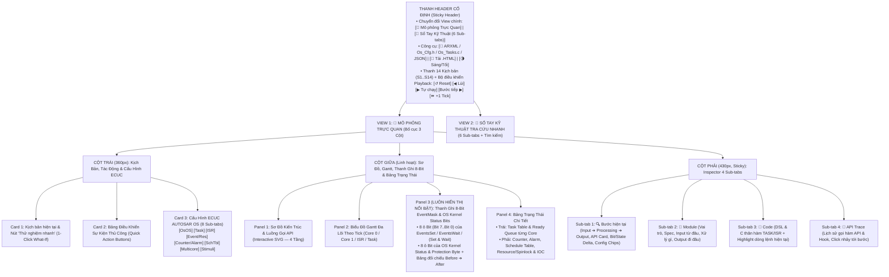

# Tài Liệu Thiết Kế Chi Tiết Trình Mô Phỏng AUTOSAR OS (`OS_Simulation_design.md`)

> **Trạng thái tài liệu:** Đã cập nhật theo phản hồi chốt thiết kế lần 2 của User (Bổ sung thanh 8-Bit luôn hiển thị nổi bật như `AUTOSAR_DEM.html`, mở rộng lên **14 Kịch bản mẫu `S1`–`S14`** bao gồm kịch bản chuyên sâu về **RTE Multi-Runnable Bitmask + ExclusiveArea** và **Deadlock cổ điển vs OSEK Priority Ceiling Protocol**).  
> **Mục đích:** Dùng để User review và phê duyệt trước khi bắt đầu giai đoạn viết code tạo file `AUTOSAR_OS.html`.

---

## 1. Tổng Quan & Định Hướng Thiết Kế Đã Chốt

| Hạng mục | Nội dung thiết kế đã xác nhận |
| :--- | :--- |
| **Tên file đích** | `d:\__Personal\AntiGravity\AUTOSAR_OS.html` (1 file HTML độc lập, chạy 100% offline, Pure CSS, có nút tải `.HTML` kèm cấu hình nhúng). |
| **Chuẩn tham chiếu** | **AUTOSAR Classic Platform R4.x (`SWS_OS`)** dựa trên **OSEK/VDX OS 2.2.3**, gắn mã requirement **`SWS_Os_xxxxx`** tại các bước kiểm tra logic, bảng lỗi và sổ tay. |
| **Phong cách giao diện** | Kết hợp tinh hoa của 2 file mẫu người dùng ưng ý nhất:<br>1. **Từ `AUTOSAR_DEM.html`**:<br>   • **Thanh ghi 8-Bit tương tác luôn hiển thị nổi bật ở cột giữa** (ngay dưới Sơ đồ/Gantt) để thấy rõ các bit đổi trạng thái (`0 ➔ 1`, `1 ➔ 0`), mã Hex (`0x00..0xFF`), nhị phân (`0000 0000b`) ở từng bước.<br>   • **Bảng Điều Khiển Sự Kiện Thủ Công (Quick Action Bar)** với các nút bấm trực quan.<br>   • **Chia nhiều Sub-tab** cho các chủ đề con và **Sổ tay kỹ thuật 6 Sub-tabs** có bảng phân tích **Input ➔ Processing ➔ Output** của từng module.<br>2. **Từ `AUTOSAR_PduR.html`**:<br>   • Bố cục 3 cột hiện đại, Sơ đồ kiến trúc SVG có animation đường truyền & gói tin.<br>   • Inspector bên phải phân tích rõ **Input ➔ Processing ➔ Output**, chữ ký hàm C chuẩn AUTOSAR, giá trị trả về `StatusType`, và **Chip cấu hình click-to-highlight**.<br>   • Xuất cấu hình sang **ARXML / `Os_Cfg.h` / `Os_Tasks.c` / JSON**. |

---

## 2. Bố Cục Giao Diện & Hệ Thống Sub-Tabs (UI Wireframe)

### 2.1. Sơ Đồ Phân Bổ Màn Hình



---

### 2.2. Thiết Kế Chi Tiết Panel 3 (Cột Giữa): "Thanh Ghi 8-Bit EventMask & OS Kernel Status Bits" (Luôn Hiển Thị Nổi Bật)

Theo xác nhận **A1** của User, bảng này được đặt **cố định và nổi bật ngay dưới Biểu đồ Gantt** (tương tự bảng *8-Bit DTC Status Byte* của `AUTOSAR_DEM.html`), giúp người dùng quan sát sự thay đổi của từng bit qua mỗi bước chạy:

```text
+------------------------------------------------------------------------------------------------------------------+
| 🔢 THANH GHI 8-BIT AUTOSAR OS (LIVE BITFIELD INSPECTOR)       [Chọn Task giám sát Event: ▼ Task_RteApp (EXT)]   |
| Bước #4 (t=2): CanIf ➔ Com ➔ Rte_COMCbk ➔ SetEvent(Task_RteApp, 0x02)  |  Before: 0x00 (0000) ➔ After: 0x02     |
+------------------------------------------------------------------------------------------------------------------+
| A. THANH GHI 8-BIT EVENT MASK CỦA EXTENDED TASK (`EventMaskType`: `EventsSet` vs `EventsWait`)                   |
|   Hex EventsSet: [ 0x02 (0000 0010b) ]   Hex EventsWait: [ 0x07 (0000 0111b) ]   Wakeup (Set & Wait): [ 0x02 ✅ ]|
|  +------------+ +------------+ +------------+ +------------+ +------------+ +------------+ +------------+ +-----+|
|  | Bit 7 (80) | | Bit 6 (40) | | Bit 5 (20) | | Bit 4 (10) | | Bit 3 (08) | | Bit 2 (04) | | Bit 1 (02) | |Bit 0||
|  | ev_Shutdwn | | ev_ErrHook | | ev_WdgTick | | ev_NvmDone | | ev_ModeChg | | ev_DiagReq | | ev_CanRx   | |ev_10||
|  | Set : 0    | | Set : 0    | | Set : 0    | | Set : 0    | | Set : 0    | | Set : 0    | | Set : 1 🔥 | |Set:0||
|  | Wait: 0    | | Wait: 0    | | Wait: 0    | | Wait: 0    | | Wait: 0    | | Wait: 1    | | Wait: 1 🎯 | |Wai:1||
|  | [Set][Clr] | | [Set][Clr] | | [Set][Clr] | | [Set][Clr] | | [Set][Clr] | | [Set][Clr] | | MATCH!  Wake| |[S/C]||
|  +------------+ +------------+ +------------+ +------------+ +------------+ +------------+ +------------+ +-----+|
+------------------------------------------------------------------------------------------------------------------+
| B. THANH GHI 8-BIT TRẠNG THÁI LÕI OS (`OS Kernel Context & Protection Status Byte`: Hex `0x11`)                  |
|  +------------+ +------------+ +------------+ +------------+ +------------+ +------------+ +------------+ +-----+|
|  | Bit 7      | | Bit 6      | | Bit 5      | | Bit 4      | | Bit 3      | | Bit 2      | | Bit 1      | |Bit 0||
|  | FAULT_LAT  | | HOOK_ACTV  | | SCHED_LOCK | | PCP_ACTIVE | | INT_LOCKED | | IN_ISR_CAT1| | IN_ISR_CAT2| |OS_ON||
|  |     0      | |     0      | |     0      | |    1 (⬆️)   | |     0      | |     0      | |     0      | |  1  ||
|  | Không lỗi  | | Ngoài Hook | | Preempt OK | | RunPrio>Base| | IRQ mở    | | Normal     | | Task Level | |Chạy ||
|  +------------+ +------------+ +------------+ +------------+ +------------+ +------------+ +------------+ +-----+|
+------------------------------------------------------------------------------------------------------------------+
```

* **Tính năng tương tác trên Thanh ghi 8-Bit:**
  1. **Click trực tiếp vào nút `[Set]` hoặc `[Clr]` trên từng ô `Bit 7 .. Bit 0`** của `EventMaskType` để chèn lệnh `SetEvent(Task, 1<<bit)` hoặc `ClearEvent(1<<bit)` vào luồng chạy và thấy ngay hiệu ứng đánh thức Task (`WAITING ➔ READY`) hoặc gọi Runnable tương ứng!
  2. **Hiệu ứng đổi bit (`0 ➔ 1` hoặc `1 ➔ 0`)**: Ô bit nào vừa thay đổi tại bước hiện tại sẽ phát sáng viền vàng/xanh kèm mũi tên `0 ➔ 1` để người dùng nhận diện tức thì.
  3. **Hiển thị rõ điều kiện đánh thức Extended Task (`SWS_Os_00261`)**: `WakeupTrigger = (EventsSet & EventsWait) != 0x00`. Khi khác `0`, ô bit trùng khớp hiện nhãn `MATCH! (WAITING ➔ READY)`.

---

## 3. Phân Tích Xử Lý Từng Module: Input Lấy Từ Đâu, Xử Lý Gì, Output Route Đến Đâu

Mọi module xuất hiện trên sơ đồ kiến trúc SVG đều có thể **click vào để xem giải thích chi tiết** ở cột phải (Tab `🧩 Module`) và được tổng hợp đầy đủ trong **Tab 1 của Sổ tay**:

| # | Module / Phân khối | Lớp AUTOSAR | 📥 Input lấy từ đâu? | ⚙️ Cách xử lý nội bộ (Processing & State) | 📤 Output route đến đâu & Hàm API chuẩn |
| :-: | :--- | :--- | :--- | :--- | :--- |
| **1** | **`EcuM`**<br>*(ECU State Manager)* | System Services | • Reset vector từ MCU (`main()`) sau khi cấp nguồn.<br>• Yêu cầu chuyển trạng thái tắt/ngủ từ `BswM` hoặc `SWC`. | • Thực thi chuỗi khởi tạo `EcuM_StartupOne()`: gọi `Mcu_Init()`, `Gpt_Init()`, `Can_Init()`, kiểm tra nguồn đánh thức (`WakeupSource`).<br>• Chọn `AppModeType` (`OSDEFAULTAPPMODE = 0x01`, `APPMODE_DIAG = 0x02`).<br>• Gọi `StartOS(AppMode)` để bàn giao điều khiển CPU cho AUTOSAR OS.<br>• Trong `Task_Init`: chạy `EcuM_StartupTwo()` để khởi tạo `SchM`, `BswM`, `RTE`.<br>• Khi tắt máy: gọi `EcuM_GoDown()` ➔ `ShutdownOS(E_OK)`. | • Gọi xuống **AUTOSAR OS**:<br>`StartOS(AppModeType Mode)` [`SWS_Os_00424`]<br>`ShutdownOS(StatusType Error)` [`SWS_Os_00054`]<br>`GetActiveApplicationMode()` [`SWS_Os_00246`] |
| **2** | **`BswM`**<br>*(BSW Mode Manager)* | System Services | • Thông báo trạng thái từ `EcuM`, `ComM`, `CanSM`, `Dcm`, hoặc `SWC Mode Request Port` qua RTE. | • Chạy bộ phân xử chế độ (`Mode Arbitration Rules`) dựa trên biểu thức logic.<br>• Thực thi `Action Lists`: bật/tắt nhóm PDU trong `PduR`, bắt đầu hoặc chuyển đổi `ScheduleTable` của OS (`ST_Startup ➔ ST_Run`), hoặc kích hoạt `ShutdownOS`. | • Gọi xuống **AUTOSAR OS**:<br>`StartScheduleTableRel()` [`SWS_Os_00347`]<br>`NextScheduleTable()` [`SWS_Os_00191`]<br>`StopScheduleTable()` [`SWS_Os_00006`]<br>`ShutdownOS()` |
| **3** | **`RTE`**<br>*(Runtime Environment)* | RTE Layer | • Được OS gọi khi Task bắt đầu chạy (`TASK(Task_xxx)`) hoặc khi Task thức dậy sau `WaitEvent()`.<br>• Nhận sự kiện từ `SWC` (`Rte_Write`, `Rte_Call`, `Rte_IrTrigger`) và từ `Com` (`Rte_COMCbk_*`). | • **Event-to-Task Mapping**: Ánh xạ nhiều **RTE Events** (`TimingEvent`, `DataReceivedEvent`, `OperationInvokedEvent`, `ModeSwitchEvent`) vào 1 hoặc nhiều **OS Tasks**.<br>• Nếu nhiều Runnable cùng map vào 1 **Extended Task**, RTE phân bổ mỗi Runnable 1 bit riêng trên `EventMaskType` (`Bit 0 = 0x01`, `Bit 1 = 0x02`, `Bit 2 = 0x04`), dùng vòng lặp `WaitEvent ➔ GetEvent ➔ ClearEvent` để điều phối.<br>• Quản lý **ExclusiveArea** (`Rte_Enter_*` / `Rte_Exit_*`) bằng cách gọi `GetResource`/`ReleaseResource` hoặc `SuspendAllInterrupts`/`ResumeAllInterrupts`. | • Gọi xuống **AUTOSAR OS**:<br>`ActivateTask()`, `TerminateTask()`, `SetEvent()`, `WaitEvent()`, `GetEvent()`, `ClearEvent()`, `GetResource()`, `ReleaseResource()`, `SuspendAllInterrupts()`, `IocSend()`, `IocReceive()`<br>• Gọi lên **SWC Runnables**:<br>`Runnable_10ms_Ctrl()`, `Runnable_OnCanRx()` |
| **4** | **`SWC_Ctrl` & `SWC_ComDiag`**<br>*(Application SWCs)* | Application Layer | • Được `RTE` kích hoạt thông qua các hàm **Runnable Entity**.<br>• Đọc dữ liệu cổng Sender-Receiver (`Rte_Read_*` / `Rte_IRead_*`). | • Thực thi logic nghiệp vụ (điều khiển động cơ/phanh, lọc tín hiệu, kiểm tra chẩn đoán).<br>• Khi cập nhật cấu trúc dữ liệu dùng chung giữa nhiều Runnable khác độ ưu tiên, gọi `Rte_Enter_<ExclusiveArea>()` trước khi ghi và `Rte_Exit_<ExclusiveArea>()` sau khi ghi. | • Gọi qua **RTE**:<br>`Rte_Write_PPort_Sig()`, `Rte_Enter_EA_SharedBuf()`, `Rte_Exit_EA_SharedBuf()`, `Rte_Call_Dem_SetEventStatus()` |
| **5** | **`SchM`**<br>*(BSW Scheduler)* | System Services (RTE/BSW) | • Được kích hoạt định kỳ bên trong `Task_Bsw` (do `OsAlarm` hoặc `OsScheduleTable` đánh thức mỗi 5ms/10ms). | • Gọi tuần tự các hàm `*_MainFunction()` của các module BSW theo đúng thứ tự phụ thuộc.<br>• Bảo vệ vùng dữ liệu găng nội bộ của BSW (`SchM_Enter_<Mod>_<ExclusiveArea>()`) bằng cách gọi dịch vụ khóa ngắt hoặc Resource của OS. | • Gọi sang **BSW Modules**:<br>`Com_MainFunctionRx()`, `Com_MainFunctionTx()`, `CanIf_MainFunction()`, `Dem_MainFunction()`<br>• Gọi xuống **AUTOSAR OS**:<br>`GetResource()`, `SuspendOSInterrupts()` |
| **6** | **`Com` / `CanIf` / `Dem`**<br>*(BSW Services)* | Communication & Diagnostic Services | • `CanIf` nhận frame từ `Can Driver` (trong ngữ cảnh `ISR Cat 2`).<br>• `Com` & `Dem` được gọi định kỳ từ `SchM` hoặc nhận tín hiệu từ `CanIf`/`RTE`. | • `CanIf_RxIndication()` chuyển I-PDU lên `PduR_CanIfRxIndication()` ➔ `Com_RxIndication()`.<br>• `Com` giải nén tín hiệu, nếu tín hiệu cấu hình `NOTIFICATION = IMMEDIATE` thì gọi ngay `Rte_COMCbk_<Signal>()` để RTE bắn `SetEvent(Task_RteApp, 0x02)` hoặc `ActivateTask()`. | • Gọi lên **RTE**:<br>`Rte_COMCbk_Sig_EngineSpeed()`<br>• Từ đó RTE gọi xuống **OS**:<br>`SetEvent()` / `ActivateTask()` |
| **7** | **`Gpt / HW System Timer`**<br>*(MCAL Timer)* | MCAL / Microcontroller | • Xung nhịp phần cứng từ bộ chia tần số thạch anh của MCU (ví dụ mỗi `1ms`). | • Phát sinh ngắt System Tick định kỳ cho nhân OS.<br>• Tăng giá trị bộ đếm phần cứng/phần mềm `OsCounter` (`SysCounter`), xử lý quay vòng tại `OsCounterMaxAllowedValue`. | • Gọi vào **OS Counter**:<br>`Os_IncrementCounter(SysCounter)` / `IncrementCounter(CounterID)` [`SWS_Os_00399`] |
| **8** | **`Can Driver / HW IRQ`**<br>*(MCAL & INTC)* | MCAL / Microcontroller | • Sườn xung vật lý trên bus CAN khi nhận xong 1 frame, hoặc sự kiện phần cứng khẩn cấp (ADC/Crankshaft). | • Bộ điều khiển ngắt phần cứng (INTC) so sánh `OsIsrPriority` với mức ưu tiên hiện tại của CPU và cờ `INT_LOCKED`.<br>• Phân nhánh theo `OsIsrCategory`:<br>  - **`CATEGORY_1`**: nhảy trực tiếp vào ISR vector, không qua OS, độ trễ nhỏ nhất.<br>  - **`CATEGORY_2`**: vào OS wrapper, lưu ngữ cảnh Task bị ngắt, chuyển `CallLevel = ISR2`, khi thoát ISR sẽ gọi lại Scheduler. | • Kích hoạt **OS ISR**:<br>`ISR(CanRx_Isr2)` (Cat 2)<br>`ISR_CAT1(FastAdc_Isr1)` (Cat 1) |
| **9** | **`Det`**<br>*(Default Error Tracer)* | System Services | • Nhận mã lỗi từ OS Kernel hoặc BSW khi một API thất bại (`Status != E_OK`). | • Lưu vết `ModuleId (Os = 0x0001)`, `InstanceId`, `ApiId (OSServiceId_*)`, `ErrorId (E_OS_*)` để hiển thị trên bảng Trace và hỗ trợ debug. | • Ghi nhận hàm:<br>`Det_ReportError()` / `Det_ReportRuntimeError()` |
| **10** | **`AUTOSAR OS Kernel`**<br>*(8 Khối Nội Bộ)* | OS Kernel | • Mọi lời gọi API từ `EcuM`, `BswM`, `RTE`, `SchM`, `ISR` và xung nhịp từ `Gpt`. | • **1. Task & Ready Queue (`Os_Task`)**: quản lý TCB, 4 trạng thái, hàng đợi ưu tiên FIFO.<br>• **2. Scheduler (`Os_Sched`)**: so sánh `RunPrio` để quyết định Preemption / Context Switch.<br>• **3. Event Manager (`Os_Evt`)**: cập nhật 8-bit `EventsSet` & `EventsWait`.<br>• **4. Resource Manager (`Os_Res`)**: thực thi **OSEK PCP** nâng trần `RunPrio` hoặc kiểm tra Deadlock.<br>• **5. Counter & Alarm (`Os_Alm`)**: kiểm tra `AlarmTime` & `CycleTime`.<br>• **6. Schedule Table (`Os_St`)**: thực thi danh sách `ExpiryPoint`, `NextScheduleTable`, `Sync`.<br>• **7. Hook & Protection (`Os_Prot`)**: gọi 6 loại Hook, kiểm tra `ExecutionBudget`, `TimeFrame`, `StackMonitoring`.<br>• **8. Multicore (`Os_Mc`)**: điều phối `Core 0` & `Core 1`, `Spinlock` và kênh `IOC`. | • Điều phối CPU (`Context Switch`) giữa các Task & ISR.<br>• Gọi các hàm **Hook Routines**.<br>• Trả về `StatusType` (`E_OK` hoặc `E_OS_*`). |

---

## 4. Danh Mục Đầy Đủ Các Trường Cấu Hình (Checkboxes, Textboxes, Spinners, Dropdowns)

Tất cả các trường dưới đây đều có thể chỉnh sửa trực tiếp ở cột trái (8 Sub-tabs) và có hiệu lực ngay lập tức:

### 4.1. Sub-tab `OsOS` (Cấu hình Tổng thể Kernel & Hooks)
1. **Dropdown `OsScalabilityClass`**: `SC1` | `SC2` | `SC3` | `SC4` (`SWS_Os_00349`).
2. **Dropdown `OsStatus`**: `EXTENDED` | `STANDARD` (Kiểm tra lỗi đầy đủ vs tối ưu tốc độ).
3. **Dropdown `AppMode` (tham số `StartOS`)**: `OSDEFAULTAPPMODE (0x01)` | `APPMODE_DIAG (0x02)` | `APPMODE_SLEEP (0x04)`.
4. **Number `HorizonTicks`**: Tổng số tick mô phỏng (`4 .. 40`).
5. **Checkbox ☑️ `OsUsePcp` (OSEK Priority Ceiling Protocol)**:
   - Khi **BẬT (`TRUE` - chuẩn AUTOSAR/OSEK)**: `GetResource()` nâng ngay `RunPrio` của Task lên `CeilingPriority` của Resource ➔ Chống Priority Inversion và chống Deadlock tuyệt đối (`SWS_Os_00180`).
   - Khi **TẮT (`FALSE` - chế độ đối chiếu Mutex thường)**: Không nâng trần ưu tiên ➔ Cho phép người dùng tận mắt thấy hiện tượng **Priority Inversion** ( ở kịch bản `S5`) và **Deadlock vòng tròn** (ở kịch bản `S14`)!
6. **Checkbox ☑️ `OsStackMonitoring`**: Bật kiểm tra tràn stack (`StackUsage > StackSize ➔ E_OS_STACKFAULT`, `SWS_Os_00067`).
7. **Checkbox ☑️ `OsUseGetServiceId`**: Cho phép gọi `OSErrorGetServiceId()` trong `ErrorHook`.
8. **Checkbox ☑️ `OsUseParameterAccess`**: Cho phép đọc tham số gây lỗi qua `OSError_<Api>_<Param>()` trong `ErrorHook`.
9. **Checkbox ☑️ `OsUseResScheduler`**: Cho phép Task chiếm `RES_SCHEDULER` để khóa bộ lập lịch.
10. **Nhóm 6 Checkboxes `OsHooks`**:
    - ☑️ `OsStartupHook` (`StartupHook()`)
    - ☑️ `OsShutdownHook` (`ShutdownHook(Error)`)
    - ☑️ `OsErrorHook` (`ErrorHook(Error)`)
    - ☑️ `OsPreTaskHook` (`PreTaskHook()`)
    - ☑️ `OsPostTaskHook` (`PostTaskHook()`)
    - ☑️ `OsProtectionHook` (`ProtectionHook(FatalError)`)
11. **Dropdown `ProtectionReturn` (hành vi trả về của `ProtectionHook`)**:
    - `PRO_TERMINATETASKISR` (Hủy Task/ISR vi phạm, thu hồi Resource đang giữ)
    - `PRO_TERMINATEAPPL` (Hủy toàn bộ OS-Application)
    - `PRO_SHUTDOWN` (Gọi `ShutdownOS()` ngay lập tức)
    - `PRO_IGNORE` (Bỏ qua lỗi).

### 4.2. Sub-tab `Task` (Cấu hình từng `OsTask`)
- **Textbox `Name`**: Tên Task (vd: `Task_Init`, `Task_RteApp`, `Task_Bsw`, `Task_Ctrl`).
- **Textbox `RunnableMapping`**: Danh sách Runnable được map vào Task.
- **Select `OsTaskType`**: `BASIC` | `EXTENDED`.
- **Select `OsTaskSchedule`**: `FULL` (Preemptive) | `NON` (Non-Preemptive).
- **Select `CoreId`**: `Core 0` | `Core 1`.
- **Number `OsTaskPriority`**: Độ ưu tiên cơ sở (`BasePrio`: `0 .. 31`).
- **Number `OsTaskActivation`**: Giới hạn số lần xếp hàng kích hoạt (`1 .. 8`, Extended Task cố định = `1`).
- **Number `OsTaskExecutionBudget`**: Ngân sách tick chạy tối đa cho 1 lần kích hoạt (`0` = không giới hạn, `>0` = bật Timing Protection `E_OS_PROTECTION_TIME`).
- **Number `OsTaskTimeFrame`**: Khoảng cách tick tối thiểu giữa 2 lần `ActivateTask` (`0` = tắt, `>0` = kiểm tra `E_OS_PROTECTION_ARRIVAL`).
- **Number `StackSize` & `StackPeak`**: Kích thước stack cấu hình (bytes) và đỉnh stack thực tế dùng để kiểm tra `OsStackMonitoring`.
- **Checkbox ☑️ `OsTaskAutostart`**: Tự động kích hoạt trong `StartOS()`.
- **Checkboxes ☑️ `AccessedResources`**: Chọn các `OsResource` mà Task này được phép truy cập (dùng để OS tự động tính `CeilingPriority` cho Resource).
- **Textarea `Program (DSL)`**: Chuỗi lệnh thực thi theo từng tick của Task.

### 4.3. Sub-tab `ISR` (Cấu hình từng `OsIsr`)
- **Textbox `Name`**, **Select `OsIsrCategory`** (`CATEGORY_1` | `CATEGORY_2`), **Number `OsIsrPriority`**, **Number `OsIsrExecutionBudget`**, **Select `CoreId`**, **Textarea `Program (DSL)`**.

### 4.4. Sub-tab `Event/Res` (`OsEvent`, `OsResource` & `RteExclusiveArea`)
- **Bảng `OsEvent` (8 sự kiện ứng với `Bit 0 .. Bit 7`)**: Textbox `Name`, Mask (`0x01`, `0x02`, `0x04`, `0x08`, `0x10`, `0x20`, `0x40`, `0x80`), mô tả Runnable/Trigger gắn với từng bit.
- **Bảng `OsResource`**: Textbox `Name`, Select `OsResourceProperty` (`STANDARD` | `INTERNAL`), hiển thị **`CeilingPriority` (tự động tính từ các Task truy cập)**, Number `LockBudget` (giới hạn số tick giữ Resource tối đa trước khi báo `E_OS_PROTECTION_LOCKED`).
- **Dropdown `RteExclusiveAreaImplMechanism`** (phục vụ kịch bản S13):
  - `OS_RESOURCE` (`Rte_Enter` gọi `GetResource`, `Rte_Exit` gọi `ReleaseResource`)
  - `OS_INTERRUPT_BLOCKING` (`Rte_Enter` gọi `SuspendAllInterrupts`, `Rte_Exit` gọi `ResumeAllInterrupts`)
  - `COOPERATIVE_RUNNABLE_PLACEMENT` (Không cần khóa vì các Runnable cùng chạy tuần tự trong 1 Task).

### 4.5. Sub-tab `Counter/Alarm` (`OsCounter` & `OsAlarm`)
- **Cấu hình `OsCounter`**: `Name`, `OsCounterMaxAllowedValue`, `OsCounterTicksPerBase`, `OsCounterMinCycle`.
- **Cấu hình `OsAlarm`**: `Name`, `Action` (`ACTIVATETASK` | `SETEVENT` | `ALARMCALLBACK` | `INCREMENTCOUNTER`), `TargetTask`, `TargetEventMask`, Checkbox ☑️ `OsAlarmAutostart`, `AutostartType` (`RELATIVE` | `ABSOLUTE`), `OsAlarmAlarmTime`, `OsAlarmCycleTime`.

### 4.6. Sub-tab `SchTbl` (`OsScheduleTable` & `ExpiryPoints`)
- `Name`, `OsScheduleTableDuration`, Checkbox ☑️ `OsScheduleTableRepeating`, Checkbox ☑️ `OsScheduleTableAutostart`, `OsScheduleTableSyncStrategy` (`NONE` | `IMPLICIT` | `EXPLICIT`), danh sách `ExpiryPoint` (`Offset`, `ActivateTasks[]`, `SetEvents[]`, `MaxShorten`, `MaxLengthen`).

### 4.7. Sub-tab `Multicore` (`OsCore`, `OsSpinlock`, `OsIoc`)
- `OsNumberOfCores` (`1` | `2`), cấu hình `OsSpinlock` (`Name`, `OsSpinlockLockMethod`, `SuccessorSpinlock`), cấu hình kênh `IOC` (`Name`, `Mode`: `QUEUED` / `LAST_IS_BEST`, `BufferSize`).

### 4.8. Sub-tab `Stimuli` (Sự kiện kích thích theo thời gian `t`)
- Cho phép bật/tắt bằng Checkbox ☑️ hoặc thêm/xóa các sự kiện ngoại vi tại tick `t` bất kỳ (`TriggerISR`, `ActivateTask`, `SetEvent`, `CancelAlarm`, `SyncScheduleTable`, `ShutdownOS`).

---

## 5. Thiết Kế Chi Tiết 14 Kịch Bản Mẫu (`S1` – `S14`)

Danh sách **14 kịch bản** (gồm 12 kịch bản ban đầu + 2 kịch bản chuyên sâu mới `S13`, `S14` theo yêu cầu của User):

| Mã | Nhóm chủ đề | Tên kịch bản | Luồng xử lý chính & Các Bit / Config / API được làm nổi bật | Nút "Thử nghiệm nhanh" (1-Click What-If) |
| :-: | :--- | :--- | :--- | :--- |
| **S1** | **Lifecycle & BSW** | **Khởi động & Tắt ECU (`EcuM` ↔ `OS` ↔ `BswM`)** | • `EcuM_Init()` ➔ `StartOS(OSDEFAULTAPPMODE)` [`SWS_Os_00424`] ➔ bật bit `Bit 0 (OS_STARTED = 1)`.<br>• Chạy `StartupHook()` (bật `Bit 6 HOOK_ACTV`) ➔ Autostart `Task_Init` (`SUSPENDED ➔ READY ➔ RUNNING`) ➔ `EcuM_StartupTwo()` khởi tạo `SchM` & `BswM`.<br>• `Task_Cyclic` chạy 1 chu kỳ, sau đó `BswM` yêu cầu tắt máy ➔ `ShutdownOS(E_OK)` [`SWS_Os_00054`] ➔ `ShutdownHook()`. | 1. Tắt `OsStartupHook` & `OsShutdownHook`<br>2. Bật `OsPreTaskHook` & `OsPostTaskHook`<br>3. Đổi `AppMode` sang `APPMODE_DIAG` |
| **S2** | **Task & Scheduling** | **Lập lịch `FULL` vs `NON` Preemptive, `ChainTask` & `Schedule`** | • `Task_Low` (Prio 2) đang chạy thì tại `t = 1`, `Task_High` (Prio 6) được `ActivateTask()`.<br>• Khi `Task_Low` là `FULL` preemptive: bị chiếm quyền ngay lập tức (`RUNNING ➔ READY`), `Task_High` lên `RUNNING`.<br>• Khi `Task_Low` là `NON` preemptive: bật bit `Bit 5 (SCHED_LOCK = 1)`, `Task_High` phải đợi ở `READY` cho đến khi `Task_Low` gọi `Schedule()` [`SWS_Os_00063`].<br>• Cuối luồng: `Task_Low` gọi `ChainTask(Task_Cleanup)` [`SWS_Os_00048`]. | 1. Đổi `Task_Low` từ `FULL` sang `NON` (thấy ngay `SCHED_LOCK = 1` chặn Preemption)<br>2. Xóa lệnh `Schedule()` khỏi `Task_Low`<br>3. Gọi `TerminateTask()` khi chưa nhả Resource ➔ lỗi `E_OS_RESOURCE` |
| **S3** | **Task & Scheduling** | **Multiple Activation Queue & Lỗi `E_OS_LIMIT`** | • Basic Task `Task_BurstCan` có `OsTaskActivation = 2` (cho phép xếp hàng tối đa 2 lần kích hoạt).<br>• Tại `t = 1`, khi `Task_BurstCan` đang bận/chờ, có 3 yêu cầu `ActivateTask(Task_BurstCan)` liên tiếp từ `CanIf`:<br>  - Lần 1 & 2: `actCount` tăng `1 ➔ 2` (`E_OK`).<br>  - Lần 3: vượt `OsTaskActivation` ➔ trả về `E_OS_LIMIT` [`SWS_Os_00041`], bật `Bit 7 (FAULT_LAT = 1)`, gọi `ErrorHook(E_OS_LIMIT)` và `Det_ReportError()`. | 1. Tăng `OsTaskActivation` từ `2` lên `3` (cả 3 lần đều `E_OK`)<br>2. Giảm `OsTaskActivation` xuống `1`<br>3. Thử kích hoạt lần 2 cho `EXTENDED` Task ➔ lỗi `E_OS_LIMIT` ngay ở lần 2 |
| **S4** | **Event & RTE** | **Cơ chế Event 8-Bit (`SetEvent` / `WaitEvent` / `ClearEvent`)** | • Extended Task `Task_DiagExt` khởi động và gọi `WaitEvent(0x05)` (`Bit 0: ev_RxReq | Bit 2: ev_Timeout`) ➔ `EventsWait = 0x05 (0000 0101b)`, vì `EventsSet == 0x00` nên chuyển sang `WAITING` [`SWS_Os_00262`].<br>• CPU nhường cho `Task_Bg` chạy nền.<br>• Tại `t = 2`, ngắt CAN nhận bản tin UDS ➔ `SetEvent(Task_DiagExt, 0x01)` ➔ `EventsSet` bật `Bit 0` lên `1` (`0x01`).<br>• Phép toán `(EventsSet & EventsWait) = (0x01 & 0x05) = 0x01 != 0` ➔ `Task_DiagExt` lập tức chuyển `WAITING ➔ READY ➔ RUNNING`, gọi `GetEvent()` và `ClearEvent(0x01)`. | 1. ISR bắn `SetEvent(0x02)` (Bit 1 không nằm trong `EventsWait = 0x05`) ➔ Task vẫn ngủ ở `WAITING`!<br>2. Bắn `SetEvent(0x01)` trước khi Task gọi `WaitEvent(0x05)` ➔ Task không bị block sang `WAITING`<br>3. Đổi `Task_DiagExt` sang `BASIC` ➔ gọi `WaitEvent` báo lỗi `E_OS_ACCESS` |
| **S5** | **Resource (PCP)** | **OSEK Priority Ceiling Protocol (PCP) Chống Đảo Ngược Ưu Tiên** | • 3 Task: `Task_Low` (Prio 1), `Task_Med` (Prio 3), `Task_High` (Prio 5). Cả `Task_Low` và `Task_High` cùng khai báo truy cập `RES_SPI` ➔ OS tính trần **`CeilingPriority(RES_SPI) = 5`**.<br>• `Task_Low` chạy và gọi `GetResource(RES_SPI)` ➔ bật `Bit 4 (PCP_ACTIVE = 1)`, nâng `RunPrio` từ `1 ➔ 5`.<br>• Tại `t = 1`, `Task_Med` (Prio 3) được kích hoạt nhưng vì `RunPrio(Task_Low) = 5 > 3` nên `Task_Med` **không thể chen ngang**!<br>• Ngay khi `Task_Low` gọi `ReleaseResource(RES_SPI)`, `RunPrio` hạ về `1`, `Task_High`/`Task_Med` mới được chạy theo đúng thứ tự ưu tiên. | 1. **Tắt Checkbox `OsUsePcp`** ➔ Xem ngay hiện tượng **Priority Inversion**: `Task_Med` (Prio 3) chen ngang giam giữ `Task_Low`, làm `Task_High` (Prio 5) bị kẹt theo!<br>2. Dùng `RES_SCHEDULER` để khóa toàn bộ lập lịch Task |
| **S6** | **Counter & Alarm** | **Counter, Alarm Chu Kỳ & Điều Phối `SchM` BSW MainFunctions** | • `Gpt` phần cứng kích `IncrementCounter(SysCounter)` mỗi tick (`SWS_Os_00399`).<br>• `Alm_Bsw5ms` (`CycleTime = 2`, Action = `ACTIVATETASK Task_Bsw`) định kỳ kích hoạt `SchM` chạy `Com_MainFunctionRx()`, `Com_MainFunctionTx()`, `Dem_MainFunction()`.<br>• `Alm_Ctrl10ms` (`CycleTime = 4`, Action = `SETEVENT Bit 0`) định kỳ bật `Bit 0 (0x01)` đánh thức `Task_Ctrl`. | 1. Đổi `Alm_Bsw5ms` từ Cyclic (`CycleTime = 2`) sang One-Shot (`CycleTime = 0`)<br>2. Chèn lệnh `CancelAlarm(Alm_Bsw5ms)` tại `t = 3`<br>3. Đổi Action của Alarm sang `ALARMCALLBACK` |
| **S7** | **Schedule Table** | **Schedule Table, Expiry Point, `NextScheduleTable` & Đồng Bộ `Sync`** | • `ST_Init` chạy 2 Expiry Points: tại `offset = 1` kích hoạt `Task_Sensor`, tại `offset = 3` **đồng thời** vừa `ActivateTask(Task_Bsw)` vừa `SetEvent(Task_Ctrl, 0x01)` (`SWS_Os_00412`).<br>• Gọi `NextScheduleTable(ST_Init, ST_Main)` [`SWS_Os_00191`] để khi `ST_Init` kết thúc ở tick 4 sẽ tự động chuyển sang bảng lặp `ST_Main` mà không trễ nhịp.<br>• Minh họa `SyncScheduleTable(ST_Main, GlobalTime)` với chiến lược `EXPLICIT`. | 1. Tắt `OsScheduleTableRepeating` của `ST_Main`<br>2. Chèn `SyncScheduleTable` lệch pha `+1 tick` để xem OS tự động co/giãn khoảng cách tới Expiry Point tiếp theo |
| **S8** | **Interrupts** | **`ISR Category 1` vs `Category 2` & Các Hàm Khóa Ngắt** | • `Task_App` đang chạy thì ngắt `CanRx_Isr2` (**Category 2**, Prio 10) xảy ra ➔ OS bật `Bit 1 (IN_ISR_CAT2 = 1)`, cho phép gọi `SetEvent(Task_Com, 0x02)`.<br>• Ngay khi `CanRx_Isr2` đang chạy, ngắt phần cứng khẩn cấp `Overcurrent_Isr1` (**Category 1**, Prio 20) xảy ra ➔ chiếm quyền cả `ISR Cat 2`, bật `Bit 2 (IN_ISR_CAT1 = 1)`, xử lý thanh ghi PWM trực tiếp rồi thoát nhanh.<br>• Minh họa cặp `SuspendAllInterrupts()` / `ResumeAllInterrupts()` bật `Bit 3 (INT_LOCKED = 1)`. | 1. Cho `Overcurrent_Isr1` (**Cat 1**) thử gọi `ActivateTask()` ➔ bị OS chặn báo lỗi `E_OS_CALLEVEL` [`SWS_Os_00088`]!<br>2. Quên gọi `ResumeAllInterrupts()` trước khi kết thúc Task ➔ báo lỗi `E_OS_DISABLEDINT` [`SWS_Os_00093`] |
| **S9** | **Hooks & Errors** | **Chuỗi Hook (`Pre/PostTask`, `ErrorHook`) & `STANDARD` vs `EXTENDED`** | • Bật đầy đủ `PreTaskHook`, `PostTaskHook`, `ErrorHook`, `OsUseGetServiceId`, `OsUseParameterAccess`.<br>• Quan sát chính xác thời điểm OS bật `Bit 6 (HOOK_ACTV = 1)` khi gọi `PostTaskHook` của Task cũ và `PreTaskHook` của Task mới trong mỗi pha Context Switch.<br>• Cố tình gọi `ActivateTask(INVALID_TASK_ID)` và `GetResource` sai quy tắc để xem `ErrorHook` đọc `OSErrorGetServiceId()` và báo `Det_ReportError()`. | 1. Đổi `OsStatus` từ `EXTENDED` sang `STANDARD` (bỏ qua kiểm tra `E_OS_ID` / `E_OS_RESOURCE`)<br>2. Tắt `PreTaskHook` & `PostTaskHook` |
| **S10** | **Protection (SC2–4)** | **Timing Protection (`ExecutionBudget` / `TimeFrame`) & `ProtectionHook`** | • Cấu hình `OsScalabilityClass = SC2`, `Task_Calc` có `OsTaskExecutionBudget = 2 ticks`, nhưng do lỗi vòng lặp nên chạy sang tick thứ 3.<br>• Bộ giám sát thời gian của OS phát hiện `execTime > Budget` ➔ bật `Bit 7 (FAULT_LAT = 1)`, gọi `ProtectionHook(E_OS_PROTECTION_TIME)` [`SWS_Os_00064`].<br>• Dựa vào cấu hình `ProtectionReturn = PRO_TERMINATETASKISR`, OS cưỡng bức hủy `Task_Calc`, tự động mở khóa Resource đang giữ để cứu hệ thống. | 1. Đổi `ProtectionReturn` sang `PRO_SHUTDOWN` ➔ OS gọi `ShutdownOS()` ngay khi vượt budget<br>2. Tăng `OsTaskExecutionBudget` lên `4`<br>3. Cho `StackPeak > StackSize` với `OsStackMonitoring = TRUE` ➔ kích hoạt `E_OS_STACKFAULT` |
| **S11** | **Multicore** | **Đa Lõi (`Core 0` + `Core 1`), `StartCore`, `Spinlock` & `IOC`** | • `Core 0` (Master) gọi `StartCore(OS_CORE_ID_1, &status)` [`SWS_Os_00676`] trước khi cả 2 lõi cùng gọi `StartOS()`.<br>• Biểu đồ Gantt hiển thị **2 dải băng song song (`CORE 0` và `CORE 1`)**.<br>• `Task_Core0` và `Task_Core1` cùng truy cập vùng RAM chung qua `GetSpinlock(SPIN_SHARED)` / `ReleaseSpinlock(SPIN_SHARED)` (hiển thị ô sọc đỏ `Spinning` trên Gantt khi lõi kia đang giữ khóa).<br>• Truyền dữ liệu xuyên lõi không cần khóa bằng `IocSend_Ioc_Sensor()` ➔ `IocReceive_Ioc_Sensor()`. | 1. Tăng thời gian giữ `Spinlock` trên `Core 1` ➔ thấy rõ `Core 0` bị `Busy-Wait` kéo dài<br>2. Chiếm 2 Spinlock ngược thứ tự cấu hình `Successor` ➔ báo lỗi `E_OS_NESTING_DEADLOCK` [`SWS_Os_00690`] |
| **S12** | **End-to-End** | **Luồng Tổng Hợp Toàn Hệ Thống (CAN Rx ➔ Com ➔ RTE ➔ SWC ➔ OS)** | • Kịch bản thực tế kết nối tất cả các lớp: Ngắt `CanRx_Isr2` ➔ `CanIf_RxIndication` ➔ `Com_RxIndication` ➔ `Rte_COMCbk` bắn `SetEvent(Task_ComRx, 0x02)` ➔ giải mã tín hiệu gửi sang `Task_Ctrl` (kích hoạt bởi `ScheduleTable`) ➔ `SchM` chạy `Com_MainFunctionTx` & `Dem_MainFunction`. | 1. Bắn thêm ngắt CAN Rx ở `t = 4`<br>2. Tắt `ScheduleTable` định kỳ |
| **S13** | **RTE Deep-Dive *(Mới)*** | **Nhiều RTE Runnables Dùng Chung 1 Extended Task (Bitmask `0x01 / 0x02 / 0x04`) & `Rte_Enter/Exit` ExclusiveArea** | • **Thiết kế thực tế phổ biến nhất khi cấu hình RTE + OS**: 3 Runnable của `SWC_Engine` (`Runnable_10ms_Periodic`, `Runnable_OnSpeedRx`, `Runnable_DiagReadDid`) được gom vào chung 1 Extended Task `Task_RteApp` để tiết kiệm RAM stack.<br>• RTE gán mỗi Runnable 1 bit trên thanh ghi 8-bit `EventMaskType`:<br>  - `Bit 0 (0x01)`: `RTE_EV_TIMING_10MS` (do `Alm_10ms` bắn)<br>  - `Bit 1 (0x02)`: `RTE_EV_DATA_SPEED_RX` (do `Com` callback bắn)<br>  - `Bit 2 (0x04)`: `RTE_EV_OP_DIAG_READ` (do `Dcm` gọi)<br>• Khi cả `Bit 0` và `Bit 1` cùng bật (`EventsSet = 0x03`), `Task_RteApp` thức dậy sau `WaitEvent(0x07)`, gọi `GetEvent()`, rồi lần lượt kiểm tra từng bit: xóa `ClearEvent(0x01)` ➔ chạy `Runnable_10ms_Periodic()`, xóa `ClearEvent(0x02)` ➔ chạy `Runnable_OnSpeedRx()`.<br>• Bên trong Runnable: minh họa `Rte_Enter_EA_EngData()` / `Rte_Exit_EA_EngData()` ánh xạ xuống `GetResource(RES_RTE_EA)` hoặc `SuspendAllInterrupts()` tùy cấu hình `RteExclusiveAreaImplMechanism`. | 1. Đổi `RteExclusiveAreaImplMechanism` từ `OS_RESOURCE` sang `OS_INTERRUPT_BLOCKING` (`SuspendAllInterrupts`)<br>2. Đổi sang `COOPERATIVE_RUNNABLE_PLACEMENT` (không tốn lệnh lock vì các Runnable chạy tuần tự trong cùng 1 Task)<br>3. Bắn đồng thời cả 3 bit `0x01 | 0x02 | 0x04 = 0x07` trong cùng 1 tick |
| **S14** | **Deadlock vs PCP *(Mới)*** | **So Sánh Lỗi Deadlock Cổ Điển (Khi Tắt PCP) vs Phòng Chống Deadlock Tuyệt Đối Khi Bật OSEK PCP** | • Hai Task (`Task_Low` Prio 2 và `Task_High` Prio 5) cùng cần khóa lồng nhau 2 tài nguyên `RES_A` và `RES_B` theo thứ tự ngược nhau:<br>  - `Task_Low`: `GetResource(RES_A)` ➔ `GetResource(RES_B)`<br>  - `Task_High`: `GetResource(RES_B)` ➔ `GetResource(RES_A)`<br>• **Chế độ 1 (Mặc định của kịch bản S14: `OsUsePcp = FALSE` — Khóa Mutex cổ điển không có trần ưu tiên)**:<br>  1. `Task_Low` lấy `RES_A`.<br>  2. Trước khi `Task_Low` kịp lấy `RES_B`, `Task_High` (Prio 5) được kích hoạt và chiếm quyền CPU.<br>  3. `Task_High` lấy `RES_B`, rồi gọi `GetResource(RES_A)` (đang bị `Task_Low` giữ) ➔ **Xảy ra DEADLOCK vòng tròn (`E_OS_NESTING_DEADLOCK` / `Task_High` chờ `Task_Low`, `Task_Low` chờ `Task_High`)**!<br>• **Chế độ 2 (Khi bấm nút bật `OsUsePcp = TRUE` — Chuẩn AUTOSAR/OSEK PCP)**:<br>  1. Vì cả `Task_Low` và `Task_High` đều dùng `RES_A` và `RES_B`, cả hai Resource đều có `CeilingPriority = 5`.<br>  2. Ngay khi `Task_Low` gọi `GetResource(RES_A)`, `RunPrio` của `Task_Low` được nâng từ `2 ➔ 5` (`Bit 4 PCP_ACTIVE = 1`).<br>  3. Khi `Task_High` (Prio 5) được kích hoạt ở `t = 1`, do `RunPrio(Task_Low) == 5`, `Task_High` **không thể chiếm quyền** mà phải đợi ở `READY`!<br>  4. `Task_Low` lấy tiếp `RES_B`, hoàn thành công việc, nhả cả `RES_B` và `RES_A`, hạ `RunPrio` về `2` ➔ Lúc này `Task_High` mới bắt đầu chạy và lấy `RES_B`, `RES_A` hoàn toàn trơn tru, **triệt tiêu 100% Deadlock**! | 1. **Bật Checkbox `OsUsePcp = TRUE` (Chuẩn OSEK PCP)** ➔ Thấy ngay Deadlock biến mất hoàn toàn nhờ trần ưu tiên `CeilingPrio = 5`!<br>2. **Tắt Checkbox `OsUsePcp = FALSE`** ➔ Tái hiện lại lỗi **Deadlock vòng tròn** giữa `RES_A` và `RES_B`<br>3. Đổi thứ tự lấy khóa của `Task_High` thành `RES_A` trước, `RES_B` sau |

---

## 6. Thiết Kế Bảng Điều Khiển Sự Kiện Thủ Công (Quick Action Bar)

Đặt ở Cột Trái (Card 2), cho phép người dùng tác động trực tiếp vào hệ thống tại tick hiện tại hoặc tick kế tiếp (giống bảng điều khiển của `AUTOSAR_DEM.html`):

| Nút điều khiển | Tham số đi kèm | Hành động mô phỏng |
| :--- | :--- | :--- |
| **`⚡ ActivateTask`** | Chọn `Task` đích | Chèn lệnh `ActivateTask(TaskID)` vào tick kế tiếp (`t + 1`) để kiểm tra Preemption hoặc lỗi `E_OS_LIMIT`. |
| **`🔔 SetEvent (Bit 0..7)`** | Chọn `Extended Task` + Chọn `Bit 0..7` | Chèn lệnh `SetEvent(TaskID, 1 << bit)` để bật bit tương ứng trên thanh ghi 8-bit `EventsSet` và đánh thức Task. |
| **`🔒 Get / 🔓 Release Resource`** | Chọn `Resource` (`RES_SPI`, `RES_CAN`...) | Chèn lệnh chiếm/nhả Resource cho Task đang chạy để kiểm tra nâng trần PCP (`Bit 4 PCP_ACTIVE`). |
| **`🚨 Bắn Ngắt ISR Cat 2`** | Chọn `ISR Cat 2` (`CanRx_Isr2`) | Phát sinh ngắt phần cứng Category 2 ngay tại tick kế tiếp. |
| **`⚡ Bắn Ngắt ISR Cat 1`** | Chọn `ISR Cat 1` (`FastAdc_Isr1`) | Phát sinh ngắt phần cứng Category 1 (ưu tiên tối cao, vượt qua cả `ISR Cat 2`). |
| **`⏱ +1 Counter Tick`** | Chọn `Counter` (`SysCounter`) | Gọi `IncrementCounter()` thủ công. |
| **`💥 Ép Quá Hạn Budget`** | Chọn `Task` đang chạy | Cộng thêm lệnh `Compute(3)` vào Task để vượt `OsTaskExecutionBudget`, kích hoạt `ProtectionHook(E_OS_PROTECTION_TIME)`. |
| **`🧹 Xóa Sự Kiện Thủ Công`** | — | Xóa các sự kiện thủ công người dùng vừa chèn để quay về kịch bản gốc. |

---

## 7. Cấu Trúc 6 Sub-Tabs Trong "Sổ Tay Kỹ Thuật AUTOSAR OS" (`📖 Sổ tay tra cứu`)

Khi chuyển sang View **`📖 Sổ tay tra cứu`**, người dùng có thanh tìm kiếm tức thời và 6 Sub-tabs chuyên sâu:

1. **Sub-tab 1: `1. I/O & Xử Lý Của Từng Module`**
   - Bảng phân tích chi tiết 10 module (`EcuM`, `BswM`, `RTE`, `SWC`, `SchM`, `Com/CanIf/Dem`, `Gpt`, `Can/IRQ`, `Det`, `OS Kernel`): **Input lấy từ đâu ➔ Cách xử lý nội bộ ➔ Output route đến đâu & API chuẩn**.
   - Bảng so sánh 4 lớp khả năng mở rộng **Scalability Classes (`SC1`, `SC2`, `SC3`, `SC4`)**.
2. **Sub-tab 2: `2. Task State Machine & Lập Lịch`**
   - Giải thích chi tiết 4 trạng thái (`SUSPENDED`, `READY`, `RUNNING`, `WAITING`), sự khác nhau giữa **Basic Task** và **Extended Task**.
   - Phân tích **Full-Preemptive vs Non-Preemptive vs Mixed**, cơ chế `Multiple Activation` và `ChainTask` / `Schedule`.
3. **Sub-tab 3: `3. Giải Mã 8-Bit EventMask, RTE Mapping & Resource PCP`**
   - Giải thích thanh ghi 8-bit `EventMaskType` (`EventsSet`, `EventsWait`, phép AND bitwise).
   - Mẫu thiết kế chuẩn trong dự án thực tế: **Gộp nhiều RTE Runnables vào 1 Extended Task dùng Event Bitmask** và 3 cơ chế thực thi **`RteExclusiveAreaImplMechanism` (`OS_RESOURCE`, `OS_INTERRUPT_BLOCKING`, `COOPERATIVE_RUNNABLE_PLACEMENT`)**.
   - Phân tích toán học & trực quan tại sao **OSEK Priority Ceiling Protocol (PCP)** vừa chống **Priority Inversion**, vừa chống **Deadlock** mà không bao giờ làm Task bị block khi gọi `GetResource()`.
4. **Sub-tab 4: `4. Counter, Alarm & Schedule Table`**
   - Công thức quy đổi tick của `OsCounter` (`MaxAllowedValue`, `TicksPerBase`, `MinCycle`).
   - So sánh `OsAlarm` vs `OsScheduleTable`, cấu trúc `ExpiryPoint`, chuyển bảng `NextScheduleTable` và đồng bộ `IMPLICIT` / `EXPLICIT`.
5. **Sub-tab 5: `5. ISR Cat1/Cat2, Hooks, Timing Protection & Multicore`**
   - So sánh `ISR Category 1` vs `Category 2` và bảng **Ma trận Ngữ cảnh Gọi Hàm (`Allowed Service Calls by OS Context` — `SWS_Os_00088`)**.
   - Sơ đồ thời điểm gọi 6 hàm **Hook Routines** (`StartupHook`, `PreTaskHook`, `PostTaskHook`, `ErrorHook`, `ProtectionHook`, `ShutdownHook`).
   - Cơ chế **Timing Protection (`SC2`/`SC4`)**, **Stack Monitoring** và kiến trúc **Multicore (`StartCore`, `Spinlock`, `IOC`)**.
6. **Sub-tab 6: `6. Từ Điển API, StatusType & Tham Số ECUC`**
   - Bảng tra cứu 30+ hàm API chuẩn AUTOSAR OS, bảng mã lỗi `StatusType` (`E_OK`, `E_OS_*`) và từ điển ánh xạ tham số cấu hình ECUC kèm mã `SWS_Os_xxxxx`.

---

## 8. Quy Trình Triển Khai Kỹ Thuật (Sẵn Sàng Khi User Duyệt)

Khi User review xong file `OS_Simulation_design.md` này và yêu cầu tiến hành:
1. Xây dựng từng phân mô-đun (`p1_head.html`, `p2_constants.js`, `p3_engine.js`, `p4_scenarios.js`, `p5_ui.js`, `p6_handbook.js`) và đóng gói thành 1 file duy nhất `d:\__Personal\AntiGravity\AUTOSAR_OS.html`.
2. Chạy kiểm thử tự động toàn bộ **14 kịch bản (`S1`–`S14`)** và các nút **"Thử nghiệm nhanh"** bằng trình duyệt headless để đảm bảo 0 lỗi console, mọi bit trên thanh ghi 8-Bit và biểu đồ Gantt hiển thị chính xác tuyệt đối.
