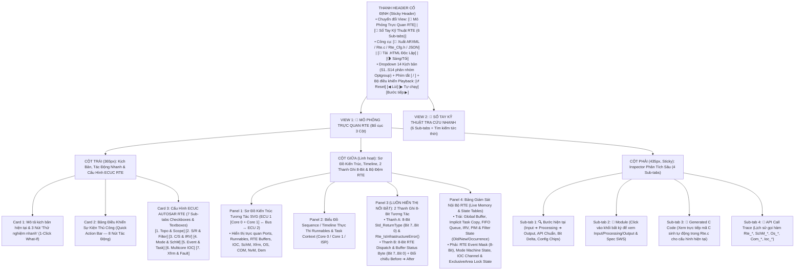

# Tài Liệu Thiết Kế Chi Tiết Trình Mô Phỏng AUTOSAR RTE (`RTE_Simulation_design.md`)

> **Trạng thái tài liệu:** ✅ Đã được User xác nhận (A1, A2, A3) & Hoàn tất triển khai + Kiểm thử tự động 10/10 Test Cases (`TC01`–`TC10` PASS 100%).  
> **File đích đã xuất bản:** `d:\__Personal\AntiGravity\AUTOSAR_RTE.html` (Ứng dụng Web Tương tác 1 file HTML độc lập, 100% Offline, Pure CSS, có nút tải `.HTML` kèm cấu hình nhúng & xuất code `ARXML / Rte.c / Rte_Cfg.h`).  
> **Chuẩn tham chiếu:** **AUTOSAR Classic Platform R4.x / R22-11 (`SWS_Rte`, `SWS_SchM`, `SWS_OS`, `SWS_COM`, `SWS_E2EXf`, `SWS_SomeIpXf`)**, đính kèm mã requirement chuẩn **`SWS_Rte_xxxxx`** tại từng bước xử lý, thanh ghi bit, mã lỗi và sổ tay tra cứu.

---

## 1. Mục Tiêu & Điểm Khác Biệt Của Trình Mô Phỏng RTE Mới

So với file `AUTOSAR_RTE_E2E.html` trước đây (vốn tập trung chủ yếu vào E2E Profile 01/02/04/05), trình mô phỏng **`AUTOSAR_RTE.html` mới** được thiết kế lại toàn diện theo chuẩn kiến trúc của `AUTOSAR_OS.html`, `AUTOSAR_PduR.html` và `AUTOSAR_DEM.html`, tập trung giải quyết trọn vẹn 2 trụ cột lớn mà User yêu cầu:

1. **Cách RTE xử lý & tương tác với toàn bộ hệ sinh thái AUTOSAR:**
   - **Tầng Application (`SWC`)**: `SensorSWC`, `ControllerSWC`, `ActuatorSWC`, `DiagSWC`, `ModeManagerSWC`, `NvBlockSWC` thông qua các Ports (`PPort`, `RPort`, `PRPort`) và `Runnable Entities`.
   - **Tầng Dịch vụ & Giao tiếp BSW**:
     - **`AUTOSAR OS`**: Ánh xạ `RTE Events` vào `OS Tasks` (`ActivateTask`, `SetEvent`, `WaitEvent`, `GetEvent`, `ClearEvent`), bảo vệ vùng găng (`GetResource`/`ReleaseResource`, `SuspendOSInterrupts`), điều phối đa lõi (`GetSpinlock`, `IocSend`/`IocReceive`, `IocWrite`/`IocRead`).
     - **`AUTOSAR COM` & `LdCom`**: Truyền nhận tín hiệu liên ECU (`Com_SendSignal`, `Com_SendSignalGroup`, `Com_ReceiveSignal`, `Com_InvalidateSignal`) và nhận **5 loại Callback từ COM lên RTE** (`Rte_COMCbk_<Sig>`, `Rte_COMCbkTxAck_<Sig>`, `Rte_COMCbkTxTOut_<Sig>`, `Rte_COMCbkRxTOut_<Sig>`, `Rte_COMCbkInv_<Sig>`).
     - **Chuỗi Transformer (`Xfrm`)**: `SomeIpXf` / `ComXf` (Serialization) ➔ `E2EXf` (End-to-End Protection) theo cơ chế **Transformer Chain (`SWS_Rte_08528`)**.
     - **`SchM` (Basic Software Scheduler)**: Quản lý vòng đời gọi `*_MainFunction()` và vùng độc quyền BSW (`SchM_Enter_<Mod>_<EA>()` / `SchM_Exit_<Mod>_<EA>()`).
     - **`NvM`, `Dem`, `Dcm`, `BswM`, `EcuM`**: Giao tiếp qua **AUTOSAR Service Ports** (Client-Server & Mode Switch giữa SWC và BSW).

2. **Mô hình hóa trực quan 4 Phạm Vi Giao Tiếp (Communication Scopes) của RTE:**
   - **Phạm vi 1 — Intra-Task (Cùng 1 OS Task trên cùng 1 Core):** Giao tiếp giữa các Runnable chạy tuần tự trong cùng 1 Task hoặc qua **IRV (Inter-Runnable Variable)** trong nội bộ 1 SWC (`Explicit` vs `Implicit` Copy-In/Copy-Out).
   - **Phạm vi 2 — Inter-Task / Intra-Core (Khác OS Task có mức ưu tiên khác nhau trên cùng 1 Core):** Giải quyết bài toán **Preemption & Data Consistency** bằng `Implicit Task Buffer`, `Explicit + ExclusiveArea` (`OS Resource` / `Interrupt Lock`), hoặc `Queued FIFO Buffer`.
   - **Phạm vi 3 — Inter-Core / Inter-Partition (Giữa `Core 0 [ASIL-D]` và `Core 1 [QM]` trong cùng 1 ECU):** Giao tiếp xuyên ranh giới MPU / Lõi CPU thông qua **`AUTOSAR OS IOC` (`IocWrite`/`IocRead` hoặc `IocSend`/`IocReceive`)**, kết hợp `Cross-Core SetEvent / ActivateTask` hoặc `Spinlock`, kể cả **Inter-Core Client-Server (`Rte_Call` đồng bộ & bất đồng bộ)**.
   - **Phạm vi 4 — Inter-ECU (Giữa `ECU 1` và `ECU 2` qua mạng CAN / CAN-FD / Ethernet):** Đi qua chuỗi `RTE` ➔ `SomeIpXf/ComXf` ➔ `E2EXf` ➔ `COM/SoAd` ➔ `PduR` ➔ `Bus` ➔ `Rte_COMCbk_*` ➔ `SWC`, kèm bộ lọc `DataFilter`, `UpdateBit`, `Signal Invalidity` và `Alive Timeout`.

---

## 2. Bố Cục Giao Diện 3 Cột & Hệ Thống Sub-Tabs (UI Wireframe)



---

## 3. Thiết Kế Chi Tiết Panel 3 (Cột Giữa): 2 Thanh Ghi 8-Bit Tương Tác Luôn Hiển Thị Nổi Bật

Để làm nổi bật vai trò của từng bit trong `Std_ReturnType` và trạng thái điều phối nội bộ của RTE ở mọi bước chạy, Panel 3 được cố định ngay dưới sơ đồ kiến trúc:

```text
+-------------------------------------------------------------------------------------------------------------------+
| 🔢 BẢNG GIÁM SÁT BITFIELD 8-BIT CỦA AUTOSAR RTE (LIVE 8-BIT INSPECTOR)     [Click vào từng Bit để thử nghiệm/giải mã]|
| Bước #4: Rte_Receive_RPort_Cmd(&data)  |  Before: 0x00 (RTE_E_OK) ➔ After: 0x42 (MAX_AGE_EXCEEDED | LOST_DATA)    |
+-------------------------------------------------------------------------------------------------------------------+
| A. THANH GHI 8-BIT MÃ TRẢ VỀ `Std_ReturnType` (`SWS_Rte_01259`, `SWS_Rte_02594`) — Hex: [ 0x42 ] Bin: [0100 0010b]|
|    Macro kiểm tra: Rte_IsInfrastructureError(status) = ((status & 0x80U) != 0U) ➔ [ FALSE ]                       |
|  +-------------+ +-------------+ +-------------+ +-------------+ +-------------+ +-------------+ +-------+ +-----+|
|  | Bit 7 (0x80)| | Bit 6 (0x40)| | Bit 5 (0x20)| | Bit 4 (0x10)| | Bit 3 (0x08)| | Bit 2 (0x04)| |Bit1(2)| |Bit 0||
|  | INFRA_ERR   | | MAX_AGE_EXC | | OUT_OF_RNG  | | UNCONNECTED | | NO_DATA     | | LIMIT_STOP  | |LOST_DT| |INVAL||
|  |      0      | |   1 (0➔1🔥) | |      0      | |      0      | |      0      | |      0      | |1(0➔1) | |  0  ||
|  | Hard/XfrmErr| | AliveTimeout| | AppErr/Range| | Port Unconn | | Queue Empty | | Queue Full  | |Ovflow | |Inval||
|  +-------------+ +-------------+ +-------------+ +-------------+ +-------------+ +-------------+ +-------+ +-----+|
+-------------------------------------------------------------------------------------------------------------------+
| B. THANH GHI 8-BIT TRẠNG THÁI ĐIỀU PHỐI NỘI BỘ RTE (`RTE Dispatch & Buffer Status Byte`) — Hex: [ 0x32 ]          |
|  +-------------+ +-------------+ +-------------+ +-------------+ +-------------+ +-------------+ +-------+ +-----+|
|  | Bit 7 (0x80)| | Bit 6 (0x40)| | Bit 5 (0x20)| | Bit 4 (0x10)| | Bit 3 (0x08)| | Bit 2 (0x04)| |Bit1(2)| |Bit 0||
|  | XFRM_FAULT  | | MODE_TRANS  | | EA_LOCKED   | | IMPL_DIRTY  | | IOC_PENDING | | QUEUE_FULL  | |UPD_BIT| |START||
|  |      0      | |      0      | |   1 (🔒)    | |   1 (📝)    | |      0      | |      0      | |  1    | |  1  ||
|  | E2E/Xf OK   | | Mode Stable | | In ExclArea | | Buf Unflush | | IOC Idle    | | Queue OK    | |New Rx | |Init ||
|  +-------------+ +-------------+ +-------------+ +-------------+ +-------------+ +-------------+ +-------+ +-----+|
+-------------------------------------------------------------------------------------------------------------------+
```

### Ý nghĩa chi tiết từng Bit trên 2 Thanh ghi 8-Bit:

#### Thanh A: `Std_ReturnType` (8-Bit Return Code của các API `Rte_*` — `SWS_Rte_01259`)
| Bit | Mask | Tên cờ chuẩn AUTOSAR | Ý nghĩa & Khi nào bật lên `1` |
| :-: | :-: | :--- | :--- |
| **Bit 7** | `0x80` | **`MSB_INFRASTRUCTURE_ERR`** | Bit phân loại lỗi (`SWS_Rte_07404`): `0` = Mã trạng thái chuẩn / Application Error (`0x00..0x3F`); `1` = Lỗi hạ tầng RTE hoặc Transformer (`RTE_E_HARD_TRANSFORMER_ERROR = 0x80`, `RTE_E_SOFT_TRANSFORMER_ERROR = 0x82`). |
| **Bit 6** | `0x40` | **`RTE_E_MAX_AGE_EXCEEDED`** | Bật khi bản tin Rx bị quá hạn `AliveTimeout` (`Rte_COMCbkRxTOut` đã kích hoạt) làm cờ tuổi dữ liệu vượt ngưỡng (`SWS_Rte_01064`). |
| **Bit 5** | `0x20` | **`RTE_E_OUT_OF_RANGE` / `APP_ERR`** | Giá trị truyền vào ngoài dải cho phép hoặc mã lỗi `ApplicationError` do Server Runnable trả về (`0x20..0x3F`). |
| **Bit 4** | `0x10` | **`RTE_E_UNCONNECTED` / `SEG_FAULT`** | Gọi `Rte_Read`/`Rte_Call` trên một `RPort` không được nối dây trong cấu hình (`SWS_Rte_01060`). |
| **Bit 3** | `0x08` | **`RTE_E_NO_DATA` / `TRANSMIT_ACK`** | Gọi `Rte_Receive` khi hàng đợi FIFO đang rỗng (`Count == 0`), hoặc gọi `Rte_Result` khi Server chưa trả kết quả (`SWS_Rte_01065`). |
| **Bit 2** | `0x04` | **`RTE_E_LIMIT` / `COM_STOPPED`** | Gọi `Rte_Send` khi hàng đợi FIFO đã đầy (`Count == MaxLength`), hoặc gọi `Rte_Call` vượt giới hạn đồng thời, hoặc `COM` dừng nhóm I-PDU (`RTE_E_COM_STOPPED = 0x84`). |
| **Bit 1** | `0x02` | **`RTE_E_LOST_DATA`** | **Cờ Bitmask đặc biệt (`SWS_Rte_02571`)**: Bật khi ít nhất 1 phần tử trong hàng đợi đã bị ghi đè/rớt trước đó; có thể **OR bitwise** với các cờ khác (ví dụ `0x42 = RTE_E_MAX_AGE_EXCEEDED | RTE_E_LOST_DATA`). |
| **Bit 0** | `0x01` | **`RTE_E_INVALID`** | Dữ liệu nhận được mang giá trị `InvalidValue` (do phía gửi gọi `Rte_Invalidate` và kích hoạt `Rte_COMCbkInv` — `SWS_Rte_01061`). |

#### Thanh B: `RTE Internal Dispatch & Buffer Status Byte` (8-Bit Trạng thái Nội bộ RTE)
| Bit | Mask | Tên Bit | Ý nghĩa kỹ thuật trong trình tạo mã RTE (`Rte.c`) |
| :-: | :-: | :--- | :--- |
| **Bit 7** | `0x80` | **`XFRM_CHAIN_FAULT`** | Chuỗi Transformer (`SomeIpXf` / `E2EXf`) phát hiện lỗi frame (sai CRC, nhảy Counter, sai Header). |
| **Bit 6** | `0x40` | **`MODE_IN_TRANSITION`** | Máy trạng thái Mode đang ở pha chuyển giao (`RTE_TRANSITION_<ModeGroup>`), đang chạy các `OnExit`/`OnEntry` Runnables và khóa các Runnable bị `ModeDisablingDependency`. |
| **Bit 5** | `0x20` | **`EXCLUSIVE_AREA_LOCKED`** | Đang ở bên trong cặp `Rte_Enter_<EA>()` / `SchM_Enter_<Mod>_<EA>()` (đang giữ `OS Resource` hoặc khóa ngắt `SuspendOSInterrupts`). |
| **Bit 4** | `0x10` | **`IMPLICIT_BUF_DIRTY`** | Runnable đã gọi `Rte_IWrite()` ghi vào **Task Local Buffer**, đang chờ Runnable kết thúc để RTE tự động copy (Flush) ra **Global Buffer / COM**. |
| **Bit 3** | `0x08` | **`IOC_XCORE_PENDING`** | Có dữ liệu hoặc yêu cầu gọi hàm xuyên lõi (`Core 0 ↔ Core 1`) đang nằm trong bộ đệm `AUTOSAR OS IOC` chờ lõi đích đọc. |
| **Bit 2** | `0x04` | **`FIFO_QUEUE_FULL`** | Hàng đợi `Rte_Send` hoặc hàng đợi `ModeSwitch` đã chạm ngưỡng tối đa (`QueueCount == QueueLength`). |
| **Bit 1** | `0x02` | **`RX_UPDATE_BIT_SET`** | Cờ `UpdateBit` / `DataReceivedFlag` vừa được bật bởi `Rte_Write` hoặc `Rte_COMCbk_<Sig>()`. |
| **Bit 0** | `0x01` | **`RTE_STARTED`** | `Rte_Start()` đã được gọi thành công (`Rte_Initialized == TRUE`); nếu bằng `0` (sau `Rte_Stop()`), mọi API `Rte_*` sẽ bị chặn (`RTE_E_UNINIT`). |

---

## 4. Phân Tích Xử Lý Từng Module: Input Lấy Từ Đâu, Xử Lý Gì, Output Route Đến Đâu

Mọi khối trên sơ đồ kiến trúc SVG đều có thể **click vào để xem giải thích chi tiết** ở cột phải (Tab `🧩 Module`) và được tổng hợp đầy đủ trong **Tab 1 của Sổ tay**:

| # | Module / Phân khối | Lớp AUTOSAR | 📥 Input lấy từ đâu? | ⚙️ Cách xử lý nội bộ (Processing, Buffers & State) | 📤 Output route đến đâu & Hàm API chuẩn |
| :-: | :--- | :--- | :--- | :--- | :--- |
| **1** | **`SWC_Sensor` & `SWC_Controller`**<br>*(Application SWCs — Core 0)* | Application Layer | • Được `RTE` gọi vào các hàm **Runnable Entity** (`Runnable_Sensor_10ms`, `Runnable_Ctrl_OnRx`).<br>• Đọc dữ liệu qua `RPort` (`Rte_Read_*`, `Rte_IRead_*`, `Rte_Receive_*`, `Rte_Mode_*`, `Rte_Prm_*`, `Rte_IrvRead_*`). | • Thực thi thuật toán điều khiển ứng dụng.<br>• Không được phép gọi trực tiếp bất kỳ hàm BSW/OS/MCAL nào (mọi giao tiếp đều phải đi qua **Virtual Functional Bus — VFB** do `RTE` hiện thực hóa).<br>• Truy cập vùng nhớ riêng của Instance qua `Rte_Pim_<Name>()` và bảo vệ vùng găng qua `Rte_Enter_<EA>()` / `Rte_Exit_<EA>()`. | • Gọi xuống **RTE**:<br>`Rte_Write_<p>_<o>()`, `Rte_IWrite_<re>_<p>_<o>()`, `Rte_Send_<p>_<o>()`, `Rte_Invalidate_<p>_<o>()`, `Rte_Call_<p>_<o>()`, `Rte_Result_<p>_<o>()`, `Rte_Switch_<p>_<m>()`, `Rte_IrvWrite_<re>_<v>()`, `Rte_IrTrigger_<re>_<t>()` |
| **2** | **`SWC_Actuator_Core1` & `SWC_DiagServer`**<br>*(SWCs trên Core 1 / Server)* | Application Layer | • Được kích hoạt trên `Core 1` (hoặc Partition khác) khi nhận sự kiện từ `RTE` / `OS IOC`.<br>• Nhận tham số đầu vào `IN / INOUT` khi `OperationInvokedEvent` kích hoạt Server Runnable. | • Xử lý dữ liệu nhận xuyên lõi từ `IOC` hoặc thực thi dịch vụ Server (ví dụ: tính toán mô-men xoắn, kiểm tra phần cứng cầu H, phục vụ yêu cầu chẩn đoán) rồi trả kết quả qua tham số `OUT` và mã trả về `Std_ReturnType`. | • Trả kết quả về **RTE** (`E_OK` hoặc `ApplicationError 0x01..0x3F`) để RTE đóng gói gửi trả lại Client (trực tiếp hoặc qua `IOC`). |
| **3** | **`RTE Core Engine`**<br>*(Runtime Environment)* | RTE Layer | • Lời gọi API `Rte_*` từ tất cả các `SWC`.<br>• Lời gọi Callback từ `COM` (`Rte_COMCbk_*`), `NvM` (`Rte_NvMCbk_*`).<br>• Sự kiện đánh thức từ `AUTOSAR OS` (`TASK(Task_*)`, `WaitEvent` wakeup). | • **1. S/R Routing & Buffering**: Quản lý `Global RAM Buffer`, `Task Implicit Buffer` (Copy-in trước khi gọi Runnable, Copy-out sau khi Runnable thoát), và `FIFO Queue` (`Rte_Send`/`Rte_Receive`).<br>• **2. Reception Filtering (`SWS_Rte_04505`)**: Chạy thuật toán lọc `ALWAYS`, `NEVER`, `MASKED_NEW_DIFFERS_X`, `MASKED_NEW_DIFFERS_MASKED_OLD`, `NEW_IS_WITHIN`, `NEW_IS_OUTSIDE`, `ONE_EVERY_N`.<br>• **3. Invalidity & Timeout Handling**: Kiểm tra cờ `Invalid` & `AliveTimeout`, áp dụng chính sách `KEEP`, `REPLACE_BY_INIT`, hoặc `EXTERNAL_REPLACEMENT`.<br>• **4. Event-to-Task Dispatch**: Dùng bitmask `EventMaskType` để kích hoạt đúng Runnable trong Extended Task.<br>• **5. C/S & Mode Machine**: Điều phối `Direct Call` vs `Queued Server Call` (Đồng bộ/Bất đồng bộ) và máy trạng thái `Mode Switch` (`OnExit ➔ TRANSITION ➔ OnEntry`). | • Gọi lên **SWC Runnables**: `Runnable_*()`<br>• Gọi xuống **OS**: `ActivateTask()`, `SetEvent()`, `WaitEvent()`, `GetEvent()`, `ClearEvent()`, `GetResource()`, `ReleaseResource()`, `SuspendOSInterrupts()`<br>• Gọi sang **IOC**: `IocWrite_*()`, `IocRead_*()`, `IocSend_*()`, `IocReceive_*()`<br>• Gọi sang **Transformer**: `SomeIpXf_Transform()`, `E2EXf_Transform()`<br>• Gọi xuống **COM**: `Com_SendSignal()`, `Com_ReceiveSignal()`, `Com_InvalidateSignal()` |
| **4** | **`SchM`**<br>*(BSW Scheduler — Phần của RTE)* | RTE / System Services | • Được `OS Alarm` / `ScheduleTable` kích hoạt định kỳ trong `Task_Bsw` (ví dụ mỗi `5ms`/`10ms`).<br>• Lời gọi `SchM_Enter_*`, `SchM_Exit_*`, `SchM_Switch_*` từ các module BSW (`Com`, `CanIf`, `PduR`, `Dem`). | • Gọi tuần tự các hàm `*_MainFunction()` của BSW theo bảng lập lịch tĩnh.<br>• Cung cấp cơ chế khóa vùng găng cực nhanh cho các module BSW (`SchM_Enter_<Mod>_<ExclusiveArea>()` thường dùng `SuspendAllInterrupts` hoặc `OS Resource`).<br>• Điều phối chuyển chế độ BSW (`SchM_Switch` / `BswM`). | • Gọi sang **BSW**: `Com_MainFunctionRx()`, `Com_MainFunctionTx()`, `NvM_MainFunction()`, `Dem_MainFunction()`<br>• Gọi xuống **OS**: `SuspendAllInterrupts()`, `ResumeAllInterrupts()`, `GetResource()` |
| **5** | **`AUTOSAR OS & IOC`**<br>*(OS Kernel & Inter-OS-App Communicator)* | System Services (OS) | • Lời gọi từ `RTE` & `SchM` (`ActivateTask`, `SetEvent`, `GetResource`, `IocSend`, `IocWrite`).<br>• Ngắt phần cứng từ Timer (`Gpt`) và `CanIf`. | • Lập lịch ưu tiên `Task` trên `Core 0` và `Core 1` (Preemptive / Non-preemptive).<br>• Quản lý thanh ghi 8-bit `EventMaskType` cho từng Extended Task.<br>• Thực thi **OSEK PCP** khi khóa `Resource` hoặc khóa `Spinlock` đa lõi.<br>• **Khối `IOC`**: Truyền dữ liệu an toàn qua ranh giới MPU / Core giữa `OS-Application_Core0 (ASIL-D)` và `OS-Application_Core1 (QM)` mà không vi phạm bảo vệ bộ nhớ. | • Đánh thức và chuyển ngữ cảnh CPU vào `TASK(Task_*)` nơi mã khung của `RTE` đang chờ.<br>• Trả dữ liệu `IocRead`/`IocReceive` và `StatusType` (`E_OK`, `IOC_E_OK`, `IOC_E_LOST_DATA`, `IOC_E_NO_DATA`). |
| **6** | **`Transformer Chain (`SomeIpXf` + `E2EXf`)`** | Communication Services (Xfrm) | • Phía Tx: Nhận cấu trúc dữ liệu C từ `RTE` (`Rte_Write` / `Rte_Call`).<br>• Phía Rx: Nhận mảng byte `uint8[]` từ `COM` / `LdCom` / `SoAd`. | • **Phía Tx (`SWS_Rte_08528`)**: `SomeIpXf_Transform()` tuần tự hóa (serialize) struct thành byte stream ➔ `E2EXf_Transform()` tính `CRC` + tăng `AliveCounter` chèn vào Header.<br>• **Phía Rx**: `E2EXf_Inv_Transform()` kiểm tra `CRC` và `DeltaCounter` ➔ `SomeIpXf_Inv_Transform()` giải tuần tự hóa (deserialize) về lại struct C cho SWC. | • Trả về mảng byte đã đóng gói và mã `Std_ReturnType` (`E_OK = 0x00`, `E_SAFETY_SOFT_RUNTIMEERROR = 0x82`, `E_SAFETY_HARD_RUNTIMEERROR = 0x80..0x86`) về cho `RTE`. |
| **7** | **`AUTOSAR COM` & `PduR`**<br>*(Communication Stack)* | Communication Services | • Nhận `Com_SendSignal` / `Com_SendSignalGroup` / `Com_InvalidateSignal` từ `RTE`.<br>• Nhận `Com_RxIndication` từ `PduR` ➔ `CanIf` khi có frame từ Bus. | • Đóng gói Signal vào I-PDU Buffer, thiết lập `UpdateBit`, phát xuống `PduR_ComTransmit()` (ngay lập tức nếu `TRIGGERED` hoặc chờ `Com_MainFunctionTx` nếu `PENDING`).<br>• Giám sát bộ đếm **Rx Deadline Monitoring (`AliveTimeout`)**. Khi nhận được tín hiệu, bị `InvalidData`, hoặc quá hạn `Timeout`, gọi ngay hàm Callback tương ứng của `RTE`. | • Gọi ngược lên **RTE Callbacks**:<br>`Rte_COMCbk_<Sig>()` (Rx thành công)<br>`Rte_COMCbkInv_<Sig>()` (Nhận mẫu Invalid)<br>`Rte_COMCbkRxTOut_<Sig>()` (Quá hạn Rx Timeout)<br>`Rte_COMCbkTxAck_<Sig>()` / `Rte_COMCbkTxTOut_<Sig>()` |
| **8** | **`NvM`, `Dem`, `BswM`**<br>*(BSW Service Modules)* | Memory, Diag & System Services | • Nhận lời gọi `Client-Server` hoặc `Mode Switch` từ `SWC` đi xuyên qua **RTE Service Ports** (`Rte_Call_NvMService_WriteBlock`, `Rte_Call_DiagnosticMonitor_SetEventStatus`, `Rte_Switch_Mode_BswM`). | • **`NvM`**: Sao chép dữ liệu giữa RAM Block (`Rte_Pim_*`) và EEPROM/Flash trong `NvM_MainFunction()`, khi xong gọi `Rte_NvMCbk_JobFinished()`.<br>• **`Dem`**: Thực hiện Debounce lỗi chẩn đoán và cập nhật 8-bit `DTC Status Byte`.<br>• **`BswM`**: Phân xử chế độ hệ thống (`Mode Arbitration`) và bật/tắt nhóm I-PDU của `COM`. | • Trả về `Std_ReturnType` cho `RTE` và bắn thông báo hoàn thành (`JobFinished` / `ModeSwitchAck`) ngược lên `SWC`. |

---

## 5. Danh Mục Đầy Đủ Các Trường Cấu Hình (Checkboxes, Textboxes, Dropdowns — 7 Sub-Tabs)

Ở cột trái (Card 3), người dùng có thể tùy chỉnh trực tiếp các tham số ECUC chuẩn của `RTE` thông qua **Checkboxes, Textboxes, Spinners và Dropdowns** được chia thành **7 Sub-tabs khoa học**:

### 5.1. Sub-tab 1: `Topo & Scope` (Kiến trúc Giao tiếp & Vòng đời RTE)
- **Dropdown `CommScope` (Phạm vi giao tiếp của cổng S/R & C/S)**:
  - `INTRA_TASK` (Cùng 1 OS Task trên Core 0 — đọc/ghi biến RAM trực tiếp)
  - `INTER_TASK_SAME_CORE` (Khác OS Task trên Core 0 — có nguy cơ Preemption)
  - `INTER_CORE_IOC` (Xuyên lõi `Core 0 [ASIL-D] ➔ Core 1 [QM]` qua `AUTOSAR OS IOC`)
  - `INTER_ECU_COM` (Liên ECU `ECU 1 ➔ CAN/ETH Bus ➔ ECU 2` qua `COM` / `Transformer`).
- **Checkbox ☑️ `RteInitialized` (`Rte_Start()` đã chạy)**: Bật/tắt trạng thái khởi tạo RTE (`Bit 0 RTE_STARTED`).
- **Checkbox ☑️ `RteDevErrorDetect` (`SWS_Rte_07015`)**: Bật/tắt báo lỗi `Det_ReportError()` khi gọi API sai trạng thái/tham số.
- **Checkbox ☑️ `RtePortConnected`**: Giả lập cổng `RPort` đã được nối dây hay để trống (kiểm tra lỗi `RTE_E_UNCONNECTED = 0x10`).
- **Checkbox ☑️ `RteOptimizationDirectMacro`**: Khi giao tiếp `INTRA_TASK`, cho phép RTE sinh macro `#define Rte_Read_...` đọc thẳng biến RAM không tốn lệnh `call`.

### 5.2. Sub-tab 2: `S/R & Filter` (Sender-Receiver, Buffering, Filter, Invalid & Timeout)
- **Textbox / Number `TxSignalValue`**: Giá trị dữ liệu `SWC_Sensor` gửi đi (ví dụ: `VehicleSpeed = 120`).
- **Textbox / Number `RteInitValue` (`Rte_InitValue_*`)**: Giá trị khởi tạo / thay thế an toàn khi lỗi (mặc định `0`).
- **Textbox / Number `SignalInvalidValue`**: Giá trị đại diện cho trạng thái Invalid trên đường truyền (ví dụ `65535` / `0xFFFF`).
- **Checkbox ☑️ `UseImplicitAccess` (`Implicit` vs `Explicit`)**:
  - `FALSE` (Mặc định): Dùng **Explicit API** (`Rte_Write` / `Rte_Read`) — đọc/ghi trực tiếp vào Global Buffer ngay tại thời điểm gọi.
  - `TRUE`: Dùng **Implicit API** (`Rte_IWrite` / `Rte_IRead`) — RTE copy vào `Task Local Buffer` trước khi Runnable chạy và chỉ Flush ra Global Buffer sau khi Runnable kết thúc (`Bit 4 IMPL_DIRTY`).
- **Checkbox ☑️ `IsQueued` (`Unqueued Last-is-Best` vs `Queued FIFO`)**:
  - `FALSE`: Ghi đè mẫu mới nhất (`Rte_Write` / `Rte_Read`).
  - `TRUE`: Đẩy vào hàng đợi vòng FIFO (`Rte_Send` / `Rte_Receive`).
- **Number `QueueLength` (`RteQueueLength`)**: Độ sâu hàng đợi FIFO (`1 .. 8`, mặc định `3`).
- **Dropdown `DataFilterAlgorithm` (`ComFilterAlgorithm` / `RteFilter` — `SWS_Rte_04505`)**:
  - `ALWAYS` (Luôn cho qua)
  - `NEVER` (Chặn toàn bộ)
  - `MASKED_NEW_DIFFERS_MASKED_OLD` (`(New & Mask) != (Old & Mask)`)
  - `MASKED_NEW_DIFFERS_X` (`(New & Mask) != X`)
  - `NEW_IS_WITHIN` (`FilterMin <= New <= FilterMax`)
  - `NEW_IS_OUTSIDE` (`New < FilterMin || New > FilterMax`)
  - `ONE_EVERY_N` (`Occurrence % Period == Offset`).
- **Textboxes / Numbers cho bộ lọc**: `FilterMask (Hex)` (`0xFF`), `FilterX (Hex)` (`0x00`), `FilterMin` (`20`), `FilterMax` (`200`), `FilterPeriodN` (`3`), `FilterOffset` (`0`).
- **Checkbox ☑️ `EnableUpdateBit` (`ComSignalUpdateBitPosition`)**: Sử dụng cờ Update-Bit cho tín hiệu Rx.
- **Checkbox ☑️ `EnableAliveTimeout` (`AliveTimeout > 0`)** & **Number `AliveTimeoutMs` (`500 ms`)**: Giám sát quá hạn bản tin Rx (`RTE_E_MAX_AGE_EXCEEDED = 0x40`).
- **Dropdown `InvalidationPolicy` (`handleInvalid` / `handleTimeout`)**:
  - `KEEP` (Giữ nguyên giá trị hợp lệ cuối cùng trong bộ đệm RTE)
  - `REPLACE` (Thay thế bằng `RteInitValue`)
  - `EXTERNAL_REPLACEMENT` (Thay thế bằng `ReplacementValue` cấu hình riêng).

### 5.3. Sub-tab 3: `C/S & IRV` (Client-Server, ExclusiveArea, IRV & PIM/NvM)
- **Checkbox ☑️ `CsAsyncMode` (`Synchronous` vs `Asynchronous Rte_Call`)**:
  - `FALSE`: `Rte_Call` đồng bộ (Chờ Server thực thi xong mới trả về).
  - `TRUE`: `Rte_Call` bất đồng bộ (Trả về ngay lập tức, sau đó lấy kết quả qua `Rte_Result`).
- **Number `CsTimeoutTicks`**: Thời gian chờ tối đa của `Rte_Call` / `Rte_Result` trước khi báo `RTE_E_TIMEOUT (0x81)`.
- **Number `ServerReturnAppError`**: Mã lỗi ứng dụng do Server Runnable trả về (`0 = E_OK`, `1..63 = ApplicationError`).
- **Checkbox ☑️ `UseExclusiveArea` (`Rte_Enter` / `Rte_Exit`)**: Bảo vệ vùng dữ liệu dùng chung khi có Task ưu tiên cao chen ngang.
- **Dropdown `ExclusiveAreaMechanism` (`RteExclusiveAreaImplMechanism`)**:
  - `OS_INTERRUPT_BLOCKING` (`SuspendOSInterrupts()` / `ResumeOSInterrupts()`)
  - `OS_RESOURCE` (`GetResource(RES_RTE)` / `ReleaseResource(RES_RTE)`)
  - `COOPERATIVE_RUNNABLE_PLACEMENT` (Xếp các Runnable vào cùng 1 Task nên không cần khóa)
  - `NONE` (Không khóa — để người dùng quan sát lỗi **Torn Read / Race Condition**!).
- **Checkbox ☑️ `IrvImplicitMode`**: Chọn chế độ truy cập biến nội bộ giữa các Runnable trong cùng SWC (`Rte_IrvWrite`/`Rte_IrvRead` vs `Rte_IrvIWrite`/`Rte_IrvIRead`).
- **Textbox `PimDefaultValue` & Checkbox ☑️ `NvMBlockWriteProtected`**: Cấu hình vùng nhớ `Rte_Pim_*` và dịch vụ `NvM`.

### 5.4. Sub-tab 4: `Mode & SchM` (Mode Switch State Machine & BSW Scheduler)
- **Dropdown `TargetMode` (Chế độ yêu cầu qua `Rte_Switch`)**:
  - `RTE_MODE_Mdg_STARTUP (0)`
  - `RTE_MODE_Mdg_NORMAL_RUN (1)`
  - `RTE_MODE_Mdg_LIMP_HOME (2)`
  - `RTE_MODE_Mdg_SHUTDOWN (3)`.
- **Checkbox ☑️ `ModeSwitchAsync`**: Chuyển Mode bất đồng bộ qua hàng đợi của Mode Manager (`ModeQueueLength = 1..4`) vs đồng bộ.
- **Checkbox ☑️ `EnableModeDisabling`**: Tự động khóa (không cho chạy) các Runnable nằm trong danh sách `ModeDisablingDependency` khi đang ở `LIMP_HOME` hoặc đang ở pha `RTE_TRANSITION`.
- **Checkbox ☑️ `EnableModeSwitchAck` (`Rte_SwitchAck`)**: Bật thông báo xác nhận sau khi hoàn tất toàn bộ `OnExit` ➔ `TRANSITION` ➔ `OnEntry`.
- **Checkboxes ☑️ cấu hình `SchM` (`Task_Bsw`)**:
  - ☑️ `SchmRunComMainRx` (`Com_MainFunctionRx()`)
  - ☑️ `SchmRunComMainTx` (`Com_MainFunctionTx()`)
  - ☑️ `SchmRunNvMMain` (`NvM_MainFunction()`)
  - ☑️ `SchmRunDemMain` (`Dem_MainFunction()`).

### 5.5. Sub-tab 5: `Event & Task` (Ánh xạ RTE Events vào OS Tasks & Bitmask)
- **Bảng ánh xạ 8 Bit của `EventMaskType` trên Extended Task `Task_RteApp`**:
  - Cho phép đổi `BitMask` (`0x01 .. 0x80`), bật/tắt từng `RTE Event` bằng Checkbox ☑️:
    - `Bit 0 (0x01)`: `TimingEvent_10ms` ➔ `Runnable_Periodic10ms`
    - `Bit 1 (0x02)`: `DataReceivedEvent_Speed` ➔ `Runnable_OnSpeedRx`
    - `Bit 2 (0x04)`: `DataReceiveErrorEvent_TOut` ➔ `Runnable_OnRxError`
    - `Bit 3 (0x08)`: `OperationInvokedEvent_Diag` ➔ `Runnable_ServerOp`
    - `Bit 4 (0x10)`: `AsyncServerCallReturnsEvent` ➔ `Runnable_OnCsResult`
    - `Bit 5 (0x20)`: `SwcModeSwitchEvent_OnEntry` ➔ `Runnable_ModeEntry`
    - `Bit 6 (0x40)`: `InternalTriggerOccurredEvent` ➔ `Runnable_OnIntTrig`
    - `Bit 7 (0x80)`: `ExternalTriggerOccurredEvent` ➔ `Runnable_OnExtTrig`
- **Dropdown `RunnablePositionInTask`**: Điều chỉnh thứ tự ưu tiên kiểm tra bit và gọi Runnable trong vòng lặp `WaitEvent ➔ GetEvent ➔ ClearEvent` của `Task_RteApp`.

### 5.6. Sub-tab 6: `Multicore IOC` (Giao tiếp Đa Lõi & Liên Phân Vùng MPU)
- **Dropdown `IocCommunicationMode`**:
  - `IOC_UNQUEUED` (`IocWrite_<Id>` / `IocRead_<Id>` — Last-is-Best cho dữ liệu trạng thái)
  - `IOC_QUEUED` (`IocSend_<Id>` / `IocReceive_<Id>` — Hàng đợi FIFO cho sự kiện/lệnh).
- **Number `IocQueueLength`**: Kích thước hàng đợi IOC (`1 .. 8`).
- **Checkbox ☑️ `CrossCoreNotifyByEvent`**: Sau khi ghi vào `IOC` trên `Core 0`, RTE tự động gọi `SetEvent(Task_Core1_Actuator, 0x02)` xuyên lõi (IPI) để đánh thức `Core 1` xử lý ngay, thay vì đợi `Core 1` đọc chu kỳ.
- **Checkbox ☑️ `UseMulticoreSpinlock`**: Sử dụng `GetSpinlock` / `ReleaseSpinlock` khi truy cập vùng đệm dùng chung đa lõi.

### 5.7. Sub-tab 7: `Xfrm & Fault` (Chuỗi Transformer `SomeIpXf`/`E2EXf` & Bơm Lỗi)
- **Checkbox ☑️ `EnableTransformerChain` (`SWS_Rte_08528`)**: Bật chuỗi `SomeIpXf` + `E2EXf` khi truyền/nhận qua RTE.
- **Dropdown `E2EProfile`**: `P01 (CRC8-J1850)` | `P02 (CRC8-H2F)` | `P04 (CRC32P4)` | `P05 (CRC16)`.
- **Textbox `E2EDataId` (`0x1234`)** & **Number `MaxDeltaCounter` (`2`)**.
- **Checkbox ☑️ `DiscardOnHardTransformerError`**: Chặn dữ liệu hỏng không cho vào bộ đệm SWC khi `Bit 7 (0x80)` bật.
- **Các Checkboxes ☑️ Bơm lỗi đường truyền (Fault Injection)**:
  - ☑️ `InjectCrcError` (Đảo bit CRC trên Bus ➔ `E_SAFETY_HARD_RUNTIMEERROR = 0x83`)
  - ☑️ `InjectCounterJump` (Nhảy cóc AliveCounter vượt `MaxDeltaCounter` ➔ `0x85`)
  - ☑️ `InjectBusDropTimeout` (Ngắt cáp/mất bản tin Rx quá `AliveTimeout` ➔ `Rte_COMCbkRxTOut` ➔ `0x40`)
  - ☑️ `InjectQueueOverflow` (Bơm dồn dập vượt `QueueLength` ➔ `RTE_E_LIMIT = 0x04` & `RTE_E_LOST_DATA = 0x02`).

---

## 6. Thiết Kế Chi Tiết 14 Kịch Bản Chạy Mẫu (`S1` – `S14`)

Mỗi kịch bản được thiết kế để làm nổi bật rõ **sự thay đổi của các Bit trên 2 Thanh ghi 8-Bit**, **sự khác nhau khi bật/tắt các trường Config**, và **luồng gọi hàm API chuẩn AUTOSAR** giữa các module:

| Mã | Nhóm chủ đề | Tên kịch bản | Luồng xử lý chính, API chuẩn & Các Bit / Config nổi bật | 3 Nút "Thử nghiệm nhanh" (1-Click What-If) |
| :-: | :--- | :--- | :--- | :--- |
| **S1** | **Intra-ECU S/R (Explicit vs Implicit)** | **Giao Tiếp Sender-Receiver Nội Bộ ECU: `Explicit` (`Rte_Write`/`Rte_Read`) vs `Implicit` (`Rte_IWrite`/`Rte_IRead`) & Chống Race Condition** | • `Runnable_Sensor` (Task_Low, Prio 2) và `Runnable_Diag` cùng truy cập tín hiệu `EngineSpeed` và `EngineTorque`.<br>• Khi dùng **Explicit (`UseImplicitAccess = FALSE`)**: `Runnable_Ctrl` đang đọc dở `EngineSpeed` thì bị `Task_High` chen ngang ghi giá trị mới vào `EngineTorque` ➔ xảy ra **Torn Read / Data Inconsistency**.<br>• Khi bật **Implicit (`UseImplicitAccess = TRUE`)**: Trước khi `Runnable_Ctrl` chạy, RTE copy toàn bộ vào **Task Local Buffer** (`Rte_IRead`), và khi `Runnable_Sensor` gọi `Rte_IWrite`, bit **`Bit 4 (IMPL_DIRTY = 1)`** bật lên, dữ liệu chỉ được Flush ra Global Buffer sau khi Runnable kết thúc (`SWS_Rte_01083`). | 1. **Bật `UseImplicitAccess = TRUE`** (`Rte_IWrite`/`Rte_IRead` — thấy ngay `Bit 4 IMPL_DIRTY = 1` và dữ liệu nhất quán 100%)<br>2. **Tắt `UseImplicitAccess = FALSE`** + Bật Preemption (thấy ngay lỗi Torn Read)<br>3. Bật `UseExclusiveArea = TRUE` (`OS_RESOURCE` / `OS_INTERRUPT_BLOCKING`) |
| **S2** | **Queued S/R (`Rte_Send` / `Rte_Receive`)** | **Hàng Đợi Sự Kiện FIFO (`isQueued = TRUE`), Tràn Hàng Đợi (`RTE_E_LIMIT = 0x04`) & Cờ Rớt Mẫu (`RTE_E_LOST_DATA = 0x02`)** | • Cổng lệnh điều khiển cấu hình `IsQueued = TRUE`, `QueueLength = 3`.<br>• Bước đầu `SWC_Ctrl` gọi `Rte_Receive()` khi hàng đợi rỗng ➔ trả về **`0x08` (`Bit 3 RTE_E_NO_DATA = 1`)**.<br>• `SWC_HMI` gọi `Rte_Send()` 4 lần liên tiếp (`Cmd_1`, `Cmd_2`, `Cmd_3`, `Cmd_4`):<br>  - 3 lần đầu thành công (`0x00`), lần 3 bật **`Bit 2 (FIFO_QUEUE_FULL = 1)`** trên thanh Status.<br>  - Lần 4 vượt `QueueLength = 3` ➔ `Rte_Send` trả về **`0x04` (`Bit 2 RTE_E_LIMIT = 1`)** và ghi nhận cờ Overflow.<br>• Khi `SWC_Ctrl` gọi `Rte_Receive()` lấy mẫu tiếp theo, RTE trả về dữ liệu kèm mã **`0x02` (`Bit 1 RTE_E_LOST_DATA = 1`, `SWS_Rte_02571`)** để báo cho SWC biết đã có lệnh bị rớt! | 1. Tăng `QueueLength` từ `3` lên `5` (cả 4 lệnh `Rte_Send` đều `0x00 RTE_E_OK`)<br>2. Gọi `Rte_Receive` khi Queue rỗng (kiểm tra `Bit 3 RTE_E_NO_DATA = 0x08`)<br>3. Bơm đồng thời `Overflow + Timeout` để xem tổ hợp bit **`0x42` (`MAX_AGE_EXCEEDED | LOST_DATA`)** |
| **S3** | **Inter-ECU S/R via COM** | **Giao Tiếp Liên ECU Qua `AUTOSAR COM`: `Rte_Write` ➔ `Com_SendSignal` ➔ Bus ➔ `Rte_COMCbk_<Sig>` ➔ `SetEvent` ➔ `Rte_Read`** | • Trên **ECU 1**: `SWC_Sensor` gọi `Rte_Write_PPort_Speed(120)` ➔ RTE gọi `Com_SendSignal(ComConf_ComSignal_Speed, &val)` [`SWS_Rte_04527`].<br>• Tùy thuộc `ComTransferProperty = TRIGGERED` hay `PENDING`, `COM` phát I-PDU qua `PduR` xuống CAN Bus sang **ECU 2**.<br>• Trên **ECU 2**: `CanIf` ➔ `PduR` ➔ `Com_RxIndication()` giải nén tín hiệu và gọi ngay **`Rte_COMCbk_Sig_Speed()`**.<br>• Bên trong `Rte_COMCbk_Sig_Speed()`: RTE bật **`Bit 1 (RX_UPDATE_BIT = 1)`**, gọi `Com_ReceiveSignal()` cập nhật bộ đệm và gọi `SetEvent(Task_RteApp, 0x02)` đánh thức `Runnable_OnSpeedRx` gọi `Rte_Read() == 0x00`. | 1. Đổi `ComTransferProperty` từ `TRIGGERED` sang `PENDING` (phải chờ `SchM` gọi `Com_MainFunctionTx` mới phát)<br>2. Tắt `DataReceivedEvent` (chuyển sang đọc Polling định kỳ)<br>3. Tắt I-PDU Group của COM ➔ `Rte_Write` trả về **`0x84` (`RTE_E_COM_STOPPED`)** |
| **S4** | **Reception Filter (`SWS_Rte_04505`)** | **Bộ Lọc Dữ Liệu Nhận Của RTE (`DataFilterAlgorithm`: `MASKED_NEW_DIFFERS_OLD`, `NEW_IS_WITHIN`, `ONE_EVERY_N`)** | • Minh họa cách RTE giảm tải CPU bằng cách lọc dữ liệu ngay trong `Rte_Write` / `Rte_COMCbk` trước khi cập nhật bộ đệm và kích hoạt `DataReceivedEvent`.<br>• Chạy chuỗi 5 mẫu dữ liệu đến liên tiếp (`100 ➔ 100 ➔ 125 ➔ 240 ➔ 130`):<br>  - Với `MASKED_NEW_DIFFERS_MASKED_OLD`: mẫu thứ 2 (`100 == Old`) bị chặn (`FilterResult = FALSE`), không bắn `SetEvent`!<br>  - Với `NEW_IS_WITHIN [20..200]`: mẫu `240` bị loại bỏ.<br>  - Với `ONE_EVERY_N (N=3, Offset=0)`: bộ đếm `Occurrence` tăng mỗi lần nhận, chỉ cho qua ở mẫu thứ `0, 3, 6...`. | 1. Đổi bộ lọc sang `NEW_IS_WITHIN (Min=20, Max=200)`<br>2. Đổi bộ lọc sang `ONE_EVERY_N (Period=3, Offset=0)`<br>3. Đổi bộ lọc sang `NEVER` (chặn 100% sự kiện `DataReceivedEvent`) |
| **S5** | **Invalidation & Alive Timeout** | **Xử Lý Tín Hiệu Không Hợp Lệ (`Rte_Invalidate` ➔ `RTE_E_INVALID = 0x01`) & Quá Hạn (`Rte_COMCbkRxTOut` ➔ `RTE_E_MAX_AGE_EXCEEDED = 0x40`)** | • **Pha 1 (Signal Invalidation)**: Khi cảm biến lỗi, `SWC_Sensor` gọi `Rte_Invalidate_PPort_Speed()` [`SWS_Rte_01089`] ➔ RTE gọi `Com_InvalidateSignal()` gửi `SignalInvalidValue (0xFFFF)` ➔ ECU nhận kích hoạt **`Rte_COMCbkInv_Sig_Speed()`**.<br>  - Tùy cấu hình `InvalidationPolicy` (`KEEP` vs `REPLACE`), khi `SWC_Ctrl` gọi `Rte_Read()`, RTE trả về **`0x01` (`Bit 0 RTE_E_INVALID = 1`)**.<br>• **Pha 2 (Rx Alive Timeout)**: Ngắt đường truyền quá `AliveTimeout = 500ms` ➔ `Com_MainFunctionRx()` gọi **`Rte_COMCbkRxTOut_Sig_Speed()`** ➔ bật cờ Timeout và kích hoạt `DataReceiveErrorEvent` (`Bit 2 = 0x04` trên Task). Khi `SWC_Ctrl` gọi `Rte_Read()`, RTE trả về **`0x40` (`Bit 6 RTE_E_MAX_AGE_EXCEEDED = 1`)** và thay giá trị bằng `RteInitValue (0)`! | 1. Đổi `InvalidationPolicy` giữa `REPLACE` (trả về `InitValue = 0`) và `KEEP` (giữ nguyên giá trị cũ `120`)<br>2. Kích hoạt đồng thời `Timeout + Queue Lost Data` ➔ xem mã trả về **`0x42`**<br>3. Đổi sang `EXTERNAL_REPLACEMENT` |
| **S6** | **Inter-Core / Inter-Partition (`OS IOC`)** | **Giao Tiếp Xuyên Lõi (`Core 0 [ASIL-D]` ↔ `Core 1 [QM]`) Qua `AUTOSAR OS IOC` (`IocWrite`/`IocRead` & `IocSend`/`IocReceive` + Cross-Core Event)** | • Minh họa cách RTE kết nối 2 SWC nằm trên **2 Core khác nhau (hoặc 2 OS-Application khác vùng bảo vệ MPU)**:<br>  - `SWC_Ctrl` trên `Core 0` gọi `Rte_Write_PPort_TorqueCmd(85)` (hoặc `Rte_Send`).<br>  - Vì khác Partition/Core, RTE không ghi thẳng RAM mà tự động gọi **`IocWrite_Rte_Ioc_Torque(85)`** (hoặc **`IocSend_Rte_Ioc_Torque(85)`**) [`SWS_Rte_07602`], bật **`Bit 3 (IOC_PENDING = 1)`**.<br>  - Nếu `CrossCoreNotifyByEvent = TRUE`, RTE gọi `SetEvent(Task_Core1_Actuator, 0x02)` qua ngắt liên lõi (IPI) đánh thức `Core 1`.<br>  - Trên `Core 1`, `Task_Core1_Actuator` thức dậy, RTE gọi **`IocRead_Rte_Ioc_Torque(&val)`** (hoặc `IocReceive`) và trao dữ liệu cho `Runnable_Actuator_Core1`. | 1. Chuyển đổi `IocCommunicationMode` giữa `IOC_UNQUEUED` (`IocWrite`/`IocRead`) và `IOC_QUEUED` (`IocSend`/`IocReceive`)<br>2. Tắt `CrossCoreNotifyByEvent` (Core 1 đọc định kỳ thay vì đánh thức tức thời)<br>3. Bơm tràn bộ đệm `IOC_QUEUED` ➔ nhận `IOC_E_LOST_DATA` ánh xạ thành `RTE_E_LOST_DATA (0x02)` |
| **S7** | **Client-Server Synchronous** | **Giao Tiếp Client-Server Đồng Bộ (`Rte_Call` Direct Call vs Task Context Switch & `ApplicationError`)** | • **Trường hợp 1 (Cùng Partition / Intra-Core Direct Call)**: `SWC_Client` gọi `Rte_Call_RPort_HwAb_SetPwm(Duty, &Status)`. RTE dịch thành lời gọi hàm trực tiếp `Runnable_Server_SetPwm(Duty, &Status)` chạy ngay trong ngữ cảnh Task của Client (độ trễ = 0).<br>• **Trường hợp 2 (Server Runnable ánh xạ vào Task riêng hoặc Core khác)**: `Rte_Call` đóng gói tham số `IN`, bật `OperationInvokedEvent` (`SetEvent(Task_Server, 0x08)`), rồi gọi `WaitEvent()` chờ Server chạy xong trả kết quả `OUT` và `Std_ReturnType`.<br>• Minh họa khi Server trả về `ApplicationError = 0x21` (`E_NOT_OK / HW_FAULT` — bật `Bit 5` và `Bit 0`, nhưng `Bit 7 = 0`). | 1. Cho Server trả về `ApplicationError = 0x21` (thấy `Rte_IsInfrastructureError(0x21) == FALSE`)<br>2. Chuyển Server Runnable sang `Task_Server` riêng biệt (thấy rõ pha `SetEvent ➔ Context Switch ➔ WaitEvent`)<br>3. Bật khóa `ExclusiveArea` trong Server Runnable |
| **S8** | **Client-Server Asynchronous** | **Giao Tiếp Client-Server Bất Đồng Bộ (`Rte_Call` Non-Blocking + `AsynchronousServerCallReturnsEvent` ➔ `Rte_Result` & `RTE_E_TIMEOUT`)** | • Khi tác vụ Server tốn nhiều thời gian (ví dụ: ghi Flash `NvM`, chẩn đoán từ xa, hoặc gọi sang `Core 1`), Client dùng **Asynchronous `Rte_Call`** (`CsAsyncMode = TRUE`).<br>• Bước 1: `SWC_Client` gọi `Rte_Call_RPort_Diag_RunSelfTest(Param)` ➔ RTE xếp yêu cầu vào hàng đợi Server, kích hoạt `OperationInvokedEvent`, và **trả về `RTE_E_OK (0x00)` ngay lập tức** để Client làm việc khác!<br>• Bước 2: Nếu Client gọi `Rte_Result()` sớm khi Server chưa xong ➔ nhận **`0x08` (`Bit 3 RTE_E_NO_DATA = 1`)**.<br>• Bước 3: Khi Server hoàn tất, RTE bật `Bit 4 (0x10)` đánh thức `Runnable_OnCsResult` (qua `AsynchronousServerCallReturnsEvent`), gọi **`Rte_Result_RPort_Diag_RunSelfTest(&OutResult)`** lấy kết quả thành công (`0x00`). | 1. Cho Server bị treo quá `CsTimeoutTicks` ➔ `Rte_Result` trả về **`0x81` (`RTE_E_TIMEOUT`, bật `Bit 7 = 1` Infrastructure Error)**<br>2. Gọi `Rte_Call` lần 2 khi lần 1 chưa xong ➔ báo lỗi **`0x04` (`RTE_E_LIMIT`)**<br>3. Đổi về chế độ Đồng bộ (`CsAsyncMode = FALSE`) để so sánh timeline |
| **S9** | **Transformer Chain (`SomeIpXf` + `E2EXf`)** | **Chuỗi Transformer Chuẩn AUTOSAR (`SWS_Rte_08528`): `Rte_Write` ➔ `SomeIpXf` ➔ `E2EXf` ➔ `COM/SoAd` & Phân Loại Lỗi `Bit 7 (0x80)`** | • Khi truyền cấu trúc dữ liệu phức tạp hoặc yêu cầu an toàn chức năng ISO 26262 (ASIL-D) giữa 2 ECU, RTE thực thi **Transformer Chain**:<br>  - **Tx**: `Rte_Write` ➔ `SomeIpXf_Transform()` (tuần tự hóa struct thành byte array) ➔ `E2EXf_Transform()` (tính CRC + tăng Counter chèn vào Header) ➔ `Com_SendSignalGroup()`.<br>  - **Rx**: `Rte_COMCbk` ➔ `E2EXf_Inv_Transform()` (kiểm tra CRC & DeltaCounter) ➔ `SomeIpXf_Inv_Transform()` (giải nén struct).<br>• Khi bật `InjectCrcError = TRUE`: `E2EXf_Inv_Transform` trả về `0x83 (E_SAFETY_HARD_RUNTIMEERROR)`, bật **`Bit 7 (INFRA_ERR = 1)`** và **`Bit 7 (XFRM_FAULT = 1)`**, chặn dữ liệu hỏng! | 1. **Bật `InjectCrcError = TRUE`** (thấy `Std_ReturnType = 0x83`, `Rte_IsInfrastructureError(0x83) == TRUE`)<br>2. **Bật `InjectCounterJump = TRUE`** (nhảy Counter vượt `MaxDeltaCounter` ➔ `0x85`)<br>3. Tắt `DiscardOnHardTransformerError` (xem cảnh báo nguy hiểm khi cho dữ liệu lỗi CRC lọt vào SWC) |
| **S10** | **Mode Management (`Rte_Switch` / `Rte_Mode`)** | **Quản Lý Chế Độ (`Rte_Switch` ➔ `OnExit` ➔ `RTE_TRANSITION` ➔ `ModeDisabling` ➔ `OnEntry` ➔ `Rte_SwitchAck`)** | • `SWC_ModeMgr` gọi `Rte_Switch_PP_Mode_Mdg(RTE_MODE_Mdg_LIMP_HOME)` [`SWS_Rte_02661`].<br>• RTE bắt đầu pha chuyển giao: bật **`Bit 6 (MODE_IN_TRANS = 1)`**, đặt trạng thái nội bộ thành **`RTE_TRANSITION_Mdg`**.<br>• Bước 1: Chạy tất cả các `OnExit` Runnables của chế độ cũ (`NORMAL_RUN`).<br>• Bước 2: Kích hoạt **`ModeDisablingDependency`** — vô hiệu hóa `Runnable_CruiseCtrl` (vốn bị cấm chạy trong chế độ `LIMP_HOME`).<br>• Bước 3: Cập nhật biến trạng thái sang `LIMP_HOME`, chạy các `OnEntry` Runnables.<br>• Bước 4: Tắt `Bit 6 (MODE_IN_TRANS = 0)` và bắn `ModeSwitchedAckEvent` để `SWC_ModeMgr` gọi **`Rte_SwitchAck_PP_Mode_Mdg() == RTE_E_OK (0x00)`**. | 1. Bắn thêm lệnh `Rte_Switch` thứ 2 ngay khi đang ở `RTE_TRANSITION` (xem RTE xếp vào Mode Queue hoặc trả về `RTE_E_LIMIT = 0x04`)<br>2. Tắt `EnableModeDisabling` (thấy `Runnable_CruiseCtrl` vẫn chạy trong `LIMP_HOME`)<br>3. Chuyển sang chế độ `SHUTDOWN` |
| **S11** | **Internal SWC: IRV, PIM, Calibration & NvM** | **Biến Nội Bộ Giữa Các Runnables (`IRV`: `Rte_IrvWrite`/`Rte_IrvRead`), Bộ Nhớ `PIM` (`Rte_Pim`), Hằng Số Hiệu Chuẩn (`Rte_Prm`) & Kết Nối `NvM`** | • Bên trong 1 SWC có 2 Runnable chạy ở 2 Task khác nhau (`Runnable_Fast1ms` và `Runnable_Slow10ms`):<br>  - Giao tiếp nội bộ không cần qua Port bằng **IRV (Inter-Runnable Variable)**: so sánh `Explicit` (`Rte_IrvWrite` / `Rte_IrvRead` bảo vệ bằng khóa) và `Implicit` (`Rte_IrvIWrite` / `Rte_IrvIRead`).<br>• Đọc tham số hiệu chuẩn Flash qua **`Rte_Prm_RP_Calib_Kp()`** (`SWS_Rte_02615`).<br>• Cập nhật dữ liệu học thích nghi vào **`*Rte_Pim_LearnedOffset()`**, sau đó gọi **`Rte_Call_NvMService_WriteBlock()`** để `NvM_MainFunction()` lưu xuống EEPROM và báo về qua `Rte_NvMCbk_JobFinished()`. | 1. Chuyển đổi `IrvImplicitMode` giữa `Explicit` và `Implicit`<br>2. Bật `NvMBlockWriteProtected = TRUE` ➔ `Rte_Call_NvMService_WriteBlock` trả về lỗi `E_NOT_OK`<br>3. Thay đổi giá trị tham số hiệu chuẩn `Calib_Kp` |
| **S12** | **RTE Event Multiplexing & ExclusiveArea** | **Gộp Nhiều RTE Events Vào 1 Extended Task (Bitmask 8-Bit `0x01..0x80`) & 3 Cơ Chế Thực Thi `ExclusiveArea`** | • Minh họa cấu trúc hàm `TASK(Task_RteApp)` chuẩn do RTE Generator sinh ra khi gộp 4 Runnables vào 1 Extended Task:<br>  - `Bit 0 (0x01)`: `TimingEvent_10ms`<br>  - `Bit 1 (0x02)`: `DataReceivedEvent_Speed`<br>  - `Bit 3 (0x08)`: `OperationInvokedEvent_Diag`<br>  - `Bit 6 (0x40)`: `InternalTriggerOccurredEvent` (khi Runnable gọi `Rte_IrTrigger()`)<br>• Khi nhiều bit cùng bật (`EventsSet = 0x43`), Task thức dậy sau `WaitEvent()`, gọi `GetEvent()`, xóa từng bit bằng `ClearEvent()` và chạy lần lượt các Runnable theo thứ tự cấu hình.<br>• Minh họa `Rte_Enter_EA_Shared()` / `Rte_Exit_EA_Shared()` bật **`Bit 5 (EA_LOCKED = 1)`** với 3 cơ chế: `OS_INTERRUPT_BLOCKING`, `OS_RESOURCE`, và `COOPERATIVE_RUNNABLE_PLACEMENT`. | 1. Đổi `ExclusiveAreaMechanism` sang `OS_INTERRUPT_BLOCKING` (`SuspendOSInterrupts`)<br>2. Đổi sang `COOPERATIVE_RUNNABLE_PLACEMENT` (tối ưu 0 lệnh khóa khi các Runnable nằm chung 1 Task)<br>3. Bắn đồng thời 4 sự kiện (`0x01 | 0x02 | 0x08 | 0x40 = 0x4B`) |
| **S13** | **BSW Scheduler (`SchM`) & Service Ports** | **Điều Phối Lịch Trình BSW (`SchM_Enter`/`SchM_Exit`, `*_MainFunction`) & Kết Nối SWC Với `Dem` / `Com` Qua Service Ports** | • Minh họa nửa thứ hai của RTE là **BSW Scheduler (`SchM`)**:<br>  - Trong `Task_Bsw` (chu kỳ 5ms), `SchM` lần lượt kích hoạt `Com_MainFunctionRx()`, `Com_MainFunctionTx()`, `NvM_MainFunction()`, `Dem_MainFunction()`.<br>  - Khi `Com_MainFunctionTx()` truy cập I-PDU Buffer dễ bị `CanTx_Isr` chen ngang, `Com` gọi **`SchM_Enter_Com_COM_EXCLUSIVE_area_0()`** ➔ bật `Bit 5 (EA_LOCKED = 1)` (`SuspendAllInterrupts`) ➔ xử lý xong gọi **`SchM_Exit_Com_COM_EXCLUSIVE_area_0()`**.<br>• Đồng thời minh họa `SWC_Diag` gọi **`Rte_Call_Event_SensorFault_SetEventStatus(DEM_EVENT_STATUS_PREFAILED)`** xuyên qua RTE xuống `Dem_SetEventStatus()`. | 1. Tắt `SchmRunComMainTx` (xem các bản tin `PENDING` bị kẹt lại trong bộ đệm COM không thoát ra Bus được)<br>2. Tắt khóa trong `SchM_Enter` khi có ngắt `CanRx_Isr` chen ngang<br>3. Gửi `DEM_EVENT_STATUS_FAILED` qua RTE Service Port xuống `Dem` |
| **S14** | **End-to-End Multi-ECU & Multi-Core** | **Luồng Tổng Hợp Toàn Hệ Thống: `ECU 1` ➔ `Xfrm/COM` ➔ `Bus` ➔ `ECU 2 (Core 0)` ➔ `OS IOC` ➔ `ECU 2 (Core 1)` ➔ `Dem/NvM`** | • Kịch bản tổng hợp kết nối mọi mảnh ghép của AUTOSAR RTE:<br>  1. **ECU 1**: `SWC_Sensor` đọc cảm biến, gọi `Rte_Write` ➔ `SomeIpXf` + `E2EXf` ➔ `Com_SendSignalGroup` ➔ CAN-FD Bus.<br>  2. **ECU 2 — Core 0 (`ASIL-D`)**: `Com_RxIndication` ➔ `Rte_COMCbk` ➔ `E2EXf_Inv` + `SomeIpXf_Inv` ➔ lọc qua `DataFilter` ➔ bắn `SetEvent(Task_Ctrl_Core0, 0x02)` ➔ `SWC_Ctrl` tính toán lệnh điều khiển.<br>  3. **Xuyên lõi (`Core 0 ➔ Core 1`)**: `SWC_Ctrl` gọi `Rte_Send` ➔ RTE đẩy qua **`IocSend()`** + bắn IPI đánh thức `Task_Actuator_Core1` trên `Core 1 (QM)`.<br>  4. **ECU 2 — Core 1 (`QM`)**: `SWC_Actuator` gọi `Rte_Receive` (từ `IocReceive`) điều khiển cơ cấu chấp hành và trả trạng thái chẩn đoán về `Dem` / `NvM`. | 1. Bơm lỗi đứt cáp (`InjectBusDropTimeout`) ở giữa luồng để xem toàn bộ chuỗi phản ứng từ `COM` ➔ `Core 0` ➔ `IOC` ➔ `Core 1 Safe State`<br>2. Bơm lỗi CRC (`InjectCrcError`) trên đường truyền liên ECU<br>3. Tắt `RteInitialized` (`Rte_Stop()`) để xem cơ chế bảo vệ khi RTE dừng |

---

## 7. Thiết Kế Bảng Điều Khiển Sự Kiện Thủ Công (Quick Action Bar)

Đặt ở Cột Trái (Card 2), cho phép người dùng tương tác trực tiếp với hệ thống RTE bất kỳ lúc nào:

| Nút điều khiển | Tham số / Hành động | Hiệu ứng trực quan trên Sơ đồ & Thanh ghi 8-Bit |
| :--- | :--- | :--- |
| **`📤 Rte_Write / Rte_Send`** | Gửi giá trị `TxSignalValue` từ `SWC_Sensor` | Kích hoạt luồng truyền dữ liệu theo đúng `CommScope` hiện tại (`Intra-Task` / `Inter-Task` / `Inter-Core IOC` / `Inter-ECU COM`), cập nhật `Std_ReturnType`. |
| **`📥 Rte_Read / Rte_Receive`** | `SWC_Ctrl` đọc dữ liệu từ `RPort` | Kiểm tra `Filter`, `Invalid`, `AliveTimeout`, `Queue` và hiển thị rõ các bit trả về trên thanh 8-Bit `Std_ReturnType`. |
| **`🚫 Rte_Invalidate`** | Đánh dấu tín hiệu `Invalid` (`0xFFFF`) | Kích hoạt `Rte_COMCbkInv_<Sig>()`, bật **`Bit 0 (RTE_E_INVALID = 0x01)`** khi phía nhận đọc dữ liệu. |
| **`📞 Rte_Call (C/S)`** | Gọi dịch vụ Server (`Sync` hoặc `Async`) | Thực thi `Direct Call` hoặc bắn `OperationInvokedEvent` (`Bit 3 = 0x08`) sang Server Task / Core 1. |
| **`🔄 Rte_Switch (Mode)`** | Chuyển sang `TargetMode` đã chọn | Kích hoạt máy trạng thái Mode: bật **`Bit 6 (MODE_IN_TRANS = 1)`**, chạy `OnExit ➔ TRANSITION ➔ OnEntry ➔ Rte_SwitchAck`. |
| **`⚡ Bơm Lỗi CRC / Counter`** | Đảo bit CRC hoặc nhảy cóc Counter | Làm `E2EXf_Inv_Transform` trả về **`0x83 / 0x85`**, bật **`Bit 7 (INFRA_ERR = 1)`** trên `Std_ReturnType`. |
| **`⏱ Kích Hoạt Rx Timeout`** | Giả lập mất bản tin quá hạn `AliveTimeout` | Gọi `Rte_COMCbkRxTOut_<Sig>()`, bật **`Bit 6 (RTE_E_MAX_AGE_EXCEEDED = 0x40)`** và thay bằng `RteInitValue`. |
| **`🧹 Xóa Lỗi & Reset Buffer`** | Khôi phục trạng thái sạch | Xóa toàn bộ cờ lỗi, làm sạch FIFO Queue / IOC Buffer và đưa 2 thanh ghi 8-Bit về trạng thái chuẩn. |

---

## 8. Cấu Trúc 6 Sub-Tabs Trong "Sổ Tay Kỹ Thuật AUTOSAR RTE" (`📖 Sổ tay tra cứu`)

Khi chuyển sang View **`📖 Sổ tay tra cứu`**, người dùng có ô tìm kiếm tức thời (Live Filter) và **6 Sub-tabs chuyên sâu**:

1. **Sub-tab 1: `1. Kiến Trúc VFB & I/O Từng Module`**
   - Khái niệm **Virtual Functional Bus (VFB)** và cách RTE hiện thực hóa VFB thành code C cụ thể (`Rte.c`, `Rte_Cfg.h`, `Rte_Type.h`).
   - Bảng phân tích chi tiết 8 phân khối (`SWC`, `RTE Core`, `SchM`, `OS & IOC`, `Transformer Chain`, `COM/PduR`, `NvM/Dem/BswM`): **Input lấy từ đâu ➔ Xử lý nội bộ ➔ Output route đến đâu & API chuẩn**.
2. **Sub-tab 2: `2. 4 Phạm Vi Giao Tiếp (Intra-Task, Inter-Task, Inter-Core IOC, Inter-ECU)`**
   - Bảng so sánh chi tiết cơ chế truyền dữ liệu, cách đóng gói, cơ chế khóa bảo vệ (`Data Consistency`) và độ trễ của 4 phạm vi giao tiếp:
     - **Intra-Task** (Direct Variable / Macro)
     - **Inter-Task Intra-Core** (Implicit Buffer Copy-in/Copy-out vs Explicit + Resource/IRQ Lock)
     - **Inter-Core / Inter-Partition** (`AUTOSAR OS IOC`: `IocWrite`/`IocRead`, `IocSend`/`IocReceive` + Cross-Core `SetEvent` / `Spinlock`)
     - **Inter-ECU** (`RTE` ➔ `Xfrm` ➔ `COM/LdCom` ➔ `PduR` ➔ `Bus`).
3. **Sub-tab 3: `3. Giải Mã 2 Thanh Ghi 8-Bit (`Std_ReturnType` & `RTE Status`) & Bộ Lọc Dữ Liệu`**
   - Giải thích chi tiết từng bit (`Bit 7 .. Bit 0`) của `Std_ReturnType` (`SWS_Rte_01259`), cách hoạt động của macro `Rte_IsInfrastructureError(status)` (`Bit 7 == 1`), cách kết hợp cờ `RTE_E_LOST_DATA (0x02)` với `RTE_E_MAX_AGE_EXCEEDED (0x40)`.
   - Công thức toán học và bảng chân trị của **7 thuật toán lọc dữ liệu (`DataFilterAlgorithm` — `SWS_Rte_04505`)** cùng chính sách xử lý `Invalidation` & `AliveTimeout`.
4. **Sub-tab 4: `4. Sender-Receiver, Client-Server, Mode Switch, IRV & PIM`**
   - So sánh `Explicit` (`Rte_Write`/`Rte_Read`) vs `Implicit` (`Rte_IWrite`/`Rte_IRead`/`Rte_IWriteRef`).
   - So sánh `Unqueued (Last-is-Best)` vs `Queued (FIFO Event)`.
   - Phân tích `Synchronous` vs `Asynchronous Client-Server` (`Rte_Call` + `Rte_Result`), máy trạng thái `Mode Switch` (`OnExit ➔ TRANSITION ➔ OnEntry`), `IRV` và `PIM`.
5. **Sub-tab 5: `5. RTE Events, OS Task Mapping, ExclusiveArea & SchM`**
   - Bảng tổng hợp **11 loại RTE Events** và cách RTE Generator gộp nhiều Runnable vào chung 1 Extended Task bằng bitmask `EventMaskType`.
   - So sánh 3 cơ chế thực thi **`ExclusiveArea`** (`OS_INTERRUPT_BLOCKING`, `OS_RESOURCE`, `COOPERATIVE_RUNNABLE_PLACEMENT`) và vai trò của **`SchM`** (`SchM_Enter`/`SchM_Exit`, `*_MainFunction`).
6. **Sub-tab 6: `6. Từ Điển API Chuẩn AUTOSAR RTE, COM Callbacks & Tham Số ECUC`**
   - Bảng tra cứu 35+ hàm API chuẩn (`Rte_*`, `SchM_*`, `Rte_COMCbk_*`, `Ioc_*`) kèm chữ ký hàm C, ngữ cảnh gọi hợp lệ, mã lỗi trả về và mã chuẩn `SWS_Rte_xxxxx`.

---

## 9. Kế Hoạch Triển Khai Chi Tiết: Các Task, Thành Phần Cần Tạo & Kế Hoạch Kiểm Thử (Test Plan)

### 9.1. Danh Sách Các Task Cần Thực Hiện (Implementation Tasks)

| Mã Task | Tên Task | Nội dung công việc chi tiết | Sản phẩm đầu ra (Deliverables) |
| :-: | :--- | :--- | :--- |
| **T1** | **Khởi tạo Khung Giao Diện & Hệ Thống CSS Offline (`p1_head.html`)** | • Thiết kế hệ thống biến màu CSS (`Dark Mode` & `Light Mode`), bố cục 3 cột chuẩn (`365px - 1fr - 435px`), Sticky Header, hệ thống Sub-tabs, Styling cho 2 Thanh ghi 8-Bit, SVG Architecture Canvas, Sequence Timeline và Modal xuất code. | Module giao diện khung HTML + Pure CSS 100% offline. |
| **T2** | **Xây dựng Cơ Sở Dữ Liệu Module, Config Metadata & Từ Điển Spec (`p2_constants.js`)** | • Định nghĩa metadata chi tiết cho 10 khối kiến trúc trên sơ đồ SVG (**Input ➔ Processing ➔ Output & API**).<br>• Định nghĩa metadata cho 2 Thanh ghi 8-Bit (`Bit 7..Bit 0` của `Std_ReturnType` và `RTE Internal Status Byte`).<br>• Định nghĩa 35+ trường cấu hình ECUC (7 Sub-tabs) để hỗ trợ tính năng **Config Chip Click-to-Highlight**. | Bộ hằng số `MODULES_INFO`, `STD_RET_BITS`, `RTE_STATUS_BITS`, `CFG_META`. |
| **T3** | **Xây dựng Engine Mô Phỏng RTE Đa Phạm Vi & Bộ Sinh Mã C (`p3_engine.js`)** | • Hiện thực hóa thuật toán mô phỏng động:<br>  - Bộ lọc `DataFilterAlgorithm` (đầy đủ 7 chế độ chuẩn `SWS_Rte_04505`).<br>  - Bộ quản lý bộ đệm: `Global Buffer`, `Implicit Task Local Copy`, `FIFO Queue` (`QueueLength`, `Overflow`, `RTE_E_LOST_DATA`), `IRV Buffer`, `PIM`.<br>  - Bộ định tuyến theo `CommScope`: `INTRA_TASK`, `INTER_TASK_SAME_CORE`, `INTER_CORE_IOC` (`IocWrite`/`IocSend`), `INTER_ECU_COM` (`SomeIpXf` + `E2EXf` + `COM`).<br>  - Máy trạng thái `Mode Switch` (`OnExit ➔ TRANSITION ➔ ModeDisabling ➔ OnEntry ➔ SwitchAck`).<br>  - Bộ tính toán giá trị 2 Thanh ghi 8-Bit ở từng bước (`Before ➔ After`) và bộ sinh mã C động (`Rte.c`, `Rte_Cfg.h`, `ARXML`). | Engine mô phỏng `buildSimulationSteps(cfg)` và `generateRteCode(cfg)`. |
| **T4** | **Xây dựng 14 Kịch Bản Mẫu (`S1`–`S14`) & Nút "Thử Nghiệm Nhanh" (`p4_scenarios.js`)** | • Thiết lập cấu hình mặc định, chuỗi bước mô phỏng chi tiết và **3 nút "Thử nghiệm nhanh (1-Click What-If)"** cho từng kịch bản từ `S1` đến `S14`. | Danh mục `SCENARIOS` (`S1`..`S14`) và hàm `applyWhatIf()`. |
| **T5** | **Xây dựng Bộ Render Sơ Đồ SVG, Timeline, 2 Thanh Ghi 8-Bit & Inspector (`p5_ui.js`)** | • Render sơ đồ kiến trúc SVG tương tác (`ECU 1 [Core 0 + Core 1] ↔ Bus ↔ ECU 2`) với hiệu ứng gói tin di chuyển và highlight cổng/module đang hoạt động.<br>• Render biểu đồ Timeline/Sequence giữa các Task/Core/Runnable.<br>• Render 2 Thanh ghi 8-Bit với hiệu ứng nhấp nháy bit vừa đổi trạng thái (`0 ➔ 1`, `1 ➔ 0`) và cho phép click trực tiếp vào từng ô bit.<br>• Render 4 Sub-tabs của Inspector bên phải và Modal xuất code / tải file `.HTML`. | Hệ thống hàm điều khiển UI, Playback (`Play/Pause/Step/Reset`) và Quick Actions. |
| **T6** | **Biên soạn Sổ Tay Kỹ Thuật 6 Sub-Tabs & Tìm Kiếm Tức Thời (`p6_handbook.js`)** | • Biên soạn nội dung chi tiết cho 6 Sub-tabs của Sổ tay tra cứu nhanh kèm chức năng lọc từ khóa theo thời gian thực. | Module `HANDBOOK_TABS` và hàm `renderHandbook()`. |
| **T7** | **Đóng gói File Độc Lập & Chạy Kiểm Thử Tự Động (`T1`–`T10`)** | • Ghép nối toàn bộ thành 1 file duy nhất và chạy kiểm thử tự động trên trình duyệt thực tế để xác minh mọi kịch bản, checkbox, textbox, bitfield và sơ đồ hoạt động chính xác 100% (0 lỗi JS/CSS). | File hoàn chỉnh `AUTOSAR_RTE.html` đã qua kiểm thử. |

---

### 9.2. Danh Sách Các Thành Phần (Components) Cần Tạo Trong Ứng Dụng

1. **`HeaderBar` & `ScenarioToolbar`**: Thanh chọn View (`Mô phỏng` / `Sổ tay`), chọn 14 kịch bản (`S1`–`S14`), điều khiển Playback (`Reset`, `Prev`, `Play/Pause`, `Next`, `Speed`), chuyển đổi `Dark/Light Mode`, xuất `ARXML/C/JSON` và tải file `.HTML`.
2. **`ScenarioWhatIfCard` (Cột trái - Card 1)**: Tóm tắt mục tiêu kịch bản hiện tại và 3 nút bấm **"Thử nghiệm nhanh (1-Click What-If)"** giúp người dùng kiểm chứng ngay sự thay đổi hành vi khi đổi cấu hình.
3. **`QuickActionBar` (Cột trái - Card 2)**: 8 nút tác động thủ công (`Rte_Write/Send`, `Rte_Read/Receive`, `Rte_Invalidate`, `Rte_Call`, `Rte_Switch`, `Bơm lỗi CRC`, `Kích hoạt Rx Timeout`, `Reset`).
4. **`EcucConfigPanel` (Cột trái - Card 3)**: Bảng cấu hình 7 Sub-tabs chứa đầy đủ các Checkboxes, Textboxes, Spinners, Dropdowns có hiệu ứng highlight vàng (`cfg-used` / `cfg-flash`) khi bước hiện tại sử dụng tham số đó.
5. **`InteractiveArchitectureSvg` (Cột giữa - Panel 1)**: Sơ đồ kiến trúc đa tầng hiển thị rõ:
   - `ECU 1` (`Core 0 [ASIL-D]`: `SWC_Sensor`, `SWC_Ctrl`, `SWC_ModeMgr`, `RTE Core 0`, `SchM`, `OS Core 0`, `IOC`, `SomeIpXf/E2EXf`, `COM/PduR`, `NvM/Dem`)
   - `Core 1 [QM]` (`SWC_Actuator_Core1`, `SWC_Server_Core1`, `RTE Core 1`, `OS Core 1`)
   - `ECU 2 (Remote Node)` qua CAN / Ethernet Bus.
6. **`ExecutionTimelinePanel` (Cột giữa - Panel 2)**: Biểu đồ theo bước/thời gian hiển thị ngữ cảnh đang chạy (`ISR`, `Task_High`, `Task_RteApp`, `Task_Bsw`, `Task_Core1`) và các Runnable được kích hoạt.
7. **`DualEightBitInspector` (Cột giữa - Panel 3 — Luôn hiển thị nổi bật)**:
   - Thanh A: 8 ô bit (`Bit 7..Bit 0`) của `Std_ReturnType` + hiển thị `Hex`, `Binary`, tên hằng số `RTE_E_*` và kết quả `Rte_IsInfrastructureError()`.
   - Thanh B: 8 ô bit (`Bit 7..Bit 0`) của `RTE Dispatch & Buffer Status Byte` + bảng đối chiếu `Before ➔ After`.
8. **`RteMemoryAndStateTables` (Cột giữa - Panel 4)**:
   - Bảng giám sát bộ đệm trực tiếp: `Global Buffer`, `Implicit Task Buffer`, `FIFO Queue [0..N]`, `IRV`, `PIM`, trạng thái `DataFilter` (`OldValue`, `NewValue`, `Occurrence`, `Pass/Block`).
   - Bảng giám sát điều phối: `8-Bit OS EventMask` của `Task_RteApp`, trạng thái `Mode Machine`, kênh `IOC` và khóa `ExclusiveArea`.
9. **`DeepDiveInspector` (Cột phải - 4 Sub-tabs)**:
   - Tab `🔍 Bước hiện tại`: Khung phân tích **📥 Input lấy từ đâu ➔ ⚙️ Xử lý gì ➔ 📤 Output đi đâu**, thẻ chữ ký hàm API chuẩn AUTOSAR, giải thích các Bit vừa đổi và các Chip cấu hình liên quan.
   - Tab `🧩 Module`: Thông tin chuyên sâu của từng module khi click trên sơ đồ SVG.
   - Tab `📄 Generated Code`: Hiển thị trực tiếp đoạn mã C mà **RTE Generator** sinh ra trong `Rte.c` ứng với cấu hình hiện tại (ví dụ: thấy rõ hàm `Rte_Write` tự động chèn thêm `IocWrite` hay `Com_SendSignal` hay `SuspendOSInterrupts` khi người dùng tích chọn Checkbox!).
   - Tab `📜 API Trace`: Bảng lịch sử toàn bộ các lời gọi hàm từ đầu kịch bản, click vào dòng nào nhảy ngay tới bước đó.
10. **`TechnicalHandbookView` (View 2 - 6 Sub-tabs)**: Sổ tay tra cứu toàn diện kèm thanh tìm kiếm.

---

### 9.3. Kế Hoạch Kiểm Thử Chi Tiết (Test Cases Cần Thực Hiện)

| Mã Test | Hạng mục kiểm thử | Các bước thực hiện & Điều kiện đầu vào | Kết quả mong đợi (Pass Criteria) |
| :-: | :--- | :--- | :--- |
| **TC01** | **Kiểm thử cú pháp & Khởi tạo giao diện** | Mở file HTML trên trình duyệt, kiểm tra Console Log và toàn bộ các phần tử DOM chính. | `0` lỗi JavaScript/CSS; hiển thị đầy đủ 3 cột, sơ đồ SVG, 2 thanh ghi 8-Bit, 7 Sub-tabs cấu hình và Dropdown 14 kịch bản (`S1`–`S14`). |
| **TC02** | **Kiểm thử 14 Kịch bản mẫu (`S1`–`S14`) & Playback** | Lần lượt chọn từng kịch bản từ `S1` đến `S14`, chạy qua tất cả các bước bằng nút `Bước tiếp ▶`, `◀ Lùi`, `↺ Reset`. | Cả 14 kịch bản đều tạo đúng chuỗi bước, cập nhật chính xác sơ đồ SVG, Timeline, bảng bộ đệm và Inspector `Input ➔ Processing ➔ Output`. |
| **TC03** | **Kiểm thử 2 Thanh ghi 8-Bit (`Std_ReturnType` & `RTE Status`)** | Kiểm tra giá trị Hex, Binary và trạng thái bật/tắt của từng ô `Bit 7..Bit 0` trong các kịch bản chuẩn và kịch bản lỗi (`S2`, `S5`, `S8`, `S9`, `S10`, `S12`). | • Khi `RTE_E_OK`: Thanh A = `0x00 (0000 0000b)`.<br>• Khi `Invalid`: bật `Bit 0 (0x01)`.<br>• Khi `Overflow + Read`: bật `Bit 1 (0x02 RTE_E_LOST_DATA)`.<br>• Khi `Queue Full`: bật `Bit 2 (0x04 RTE_E_LIMIT)`.<br>• Khi `Queue Empty`: bật `Bit 3 (0x08 RTE_E_NO_DATA)`.<br>• Khi `AliveTimeout`: bật `Bit 6 (0x40 RTE_E_MAX_AGE_EXCEEDED)`.<br>• Khi lỗi `E2EXf`: bật `Bit 7 (0x80)` và `Rte_IsInfrastructureError() == TRUE`. |
| **TC04** | **Kiểm thử 4 Phạm vi Giao tiếp (`CommScope`)** | Tại Sub-tab `Topo & Scope`, chuyển đổi `CommScope` lần lượt qua `INTRA_TASK`, `INTER_TASK_SAME_CORE`, `INTER_CORE_IOC`, `INTER_ECU_COM`. | Luồng bước chạy, đường đi gói tin trên sơ đồ SVG và đoạn code C sinh tự động trong Tab `📄 Generated Code` thay đổi tương ứng chính xác với từng phạm vi. |
| **TC05** | **Kiểm thử Checkboxes & Textboxes Cấu hình Tức thời** | Thay đổi các Checkbox (`UseImplicitAccess`, `IsQueued`, `CsAsyncMode`, `UseExclusiveArea`, `EnableTransformerChain`, `InjectCrcError`) và Textbox (`TxSignalValue`, `QueueLength`, `FilterMin/Max`, `RteInitValue`). | Trình mô phỏng tự động tính toán lại luồng chạy ngay lập tức; các tham số được dùng ở bước hiện tại sáng viền vàng (`cfg-used`); click vào Chip cấu hình ở cột phải tự động cuộn và nhấp nháy đúng ô cấu hình ở cột trái. |
| **TC06** | **Kiểm thử 7 Thuật toán Bộ lọc (`DataFilterAlgorithm`)** | Trong kịch bản `S4`, đổi `DataFilterAlgorithm` qua cả 7 chế độ (`ALWAYS`, `NEVER`, `MASKED_NEW_DIFFERS_OLD`, `MASKED_NEW_DIFFERS_X`, `NEW_IS_WITHIN`, `NEW_IS_OUTSIDE`, `ONE_EVERY_N`). | Bảng trạng thái Filter hiển thị đúng công thức so sánh, cập nhật đúng `OldValue`/`Occurrence` và chặn/cho qua đúng các mẫu dữ liệu. |
| **TC07** | **Kiểm thử các nút "Thử nghiệm nhanh" (1-Click What-If) & Quick Actions** | Bấm thử các nút `Thử nghiệm nhanh` trong Card 1 và 8 nút `Quick Action Bar` trong Card 2. | Hệ thống tự động áp dụng cấu hình/sự kiện và nhảy tới đúng bước thể hiện rõ sự thay đổi (ví dụ: thấy ngay Torn Read biến mất khi bật Implicit hoặc thấy ngay bit `0x83` bật khi bơm lỗi CRC). |
| **TC08** | **Kiểm thử Sổ tay Kỹ thuật (6 Sub-tabs) & Tìm kiếm** | Chuyển sang View `📖 Sổ tay tra cứu`, bấm qua cả 6 Sub-tabs và nhập từ khóa tìm kiếm (ví dụ: `IocSend`, `RTE_E_LOST_DATA`, `Implicit`, `SchM_Enter`). | Hiển thị đầy đủ 6 Sub-tabs và lọc nội dung tức thời theo từ khóa. |
| **TC09** | **Kiểm thử Xuất Code (`ARXML / Rte.c / Rte_Cfg.h / JSON`) & Tải file `.HTML`** | Mở Modal xuất cấu hình, chuyển đổi giữa 4 định dạng và kiểm tra chức năng tải file `.HTML` độc lập. | Sinh đúng cấu trúc `ECUC ARXML`, mã nguồn `Rte.c`, `Rte_Cfg.h`, `JSON` theo cấu hình hiện tại; file `.HTML` tải về giữ nguyên trạng thái cấu hình và chạy độc lập 100% offline. |
| **TC10** | **Kiểm thử Giao diện Sáng/Tối (`Light/Dark Mode`) & Responsive** | Chuyển đổi nút `🌗 Sáng/Tối` và kiểm tra độ tương phản của chữ, sơ đồ SVG và các ô Bit. | Toàn bộ bảng màu chuyển đổi mượt mà, chữ và sơ đồ rõ nét ở cả 2 chế độ. |
