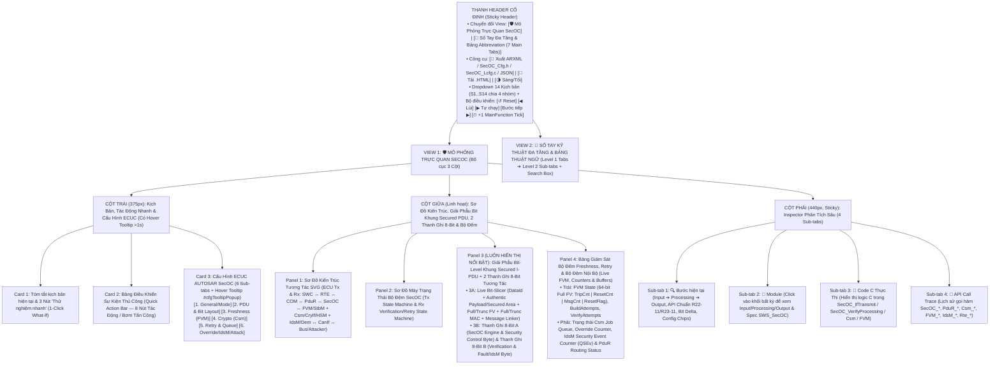
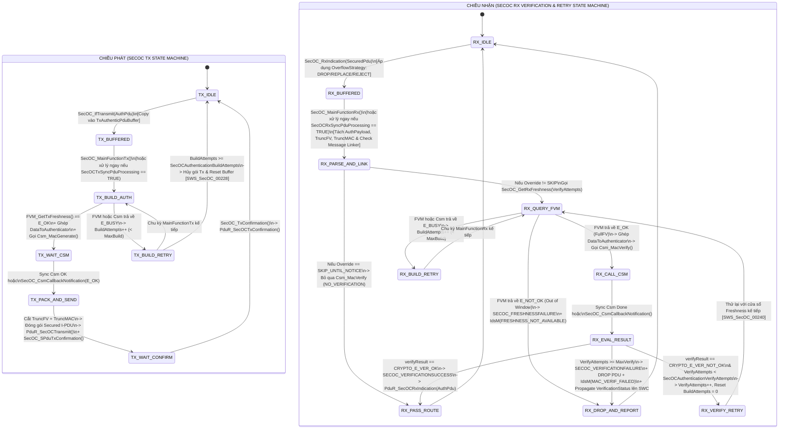

# Tài Liệu Thiết Kế Chi Tiết Trình Mô Phỏng AUTOSAR SecOC (`SecOC_Simulation_design.md`)

> **Trạng thái tài liệu:** Bản thiết kế chi tiết đã cập nhật theo xác nhận `A1`–`A4` của User — Sẵn sàng để User review trước khi triển khai code.  
> **File đích dự kiến xuất bản:** `d:\__Personal\AntiGravity\AUTOSAR_SecOC.html` (Ứng dụng Web Tương tác 1 file HTML độc lập, 100% Offline, Pure CSS, có nút tải `.HTML` kèm cấu hình nhúng & xuất code `ARXML / SecOC_Cfg.h / SecOC_Lcfg.c / JSON` để chia sẻ).  
> **Chuẩn tham chiếu:** **AUTOSAR Classic Platform R20-11 / R22-11 / R23-11 (`SWS_SecOC`, `SWS_PduR`, `SWS_Csm`, `SWS_CryIf`, `SWS_IdsM`, `SWS_StbM`, `SWS_COM`, `SWS_Rte`)**, đính kèm mã requirement chuẩn **`SWS_SecOC_xxxxx`** tại từng bước xử lý, thanh giải phẫu Bit-level, 2 thanh ghi 8-Bit, tooltip cấu hình và sổ tay tra cứu đa tầng.

---

## 1. Tổng Quan Định Hướng Thiết Kế Đã Chốt (`A1` – `A4`)

| Hạng mục | Nội dung thiết kế đã xác nhận với User |
| :--- | :--- |
| **1. Bố cục giao diện & Phạm vi hệ sinh thái (`A1`)** | Kết hợp tinh hoa của **`AUTOSAR_DEM.html`**, **`AUTOSAR_CanSM.html`** và **`AUTOSAR_RTE.html`**:<br>• **Bố cục 3 cột hiện đại**: Cột trái (`375px`: Kịch bản, Quick Action Bar, 6 Sub-tabs Cấu hình ECUC) — Cột giữa (`Linh hoạt`: Sơ đồ kiến trúc End-to-End Tx/Rx SVG + Sơ đồ State/Sequence + Thanh giải phẫu Bit-level `Secured I-PDU` + 2 Thanh ghi 8-Bit luôn hiển thị nổi bật + Bảng bộ đệm/bộ đếm nội bộ) — Cột phải (`440px`: Inspector 4 Sub-tabs).<br>• **Sơ đồ kiến trúc End-to-End cả 2 chiều Tx & Rx**: Bao phủ đầy đủ `SWC_App / SWC_SecMon / SWC_Diag` ↔ `RTE / SchM` ↔ `COM / Dcm` ↔ `PduR` ↔ **`SecOC (Tx & Rx)`** ↔ `FVM / StbM` + `Csm / CryIf / Crypto (HSM)` + `IdsM / Dem / Det` ↔ `CanIf / CanTp / SoAd` (kèm khối `Attacker MITM / Replay Node` trên Bus).<br>• **Config Hover Tooltip (`> 1s` delay)** giống hệt `AUTOSAR_DEM.html` (`#cfgTooltipPopup` hiển thị tên tham số, đường dẫn ECUC, mã `SWS_SecOC_xxxxx`, mô tả, dải giá trị, giá trị typical và lưu ý kỹ thuật).<br>• **Công cụ xuất mã & chia sẻ**: Xuất `ARXML / SecOC_Cfg.h / SecOC_Lcfg.c / JSON` và nút tải file `.HTML` độc lập chạy offline. |
| **2. Khu vực Giám sát Bit-level & 2 Thanh ghi 8-Bit (`A2`)** | Đặt **cố định và nổi bật ở Cột Giữa (Panel 3)** gồm **2 tầng trực quan hóa Bit**:<br>• **Tầng 1 — Thanh Giải Phẫu Bit-Level Khung `Secured I-PDU` & `DataToAuthenticator` (`Live Bit-Slicer & Non-Byte-Aligned Packing Inspector`)**: Minh họa trực quan cách ghép `[DataId (16b) | Authentic Payload / Secured Area | Full Freshness Value (64b)]` ➔ tính `Full MAC (128b)` ➔ **Cắt bit (`Truncated FV` + `Truncated MAC`, kể cả trường hợp lẻ bit không tròn byte như `4-bit FV + 28-bit MAC`)** và đóng gói vào `Secured I-PDU` (hoặc tách thành `Authentic PDU` + `Cryptographic PDU` nối bằng `Message Linker`).<br>• **Tầng 2 — 2 Thanh ghi 8-Bit tương tác song song**:<br>  1. **Thanh A (`8-Bit SecOC Engine & Security Processing Byte`)**: Theo dõi trạng thái xử lý nội bộ (`SECOC_RX_DROP_BLOCKED`, `IDSM_SEV_REPORTED`, `OVERRIDE_OR_DEFAULT_AUTH`, `RETRY_ATTEMPT_ACTIVE`, `CSM_ASYNC_WAIT`, `FVM_SYNC_VALID`, `MAC_OP_SUCCESS`, `AUTH_PDU_ROUTED_OK`).<br>  2. **Thanh B (`8-Bit Verification Status & Attack/Fault Diagnostic Byte`)**: Giải mã chi tiết kết quả `SecOC_VerificationResultType` (`VERIFICATION_SUCCESS`, `MAC_VERIFICATION_FAILURE`, `FRESHNESS_FAILURE`, `NO_VERIFICATION_SKIP`, `MAC_SERVICE_FAILURE`, `SPLIT_LINK_MISMATCH`, `OVERFLOW_REJECT_REPLACE`, `SECOC_INITIALIZED`). |
| **3. Hệ thống Kịch bản (`A3`)** | Thiết kế sẵn **14 Kịch bản chạy mẫu (`S1`–`S14`)** chia làm 4 nhóm lớn:<br>• **Nhóm 1 (`S1`–`S4`)**: Luồng chuẩn Tx & Rx (`SecOC_IfTransmit` / `SecOC_RxIndication`), so sánh `Direct Sync` vs `MainFunction Async HSM`, cắt bit lẻ (`4-bit FV + 28-bit MAC`) và tính năng **Secured Area** (chỉ xác thực một vùng dữ liệu nhạy cảm trong I-PDU).<br>• **Nhóm 2 (`S5`–`S7`)**: Đồng bộ `Freshness Value` (`FVM` / `StbM`) & Cơ chế tự phục hồi bằng thử lại: **`SecOCAuthenticationBuildAttempts`** (khi `Csm`/`FVM` báo `E_BUSY`) và **`SecOCAuthenticationVerifyAttempts`** (khi rớt gói tin trên bus làm lệch bộ đếm `MsgCnt`).<br>• **Nhóm 3 (`S8`–`S10`)**: Tấn công mạng & Phòng thủ an ninh: Tấn công sửa đổi dữ liệu (**Spoofing / Tampering**), Tấn công phát lại (**Replay Attack**), lỗi hết hạn `StbM Timestamp` ➔ `SecOC` chặn gói tin (**DROP**), báo **`IdsM_SetSecurityEvent()`** và gửi `VerificationStatus` lên `SWC`.<br>• **Nhóm 4 (`S11`–`S14`)**: Tính năng nâng cao & Liên thông `SWC`: **Split Secured I-PDU Collection** (`Authentic PDU` + `Cryptographic PDU` nối bằng `Message Linker`), **`SecOC_VerifyStatusOverride()`** từ `SWC_Diag`, **`SecOC_SendDefaultAuthenticationInformation()`**, xử lý tràn bộ đệm `SecOCReceptionOverflowStrategy` (`DROP` / `REPLACE` / `REJECT`) và luồng `SecOC_TpTransmit / TpRx` (CAN-FD / DoIP). |
| **4. Sổ tay tra cứu đa tầng & Bảng Abbreviation (`A4`)** | **View 2 (`📖 Sổ Tay Kỹ Thuật SecOC & Từ Điển Thuật Ngữ`)** được tổ chức theo cấu trúc **Đa Tầng (Multi-level Tabs)**:<br>• **6 Main Sub-tabs (Level 1) × 4 Chủ đề con (Level 2 Pills/Tabs = 24 chuyên đề)**.<br>• **Tab 7 chuyên biệt: `🔤 Bảng Thuật Ngữ & Từ Viết Tắt (Abbreviation Table)`** trình bày dưới dạng bảng chuẩn, tích hợp **Search Box tìm kiếm tức thời (Live Search)** và các nút lọc nhanh theo phân nhóm (`SecOC Core`, `Freshness/FVM`, `Crypto/Csm/HSM`, `Security/IdsM`, `AUTOSAR Stack`). |

---

## 2. Bố Cục Giao Diện 3 Cột & Hệ Thống Sub-Tabs (UI Wireframe)



---

## 3. Thiết Kế Chi Tiết Panel 3 (Cột Giữa): Giải Phẫu Bit-Level Khung `Secured I-PDU` & 2 Thanh Ghi 8-Bit Tương Tác

Một trong những điểm khó hình dung nhất khi làm việc với `SecOC` trong thực tế là: **Cách `SecOC` ghép chuỗi bit `DataToAuthenticator`, cắt tỉa từng bit (`Bit-level Truncation`) của `Freshness Value` và `MAC` (thường không nằm chẵn trên biên Byte!), đóng gói vào `Secured I-PDU`, và cập nhật các bit trạng thái xác thực**. Do đó, Panel 3 ở Cột Giữa được thiết kế gồm **2 phần trực quan hóa liên thông**:

### 3.1. Phần 3A — Thanh Giải Phẫu Bit-Level Khung `DataToAuthenticator` ➔ `Secured I-PDU` (Live Bit-Slicer)

```text
+-------------------------------------------------------------------------------------------------------------------+
| 🧬 GIẢI PHẪU BIT-LEVEL: DATA-TO-AUTHENTICATOR ➔ CẮT BIT (TRUNCATION) ➔ KHUNG SECURED I-PDU TRÊN BUS CAN/CAN-FD     |
+-------------------------------------------------------------------------------------------------------------------+
| 1. ĐẦU VÀO TÍNH MAC (`DataToAuthenticator` đưa vào `Csm_MacGenerate` / `Csm_MacVerify` — [`SWS_SecOC_00046`]):     |
|  +------------------+----------------------------------------+-------------------------------------------------+  |
|  | SecOCDataId (16b)| Authentic Payload / Secured Area (32b) | Complete Freshness Value từ FVM (64 bits)       |  |
|  |     0x01A4       |   BrkTorque = 0x12, 0x34, 0x56, 0x78   | Trip:0x0005 | Rst:0x02 | MsgCnt:0x00001A | Flg:1|  |
|  +------------------+----------------------------------------+-------------------------------------------------+  |
|                                                        │                                                          |
|                                   ▼ Qua Csm (AES-128-CMAC, KeySlot #3 trong HSM)                                  |
|  Full MAC (128 bits): [ 9F 4A 2C 81 E7 03 B5 ... ] ──► Cắt lấy `SecOCAuthInfoTruncLength = 28 bits`: [ 0x9F4A2C8 ]|
|  Full FV  (64 bits) : [ 00 05 00 02 00 00 1A 9   ] ──► Cắt lấy `SecOCFreshnessValueTruncLength = 4 bits`: [ 0x9 ] |
|                                                        │                                                          |
| 2. KHUNG ĐÓNG GÓI TRÊN BUS (`Secured I-PDU` = 8 Bytes / 64 Bits — Đóng gói nối tiếp sát bit [`SWS_SecOC_00037`]): |
|  +--------------+--------------------------------------------+-------------------+-----------------------------+  |
|  | Header (Opt) | Authentic Payload (Bytes 0..3 = 32 bits)   | TruncFV (Bits 32..| TruncMAC (Bits 36..63 = 28b)|  |
|  |   (0 bits)   |     [ 0x12 ] [ 0x34 ] [ 0x56 ] [ 0x78 ]    |  ..35 = 4 bits)   | [0x9F] [0x4A] [0x2C] [0x8_] |  |
|  |              |  (Vùng tô sáng = Secured Area được bảo vệ) |     Bin: 1001b    | Byte 4..7 ghép chung FV+MAC!|  |
|  +--------------+--------------------------------------------+-------------------+-----------------------------+  |
+-------------------------------------------------------------------------------------------------------------------+
```

- **Tính năng tương tác trên Thanh Giải Phẫu Bit-Level**:
  - Khi người dùng thay đổi **`SecOCFreshnessValueTruncLength`** (ví dụ từ `8 bits` sang `4 bits` hoặc `0 bits`) và **`SecOCAuthInfoTruncLength`** (ví dụ từ `24 bits` sang `28 bits` hoặc `64 bits`), thanh Bit-Slicer lập tức vẽ lại vị trí bit bắt đầu/kết thúc, làm nổi bật các byte chứa cả phần dư của `TruncFV` và phần đầu của `TruncMAC`!
  - Khi bật **`UseSecuredArea = TRUE`** (`SecOCSecuredRxPduOffset = 1`, `SecOCSecuredRxPduLength = 2`), thanh Bit-Slicer chỉ tô sáng vùng `Bytes 1..2` được đưa vào `DataToAuthenticator`, còn `Byte 0` và `Byte 3` được đánh dấu `Unprotected Area (Không tính vào MAC)` — giúp người dùng hiểu ngay tại sao sửa đổi `Byte 0` không bị `Csm_MacVerify` phát hiện, nhưng sửa `Byte 1` lập tức gây lỗi `SECOC_VERIFICATIONFAILURE`!
  - Khi bật **`UseSplitSecuredPduCollection = TRUE`**, thanh Bit-Slicer tự động tách thành 2 khung riêng biệt: **`Authentic I-PDU`** và **`Cryptographic I-PDU`** với các bit **`Message Linker`** (`SecOCMessageLinkPos`, `SecOCMessageLinkLen`) được nối dây đối chiếu trực quan!

### 3.2. Phần 3B — 2 Thanh Ghi 8-Bit Trạng Thái Tương Tác Luôn Hiển Thị Nổi Bật

Ngay bên dưới thanh Bit-Slicer là **2 Thanh ghi 8-Bit tương tác** theo đúng phong cách của `AUTOSAR_DEM.html` và `AUTOSAR_CanSM.html`:

```text
+-------------------------------------------------------------------------------------------------------------------+
| 🔢 BẢNG GIÁM SÁT BITFIELD 8-BIT SECOC & VERIFICATION/IDSM (LIVE 8-BIT INSPECTOR) [Click vào từng Bit để giải mã]  |
| Bước #5: Csm_MacVerify() ➔ CRYPTO_E_VER_NOT_OK (Attack!) | Engine Byte: 0x04 ➔ 0xC0 | Verify Byte: 0x01 ➔ 0x83   |
+-------------------------------------------------------------------------------------------------------------------+
| A. THANH GHI 8-BIT ĐIỀU KHIỂN XỬ LÝ & AN NINH SECOC (`SecOC_EngineControlByte`) — Hex: [ 0xC0 ] Bin: [1100 0000b] |
|    Trạng thái PDU: [ RX_VERIFICATION_FAILED_DROPPED ] | Csm Job: [ IDLE ] | Retry: [ Build: 0/2 | Verify: 2/2 ]   |
|  +-------------+ +-------------+ +-------------+ +-------------+ +-------------+ +-------------+ +-------+ +-----+|
|  | Bit 7 (0x80)| | Bit 6 (0x40)| | Bit 5 (0x20)| | Bit 4 (0x10)| | Bit 3 (0x08)| | Bit 2 (0x04)| |Bit1(2)| |Bit 0||
|  |  PDU_DROP   | | IDSM_SEV_TX | |  OVERRIDE   | | RETRY_ACTV  | | CSM_ASYNC   | | FVM_SYNC_OK | |MAC_OK | |ROUTE||
|  |  1 (0➔1🛡️)  | |  1 (0➔1🚨)  | |      0      | |      0      | |      0      | |  0 (1➔0❌)  | |   0   | |  0  ||
|  | Dropped PDU!| | QSEv Sent!  | | Normal Auth | | Retry Done  | | Sync Mode   | | FV Exhausted| |MAC Bad| |Block||
|  +-------------+ +-------------+ +-------------+ +-------------+ +-------------+ +-------------+ +-------+ +-----+|
+-------------------------------------------------------------------------------------------------------------------+
| B. THANH GHI 8-BIT KẾT QUẢ XÁC THỰC & CHẨN ĐOÁN LỖI (`SecOC_VerificationDiagByte`) — Hex: [ 0x83 ]                |
|    SecOC_VerificationResultType: [ SECOC_VERIFICATIONFAILURE (0x01) ] | IdsM Event: [ SECOC_SEV_MAC_VERIF_FAILED ]|
|  +-------------+ +-------------+ +-------------+ +-------------+ +-------------+ +-------------+ +-------+ +-----+|
|  | Bit 7 (0x80)| | Bit 6 (0x40)| | Bit 5 (0x20)| | Bit 4 (0x10)| | Bit 3 (0x08)| | Bit 2 (0x04)| |Bit1(2)| |Bit 0||
|  | VRF_STAT_UP | | OVRFLW_LOSS | | LINK_MISMTC | | MAC_SVC_ERR | | NO_VRF_SKIP | | FRESH_FAIL  | |MAC_ERR| |INIT ||
|  |  1 (0➔1📡)  | |      0      | |      0      | |      0      | |      0      | |      0      | |1(0➔1) | |  1  ||
|  | Notify SWC! | | Queue OK    | | Link Match  | | Csm Svc OK  | | Full Check  | | FV Fetched  | |Spoof! | |Online|
|  +-------------+ +-------------+ +-------------+ +-------------+ +-------------+ +-------------+ +-------+ +-----+|
+-------------------------------------------------------------------------------------------------------------------+
```

#### 3.2.1. Giải Mã Chi Tiết Thanh A: `8-Bit SecOC Engine & Security Processing Byte` (`SecOC_EngineControlByte`)

| Bit | Mask | Tên Cờ (`SecOC Engine Bit`) | Ý nghĩa kỹ thuật & Khi nào bật lên `1` (`0 ➔ 1`) | Khi nào hạ về `0` (`1 ➔ 0`) |
| :-: | :-: | :--- | :--- | :--- |
| **Bit 7** | `0x80` | **`PDU_DROP_BLOCKED`** | Bật khi `SecOC` quyết định **chặn và hủy bỏ (Drop)** I-PDU nhận được do xác thực MAC thất bại (`SECOC_VERIFICATIONFAILURE`), lỗi bộ đếm Freshness (`SECOC_FRESHNESSFAILURE`), lỗi dịch vụ Csm (`SECOC_MACSERVICEFAILURE`), hoặc do lệnh `SecOC_VerifyStatusOverride(DROP_UNTIL_NOTICE)` (`SWS_SecOC_00087`). Gói tin tuyệt đối không được chuyển lên `PduR_SecOCRxIndication()`. | Hạ về `0` khi bắt đầu xử lý một I-PDU mới hoặc khi xác thực thành công / được Override cho phép đi qua. |
| **Bit 6** | `0x40` | **`IDSM_SEV_REPORTED`** | Bật khi `SecOC` phát hiện dấu hiệu tấn công hoặc lỗi an ninh và gọi **`IdsM_SetSecurityEvent()`** (`SWS_SecOC_91015`) để báo cáo một trong các sự kiện: `SECOC_SEV_MAC_VERIFICATION_FAILED`, `SECOC_SEV_FRESHNESS_NOT_AVAILABLE`, hoặc `SECOC_SEV_RX_PDU_DROPPED` lên `IdsM`. | Hạ về `0` khi reset chu kỳ nhận mới hoặc khi xác thực gói tin tiếp theo thành công. |
| **Bit 5** | `0x20` | **`OVERRIDE_OR_DEF_AUTH`** | Bật ở chiều **Rx** khi `SWC_Diag` kích hoạt **`SecOC_VerifyStatusOverride()`** (`SKIP_UNTIL_NOTICE` / `PASS_N_TIMES` / `DROP_UNTIL_NOTICE` — `SWS_SecOC_00122`), hoặc bật ở chiều **Tx** khi kích hoạt **`SecOC_SendDefaultAuthenticationInformation(TRUE)`** để điền mẫu mặc định `SecOCDefaultAuthenticationInformationPattern` (ví dụ `0xFF`) thay vì gọi `Csm_MacGenerate` (`SWS_SecOC_91012`). | Hạ về `0` khi gọi `SecOC_VerifyStatusOverride(SECOC_OVERRIDE_CANCEL)` (hoặc khi đã đếm hết `numberOfMessagesToOverride = 0`) hoặc tắt `SendDefaultAuthenticationInformation(FALSE)`. |
| **Bit 4** | `0x10` | **`RETRY_ATTEMPT_ACTIVE`** | Bật khi `SecOC_MainFunctionTx/Rx` đang ở trong vòng lặp thử lại: tăng bộ đếm **`AuthenticationBuildAttempts`** (khi `FVM` hoặc `Csm` trả về `E_BUSY` / `CRYPTO_E_BUSY` — `SWS_SecOC_00226`) hoặc tăng bộ đếm **`AuthenticationVerifyAttempts`** (khi `Csm_MacVerify` báo `CRYPTO_E_VER_NOT_OK` và `SecOC` yêu cầu `FVM` thử giá trị Freshness tiếp theo — `SWS_SecOC_00240`). | Hạ về `0` ngay khi lần thử lại thành công, hoặc khi bộ đếm chạm trần `SecOCAuthenticationBuildAttempts` / `SecOCAuthenticationVerifyAttempts` và kết thúc bằng lỗi. |
| **Bit 3** | `0x08` | **`CSM_ASYNC_WAIT`** | Bật khi `SecOC` gọi `Csm_MacGenerate()` hoặc `Csm_MacVerify()` ở chế độ **Bất đồng bộ (`ASYNCHRONOUS` qua phần cứng HSM)** và đang ở trạng thái chờ callback **`SecOC_CsmCallbackNotification(job, result)`** trả về (`SWS_SecOC_00072`). | Hạ về `0` ngay khi hàm `SecOC_CsmCallbackNotification()` được `Csm` / `CryIf` gọi ngược lại, hoặc khi chạy ở chế độ Đồng bộ (`SYNCHRONOUS`). |
| **Bit 2** | `0x04` | **`FVM_SYNC_VALID`** | Bật khi `SecOC` gọi **`SecOC_GetTxFreshness()`** hoặc **`SecOC_GetRxFreshness()`** (hoặc qua `SPort` RTE) và nhận về `E_OK` kèm giá trị `Complete Freshness Value` (64-bit) hợp lệ nằm trong cửa sổ đồng bộ (`Delta <= FvmMaxDeltaWindow`). | Hạ về `0` khi `FVM` trả về `E_NOT_OK` (giá trị `TruncFV` nằm ngoài cửa sổ chống phát lại hoặc `StbM` mất đồng bộ thời gian) hoặc trả về `E_BUSY`. |
| **Bit 1** | `0x02` | **`MAC_OP_SUCCESS`** | Bật ở chiều **Tx** khi `Csm_MacGenerate()` sinh chữ ký CMAC/HMAC thành công (`E_OK`), hoặc ở chiều **Rx** khi `Csm_MacVerify()` kiểm tra chữ ký khớp hoàn toàn và trả về **`*verifyPtr == CRYPTO_E_VER_OK`** (`SWS_SecOC_00048`). | Hạ về `0` khi `Csm_MacVerify()` trả về `CRYPTO_E_VER_NOT_OK` (sai MAC do giả mạo hoặc lệch Freshness), hoặc khi `Csm` báo lỗi dịch vụ (`E_NOT_OK` / `CRYPTO_E_KEY_EMPTY`). |
| **Bit 0** | `0x01` | **`AUTH_PDU_ROUTED_OK`** | Bật ở chiều **Tx** khi `SecOC` đã đóng gói xong `Secured I-PDU` và đẩy thành công xuống **`PduR_SecOCTransmit()`** (`SWS_SecOC_00038`), hoặc ở chiều **Rx** khi `SecOC` đã bóc tách `Authentic I-PDU` đã xác thực và chuyển lên **`PduR_SecOCRxIndication()`** cho `COM` ➔ `RTE` ➔ `SWC` (`SWS_SecOC_00050`). | Hạ về `0` khi bắt đầu chu kỳ PDU mới hoặc khi gói tin bị chặn (`Bit 7 = 1`). |

#### 3.2.2. Giải Mã Chi Tiết Thanh B: `8-Bit Verification Status & Attack/Fault Diagnostic Byte` (`SecOC_VerificationDiagByte`)

| Bit | Mask | Tên Cờ (`Verification & Fault Bit`) | Ý nghĩa kỹ thuật & Liên hệ với `SecOC_VerificationResultType` (`SWS_SecOC_00149`) |
| :-: | :-: | :--- | :--- |
| **Bit 7** | `0x80` | **`VERIF_STATUS_PROPAGATED`** | Bật khi `SecOC` gửi thông báo kết quả xác thực (`SecOC_VerificationStatusType`) lên tầng `SWC` qua cổng RTE `Rte_Write_VerificationStatus_verificationStatus()` hoặc hàm `SecOC_VerificationStatusCallout()` (tùy cấu hình `SecOCVerificationStatusPropagationMode = BOTH / FAILURE_ONLY` và `SecOCPropagateOnlyFinalVerificationStatus`). |
| **Bit 6** | `0x40` | **`RX_OVERFLOW_EVENT`** | Bật khi một `Secured I-PDU` mới đến tại `SecOC_RxIndication()` trong lúc bộ đệm của PDU đó vẫn đang bận xử lý gói cũ (`Csm` chưa trả kết quả), kích hoạt chính sách **`SecOCReceptionOverflowStrategy`** (`DROP` gói mới, `REPLACE` ghi đè gói cũ, hoặc `REJECT` trả lỗi cho `PduR` — `SWS_SecOC_00214`). |
| **Bit 5** | `0x20` | **`SPLIT_LINK_MISMATCH`** | Bật khi dùng **Split Secured I-PDU Collection** (`Authentic PDU` + `Cryptographic PDU` đi riêng) mà giá trị **`Message Linker`** trích xuất tại vị trí `SecOCMessageLinkPos` (độ dài `SecOCMessageLinkLen` bits) của 2 gói không khớp nhau (`SWS_SecOC_00208`). |
| **Bit 4** | `0x10` | **`MAC_SERVICE_FAILURE`** | Bật khi kết quả xác thực là **`SECOC_MACSERVICEFAILURE (0x05)`**: Không thể tạo hoặc kiểm tra MAC do lỗi phần cứng/dịch vụ `Csm` (vượt quá `SecOCAuthenticationBuildAttempts` vì `CRYPTO_E_BUSY`, hoặc Key Slot trong HSM chưa nạp khóa `CRYPTO_E_KEY_EMPTY`). |
| **Bit 3** | `0x08` | **`NO_VERIFICATION_SKIP`** | Bật khi kết quả là **`SECOC_NO_VERIFICATION (0x02)`** hoặc **`SECOC_VERIFICATIONFAILURE_OVERWRITTEN (0x04)`**: Bỏ qua kiểm tra `Csm_MacVerify` hoặc cưỡng bức cho qua theo lệnh `SecOC_VerifyStatusOverride()` từ `SWC_Diag`. |
| **Bit 2** | `0x04` | **`FRESHNESS_FAILURE`** | Bật khi kết quả là **`SECOC_FRESHNESSFAILURE (0x03)`**: `FVM` trả về `E_NOT_OK` khi gọi `SecOC_GetRxFreshness()` (ví dụ: gói tin Replay có bộ đếm cũ đã nằm ngoài cửa sổ, hoặc `StbM` mất đồng bộ thời gian), kèm báo `IdsM` `SECOC_SEV_FRESHNESS_NOT_AVAILABLE`. |
| **Bit 1** | `0x02` | **`MAC_VERIF_FAILURE`** | Bật khi kết quả là **`SECOC_VERIFICATIONFAILURE (0x01)`**: `Csm_MacVerify()` trả về **`CRYPTO_E_VER_NOT_OK`** sau khi đã thử hết `SecOCAuthenticationVerifyAttempts` (do kẻ tấn công sửa đổi Payload/MAC hoặc phát lại gói tin cũ), kèm báo `IdsM` `SECOC_SEV_MAC_VERIFICATION_FAILED`. |
| **Bit 0** | `0x01` | **`SECOC_INITIALIZED`** | Bật (`1`) khi `SecOC_Init(&SecOC_Config)` đã chạy thành công (`SecOC_State == SECOC_ONLINE`). Nếu bằng `0` (`SECOC_UNINIT`), mọi lời gọi `SecOC_IfTransmit` / `SecOC_RxIndication` đều bị từ chối và báo lỗi `Det_ReportError(SECOC_E_UNINIT = 0x02)`. |

---

## 4. Phân Tích Xử Lý Từng Module: Input Lấy Từ Đâu, Xử Lý Gì, Output Route Đến Đâu

Mọi khối trên sơ đồ kiến trúc SVG đều có thể **click vào để xem giải thích chi tiết** ở cột phải (Tab `🧩 Module`) và được tổng hợp đầy đủ trong **Tab 1 của Sổ tay**:

| # | Module / Phân khối | Lớp AUTOSAR | 📥 Input lấy từ đâu? | ⚙️ Cách xử lý nội bộ (Processing, Buffers, Counters & State) | 📤 Output route đến đâu & Hàm API chuẩn (R22-11 / R23-11) |
| :-: | :--- | :--- | :--- | :--- | :--- |
| **1** | **`SWC_App`, `SWC_SecMon` & `SWC_Diag`**<br>*(Application Layer)* | Application Layer | • **Đường dữ liệu**: Nhận tín hiệu đã xác thực từ `COM` qua `RTE` (`Rte_Read_RPort_BrakeCmd`).<br>• **Đường trạng thái SecOC**: `SWC_SecMon` nhận cấu trúc `SecOC_VerificationStatusType` từ `SecOC` qua `RTE` (`Rte_Read_VerificationStatus` hoặc `VerificationStatusNotification`). | • **`SWC_App`**: Tạo dữ liệu điều khiển nhạy cảm (ví dụ: `BrakeTorqueCmd`, `SteerAngle`) và gửi qua `Rte_Write` ➔ `COM` (chiều Tx), hoặc chỉ thực thi lệnh phanh/lái khi gói tin Rx đã vượt qua kiểm tra `SecOC`.<br>• **`SWC_SecMon`**: Giám sát thông báo `verificationStatus` từ `SecOC`. Nếu phát hiện `SECOC_VERIFICATIONFAILURE` hoặc `SECOC_FRESHNESSFAILURE` liên tiếp trên một `secOCDataId`, kích hoạt chế độ an toàn (Safe State / Degraded Mode).<br>• **`SWC_Diag`**: Trong chế độ kiểm thử nhà máy hoặc dịch vụ UDS `0x31 RoutineControl`, gọi cổng Client-Server xuống `SecOC` để tạm thời ghi đè trạng thái xác thực (`VerifyStatusOverride`) hoặc yêu cầu phát thông tin xác thực mặc định (`SendDefaultAuthenticationInformation`). | • Gọi dữ liệu qua **RTE ↔ COM**:<br>`Rte_Write_<P>_<Sig>()` / `Rte_Read_<R>_<Sig>()`<br>• Gọi dịch vụ **SecOC** qua **RTE** (`SWS_SecOC_00122`, `SWS_SecOC_91012`):<br>`Rte_Call_VerifyStatusOverride_VerifyStatusOverride(ValueId, overrideStatus, numMsgs)`<br>`Rte_Call_SendDefaultAuthenticationInformation_SendDefaultAuthenticationInformation(FreshnessValueID, sendDefault)` |
| **2** | **`RTE` & `SchM`**<br>*(Runtime Environment & BSW Scheduler)* | RTE Layer | • Lời gọi từ `SWC` và từ `SecOC` (khi `SecOC` báo `VerificationStatus` hoặc gọi `FVM` qua `SPort`).<br>• Xung nhịp định kỳ từ `AUTOSAR OS` (`Task_Bsw_5ms` / `10ms`). | • **RTE**: Kết nối các cổng Service Ports của `SecOC` (`VerificationStatus`, `VerifyStatusOverride`, `SendDefaultAuthenticationInformation`, `FreshnessManagement`) với các `SWC` tương ứng.<br>• **SchM**: Định kỳ gọi **`SecOC_MainFunctionTx()`** và **`SecOC_MainFunctionRx()`** để xử lý các I-PDU đang nằm trong hàng đợi bất đồng bộ.<br>• Cung cấp cơ chế khóa vùng găng (`ExclusiveArea`) bảo vệ bộ đệm `SecOC` khi có ngắt `SecOC_RxIndication` hoặc `SecOC_CsmCallbackNotification` xảy ra đồng thời với `MainFunction`. | • Gọi định kỳ vào **SecOC**:<br>`SecOC_MainFunctionTx()` [`SWS_SecOC_00176`]<br>`SecOC_MainFunctionRx()` [`SWS_SecOC_00171`]<br>• Gọi lên **SWC** từ **SecOC**:<br>`Rte_Write_PS_VerificationStatus_verificationStatus(&status)`<br>• Bảo vệ vùng găng **SecOC**:<br>`SchM_Enter_SecOC_SECOC_EXCLUSIVE_AREA_TX/RX()` |
| **3** | **`AUTOSAR COM` & `Dcm`**<br>*(Upper Layer Comm / Diag)* | Communication / Diag Services | • Chiều Tx: Nhận `Com_SendSignal()` từ `RTE`/`SWC` hoặc bản tin chẩn đoán bảo mật từ `Dcm`.<br>• Chiều Rx: Nhận `Com_RxIndication()` / `Com_TpRxIndication()` từ `PduR` **chỉ sau khi `SecOC` đã xác thực thành công**. | • **Chiều Tx**: Đóng gói các Signals vào **`Authentic I-PDU`** (chỉ chứa dữ liệu ứng dụng thuần túy, ví dụ `4 bytes`) và gọi `PduR_ComTransmit()`.<br>• **Chiều Rx**: Chỉ nhận được `Authentic I-PDU` đã được `SecOC` cắt bỏ phần đuôi `TruncFV + TruncMAC`. Nếu `SecOC` phát hiện giả mạo và `DROP` gói tin, `COM` không nhận được `Com_RxIndication` (nếu kéo dài sẽ kích hoạt `Com Rx Deadline Monitoring Timeout` để báo cho `SWC` biết đường truyền đang mất gói hợp lệ). | • Chiều Tx gọi xuống **PduR**:<br>`PduR_ComTransmit(TxPduId, &PduInfo)`<br>• Chiều Rx nhận từ **PduR**:<br>`Com_RxIndication(RxPduId, &PduInfo)`<br>`Com_TpRxIndication(RxPduId, result)` |
| **4** | **`PduR`**<br>*(PDU Router)* | Communication Services | • Chiều Tx: Nhận `Authentic I-PDU` từ `COM` (`PduR_ComTransmit`) và nhận `Secured I-PDU` đã ký từ `SecOC` (`PduR_SecOCTransmit`).<br>• Chiều Rx: Nhận `Secured I-PDU` từ `CanIf`/`CanTp` (`PduR_CanIfRxIndication`) và nhận `Authentic I-PDU` đã xác thực từ `SecOC` (`PduR_SecOCRxIndication`). | • Đóng vai trò **trạm trung chuyển bắt buộc (U-Turn Routing)** cho `SecOC`:<br>  - **Tx Route**: `COM` ➔ `PduR_ComTransmit` ➔ `SecOC_IfTransmit` ➔ *(SecOC ký MAC)* ➔ `PduR_SecOCTransmit` ➔ `CanIf_Transmit`.<br>  - **Rx Route**: `CanIf` ➔ `PduR_CanIfRxIndication` ➔ `SecOC_RxIndication` ➔ *(SecOC kiểm tra MAC)* ➔ nếu `OK` mới gọi `PduR_SecOCRxIndication` ➔ `Com_RxIndication`.<br>• Khi dùng **Split Secured I-PDU Collection**, `PduR` định tuyến cả 2 gói (`Authentic I-PDU` và `Cryptographic I-PDU`) giữa `SecOC` và `CanIf`. | • Gọi vào **SecOC**:<br>`SecOC_IfTransmit()`, `SecOC_TpTransmit()`, `SecOC_CancelTransmit()`, `SecOC_RxIndication()`, `SecOC_TxConfirmation()`, `SecOC_TriggerTransmit()`, `SecOC_StartOfReception()`, `SecOC_CopyRxData()`, `SecOC_CopyTxData()`<br>• Nhận từ **SecOC**:<br>`PduR_SecOCTransmit()`, `PduR_SecOCRxIndication()`, `PduR_SecOCTxConfirmation()` |
| **5** | **`SecOC Core Engine`**<br>*(Secure Onboard Communication)* | Communication Services | • Nhận `Authentic I-PDU` (Tx) và `Secured I-PDU` (Rx) từ `PduR`.<br>• Nhận `Complete Freshness Value` từ `FVM`.<br>• Nhận kết quả tạo/kiểm tra MAC từ `Csm` (trực tiếp hoặc qua `SecOC_CsmCallbackNotification`).<br>• Nhận lệnh `VerifyStatusOverride` & `SendDefaultAuthenticationInformation` từ `SWC`/`RTE`. | • **1. Quản lý bộ đệm Tx/Rx & Overflow**: Lưu giữ `Authentic PDU` / `Secured PDU` và áp dụng `SecOCReceptionOverflowStrategy` (`DROP`, `REPLACE`, `REJECT`).<br>• **2. Xây dựng `DataToAuthenticator` (`SWS_SecOC_00046`)**: Ghép nối `SecOCDataId (16-bit Big-Endian)` + `Authentic Payload` (hoặc vùng con `Secured Area` theo `Offset`/`Length`) + `Complete Freshness Value (N bits)`.<br>• **3. Phối hợp `FVM` & `Csm` có Retry**: Quản lý bộ đếm **`AuthenticationBuildAttempts`** (khi `FVM`/`Csm` bận) và **`AuthenticationVerifyAttempts`** (thử lại với cửa sổ Freshness kế tiếp khi `CRYPTO_E_VER_NOT_OK`).<br>• **4. Cắt & Đóng gói Bit (`Bit Truncation & Packing`)**: Cắt `FV` theo `SecOCFreshnessValueTruncLength` và cắt `MAC` theo `SecOCAuthInfoTruncLength`, đóng gói vào `Secured I-PDU` (hoặc tách `Authentic PDU` + `Crypto PDU` kèm `Message Linker`).<br>• **5. Quyết định An ninh & Báo cáo**: Chặn gói lỗi (`DROP`), báo `IdsM_SetSecurityEvent()`, và đẩy `VerificationStatus` lên `SWC`. | • Gọi sang **FVM**:<br>`SecOC_GetTxFreshness()`, `SecOC_GetTxFreshnessTruncData()`, `SecOC_SPduTxConfirmation()`, `SecOC_GetRxFreshness()`, `SecOC_GetRxFreshnessAuthData()`<br>• Gọi xuống **Csm**:<br>`Csm_MacGenerate()`, `Csm_MacVerify()`<br>• Gọi sang **PduR**:<br>`PduR_SecOCTransmit()`, `PduR_SecOCRxIndication()`<br>• Báo sang **IdsM, RTE, Dem & Det**:<br>`IdsM_SetSecurityEvent()`, `Rte_Write_VerificationStatus()`, `Det_ReportError()`, `Det_ReportRuntimeError()` |
| **6** | **`FVM` & `StbM`**<br>*(Freshness Value Manager & Time-Base Manager)* | Security / System Services | • Được `SecOC` gọi khi cần lấy `Freshness Value` để ký (Tx) hoặc khôi phục `Complete Freshness Value` từ `Truncated FV` (Rx).<br>• Nhận xung thời gian đồng bộ hoặc `TripCounter / ResetCounter` từ `StbM` / `NvM`. | • Duy trì **Giá trị tươi mới đầy đủ (`Complete Freshness Value`, tối đa 64 bits)** để chống tấn công phát lại (**Anti-Replay**):<br>  - **Chế độ 1 (Single Monotonic Counter)**: Bộ đếm 64-bit tăng dần sau mỗi bản tin.<br>  - **Chế độ 2 (JASPAR / AUTOSAR Composite Counter)**: Ghép `[TripCounter (16b) | ResetCounter (8b) | MessageCounter (24..36b) | ResetFlag (1..4b)]`.<br>  - **Chế độ 3 (`StbM` Synchronized Timestamp)**: Dùng nhãn thời gian toàn cục từ `StbM_GetCurrentTime()`.<br>• **Thuật toán khôi phục Rx (`GetRxFreshness`)**: Nhận `Truncated FV` (ví dụ 4 bit thấp) và số lần thử `VerifyAttempts`. Nếu `TruncFV >= LSB(LastValidFV)`, giữ nguyên phần MSB; nếu `TruncFV < LSB(LastValidFV)` (tràn bit thấp), tự động cộng `+1` vào phần MSB (`Carry-over`). Khi `VerifyAttempts > 0`, dịch chuyển cửa sổ sang chu kỳ kế tiếp để bù gói tin bị rớt! | • Trả về cho **SecOC**:<br>`E_OK` (kèm mảng bit `FullFreshnessValue` và `TruncatedFreshnessValue`), `E_BUSY` (để `SecOC` tăng `BuildAttempts`), hoặc `E_NOT_OK` (ngoài cửa sổ hợp lệ ➔ `SECOC_FRESHNESSFAILURE`). |
| **7** | **`Csm`**<br>*(Crypto Service Manager)* | Crypto Service Layer | • Nhận yêu cầu `Csm_MacGenerate(jobId, ...)` và `Csm_MacVerify(jobId, ...)` từ `SecOC`.<br>• Nhận thông báo hoàn thành từ `CryIf` (`Csm_CallbackNotification`). | • Quản lý hàng đợi công việc mật mã (**Csm Job Queue**) và kiểm tra quyền truy cập khóa (`KeyId`).<br>• Nếu Job cấu hình **`SYNCHRONOUS`**: Gọi thẳng xuống `CryIf_ProcessJob()` và trả kết quả ngay trong cùng lệnh gọi.<br>• Nếu Job cấu hình **`ASYNCHRONOUS`**: Đưa Job vào hàng đợi (nếu đầy trả về `CRYPTO_E_BUSY` / `CRYPTO_E_QUEUE_FULL`), xử lý trong `Csm_MainFunction()` và gọi ngược **`SecOC_CsmCallbackNotification(job, result)`** khi phần cứng `HSM` hoàn tất. | • Gọi xuống **CryIf**:<br>`CryIf_ProcessJob(channelId, jobPtr)`<br>• Gọi Callback lên **SecOC** (`SecOC_Cbk.h`):<br>`SecOC_CsmCallbackNotification(job, result)` [`SWS_SecOC_00072`] |
| **8** | **`CryIf` & `Crypto Driver (HSM / SHE)`** | Crypto Abstraction & MCAL / Hardware | • Nhận `CryIf_ProcessJob` từ `Csm`.<br>• Truy cập **Hardware Security Module (`HSM` / `SHE`)** chứa khóa bí mật `SecOC_SymmetricKey_128` trong vùng nhớ chống đọc trộm. | • Thực thi thuật toán mật mã tốc độ cao trong phần cứng chuyên dụng:<br>  - **`AES-128-CMAC`** (phổ biến nhất cho CAN / CAN-FD theo chuẩn NIST SP 800-38B).<br>  - **`SipHash-2-4`** (MAC nhẹ tốc độ cao 64-bit).<br>  - **`HMAC-SHA256`** hoặc chữ ký bất đối xứng **`Ed25519 / ECDSA`** (dùng cho Ethernet / DoIP).<br>• So sánh bit-by-bit giữa `Calculated MAC` và `Received Truncated MAC` với độ dài `macLength` (tính bằng **bits**), trả về `CRYPTO_E_VER_OK (0x00)` hoặc `CRYPTO_E_VER_NOT_OK (0x01)`. | • Trả về kết quả mật mã cho **Csm**:<br>`Std_ReturnType` (`E_OK`, `E_NOT_OK`, `CRYPTO_E_BUSY`, `CRYPTO_E_KEY_EMPTY`) và `Crypto_VerifyResultType` (`CRYPTO_E_VER_OK` / `CRYPTO_E_VER_NOT_OK`). |
| **9** | **`IdsM`, `Dem` & `Det`**<br>*(Security & Diagnostic Services)* | System / Security / Diag Services | • **`IdsM`**: Nhận `IdsM_SetSecurityEvent(securityEventId)` từ `SecOC`.<br>• **`Dem` / `Det`**: Nhận báo cáo lỗi phát triển và lỗi runtime từ `SecOC` (`ModuleId = 178 / 0x00B2`). | • **`IdsM` (Intrusion Detection System Manager)**: Bộ lọc sự kiện an ninh (Qualification Filter) tổng hợp các lần lỗi MAC / Freshness thành **QSEv (Qualified Security Event)** để gửi cảnh báo về SOC (Security Operations Center) hoặc lưu vào bộ nhớ bảo mật (`IdsR`).<br>• **`Det`**: Ghi nhận mã lỗi `SECOC_E_PARAM_POINTER (0x01)`, `SECOC_E_UNINIT (0x02)`, `SECOC_E_INVALID_PDU_SDU_ID (0x03)`, `SECOC_E_CRYPTO_FAILURE (0x04)`, `SECOC_E_INIT_FAILED (0x07)` lên bảng Trace. | • Hiển thị cảnh báo xâm nhập **`QSEv`** trên bảng `IdsM Inspector`, cập nhật **Thanh ghi 8-Bit A & B**, và ghi vào **API Call Trace**. |
| **10** | **`CanIf` / `CanTp` & `Bus / Attacker`**<br>*(Lower Layer & Physical Network)* | ECU Abstraction & Bus | • Chiều Tx: Nhận `Secured I-PDU` từ `PduR_SecOCTransmit`.<br>• Chiều Rx: Nhận khung vật lý từ Bus (có thể đi qua khối mô phỏng **`Attacker Node`**). | • Truyền/nhận khung `Secured I-PDU` trên đường truyền vật lý CAN (tối đa 8 bytes), CAN-FD (tối đa 64 bytes) hoặc Ethernet.<br>• **Khối `Attacker / Fault Node` trên Bus**: Cho phép người dùng chủ động tấn công trực tiếp vào khung đang bay trên bus: (1) Sửa byte dữ liệu `BrkTorque` (**Tampering**), (2) Ghi lại gói hợp lệ cũ rồi phát lại (**Replay Attack**), hoặc (3) Làm rớt N gói tin liên tiếp trên đường truyền (**Packet Loss**) để kiểm tra khả năng tự đồng bộ của `SecOC`. | • Đẩy khung vật lý lên **PduR ➔ SecOC**:<br>`PduR_CanIfRxIndication(RxPduId, &PduInfo)`<br>`PduR_CanIfTxConfirmation(TxPduId, result)` |

---

## 5. Thiết Kế Chi Tiết Máy Trạng Thái Bộ Đệm `SecOC_Tx` & `SecOC_Rx` (Panel 2)

Trên Panel 2 của Cột Giữa, sơ đồ máy trạng thái của cả 2 chiều **Tx (Tạo chữ ký & Đóng gói)** và **Rx (Giải bóc, Thử lại & Xác thực)** được hiển thị trực quan theo chuẩn `SWS_SecOC` R22-11/R23-11:



---

## 6. Danh Mục Đầy Đủ Các Trường Cấu Hình (Checkboxes & Textboxes — 6 Sub-Tabs) & Thiết Kế Hover Tooltip Giống File `DEM`

Ở Cột Trái (Card 3), toàn bộ các tham số cấu hình chuẩn ECUC `SecOC` được bố trí thành **Checkboxes, Textboxes, Number Spinners và Dropdowns** trong **6 Sub-tabs**.  
Mọi ô cấu hình đều gắn thuộc tính `data-cfg-key` và hỗ trợ **Floating Tooltip on Hover (`> 1s` delay hoặc click icon `ⓘ`) giống hệt `AUTOSAR_DEM.html`**.

### 6.1. Giao Diện & Cấu Trúc Dữ Liệu Của Floating Config Hover Tooltip (`#cfgTooltipPopup`)

Khi người dùng rê chuột giữ trên một ô cấu hình quá `1000ms` (hoặc bấm vào biểu tượng `ⓘ`), hộp thoại nổi `#cfgTooltipPopup` sẽ xuất hiện cạnh ô cấu hình với bố cục chuẩn của `AUTOSAR_DEM.html`:

```text
+----------------------------------------------------------------------------------------------------+
| 📘 Độ Dài Cắt Ngắn Mã Xác Thực MAC (Bits)                            [SWS_SecOC_00037 | ECUC_00027]|
| SecOC / SecOCRxPduProcessing (hoặc SecOCTxPduProcessing) / SecOCAuthInfoTruncLength               |
+----------------------------------------------------------------------------------------------------+
| Xác định số lượng bit (tính từ bit trọng số cao nhất - MSB) của mã xác thực MAC/Authenticator      |
| được giữ lại và đính kèm vào khung Secured I-PDU sau khi Csm_MacGenerate() hoàn tất. Ở phía nhận,  |
| đây là số bit MAC mà SecOC trích xuất để đưa vào Csm_MacVerify().                                  |
+-------------------------------------------------+--------------------------------------------------+
| Dải giá trị cho phép (Range):                   | Giá trị thường dùng (Typical):                   |
| 1 .. SecOCAuthInfoLength (1 .. 128 bits)        | 24 bits, 28 bits (CAN 2.0) hoặc 64 bits (CAN-FD) |
+-------------------------------------------------+--------------------------------------------------+
| 💡 Lưu ý kỹ thuật: Theo khuyến nghị an ninh AUTOSAR SecOC, tổng (SecOCFreshnessValueTruncLength +  |
| SecOCAuthInfoTruncLength) thường chọn là bội số của 8 bits (ví dụ: 4-bit FV + 28-bit MAC = 32 bits |
| = 4 Bytes) để vừa khít khung CAN 8-byte khi Payload dài 4 Bytes, dù bản thân từng trường lẻ bit!   |
+----------------------------------------------------------------------------------------------------+
```

### 6.2. Danh Sách Chi Tiết 32 Trường Cấu Hình Trong 6 Sub-Tabs

#### Sub-tab 1: `1. General/Mode` (`SecOCGeneral` — Cấu hình Chung & Chế độ Đồng bộ / Bất đồng bộ)
1. **Checkbox ☑️ `SecOCInitialized` (`SecOC_Init()` State)**: Bật/tắt trạng thái khởi tạo module `SecOC` (`Bit 0 SECOC_INITIALIZED`). Nếu tắt, mọi API trả về `E_NOT_OK` và gọi `Det_ReportError(SECOC_E_UNINIT = 0x02)`.
2. **Checkbox ☑️ `SecOCDevErrorDetect` (`ECUC_SecOC_00003`)**: Bật/tắt kiểm tra và báo lỗi Development Error qua `Det_ReportError()`.
3. **Dropdown `OperationDirection` (Chiều mô phỏng trọng tâm)**:
   - `END_TO_END_TX_AND_RX` (Mô phỏng xuyên suốt ECU Phát ➔ Bus CAN/CAN-FD ➔ ECU Nhận)
   - `TX_ONLY_GENERATION` (Tập trung sâu vào máy trạng thái `SecOC_Tx`)
   - `RX_ONLY_VERIFICATION` (Tập trung sâu vào máy trạng thái `SecOC_Rx`).
4. **Checkbox ☑️ `SecOCTxSyncPduProcessing` (`ECUC_SecOC_00060`)**:
   - `FALSE`: Xử lý bất đồng bộ trong `SecOC_MainFunctionTx()`.
   - `TRUE`: Xử lý tạo Freshness + gọi `Csm_MacGenerate` + phát `PduR_SecOCTransmit` ngay bên trong ngữ cảnh hàm `SecOC_IfTransmit()`!
5. **Checkbox ☑️ `SecOCRxSyncPduProcessing` (`ECUC_SecOC_00061`)**:
   - `FALSE`: Lưu vào bộ đệm Rx và xác thực trong `SecOC_MainFunctionRx()`.
   - `TRUE`: Thực hiện xác thực ngay bên trong ngữ cảnh ngắt `SecOC_RxIndication()`.
6. **Number / Textbox `SecOCMainFunctionPeriodTx` & `SecOCMainFunctionPeriodRx` (`ECUC_SecOC_00050/00051`)**: Chu kỳ gọi `SecOC_MainFunctionTx/Rx` tính bằng `ms` (Mặc định: `5 ms`).
7. **Textbox `SecOCDefaultAuthenticationInformationPattern` (`ECUC_SecOC_00095`)**: Giá trị byte mẫu mặc định (ví dụ `0xFF`) được điền vào vùng `TruncFV` và `TruncMAC` khi kích hoạt `SecOC_SendDefaultAuthenticationInformation(TRUE)` (`SWS_SecOC_91012`).

#### Sub-tab 2: `2. PDU & Bit Layout` (`SecOCTxPduProcessing` / `SecOCRxPduProcessing` — Cấu trúc Khung, Secured Area & Split PDU)
8. **Textbox `SecOCDataId` (`ECUC_SecOC_00024` — 16-bit Data Identifier)**: Định danh duy nhất 16-bit của I-PDU bảo mật được đưa vào đầu chuỗi `DataToAuthenticator` (Mặc định: `0x01A4`).
9. **Textbox `AuthenticPayloadHex` (Nội dung `Authentic I-PDU` từ `COM`)**: Chuỗi byte dữ liệu ứng dụng (Mặc định: `12 34 56 78` = 4 Bytes / 32 Bits).
10. **Number `SecOCAuthPduHeaderLength` (`ECUC_SecOC_00090` — Độ dài Header của Secured I-PDU)**: Số byte Header (`0 .. 4 bytes`) được `SecOC` chèn ở đầu `Secured I-PDU` để báo độ dài động của `Authentic I-PDU` (Mặc định: `0 bytes` cho PDU tĩnh).
11. **Checkbox ☑️ `SecOCUseSecuredArea` (`SecOCRxSecuredPduArea` / `SecOCTxSecuredPduArea` — Chỉ ký một vùng Payload)**:
    - `FALSE` (Mặc định): Bảo vệ toàn bộ `Authentic I-PDU` (`32 bits`).
    - `TRUE`: Chỉ đưa vùng con từ `SecOCSecuredRxPduOffset` với độ dài `SecOCSecuredRxPduLength` vào `DataToAuthenticator` (`SWS_SecOC_00311`).
12. **Number `SecOCSecuredRxPduOffset` & `SecOCSecuredRxPduLength` (`ECUC_SecOC_00083/00082`)**: Vị trí byte bắt đầu (ví dụ `Offset = 1`) và số byte được bảo vệ (ví dụ `Length = 2 bytes`).
13. **Checkbox ☑️ `UseSplitSecuredPduCollection` (`SecOCSameBufferPduCollection` / `SecOCSecuredPduCollection` — Tách 2 PDU)**:
    - `FALSE`: Gửi 1 khung `Secured I-PDU` duy nhất chứa `[Payload | TruncFV | TruncMAC]`.
    - `TRUE`: Tách thành 2 PDU gửi riêng trên bus: **`Authentic I-PDU`** và **`Cryptographic I-PDU`**, liên kết với nhau qua trường **`Message Linker`** (`SWS_SecOC_00205`).
14. **Number `SecOCMessageLinkPos` & `SecOCMessageLinkLen` (`ECUC_SecOC_00066/00067`)**: Vị trí bit bắt đầu (ví dụ `Bit 24`) và độ dài bit (ví dụ `8 bits`) của `Message Linker` trích từ `Authentic I-PDU` để chèn vào `Cryptographic I-PDU`.

#### Sub-tab 3: `3. Freshness (FVM)` (`SecOCFreshnessValue*` — Cấu hình Freshness Value & Cửa sổ Chống Replay)
15. **Number / Textbox `SecOCFreshnessValueId` (`ECUC_SecOC_00028`)**: ID của bộ đếm Freshness dùng khi gọi `FVM` (Mặc định: `1`).
16. **Dropdown `FvmCounterModel` (Mô hình cấu trúc 64-bit Freshness Value)**:
    - `MONOTONIC_64BIT_COUNTER` (Bộ đếm đơn 64-bit tăng tuyến tính sau mỗi bản tin)
    - `COMPOSITE_TRIP_RESET_MSG_COUNTER` (Cấu trúc chuẩn AUTOSAR/JASPAR: `TripCnt [16b] | ResetCnt [8b] | MsgCnt [36b] | ResetFlag [4b]`)
    - `STBM_SYNCHRONIZED_TIMESTAMP` (Nhãn thời gian đồng bộ từ `StbM`).
17. **Number `SecOCFreshnessValueLength` (`ECUC_SecOC_00029` — Độ dài Full FV tính bằng bits)**: Độ dài đầy đủ của Freshness Value đưa vào `DataToAuthenticator` (Mặc định: `64 bits`, dải `0 .. 64 bits`).
18. **Number `SecOCFreshnessValueTruncLength` (`ECUC_SecOC_00030` — Độ dài Truncated FV gửi trên Bus)**: Số bit LSB của Freshness Value được đính kèm vào `Secured I-PDU` (Mặc định: `4 bits` hoặc `8 bits`; nếu đặt `= 0 bits`, không gửi FV trên bus mà hai đầu tự đồng bộ ngầm!).
19. **Checkbox ☑️ `SecOCProvideTxTruncatedFreshnessValue` (`ECUC_SecOC_00031`)**:
    - `FALSE`: `SecOC` gọi `SecOC_GetTxFreshness()` lấy Full FV rồi **tự cắt** lấy `TruncFV`.
    - `TRUE`: `SecOC` gọi `SecOC_GetTxFreshnessTruncData()` để `FVM` trả về sẵn cả `FullFV` và `TruncFV` (`SWS_SecOC_00222`).
20. **Number `TxFreshnessCounterVal` & `RxLastValidFreshnessVal`**: Giá trị bộ đếm Freshness hiện tại ở phía Phát (`Tx`) và phía Nhận (`Rx`) — cho phép người dùng chỉnh tay để thử nghiệm lệch bộ đếm!

#### Sub-tab 4: `4. Crypto (Csm)` (`SecOCCsmJobRef` & `SecOCAuthInfo*` — Thuật toán Mật mã, Cắt bit MAC & HSM)
21. **Dropdown `CryptoAlgorithm` (Thuật toán tạo/kiểm tra chữ ký trong `Csm` / `HSM`)**:
    - `AES_128_CMAC` (Chuẩn phổ biến nhất trên CAN / CAN-FD — Full MAC 128 bits)
    - `SIPHASH_2_4` (MAC nhẹ tốc độ cao — Full MAC 64 bits)
    - `HMAC_SHA256` (Băm mật mã — Full MAC 256 bits)
    - `ED25519_SIGNATURE` (Chữ ký số bất đối xứng cho Ethernet/SomeIP — 512 bits).
22. **Dropdown `CsmJobExecutionMode` (Chế độ thực thi của `Csm` / `CryIf`)**:
    - `CSM_SYNCHRONOUS` (Trả kết quả ngay lập tức trong lệnh gọi `Csm_MacGenerate` / `Csm_MacVerify`)
    - `CSM_ASYNCHRONOUS_HSM` (Đưa vào hàng đợi phần cứng `HSM`, bật `Bit 3 CSM_ASYNC_WAIT = 1` và trả kết quả qua callback `SecOC_CsmCallbackNotification` ở chu kỳ kế tiếp).
23. **Number `SecOCAuthInfoLength` (Độ dài MAC nguyên bản trước khi cắt)**: Mặc định `128 bits` (với AES-CMAC).
24. **Number `SecOCAuthInfoTruncLength` (`ECUC_SecOC_00027` — Độ dài Truncated MAC gửi trên Bus)**: Số bit MSB của MAC được đính kèm vào `Secured I-PDU` (Mặc định: `28 bits` khi đi cặp với `4-bit TruncFV`, hoặc `24 bits` khi đi cặp với `8-bit TruncFV`).
25. **Checkbox ☑️ `HsmKeySlotValid` (Trạng thái khóa bí mật trong `HSM`)**: Nếu tắt (`FALSE`), `Csm` trả về lỗi `CRYPTO_E_KEY_EMPTY` ➔ kích hoạt `SECOC_MACSERVICEFAILURE (0x05)`.

#### Sub-tab 5: `5. Retry & Queue` (`SecOCAuthentication*Attempts` & `SecOCReceptionOverflowStrategy`)
26. **Number `SecOCAuthenticationBuildAttempts` (`ECUC_SecOC_00046`)**: Số lần tối đa `SecOC` thử gọi lại `FVM` / `Csm` khi nhận mã trả về `E_BUSY` / `CRYPTO_E_BUSY` trước khi hủy bỏ gói tin (Mặc định: `2 lần`, dải `0 .. 255`).
27. **Number `SecOCAuthenticationVerifyAttempts` (`ECUC_SecOC_00047`)**: Số lần tối đa `SecOC_Rx` thử gọi lại `FVM_GetRxFreshness(..., VerifyAttempts)` + `Csm_MacVerify()` khi chữ ký không khớp (`CRYPTO_E_VER_NOT_OK`) để tự động bắt kịp bộ đếm khi có gói tin bị rớt trên bus (Mặc định: `2 lần`, dải `0 .. 255`).
28. **Dropdown `SecOCReceptionOverflowStrategy` (`ECUC_SecOC_00045` — Chính sách xử lý tràn bộ đệm Rx)**:
    - `SECOC_DROP` (Hủy bỏ gói mới vừa đến nếu bộ đệm đang bận xử lý gói cũ)
    - `SECOC_REPLACE` (Ghi đè gói mới nhất lên bộ đệm Rx để luôn ưu tiên dữ liệu mới nhất)
    - `SECOC_REJECT` (Từ chối ngay tại `SecOC_RxIndication` / trả `BUFREQ_E_NOT_OK`).

#### Sub-tab 6: `6. Override/IdsM/Attack` (Propagate Status, Override, `IdsM` & Bơm Tấn Công Mạng)
29. **Dropdown `SecOCVerificationStatusPropagationMode` (`ECUC_SecOC_00048`)**:
    - `BOTH` (Báo cả `VERIFICATIONSUCCESS` và các mã lỗi `FAILURE` lên `SWC_SecMon` qua `RTE`)
    - `FAILURE_ONLY` (Chỉ thông báo lên `SWC_SecMon` khi xác thực thất bại)
    - `NONE` (Không gửi thông báo trạng thái xác thực lên `SWC`).
30. **Checkbox ☑️ `SecOCPropagateOnlyFinalVerificationStatus` (`ECUC_SecOC_00091`)**:
    - `TRUE`: Trong lúc đang thử lại (`VerifyAttempts`), không báo các lỗi trung gian mà chỉ báo kết quả cuối cùng lên `SWC`.
    - `FALSE`: Báo trạng thái lên `SWC` sau mỗi lần thử `Csm_MacVerify` thất bại.
31. **Dropdown `ActiveOverrideMode` (`SecOC_VerifyStatusOverride` — `SWS_SecOC_00122`)**:
    - `SECOC_OVERRIDE_CANCEL` (Chế độ bảo mật bình thường — không ghi đè)
    - `SECOC_OVERRIDE_SKIP_UNTIL_NOTICE` (Bỏ qua `Csm_MacVerify`, cho phép mọi gói đi lên `PduR_SecOCRxIndication` với trạng thái `SECOC_NO_VERIFICATION`)
    - `SECOC_OVERRIDE_DROP_UNTIL_NOTICE` (Cưỡng bức hủy mọi gói tin Rx ngay lập tức).
32. **Checkboxes ☑️ Bơm Tấn Công Mạng & Lỗi Phần Cứng (Attack & Fault Injection)**:
    - ☑️ `InjectTamperedPayload` (Kẻ tấn công MITM sửa đổi byte dữ liệu `BrkTorque` trên bus mà không có khóa tạo lại MAC).
    - ☑️ `InjectCapturedReplayFrame` (Kẻ tấn công phát lại gói tin hợp lệ cũ có `TruncFV` của quá khứ).
    - ☑️ `InjectCsmBusyCount` (Giả lập phần cứng `HSM` đang bận `CRYPTO_E_BUSY` trong `1..3` chu kỳ đầu để kích hoạt `BuildAttempts`).
    - ☑️ `InjectSplitPduLinkMismatch` (Làm lệch `Message Linker` giữa `Authentic PDU` và `Cryptographic PDU`).

---

## 7. Thiết Kế Chi Tiết 14 Kịch Bản Chạy Mẫu (`S1` – `S14`)

Mỗi kịch bản được thiết kế để làm nổi bật rõ **sự thay đổi của từng Bit trên Thanh Giải Phẫu `Secured I-PDU` + 2 Thanh ghi 8-Bit**, **tác động của các trường Config**, và **luồng gọi hàm API chuẩn AUTOSAR R22-11 / R23-11** giữa các module:

| Mã | Nhóm chủ đề | Tên kịch bản | Luồng xử lý chính, API chuẩn & Các Bit / Config nổi bật | 3 Nút "Thử nghiệm nhanh" (1-Click What-If) |
| :-: | :--- | :--- | :--- | :--- |
| **S1** | **Nhóm 1: Standard Tx/Rx & Bit Layout** | **Luồng End-to-End Chuẩn (`SWC_Tx ➔ COM ➔ PduR ➔ SecOC_Tx ➔ Bus ➔ SecOC_Rx ➔ PduR ➔ COM ➔ SWC_Rx`) Với Cắt Bit Lẻ (`4-Bit FV + 28-Bit MAC`)** | • **Pha 1 (Tx Request)**: `SWC_App` gọi `Rte_Write` ➔ `Com_SendSignal` ➔ `PduR_ComTransmit` ➔ **`SecOC_IfTransmit(TxPduId, &AuthPduInfo)`** [`SWS_SecOC_00112`] (Payload 4 bytes `12 34 56 78`).<br>• **Pha 2 (Tx Build & Sign)**: Trong `SecOC_MainFunctionTx()`, `SecOC` gọi **`SecOC_GetTxFreshness(FvId=1, &FullFV, &FvLen)`** [`SWS_SecOC_00221`] ➔ bật **`Bit 2 (FVM_SYNC_OK = 1)`**. Ghép `DataToAuthenticator` = `[DataId 0x01A4 (16b) | Payload (32b) | FullFV (64b)]` = `112 bits`. Gọi **`Csm_MacGenerate()`** ➔ tạo `128-bit AES-CMAC`, bật **`Bit 1 (MAC_OK = 1)`**.<br>• **Pha 3 (Bit Packing & Bus Tx)**: Cắt lấy **4 bit thấp của FV (`0x9`)** và **28 bit cao của MAC (`0x9F4A2C8`)** đóng gói sát bit vào Byte 4..7 tạo khung `Secured I-PDU` dài 8 bytes ➔ gọi **`PduR_SecOCTransmit()`** và **`SecOC_SPduTxConfirmation()`** (`Bit 0 ROUTE = 1`).<br>• **Pha 4 (Rx Verify & Route)**: Phía nhận gọi **`SecOC_RxIndication()`** ➔ tách `TruncFV (4b)` và `TruncMAC (28b)` ➔ gọi **`SecOC_GetRxFreshness()`** khôi phục `64-bit FullFV` ➔ gọi **`Csm_MacVerify()`** trả về **`CRYPTO_E_VER_OK`** ➔ chỉ chuyển 4 bytes `Authentic I-PDU` lên **`PduR_SecOCRxIndication()`** ➔ `Com_RxIndication` ➔ `SWC_Rx` và báo `VerificationStatus(SECOC_VERIFICATIONSUCCESS)`! | 1. **Đổi sang `8-Bit FV + 24-Bit MAC`** (xem Thanh Bit-Slicer tự động dịch ranh giới bit về chẵn biên Byte)<br>2. **Đặt `SecOCFreshnessValueTruncLength = 0 bits`** (chế độ Implicit Freshness: không gửi FV trên bus, dành trọn 32 bits cho MAC)<br>3. **Bật `SecOCProvideTxTruncatedFreshnessValue = TRUE`** (để `FVM` tự cắt `TruncFV` qua `SecOC_GetTxFreshnessTruncData`) |
| **S2** | **Nhóm 1: Standard Tx/Rx & Bit Layout** | **So Sánh Xử Lý Đồng Bộ (`Direct Sync`) vs Bất Đồng Bộ Qua Phần Cứng `HSM` (`Async Csm Job Queue` & `SecOC_CsmCallbackNotification`)** | • Minh họa sự khác biệt giữa 2 kiến trúc xử lý mật mã:<br>  - **Khi `CsmJobExecutionMode = CSM_ASYNCHRONOUS_HSM`**: `SecOC_MainFunctionRx()` gọi `Csm_MacVerify()`. Do chạy trên core `HSM` độc lập, `Csm` trả về `E_OK` nhưng chưa có kết quả ngay; `SecOC` chuyển vào trạng thái `RX_WAIT_CSM`, bật **`Bit 3 (CSM_ASYNC_WAIT = 1)`**.<br>  - Khi `HSM` tính toán xong, `CryIf` gọi ngược **`SecOC_CsmCallbackNotification(job, CRYPTO_E_OK)`** [`SWS_SecOC_00072`] ➔ `SecOC` tắt `Bit 3 (CSM_ASYNC_WAIT = 0)`, bật `Bit 1 (MAC_OK = 1)` và đẩy `Authentic I-PDU` lên `PduR_SecOCRxIndication()`.<br>  - **Khi `SecOCTxSyncPduProcessing = TRUE` & `CSM_SYNCHRONOUS`**: Toàn bộ chuỗi từ `SecOC_IfTransmit` ➔ `FVM` ➔ `Csm_MacGenerate` ➔ `PduR_SecOCTransmit` hoàn tất ngay trong 1 bước mà không cần chờ `SecOC_MainFunctionTx()`. | 1. **Bật `SecOCTxSyncPduProcessing = TRUE` và `SecOCRxSyncPduProcessing = TRUE`** (xử lý tức thời không qua MainFunction)<br>2. **Đổi thuật toán từ `AES-128-CMAC` sang `SipHash-2-4` hoặc `Ed25519`**<br>3. **Giả lập tràn hàng đợi `Csm` (`InjectCsmBusyCount = 1`)** |
| **S3** | **Nhóm 1: Standard Tx/Rx & Bit Layout** | **Tính Năng `Secured Area` (`SecOCRxSecuredPduArea`): Chỉ Xác Thực Một Phần Dữ Liệu Nhạy Cảm Trong `Authentic I-PDU` (`SWS_SecOC_00311`)** | • Trong nhiều I-PDU thực tế (ví dụ khung ghép động chứa cả tín hiệu `BrakeTorque` [ASIL-D] ở `Bytes 1..2` và tín hiệu `AmbientTemp` [QM] ở `Byte 0, Byte 3`), chỉ cần bảo mật vùng dữ liệu quan trọng để giảm tải cho `HSM`:<br>  - Khi **`SecOCUseSecuredArea = TRUE`**, `SecOCSecuredRxPduOffset = 1`, `SecOCSecuredRxPduLength = 2`:<br>  - Trên Thanh Giải Phẫu Bit-level, chỉ **`Bytes 1..2` (`0x34, 0x56`)** được tô sáng và đưa vào chuỗi `DataToAuthenticator` (`[DataId (16b) | SecuredArea (16b) | FullFV (64b)]`).<br>  - `Csm_MacGenerate` và `Csm_MacVerify` chỉ tính chữ ký trên 2 byte này. Nếu một node Gateway trung gian thay đổi `Byte 0` (vùng không bảo vệ), chữ ký MAC ở đầu nhận vẫn khớp **`CRYPTO_E_VER_OK`**; nhưng nếu chạm vào `Byte 1` hoặc `Byte 2`, lập tức bị bắt lỗi `SECOC_VERIFICATIONFAILURE`! | 1. **Thử sửa đổi `Byte 0` (ngoài vùng `Secured Area`)** ➔ thấy `Csm_MacVerify` vẫn báo `CRYPTO_E_VER_OK`!<br>2. **Thử sửa đổi `Byte 1` (nằm trong `Secured Area`)** ➔ thấy lập tức bị chặn `SECOC_VERIFICATIONFAILURE`!<br>3. **Tắt `SecOCUseSecuredArea = FALSE`** để bảo vệ lại toàn bộ 4 bytes |
| **S4** | **Nhóm 1: Standard Tx/Rx & Bit Layout** | **Truyền Nhận I-PDU Kích Thước Lớn / Độ Dài Động Qua Transport Protocol (`SecOC_TpTransmit` ➔ `SecOC_CopyTxData` & `SecOC_StartOfReception` ➔ `SecOC_CopyRxData` ➔ `SecOC_TpRxIndication`)** | • Minh họa luồng `SecOC` làm việc với các bản tin dài (CAN-FD 64 bytes hoặc DoIP / CanTp segmented frames) và có sử dụng **`SecOCAuthPduHeaderLength = 2 bytes`** [`SWS_SecOC_00255`]:<br>  - **Chiều Tx**: `Dcm` / `COM` gọi **`SecOC_TpTransmit()`** ➔ `SecOC` chèn 2 bytes `Secured Header` ghi độ dài thực của `Authentic Payload`, ký MAC rồi gọi `PduR_SecOCTpTransmit()` và cung cấp từng phân đoạn qua **`SecOC_CopyTxData()`**.<br>  - **Chiều Rx**: `PduR` gọi **`SecOC_StartOfReception()`** ➔ **`SecOC_CopyRxData()`** gom đủ toàn bộ `Secured I-PDU` vào bộ đệm ➔ khi **`SecOC_TpRxIndication(E_OK)`** kết thúc, `SecOC_MainFunctionRx()` đọc `Secured Header` để biết độ dài Payload, xác thực MAC rồi mới đẩy lên `PduR_SecOCTpStartOfReception()` / `PduR_SecOCTpCopyRxData()`. | 1. **Đổi `SecOCAuthPduHeaderLength` từ `2 bytes` về `0 bytes`**<br>2. **Giả lập lỗi truyền phân đoạn `SecOC_TpRxIndication(E_NOT_OK)`** (xem `SecOC` hủy ngay bộ đệm Rx)<br>3. **Tăng độ dài `TruncMAC` lên `64 bits` (chuẩn CAN-FD)** |
| **S5** | **Nhóm 2: Freshness (FVM) & Retry** | **Đồng Bộ Bộ Đếm Freshness Phức Hợp (`TripCounter | ResetCounter | MessageCounter | ResetFlag`) & Xử Lý Tràn Bit Thấp (`Carry-Over`)** | • Giải thích chi tiết cách `FVM` khôi phục `64-bit Complete Freshness Value` khi trên bus chỉ gửi `4-bit Truncated FV` (`0x0 .. 0xF`):<br>  - Giả sử phía Nhận đang có `LastValidMsgCnt = 0x00001E` (4 bit thấp = `0xE = 14`).<br>  - Phía Phát gửi 2 gói tin làm bộ đếm tăng từ `0x1E ➔ 0x1F ➔ 0x20` (4 bit thấp gửi trên bus là **`0x0`**).<br>  - Khi `SecOC_Rx` gọi `SecOC_GetRxFreshness(TruncFV = 0x0)`, `FVM` thấy `ReceivedLSB (0x0) < LastValidLSB (0xE)` ➔ suy luận bộ đếm 4-bit đã tràn qua `0xF` và tự động **cộng `+1` vào phần MSB (`0x00001_ ➔ 0x00002_`)**, khôi phục chính xác `Candidate FullFV = 0x000020`!<br>  - Đưa vào `Csm_MacVerify()` khớp hoàn toàn (`CRYPTO_E_VER_OK`) và cập nhật `LastValidMsgCnt = 0x000020`. | 1. **Chuyển mô hình `FVM` sang `STBM_SYNCHRONIZED_TIMESTAMP`** (dùng thời gian đồng bộ từ `StbM`)<br>2. **Tăng `TripCounter` khi khởi động lại xe (Ignition Cycle mới)** để xem toàn bộ `MsgCnt` được reset về `1` an toàn<br>3. **Giả lập rớt `> 16` gói tin liên tiếp** (vượt quá 1 chu kỳ 4-bit ➔ nhảy sang kịch bản S7) |
| **S6** | **Nhóm 2: Freshness (FVM) & Retry** | **Phần Cứng `HSM` / `FVM` Đang Bận (`E_BUSY`) — Cơ Chế Thử Lại Tạo Xác Thực Qua `SecOCAuthenticationBuildAttempts` (`SWS_SecOC_00226`)** | • Khi `SecOC_MainFunctionRx()` (hoặc `MainFunctionTx`) gọi `SecOC_GetRxFreshness()` hoặc `Csm_MacVerify()`, nhưng hàng đợi `Csm` đang đầy nên trả về **`CRYPTO_E_BUSY`** (hoặc `FVM` trả về `E_BUSY`):<br>  - **Chu kỳ #1**: `SecOC` chưa báo lỗi ngay mà bật **`Bit 4 (RETRY_ATTEMPT_ACTIVE = 1)`**, tăng bộ đếm **`AuthenticationBuildAttempts = 1`** (`<= SecOCAuthenticationBuildAttempts = 2`) và giữ nguyên I-PDU trong bộ đệm.<br>  - **Chu kỳ #2**: `SecOC_MainFunctionRx()` tự động gọi lại `Csm_MacVerify()`. Lần này `HSM` đã rảnh, trả về `CRYPTO_E_VER_OK` ➔ `SecOC` tắt `Bit 4`, reset `BuildAttempts = 0` và chuyển tiếp dữ liệu thành công!<br>  - Nếu bận vượt quá `SecOCAuthenticationBuildAttempts`, `SecOC` kết luận **`SECOC_MACSERVICEFAILURE (0x05)`** (`Bit 4 MAC_SVC_ERR = 1` trên Thanh B) và hủy gói tin! | 1. **Tăng `InjectCsmBusyCount = 3` (vượt ngưỡng `BuildAttempts = 2`)** ➔ xem `SecOC` hủy gói và báo `SECOC_MACSERVICEFAILURE`<br>2. **Đặt `SecOCAuthenticationBuildAttempts = 0`** (không cho phép thử lại khi `BUSY`)<br>3. **Thử nghiệm `BuildAttempts` ở chiều Phát (`SecOC_MainFunctionTx`)** |
| **S7** | **Nhóm 2: Freshness (FVM) & Retry** | **Mất Nhiều Gói Tin Trên Bus Làm Trượt Cửa Sổ `TruncFV` — Tự Phục Hồi Nhờ `SecOCAuthenticationVerifyAttempts` (`SWS_SecOC_00240`)** | • Kịch bản kinh điển giải thích sự khác nhau giữa **`BuildAttempts`** và **`VerifyAttempts`**:<br>  - Với `TruncFV = 4 bits` (chu kỳ 16 giá trị), giả sử nhiễu bus làm rớt mất 17 gói tin liên tiếp: bộ đếm phía Phát đã nhảy từ `0x12` lên **`0x23`** (4 bit thấp trên bus là `0x3`).<br>  - **Lần thử #1 (`VerifyAttempts = 0`)**: `FVM` đoán giá trị gần nhất trong cùng chu kỳ là `0x13`. `SecOC` gọi `Csm_MacVerify()` với `FullFV = 0x13` ➔ trả về **`CRYPTO_E_VER_NOT_OK`** (vì gói thực tế được ký bằng `0x23`)!<br>  - Nhờ cấu hình **`SecOCAuthenticationVerifyAttempts = 2`**, `SecOC` chưa vội hủy gói mà bật **`Bit 4 (RETRY_ATTEMPT_ACTIVE = 1)`**, tăng **`VerifyAttempts = 1`** (đồng thời reset `BuildAttempts = 0` theo `SWS_SecOC_00241`).<br>  - **Lần thử #2 (`VerifyAttempts = 1`)**: `SecOC` gọi lại `SecOC_GetRxFreshness(..., VerifyAttempts = 1)`. Lần này `FVM` cộng thêm `+1` chu kỳ bước nhảy (`+16`), trả về **`Candidate FullFV = 0x23`** ➔ `Csm_MacVerify()` báo **`CRYPTO_E_VER_OK`**! Hệ thống tự đồng bộ lại thành công mà không làm rớt gói tin hợp lệ! | 1. **Đặt `SecOCAuthenticationVerifyAttempts = 0`** ➔ thấy gói tin bị hủy ngay ở lần thử đầu tiên (`SECOC_VERIFICATIONFAILURE`)!<br>2. **Bật/Tắt `SecOCPropagateOnlyFinalVerificationStatus`** để xem `SecOC` có báo lỗi tạm thời ở lần thử #1 lên `SWC` hay chỉ báo kết quả `SUCCESS` cuối cùng<br>3. **Cho rớt quá 3 chu kỳ (vượt `VerifyAttempts = 2`)** ➔ xem báo lỗi và cần đồng bộ lại từ `FVM` Master |
| **S8** | **Nhóm 3: Cyber Attack & Defense** | **Tấn Công Giả Mạo Dữ Liệu (`MITM Spoofing / Tampering Attack`) — Phát Hiện Sai MAC, Chặn Gói Tin (`DROP`) & Báo Cảnh Báo Xâm Nhập Lên `IdsM` (`SECOC_SEV_MAC_VERIFICATION_FAILED`)** | • Kẻ tấn công cắm thiết bị vào mạng CAN, bắt gói tin phanh `Secured I-PDU` và sửa đổi `BrakeTorque` từ `12 34 56 78` thành **`FF FF 56 78`** (nhưng không có khóa bí mật trong `HSM` để tính lại `TruncMAC`):<br>  1. `SecOC_Rx` nhận gói tin, trích xuất dữ liệu đã bị sửa đổi, ghép với `FullFV` và gọi `Csm_MacVerify()`.<br>  2. `HSM` tính ra `Expected MAC = 0x4B1E902` khác hẳn `Received MAC = 0x9F4A2C8` ➔ trả về **`CRYPTO_E_VER_NOT_OK`**.<br>  3. Sau khi thử hết `SecOCAuthenticationVerifyAttempts`, `SecOC` kết luận **`SECOC_VERIFICATIONFAILURE (0x01)`**:<br>     - Bật **`Bit 7 (PDU_DROP_BLOCKED = 1)`** trên Thanh A và **`Bit 1 (MAC_VERIF_FAILURE = 1)`** trên Thanh B.<br>     - **Tuyệt đối không gọi `PduR_SecOCRxIndication()`** (bảo vệ `SWC_App` khỏi lệnh phanh giả mạo!).<br>     - Gọi **`IdsM_SetSecurityEvent(SECOC_SEV_MAC_VERIFICATION_FAILED)`** [`SWS_SecOC_91015`] (`Bit 6 IDSM_SEV_REPORTED = 1`).<br>     - Đẩy `VerificationStatus(SECOC_VERIFICATIONFAILURE)` qua `RTE` lên `SWC_SecMon` (`Bit 7 VERIF_STATUS_PROPAGATED = 1`). | 1. **Tắt `InjectTamperedPayload = FALSE`** (khôi phục gói tin hợp lệ)<br>2. **Bật `ActiveOverrideMode = SECOC_OVERRIDE_SKIP_UNTIL_NOTICE`** (xem chuyện gì xảy ra nếu kỹ thuật viên quên tắt chế độ Override)<br>3. **Đổi `SecOCVerificationStatusPropagationMode` sang `NONE`** |
| **S9** | **Nhóm 3: Cyber Attack & Defense** | **Tấn Công Phát Lại Gói Tin Cũ (`Replay Attack`) & Lỗi Ngoài Cửa Sổ Freshness (`SECOC_FRESHNESSFAILURE` + `IdsM_SetSecurityEvent`)** | • Kẻ tấn công không sửa đổi gói tin (vì biết sửa sẽ bị sai MAC) mà **thu âm nguyên vẹn một khung `Secured I-PDU` hợp lệ trong quá khứ** (có `FullFV = 0x000010`, `TruncFV = 0x0`, `MAC` hoàn toàn đúng với `0x10`) rồi phát lại lên bus khi ECU Nhận đã tiến tới `LastValidFV = 0x000025`:<br>  - **Trường hợp A (Cắt ngắn FV `4 bits`)**: `FVM` khôi phục `TruncFV = 0x0` thành giá trị tương lai **`0x000030`** (vì bộ đếm không bao giờ lùi!). Khi `Csm_MacVerify()` kiểm tra chữ ký bằng `FullFV = 0x000030`, chữ ký cũ (vốn được ký với `0x000010`) lập tức **sai hoàn toàn (`CRYPTO_E_VER_NOT_OK`)** ➔ bị chặn bởi `SECOC_VERIFICATIONFAILURE`!<br>  - **Trường hợp B (Gửi đủ FV hoặc Timestamp `StbM` quá hạn)**: `FVM` phát hiện ngay `ReceivedFV (0x10) <= LastValidFV (0x25)` và trả về **`E_NOT_OK`** ngay từ bước `SecOC_GetRxFreshness()` ➔ `SecOC` bật **`Bit 2 (FRESHNESS_FAILURE = 1)`** trên Thanh B, hủy gói tin (`Bit 7 = 1`) và gọi **`IdsM_SetSecurityEvent(SECOC_SEV_FRESHNESS_NOT_AVAILABLE)`** mà không cần tốn tài nguyên gọi `Csm`! | 1. **Chuyển đổi giữa Trường hợp A (`TruncFV = 4 bits`) và Trường hợp B (`TruncFV = 64 bits` / `StbM Timestamp`)** để thấy 2 tầng phòng thủ chống Replay của SecOC<br>2. **Tăng `SecOCAuthenticationVerifyAttempts`** để thấy dù thử lại bao nhiêu lần gói Replay vẫn bị chặn 100%<br>3. **Tắt `InjectCapturedReplayFrame = FALSE`** |
| **S10** | **Nhóm 3: Cyber Attack & Defense** | **Lỗi Dịch Vụ Mật Mã (`SECOC_MACSERVICEFAILURE`): Chưa Nạp Khóa Bí Mật Vào `HSM` (`CRYPTO_E_KEY_EMPTY`) Hoặc Lỗi Tham Số DET** | • Khi dây chuyền sản xuất chưa nạp khóa đối xứng `SecOC_SymmetricKey_128` vào `HSM` (`HsmKeySlotValid = FALSE`):<br>  - Ở chiều Tx: `Csm_MacGenerate()` trả về `CRYPTO_E_KEY_EMPTY` ➔ `SecOC` không thể tạo chữ ký, hủy truyền và gọi `Det_ReportRuntimeError(SECOC_E_CRYPTO_FAILURE = 0x04)`.<br>  - Ở chiều Rx: `Csm_MacVerify()` trả về `CRYPTO_E_KEY_EMPTY` ➔ `SecOC` bật **`Bit 4 (MAC_SERVICE_FAILURE = 1)`** trên Thanh B, hủy gói tin và gửi trạng thái **`SECOC_MACSERVICEFAILURE (0x05)`** lên `SWC_SecMon`. | 1. **Bật lại `HsmKeySlotValid = TRUE`** để nạp khóa hợp lệ vào HSM<br>2. **Ở chiều Tx, bật `SecOC_SendDefaultAuthenticationInformation(TRUE)`** để cho phép ECU phát mẫu mặc định `0xFF` khi chưa nạp khóa (Kịch bản S13)<br>3. **Tắt `SecOCInitialized = FALSE`** để kiểm tra lỗi `SECOC_E_UNINIT (0x02)` |
| **S11** | **Nhóm 4: Advanced Features & SWC Services** | **Tách Khung Bảo Mật (`Split Secured I-PDU Collection`): `Authentic I-PDU` + `Cryptographic I-PDU` Kết Nối Bằng `Message Linker` (`SWS_SecOC_00205`)** | • Trên mạng CAN 2.0 cổ điển (tối đa 8 bytes), nếu bản tin ứng dụng `Authentic I-PDU` đã chiếm trọn 8 bytes, không còn chỗ gắn `TruncFV + TruncMAC`! AUTOSAR `SecOC` giải quyết bằng **`SecOCSameBufferPduCollection` (Split PDU)**:<br>  1. **Chiều Tx**: `SecOC` tách đầu ra thành **2 I-PDU gửi riêng biệt** qua `PduR`:<br>     - **`Authentic I-PDU`**: Chứa dữ liệu gốc (trong đó các bit tại `SecOCMessageLinkPos = 24`, `SecOCMessageLinkLen = 8 bits` có giá trị `0x78`).<br>     - **`Cryptographic I-PDU`**: Chứa `[TruncFV | TruncMAC | Message Linker = 0x78]`.<br>  2. **Chiều Rx**: `SecOC` chờ nhận đủ cả 2 gói từ `PduR`, trích xuất **`Message Linker`** ở cả 2 gói để so khớp (`0x78 == 0x78`) [`SWS_SecOC_00208`]. Nếu khớp mới tiến hành `Csm_MacVerify()` và đẩy `Authentic I-PDU` lên `COM`.<br>  3. Nếu `InjectSplitPduLinkMismatch = TRUE` (2 gói không cùng cặp): `SecOC` bật **`Bit 5 (SPLIT_LINK_MISMATCH = 1)`** trên Thanh B và hủy gói! | 1. **Bật `InjectSplitPduLinkMismatch = TRUE`** (giả lập rớt gói Crypto làm lệch `Message Linker` ➔ xem `SecOC` phát hiện ngay ở bước Link Check)<br>2. **Thay đổi `SecOCMessageLinkPos` và `SecOCMessageLinkLen`** trên Thanh Bit-Slicer<br>3. **Tắt `UseSplitSecuredPduCollection = FALSE`** để quay về khung đơn |
| **S12** | **Nhóm 4: Advanced Features & SWC Services** | **Ghi Đè Trạng Thái Xác Thực Từ `SWC_Diag` (`SecOC_VerifyStatusOverride`: `SKIP_UNTIL_NOTICE`, `PASS_N_TIMES`, `DROP_UNTIL_NOTICE` — `SWS_SecOC_00122`)** | • Trong quá trình thử nghiệm trên băng thử (HIL / EOL Testing) hoặc chẩn đoán tại xưởng, `SWC_Diag` gọi API chuẩn **`SecOC_VerifyStatusOverride(ValueId, overrideStatus, numberOfMessagesToOverride)`**:<br>  - **Chế độ 1 (`SECOC_OVERRIDE_SKIP_UNTIL_NOTICE` — `0x02`)**: `SecOC` bật **`Bit 5 (OVERRIDE = 1)`** trên Thanh A và **`Bit 3 (NO_VERIFICATION_SKIP = 1)`** trên Thanh B. Khi nhận gói tin (kể cả gói sai MAC), `SecOC` **bỏ qua không gọi `Csm_MacVerify()`**, chuyển thẳng `Authentic I-PDU` lên `PduR_SecOCRxIndication()` và báo trạng thái `SECOC_NO_VERIFICATION (0x02)` lên `SWC`.<br>  - **Chế độ 2 (`SECOC_OVERRIDE_PASS_NUMBER_OF_TIMES` — `0x41`)**: Cho phép đúng `N` bản tin kế tiếp vượt qua với trạng thái `SECOC_VERIFICATIONFAILURE_OVERWRITTEN (0x04)`, sau mỗi gói giảm `OverrideCounter--`; khi về `0` tự động khôi phục bảo mật chuẩn!<br>  - **Chế độ 3 (`SECOC_OVERRIDE_DROP_UNTIL_NOTICE` — `0x00`)**: Cưỡng bức chặn hủy mọi gói tin Rx ngay lập tức không cần kiểm tra MAC. | 1. **Chuyển đổi giữa `SKIP_UNTIL_NOTICE`, `PASS_NUMBER_OF_TIMES (N=2)` và `DROP_UNTIL_NOTICE`**<br>2. **Gọi `SecOC_VerifyStatusOverride(SECOC_OVERRIDE_CANCEL)`** để khôi phục bảo mật chuẩn<br>3. **Bơm gói tấn công `InjectTamperedPayload` khi đang ở `PASS_NUMBER_OF_TIMES`** để xem bộ đếm giảm dần về 0 rồi chặn lại |
| **S13** | **Nhóm 4: Advanced Features & SWC Services** | **Phát Thông Tin Xác Thực Mặc Định (`SecOC_SendDefaultAuthenticationInformation` — Điền Mẫu `0xFF` Khi Chưa Provision Key `SWS_SecOC_91012`)** | • Khi ECU mới lắp ráp trên dây chuyền chưa được nạp khóa mật mã hoặc chưa đồng bộ `FVM`, để các ECU khác vẫn kiểm tra được kết nối truyền thông cơ bản, `SWC_Diag` gọi **`SecOC_SendDefaultAuthenticationInformation(FreshnessValueID=1, TRUE)`**:<br>  - Ở chiều Tx: Khi `SecOC_MainFunctionTx()` xử lý I-PDU, thay vì gọi `Csm_MacGenerate()` (hoặc khi `Csm` báo lỗi khóa trống), `SecOC` bật **`Bit 5 (OVERRIDE_OR_DEF_AUTH = 1)`**, tự động điền giá trị **`SecOCDefaultAuthenticationInformationPattern` (ví dụ `0xFF`)** vào toàn bộ các bit của `TruncFV` và `TruncMAC`!<br>  - Thanh Giải Phẫu Bit-Slicer hiển thị rõ phần đuôi bảo mật mang toàn bit `1` (`0xFFFFFFFF`) và gửi xuống `PduR_SecOCTransmit()`. | 1. **Đổi `SecOCDefaultAuthenticationInformationPattern` từ `0xFF` sang `0xAA`** (xem các bit `10101010b` điền vào vùng `TruncFV + TruncMAC`)<br>2. **Gọi `SecOC_SendDefaultAuthenticationInformation(1, FALSE)`** để quay lại ký `AES-128-CMAC` thực tế<br>3. **Kết hợp với `SecOC_VerifyStatusOverride(SKIP)` ở đầu nhận** để hoàn tất quy trình kiểm tra nhà máy |
| **S14** | **Nhóm 4: Advanced Features & SWC Services** | **So Sánh 3 Chính Sách Xử Lý Tràn Bộ Đệm Nhận Khi `HSM` Đang Bận (`SecOCReceptionOverflowStrategy`: `DROP` vs `REPLACE` vs `REJECT` — `SWS_SecOC_00214`)** | • Khi `Csm` đang chạy ở chế độ bất đồng bộ (`CSM_ASYNCHRONOUS_HSM`) để xác thực **Gói #1 (`Payload = 0x11111111`)**, thì **Gói #2 mới hơn (`Payload = 0x22222222`)** của cùng I-PDU đã ập đến tại `SecOC_RxIndication()`. `SecOC` bật **`Bit 6 (RX_OVERFLOW_EVENT = 1)`** trên Thanh B và xử lý theo cấu hình:<br>  - **Chế độ 1 (`SECOC_DROP`)**: Giữ nguyên Gói #1 đang xử lý, **hủy bỏ Gói #2 mới đến** và gọi `IdsM_SetSecurityEvent(SECOC_SEV_RX_PDU_DROPPED)`.<br>  - **Chế độ 2 (`SECOC_REPLACE`)**: Hủy quá trình chờ của Gói #1 cũ, **ghi đè Gói #2 mới nhất vào bộ đệm Rx** để đảm bảo `SWC_App` luôn nhận được dữ liệu điều khiển mới nhất!<br>  - **Chế độ 3 (`SECOC_REJECT`)**: Từ chối nhận ngay tại hàm giao tiếp với `PduR` (trả về `BUFREQ_E_NOT_OK` đối với `TpStartOfReception`). | 1. **Chuyển đổi trực tiếp giữa `SECOC_DROP`, `SECOC_REPLACE` và `SECOC_REJECT`** để xem gói nào (`0x11111111` hay `0x22222222`) được đẩy lên `SWC_App`!<br>2. **Chuyển `Csm` về `CSM_SYNCHRONOUS`** (xử lý xong ngay lập tức nên không bao giờ bị tràn bộ đệm)<br>3. **Kiểm tra bộ đếm sự kiện `SECOC_SEV_RX_PDU_DROPPED` trên `IdsM`** |

---

## 8. Thiết Kế Bảng Điều Khiển Sự Kiện Thủ Công (Quick Action Bar)

Đặt ở Cột Trái (Card 2), cho phép người dùng đóng vai `SWC`, `PduR`, `Csm`, `SWC_Diag` hoặc `Attacker` để bắn trực tiếp các sự kiện vào `SecOC` bất kỳ lúc nào (giống bảng điều khiển của `AUTOSAR_DEM.html` và `AUTOSAR_CanSM.html`):

| Nút điều khiển | Tham số / Hành động | Hiệu ứng trực quan trên Sơ đồ, Thanh Bit-Slicer & 2 Thanh ghi 8-Bit |
| :--- | :--- | :--- |
| **`📤 1. Tx Send Authentic PDU`** | `SecOC_IfTransmit(TxPduId, &AuthPdu)` | Đẩy `Authentic I-PDU` từ `COM` qua `PduR` vào `SecOC_Tx`, lấy `Freshness Value` từ `FVM`, tính `AES-128-CMAC`, cắt bit `TruncFV + TruncMAC` và phát `Secured I-PDU` ra bus. |
| **`📥 2. Rx Verify Valid PDU`** | `SecOC_RxIndication(RxPduId, &SecPdu)` | Đưa khung `Secured I-PDU` hợp lệ vào `SecOC_Rx`, khôi phục `FullFV`, kiểm tra `Csm_MacVerify() == CRYPTO_E_VER_OK`, bật `Bit 1 (MAC_OK = 1)` & `Bit 0 (ROUTE = 1)`, đẩy dữ liệu sạch lên `SWC`. |
| **`🕵️ 3. Bắn Tấn Công Sửa Dữ Liệu (Spoof!)`** | Tamper Payload Byte 0 ➔ `SecOC_RxIndication` | Sửa đổi dữ liệu trên bus mà không có khóa HSM ➔ `Csm_MacVerify` báo `CRYPTO_E_VER_NOT_OK` ➔ thử lại hết `VerifyAttempts` ➔ bật `Bit 7 (PDU_DROP = 1)` & `Bit 6 (IDSM_SEV = 1)`, chặn gói tin và báo `IdsM`! |
| **`🔁 4. Bắn Tấn Công Phát Lại (Replay!)`** | Replay Old Frame (`Old FV`) ➔ `SecOC_RxIndication` | Phát lại gói tin cũ đã thu âm ➔ bị `FVM` hoặc `Csm_MacVerify` phát hiện lệch cửa sổ Freshness ➔ bật `Bit 2 (FRESHNESS_FAILURE = 1)` hoặc `Bit 1 (MAC_ERR = 1)`, chặn gói và báo `IdsM`. |
| **`📉 5. Làm Rớt 17 Gói (Test VerifyRetry)`** | Tăng `TxFreshnessCounter += 17` | Làm lệch pha bộ đếm giữa Tx và Rx quá 1 chu kỳ 4-bit (`TruncFV`) ➔ quan sát `SecOC_Rx` tự động tăng `VerifyAttempts` từ `0 ➔ 1` để cộng bù chu kỳ và tự đồng bộ lại thành công! |
| **`⏱ 6. +1 MainFunction / HSM Callback`** | `SecOC_MainFunctionRx/Tx()` & `SecOC_CsmCallbackNotification` | Tiến thêm 1 chu kỳ định thời để xử lý hàng đợi bất đồng bộ, thực thi bước Retry kế tiếp (`BuildAttempts` / `VerifyAttempts`) hoặc trả kết quả từ `HSM`. |
| **`🔓 7. Toggle Override (SKIP / CANCEL)`** | `SecOC_VerifyStatusOverride()` | Bật/tắt chế độ ghi đè xác thực từ `SWC_Diag` (`Bit 5 OVERRIDE = 1`, `Bit 3 NO_VRF_SKIP = 1`) để xem gói lỗi được cho qua với mã `SECOC_NO_VERIFICATION`. |
| **`🧹 8. Đồng Bộ Lại FVM & Reset`** | Sync `RxFV = TxFV` & Clear Counters | Đồng bộ lại bộ đếm `Freshness Value` giữa ECU Phát và ECU Nhận, xóa bộ đếm tấn công `IdsM` và đưa 2 Thanh ghi 8-Bit về trạng thái sạch ban đầu. |

---

## 9. Cấu Trúc "Sổ Tay Kỹ Thuật AUTOSAR SecOC" Đa Tầng (`📖 Sổ tay tra cứu` — 2 Levels) & Bảng Giải Thích Thuật Ngữ (`Abbreviation Table` + `Search Box`)

Đáp ứng trọn vẹn yêu cầu của User:
- *"Tạo các mục 'sổ tay' để có thể tra cứu thông tin nhanh. Các topic con có thể chia thành nhiều tabs với nhiều level khác nhau."*
- *"Thêm mục abbreviation để giải thích các thuật ngữ dưới dạng bảng, thêm search box để thuận tiện cho việc tìm kiếm thuật ngữ."*

View **`📖 Sổ tay tra cứu & Thuật ngữ`** được thiết kế với **Hệ thống Tabs 2 Tầng (Level 1: 7 Main Tabs ➔ Level 2: 4 Sub-topic Tabs trong mỗi mục = 24 chuyên đề kỹ thuật + Tab 7 Bảng Thuật Ngữ có Search Box riêng)**:

### 9.1. Sơ Đồ Phân Cấp 2 Tầng Của 6 Main Tabs Sổ Tay Kỹ Thuật (`Tab 1` – `Tab 6`)

| Tầng 1 (Main Handbook Tabs) | Tầng 2 (Sub-Topic Tabs / Pills bên trong mỗi Tab chính) | Nội dung kỹ thuật trọng tâm được trình bày |
| :--- | :--- | :--- |
| **Tab 1: `1. Kiến Trúc SecOC & Tương Tác SWC / BSW`** | • **`1.1. Tổng quan SecOC & Mô hình U-Turn qua PduR`**<br>• **`1.2. 4 Cổng Giao Tiếp Giữa SecOC và SWC (Qua RTE)`**<br>• **`1.3. Bảng Phân Tích I/O 10 Module Liên Quan`**<br>• **`1.4. So Sánh SecOC vs E2E Protection (Safety vs Security)`** | • Giải thích tại sao mọi gói tin `COM ↔ SecOC ↔ CanIf` đều phải đi vòng chữ U qua `PduR`.<br>• Phân tích chi tiết 4 giao diện chuẩn giữa `SecOC` và `SWC`: `VerificationStatus`, `VerifyStatusOverride`, `SendDefaultAuthenticationInformation`, và `FreshnessManagement`.<br>• Bảng 10 module: **Input từ đâu ➔ Xử lý gì ➔ Output đi đâu & API chuẩn R22-11/R23-11**.<br>• Bảng đối chiếu sự khác biệt cốt lõi giữa **AUTOSAR E2E** (CRC chống nhiễu ngẫu nhiên — Safety ISO 26262) và **AUTOSAR SecOC** (Cryptographic MAC + Freshness chống tấn công chủ đích — Cybersecurity ISO/SAE 21434). |
| **Tab 2: `2. Giải Phẫu Bit-Level Khung Secured I-PDU`** | • **`2.1. Cấu Trúc Chuỗi DataToAuthenticator`**<br>• **`2.2. Kỹ Thuật Cắt Bit (Truncated FV & Truncated MAC)`**<br>• **`2.3. Tính Năng Secured Area (Bảo Vệ Vùng Con)`**<br>• **`2.4. Split Secured I-PDU Collection & Message Linker`** | • Quy tắc ghép bit chuẩn `SWS_SecOC_00046`: `[SecOCDataId (16b) | Authentic Payload / Secured Area | Complete Freshness Value]`.<br>• Giải thích cách đóng gói bit lẻ không tròn byte (ví dụ `4-bit TruncFV + 28-bit TruncMAC = 32 bits`) và thứ tự bit `Big-Endian (Motorola)` trong `SecOC`.<br>• Khi nào dùng `Secured Area` (`Offset` + `Length`) và khi nào dùng `SecOCSameBufferPduCollection` (`Authentic PDU` + `Cryptographic PDU` nối bằng `Message Linker`). |
| **Tab 3: `3. Quản Lý Freshness Value (FVM & StbM)`** | • **`3.1. Nguyên Lý Chống Tấn Công Phát Lại (Anti-Replay)`**<br>• **`3.2. Mô Hình Bộ Đếm Đơn vs Bộ Đếm Phức Hợp (JASPAR)`**<br>• **`3.3. Đồng Bộ Thời Gian Thực Qua StbM Timestamp`**<br>• **`3.4. Thuật Toán Khôi Phục Full FV Từ Truncated FV`** | • Tại sao chỉ có MAC là không đủ để chống Replay Attack mà bắt buộc phải có `Freshness Value` tăng đơn điệu.<br>• Giải phẫu cấu trúc 64-bit Composite Counter: `TripCounter` (lưu NvM) + `ResetCounter` + `MessageCounter` + `ResetFlag`.<br>• Bảng minh họa từng bước thuật toán khôi phục phần MSB từ vài bit LSB (`TruncFV`) tại đầu nhận khi có tràn bit (`Carry-over`) và khi có gói tin bị rớt trên bus. |
| **Tab 4: `4. Cơ Chế Mật Mã Csm / CryIf / HSM & Retry`** | • **`4.1. Chuỗi Gọi Hàm SecOC ➔ Csm ➔ CryIf ➔ Crypto (HSM)`**<br>• **`4.2. Các Thuật Toán Chuẩn: AES-128-CMAC, SipHash, HMAC`**<br>• **`4.3. Đồng Bộ (Sync) vs Bất Đồng Bộ (Async Callback)`**<br>• **`4.4. Phân Biệt BuildAttempts vs VerifyAttempts`** | • Phân tích đường đi của Job mật mã từ `Csm_MacGenerate` / `Csm_MacVerify` xuống `Hardware Security Module (HSM / SHE)`.<br>• So sánh độ dài khóa, tốc độ và mức độ an toàn của `AES-128-CMAC`, `SipHash-2-4`, `HMAC-SHA256` và `Ed25519`.<br>• Bảng phân biệt rõ ràng: **`SecOCAuthenticationBuildAttempts`** (xử lý khi `FVM`/`Csm` trả về `E_BUSY`) vs **`SecOCAuthenticationVerifyAttempts`** (xử lý khi `Csm_MacVerify` báo `CRYPTO_E_VER_NOT_OK` do trượt cửa sổ bộ đếm). |
| **Tab 5: `5. Phòng Thủ Tấn Công, IdsM, Override & Overflow`** | • **`5.1. Giải Mã 2 Thanh Ghi 8-Bit & SecOC_VerificationResultType`**<br>• **`5.2. Liên Thông IdsM (Báo Cáo Sự Kiện Xâm Nhập QSEv)`**<br>• **`5.3. Cơ Chế VerifyStatusOverride & DefaultAuthInfo`**<br>• **`5.4. 3 Chính Sách Tràn Bộ Đệm (DROP / REPLACE / REJECT)`** | • Bảng tra cứu từng bit (`Bit 7 .. Bit 0`) của 2 Thanh ghi 8-Bit và 6 giá trị `SecOC_VerificationResultType` (`0x00 .. 0x05`).<br>• Danh mục các mã Security Event (`SECOC_SEV_*`) báo lên `IdsM` theo chuẩn AUTOSAR R22-11/R23-11.<br>• Quy trình an ninh khi sử dụng `SecOC_VerifyStatusOverride` và `SecOC_SendDefaultAuthenticationInformation` trong nhà máy.<br>• Phân tích ưu/nhược điểm của `SECOC_DROP`, `SECOC_REPLACE` và `SECOC_REJECT`. |
| **Tab 6: `6. Từ Điển API Chuẩn R23-11, Lỗi DET & ECUC`** | • **`6.1. Bảng API Chuẩn SecOC (Standard & Service APIs)`**<br>• **`6.2. Bảng Callback & Callout (PduR, Csm, FVM)`**<br>• **`6.3. Bảng Mã Lỗi DET / Runtime Errors (SECOC_E_*)`**<br>• **`6.4. Từ Điển Đầy Đủ Tham Số Cấu Hình ECUC SecOC`** | • Bảng tra cứu đầy đủ chữ ký hàm (Function Prototype), `ServiceId`, tham số vào/ra và mã `SWS_SecOC_xxxxx` của tất cả API chuẩn R22-11/R23-11.<br>• Bảng mã lỗi `SECOC_E_PARAM_POINTER (0x01)` .. `SECOC_E_INIT_FAILED (0x07)`.<br>• Bảng tổng hợp toàn bộ các container cấu hình ECUC (`SecOCGeneral`, `SecOCTxPduProcessing`, `SecOCRxPduProcessing`, `SecOCSameBufferPduCollection`). |

---

### 9.2. Thiết Kế Chi Tiết Tab 7: `🔤 Bảng Giải Thích Thuật Ngữ & Từ Viết Tắt (Abbreviation Table + Live Search Box)`

Đáp ứng yêu cầu: *"Thêm mục abbreviation để giải thích các thuật ngữ dưới dạng bảng, thêm search box để thuận tiện cho việc tìm kiếm thuật ngữ"*, **Tab 7 (`🔤 Thuật Ngữ / Abbreviation`)** được thiết kế với giao diện tra cứu chuyên nghiệp:

```text
+-------------------------------------------------------------------------------------------------------------------+
| 🔤 TỪ ĐIỂN THUẬT NGỮ & TỪ VIẾT TẮT AUTOSAR SECOC (ABBREVIATION & GLOSSARY TABLE)                                  |
+-------------------------------------------------------------------------------------------------------------------+
| [ 🔍 Nhập từ viết tắt, tên thuật ngữ tiếng Anh/Việt hoặc mã SWS để tìm kiếm nhanh... (VD: CMAC, FVM, Trunc, IdsM) ] |
| Bộ lọc nhanh: [ Tất cả (45) ] [ 🛡️ SecOC Core (14) ] [ ⏱️ Freshness/FVM (9) ] [ 🔐 Crypto/HSM (10) ] [ 🚨 IdsM/Stack (12) ]|
+------------+----------------------------------+-------------------+-----------------------------------------------+
| Từ viết tắt| Tên đầy đủ (English Term)        | Phân nhóm         | Giải thích chi tiết & Vai trò trong SecOC     |
+------------+----------------------------------+-------------------+-----------------------------------------------+
| SecOC      | Secure Onboard Communication     | 🛡️ SecOC Core     | Module BSW thuộc tầng Communication Services  |
|            |                                  |                   | cung cấp cơ chế xác thực nguồn gốc và tính    |
|            |                                  |                   | toàn vẹn kèm chống phát lại cho các I-PDU.    |
+------------+----------------------------------+-------------------+-----------------------------------------------+
| Authentic  | Authentic Interaction Layer PDU  | 🛡️ SecOC Core     | Gói tin dữ liệu gốc (chưa đính kèm thông tin  |
| I-PDU      |                                  |                   | bảo mật) gửi từ COM xuống SecOC hoặc từ SecOC |
|            |                                  |                   | đẩy ngược lên COM sau khi đã xác thực xong.   |
+------------+----------------------------------+-------------------+-----------------------------------------------+
| Secured    | Secured Interaction Layer PDU    | 🛡️ SecOC Core     | Khung dữ liệu bảo mật gửi trên bus vật lý,    |
| I-PDU      |                                  |                   | bao gồm: [Header (tùy chọn) | Authentic I-PDU |
|            |                                  |                   | | Truncated Freshness Value | Truncated MAC]. |
+------------+----------------------------------+-------------------+-----------------------------------------------+
| MAC /      | Message Authentication Code /    | 🔐 Crypto/HSM     | Mã xác thực thông điệp sinh bởi thuật toán    |
| AuthInfo   | Authenticator                    |                   | mật mã đối xứng (như AES-128-CMAC, HMAC) dùng |
|            |                                  |                   | khóa bí mật chung để chứng minh tính xác thực.|
+------------+----------------------------------+-------------------+-----------------------------------------------+
| CMAC       | Cipher-based Message             | 🔐 Crypto/HSM     | Thuật toán tạo MAC dựa trên mã khối đối xứng  |
|            | Authentication Code              |                   | (thường là AES-128 theo chuẩn NIST SP 800-38B)|
|            |                                  |                   | được dùng phổ biến nhất trong AUTOSAR SecOC.  |
+------------+----------------------------------+-------------------+-----------------------------------------------+
| FV /       | Freshness Value                  | ⏱️ Freshness/FVM  | Giá trị tươi mới (bộ đếm tăng đơn điệu hoặc   |
| Freshness  |                                  |                   | nhãn thời gian đồng bộ) đưa vào tính MAC để   |
|            |                                  |                   | đảm bảo mỗi gói tin có một MAC duy nhất,      |
|            |                                  |                   | ngăn chặn triệt để tấn công phát lại (Replay).|
+------------+----------------------------------+-------------------+-----------------------------------------------+
| TruncFV /  | Truncated Freshness Value /      | 🛡️ SecOC Core     | Phần bit rút gọn của Freshness Value (LSB) và |
| TruncMAC   | Truncated Authenticator          |                   | của MAC (MSB) được truyền thực tế trên bus để |
|            |                                  |                   | tiết kiệm băng thông mạng CAN / CAN-FD.       |
+------------+----------------------------------+-------------------+-----------------------------------------------+
| FVM        | Freshness Value Manager          | ⏱️ Freshness/FVM  | Thành phần phần mềm (Complex Driver / BSW /   |
|            |                                  |                   | SWC) quản lý, đồng bộ và cung cấp Complete    |
|            |                                  |                   | Freshness Value cho SecOC qua các hàm Callout.|
+------------+----------------------------------+-------------------+-----------------------------------------------+
| Csm        | Crypto Service Manager           | 🔐 Crypto/HSM     | Module tầng dịch vụ cung cấp giao diện chuẩn  |
|            |                                  |                   | hóa (Csm_MacGenerate, Csm_MacVerify) và quản  |
|            |                                  |                   | lý hàng đợi Job cho SecOC và các SWC.         |
+------------+----------------------------------+-------------------+-----------------------------------------------+
| CryIf      | Crypto Interface                 | 🔐 Crypto/HSM     | Lớp trừu tượng hóa mật mã nối Csm với một     |
|            |                                  |                   | hoặc nhiều Crypto Driver (Phần mềm hoặc HSM). |
+------------+----------------------------------+-------------------+-----------------------------------------------+
| HSM / SHE  | Hardware Security Module /       | 🔐 Crypto/HSM     | Vi xử lý bảo mật phần cứng độc lập bên trong  |
|            | Secure Hardware Extension        |                   | MCU dùng để lưu trữ khóa bí mật chống đọc     |
|            |                                  |                   | trộm và tăng tốc tính toán AES-CMAC/SHA.      |
+------------+----------------------------------+-------------------+-----------------------------------------------+
| IdsM /     | Intrusion Detection System       | 🚨 IdsM/Stack     | Module quản lý phát hiện xâm nhập trên ECU;   |
| QSEv       | Manager / Qualified Sec Event    |                   | nhận sự kiện lỗi MAC/Freshness từ SecOC để    |
|            |                                  |                   | lọc và phát cảnh báo an ninh QSEv.            |
+------------+----------------------------------+-------------------+-----------------------------------------------+
```

Danh sách đầy đủ trong Bảng Abbreviation sẽ bao gồm **45+ thuật ngữ chuyên ngành** (`SecOC`, `I-PDU`, `S-PDU`, `Authentic I-PDU`, `Secured I-PDU`, `Cryptographic I-PDU`, `DataId`, `DataToAuthenticator`, `Secured Area`, `Message Linker`, `MAC`, `CMAC`, `HMAC`, `SipHash`, `Ed25519`, `FV`, `TruncFV`, `TruncMAC`, `FVM`, `StbM`, `TripCounter`, `ResetCounter`, `MessageCounter`, `ResetFlag`, `Carry-over`, `BuildAttempts`, `VerifyAttempts`, `Csm`, `CryIf`, `HSM`, `SHE`, `IdsM`, `SEv`, `QSEv`, `IdsR`, `MITM`, `Spoofing`, `Tampering`, `Replay Attack`, `E2E`, `PduR`, `COM`, `RTE`, `SWC`, `DEM`, `DET`, `ECUC`, `ARXML`...), hỗ trợ:
1. **Tìm kiếm tức thời (`Live Search Box`)**: Gõ bất kỳ ký tự nào sẽ lọc ngay các hàng khớp trong bảng và tô sáng (`<mark>`) từ khóa tìm thấy.
2. **Lọc theo nhóm chủ đề (`Category Filter Pills`)**: Giúp lọc nhanh theo 4 nhóm kiến thức.

---

## 10. Kế Hoạch Triển Khai Chi Tiết (Sẵn Sàng Khi User Review & Phê Duyệt)

Sau khi User xem xét tài liệu thiết kế `SecOC_Simulation_design.md` này và yêu cầu triển khai, quy trình thực hiện sẽ gồm 7 bước chuẩn hóa:

| Mã Task | Tên Task | Nội dung thực hiện chi tiết |
| :-: | :--- | :--- |
| **T1** | **Khung HTML & Hệ Thống CSS Sáng/Tối (`p1_head.html`)** | Thiết kế giao diện 3 cột, Sticky Header, hệ thống Sub-tabs, styling cho Thanh Giải Phẫu Bit-Slicer, 2 Thanh ghi 8-Bit, sơ đồ SVG, State Machine, Bảng Abbreviation và hộp thoại nổi `#cfgTooltipPopup` (Dark Mode & Light Mode). |
| **T2** | **Cơ Sở Dữ Liệu Module, Bitfield & Config Tooltip (`p2_constants.js`)** | Xây dựng metadata cho 10 module (`MODULES_INFO`), 2 thanh ghi 8-Bit (`SECOC_ENGINE_BITS`, `SECOC_VERIFY_BITS`), và dữ liệu đầy đủ cho **32 trường cấu hình trong `configTooltipData`** (phục vụ Hover Tooltip `>1s` giống `AUTOSAR_DEM.html`). |
| **T3** | **Engine Mô Phỏng SecOC, Bit-Slicer, FVM & Csm (`p3_engine.js`)** | Lập trình bộ máy xử lý `SecOC_Tx` & `SecOC_Rx`, thuật toán đóng gói/cắt bit lẻ (`TruncFV` + `TruncMAC`), `Secured Area`, `Split PDU Message Linker`, bộ đếm `FVM` (`Monotonic` / `Composite` / `StbM`), cơ chế Retry (`BuildAttempts` vs `VerifyAttempts`), `VerifyStatusOverride`, `SendDefaultAuthInfo`, `OverflowStrategy`, liên thông `IdsM` và bộ sinh code `ARXML / SecOC_Cfg.h / SecOC_Lcfg.c / JSON`. |
| **T4** | **14 Kịch Bản Mẫu (`S1`–`S14`) & 1-Click What-If (`p4_scenarios.js`)** | Xây dựng chi tiết 14 kịch bản thuộc 4 nhóm chủ đề cùng 42 nút "Thử nghiệm nhanh (1-Click What-If)". |
| **T5** | **Bộ Render Sơ Đồ SVG, Bit-Slicer, 2 Thanh 8-Bit & Tooltip (`p5_ui.js`)** | Render sơ đồ kiến trúc End-to-End SVG có hiệu ứng gói tin/tấn công, sơ đồ State Machine Tx/Rx, Thanh Giải Phẫu Bit-Level `Secured I-PDU`, 2 thanh ghi 8-Bit tương tác, bảng `FVM`/`IdsM`, Inspector 4 Sub-tabs và sự kiện hover `>1000ms` cho `#cfgTooltipPopup`. |
| **T6** | **Sổ Tay Đa Tầng (6x4 Sub-Tabs) & Bảng Abbreviation + Search Box (`p6_handbook.js`)** | Biên soạn đầy đủ 6 Main Tabs × 4 Level-2 Sub-tabs (24 chuyên đề) + Tab 7 Bảng Thuật Ngữ (`Abbreviation Table` 45+ mục) kèm ô tìm kiếm tức thời (`Search Box`) và bộ lọc phân nhóm. |
| **T7** | **Đóng Gói `AUTOSAR_SecOC.html` & Kiểm Thử Tự Động** | Đóng gói thành 1 file độc lập `d:\__Personal\AntiGravity\AUTOSAR_SecOC.html` và kiểm thử toàn bộ 14 kịch bản, các Checkbox/Textbox, Hover Tooltip, Sổ tay đa tầng và Bảng Abbreviation. |
