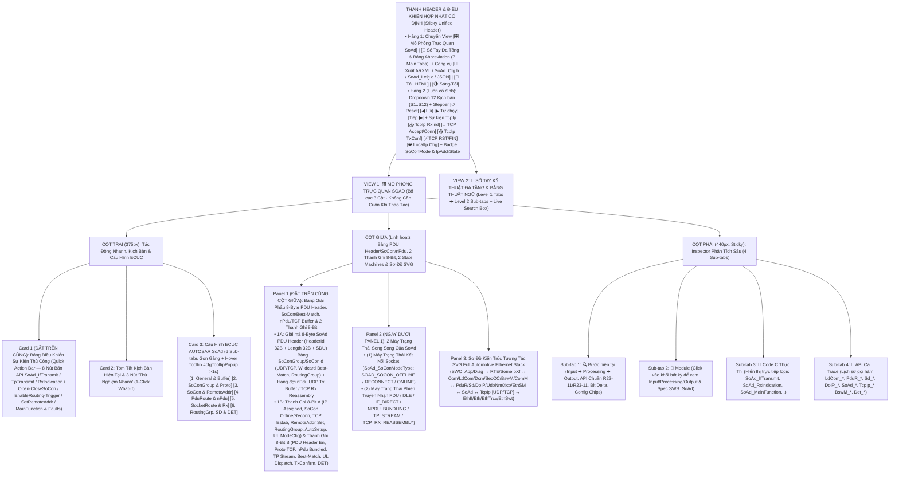
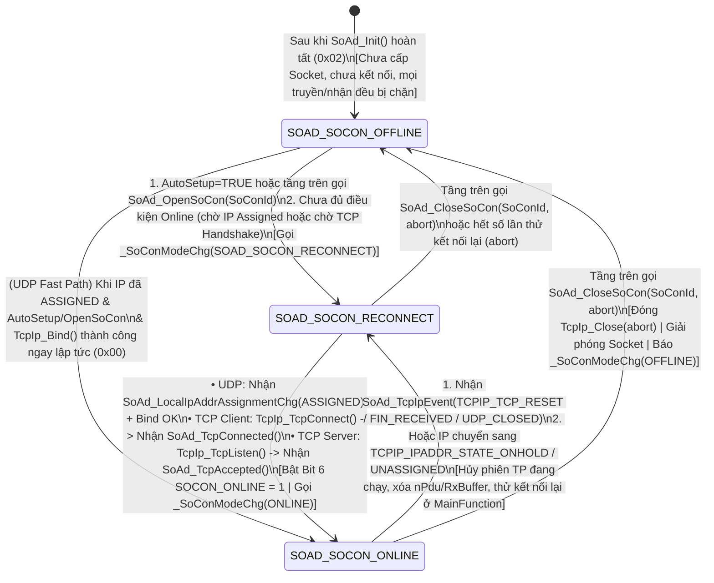
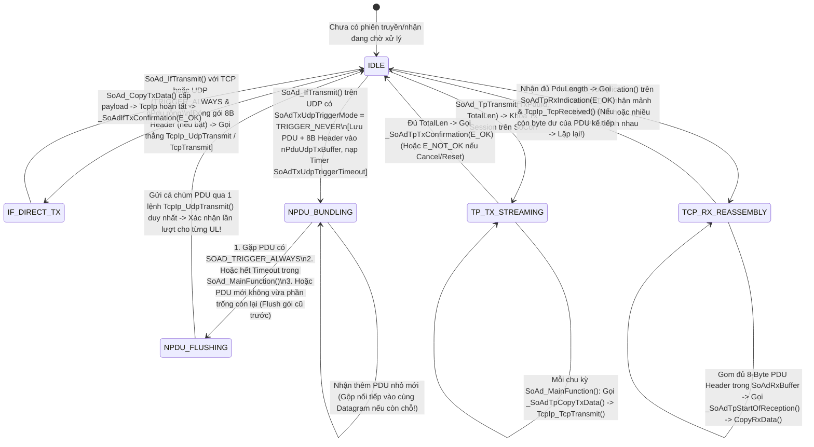

# Tài Liệu Thiết Kế Chi Tiết Trình Mô Phỏng AUTOSAR SoAd (`SoAd_Simulation_design.md`)

> **Trạng thái tài liệu:** Bản thiết kế chi tiết đã cập nhật theo xác nhận `A1`–`A4` của User — Sẵn sàng để User review trước khi triển khai code.  
> **File đích dự kiến xuất bản (sau khi User review & yêu cầu triển khai):** `d:\__Personal\AntiGravity\Simulation\03_Services\AUTOSAR_SoAd.html` (Ứng dụng Web Tương tác 1 file HTML độc lập, 100% Offline, Pure CSS, có nút tải `.HTML` kèm cấu hình nhúng & xuất code `ARXML / SoAd_Cfg.h / SoAd_Lcfg.c / JSON`).  
> **Chuẩn tham chiếu:** **AUTOSAR Classic Platform R20-11 / R22-11 / R23-11 (`SWS_SoAd`, `SWS_TcpIp`, `SWS_PduR`, `SWS_ServiceDiscovery` [`Sd`], `SWS_DoIP`, `SWS_UdpNm`, `SWS_LdCom`, `SWS_SecOC`, `SWS_EthSM`, `SWS_BswM`, `SWS_Det`, `SWS_IdsM`)**, đính kèm mã requirement chuẩn **`SWS_SoAd_xxxxx`** tại từng bước xử lý, Bảng Giải Phẫu `8-Byte SoAd PDU Header (HeaderId + Length)` & Bảng Ánh Xạ `PduRoute (Tx) ↔ SoCon / SoConGroup (Best-Match) ↔ SocketRoute (Rx)` & Bộ Đệm Gom Gói `nPdu UDP Tx Buffer` / `TCP Rx Stream Reassembly`, 2 thanh ghi 8-Bit tương tác, tooltip cấu hình và sổ tay tra cứu đa tầng.

---

## 1. Tổng Quan Định Hướng Thiết Kế Đã Chốt (`A1` – `A4`)

| Hạng mục | Nội dung thiết kế đã xác nhận với User |
| :--- | :--- |
| **1. Bố cục giao diện & Ưu tiên Không Cuộn Trang — Zero-Scroll (`A1`)** | Kế thừa tinh hoa của **`AUTOSAR_DEM.html`**, **`AUTOSAR_CanIf.html`** và **`AUTOSAR_CanSM.html`**, tối ưu hóa **Above-the-Fold (Zero-Scroll)** để các khối thao tác và giám sát tần suất cao nhất luôn nằm ngay phần đầu mỗi cột trong khung màn hình:<br>• **Thanh Điều Khiển Hợp Nhất Cố Định (Sticky Unified Header — 2 hàng)**:<br>  - **Hàng 1**: Chuyển View `[🎛️ Mô Phỏng Trực Quan SoAd]` \| `[📖 Sổ Tay Đa Tầng & Bảng Abbreviation (7 Main Tabs)]` + Công cụ `[🧾 Xuất ARXML / SoAd_Cfg.h / SoAd_Lcfg.c / JSON]` \| `[💾 Tải .HTML]` \| `[🌗 Sáng/Tối]`.<br>  - **Hàng 2 (Luôn cố định)**: Dropdown chọn 12 Kịch bản (`S1`–`S12`), Stepper (`↺ Reset`, `◀ Lùi`, `▶ Tự chạy`, `Tiếp ▶`), Bộ kích hoạt sự kiện mạng `TcpIp` (`📥 TcpIp RxInd`, `🤝 TCP SYN/Accept`, `📤 TcpIp TxConfirm`, `⚡ TCP RST/FIN`, `🌐 LocalIp Assigned`) và Badge Trạng thái `SoConMode (SOAD_SOCON_*)` & `IpAddrState (TCPIP_IPADDR_STATE_*)`.<br>• **Bố cục 3 cột hiện đại (Mỗi cột tự cuộn độc lập trong khung Viewport)**:<br>  - **Cột Trái (`375px`)**: Đưa **Card 1: Bảng Điều Khiển Sự Kiện Thủ Công (`Quick Action Bar` — 8 nút bắn trực tiếp các API cốt lõi của `SoAd`: `SoAd_IfTransmit`, `SoAd_TpTransmit`, `SoAd_RxIndication`, `SoAd_OpenSoCon / CloseSoCon`, `SoAd_EnableRouting / IfRoutingGroupTransmit`, `SoAd_SetRemoteAddr / SetUniqueRemoteAddr`, `SoAd_MainFunction` & `Inject TCP Reset / DET Fault`)** và **Card 2: Tóm tắt kịch bản & 3 nút 1-Click What-If** lên trên cùng, tiếp theo là **Card 3: 6 Sub-tabs Cấu hình ECUC `SoAd`** (36 tham số Checkbox/Textbox/Number/Dropdown, hỗ trợ Floating Hover Tooltip `#cfgTooltipPopup` sau `>1s` giống hệt `AUTOSAR_DEM.html`).<br>  - **Cột Giữa (`Linh hoạt`)**: Đưa **Panel 1: Bảng Giải Phẫu `8-Byte SoAd PDU Header (HeaderId + Length)`, Bảng Ánh Xạ `PduRoute ↔ SoCon (Best-Match) ↔ SocketRoute`, Bộ Đệm Gom Gói `nPdu UDP Tx Buffer` / `TCP Rx Stream Buffer` + 2 Thanh Ghi 8-Bit Tương Tác** và **Panel 2: 2 Máy Trạng Thái Song Song (`SoAd_SoConModeType` & Máy Trạng Thái Phiên Truyền `IF / nPdu / TP`)** lên ngay đầu cột giữa; bên dưới là **Panel 3: Sơ Đồ Kiến Trúc Tương Tác SVG Full Automotive Ethernet Stack** (`SWC_App/Diag ↔ RTE/SomeIpXf ↔ Com/LdCom/Dcm/SecOC/BswM/ComM ↔ PduR/Sd/DoIP/UdpNm/Xcp/EthSM ↔ SoAd ↔ TcpIp [UDP/TCP Sockets] ↔ EthIf/EthDrv/EthTrcv/EthSwt`).<br>  - **Cột Phải (`440px, Sticky`)**: Inspector 4 Sub-tabs (`🔍 Bước hiện tại`, `🧩 Module`, `📄 Code C Thực Thi (SoAd.c / SoAd_Lcfg.c)`, `📜 API Call Trace`). |
| **2. Khu vực Giám sát Bit-level & Giải phẫu `PDU Header / SoCon / nPdu` 2 Tầng (`A2`)** | Đặt **cố định và nổi bật ở đầu Cột Giữa** gồm **2 tầng trực quan hóa**:<br>• **Tầng 1 — Bảng Giải Phẫu `8-Byte SoAd PDU Header`, Ánh Xạ `PduRoute / SoCon (Best-Match) / SocketRoute` & Bộ Đệm `nPdu / TCP Stream`**:<br>  - **Giải mã khung `8-Byte SoAd PDU Header` (`SWS_SoAd_00195`, `00559`)**: Tách rõ `[Byte 0..3: HeaderId (uint32 Big-Endian, vd: 0x12340001)]` + `[Byte 4..7: Length (uint32 Big-Endian, vd: 0x00000020 = 32B)]` + `[Byte 8..N: SDU Payload]` khi `SoAdPduHeaderEnable = TRUE` (cho phép nhiều PDU ghép chung 1 Socket TCP/UDP duy nhất).<br>  - **Bảng kết nối `SoConGroup` & `SoConId` + `Best-Match`**: Hiển thị giao thức (`UDP` vs `TCP Client/Server`), `Local IP:Port`, `Remote IP:Port` (hỗ trợ Wildcard `ANY:ANY`), trạng thái `SoAd_SoConModeType`, cờ `RoutingGroup`, bộ đệm **`nPdu UDP Tx Buffer`** (`SOAD_TRIGGER_NEVER` / `Timeout`) và **`TCP Rx Stream Reassembly Buffer`**.<br>• **Tầng 2 — 2 Thanh ghi 8-Bit tương tác song song**:<br>  1. **Thanh A (`8-Bit SoAd Socket Connection, IP, TCP & RoutingGroup State Byte` — `SoAd_SoConStateByte`)**: Theo dõi trạng thái cấp phát IP (`IP_ASSIGNED`), trạng thái Socket Connection (`SOCON_ONLINE`, `SOCON_RECONN`), bắt tay TCP (`TCP_ESTAB`), khóa địa chỉ đích (`REM_ADDR_SET`), trạng thái nhóm định tuyến (`RT_GRP_EN`), chế độ mở tự động (`AUTO_SOCON`) và cờ thông báo đổi chế độ lên tầng trên (`UL_MODE_CHG`).<br>  2. **Thanh B (`8-Bit SoAd PDU Header, Protocol, nPdu Buffer, TP Stream & Routing Byte` — `SoAd_PduRoutingByte`)**: Theo dõi trực tiếp chế độ xử lý PDU của `SoAd` (`PDU_HDR_EN`, `PROTO_TCP`, `NPDU_BUNDLED`, `TP_STREAM`, `BEST_MATCH`, `UL_DISPATCH`, `TX_CONF_OK`, `DET_ERR`). Cho phép click trực tiếp vào từng bit để giải mã hoặc thử nghiệm! |
| **3. Hệ thống 12 Kịch bản mẫu (`A3`)** | Thiết kế sẵn **12 Kịch bản (`S1`–`S12`)** chia làm 4 nhóm lớn:<br>• **Nhóm 1 (`S1`–`S3`) — Quản Lý `SoCon`, `LocalIpAddr`, Bắt Tay TCP & `Best-Match` / `Dynamic RemoteAddr`**: Khởi tạo & tự động/thủ công mở `SoCon` khi IP được gán (`S1`); Bắt tay TCP Client (`TcpIp_TcpConnect` ➔ `SoAd_TcpConnected`) vs TCP Server (`TcpIp_TcpListen` ➔ `SoAd_TcpAccepted`) (`S2`); Thuật toán `Best-Match` trên Wildcard `RemoteAddr` & khóa địa chỉ động `SoAd_SetUniqueRemoteAddr()` / `ReleaseRemoteAddr()` (`S3`).<br>• **Nhóm 2 (`S4`–`S6`) — `IF-API`, `8-Byte PDU Header`, Gom Gói `nPdu UDP Buffer` & Fan-Out/Demux**: Truyền chuẩn `IF-API` (`SWC ➔ RTE/SomeIpXf ➔ LdCom ➔ PduR ➔ SoAd_IfTransmit`) có/không `8-Byte Header` (`S4`); Cơ chế gom nhiều PDU nhỏ vào 1 UDP Datagram bằng `nPdu UDP Tx Buffer` (`SOAD_TRIGGER_NEVER` vs `TRIGGER_ALWAYS` & `TriggerTimeout`) (`S5`); Giải phẫu `SoAd_RxIndication()` tách đa PDU trong 1 gói UDP (`StrictHeaderLenCheck`) & điều phối đa đích (`PduR`, `Sd`, `UdpNm`, `Xcp`) (`S6`).<br>• **Nhóm 3 (`S7`–`S9`) — `TP-API` Streaming, Phân Mảnh/Dính Gói Dòng Byte TCP & Phối Hợp `SOME/IP-SD` (`RoutingGroups`)**: Truyền dữ liệu lớn qua `SoAd_TpTransmit()` & vòng lặp `<Up>_SoAdTpCopyTxData()` (`S7`); Tái hợp dòng byte **TCP Stream bị phân mảnh (Fragmented) hoặc dính gói (Sticky Packets)** trong `SoAdRxBuffer` (`S8`); Phối hợp động với `Sd`: nhận `SubscribeEventgroup` ➔ `SoAd_SetUniqueRemoteAddr()` ➔ `SoAd_EnableRouting()` ➔ `SoAd_IfRoutingGroupTransmit()` kích hoạt `<Up>_SoAdIfTriggerTransmit()` (`S9`).<br>• **Nhóm 4 (`S10`–`S12`) — Phục Hồi Lỗi `SoAd_TcpIpEvent`, Hủy `TP Cancel`, `ChangeParameter` & Hàng Rào `DET`**: Xử lý sự cố `TCPIP_TCP_RESET / FIN_RECEIVED` (hủy phiên TP, dọn buffer, chuyển `SOAD_SOCON_RECONNECT` & báo `BswM/DoIP/Sd`) (`S10`); Chủ động hủy truyền/nhận `SoAd_TpCancelTransmit / Receive` & đổi tham số Socket lúc chạy `SoAd_ChangeParameter` (`S11`); Kiểm thử hàng rào lỗi `DET` (`ModuleId = 56`), đọc bộ đếm rơi gói `SoAd_GetAndResetMeasurementData()` & báo cáo `IdsM` (`S12`). |
| **4. Sổ tay tra cứu đa tầng & Bảng Abbreviation (`A4`)** | **View 2 (`📖 Sổ Tay Kỹ Thuật SoAd & Từ Điển Thuật Ngữ`)** được tổ chức theo cấu trúc **Đa Tầng (Multi-level Tabs)**:<br>• **6 Main Sub-tabs (Level 1) × 4 Chủ đề con (Level 2 Pills/Tabs = 24 chuyên đề)** phân tích sâu kiến trúc Automotive Ethernet Stack, mô hình `SoConGroup` & `SoCon` State Machine, thuật toán `Best-Match`, cấu trúc `8-Byte SoAd PDU Header`, cơ chế gom gói `nPdu UDP Tx Buffer`, tái hợp dòng byte `TCP Stream` (Fragmentation/Sticky), giao tiếp `IF-API` vs `TP-API`, phối hợp `SOME/IP-SD` (`RoutingGroups`), `DoIP`, `UdpNm` và ECUC.<br>• **Tab 7 chuyên biệt: `🔤 Bảng Thuật Ngữ & Từ Viết Tắt (Abbreviation Table)`** trình bày dưới dạng bảng chuẩn 4 cột, tích hợp **Search Box tìm kiếm tức thời (Live Search + Highlight `<mark>`)** và 5 nút lọc nhanh theo phân nhóm (`SoAd Core & SoCon`, `PDU Header & Routing`, `nPdu, TCP Stream & TP`, `SD, DoIP, UdpNm & EthSM`, `APIs, ECUC, DET & Meas`). |

---

## 2. Bố Cục Giao Diện 3 Cột Ưu Tiên Zero-Scroll & Hệ Thống Sub-Tabs (UI Wireframe)

Để đáp ứng triệt để yêu cầu **"đưa các khối được dùng thường xuyên hơn lên phía trên để người dùng không cần cuộn chuột lên xuống mỗi lần thao tác"**, giao diện được thiết kế theo nguyên lý **Viewport-First (Toàn bộ 8 nút gọi nhanh API `SoAd`, các nút kích hoạt sự kiện mạng `TcpIp`, Bảng Giải Phẫu `8-Byte PDU Header / SoCon / nPdu Buffer`, 2 Thanh Ghi 8-Bit và 2 Máy Trạng Thái đều nằm ngay trong tầm mắt đầu trang)**:



### Điểm Cải Tiến Đột Phá Về Trải Nghiệm "Zero-Scroll" Cho Module `SoAd`:
1. **Thanh Điều Khiển Hợp Nhất (`Sticky Unified Header`) Với Các Nút Kích Hoạt Sự Kiện Mạng `TcpIp` (`TcpIp Network Event Triggers`)**:
   - Khác với các module giao tiếp đồng bộ thông thường, `SoAd` nằm ngay trên `TcpIp` và liên tục chịu tác động bất đồng bộ từ mạng Ethernet (gói tin `SoAd_RxIndication` đổ về, bắt tay `SoAd_TcpConnected`/`TcpAccepted`, hoàn tất cấp phát IP `SoAd_LocalIpAddrAssignmentChg`, hoặc đứt kết nối `SoAd_TcpIpEvent(TCP_RESET)`). Đặt 5 nút kích hoạt sự kiện mạng ngay trên Header cố định giúp người dùng dễ dàng vừa bơm dữ liệu ở tầng trên (`SoAd_IfTransmit`), vừa bấm `SoAd_MainFunction()` để xả `nPdu Buffer`, hoặc ngắt dây mạng bằng `⚡ TCP RST/FIN` ngay lập tức mà không hề phải cuộn chuột!
2. **Đưa `Quick Action Bar` (8 nút tác động nhanh) lên vị trí Card 1 (Đầu Cột Trái)** và đưa **Bảng Giải Phẫu `8-Byte PDU Header / SoCon / nPdu Buffer` + 2 Thanh Ghi 8-Bit** lên đầu Cột Giữa: Mọi thao tác bật/tắt `SoAdPduHeaderEnable`, thay đổi `RoutingGroup`, khóa `RemoteAddr`, hay gộp nhiều PDU vào 1 gói UDP đều hiển thị phản hồi trực quan ngay lập tức trong tầm mắt.
3. **Gom 36 tham số ECUC vào 6 Sub-tabs gọn gàng**: Chiều cao Card Cấu hình được giữ gọn cố định (~275px), kèm hộp thoại giải thích nổi `#cfgTooltipPopup` khi hover quá `1000ms` giống hệt file `AUTOSAR_DEM.html`.

---

## 3. Thiết Kế Chi Tiết Panel 1 (Đầu Cột Giữa): Bảng Giải Phẫu `8-Byte SoAd PDU Header`, Ánh Xạ `PduRoute / SoCon / SocketRoute`, `nPdu UDP Buffer` & 2 Thanh Ghi 8-Bit Tương Tác

Trong `AUTOSAR Classic`, giá trị kỹ thuật cốt lõi của `SoAd` (`SWS_SoAd`) nằm ở **5 cơ chế cầu nối PDU ↔ Socket**:
1. **Đóng gói & Giải mã `8-Byte SoAd PDU Header` (`SWS_SoAd_00195`, `00559`)**: Cho phép ghép nhiều AUTOSAR I-PDU khác nhau đi chung qua một kết nối TCP hoặc UDP duy nhất (`Socket Multiplexing`) nhờ 4 byte `HeaderId` (Big-Endian) + 4 byte `Length` (Big-Endian).
2. **Quản lý `SoConGroup`, `SoCon` & Thuật toán `Best Match` (`SWS_SoAd_00680`)**: Ánh xạ giữa `PduId` của tầng trên và cặp `(Local IP:Port ↔ Remote IP:Port)` của `TcpIp`, hỗ trợ Wildcard `ANY:ANY` và khóa địa chỉ động bằng `SoAd_SetUniqueRemoteAddr()`.
3. **Kiểm soát luồng truyền thông động bằng `SoAdRoutingGroup` (`SWS_SoAd_00605`, `00661`)**: Cho phép `Sd (Service Discovery)` hoặc `BswM` đóng/mở từng tuyến `PduRouteDest` / `SocketRouteDest` theo thời gian thực khi Client đăng ký `SubscribeEventgroup`.
4. **Gom gói tối ưu băng thông bằng `nPdu UDP Tx Buffer` (`SWS_SoAd_00547`, `00695`)**: Gom nhiều PDU ngắn có `SoAdTxUdpTriggerMode = SOAD_TRIGGER_NEVER` vào chung một UDP Datagram để giảm tải ngắt Ethernet, rồi phát đi một lượt khi hết `SoAdTxUdpTriggerTimeout` hoặc khi có một PDU `SOAD_TRIGGER_ALWAYS`.
5. **Tái hợp dòng byte `TCP Stream` (Fragmentation & Sticky Packets) & Truyền `TP-API` (`SWS_SoAd_00551`, `00567`)**: Khác với UDP có ranh giới gói tin rõ ràng, TCP chỉ là một luồng byte liên tục — `SoAd` dùng `SoAdRxBuffer` để ghép các mảnh TCP nhận rời rạc hoặc tách nhiều PDU dính liền trong 1 đoạn TCP trước khi đẩy lên `DoIP / PduR / Dcm`.

Do đó, Panel 1 ở đầu Cột Giữa được thiết kế gồm **2 phần trực quan hóa liên thông**:

### 3.1. Phần 1A — Bảng Giải Phẫu `8-Byte SoAd PDU Header`, Kết Nối `SoCon` (`Best-Match`) & Bộ Đệm `nPdu / TCP Stream`

```text
+-------------------------------------------------------------------------------------------------------------------+
| 🔌 BẢNG GIẢI PHẪU 8-BYTE PDU HEADER, KẾT NỐI SOCON (BEST-MATCH) & BỘ ĐỆM NPDU/TCP (`SWS_SoAd_00195`, `00680`)     |
| LocalAddr_0: [192.168.10.50 (ASSIGNED)] | Active SoCon_0: [SOAD_SOCON_ONLINE] | [HdrEn: ON] [Proto: UDP/TCP]      |
+-------------------------------------------------------------------------------------------------------------------+
| 1. CẤU TRÚC KHUNG TRUYỀN QUA SOCKET (Toggle [SoAdPduHeaderEnable: ON ↔ OFF] — SWS_SoAd_00195 / 00559):             |
|  +----------------------------------+----------------------------------+----------------------------------------+ |
|  | Byte 0..3: HeaderId (Big-Endian) | Byte 4..7: PduLength (Big-Endian)| Byte 8..N: SDU Payload (DataPtr)       | |
|  | 0x12340001 (Svc 0x1234 Evt 0x01) | 0x00000020 (32 Bytes)            | [11 22 33 44 55 66 ... (32B)]          | |
|  +----------------------------------+----------------------------------+----------------------------------------+ |
+-------------------------------------------------------------------------------------------------------------------+
| 2. BẢNG ÁNH XẠ SOCONGROUP / SOCONID & THUẬT TOÁN BEST-MATCH (`SWS_SoAd_00680`, `00605`):                           |
|  +---------+--------------------+-----------------------+-------------------------+-------------------+---------+ |
|  | SoConId | Proto & Role       | Local IP : Port       | Remote IP : Port        | RoutingGroup (RG) | Mode    | |
|  +---------+--------------------+-----------------------+-------------------------+-------------------+---------+ |
|  | SoCon_0 | UDP Unicast (SOA)  | 192.168.10.50 : 30501 | 192.168.10.99 : 30501   | RG_0 [🟢 ENABLED] | ONLINE  | |
|  | SoCon_1 | UDP Multicast (SD) | 192.168.10.50 : 30490 | 224.224.224.245 : 30490 | RG_SD[🟢 ENABLED] | ONLINE  | |
|  | SoCon_2 | TCP Server (DoIP)  | 192.168.10.50 : 13400 | ANY : ANY (Wildcard #1) | RG_2 [🟢 ENABLED] | RECONN  | |
|  | SoCon_3 | UDP nPdu (Bundling)| 192.168.10.50 : 30505 | 192.168.10.88 : 30505   | RG_1 [🟡 DISABLED]| ONLINE  | |
|  +---------+--------------------+-----------------------+-------------------------+-------------------+---------+ |
| 3. BỘ ĐỆM GOM GÓI TX (`nPdu UDP Tx Buffer`) & TÁI HỢP RX (`TCP Rx Stream Buffer` — SWS_SoAd_00547 / 00567):      |
|  • nPdu Buffer (SoCon_3): [ PDU_A (0x1001, 8B, NEVER) ] + [ PDU_B (0x1002, 12B, NEVER) ] | Timer: 4ms / 10ms      |
|  • TCP Rx Stream (SoCon_2): [ Fragment 1 (14B) + Fragment 2 (26B) ] = 40B (8B Hdr + 32B DoIP SDU) ➔ [ COMPLETE! ] |
+-------------------------------------------------------------------------------------------------------------------+
```

- **Tính năng tương tác trực tiếp trên Phần 1A**:
  - Người dùng có thể bấm nút gạt **`[SoAdPduHeaderEnable: ON ↔ OFF]`** ngay trên phần giải mã Header để quan sát ngay sự thay đổi độ dài truyền qua `TcpIp` (`Payload + 8B` vs `Raw Payload` như gói `UdpNm`) và trạng thái `Bit 7 (PDU_HDR_EN)` trên Thanh B!
  - Có nút chuyển nhanh **`[Toggle RG_0 ENABLED ↔ DISABLED]`** và **`[RemoteAddr: Fixed ↔ ANY:ANY]`** để kiểm nghiệm tức thời việc `SoAd_IfTransmit` chặn tuyến bị khóa hoặc thuật toán `Best-Match` chọn đúng `SoCon` khi gói tin mạng đổ về!

### 3.2. Phần 1B — 2 Thanh Ghi 8-Bit Trạng Thái Tương Tác Luôn Hiển Thị Nổi Bật

Ngay bên dưới Phần 1A là **2 Thanh ghi 8-Bit tương tác** theo đúng phong cách chuẩn của `AUTOSAR_DEM.html` và `AUTOSAR_CanIf.html`:

```text
+-------------------------------------------------------------------------------------------------------------------+
| 🔢 BẢNG GIÁM SÁT BITFIELD 8-BIT SOAD SOCON/IP/ROUTING & HEADER/BUFFER (LIVE 8-BIT INSPECTOR) [Click Bit để thử]   |
| Bước #4: SoAd_IfTransmit(PduRoute_3) ➔ Gom PDU_A vào nPdu UDP Tx Buffer (Chờ Trigger/Timeout) | A: 0xCA | B: 0xA0 |
+-------------------------------------------------------------------------------------------------------------------+
| A. THANH GHI 8-BIT TRẠNG THÁI SOCON, LOCAL IP, TCP & ROUTINGGROUP (`SoAd_SoConStateByte`) — Hex:[0xCA] [11001010] |
|    LocalIp: [ ASSIGNED ] | Active SoCon: [ SOAD_SOCON_ONLINE ] | RG_0: [ ENABLED ] | AutoSetup: [ TRUE ]          |
|  +-------------+ +-------------+ +-------------+ +-------------+ +-------------+ +-------------+ +-------+ +-----+|
|  | Bit 7 (0x80)| | Bit 6 (0x40)| | Bit 5 (0x20)| | Bit 4 (0x10)| | Bit 3 (0x08)| | Bit 2 (0x04)| |Bit1(2)| |Bit 0||
|  | IP_ASSIGNED | | SOCON_ONLNE | | SOCON_RECON | |  TCP_ESTAB  | | REM_ADDR_OK | |  RT_GRP_EN  | |AUTO_ON| |UL_MC||
|  |      1      | |      1      | |      0      | |      0      | |      1      | |      0      | |   1   | |  0  ||
|  | IP Ready!   | | SoCon Onl   | | Not Reconn  | | UDP Socket  | | Dest IP Set | | RG Disabled | |AutoSet| |Idle ||
|  +-------------+ +-------------+ +-------------+ +-------------+ +-------------+ +-------------+ +-------+ +-----+|
+-------------------------------------------------------------------------------------------------------------------+
| B. THANH GHI 8-BIT PDU HEADER, GIAO THỨC, NPDU BUFFER, TP & ROUTING (`SoAd_PduRoutingByte`) — Hex:[0xA0] [10100000]|
|    Header: [ 8-Byte ON (0x12340001) ] | Proto: [ UDP ] | nPdu Buffer: [ 2 PDUs Queued ] | TP Stream: [ IDLE ]     |
|  +-------------+ +-------------+ +-------------+ +-------------+ +-------------+ +-------------+ +-------+ +-----+|
|  | Bit 7 (0x80)| | Bit 6 (0x40)| | Bit 5 (0x20)| | Bit 4 (0x10)| | Bit 3 (0x08)| | Bit 2 (0x04)| |Bit1(2)| |Bit 0||
|  | PDU_HDR_EN  | |  PROTO_TCP  | | NPDU_BUNDLE | |  TP_STREAM  | | BEST_MATCH  | | UL_DISPATCH | |TX_CONF| |DET_E||
|  |      1      | |      0      | |   1 (0➔1🔥) | |      0      | |      0      | |      0      | |   0   | |  0  ||
|  | 8B Header!  | | UDP Mode    | | In nPdu Buf | | Idle TP     | | Idle Match  | | Idle UL Rx  | |No Conf| |NoErr||
|  +-------------+ +-------------+ +-------------+ +-------------+ +-------------+ +-------------+ +-------+ +-----+|
+-------------------------------------------------------------------------------------------------------------------+
```

#### 3.2.1. Giải Mã Chi Tiết Thanh A: `8-Bit SoAd Socket Connection, IP, TCP & RoutingGroup State Byte` (`SoAd_SoConStateByte`)

| Bit | Mask | Tên Cờ (`SoAd SoCon Bit`) | Ý nghĩa kỹ thuật & Khi nào bật lên `1` (`0 ➔ 1`) | Khi nào hạ về `0` (`1 ➔ 0`) |
| :-: | :-: | :--- | :--- | :--- |
| **Bit 7** | `0x80` | **`IP_ASSIGNED`** | Bật lên `1` khi `TcpIp` gọi **`SoAd_LocalIpAddrAssignmentChg(IpAddrId, TCPIP_IPADDR_STATE_ASSIGNED)`** (`SWS_SoAd_00511`, `00588`): Địa chỉ IPv4/IPv6 cục bộ (Static, Link-Local AutoIP hoặc DHCP) đã hợp lệ và sẵn sàng mở Socket. | Hạ về `0` khi địa chỉ IP chuyển về **`TCPIP_IPADDR_STATE_UNASSIGNED`** hoặc **`TCPIP_IPADDR_STATE_ONHOLD`** (mất Link PHY Ethernet) ➔ Kéo toàn bộ `SoCon` trên IP đó rời khỏi `ONLINE`! |
| **Bit 6** | `0x40` | **`SOCON_ONLINE`** | Bật lên `1` khi kết nối Socket đang hoạt động đạt trạng thái **`SOAD_SOCON_ONLINE (0x00)`** (`SWS_SoAd_00588`): Đã có IP cục bộ, `SoCon` đã mở (`Auto` hoặc `SoAd_OpenSoCon`), và (nếu là TCP) đã bắt tay thành công. Lúc này `SoAd` cho phép truyền/nhận PDU. | Hạ về `0` khi mất kết nối (`TCPIP_TCP_RESET / FIN`), mất IP, hoặc tầng trên gọi `SoAd_CloseSoCon()` (`SOAD_SOCON_RECONNECT` hoặc `SOAD_SOCON_OFFLINE`). |
| **Bit 5** | `0x20` | **`SOCON_RECONN`** | Bật lên `1` khi kết nối ở trạng thái **`SOAD_SOCON_RECONNECT (0x01)`** (`SWS_SoAd_00589`): Socket đã được yêu cầu mở (bởi `AutoSetup = TRUE` hoặc `SoAd_OpenSoCon()`), đang chờ gán IP, chờ TCP 3-way Handshake (`TcpIp_TcpConnect` / `TcpIp_TcpListen`), hoặc vừa bị đứt kết nối TCP và `SoAd_MainFunction()` đang thử kết nối lại! | Hạ về `0` khi kết nối lên thành công **`SOAD_SOCON_ONLINE`** (`Bit 6 = 1`) hoặc bị đóng hẳn về **`SOAD_SOCON_OFFLINE`** (cả `Bit 6 = 0` và `Bit 5 = 0`). |
| **Bit 4** | `0x10` | **`TCP_ESTAB`** | Bật lên `1` đối với Socket TCP sau khi bắt tay 3 bước thành công: `TcpIp` gọi **`SoAd_TcpConnected(SocketId)`** (vai trò TCP Client) hoặc **`SoAd_TcpAccepted(SocketId, SocketIdConnected, RemoteAddr)`** (vai trò TCP Server — `SWS_SoAd_00593`, `00594`). | Hạ về `0` khi Socket là UDP, hoặc khi nhận sự kiện **`SoAd_TcpIpEvent(TCPIP_TCP_RESET / TCP_CLOSED / FIN_RECEIVED)`** / `SoAd_CloseSoCon()`. |
| **Bit 3** | `0x08` | **`REM_ADDR_SET`** | Bật lên `1` khi `SoCon` đang nắm giữ một cặp **`Remote IP:Port` cụ thể** (không phải Wildcard `TCPIP_IPADDR_ANY` / `TCPIP_PORT_ANY`): do cấu hình tĩnh, gọi `SoAd_SetRemoteAddr()` / `SoAd_SetUniqueRemoteAddr()`, hoặc tự động khóa theo địa chỉ nguồn của gói UDP/TCP vừa nhận (`SWS_SoAd_00534`, `00681`). | Hạ về `0` khi `RemoteAddr` là Wildcard `ANY:ANY`, khi tầng trên gọi **`SoAd_ReleaseRemoteAddr()`** (`SWS_SoAd_00682`), hoặc khi hết thời gian `SoAdSocketUdpAliveSupervisionTimeout` (`SWS_SoAd_00692`). |
| **Bit 2** | `0x04` | **`RT_GRP_EN`** | Bật lên `1` khi **`SoAdRoutingGroup`** gắn với tuyến `PduRouteDest` / `SocketRouteDest` hiện tại đang ở trạng thái **ENABLED** (sau `SoAd_Init` nếu `IsEnabledAfterInit = TRUE`, hoặc sau khi `Sd` / `BswM` gọi **`SoAd_EnableRouting(rgId)`** / `SoAd_EnableSpecificRouting()` — `SWS_SoAd_00605`). | Hạ về `0` khi `Sd` / `BswM` gọi **`SoAd_DisableRouting(rgId)`** (ví dụ khi Client gửi `StopSubscribeEventgroup` hoặc TTL hết hạn). Khi bằng `0`, mọi lệnh truyền/nhận qua tuyến đó bị bỏ qua! |
| **Bit 1** | `0x02` | **`AUTO_SOCON`** | Biểu diễn cờ cấu hình **`SoAdSocketAutomaticSoConSetup = TRUE`** (`SWS_SoAd_00588`): `SoAd` tự động yêu cầu `TcpIp` mở và kết nối Socket ngay khi có `IP_ASSIGNED` mà không cần tầng trên gọi `SoAd_OpenSoCon()`. | Hạ về `0` khi `SoAdSocketAutomaticSoConSetup = FALSE` (chế độ mở thủ công do `Sd` / `DoIP` / `BswM` chủ động gọi `SoAd_OpenSoCon()` và `SoAd_CloseSoCon()`). |
| **Bit 0** | `0x01` | **`UL_MODE_CHG`** | Bật lên `1` khi `SoAd` vừa phát thông báo chuyển trạng thái kết nối **`<Up>_SoConModeChg(SoConId, Mode)`** hoặc **`<Up>_LocalIpAddrAssignmentChg(SoConId, State)`** lên `BswM` / `Sd` / `DoIP` / `UdpNm` (`SWS_SoAd_00592`). | Hạ về `0` ở bước thao tác mới không làm thay đổi trạng thái `SoCon` hay IP. |

#### 3.2.2. Giải Mã Chi Tiết Thanh B: `8-Bit SoAd PDU Header, Protocol, nPdu Buffer, TP Stream & Routing Byte` (`SoAd_PduRoutingByte`)

| Bit | Mask | Tên Cờ (`SoAd Routing Bit`) | Ý nghĩa kỹ thuật & Khi nào bật lên `1` (`0 ➔ 1`) | Khi nào hạ về `0` (`1 ➔ 0`) |
| :-: | :-: | :--- | :--- | :--- |
| **Bit 7** | `0x80` | **`PDU_HDR_EN`** | Bật lên `1` khi `SoAdSocketConnectionGroup` đang bật **`SoAdPduHeaderEnable = TRUE`** (`SWS_SoAd_00195`): Chiều Tx sẽ tự động gắn **8 bytes Header `[HeaderId (4B) | Length (4B)]`** vào đầu SDU; chiều Rx sẽ đọc 8 bytes Header để tách PDU và định tuyến theo `HeaderId`. | Hạ về `0` khi `SoAdPduHeaderEnable = FALSE` (truyền/nhận dữ liệu thô Raw Payload không kèm 8-byte Header, ví dụ `UdpNm` hoặc Socket 1:1 chuyên biệt). |
| **Bit 6** | `0x40` | **`PROTO_TCP`** | Bật lên `1` khi `SoCon` hiện tại cấu hình giao thức **`TCP` (`SoAdSocketTcp`)** — truyền theo luồng byte tin cậy có bắt tay & ACK, hỗ trợ tái hợp phân mảnh và dính gói trên `SoAdRxBuffer`. | Hạ về `0` khi `SoCon` cấu hình giao thức **`UDP` (`SoAdSocketUdp`)** — truyền theo Datagram không kết nối (hỗ trợ Multicast, Broadcast và gom gói `nPdu`). |
| **Bit 5** | `0x20` | **`NPDU_BUNDLED`** | Bật lên `1` khi có ít nhất 1 PDU đang được giữ trong hàng đợi **`nPdu UDP Tx Buffer`** (`SoAdTxUdpTriggerMode = SOAD_TRIGGER_NEVER` — `SWS_SoAd_00547`, `00695`) chờ đến hạn `SoAdTxUdpTriggerTimeout` hoặc chờ 1 PDU có `SOAD_TRIGGER_ALWAYS` để gửi gộp chung 1 UDP Datagram. | Hạ về `0` ngay khi toàn bộ các PDU trong `nPdu UDP Tx Buffer` được đóng gói thành 1 UDP Datagram gọi `TcpIp_UdpTransmit()` gửi ra mạng, hoặc khi Socket chuyển về `OFFLINE` / Reset! |
| **Bit 4** | `0x10` | **`TP_STREAM`** | Bật lên `1` khi đang có phiên truyền hoặc nhận dữ liệu lớn qua giao diện **`TP-API`**: `SoAd_TpTransmit()` đang chạy vòng lặp `<Up>_SoAdTpCopyTxData()` trong `SoAd_MainFunction()` (`SWS_SoAd_00551`), hoặc chiều Rx đang tái hợp khung lớn qua `<Up>_SoAdTpStartOfReception()` / `<Up>_SoAdTpCopyRxData()` (`SWS_SoAd_00568`). | Hạ về `0` khi phiên TP hoàn tất (`TxConfirmation` / `RxIndication`), bị hủy (`SoAd_TpCancelTransmit / Receive`), hoặc bị ngắt do lỗi kết nối `SoAd_TcpIpEvent`. |
| **Bit 3** | `0x08` | **`BEST_MATCH`** | Bật lên `1` trong `SoAd_RxIndication()` khi **`Best Match Algorithm` (`SWS_SoAd_00680`)** tìm ra đúng `SoConId` ưu tiên nhất (1. Khớp chính xác Local & Remote IP:Port ➔ 2. Khớp Remote IP & Wildcard Port ➔ 3. Khớp Wildcard IP & Remote Port ➔ 4. Khớp Wildcard `ANY:ANY`) và tra khớp `SocketRoute` (theo `HeaderId`). | Hạ về `0` nếu gói tin đến từ IP/Port không khớp bộ lọc chấp nhận (`SoAdSocketMsgAcceptanceFilterEnabled`), hoặc không tìm thấy `HeaderId` hợp lệ trong bảng `SocketRoute`. |
| **Bit 2** | `0x04` | **`UL_DISPATCH`** | Bật lên `1` khi `SoAd` đẩy dữ liệu nhận được lên tầng trên thành công qua `<Up>_SoAdIfRxIndication()`, `<Up>_SoAdTpRxIndication(E_OK)`, hoặc kéo dữ liệu từ tầng trên qua `<Up>_SoAdIfTriggerTransmit()` (`SoAd_IfRoutingGroupTransmit`). | Hạ về `0` khi gói nhận bị rơi do sai `HeaderId`, tràn `SoAdRxBuffer`, tắt `RoutingGroup`, hoặc trượt kiểm tra `StrictHeaderLenCheck`. |
| **Bit 1** | `0x02` | **`TX_CONF_OK`** | Bật lên `1` khi `SoAd` phát xác nhận truyền thành công lên tầng trên: `<Up>_SoAdIfTxConfirmation(TxPduId, E_OK)` hoặc `<Up>_SoAdTpTxConfirmation(TxPduId, E_OK)` (kể cả trường hợp `SoAdSocketTcpImmediateTpTxConfirmation = TRUE` khi nạp xong xuống `TcpIp` — `SWS_SoAd_00556`). | Hạ về `0` khi truyền thất bại (`E_NOT_OK`) hoặc ở trạng thái nhàn rỗi. |
| **Bit 0** | `0x01` | **`DET_ERR`** | Bật lên `1` ngay khi `SoAd` (`ModuleId = 56 / 0x0038`) phát hiện lỗi Development hoặc Runtime Error và gọi **`Det_ReportError()`** / **`Det_ReportRuntimeError()`** (vd: `SOAD_E_NOTINIT = 0x01`, `SOAD_E_PARAM_POINTER = 0x02`, `SOAD_E_INV_ARG = 0x03`, `SOAD_E_NOBUFS = 0x04`, `SOAD_E_INV_PDUHEADER_ID = 0x05`, `SOAD_E_INV_PDUID = 0x06`, `SOAD_E_INV_SOCKETID = 0x07`). | Hạ về `0` khi thực hiện một thao tác hợp lệ mới hoặc bấm Reset. |

---

## 4. Phân Tích Xử Lý Từng Module: Input Lấy Từ Đâu, Xử Lý Gì, Output Route Đến Đâu

Mọi khối trên sơ đồ kiến trúc SVG đều có thể **click vào để xem giải thích chi tiết** ở cột phải (Tab `🧩 Module`) và được tổng hợp đầy đủ trong **Tab 1 của Sổ tay**:

| # | Module / Phân khối | Lớp AUTOSAR | 📥 Input lấy từ đâu? | ⚙️ Cách xử lý nội bộ (Processing, State, Buffers & Routing) | 📤 Output route đến đâu & Hàm API chuẩn (R20-11 / R22-11 / R23-11) |
| :-: | :--- | :--- | :--- | :--- | :--- |
| **1** | **`SWC_App` (ADAS / Zonal SOA) & `SWC_Diag`**<br>*(Application Layer)* | Application Layer (`01_Application`) | • Nhận dữ liệu Event/Field hoặc phản hồi RPC Method từ `RTE` (`Rte_Read` / `Rte_Receive`).<br>• Nhận yêu cầu dịch vụ chẩn đoán UDS từ `Dcm`. | • **Lưu ý kiến trúc quan trọng**: Không có `SWC` nào gọi trực tiếp `SoAd`!<br>• **Luồng dữ liệu SOA (Ethernet)**: `SWC_App` xuất cấu trúc C phức tạp (vd: mảng vật thể Radar/Camera) qua `Rte_Write` ➔ `RTE` gọi `SomeIpXf` tuần tự hóa (Serialize) thành mảng byte SOME/IP ➔ đẩy xuống `LdCom` (hoặc `COM` với tín hiệu nhỏ) ➔ `PduR` ➔ `SoAd`.<br>• **Luồng chẩn đoán DoIP**: `SWC_Diag` trả lời UDS qua `Dcm` ➔ `PduR` ➔ `DoIP` ➔ `SoAd`.<br>• **Luồng điều khiển mạng**: `SWC` yêu cầu mở kênh Ethernet qua `ComM`. | • Qua **RTE** xuống **SomeIpXf / LdCom / Com / Dcm**:<br>`Rte_Write_PpRadarObjList(&objArray)`<br>`Rte_Call_RpPlanner_CalcPath()`<br>• Qua **RTE** xuống **ComM**:<br>`Rte_Call_UR_ComMUser_Eth_RequestComMode(COMM_FULL_COMMUNICATION)` |
| **2** | **`RTE`, `SomeIpXf / E2EXf` & `SchM`**<br>*(Runtime Environment, Transformer & Scheduler)* | RTE Layer (`02_RTE`) | • Dữ liệu struct/array từ `SWC` hoặc mảng byte nhận từ `LdCom_RxIndication` / `Com_RxIndication`.<br>• Yêu cầu khóa vùng găng từ `SoAd`. | • **`SomeIpXf` / `E2EXf`**: Chuyển đổi qua lại giữa kiểu dữ liệu C của SWC và **SOME/IP Payload** (gồm các trường RequestId, Protocol Version, Interface Version, Return Code + Byte Order Big/Little Endian + E2E CRC/Counter).<br>• **SchM (`Exclusive Area`)**: Vì `SoAd_IfTransmit()` (Task ứng dụng), `SoAd_MainFunction()` (Task định kỳ) và `SoAd_RxIndication()` / `SoAd_TcpIpEvent()` (ngữ cảnh `TcpIp` Rx/Timer) cùng truy cập vào `nPduUdpTxBuffer`, `SoAdRxBuffer` và bảng `SoCon` state, `SoAd` dùng `SchM_Enter_SoAd_EXCLUSIVE_AREA_0()` để bảo vệ toàn vẹn dữ liệu! | • Đẩy xuống **LdCom / Com**:<br>`SomeIpXf_Transform()` + `E2EXf_Protect()` ➔ `LdCom_Transmit()`<br>• Bảo vệ vùng dữ liệu găng của **SoAd**:<br>`SchM_Enter_SoAd_EXCLUSIVE_AREA_0()`<br>`SchM_Exit_SoAd_EXCLUSIVE_AREA_0()` |
| **3** | **`PduR` (kèm `Com`, `LdCom`, `Dcm`, `SecOC`, `IpduM`)**<br>*(Upper Layer Data & Routing)* | Communication Services (`03_Services`) | • Yêu cầu truyền từ `LdCom` (`PduR_LdComTransmit`), `COM` (`PduR_ComTransmit`), `SecOC`, `Dcm`.<br>• Callbacks `SoAdIfRxIndication`, `SoAdTpCopyRxData`, `SoAdIfTxConfirmation` từ `SoAd`. | • **Định tuyến IF & TP**: `PduR` giữ vai trò trung tâm định tuyến I-PDU độc lập với bus (giúp cùng 1 cấu hình `COM`/`Dcm` chạy được trên cả CAN lẫn Ethernet, hoặc làm Gateway `CAN ↔ Ethernet`).<br>• Khi đích đến là Ethernet (`SoAd`), `PduR` tra bảng `PduR_RoutingPath` và ánh xạ sang `SoAd_IfTransmit()` (gói đơn IF) hoặc `SoAd_TpTransmit()` (gói lớn TP).<br>• **Lưu ý TriggerTransmit**: Với các PDU động hoặc khởi tạo giá trị khi `Sd` kích hoạt `RoutingGroup`, `PduR` cung cấp `PduR_SoAdIfTriggerTransmit()`. | • Gọi xuống **SoAd**:<br>`SoAd_IfTransmit(TxPduId, &PduInfo)` [`SWS_SoAd_00091`]<br>`SoAd_TpTransmit(TxPduId, &PduInfo)` [`SWS_SoAd_00105`]<br>• Nhận Callback từ **SoAd**:<br>`PduR_SoAdIfRxIndication(RxPduId, &PduInfo)`<br>`PduR_SoAdIfTxConfirmation(TxPduId, result)`<br>`PduR_SoAdIfTriggerTransmit(TxPduId, &PduInfo)`<br>`PduR_SoAdTpStartOfReception()` / `CopyRxData()` / `RxIndication()` / `CopyTxData()` / `TxConfirmation()` |
| **4** | **`Sd` (`SOME/IP Service Discovery`)**<br>*(Dynamic Service Binding & Routing Control)* | Communication Services (`03_Services`) | • Lệnh mở/đóng dịch vụ từ `BswM` (`Sd_ServerServiceSetState`, `Sd_ClientServiceSetState`).<br>• Bản tin SD Multicast/Unicast từ `SoAd` (`Sd_SoAdIfRxIndication`).<br>• Thông báo `Sd_SoConModeChg` & `Sd_LocalIpAddrAssignmentChg` từ `SoAd`. | • **Điều khiển trực tiếp `SoAd` (Rất đặc trưng cho SOA)**:<br>  1. Gửi bản tin `OfferService` / `FindService` / `SubscribeEventgroup` qua `SoAd_IfTransmit()` (gửi xuống `SoCon` Multicast `224.224.224.245:30490`).<br>  2. Khi có Client đăng ký `SubscribeEventgroup`, `Sd` gọi **`SoAd_SetUniqueRemoteAddr()`** để cấp một `SoCon` cho đúng IP:Port của Client đó.<br>  3. Gọi **`SoAd_EnableRouting(RoutingGroupId)`** (hoặc `SoAd_EnableSpecificRouting`) để mở đường cho `LdCom/PduR` phát Event tới Client.<br>  4. Gọi **`SoAd_IfRoutingGroupTransmit(rgId)`** để gửi ngay bản tin Field/Event khởi tạo ban đầu qua `<Up>_SoAdIfTriggerTransmit()`. | • Gọi xuống **SoAd**:<br>`SoAd_IfTransmit(SdTxPduId, &PduInfo)`<br>`SoAd_OpenSoCon(SoConId)` / `SoAd_CloseSoCon(SoConId, abort)`<br>`SoAd_SetUniqueRemoteAddr(SoConId, &RemoteAddr, &AssignedId)` [`SWS_SoAd_00679`]<br>`SoAd_ReleaseRemoteAddr(SoConId)` [`SWS_SoAd_00682`]<br>`SoAd_EnableRouting(id)` / `SoAd_DisableRouting(id)` [`SWS_SoAd_00605`]<br>`SoAd_IfRoutingGroupTransmit(id)` [`SWS_SoAd_00661`]<br>• Nhận Callback từ **SoAd**: `Sd_SoAdIfRxIndication()`, `Sd_SoConModeChg()`, `Sd_LocalIpAddrAssignmentChg()` |
| **5** | **`DoIP`, `UdpNm`, `Xcp` & `CDD`**<br>*(Direct SoAd Upper Layers)* | Communication Services (`03_Services`) & CDD (`06`) | • Yêu cầu chẩn đoán UDS từ Tester ngoài mạng Ethernet (`DoIP` Port `13400` UDP/TCP).<br>• Yêu cầu giữ/ngủ mạng từ `Nm`/`ComM` (`UdpNm`).<br>• Lệnh hiệu chuẩn/đo lường nhanh (`Xcp` / `CDD`). | • **`DoIP` (ISO 13400)**: Dùng `SoAd` cho cả 2 loại Socket: UDP (Port `13400` cho Vehicle Identification Announcement) và TCP Server (Port `13400` dùng `TP-API` cho Routing Activation & truyền tải UDS Request/Response lớn lên `PduR ➔ Dcm`).<br>• **`UdpNm`**: Gửi/nhận các gói UDP NM multicast quản lý ngủ/thức cụm mạng Ethernet (thường tắt `8-Byte PDU Header`).<br>• **`Xcp` / `CDD`**: Có thể đấu nối trực tiếp với `SoAd` để truyền dữ liệu đo lường tốc độ cao qua UDP/TCP. | • Gọi xuống **SoAd**: `SoAd_IfTransmit()`, `SoAd_TpTransmit()`, `SoAd_OpenSoCon()`, `SoAd_CloseSoCon()`, `SoAd_SetRemoteAddr()`, `SoAd_TpCancelReceive()`<br>• Nhận Callback từ **SoAd**:<br>`DoIP_SoAdTpStartOfReception()` / `CopyRxData()` / `RxIndication()` / `CopyTxData()` / `TxConfirmation()` / `SoConModeChg()`<br>`UdpNm_SoAdIfRxIndication()` / `UdpNm_SoAdIfTxConfirmation()` |
| **6** | **`EthSM`, `ComM` & `BswM`**<br>*(Mode & Network State Managers)* | Communication & System Services (`03_Services`) | • Yêu cầu chế độ từ `SWC`/`Dcm` (`ComM_RequestComMode`).<br>• Trạng thái Link vật lý từ `EthIf` (`EthSM_TrcvLinkStateChg`) và IP từ `TcpIp` (`EthSM_TcpIpModeIndication`).<br>• Thông báo `BswM_SoAd_SoConModeChg` từ `SoAd`. | • **`EthSM`** không điều khiển trực tiếp `SoAd`, nhưng thông qua **`TcpIp_RequestComMode()`**, `EthSM` làm IP chuyển sang `ASSIGNED` và kích hoạt chuỗi phản ứng **`SoAd_LocalIpAddrAssignmentChg()`**!<br>• **`BswM`**: Nhận thông báo `SoConModeChg` từ `SoAd` để quyết định quy tắc kích hoạt dịch vụ `Sd` hoặc bật/tắt `SoAdRoutingGroup`. | • **EthSM ➔ TcpIp**: `TcpIp_RequestComMode(CtrlIdx, TCPIP_STATE_ONLINE)`<br>• **SoAd ➔ BswM**: `BswM_SoAd_SoConModeChg(SoConId, Mode)` |
| **7** | **`SoAd Core Engine`**<br>*(Socket Adaptor — Trọng tâm mô phỏng)* | Communication Services (`03_Services`) | • Lệnh truyền/điều khiển từ `PduR`, `Sd`, `DoIP`, `UdpNm`, `Xcp`, `CDD`.<br>• Dữ liệu mạng, trạng thái kết nối và IP callbacks từ `TcpIp`.<br>• Nhịp định kỳ `SoAd_MainFunction()`. | • **1. Cầu nối trừu tượng PDU ↔ Socket (`SoCon` State Machine)**: Quản lý vòng đời mỗi `SoConId` (`OFFLINE`, `RECONNECT`, `ONLINE`) tự động phản ứng với `LocalIpAddrAssignmentChg`, `TcpConnected`, `TcpAccepted`, `TcpIpEvent`.<br>• **2. `8-Byte PDU Header` & Routing (`PduRoute` / `SocketRoute`)**: Gắn `[HeaderId (4B) | Length (4B)]` khi truyền, hoặc tách & lọc bằng `HeaderId` + `Best-Match` khi nhận.<br>• **3. Đệm & Xử lý dòng byte (`nPdu UDP Buffer` & `TCP Stream Reassembly`)**: Gom nhiều PDU nhỏ vào 1 UDP Datagram (`nPdu`), đồng thời cắt ghép các mảnh TCP dính gói hoặc phân mảnh trong `SoAdRxBuffer` và điều phối luồng `TP-API` qua `SoAd_MainFunction()`. | • Gọi xuống **TcpIp** (`TcpIp.h`):<br>`TcpIp_SoAdGetSocket()`, `TcpIp_Bind()`, `TcpIp_TcpConnect()`, `TcpIp_TcpListen()`, `TcpIp_UdpTransmit()`, `TcpIp_TcpTransmit()`, `TcpIp_TcpReceived()`, `TcpIp_Close()`, `TcpIp_ChangeParameter()`, `TcpIp_RequestIpAddrAssignment()`<br>• Gọi Callback lên **PduR, Sd, DoIP, UdpNm, Xcp, BswM, Det, IdsM**. |
| **8** | **`TcpIp` (`TCP/IP Stack`)**<br>*(IPv4/IPv6, UDP, TCP, ARP/NDP, DHCP)* | Communication Services (`03_Services`) | • Lời gọi Socket API từ `SoAd` (`TcpIp_UdpTransmit`, `TcpIp_TcpTransmit`...).<br>• Khung Ethernet IP nhận từ `EthIf_RxIndication()`. | • Thực thi toàn bộ ngăn xếp giao thức mạng RFC (TCP state machine, Sliding Window, Retransmission, UDP Datagram, IPv4/IPv6 fragmentation, ARP/NDP, DHCP/AutoIP).<br>• Khi `SoAd` gọi `TcpIp_UdpTransmit()` hoặc `TcpIp_TcpTransmit()`, `TcpIp` gọi callback **`SoAd_CopyTxData(SocketId, BufPtr, BufLength)`** để kéo payload (theo cơ chế Zero-Copy vào vùng DMA của `EthIf`!). | • Gọi Callback lên **SoAd** (`SoAd_Cbk.h`):<br>`SoAd_RxIndication(SocketId, &RemoteAddr, BufPtr, Len)` [`SWS_SoAd_00097`]<br>`SoAd_CopyTxData(SocketId, BufPtr, BufLen)` [`SWS_SoAd_00524`]<br>`SoAd_TxConfirmation(SocketId, Length)` [`SWS_SoAd_00103`]<br>`SoAd_TcpAccepted(SocketId, SocketIdConn, &RemoteAddr)` [`SWS_SoAd_00116`]<br>`SoAd_TcpConnected(SocketId)` [`SWS_SoAd_00115`]<br>`SoAd_TcpIpEvent(SocketId, Event)` [`SWS_SoAd_00144`]<br>`SoAd_LocalIpAddrAssignmentChg(IpAddrId, State)` [`SWS_SoAd_00209`] |
| **9** | **`EthIf`, `EthDrv`, `EthTrcv`, `EthSwt` & `Det / IdsM`**<br>*(Hardware Abstraction, MCAL & Error Tracer)* | ECU Abstraction (`04`), MCAL (`05`) & Services (`03`) | • Buffer DMA truyền từ `TcpIp` (`EthIf_ProvideTxBuffer` / `EthIf_Transmit`).<br>• Báo lỗi Development/Runtime từ `SoAd`. | • **`EthIf` / `EthDrv` / `EthTrcv` / `EthSwt`**: Đóng gói IEEE 802.3 Ethernet + **IEEE 802.1Q VLAN Tag & PCP Priority** (lấy từ `SoAdSocketFramePriority` qua `TcpIp_ChangeParameter(TCPIP_PARAMID_FRAMEPRIO)`), đẩy qua DMA ra PHY 100/1000BASE-T1.<br>• **`Det` (`ModuleId = 56 / 0x0038`)**: Bắt lỗi lập trình (`SOAD_E_NOTINIT`, `SOAD_E_PARAM_POINTER`, `SOAD_E_INV_ARG`, `SOAD_E_INV_PDUID`, `SOAD_E_INV_SOCKETID`) & lỗi Runtime (`SOAD_E_NOBUFS`, `SOAD_E_INV_PDUHEADER_ID`). | • Cập nhật trực tiếp **API Call Trace**, **Thanh ghi 8-Bit B (`Bit 0 DET_ERR`)**, **Measurement Counter (`SOAD_MEAS_DROP_*`)** & **IdsM**. |

---

## 5. Thiết Kế Chi Tiết 2 Máy Trạng Thái Của `SoAd` (Panel 2)

Trên Panel 2 của Cột Giữa, 2 sơ đồ máy trạng thái cốt lõi của `SoAd` được hiển thị trực quan song song:

### 5.1. Máy Trạng Thái Kết Nối Socket (`SoAd_SoConModeType` — `SWS_SoAd_00586`..`00597`)

> **Quy tắc ràng buộc sống còn giữa `LocalIpAddr`, `Setup Mode`, `TCP/UDP` và `SoAd_SoConModeType`**:
> - Mọi `SoConId` khởi đầu sau `SoAd_Init()` đều ở trạng thái **`SOAD_SOCON_OFFLINE (0x02)`**.
> - **Điều kiện để một `SoCon` chuyển sang `SOAD_SOCON_RECONNECT (0x01)`**: Phải có yêu cầu mở (`SoAdSocketAutomaticSoConSetup = TRUE` hoặc tầng trên đã gọi `SoAd_OpenSoCon()`), hoặc bị rớt kết nối từ `ONLINE` khi yêu cầu mở vẫn còn hiệu lực.
> - **Điều kiện để lên `SOAD_SOCON_ONLINE (0x00)`**:
>   1. `LocalIpAddr` phải ở trạng thái `TCPIP_IPADDR_STATE_ASSIGNED`.
>   2. `TcpIp_SoAdGetSocket()` và `TcpIp_Bind()` đã thành công.
>   3. Nếu là **UDP**: Đã thỏa mãn địa chỉ (`RemoteAddr` khác `ANY` hoặc cho phép listen).
>   4. Nếu là **TCP**: Phải hoàn tất bắt tay 3 bước (`SoAd_TcpConnected` đối với Client hoặc `SoAd_TcpAccepted` đối với Server)!



### 5.2. Máy Trạng Thái Xử Lý Đường Truyền PDU (`IF / nPdu UDP Bundling / TP Stream & TCP Rx Reassembly`)

> **Điểm đặc sắc cần làm nổi bật trên Panel 2**:
> Một `SoCon` có thể phục vụ truyền/nhận **IF trực tiếp**, **gom nhiều PDU vào `nPdu UDP Tx Buffer`**, hoặc **truyền/nhận phân mảnh qua `TP-API`**, và ở chiều nhận TCP phải đi qua bộ máy **Tái hợp dòng byte `SoAdRxBuffer`**:



---

## 6. Danh Mục Đầy Đủ 36 Trường Cấu Hình (Checkboxes & Textboxes — 6 Sub-Tabs) & Thiết Kế Hover Tooltip Giống File `DEM`

Ở Cột Trái (Card 3), toàn bộ 36 tham số cấu hình chuẩn ECUC `SoAd` (`SoAdGeneral`, `SoAdSocketConnectionGroup`, `SoAdSocketConnection`, `SoAdPduRoute`, `SoAdSocketRoute`, `SoAdRoutingGroup`) được bố trí thành **Checkboxes, Textboxes, Number Spinners và Dropdowns** chia gọn vào **6 Sub-tabs**.  
Đặc biệt, **mọi ô cấu hình đều gắn thuộc tính `data-cfg-key` và hỗ trợ Floating Tooltip on Hover (`> 1s` delay hoặc click icon `ⓘ`) giống hệt `AUTOSAR_DEM.html`**.

### 6.1. Giao Diện & Cấu Trúc Dữ Liệu Của Floating Config Hover Tooltip (`#cfgTooltipPopup`)

Khi người dùng rê chuột giữ trên một ô cấu hình quá `1000ms` (hoặc bấm vào biểu tượng `ⓘ`), hộp thoại nổi `#cfgTooltipPopup` sẽ xuất hiện cạnh ô cấu hình với bố cục chuẩn của `AUTOSAR_DEM.html`:

```text
+----------------------------------------------------------------------------------------------------+
| 📘 Bật Tiêu Đề 8-Byte SoAd PDU Header (PDU Header Mode)               [SWS_SoAd_00195 | ECUC_00008] |
| SoAd / SoAdConfig / SoAdSocketConnectionGroup / SoAdPduHeaderEnable                                |
+----------------------------------------------------------------------------------------------------+
| Bật hoặc tắt việc chèn thêm tiêu đề 8-byte (4 byte HeaderId Big-Endian + 4 byte Length Big-Endian) |
| vào trước mỗi SDU khi truyền và đọc tiêu đề này khi nhận trên một Socket Connection Group.         |
+-------------------------------------------------+--------------------------------------------------+
| Dải giá trị cho phép (Range):                   | Giá trị thường dùng (Typical):                   |
| Boolean: TRUE (8-Byte Header) / FALSE (Raw)     | TRUE (Bắt buộc cho SOME/IP Mux & nPdu UDP)       |
+-------------------------------------------------+--------------------------------------------------+
| 💡 Lưu ý kỹ thuật:                                                                                  |
| • Khi SoAdPduHeaderEnable == TRUE: Nhiều I-PDU (nhiều dịch vụ SOME/IP khác nhau) có thể đi chung   |
|   một Socket TCP/UDP duy nhất. Chiều nhận tách ranh giới gói tin chính xác nhờ trường Length (4B)! |
| • Khi FALSE: Không thêm 8-byte Header (tiết kiệm băng thông cho giao thức đã tự có header riêng   |
|   như UdpNm, DoIP trực tiếp hoặc 1-PDU-per-Socket).                                                |
+----------------------------------------------------------------------------------------------------+
```

### 6.2. Danh Sách Chi Tiết 36 Trường Cấu Hình Trong 6 Sub-Tabs

#### Sub-tab 1: `1. General & Buffer` (`SoAdGeneral` & `SoAdBswModules` — Cấu Hình Toàn Cục)
1. **Checkbox ☑️ `SoAdDevErrorDetect` (`ECUC_SoAd_00003`)**: Bật/tắt kiểm tra và báo lỗi Development Error qua `Det_ReportError()` (`SOAD_E_NOTINIT`, `SOAD_E_PARAM_POINTER`, `SOAD_E_INV_ARG`, `SOAD_E_INV_PDUID`, `SOAD_E_INV_SOCKETID`...).
2. **Number `SoAdMainFunctionPeriodMs` (`ECUC_SoAd_00136` — `ms`)**: Chu kỳ gọi hàm `SoAd_MainFunction()` (Mặc định: `5 ms`), chịu trách nhiệm xử lý đếm ngược `nPdu UDP TriggerTimeout`, sao chép phân đoạn `TP-API`, mở/đóng lại `SoCon` (`SOAD_SOCON_RECONNECT`) và giám sát `UdpAliveSupervisionTimeout`.
3. **Checkbox ☑️ `SoAdGetAndResetMeasurementDataApi` (`ECUC_SoAd_00161` — `SWS_SoAd_00740`)**: Bật hàm `SoAd_GetAndResetMeasurementData()` để đọc và xóa bộ đếm số lượng gói tin TCP/UDP bị đánh rơi (`SOAD_MEAS_DROP_TCP`, `SOAD_MEAS_DROP_UDP`) phục vụ chẩn đoán mạng.
4. **Checkbox ☑️ `SoAdVersionInfoApi` (`ECUC_SoAd_00004` — `SWS_SoAd_00096`)**: Bật/tắt hàm `SoAd_GetVersionInfo(&versioninfo)` để đọc `ModuleId = 56 (0x0038)`, Vendor ID và phiên bản phần mềm.
5. **Number `SoAdSoConMax` (`ECUC_SoAd_00112` — `Max Connections & RoutingGroups`)**: Giới hạn số lượng `SocketConnection` tối đa và số `RoutingGroup` (`SoAdRoutingGroupMax`) mà `SoAd` quản lý đồng thời (Mặc định: `8 SoCons / 8 RoutingGroups`).
6. **Checkbox ☑️ `SoAdEnableSecurityEventReporting` (`ECUC_SoAd_00165` — `AUTOSAR R20-11+ IdsM`)**: Bật báo cáo sự kiện an ninh (`IdsM_SetSecurityEvent`) khi phát hiện gói tin đến sai `HeaderId`, sai địa chỉ nguồn không vượt qua `MsgAcceptanceFilter`, hoặc tràn `SoAdRxBuffer`.

#### Sub-tab 2: `2. SoConGroup & Proto` (`SoAdSocketConnectionGroup`, `SoAdSocketTcp`, `SoAdSocketUdp`)
7. **Dropdown `SelectedSoConId` (`SoAdSocketId` — `SoAd_SoConIdType`)**: Chọn kết nối Socket mẫu để thao tác và giám sát:
   - `SoCon_0: UDP Unicast (SOME/IP Events — 192.168.10.50:30501 ↔ 192.168.10.99:30501, Header=TRUE)`
   - `SoCon_1: UDP Multicast (SOME/IP-SD — 192.168.10.50:30490 ↔ 224.224.224.245:30490, Header=FALSE)`
   - `SoCon_2: TCP Server (DoIP / Large RPC — 192.168.10.50:13400 ↔ ANY:ANY, TP/IF, Header=TRUE)`
   - `SoCon_3: UDP nPdu Bundling (Telemetry — 192.168.10.50:30505 ↔ 192.168.10.88:30505, Header=TRUE)`
8. **Checkbox ☑️ `SoAdPduHeaderEnable` (`ECUC_SoAd_00008` — `SWS_SoAd_00195`)**: Bật/tắt cơ chế gắn tiêu đề `8-Byte SoAd PDU Header [HeaderId (4B) | Length (4B)]` cho toàn bộ `SoCon` thuộc nhóm hiện tại.
9. **Checkbox ☑️ `SoAdSocketAutomaticSoConSetup` (`ECUC_SoAd_00027` — `SWS_SoAd_00588`)**: Nếu `TRUE`, `SoAd` tự động mở kết nối (`OFFLINE ➔ RECONNECT ➔ ONLINE`) ngay khi IP cục bộ đạt `ASSIGNED`; nếu `FALSE`, bắt buộc tầng trên (`Sd` / `DoIP` / `BswM`) phải gọi `SoAd_OpenSoCon()`.
10. **Dropdown `SoAdSocketProtocolChoice` (`SoAdSocketTcp` vs `SoAdSocketUdp`)**: Chọn giao thức tầng giao vận cho Socket đang cấu hình (`UDP` — Datagram không kết nối vs `TCP` — Byte Stream tin cậy).
11. **Checkbox ☑️ `SoAdSocketTcpInitiate` (`ECUC_SoAd_00020` — `TCP Client vs TCP Server`)**: Áp dụng cho Socket TCP: `TRUE` = đóng vai **TCP Client** (chủ động gọi `TcpIp_TcpConnect()` ➔ chờ `SoAd_TcpConnected()`); `FALSE` = đóng vai **TCP Server** (gọi `TcpIp_TcpListen()` ➔ chờ Client kết nối vào qua `SoAd_TcpAccepted()`).
12. **Checkbox ☑️ `SoAdSocketTcpNoDelayAndKeepAlive` (`ECUC_SoAd_00021`, `00127`)**: Tắt thuật toán gộp chậm Nagle (`TCP_NODELAY`) để gửi gói tin đi ngay lập tức không chờ trễ 200ms và bật giám sát kết nối chết bằng gói TCP Keep-Alive.

#### Sub-tab 3: `3. SoCon & RemoteAddr` (`SoAdSocketConnection`, `Best-Match` & `LocalIpAddr`)
13. **Dropdown `ActiveLocalIpAddrState` (`TcpIp_IpAddrStateType` — `SWS_SoAd_00511`)**: Trạng thái cấp phát địa chỉ IP cục bộ tại `TcpIp`:
    - `TCPIP_IPADDR_STATE_ASSIGNED (0x00)`: IP hợp lệ, cho phép Socket hoạt động `ONLINE`.
    - `TCPIP_IPADDR_STATE_ONHOLD (0x01)`: Đứt Link PHY tạm thời (giữ IP nhưng khóa Socket về `RECONNECT`).
    - `TCPIP_IPADDR_STATE_UNASSIGNED (0x02)`: Chưa có IP hoặc thu hồi IP (đóng các Socket liên quan).
14. **Textbox `SoAdSocketLocalAddressAndPort` (`LocalIpAddr:LocalPort` — `ECUC_SoAd_00014`)**: Địa chỉ IP và Port cục bộ gắn với Socket (Mặc định: `192.168.10.50:30501`).
15. **Textbox `SoAdSocketRemoteAddressAndPort` (`RemoteIpAddr:RemotePort` — `ECUC_SoAd_00031`)**: Địa chỉ đích của đối tác mạng; hỗ trợ định dạng cố định (`192.168.10.99:30501`) hoặc Wildcard (`ANY:ANY` — cho phép nhận từ bất kỳ Client nào và tìm kiếm bằng thuật toán `Best-Match`).
16. **Checkbox ☑️ `SoAdSocketMsgAcceptanceFilterEnabled` (`ECUC_SoAd_00028` — `SWS_SoAd_00535`)**: Bật kiểm tra địa chỉ nguồn khi nhận gói tin và chạy thuật toán **`Best Match Algorithm` (`SWS_SoAd_00680`)** trên tất cả `SoCon` trong `SoConGroup`.
17. **Checkbox ☑️ `SoAdSocketUdpAliveSupervisionTimeoutEn` (`ECUC_SoAd_00145` — `SWS_SoAd_00692`)**: Nếu bật trên Socket UDP Wildcard đã khóa theo gói Rx đầu tiên, khi hết thời gian `AliveTimeout` mà không có gói tin nào tiếp theo, `SoAd` tự động giải phóng `RemoteAddr` về lại `ANY:ANY` để tiếp nhận Client mới!
18. **Number `SoAdSocketFramePriorityVlanPcp` (`ECUC_SoAd_00018` — `0..7`)**: Mức độ ưu tiên **IEEE 802.1Q VLAN PCP (`0..7`)** được `SoAd` cài đặt xuống `TcpIp` thông qua `TcpIp_ChangeParameter(TCPIP_PARAMID_FRAMEPRIO)` (Mặc định: `5` cho ADAS Control, `2` cho Diagnostics).

#### Sub-tab 4: `4. PduRoute & nPdu Tx` (`SoAdPduRoute`, `SoAdPduRouteDest`, `nPduUdpTxBuffer`)
19. **Dropdown `SelectedTxPduRouteId` (`SoAdTxPduId` — `ECUC_SoAd_00035`)**: Chọn tuyến truyền `PduRoute` mẫu khi gọi `SoAd_IfTransmit()` hoặc `SoAd_TpTransmit()`:
    - `PduRoute_0: LdCom_RadarObj (IF, SoCon_0 UDP, HeaderId=0x12340001, Trigger=ALWAYS)`
    - `PduRoute_1: Sd_MulticastOffer (IF, SoCon_1 SD, HeaderEnable=FALSE, Multicast)`
    - `PduRoute_2: Dcm_DoIPDiagResp (TP, SoCon_2 TCP, HeaderId=0x00008001, Payload=2048B)`
    - `PduRoute_3A: Com_Telemetry_A (IF, SoCon_3 nPdu UDP, HeaderId=0x20010001, Trigger=NEVER)`
    - `PduRoute_3B: Com_Telemetry_B (IF, SoCon_3 nPdu UDP, HeaderId=0x20010002, Trigger=ALWAYS)`
    - `PduRoute_4: UdpNm_NetworkPdu (IF, SoCon_1/Raw, HeaderEnable=FALSE)`
20. **Textbox `SoAdTxPduHeaderIdHex` (`ECUC_SoAd_00037` — `uint32 Hex`)**: Mã 32-bit `HeaderId` chèn vào 4 byte đầu của `8-Byte SoAd PDU Header` khi phát gói tin (Mặc định: `0x12340001`).
21. **Dropdown `SoAdTxUpperLayerType` (`ECUC_SoAd_00103` — `IF` vs `TP`)**: Chọn loại giao diện truyền tầng trên cho `PduRoute` (`IF`: gọi `SoAd_IfTransmit` phát trọn vẹn trong 1 lần vs `TP`: gọi `SoAd_TpTransmit` kèm kéo dữ liệu nhiều lần qua `<Up>_SoAdTpCopyTxData`).
22. **Dropdown `SoAdTxUdpTriggerMode` (`ECUC_SoAd_00105` — `SOAD_TRIGGER_ALWAYS` vs `SOAD_TRIGGER_NEVER`)**: Quy định hành vi đối với `nPdu UDP Tx Buffer`:
    - `SOAD_TRIGGER_ALWAYS`: Đẩy ra `TcpIp_UdpTransmit()` ngay lập tức (và kéo theo toàn bộ các PDU đang nằm chờ trong `nPdu Buffer` đi cùng!).
    - `SOAD_TRIGGER_NEVER`: Chỉ cất PDU vào `nPduUdpTxBuffer`, chưa gọi `TcpIp_UdpTransmit()`, chờ đủ nhóm hoặc hết Timer `SoAdTxUdpTriggerTimeout` mới gửi một lượt.
23. **Number `SoAdTxUdpTriggerTimeoutMs` (`ECUC_SoAd_00106` & `nPdu Buffer Max Bytes`)**: Thời gian chờ tối đa (ms) trước khi `SoAd_MainFunction()` tự động xả toàn bộ `nPduUdpTxBuffer` xuống `TcpIp_UdpTransmit()` (Mặc định: `10 ms`, dung lượng đệm `1400 Bytes`).
24. **Checkbox ☑️ `SoAdSocketTcpImmediateTpTxConfirmation` (`ECUC_SoAd_00119` — `SWS_SoAd_00556`)**: Nếu `TRUE`, ngay sau khi `TcpIp_TcpTransmit()` nhận đủ toàn bộ dữ liệu TP, `SoAd` lập tức gọi `<Up>_SoAdTpTxConfirmation(E_OK)` mà không phải đợi `SoAd_TxConfirmation()` từ ACK mạng; nếu `FALSE`, phải đợi TCP ACK từ bên nhận báo về `SoAd_TxConfirmation()`.

#### Sub-tab 5: `5. SocketRoute & Rx Buffer` (`SoAdSocketRoute`, `SoAdSocketRouteDest`, `SoAdRxBuffer`)
25. **Dropdown `SelectedRxPacketProfile` (Khung mạng giả lập bơm vào `SoAd_RxIndication`)**:
    - `Pkt A: Single UDP Datagram (Src=192.168.10.99:30501, HdrId=0x12340001, 32B) ➔ SoCon_0 ➔ PduR (LdCom)`
    - `Pkt B: Multi-PDU Bundled UDP (3 PDUs in 1 UDP: 0x20010001 + 0x20010002 + 0x20010003) ➔ Demux to Com/PduR`
    - `Pkt C: Fragmented TCP Stream (2 mảnh: Frag1=14B [8B Hdr + 6B] + Frag2=26B) ➔ Reassemble 32B ➔ DoIP`
    - `Pkt D: Sticky TCP Segment (2 PDU dính liền trong 1 lần RxIndication TCP) ➔ Split & Dispatch 2x`
    - `Pkt E: SOME/IP-SD SubscribeEventgroup (UDP 224.224.224.245:30490) ➔ Sd_SoAdIfRxIndication`
    - `Pkt F: Unknown HeaderId (0xDEAD0001) hoặc Sai Remote IP ➔ Drop & Report SOAD_E_INV_PDUHEADER_ID`
26. **Textbox `SoAdRxPduHeaderIdExpectedHex` (`ECUC_SoAd_00044` — `uint32 Hex`)**: Giá trị `HeaderId` mong đợi trong bảng `SocketRoute` chiều nhận để đối chiếu với 4 byte đầu của gói tin (Mặc định: `0x12340001`).
27. **Dropdown `SoAdRxUpperLayerTarget` (`ECUC_SoAd_00046` — Đích điều phối tầng trên)**: Chọn module tầng trên nhận dữ liệu (`PDUR [LdCom/Com/Dcm]`, `SD [SOME/IP-SD]`, `DOIP`, `UDPNM`, `XCP`, `CDD`).
28. **Number `InjectedRxPayloadLengthBytes` (`Actual Received Bytes`)**: Tổng độ dài dữ liệu (Bytes) truyền vào tham số `Length` của `SoAd_RxIndication()` (Mặc định: `40 Bytes` gồm 8B Header + 32B SDU).
29. **Number `SoAdRxBufferMaxCapacityBytes` (`ECUC_SoAd_00108` — `SoAdRxBuffer Size`)**: Kích thước tối đa của bộ đệm `SoAdRxBuffer` dùng để lưu trữ phần Header/Payload dở dang khi luồng TCP bị phân mảnh (Mặc định: `2048 Bytes`).
30. **Checkbox ☑️ `SoAdSocketUdpStrictHeaderLenCheck` (`SWS_SoAd_00560`)**: Nếu `TRUE`, tổng độ dài các `[8-Byte Header + SDU]` bên trong một UDP Datagram bắt buộc phải bằng chính xác `Length` của UDP Datagram; nếu thừa byte rác hoặc thiếu byte cuối, `SoAd` hủy bỏ phần dư và báo lỗi Runtime!

#### Sub-tab 6: `6. RoutingGrp, SD & DET` (`SoAdRoutingGroup`, `TriggerTransmit` & Kiểm Thử Lỗi)
31. **Dropdown `SelectedRoutingGroupId` (`SoAdRoutingGroupId` — `ECUC_SoAd_00049`)**: Chọn nhóm định tuyến để đóng/mở động:
    - `RG_0: RadarEventGroup_01 (Gắn với SoCon_0 / PduRoute_0)`
    - `RG_1: TelemetryBundleGroup_02 (Gắn với SoCon_3 / PduRoute_3)`
    - `RG_2: DoIPDiagnosticGroup (Gắn với SoCon_2 / PduRoute_2)`
32. **Checkbox ☑️ `SoAdRoutingGroupIsEnabledAfterInit` (`ECUC_SoAd_00050`)**: Nếu `TRUE`, tuyến đường truyền/nhận thuộc `RoutingGroup` mở sẵn ngay sau `SoAd_Init()`; nếu `FALSE`, tuyến bị khóa cho đến khi `Sd` nhận `SubscribeEventgroup` và gọi `SoAd_EnableRouting()`.
33. **Checkbox ☑️ `SoAdRoutingGroupTxTriggerable` (`ECUC_SoAd_00110` — `SWS_SoAd_00661`)**: Cho phép gọi `SoAd_IfRoutingGroupTransmit(rgId)` để `SoAd` tự động kích hoạt `<Up>_SoAdIfTriggerTransmit()` cho tất cả các `PduRouteDest` trong nhóm ở chu kỳ `SoAd_MainFunction()` tiếp theo.
34. **Checkbox ☑️ `SimulateTcpIpBufferBusyOrNoBufs` (`Force BUFREQ_E_BUSY / E_NOT_OK from TcpIp`)**: Giả lập tầng `TcpIp` bị cạn bộ đệm DMA `EthIf` hoặc chưa phân giải xong ARP (`TCPIP_E_PHYS_ADDR_MISS`), kiểm thử cách `SoAd` xử lý lỗi `SOAD_E_NOBUFS` và giữ trạng thái an toàn.
35. **Checkbox ☑️ `PassInvalidArgOrUninitForDetTest` (`Inject Invalid SoConId / PduId / NULL_PTR for DET`)**: Cố tình truyền `TxPduId = 999`, `SoConId = 99`, hoặc `PduInfoPtr = NULL_PTR` để kích hoạt kiểm tra của `DET` (`ModuleId = 56`).
36. **Dropdown `InjectedTcpIpEventType` (`TcpIp_EventType` — `SWS_SoAd_00144`)**: Chọn sự kiện mạng truyền vào `SoAd_TcpIpEvent()` khi bấm nút kích hoạt ngắt/sự kiện (`TCPIP_TCP_RESET`, `TCPIP_TCP_CLOSED`, `TCPIP_TCP_FIN_RECEIVED`, `TCPIP_UDP_CLOSED`).

---

## 7. Thiết Kế Chi Tiết 12 Kịch Bản Chạy Mẫu (`S1` – `S12`)

Mỗi kịch bản được thiết kế để làm nổi bật rõ **sự thay đổi của từng Bit trên 2 Thanh ghi 8-Bit (`SoAd_SoConStateByte` & `SoAd_PduRoutingByte`)**, **Bảng Giải Phẫu `8-Byte PDU Header / SoCon / nPdu Buffer`**, **tác động của các trường Config**, và **luồng gọi hàm API chuẩn AUTOSAR R20-11 / R22-11 / R23-11** xuyên suốt Automotive Ethernet Stack:

| Mã | Nhóm chủ đề | Tên kịch bản | Luồng xử lý chính, API chuẩn & Các Bit / Config nổi bật | 3 Nút "Thử nghiệm nhanh" (1-Click What-If) |
| :-: | :--- | :--- | :--- | :--- |
| **S1** | **Nhóm 1: Quản Lý `SoCon`, `LocalIpAddr`, TCP Handshake & `Best-Match`** | **Khởi Tạo `SoAd_Init()`, Gán IP `SoAd_LocalIpAddrAssignmentChg()` & So Sánh Mở Socket Tự Động (`AutoSetup`) vs Thủ Công (`SoAd_OpenSoCon`)** | • **Pha 1 (`SoAd_Init`)**: Toàn bộ `SoCon` khởi đầu ở `SOAD_SOCON_OFFLINE` (`Bit 6=0, Bit 5=0` trên Thanh A); `RoutingGroup` nhận trạng thái từ `IsEnabledAfterInit`.<br>• **Pha 2 (Thông báo gán IP `SoAd_LocalIpAddrAssignmentChg`)**: `EthSM` kích hoạt `TcpIp`; khi DHCP/AutoIP/Static hoàn tất, `TcpIp` gọi **`SoAd_LocalIpAddrAssignmentChg(IpAddrId_0, TCPIP_IPADDR_STATE_ASSIGNED)`** [`SWS_SoAd_00209`, `00511`]. **`Bit 7 (IP_ASSIGNED = 1)`** bật sáng!<br>• **Pha 3 (Mở `SoCon_0` UDP)**:<br>  - Nếu **`SoAdSocketAutomaticSoConSetup == TRUE`** (`Bit 1 AUTO_SOCON = 1`): `SoAd` tự gọi `TcpIp_SoAdGetSocket()` + `TcpIp_Bind(30501)` ➔ chuyển thẳng **`SOAD_SOCON_ONLINE`** (**`Bit 6 SOCON_ONLINE = 1`**) và báo **`BswM_SoAd_SoConModeChg(SoCon_0, ONLINE)`** (**`Bit 0 UL_MODE_CHG = 1`**)!<br>  - Nếu **`AutoSetup == FALSE`**: `SoCon` đứng im tại `OFFLINE` cho tới khi `Sd` / `BswM` chủ động gọi **`SoAd_OpenSoCon(SoCon_0)`** [`SWS_SoAd_00510`]. | 1. **Tắt `SoAdSocketAutomaticSoConSetup = FALSE` rồi bấm `🌐 LocalIp Assigned`** (thấy Socket giữ nguyên `OFFLINE` chờ `SoAd_OpenSoCon()`)<br>2. **Chuyển `ActiveLocalIpAddrState` sang `TCPIP_IPADDR_STATE_ONHOLD`** (xem `SoCon` rơi về `RECONNECT` khi đứt Link PHY!)<br>3. **Gọi `SoAd_CloseSoCon(SoCon_0, TRUE)`** (xem `TcpIp_Close(abort)` giải phóng Socket và đưa về `OFFLINE`) |
| **S2** | **Nhóm 1: Quản Lý `SoCon`, `LocalIpAddr`, TCP Handshake & `Best-Match`** | **Thiết Lập Kết Nối TCP Client (`TcpIp_TcpConnect` ➔ `SoAd_TcpConnected`) vs TCP Server (`TcpIp_TcpListen` ➔ `SoAd_TcpAccepted`)** | • Giải thích sự khác biệt cốt lõi giữa UDP (Online ngay sau `Bind`) và **TCP (Phải qua trạng thái trung gian `SOAD_SOCON_RECONNECT` trong khi đợi bắt tay 3 bước — `SWS_SoAd_00590`, `00593`, `00594`)**:<br>  1. **Bước 1 (Yêu cầu mở Socket TCP `SoCon_2`)**: Sau khi `IP_ASSIGNED = 1`, `SoAd` gọi `TcpIp_SoAdGetSocket(TCPIP_AF_INET, TCPIP_IPPROTO_TCP)` & `TcpIp_Bind()`. Lúc này **`Bit 6 (PROTO_TCP = 1)`** trên Thanh B bật, nhưng trên Thanh A chỉ lên **`Bit 5 (SOCON_RECONN = 1)`** (chưa lên `ONLINE`!).<br>  2. **Bước 2A (TCP Client — `SoAdSocketTcpInitiate = TRUE`)**: `SoAd_MainFunction()` gọi **`TcpIp_TcpConnect(SocketId, &RemoteAddr)`** gửi gói `SYN`. Khi nhận `SYN-ACK/ACK`, `TcpIp` gọi **`SoAd_TcpConnected(SocketId)`** [`SWS_SoAd_00115`].<br>  2. **Bước 2B (TCP Server — `SoAdSocketTcpInitiate = FALSE`)**: `SoAd` gọi **`TcpIp_TcpListen(SocketId, MaxCh)`** lắng nghe trên Port `13400`. Khi Tester bên ngoài kết nối vào, `TcpIp` tạo socket con và gọi **`SoAd_TcpAccepted(ListenSock, ConnSock, &RemoteAddr)`** [`SWS_SoAd_00116`].<br>  3. **Bước 3 (Hoàn tất Online)**: Ngay tại callback `TcpConnected` / `TcpAccepted`, `SoAd` bật **`Bit 4 (TCP_ESTAB = 1)`** và **`Bit 6 (SOCON_ONLINE = 1)`**, hạ `Bit 5 = 0`, và gọi **`DoIP_SoConModeChg(SoCon_2, SOAD_SOCON_ONLINE)`**! | 1. **Đổi `SoAdSocketTcpInitiate` giữa `TRUE` (Client) và `FALSE` (Server)** (quan sát luồng API thay đổi giữa `TcpIp_TcpConnect / SoAd_TcpConnected` và `TcpIp_TcpListen / SoAd_TcpAccepted`!)<br>2. **Bấm `🤝 TCP SYN/Accept` khi đang ở `SOAD_SOCON_RECONNECT`** (quan sát `Bit 4 TCP_ESTAB` & `Bit 6 SOCON_ONLINE` bật sáng cùng lúc!)<br>3. **Thử gọi `SoAd_TpTransmit()` khi TCP mới ở `SOAD_SOCON_RECONNECT`** (thấy `SoAd` từ chối trả về `E_NOT_OK`) |
| **S3** | **Nhóm 1: Quản Lý `SoCon`, `LocalIpAddr`, TCP Handshake & `Best-Match`** | **Thuật Toán `Best Match Algorithm` (`SWS_SoAd_00680`) Với Wildcard `RemoteAddr (ANY:ANY)` & Cấp Phát Địa Chỉ Động `SoAd_SetUniqueRemoteAddr()`** | • Minh họa cách một ECU Server/Publisher phục vụ nhiều Client/Tester khác nhau không biết trước IP/Port lúc biên dịch (`SWS_SoAd_00680`, `00679`, `00682`):<br>  1. **Pha 1 (Cấu hình `SoConGroup` có nhiều `SoCon` cùng Port `30501`)**: `SoCon_A` cố định `192.168.10.99:30501`; `SoCon_B` bán Wildcard `192.168.10.99:ANY`; `SoCon_C` toàn Wildcard `ANY:ANY`.<br>  2. **Pha 2 (Nhận gói tin từ `192.168.10.77:49152`)**: `SoAd_RxIndication()` kích hoạt **`Best Match Algorithm`**: kiểm tra `SoCon_A` (trượt IP), kiểm tra `SoCon_B` (trượt IP), khớp với **`SoCon_C (ANY:ANY)`**! Bật **`Bit 3 (BEST_MATCH = 1)`** trên Thanh B và khóa tạm `RemoteAddr` của `SoCon_C` thành `192.168.10.77:49152` (**`Bit 3 REM_ADDR_SET = 1`** trên Thanh A)!<br>  3. **Pha 3 (`SoAd_SetUniqueRemoteAddr` do `Sd` gọi)**: Khi `Sd` nhận bản tin `SubscribeEventgroup` từ một ECU Client mới, `Sd` gọi **`SoAd_SetUniqueRemoteAddr(SoConGroup_0, &ClientAddr, &AssignedSoConId)`** [`SWS_SoAd_00679`] để `SoAd` tìm hoặc cấp phát một `SoCon` trống duy nhất cho Client đó, tránh gửi nhầm sang Client khác. Khi hết hạn TTL, `Sd` gọi **`SoAd_ReleaseRemoteAddr(AssignedSoConId)`** trả về lại `ANY:ANY`! | 1. **Đổi `SoAdSocketRemoteAddressAndPort` thành `ANY:ANY` rồi bấm `📥 TcpIp RxInd`** (xem `Best-Match` chọn `SoCon` Wildcard và tự động khóa `REM_ADDR_SET = 1`!)<br>2. **Bật `SoAdSocketUdpAliveSupervisionTimeoutEn = TRUE` rồi chạy `SoAd_MainFunction()`** (xem `RemoteAddr` tự động reset về `ANY:ANY` sau khi hết Timeout)<br>3. **Gọi `SoAd_SetUniqueRemoteAddr()` với 2 địa chỉ Client khác nhau** (thấy `SoAd` cấp 2 `SoConId` tách biệt) |
| **S4** | **Nhóm 2: `IF-API`, `8-Byte PDU Header`, Gom Gói `nPdu UDP Buffer` & Demux** | **Luồng Truyền `IF-API` Chuẩn (`SWC ➔ RTE/SomeIpXf ➔ LdCom ➔ PduR ➔ SoAd_IfTransmit`): Đóng Gói `8-Byte SoAd PDU Header` vs Raw Socket (`UdpNm`)** | • Theo dõi trọn vẹn đường đi chiều truyền từ ứng dụng SOA xuống dây mạng Ethernet (`SWS_SoAd_00091`, `00195`, `00539`):<br>  1. **Pha 1 (Từ `SWC` xuống `PduR`)**: `SWC_App` ghi dữ liệu Radar (`Rte_Write`) ➔ `SomeIpXf` tuần tự hóa thành 32 bytes SOME/IP Payload ➔ `LdCom_Transmit()` ➔ `PduR_LdComTransmit()` định tuyến xuống **`SoAd_IfTransmit(PduRoute_0, &PduInfo)`**.<br>  2. **Pha 2 (Kiểm tra cổng `SoCon` & `RoutingGroup`)**: `SoAd` kiểm tra `SoCon_0` đang ở `SOAD_SOCON_ONLINE` (`Bit 6 = 1`) và `RG_0` đang `ENABLED` (`Bit 2 = 1`).<br>  3. **Pha 3 (Gắn `8-Byte SoAd PDU Header` & Truyền xuống `TcpIp`)**: Vì **`SoAdPduHeaderEnable == TRUE`** (`Bit 7 PDU_HDR_EN = 1`), `SoAd` lưu lại 4 byte `HeaderId = 0x12340001` + 4 byte `Length = 0x00000020` (32B) và gọi **`TcpIp_UdpTransmit(Sock_0, NULL_PTR, &RemoteAddr, 40)`** [`SWS_SoAd_00540`].<br>  4. **Pha 4 (Zero-Copy `SoAd_CopyTxData` & `TxConfirmation`)**: `TcpIp` cấp phát buffer DMA qua `EthIf_ProvideTxBuffer()` và gọi callback **`SoAd_CopyTxData(Sock_0, BufPtr, 40)`** [`SWS_SoAd_00524`]: `SoAd` ghi trực tiếp **8B Header + 32B SDU** thẳng vào vùng DMA của `TcpIp`, hoàn tất truyền và phát **`PduR_SoAdIfTxConfirmation(PduRoute_0, E_OK)`** (`Bit 1 TX_CONF_OK = 1`)! | 1. **Gạt `SoAdPduHeaderEnable = FALSE` (hoặc chọn `PduRoute_4 UdpNm`) rồi bấm `SoAd_IfTransmit`** (xem kích thước truyền xuống `TcpIp` giảm đúng 8 byte từ `40B` xuống `32B` và `Bit 7 PDU_HDR_EN = 0`!)<br>2. **Tắt `RG_0 (Disabled)` rồi bấm `SoAd_IfTransmit`** (xem `SoAd` âm thầm bỏ qua tuyến đã khóa mà vẫn giữ an toàn hệ thống)<br>3. **Bật `SimulateTcpIpBufferBusyOrNoBufs = TRUE`** (xem `SoAd_IfTransmit` xử lý lỗi `TCPIP_E_PHYS_ADDR_MISS` và báo `DET`!) |
| **S5** | **Nhóm 2: `IF-API`, `8-Byte PDU Header`, Gom Gói `nPdu UDP Buffer` & Demux** | **Gom Nhiều PDU Nhỏ Vào 1 Gói Tin UDP (`nPdu UDP Tx Buffer` — `SWS_SoAd_00547`, `00695`): `SOAD_TRIGGER_NEVER` vs `TRIGGER_ALWAYS` & `TriggerTimeout`** | • Minh họa cơ chế tiết kiệm băng thông & giảm tải ngắt CPU kinh điển của Automotive Ethernet:<br>  1. **Bước 1 (Truyền `PduRoute_3A` với `SOAD_TRIGGER_NEVER`)**: `Com/PduR` gọi `SoAd_IfTransmit(PduRoute_3A, 8B)`. Vì Socket `SoCon_3` có bật **`nPduUdpTxBuffer`** (`SoAdTxUdpTriggerMode = TRIGGER_NEVER`), `SoAd` **KHÔNG gọi `TcpIp_UdpTransmit()` ngay**, mà cất `[8B Header 0x20010001 + 8B SDU = 16B]` vào `nPduUdpTxBuffer`, nạp bộ đếm `SoAdTxUdpTriggerTimeout = 10ms` và bật **`Bit 5 (NPDU_BUNDLED = 1)`** trên Thanh B!<br>  2. **Bước 2 (Truyền tiếp `PduRoute_3A'` hoặc PDU thứ 2 trong khi đang đợi)**: `SoAd` nối tiếp PDU thứ 2 (`16B`) vào cùng vùng đệm `nPdu` (Tổng `32B` trong cùng 1 Buffer)!<br>  3. **Bước 3A (Xả hàng đợi bằng `SOAD_TRIGGER_ALWAYS`)**: `PduRoute_3B` (cùng chung `SoCon_3` nhưng cấu hình **`SOAD_TRIGGER_ALWAYS`**) gọi `SoAd_IfTransmit()`. `SoAd` ghép thêm `PduRoute_3B` vào cuối và **LẬP TỨC XẢ TOÀN BỘ 3 PDU** qua **duy nhất 1 lệnh `TcpIp_UdpTransmit()`** (`Bit 5 NPDU_BUNDLED: 1 ➔ 0`), rồi gọi `<Up>_SoAdIfTxConfirmation(E_OK)` cho cả 3 PDU!<br>  4. **Bước 3B (Hoặc xả khi hết Timeout trong `SoAd_MainFunction`)**: Nếu không có PDU `TRIGGER_ALWAYS`, sau `10ms` trong `SoAd_MainFunction()`, Timer tràn sẽ tự động flush cả chùm ra mạng! | 1. **Gọi `SoAd_IfTransmit` 2 lần với `SOAD_TRIGGER_NEVER` rồi bấm `SoAd_MainFunction()` đủ chu kỳ Timeout** (quan sát `nPdu Buffer` gom 2 PDU rồi tự động xả chung thành 1 UDP Datagram!)<br>2. **Đang có 2 PDU trong `nPdu Buffer`, bấm truyền `PduRoute_3B (TRIGGER_ALWAYS)`** (thấy xả tức khắc cả chùm không cần đợi Timeout!)<br>3. **Kích hoạt `SoAd_CloseSoCon()` khi `nPdu Buffer` còn dữ liệu** (xem buffer bị xóa sạch và hạ `Bit 5 = 0`) |
| **S6** | **Nhóm 2: `IF-API`, `8-Byte PDU Header`, Gom Gói `nPdu UDP Buffer` & Demux** | **Giải Phẫu Luồng Nhận `SoAd_RxIndication()`: Tách Đa PDU Trong 1 Gói UDP (`Multi-PDU Demultiplexing`), `StrictHeaderLenCheck` & Điều Phối Đa Đích** | • Theo dõi quá trình `SoAd` giải nén ngược lại một gói tin UDP gộp (`nPdu`) hoặc gói tin đa dịch vụ nhận từ mạng (`SWS_SoAd_00560`, `00563`):<br>  1. **Bước 1 (`TcpIp` gọi `SoAd_RxIndication`)**: Nhận `Pkt B` (1 UDP Datagram dài `56 bytes` chứa **3 PDU ghép nối tiếp** từ `192.168.10.88:30505`).<br>  2. **Bước 2 (`Best-Match` & Kiểm tra `RoutingGroup`)**: Tìm ra `SoCon_3`, bật **`Bit 3 (BEST_MATCH = 1)`** trên Thanh B.<br>  3. **Bước 3 (Vòng lặp tách `8-Byte Header` — `SWS_SoAd_00560`)**:<br>     - Đọc 8 byte đầu: `HeaderId_1 = 0x20010001`, `Len_1 = 8B` ➔ Tra bảng `SocketRoute` ➔ gọi **`PduR_SoAdIfRxIndication(RxPdu_A, &Pdu1)`**.<br>     - Dịch con trỏ `Offset += (8 + 8) = 16`, đọc tiếp `HeaderId_2 = 0x20010002`, `Len_2 = 12B` ➔ gọi **`PduR_SoAdIfRxIndication(RxPdu_B, &Pdu2)`**.<br>     - Dịch tiếp `Offset += 20`, đọc `HeaderId_3 = 0x20010003`, `Len_3 = 12B` ➔ gọi **`Xcp_SoAdIfRxIndication(RxPdu_C, &Pdu3)`** (`Bit 2 UL_DISPATCH = 1`).<br>  4. **Bước 4 (`StrictHeaderLenCheck` & Sai `HeaderId`)**: Nếu tổng chiều dài không khớp `Length` UDP Datagram hoặc `HeaderId` không có trong bảng `SocketRoute`, `SoAd` ghi nhận lỗi **`SOAD_E_INV_PDUHEADER_ID (0x05)`** (`Bit 0 DET_ERR = 1`) và tăng bộ đếm rơi gói! | 1. **Chọn `Pkt B (Multi-PDU Bundled UDP)` rồi bấm `📥 TcpIp RxInd`** (xem bảng giải mã 3 PDU tách ra từ 1 gói UDP duy nhất và rẽ nhánh lên 2 tầng trên khác nhau!)<br>2. **Chọn `Pkt F (Unknown HeaderId 0xDEAD0001)` rồi bấm `📥 TcpIp RxInd`** (xem `Bit 0 DET_ERR = 1` với `SOAD_E_INV_PDUHEADER_ID`)<br>3. **Bật `SoAdSocketUdpStrictHeaderLenCheck = TRUE` với gói tin dư 2 byte rác ở cuối** (xem `SoAd` từ chối phần dư!) |
| **S7** | **Nhóm 3: `TP-API`, Phân Mảnh/Dính Gói TCP & `SOME/IP-SD`** | **Truyền Dữ Liệu Lớn Qua `TP-API` (`SoAd_TpTransmit()` ➔ `<Up>_SoAdTpCopyTxData()` Trong `SoAd_MainFunction()`) & `ImmediateTpTxConfirmation`** | • Giải thích cách `SoAd` truyền các thông điệp lớn hơn 1 gói Ethernet MTU (vd: DoIP UDS Response `2048 Bytes` từ `Dcm ➔ PduR ➔ DoIP ➔ SoAd` hoặc `LdCom` Camera Metadata):<br>  1. **Pha 1 (`SoAd_TpTransmit`)**: Tầng trên gọi **`SoAd_TpTransmit(PduRoute_2, &PduInfo { SduLength = 2048 })`** [`SWS_SoAd_00105`, `00551`]. `SoAd` kiểm tra `SoCon_2` đang `ONLINE`, bật **`Bit 4 (TP_STREAM = 1)`** trên Thanh B, đánh dấu phiên TP đang bận trên `SoCon_2` và trả về `E_OK`.<br>  2. **Pha 2 (Sao chép phân mảnh trong `SoAd_MainFunction` — `SWS_SoAd_00553`)**: Ở mỗi nhịp `SoAd_MainFunction()`, `SoAd` gọi **`TcpIp_TcpTransmit(Sock_2, NULL, ChunkLen)`** ➔ `TcpIp` gọi ngược **`SoAd_CopyTxData()`** ➔ `SoAd` gắn 8-byte Header ở đoạn đầu tiên (`HeaderId=0x00008001, Len=2048`), rồi gọi lặp **`DoIP_SoAdTpCopyTxData()` / `PduR_SoAdTpCopyTxData()`** để kéo từng đoạn (vd `1024B/nhịp`) vào DMA của `TcpIp`!<br>  3. **Pha 3 (`Immediate` vs `ACK-based TpTxConfirmation` — `SWS_SoAd_00556`)**:<br>     - Nếu **`SoAdSocketTcpImmediateTpTxConfirmation == TRUE`**: Ngay sau khi truyền đủ `2048B` xuống `TcpIp`, `SoAd` gọi ngay **`DoIP_SoAdTpTxConfirmation(E_OK)`** (`Bit 1 = 1`).<br>     - Nếu `FALSE`: Phải đợi bên nhận gửi TCP ACK báo về **`SoAd_TxConfirmation()`** mới giải phóng phiên TP và báo lên tầng trên! | 1. **Đổi `SoAdSocketTcpImmediateTpTxConfirmation` giữa `TRUE` và `FALSE` khi chạy hết luồng TP** (quan sát thời điểm `DoIP_SoAdTpTxConfirmation` xuất hiện sớm hay chờ `📤 TcpIp TxConfirm`!)<br>2. **Thử gọi `SoAd_TpTransmit` lần 2 trên cùng `SoCon_2` khi phiên TP cũ chưa xong** (xem `SoAd` từ chối trả về `E_NOT_OK`)<br>3. **Giả lập `<Up>_SoAdTpCopyTxData` trả về `BUFREQ_E_BUSY`** (xem `SoAd` bảo toàn phiên để thử lại ở `SoAd_MainFunction` sau!) |
| **S8** | **Nhóm 3: `TP-API`, Phân Mảnh/Dính Gói TCP & `SOME/IP-SD`** | **Tái Hợp Dòng Byte TCP (`TCP Stream Segmentation & Sticky Packets`) Qua `SoAdRxBuffer` (`<Up>_SoAdTpStartOfReception` ➔ `CopyRxData` ➔ `RxIndication`)** | • Chứng minh một trong những bài toán khó nhất của Automotive Ethernet TCP (`SWS_SoAd_00567`, `00568`, `00570`): TCP không bảo toàn ranh giới gói tin!<br>  1. **Trường hợp 1 — Phân mảnh TCP (`Pkt C — Fragmented TCP Stream`)**: Một bản tin `40 Bytes` (8B Header + 32B Payload) bị bộ định tuyến mạng cắt làm 2 gói TCP rời rạc:<br>     - **Nhịp 1 (`RxIndication` nhận mảnh 1 = `14B`)**: Đọc đủ 8B Header (`HeaderId=0x00008001, PduLen=32B`), nhưng mới có `6B` payload! `SoAd` bật **`Bit 4 (TP_STREAM = 1)`**, gọi **`DoIP_SoAdTpStartOfReception(32B)`**, đẩy `6B` qua **`DoIP_SoAdTpCopyRxData(6B)`** và lưu trạng thái chờ còn thiếu `26B` trong `SoAdRxBuffer`!<br>     - **Nhịp 2 (`RxIndication` nhận mảnh 2 = `26B`)**: `SoAd` đẩy nốt `26B` qua `CopyRxData(26B)`, nhận thấy đã đủ `32B == PduLen` ➔ gọi **`DoIP_SoAdTpRxIndication(E_OK)`** (`Bit 2 = 1`) và gọi **`TcpIp_TcpReceived(Sock_2, 40)`** để mở rộng lại cửa sổ TCP Window!<br>  2. **Trường hợp 2 — Dính gói TCP (`Pkt D — Sticky TCP Segment`)**: 1 lần `SoAd_RxIndication()` nhận cả `2 PDU` nằm dính liền nhau (`[8B+16B] + [8B+16B] = 48B`). Vòng lặp phân tích `SoAdRxBuffer` tách chính xác từng PDU dựa vào trường `Length` trong 8-byte Header và đẩy 2 callback liên tiếp lên tầng trên! | 1. **Chọn `Pkt C (Fragmented TCP)` rồi bấm `📥 TcpIp RxInd` 2 lần liên tiếp** (quan sát trên Phần 1A quá trình `SoAdRxBuffer` tích lũy từ `14/40B` lên `40/40B [COMPLETE!]`!)<br>2. **Chọn `Pkt D (Sticky TCP Segment)`** (xem 1 gói TCP duy nhất tách thành 2 lần gọi lên `PduR/DoIP`!)<br>3. **Thu nhỏ `SoAdRxBufferMaxCapacityBytes` nhỏ hơn 8B Header bị cắt lẻ** (xem lỗi tràn bộ đệm `SOAD_E_NOBUFS`) |
| **S9** | **Nhóm 3: `TP-API`, Phân Mảnh/Dính Gói TCP & `SOME/IP-SD`** | **Phối Hợp Động Với `SOME/IP-SD` (`Sd`): Nhận `SubscribeEventgroup` ➔ `SoAd_SetUniqueRemoteAddr()` ➔ `SoAd_EnableRouting()` ➔ `SoAd_IfRoutingGroupTransmit()`** | • Luồng chạy kinh điển của kiến trúc **SOA (Service-Oriented Architecture)** trên xe hiện đại (`SWS_SoAd_00605`, `00661`, `00662`, `00679`):<br>  1. **Bước 1 (Khởi đầu chưa có Subscriber)**: Sau `SoAd_Init()`, `RG_0` đang bị tắt (**`Bit 2 RT_GRP_EN = 0`**). Dù `SWC_App / LdCom` có gọi `SoAd_IfTransmit()`, `SoAd` chặn không gửi ra mạng vì chưa có ECU nào đăng ký nhận Event!<br>  2. **Bước 2 (`Sd` nhận `SubscribeEventgroup` qua `SoCon_1`)**: Client `192.168.10.99:30501` gửi bản tin SOME/IP-SD qua Multicast/Unicast Port `30490` ➔ `SoAd` báo **`Sd_SoAdIfRxIndication()`**.<br>  3. **Bước 3 (`Sd` cấu hình động `SoAd`)**: `Sd` lần lượt gọi 3 API quyền lực:<br>     - **`SoAd_SetUniqueRemoteAddr(SoConGroup_0, &ClientAddr, &AssignedSoCon)`** (khóa `Bit 3 REM_ADDR_SET = 1`).<br>     - **`SoAd_EnableRouting(RG_0)`** (bật **`Bit 2 RT_GRP_EN = 1`** trên Thanh A, mở đường truyền `PduRoute_0`).<br>     - **`SoAd_IfRoutingGroupTransmit(RG_0)`** [`SWS_SoAd_00661`] để đẩy giá trị Field/Event ban đầu ngay sau khi gửi `SubscribeEventgroupAck`!<br>  4. **Bước 4 (`SoAd_MainFunction` kích hoạt `TriggerTransmit`)**: Trong nhịp `SoAd_MainFunction()` kế tiếp, `SoAd` quét các `PduRouteDest` của `RG_0`, gọi **`PduR_SoAdIfTriggerTransmit()` ➔ `LdCom_TriggerTransmit()`** để lấy giá trị mới nhất và phát ngay xuống `TcpIp_UdpTransmit()`! | 1. **Gọi `SoAd_DisableRouting(RG_0)` rồi thử truyền `PduRoute_0`** (xem `SoAd` khóa đường phát dù `SoCon` vẫn `ONLINE`!)<br>2. **Bật `RG_0` và bấm nút `SoAd_IfRoutingGroupTransmit(RG_0)`** rồi chạy 1 nhịp `SoAd_MainFunction()` (quan sát `SoAd` gọi ngược `PduR_SoAdIfTriggerTransmit` để kéo dữ liệu phát đi!)<br>3. **Thử tắt `SoAdRoutingGroupTxTriggerable = FALSE` rồi gọi `SoAd_IfRoutingGroupTransmit`** (xem `DET` bắt lỗi `SOAD_E_INV_ARG`!) |
| **S10** | **Nhóm 4: Sự Cố Mạng, Hủy `TP`, `ChangeParameter` & `DET`** | **Xử Lý Sự Cố Đứt Kết Nối `SoAd_TcpIpEvent(TCP_RESET / FIN_RECEIVED / UDP_CLOSED)`: Hủy Phiên TP, Dọn Buffer, Về `SOAD_SOCON_RECONNECT` & Báo `BswM/DoIP/Sd`** | • Theo dõi chuỗi phản ứng bảo vệ cực nhanh của `SoAd` khi cáp Ethernet bị rút, Switch ngắt cổng hoặc Tester đóng Socket đột ngột (`SWS_SoAd_00526`, `00645`):<br>  1. **Pha 1 (Trạng thái trước sự cố)**: `SoCon_2` (TCP Server) đang `SOAD_SOCON_ONLINE` (`Bit 6 = 1`, `Bit 4 TCP_ESTAB = 1`), đang chạy dở phiên truyền `TP-API` (`Bit 4 TP_STREAM = 1` trên Thanh B) và đang có dữ liệu dở trong `SoAdRxBuffer`.<br>  2. **Pha 2 (Nhận callback `SoAd_TcpIpEvent(Sock_2, TCPIP_TCP_RESET)`)**: `TcpIp` báo mất kết nối TCP. Ngay lập tức, `SoAd` thực hiện 5 hành động đồng bộ:<br>     - Hủy phiên TP Tx/Rx đang chạy dở: gọi **`DoIP_SoAdTpTxConfirmation(E_NOT_OK)`** / **`DoIP_SoAdTpRxIndication(E_NOT_OK)`** (hạ `Bit 4 TP_STREAM: 1 ➔ 0`).<br>     - Xóa sạch mọi byte dở dang trong `SoAdRxBuffer` và `nPduUdpTxBuffer` (hạ `Bit 5 NPDU_BUNDLED = 0`).<br>     - Giải phóng địa chỉ động (nếu được cấp phát động cho kết nối TCP Accepted đó).<br>     - Hạ `Bit 4 TCP_ESTAB = 0`, `Bit 6 SOCON_ONLINE = 0`. Nếu `AutoSetup == TRUE` (hoặc chưa gọi `CloseSoCon`), chuyển về **`SOAD_SOCON_RECONNECT`** (`Bit 5 SOCON_RECONN = 1`) và gọi **`DoIP_SoConModeChg(SoCon_2, SOAD_SOCON_RECONNECT)`** (`Bit 0 UL_MODE_CHG = 1`).<br>  3. **Pha 3 (Tự động phục hồi trong `SoAd_MainFunction`)**: Ở nhịp `MainFunction` tiếp theo, `SoAd` tự gọi `TcpIp_SoAdGetSocket()` & `TcpIp_TcpListen()` để sẵn sàng đón kết nối mới! | 1. **Khi đang truyền dở `S7 (TP_STREAM = 1)`, bấm nút `⚡ TCP RST/FIN` trên Header** (quan sát `DoIP_SoAdTpTxConfirmation(E_NOT_OK)`, xóa sạch buffer và chuyển về `SOAD_SOCON_RECONNECT`!)<br>2. **Chọn `TCPIP_TCP_FIN_RECEIVED` vs `TCPIP_TCP_RESET`** (so sánh sự khác biệt giữa đóng êm đềm từ xa và ngắt đột ngột)<br>3. **Gọi `SoAd_CloseSoCon(SoCon_2, TRUE)` khi đang `RECONNECT`** (xem chuyển hẳn về `SOAD_SOCON_OFFLINE` và ngừng thử kết nối lại) |
| **S11** | **Nhóm 4: Sự Cố Mạng, Hủy `TP`, `ChangeParameter` & `DET`** | **Chủ Động Hủy Phiên `SoAd_TpCancelTransmit() / TpCancelReceive()`, Đổi Tham Số Socket Lúc Chạy `SoAd_ChangeParameter()` & Truy Vấn Địa Chỉ (`GetLocalAddr / GetPhysAddr`)** | • Khám phá các API quản lý và điều khiển nâng cao của `SoAd` trong runtime (`SWS_SoAd_00522`, `00523`, `00684`):<br>  1. **Hủy phiên TP chủ động (`SoAd_TpCancelTransmit` / `TpCancelReceive`)**: Khi `Dcm` hết thời gian `S3Server` hoặc bị Service mới ghi đè, `DoIP/PduR` gọi **`SoAd_TpCancelReceive(RxPduId)`** [`SWS_SoAd_00523`] hoặc **`SoAd_TpCancelTransmit(TxPduId)`** [`SWS_SoAd_00522`]. `SoAd` lập tức hủy phiên TP hiện tại, đóng Socket TCP (nếu là cancel trên luồng TCP đang truyền dở để tránh lệch ranh giới stream!), xóa `SoAdRxBuffer` và báo kết thúc `E_NOT_OK`.<br>  2. **Thay đổi tham số Socket lúc chạy (`SoAd_ChangeParameter`)**: `BswM` / `Sd` gọi **`SoAd_ChangeParameter(SoConId, SOAD_PARAMID_FRAMEPRIO, &VlanPcp)`** (hoặc `TCP_NODELAY`, `TCP_KEEPALIVE`, `TCP_KEEPALIVE_TIME`) ➔ `SoAd` ánh xạ sang `TcpIp_ChangeParameter()` để thay đổi mức ưu tiên VLAN QoS ngay khi xe chuyển chế độ lái!<br>  3. **Truy vấn địa chỉ phục vụ DoIP Vehicle Announcement**: `DoIP` gọi **`SoAd_GetLocalAddr()`**, **`SoAd_GetRemoteAddr()`**, **`SoAd_GetPhysAddr()`** (lấy địa chỉ MAC 6 byte làm EID cho bản tin DoIP) và kiểm tra **`SoAd_IsConnectionReady()`**. | 1. **Chỉnh `SoAdSocketFramePriorityVlanPcp` từ `2` lên `6` rồi gọi `SoAd_ChangeParameter`** (xem `TcpIp_ChangeParameter(TCPIP_PARAMID_FRAMEPRIO, 6)` được bắn xuống `EthIf`!)<br>2. **Bấm `SoAd_TpCancelTransmit()` giữa chừng luồng `S7`** (xem `SoAd` cắt phiên TP và đóng lại kết nối TCP để giữ đồng bộ ranh giới gói!)<br>3. **Gọi `SoAd_GetPhysAddr(SoCon_0)` & `SoAd_GetLocalAddr(SoCon_0)`** (xem MAC `02:11:22:33:44:50` & IP trả về trên Trace!) |
| **S12** | **Nhóm 4: Sự Cố Mạng, Hủy `TP`, `ChangeParameter` & `DET`** | **Kiểm Thử Toàn Diện Hàng Rào Lỗi `DET` (`ModuleId = 56`), Bộ Đếm Rơi Gói `SoAd_GetAndResetMeasurementData()` (`SWS_SoAd_00740`) & Báo Cáo An Ninh `IdsM`** | • Kiểm chứng toàn bộ hệ thống phòng vệ lỗi và giám sát an ninh của `SoAd` (`ModuleId = 56 / 0x0038`):<br>  1. **Hàng rào `DET` Development Errors (`SoAdDevErrorDetect = TRUE`)**:<br>     - Gọi API khi chưa gọi `SoAd_Init()` ➔ **`SOAD_E_NOTINIT (0x01)`**.<br>     - Truyền con trỏ `NULL_PTR` cho `PduInfoPtr` hoặc `RemoteAddrPtr` ➔ **`SOAD_E_PARAM_POINTER (0x02)`**.<br>     - Truyền `RoutingGroup` không hợp lệ hoặc `Length = 0` khi IF-Tx ➔ **`SOAD_E_INV_ARG (0x03)`**.<br>     - Truyền `TxPduId = 999` vượt `SoAdPduRoute` ➔ **`SOAD_E_INV_PDUID (0x06)`**.<br>     - Truyền `SocketId` hoặc `SoConId = 99` không tồn tại ➔ **`SOAD_E_INV_SOCKETID (0x07)`**.<br>  2. **Hàng rào Runtime Errors & Bộ đếm `MeasurementData` (`SWS_SoAd_00740`)**:<br>     - Khi tràn `SoAdRxBuffer` hoặc `nPduBuffer` ➔ **`SOAD_E_NOBUFS (0x04)`**.<br>     - Khi nhận gói có `HeaderId` không tồn tại hoặc sai chiều dài ➔ **`SOAD_E_INV_PDUHEADER_ID (0x05)`** và tăng biến đếm rơi gói `SOAD_MEAS_DROP_UDP` / `SOAD_MEAS_DROP_TCP`! Gọi **`SoAd_GetAndResetMeasurementData(SOAD_MEAS_ALL, TRUE, &DropCount)`** để đọc & xóa bộ đếm.<br>  3. **Báo cáo sự kiện an ninh `IdsM` (`SoAdEnableSecurityEventReporting = TRUE`)**: Phát hiện xâm nhập Port/Header lạ ➔ gọi **`IdsM_SetSecurityEvent(SOAD_SEV_REJECTED_MESSAGE)`**! | 1. **Bật `PassInvalidArgOrUninitForDetTest = TRUE` rồi bấm `SoAd_IfTransmit` / `SoAd_RxIndication`** (quan sát `Bit 0 DET_ERR = 1` trên Thanh B và danh sách mã lỗi `SOAD_E_*` trên Call Trace!)<br>2. **Bơm 3 gói `Pkt F (Unknown HeaderId)` rồi gọi `SoAd_GetAndResetMeasurementData(SOAD_MEAS_DROP_UDP)`** (xem bộ đếm trả về `3` rồi reset về `0`!)<br>3. **Bật `SoAdEnableSecurityEventReporting = TRUE` khi bơm gói sai IP nguồn** (xem `IdsM_SetSecurityEvent` kích hoạt!) |

---

## 8. Thiết Kế Bảng Điều Khiển Sự Kiện Thủ Công (`Quick Action Bar` — Đặt Ngay Đầu Cột Trái)

Đặt ở **Card 1 (Đầu Cột Trái)** để người dùng có thể bấm thao tác bất kỳ lúc nào mà không cần cuộn trang, đóng vai `PduR / Sd / DoIP / UdpNm / BswM` và ngăn xếp `TcpIp` để bắn trực tiếp các hàm API chuẩn của `SoAd`:

| Nút điều khiển | Tham số / Hành động | Hiệu ứng trực quan trên Bảng Header/SoCon/nPdu, 2 Thanh ghi 8-Bit & 2 Máy Trạng Thái |
| :--- | :--- | :--- |
| **`📤 1. Gọi SoAd_IfTransmit`** | `SoAd_IfTransmit(SelectedTxPduRouteId, &PduInfo)` (`0x03`) | Kiểm tra `SoConMode == ONLINE` & `RoutingGroup == ENABLED`; gắn `8-Byte PDU Header` (nếu `Bit 7 = 1`), truyền thẳng `TcpIp_UdpTransmit / TcpTransmit` hoặc xếp hàng vào **`nPdu UDP Tx Buffer`** (`Bit 5 NPDU_BUNDLED = 1`)! |
| **`📦 2. Gọi SoAd_TpTransmit`** | `SoAd_TpTransmit(PduRoute_2, 2048B)` (`0x05`) | Khởi tạo phiên truyền phân mảnh lớn (`Bit 4 TP_STREAM = 1`) trên `SoCon_2` (TCP), chuẩn bị sao chép từng đoạn qua `<Up>_SoAdTpCopyTxData()` trong `SoAd_MainFunction()`! |
| **`📥 3. Bơm SoAd_RxIndication`** | `SoAd_RxIndication(SocketId, &RemoteAddr, Buf, Len)` (`0x12`) | Chạy **`Best Match Algorithm`** (`Bit 3`), tách `8-Byte PDU Header` (hoặc tái hợp mảnh/dính gói TCP trong `SoAdRxBuffer`), kiểm tra `StrictHeaderLenCheck`, rồi đẩy lên `PduR / Sd / DoIP / UdpNm / Xcp` (`Bit 2`)! |
| **`🔌 4. Open / Close SoCon`** | `SoAd_OpenSoCon(SoConId)` / `SoAd_CloseSoCon(SoConId, abort)` (`0x09` / `0x0A`) | Đóng/mở thủ công `SoCon`, yêu cầu `TcpIp_SoAdGetSocket()` + `Bind` + `TcpConnect/Listen` hoặc `TcpIp_Close()`, cập nhật `SoAd_SoConModeType` (`OFFLINE ↔ RECONNECT ↔ ONLINE`) và phát `<Up>_SoConModeChg()`! |
| **`🚦 5. EnableRouting & Trigger`** | `SoAd_EnableRouting(RG)` / `DisableRouting` / `IfRoutingGroupTransmit(RG)` (`0x0F` / `0x10` / `0x04`) | Bật/tắt `Bit 2 (RT_GRP_EN)` ngay lập tức cho nhóm `RoutingGroup` đang chọn; hoặc kích hoạt `IfRoutingGroupTransmit` để kéo dữ liệu hàng loạt qua `<Up>_SoAdIfTriggerTransmit()`! |
| **`🌐 6. SetRemoteAddr / Unique`** | `SoAd_SetRemoteAddr()` / `SetUniqueRemoteAddr()` / `ReleaseRemoteAddr()` (`0x11` / `0x1E` / `0x23`) | Thay đổi hoặc khóa cứng địa chỉ `Remote IP:Port` cho một `SoCon` Wildcard (`Bit 3 REM_ADDR_SET`), hoặc giải phóng về `ANY:ANY`! |
| **`⏱️ 7. Chạy SoAd_MainFunction`** | `SoAd_MainFunction()` (`0x19`, Chu kỳ `5 ms`) | Thực thi vòng quét định kỳ: giảm Timer và tự động flush **`nPdu UDP Tx Buffer`**, sao chép phân đoạn **`TP-API`** (`CopyTxData`), thực hiện `IfRoutingGroupTransmit`, thử kết nối lại `SOAD_SOCON_RECONNECT` và giám sát `UdpAliveTimeout`! |
| **`💥 8. TCP RST / LocalIp / DET`** | Menu nhanh: `[⚡ Fire SoAd_TcpIpEvent(RESET)]`, `[🌐 Toggle LocalIp ASSIGNED↔ONHOLD]`, `[⚠️ Inject DET / Unknown HeaderId]`, `[📊 Read & Reset Drop Meas]` | Cho phép tạo ngay sự cố đứt kết nối TCP, thu hồi IP làm rớt `SoCon`, bơm lỗi `DET` hoặc đọc bộ đếm rơi gói chỉ với 1 cú click! |

---

## 9. Cấu Trúc "Sổ Tay Kỹ Thuật AUTOSAR SoAd" Đa Tầng (`📖 Sổ tay tra cứu` — 2 Levels) & Bảng Giải Thích Thuật Ngữ (`Abbreviation Table` + `Search Box`)

Đáp ứng trọn vẹn yêu cầu của User:
- *"Tạo các mục 'sổ tay' để có thể tra cứu thông tin nhanh. Các topic con có thể chia thành nhiều tabs với nhiều level khác nhau."*
- *"Thêm mục abbreviation để giải thích các thuật ngữ dưới dạng bảng, thêm search box để thuận tiện cho việc tìm kiếm thuật ngữ."*

View **`📖 Sổ tay tra cứu & Thuật ngữ`** được thiết kế với **Hệ thống Tabs 2 Tầng (Level 1: 7 Main Tabs ➔ Level 2: 4 Sub-topic Tabs trong mỗi mục = 24 chuyên đề kỹ thuật + Tab 7 Bảng Thuật Ngữ có Live Search Box riêng)**:

### 9.1. Sơ Đồ Phân Cấp 2 Tầng Của 6 Main Tabs Sổ Tay Kỹ Thuật (`Tab 1` – `Tab 6`)

| Tầng 1 (Main Handbook Tabs) | Tầng 2 (Sub-Topic Tabs / Pills bên trong mỗi Tab chính) | Nội dung kỹ thuật trọng tâm được trình bày |
| :--- | :--- | :--- |
| **Tab 1: `1. Kiến Trúc Automotive Ethernet & Vai Trò Cầu Nối PDU ↔ Socket Của SoAd`** | • **`1.1. Vị Trí Của SoAd Trong Ngăn Xếp Truyền Thông Ethernet AUTOSAR Classic`**<br>• **`1.2. Cách SWC Tương Tác Gián Tiếp Với SoAd Qua 2 Nhánh: Data Path (SomeIpXf/LdCom/PduR) & Control Path (Sd/DoIP/EthSM/BswM)`**<br>• **`1.3. Trừu Tượng Hóa PDU-Based (AUTOSAR) Sang Socket-Based (IP:Port / TCP-UDP)`**<br>• **`1.4. Bảng Phân Tích I/O Chi Tiết 9 Khối Module (Input ➔ Processing ➔ Output)`** | • Giải thích tại sao `PduR`, `Com`, `LdCom`, `Dcm`, `UdpNm` chỉ biết khái niệm `PduId` (`PduInfoType`) chứ không bao giờ được chứa địa chỉ IP hay Port TCP/UDP trong code.<br>• So sánh cấu trúc Ethernet Stack (`LdCom / PduR / Sd / DoIP ➔ SoAd ➔ TcpIp ➔ EthIf`) với CAN Stack (`CanIf`).<br>• Bảng 9 khối module: **Input từ đâu ➔ Xử lý gì ➔ Output đi đâu & API chuẩn R22-11/R23-11**. |
| **Tab 2: `2. Giải Phẫu SoConGroup, SoCon State Machine, Best-Match & RemoteAddr`** | • **`2.1. Phân Cấp Cấu Hình: SoAdSocketConnectionGroup vs SoAdSocketConnection (SoConId)`**<br>• **`2.2. Máy Trạng Thái SoAd_SoConModeType (OFFLINE / RECONNECT / ONLINE) & Luồng Auto vs Manual Setup`**<br>• **`2.3. Thuật Toán Best Match (SWS_SoAd_00680) Với Wildcard IP/Port (ANY:ANY)`**<br>• **`2.4. Cơ Chế Khóa Địa Chỉ Động SoAd_SetUniqueRemoteAddr() & UDP Alive Supervision`** | • Phân tích quy tắc 4 mức ưu tiên của `Best Match Algorithm` khi 1 `SoConGroup` có nhiều `SoCon` dùng chung Port cục bộ.<br>• So sánh vòng đời chuyển trạng thái của **UDP Socket** (vào thẳng `ONLINE` khi có IP) và **TCP Client / Server Socket** (bắt buộc phải đi qua `RECONNECT` chờ `SoAd_TcpConnected` / `SoAd_TcpAccepted`).<br>• Giải thích cách `Sd` dùng `SetUniqueRemoteAddr()` để quản lý nhiều ECU Subscriber cùng lúc. |
| **Tab 3: `3. Cơ Chế 8-Byte SoAd PDU Header, PduRoute, nPdu UDP Buffer & Fan-Out`** | • **`3.1. Giải Phẫu Khung 8-Byte SoAd PDU Header (HeaderId 32B Big-Endian + Length 32B Big-Endian)`**<br>• **`3.2. Định Tuyến Chiều Truyền PduRoute / PduRouteDest & Hỗ Trợ Fan-Out (1 PDU ➔ Nhiều Socket)`**<br>• **`3.3. Kiến Trúc Gom Gói nPdu UDP Tx Buffer (SOAD_TRIGGER_NEVER vs TRIGGER_ALWAYS & Timeout)`**<br>• **`3.4. Giao Diện Zero-Copy SoAd_CopyTxData() Giữa TcpIp, SoAd & EthIf`** | • Giải thích tại sao trên Automotive Ethernet người ta bật `SoAdPduHeaderEnable = TRUE` để chạy hàng chục dịch vụ SOME/IP qua chung 1 Port.<br>• Minh họa dòng dữ liệu `nPdu UDP Tx Buffer`: làm sao gộp 4 bản tin cảm biến nhỏ (mỗi bản tin 8B + 8B Header) thành 1 UDP Datagram 64B duy nhất để giảm 75% chi phí Ethernet Frame Overhead và ngắt CPU!<br>• Chi tiết cơ chế Fan-Out khi 1 Event được gửi tới nhiều `PduRouteDest` khác nhau. |
| **Tab 4: `4. Luồng Nhận SoAd_RxIndication, Tái Hợp Dòng Byte TCP & TP-API`** | • **`4.1. Luồng Xử Lý Chiều Nhận UDP: Tách Đa PDU Trong 1 Datagram & StrictHeaderLenCheck`**<br>• **`4.2. Giải Pháp Xử Lý TCP Stream Segmentation (Phân Mảnh) & Sticky Packets (Dính Gói) Trên SoAdRxBuffer`**<br>• **`4.3. Giao Diện Truyền Dữ Liệu Lớn TP-API (SoAd_TpTransmit, CopyTxData, StartOfReception, CopyRxData)`**<br>• **`4.4. So Sánh Cơ Chế ImmediateTpTxConfirmation vs Chờ TCP ACK (SoAd_TxConfirmation)`** | • Giải thích sự khác biệt sống còn giữa UDP (`Message-Oriented`) và TCP (`Byte-Stream-Oriented`) trong `SoAd_RxIndication()`.<br>• Lưu đồ trạng thái của `SoAdRxBuffer` khi 8-byte Header bị chẻ làm đôi giữa 2 phân đoạn TCP.<br>• Cơ chế `TcpIp_TcpReceived()` giúp `SoAd` báo cho `TcpIp` mở lại cửa sổ trượt TCP (`Receive Window`) ngay sau khi đẩy xong dữ liệu lên `DoIP/PduR`. |
| **Tab 5: `5. Phối Hợp SOME/IP-SD (RoutingGroups), DoIP, UdpNm & Phục Hồi Lỗi Mạng`** | • **`5.1. Điều Khiển Tuyến Đường Động Bằng SoAdRoutingGroup (Enable/Disable & IfRoutingGroupTransmit)`**<br>• **`5.2. Kịch Bản Tích Hợp Thực Tế Với Sd (OfferService / SubscribeEventgroup / Initial Event)`**<br>• **`5.3. Cách DoIP (ISO 13400) & UdpNm Khai Thác Đồng Thời Cả UDP & TCP Qua SoAd`**<br>• **`5.4. Chuỗi Phục Hồi Khi Nhận SoAd_TcpIpEvent (TCP_RESET / FIN), TpCancel & VLAN QoS ChangeParameter`** | • Giải thích mối liên hệ bộ ba `Sd ↔ SoAd ↔ PduR/LdCom`: tại sao `Sd` phải tắt sẵn `RoutingGroup` lúc khởi động và chỉ bật khi nhận gói `SubscribeEventgroup` hợp lệ.<br>• Phân tích lý do `SoAd_IfRoutingGroupTransmit()` lại kéo dữ liệu qua `TriggerTransmit` chứ không đẩy trực tiếp.<br>• Quy trình dọn dẹp sạch `SoAdRxBuffer`, hủy `TP` và đưa `SoCon` về `RECONNECT` khi mất kết nối TCP đột ngột. |
| **Tab 6: `6. Từ Điển API Chuẩn R23-11, Cấu Hình ECUC, Mã Lỗi DET & Kinh Nghiệm Thực Chiến`** | • **`6.1. Bảng Tra Cứu Đầy Đủ 30+ Hàm API & Callbacks Của SoAd Theo Chuẩn R20-11 / R22-11 / R23-11`**<br>• **`6.2. Bảng Tham Số Cấu Hình ECUC Cốt Lõi (General, SoConGroup, PduRoute, SocketRoute, RoutingGroup)`**<br>• **`6.3. Bảng Mã Lỗi DET (Development & Runtime Errors), MeasurementData & Sự Kiện An Ninh IdsM`**<br>• **`6.4. 6 Bẫy Lỗi Cấu Hình Thực Tế Thường Gặp Khi Tích Hợp SoAd – TcpIp – Sd – DoIP`** | • Tổng hợp các lỗi kinh điển khi tích hợp dự án Ethernet AUTOSAR: bật `SoAdPduHeaderEnable = TRUE` cho `UdpNm` làm sai định dạng gói tin NM; quên cấu hình `SoAdRxBuffer` đủ lớn cho gói `TCP TP` làm đứt gãy luồng DoIP Flashing; đặt nhầm `SoAdTxUdpTriggerMode = TRIGGER_NEVER` mà không cấp `TriggerTimeout` khiến gói tin nằm chết trong `nPdu Buffer`; quên bật `SOAD_SOCON_AUTOMATIC_SETUP` hoặc quên gọi `SoAd_OpenSoCon()` khiến `SoCon` kẹt vĩnh viễn ở `OFFLINE`! |

---

### 9.2. Thiết Kế Chi Tiết Tab 7: `🔤 Bảng Giải Thích Thuật Ngữ & Từ Viết Tắt (Abbreviation Table + Live Search Box)`

Đáp ứng yêu cầu: *"Thêm mục abbreviation để giải thích các thuật ngữ dưới dạng bảng, thêm search box để thuận tiện cho việc tìm kiếm thuật ngữ"*, **Tab 7 (`🔤 Thuật Ngữ / Abbreviation`)** được thiết kế với giao diện tra cứu chuyên nghiệp:

```text
+-------------------------------------------------------------------------------------------------------------------+
| 🔤 TỪ ĐIỂN THUẬT NGỮ & TỪ VIẾT TẮT AUTOSAR SOAD & AUTOMOTIVE ETHERNET (ABBREVIATION & GLOSSARY TABLE)             |
+-------------------------------------------------------------------------------------------------------------------+
| [ 🔍 Nhập từ viết tắt, tên hàm API, thuật ngữ Anh/Việt hoặc mã SWS để tìm nhanh... (VD: SoCon, nPdu, Best-Match) ]|
| Bộ lọc nhanh: [ Tất cả (58) ] [ 🔌 SoAd Core & SoCon (12) ] [ 🏷️ PDU Header & Routing (12) ] [ 📦 nPdu, TCP & TP (12) ] [ 🌐 SD, DoIP & EthSM (12) ] [ 📜 APIs, ECUC & DET (10) ]|
+------------------+----------------------------------+-----------------------+-------------------------------------+
| Từ viết tắt      | Tên đầy đủ (English Term)        | Phân nhóm             | Giải thích chi tiết & Vai trò       |
+------------------+----------------------------------+-----------------------+-------------------------------------+
| SoAd             | Socket Adaptor                   | 🔌 SoAd Core & SoCon  | Module dịch vụ truyền thông chuyển  |
|                  |                                  |                       | đổi giữa AUTOSAR I-PDU (PduR, DoIP, |
|                  |                                  |                       | Sd, UdpNm) và TCP/UDP Socket (TcpIp)|
+------------------+----------------------------------+-----------------------+-------------------------------------+
| SoCon            | Socket Connection                | 🔌 SoAd Core & SoCon  | Một kết nối Socket logic cụ thể     |
|                  |                                  |                       | (SoConId) định nghĩa bởi cặp địa    |
|                  |                                  |                       | chỉ Local IP:Port ↔ Remote IP:Port. |
+------------------+----------------------------------+-----------------------+-------------------------------------+
| SoConGroup       | Socket Connection Group          | 🔌 SoAd Core & SoCon  | Nhóm các SoCon dùng chung Local     |
|                  |                                  |                       | IP:Port, giao thức (TCP/UDP) và     |
|                  |                                  |                       | thuộc tính PDU Header / Buffer.     |
+------------------+----------------------------------+-----------------------+-------------------------------------+
| SoAd PDU Header  | 8-Byte SoAd Multiplexing Header  | 🏷️ PDU Header & Route | Tiêu đề 8 byte Big-Endian [HeaderId |
|                  | (4B HeaderId + 4B Length)        |                       | (4B) + Length (4B)] giúp nhiều PDU  |
|                  |                                  |                       | đi chung 1 Socket TCP hoặc UDP.     |
+------------------+----------------------------------+-----------------------+-------------------------------------+
| Best-Match       | Best Match Socket Selection      | 🔌 SoAd Core & SoCon  | Thuật toán 4 cấp ưu tiên chọn đúng  |
|                  | Algorithm (SWS_SoAd_00680)       |                       | SoCon khi nhận gói tin trên nhóm    |
|                  |                                  |                       | Socket có Wildcard Remote IP:Port.  |
+------------------+----------------------------------+-----------------------+-------------------------------------+
| nPdu Buffer      | n-PDU UDP Transmit Buffer        | 📦 nPdu, TCP & TP     | Bộ đệm RAM gom nhiều PDU ngắn có    |
|                  | (SoAdSocketnPduUdpTxBuffer)      |                       | TRIGGER_NEVER vào chung 1 UDP       |
|                  |                                  |                       | Datagram trước khi phát ra mạng.    |
+------------------+----------------------------------+-----------------------+-------------------------------------+
| RoutingGroup     | SoAd Routing Group               | 🏷️ PDU Header & Route | Nhóm đóng/mở động các tuyến truyền  |
| (RG)             |                                  |                       | nhận (PduRouteDest/SocketRouteDest) |
|                  |                                  |                       | do SOME/IP-SD hoặc BswM điều khiển. |
+------------------+----------------------------------+-----------------------+-------------------------------------+
| Sticky TCP       | TCP Stream Concatenated PDUs     | 📦 nPdu, TCP & TP     | Hiện tượng nhiều PDU dính liền nhau |
| Packet           |                                  |                       | trong 1 lần gọi SoAd_RxIndication() |
|                  |                                  |                       | do bản chất luồng byte của TCP.     |
+------------------+----------------------------------+-----------------------+-------------------------------------+
```

Danh sách đầy đủ trong Bảng Abbreviation sẽ bao gồm **58+ thuật ngữ chuyên ngành** (`SoAd`, `SoCon (Socket Connection)`, `SoConGroup`, `SoAd_SoConModeType`, `SOAD_SOCON_ONLINE`, `SOAD_SOCON_RECONNECT`, `SOAD_SOCON_OFFLINE`, `SoAdPduHeaderEnable (8-Byte PDU Header)`, `HeaderId (32-bit Big-Endian)`, `PduLength (32-bit Big-Endian)`, `PduRoute & PduRouteDest`, `SocketRoute & SocketRouteDest`, `RoutingGroup (SoAdRoutingGroup)`, `Best Match Algorithm`, `Wildcard RemoteAddr (ANY:ANY)`, `SoAd_SetUniqueRemoteAddr`, `SoAd_ReleaseRemoteAddr`, `SoAdSocketAutomaticSoConSetup`, `SoAdSocketTcpInitiate (Client vs Server)`, `nPdu UDP Tx Buffer`, `SOAD_TRIGGER_ALWAYS`, `SOAD_TRIGGER_NEVER`, `SoAdTxUdpTriggerTimeout`, `SoAdRxBuffer`, `TCP Segmentation (Fragmentation)`, `TCP Sticky Packets`, `TcpIp_TcpReceived (Window Update)`, `ImmediateTpTxConfirmation`, `SoAd_IfTransmit`, `SoAd_TpTransmit`, `SoAd_IfRoutingGroupTransmit`, `TriggerTransmit (<Up>_SoAdIfTriggerTransmit)`, `Fan-Out Routing (1-to-N)`, `SoAdSocketUdpAliveSupervisionTimeout`, `SoAdSocketUdpStrictHeaderLenCheck`, `SoAdSocketMsgAcceptanceFilterEnabled`, `TCP_NODELAY (Nagle Disable)`, `VLAN PCP (IEEE 802.1Q Frame Priority)`, `TcpIp (TCP/IP Stack)`, `LocalIpAddrId & TCPIP_IPADDR_STATE_ASSIGNED`, `ARP / NDP (Address Resolution)`, `SOME/IP & SOME/IP-SD (Sd)`, `OfferService / SubscribeEventgroup`, `SomeIpXf (SOME/IP Transformer)`, `LdCom (Large Data COM)`, `DoIP (Diagnostics over IP — ISO 13400)`, `UdpNm (UDP Network Management)`, `EthSM (Ethernet State Manager)`, `EthIf & EthSwt`, `Zero-Copy (SoAd_CopyTxData / ProvideTxBuffer)`, `SOAD_MEAS_DROP_TCP / SOAD_MEAS_DROP_UDP`, `SOAD_E_NOTINIT (0x01)`, `SOAD_E_PARAM_POINTER (0x02)`, `SOAD_E_INV_ARG (0x03)`, `SOAD_E_NOBUFS (0x04)`, `SOAD_E_INV_PDUHEADER_ID (0x05)`, `SOAD_E_INV_PDUID (0x06)`, `SOAD_E_INV_SOCKETID (0x07)`), hỗ trợ:
1. **Tìm kiếm tức thời (`Live Search Box`)**: Gõ bất kỳ ký tự nào sẽ lọc ngay các hàng khớp trong bảng và tô sáng (`<mark>`) từ khóa tìm thấy.
2. **Lọc theo nhóm chủ đề (`Category Filter Pills`)**: Giúp lọc nhanh theo 5 nhóm kiến thức chuyên sâu.

---

## 10. Kế Hoạch Triển Khai Chi Tiết (Sẵn Sàng Khi User Review & Phê Duyệt)

Sau khi User xem xét tài liệu thiết kế `SoAd_Simulation_design.md` này và yêu cầu triển khai, quy trình thực hiện sẽ gồm 7 bước chuẩn hóa trong `Scripts/build_soad/`:

| Mã Task | Tên Task | Nội dung thực hiện chi tiết |
| :-: | :--- | :--- |
| **T1** | **Khung HTML & Hệ Thống CSS Sáng/Tối Zero-Scroll (`part1_head_and_styles.html` & `part2_body_structure.html`)** | Thiết kế giao diện 3 cột tối ưu không cần cuộn trang, Sticky Unified Header (có 5 nút kích hoạt sự kiện mạng `📥 TcpIp RxInd`, `🤝 TCP Accept/Conn`, `📤 TcpIp TxConfirm`, `⚡ TCP RST/FIN`, `🌐 LocalIp Chg`), hệ thống Sub-tabs, styling cho Bảng Giải Phẫu `8-Byte PDU Header / SoCon (Best-Match) / nPdu & TCP Buffer`, 2 Thanh ghi 8-Bit, 2 State Machines song song (`SoConMode` & `IF/nPdu/TP Stream`), sơ đồ SVG Full Automotive Ethernet Stack, Bảng Abbreviation và hộp thoại nổi `#cfgTooltipPopup` (Dark Mode & Light Mode, 100% Pure CSS Offline). |
| **T2** | **Cơ Sở Dữ Liệu Module, Bitfield & Config Tooltip (`part3_constants_and_cfg.js`)** | Xây dựng metadata cho 9 khối module trong Automotive Ethernet Stack (`MODULES_INFO`), 2 thanh ghi 8-Bit (`SOAD_SOCON_STATE_BITS`, `SOAD_PDU_ROUTING_BITS`), danh mục các `SoConGroup`, `SoCon`, `PduRoute`, `SocketRoute`, `RoutingGroup` mẫu, và dữ liệu đầy đủ cho **36 trường cấu hình trong `configTooltipData`** (phục vụ Hover Tooltip `>1s` giống `AUTOSAR_DEM.html`). |
| **T3** | **Engine Mô Phỏng SoAd, Best-Match, nPdu Bundling, TCP Stream Reassembly & Code Generator (`part4_engine.js`)** | Lập trình đầy đủ các API chuẩn của `SoAd` (`SoAd_Init`, `SoAd_IfTransmit`, `SoAd_TpTransmit`, `SoAd_RxIndication`, `SoAd_CopyTxData`, `SoAd_TxConfirmation`, `SoAd_OpenSoCon`, `SoAd_CloseSoCon`, `SoAd_EnableRouting`, `SoAd_DisableRouting`, `SoAd_IfRoutingGroupTransmit`, `SoAd_SetRemoteAddr`, `SoAd_SetUniqueRemoteAddr`, `SoAd_ReleaseRemoteAddr`, `SoAd_MainFunction`, `SoAd_TcpConnected`, `SoAd_TcpAccepted`, `SoAd_TcpIpEvent`, `SoAd_LocalIpAddrAssignmentChg`, `SoAd_TpCancelTransmit`, `SoAd_TpCancelReceive`, `SoAd_ChangeParameter`, `SoAd_GetAndResetMeasurementData`), thuật toán `Best-Match`, bộ đệm `nPdu UDP Tx Buffer`, bộ tái hợp dòng byte `TCP Stream`, kiểm tra lỗi `DET` và bộ sinh code `ARXML / SoAd_Cfg.h / SoAd_Lcfg.c / JSON`. |
| **T4** | **12 Kịch Bản Mẫu (`S1`–`S12`) & 1-Click What-If (`part4_scenarios.js`)** | Xây dựng chi tiết 12 kịch bản thuộc 4 nhóm chủ đề cùng 36 nút "Thử nghiệm nhanh (1-Click What-If)". |
| **T5** | **Bộ Render Sơ Đồ SVG, Bảng Header/SoCon/nPdu, 2 Thanh 8-Bit & Tooltip (`part5_ui_and_exports.js`)** | Render sơ đồ kiến trúc End-to-End SVG Full Automotive Ethernet Stack có hiệu ứng xung đường đi truyền/nhận đa đích (`PduR`, `Sd`, `DoIP`, `UdpNm`, `Xcp`, `BswM`, `TcpIp`, `EthIf`), 2 State Machines song song, Bảng Giải Phẫu `8-Byte PDU Header / SoCon / nPdu & TCP Buffer` tương tác, 2 thanh ghi 8-Bit, Inspector 4 Sub-tabs và sự kiện hover `>1000ms` cho `#cfgTooltipPopup`. |
| **T6** | **Sổ Tay Đa Tầng (6×4 Sub-Tabs) & Bảng Abbreviation + Search Box (`part6_handbook.js` & `generate_part6_soad.py`)** | Biên soạn đầy đủ 6 Main Tabs × 4 Level-2 Sub-tabs (24 chuyên đề kỹ thuật chuyên sâu có sơ đồ minh họa) + Tab 7 Bảng Thuật Ngữ (`Abbreviation Table` 58+ mục) kèm ô tìm kiếm tức thời (`Live Search Box`) và bộ lọc phân nhóm. |
| **T7** | **Đóng Gói `Simulation/03_Services/AUTOSAR_SoAd.html` & Cập Nhật Hub** | Chạy `assemble_soad.py` & `verify_soad.py` để đóng gói thành 1 file độc lập `d:\__Personal\AntiGravity\Simulation\03_Services\AUTOSAR_SoAd.html`, liên kết `htmlPath` vào `autosar_modules.json` / `AUTOSAR.html` và kiểm thử toàn bộ 12 kịch bản, 36 trường Config, Hover Tooltip, Sổ tay đa tầng và Bảng Abbreviation. |
