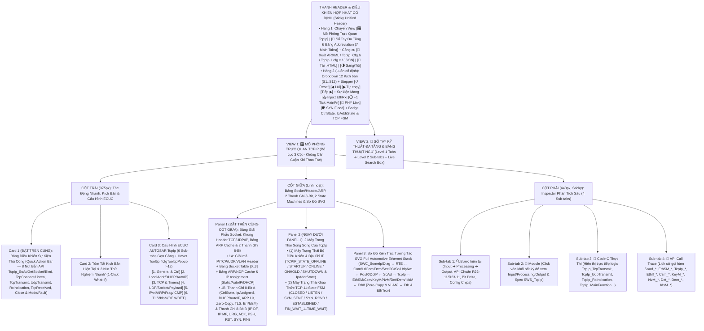
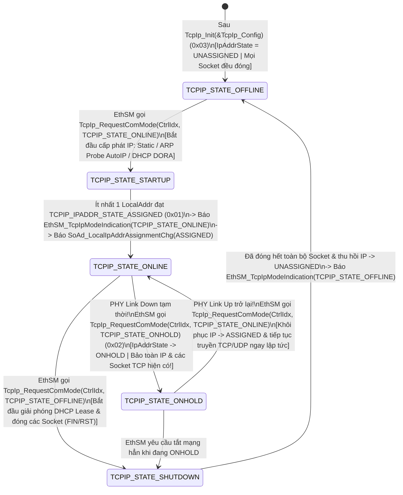
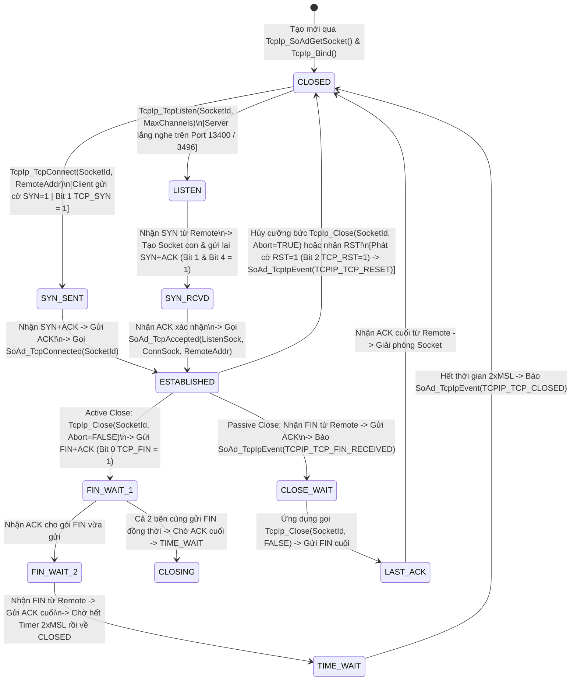

# Tài Liệu Thiết Kế Chi Tiết Trình Mô Phỏng AUTOSAR TcpIp (`TcpIp_Simulation_design.md`)

> **Trạng thái tài liệu:** Bản thiết kế chi tiết đã cập nhật theo xác nhận `A1`–`A4` của User — Sẵn sàng để User review trước khi triển khai code.  
> **File đích dự kiến xuất bản:** `d:\__Personal\AntiGravity\Simulation\03_Services\AUTOSAR_TcpIp.html` (Ứng dụng Web Tương tác 1 file HTML độc lập, 100% Offline, Pure CSS, có nút tải `.HTML` kèm cấu hình nhúng & xuất code `ARXML / TcpIp_Cfg.h / TcpIp_Lcfg.c / JSON`).  
> **Chuẩn tham chiếu:** **AUTOSAR Classic Platform R20-11 / R22-11 / R23-11 (`SWS_TcpIp`, `SWS_SoAd`, `SWS_DoIP`, `SWS_ServiceDiscovery`, `SWS_UdpNm`, `SWS_EthIf`, `SWS_EthSM`, `SWS_Eth`, `SWS_EthTrcv`, `SWS_Csm`, `SWS_KeyM`, `SWS_NvM`, `SWS_Det`, `SWS_Dem`, `SWS_IdsM`)**, đính kèm mã requirement chuẩn **`SWS_TcpIp_xxxxx`** tại từng bước xử lý, Bảng Giải Phẫu `Socket Table (TCP/UDP)`, `Khung Header TCP/UDP/IPv4/IPv6`, `Bảng ARP/NDP Cache & IP Assignment`, 2 thanh ghi 8-Bit tương tác, tooltip cấu hình và sổ tay tra cứu đa tầng.

---

## 1. Tổng Quan Định Hướng Thiết Kế Đã Chốt (`A1` – `A4`)

| Hạng mục | Nội dung thiết kế đã xác nhận với User |
| :--- | :--- |
| **1. Bố cục giao diện & Ưu tiên Không Cuộn Trang — Zero-Scroll (`A1`)** | Kế thừa tinh hoa của **`AUTOSAR_DEM.html`**, **`AUTOSAR_CanIf.html`** và **`AUTOSAR_SecOC.html`**, tối ưu hóa **Above-the-Fold (Zero-Scroll)** để các khối thao tác và giám sát tần suất cao nhất luôn nằm ngay phần đầu mỗi cột trong khung màn hình:<br>• **Thanh Điều Khiển Hợp Nhất Cố Định (Sticky Unified Header)**:<br>  - **Hàng 1**: Chuyển View `[🎛️ Mô Phỏng Trực Quan TcpIp]` \| `[📖 Sổ Tay Đa Tầng & Bảng Abbreviation (7 Main Tabs)]` + Công cụ `[🧾 Xuất ARXML / TcpIp_Cfg.h / TcpIp_Lcfg.c / JSON]` \| `[💾 Tải .HTML]` \| `[🌗 Sáng/Tối]`.<br>  - **Hàng 2 (Luôn cố định)**: Dropdown chọn 12 Kịch bản (`S1`–`S12`), Stepper (`↺ Reset`, `◀ Lùi`, `▶ Tự chạy`, `Tiếp ▶`), Bộ kích hoạt sự kiện mạng & phần cứng (`📥 Inject EthRx Frame [SYN/ACK/UDP/ARP/ICMP]`, `⏱️ +1 Tick TcpIp_MainFunction`, `🔌 PHY Link Up/Down [ONHOLD]`, `🛡️ Inject SYN Flood / IdsM`) và Badge Trạng thái `CtrlState (TCPIP_STATE_*)`, `IpAddrState (ASSIGNED/ONHOLD/UNASSIGNED)` & `TCP FSM State`.<br>• **Bố cục 3 cột hiện đại (Mỗi cột tự cuộn độc lập trong khung Viewport)**:<br>  - **Cột Trái (`375px`)**: Đưa **Card 1: Bảng Điều Khiển Sự Kiện Thủ Công (`Quick Action Bar` — 8 nút bắn trực tiếp API chuẩn `TcpIp`: `TcpIp_SoAdGetSocket & Bind`, `TcpIp_TcpConnect / TcpListen`, `TcpIp_TcpTransmit`, `TcpIp_UdpTransmit`, `TcpIp_RxIndication`, `TcpIp_TcpReceived`, `TcpIp_Close(Abort)`, `TcpIp_RequestComMode / IpAssignment`)** và **Card 2: Tóm tắt kịch bản & 3 nút 1-Click What-If** lên trên cùng, tiếp theo là **Card 3: 6 Sub-tabs Cấu hình ECUC TcpIp (36 tham số)** (hỗ trợ Floating Hover Tooltip `#cfgTooltipPopup` sau `>1s` giống hệt `AUTOSAR_DEM.html`).<br>  - **Cột Giữa (`Linh hoạt`)**: Đưa **Panel 1: Bảng Giải Phẫu `Socket Table (TCP/UDP)`, `Khung Header TCP/UDP/IPv4/IPv6`, `Bảng ARP/NDP Cache`, `IP Address Assignment (Static/DHCP/AutoIP)` + 2 Thanh Ghi 8-Bit Tương Tác** và **Panel 2: 2 Máy Trạng Thái Song Song (`TcpIp Controller & LocalIpAddr State Machine` & `TCP 11-State FSM RFC 793`)** lên ngay đầu cột giữa; bên dưới là **Panel 3: Sơ Đồ Kiến Trúc Tương Tác SVG Full Automotive Ethernet Stack** (`SWC_SomeIp/SWC_Diag ↔ RTE ↔ Com/LdCom/Dcm/SecOC/Sd/UdpNm ↔ PduR/DoIP ↔ SoAd ↔ TcpIp [TCP/UDP/IPv4/IPv6/ARP/NDP/ICMP/DHCP/TLS] ↔ EthSM/Csm/KeyM/NvM/Det/Dem/IdsM ↔ EthIf [Zero-Copy DMA & VLAN 802.1Q] ↔ Eth & EthTrcv`).<br>  - **Cột Phải (`440px, Sticky`)**: Inspector 4 Sub-tabs (`🔍 Bước hiện tại`, `🧩 Module`, `📄 Code C Thực Thi (TcpIp.c / TcpIp_Tcp.c / TcpIp_IpV4.c)`, `📜 API Call Trace`). |
| **2. Khu vực Giám sát Bit-level & Giải phẫu Socket / Packet Header / ARP Cache 2 Tầng (`A2`)** | Đặt **cố định và nổi bật ở đầu Cột Giữa** gồm **2 tầng trực quan hóa**:<br>• **Tầng 1 — Bảng Giải Phẫu Trực Quan `Socket Table`, `Khung Header TCP/UDP/IP`, `Bảng ARP/NDP Cache` & `IP Address Assignment`**:<br>  - **Giải mã cấu trúc Khung Header đang xử lý (`IPv4/IPv6 Header + TCP/UDP Header + IEEE 802.1Q VLAN Tag`)**: Hiển thị trực tiếp các trường `SrcIP ↔ DstIP`, `SrcPort ↔ DstPort`, `Protocol (0x06 TCP / 0x11 UDP / 0x01 ICMP)`, `SeqNum / AckNum`, `WindowSize`, `6 cờ TCP (URG|ACK|PSH|RST|SYN|FIN)`, `IP Flags (DF|MF) + FragOffset`, `TTL` và thẻ `VLAN VID / PCP Priority (0..7)`.<br>  - **Bảng Quản lý Socket (`TcpIp_SocketTable[0..3]`)**: Theo dõi trạng thái từng `SocketId`, `Owner (SoAd/DoIP/Sd/UdpNm)`, `Domain & Proto (AF_INET/AF_INET6, TCP/UDP)`, `Local IP:Port ↔ Remote IP:Port`, trạng thái `TCP FSM`, `Tx/Rx Window` và liên kết `TLS`.<br>  - **Bảng Phân giải Địa chỉ `ARP/NDP Cache` & `IP Assignment`**: Hiển thị các mục `IP ↔ MAC (PhysAddr)` kèm trạng thái (`REACHABLE / STALE / INCOMPLETE`), hàng đợi gói tin chờ phân giải ARP (`ArpPendingQueue`), và trạng thái cấp phát IP của từng `LocalAddrId` (`STATIC`, `LINKLOCAL_DOIP AutoIP`, `DHCP`).<br>• **Tầng 2 — 2 Thanh ghi 8-Bit tương tác song song**:<br>  1. **Thanh A (`8-Bit TcpIp Controller, IP Assignment, ARP, Zero-Copy & TLS Status Byte` — `TcpIp_CtrlIpStatusByte`)**: Theo dõi trạng thái Controller (`CTRL_ONLINE`, `CTRL_ONHOLD`), trạng thái gán IP (`IP_ASSIGNED`, `DHCP_AUTOIP_OK`), phân giải địa chỉ (`ARP_NDP_HIT`), truyền tải DMA (`ZERO_COPY_TX`), kênh bảo mật (`TLS_SEC_ACTV`) và cảnh báo lỗi/xâm nhập (`ERR_IDSM_DET`).<br>  2. **Thanh B (`8-Bit TCP Control Flags & IP Fragmentation Byte` — `TcpIp_TcpFlagsByte`)**: Phản ánh trực tiếp 2 bit phân mảnh IPv4 (`IP_DF_FLAG`, `IP_MF_FRAG`) và 6 cờ điều khiển chuẩn của TCP Header (`TCP_URG`, `TCP_ACK`, `TCP_PSH`, `TCP_RST`, `TCP_SYN`, `TCP_FIN`). Cho phép click trực tiếp vào từng bit để giải mã hoặc thử nghiệm! |
| **3. Hệ thống 12 Kịch bản mẫu (`A3`)** | Thiết kế sẵn **12 Kịch bản (`S1`–`S12`)** chia làm 4 nhóm lớn:<br>• **Nhóm 1 (`S1`–`S3`) — Khởi động `EthSM`, Cấp phát IP (`Static / AutoIP / DHCP`), `ARP Cache Miss` & Truyền/Nhận `UDP Unicast / Multicast`**: Khởi động kênh `EthSM ➔ TcpIp_RequestComMode(ONLINE)` & gán IP tĩnh/AutoIP/DHCP (`S1`); Truyền `UDP` qua Zero-Copy (`EthIf_ProvideTxBuffer`) khi gặp `ARP Cache Miss` (`S2`); Nhận `UDP Unicast & Multicast` (SOME/IP-SD `224.224.224.245:30490` với `IGMP`) (`S3`).<br>• **Nhóm 2 (`S4`–`S6`) — Kết nối `TCP 3-Way Handshake`, Truyền/Nhận `TCP Stream` (`CopyTxData / Nagle / Sliding Window`) & Đóng Kết nối (`FIN` vs `RST`)**: Thiết lập kết nối TCP Client & TCP Server (`3-Way Handshake` cho DoIP Port `13400`) (`S4`); Truyền nhận luồng dữ liệu TCP tin cậy với `SoAd_CopyTxData()`, `Nagle`, phân đoạn `MSS` & `TcpIp_TcpReceived()` (`S5`); Đóng kết nối êm dịu `4-Way FIN Teardown` đối chiếu với hủy cưỡng bức `RST Abort` (`S6`).<br>• **Nhóm 3 (`S7`–`S9`) — Tự phục hồi `TCP Retransmission (RTO) / Keep-Alive`, Phân mảnh `IPv4 (MTU)`, `ICMP Ping` & `TcpIp_ChangeParameter()`**: Xử lý mất gói tin với `RTO`, `Fast Retransmit (3x Dup-ACK)` & `Keep-Alive` (`S7`); Phân mảnh và tái hợp gói tin IPv4 vượt `MTU 1500B` (`Bit 6 IP_MF_FRAG = 1`, `Fragment Offset`) (`S8`); Phản hồi `ICMPv4/v6 Echo Reply (Ping)` / `Port Unreachable` & đổi nóng tham số Socket bằng `TcpIp_ChangeParameter()` (`S9`).<br>• **Nhóm 4 (`S10`–`S12`) — Bảo mật `AUTOSAR TLS (Csm/KeyM)`, Trạng thái `ONHOLD` khi mất Link PHY, Bảo vệ `IdsM` & Lỗi `DET/DEM`**: Thiết lập kết nối bảo mật `DoIP over TLS (Port 3496)` qua `Csm/KeyM` (`S10`); So sánh mất Link tạm thời `TCPIP_STATE_ONHOLD` (bảo toàn IP/Socket) vs `TCPIP_STATE_OFFLINE` (`S11`); Chống tấn công `TCP SYN Flood (SynCookies)` & `ARP Spoofing` báo `IdsM_SetSecurityEvent()`, lỗi mạng `Dem` & hàng rào `Det` (`ModuleId = 170`) (`S12`). |
| **4. Sổ tay tra cứu đa tầng & Bảng Abbreviation (`A4`)** | **View 2 (`📖 Sổ Tay Kỹ Thuật TcpIp & Từ Điển Thuật Ngữ`)** được tổ chức theo cấu trúc **Đa Tầng (Multi-level Tabs)**:<br>• **6 Main Sub-tabs (Level 1) × 4 Chủ đề con (Level 2 Pills/Tabs = 24 chuyên đề)** phân tích sâu kiến trúc Automotive Ethernet Stack & cầu nối `SoAd`, giải phẫu giao thức `TCP 11-State FSM / Sliding Window / Nagle / RTO`, `UDP / Zero-Copy DMA / VLAN 802.1Q / IGMP Multicast`, tầng mạng `IPv4/IPv6 / ARP/NDP / DHCP/AutoIP / Fragmentation`, chế độ `ONHOLD / TLS / IPsec / IdsM`, từ điển API R23-11, ECUC, `DET/DEM` và 6 bẫy lỗi thực chiến.<br>• **Tab 7 chuyên biệt: `🔤 Bảng Thuật Ngữ & Từ Viết Tắt (Abbreviation Table)`** trình bày dưới dạng bảng chuẩn 4 cột, tích hợp **Search Box tìm kiếm tức thời (Live Search + Highlight `<mark>`)** và 5 nút lọc nhanh theo phân nhóm (`Socket, SoAd & Core`, `TCP FSM, Window & Timer`, `UDP, IP, ARP, DHCP & ICMP`, `Zero-Copy, EthIf, VLAN & TLS`, `APIs, ECUC, DET, DEM & IdsM`). |

---

## 2. Bố Cục Giao Diện 3 Cột Ưu Tiên Zero-Scroll & Hệ Thống Sub-Tabs (UI Wireframe)

Để đáp ứng triệt để yêu cầu **"đưa các khối được dùng thường xuyên hơn lên phía trên để người dùng không cần cuộn chuột lên xuống mỗi lần thao tác"**, giao diện được thiết kế theo nguyên lý **Viewport-First (Toàn bộ 8 nút gọi nhanh API `TcpIp`, các nút bơm gói tin Ethernet `EthRx` & nhịp `TcpIp_MainFunction()`, Bảng Giải Phẫu `Socket Table / Packet Header / ARP Cache`, 2 Thanh Ghi 8-Bit và 2 Máy Trạng Thái đều nằm ngay trong tầm mắt đầu trang)**:



### Điểm Cải Tiến Đột Phá Về Trải Nghiệm "Zero-Scroll" Cho Module `TcpIp`:
1. **Thanh Điều Khiển Hợp Nhất (`Sticky Unified Header`) Với Bộ Kích Hoạt Mạng Ethernet & Chu Kỳ `MainFunction`**:
   - Trong thực tế, `TcpIp` vận hành song hành bởi các lời gọi từ `SoAd`/`EthSM`, ngắt nhận gói tin bất đồng bộ **`TcpIp_RxIndication()`** từ `EthIf`/`Eth`, và tác vụ nền chu kỳ **`TcpIp_MainFunction()`** (`5ms` hoặc `10ms`) để xử lý bộ đếm `TCP Retransmission (RTO)`, `TIME_WAIT`, `ARP Aging`, `DHCP Lease` và `AutoIP Probe`. Đặt sẵn 4 nút **`📥 Inject EthRx`**, **`⏱️ +1 Tick MainFn`**, **`🔌 PHY Link`** và **`🛡️ SYN Flood`** ngay trên thanh Header cố định giúp người dùng mô phỏng trọn vẹn tương tác mạng thực thời mà không phải cuộn chuột tìm kiếm!
2. **Đưa `Quick Action Bar` (8 nút tác động nhanh) lên vị trí Card 1 (Đầu Cột Trái)** và đưa **Bảng Giải Phẫu `Socket Table / Packet Header / ARP Cache` + 2 Thanh Ghi 8-Bit** lên đầu Cột Giữa: Mọi thao tác như tạo Socket, bắt tay 3 bước TCP, truyền gói UDP gặp ARP Cache Miss, hay cắt gói tin vượt MTU thành nhiều mảnh đều phản hồi ngay lập tức trên cấu trúc từng trường Header và từng Bit thanh ghi.
3. **Gom 36 tham số ECUC vào 6 Sub-tabs gọn gàng**: Chiều cao Card Cấu hình được giữ gọn cố định (~275px), kèm hộp thoại giải thích nổi `#cfgTooltipPopup` khi hover quá `1000ms` giống hệt file `AUTOSAR_DEM.html`.

---

## 3. Thiết Kế Chi Tiết Panel 1 (Đầu Cột Giữa): Bảng Giải Phẫu `Socket Table`, `Khung Header TCP/UDP/IP`, `Bảng ARP/NDP Cache`, `IP Assignment` & 2 Thanh Ghi 8-Bit Tương Tác

Trong `AUTOSAR Classic`, giá trị kỹ thuật cốt lõi của `TcpIp` (`SWS_TcpIp`) nằm ở **4 trụ cột kiến trúc mạng nhúng**:
1. **Quản lý Socket Tĩnh (`TcpIp_SocketTable` — `SWS_TcpIp_00018`, `00022`..`00025`)**: Không sử dụng cấp phát động `malloc/free` như OS desktop mà quản lý một bảng tĩnh các Socket (`TCP` hoặc `UDP`, `AF_INET` hoặc `AF_INET6`), gắn chặt với `LocalAddrId` và `Owner` (`SoAd`), hỗ trợ cơ chế `SoAd_CopyTxData()` kéo dữ liệu trực tiếp.
2. **Đóng gói & Giải mã Khung Header Đa Tầng (`Ethernet / 802.1Q VLAN / IPv4-IPv6 / TCP-UDP-ICMP`)**: Quản lý đầy đủ thông số Header (`SeqNum`, `AckNum`, `WindowSize`, `6 Cờ TCP`, `IP DF/MF & Fragment Offset`, `TTL`, `Checksum Offload`) và chèn thẻ ưu tiên `IEEE 802.1Q VLAN PCP` qua `EthIf`.
3. **Cơ chế Cấp phát Địa chỉ IP (`Static / AutoIP Link-Local / DHCP`) & Phân giải `ARP/NDP Cache`**: Tự động chuyển đổi trạng thái `LocalIpAddrState` (`UNASSIGNED ➔ ASSIGNED ➔ ONHOLD`), hàng đợi gói tin chờ khi xảy ra `ARP Cache Miss` (`ArpPendingQueue`), và gia nhập nhóm Multicast (`IGMP/MLD`).
4. **Truyền tải Zero-Copy DMA (`EthIf_ProvideTxBuffer` — `SWS_TcpIp_00073`) & Bảo mật Kênh Truyền (`TLS / IPsec / SynCookies`)**: Giảm thiểu tối đa thao tác copy RAM khi chạy tốc độ `100BASE-T1` / `1000BASE-T1`, đồng thời tích hợp `Csm`/`KeyM` (TLS) và `IdsM` (phát hiện tấn công).

Do đó, Panel 1 ở đầu Cột Giữa được thiết kế gồm **2 tầng trực quan hóa liên thông**:

### 3.1. Phần 1A — Bảng Giải Phẫu Trực Quan `Packet Header`, `Socket Table`, `ARP/NDP Cache` & `IP Assignment`

```text
+-------------------------------------------------------------------------------------------------------------------+
| 🌐 BẢNG GIẢI PHẪU KHUNG HEADER, SOCKET TABLE, ARP/NDP CACHE & IP ASSIGNMENT (`SWS_TcpIp_00015`..`00094`)          |
| CtrlIdx 0 (Eth_0): [ TCPIP_STATE_ONLINE ] | PHY Link: [ 🟢 UP 1000BASE-T1 ] | MTU: [ 1500B ] | VLAN PCP: [ 4 ]    |
+-------------------------------------------------------------------------------------------------------------------+
| 1. GIẢI MÃ KHUNG HEADER ĐANG XỬ LÝ (Eth/VLAN ➔ IPv4/IPv6 ➔ TCP/UDP/ICMP — Click trường để thử nghiệm):           |
|  • [ L2 VLAN 802.1Q ]: VID = 10 | PCP = 4 | EtherType = 0x0800 (IPv4) | SrcMAC = 02:AA:BB:00:00:50                |
|  • [ L3 IPv4 Header ]: Src=192.168.10.50 ➔ Dst=192.168.10.100 | Proto=0x06 (TCP) | TTL=64 | Flags:[DF=1 MF=0 Off=0]|
|  • [ L4 TCP Header  ]: SrcPort=49152 ↔ DstPort=13400 (DoIP) | Seq=0x00001001 | Ack=0x00002001 | Win=4096 | MSS=1460|
|                        TCP Flags: [ URG=0 | ACK=1 | PSH=1 | RST=0 | SYN=0 | FIN=0 ] | Payload = 64 Bytes (Zero-Copy)|
+-------------------------------------------------------------------------------------------------------------------+
| 2. BẢNG QUẢN LÝ SOCKET TĨNH (`TcpIp_SocketTable[0..3]` — SoAd ↔ TcpIp):                                           |
|  +---------+--------+--------------+---------------------------+----------------------------+-------------------+ |
|  | SockId  | Owner  | Domain/Proto | Local IP:Port             | Remote IP:Port             | State & TLS/Win   | |
|  +---------+--------+--------------+---------------------------+----------------------------+-------------------+ |
|  | Sock_0  | SoAd   | IPv4 / TCP   | 192.168.10.50:49152       | 192.168.10.100:13400(DoIP) | [🟢 ESTABLISHED]  | |
|  | Sock_1  | SoAd   | IPv4 / UDP   | 192.168.10.50:30490       | 192.168.10.200:30490       | [🟢 BOUND / RDY]  | |
|  | Sock_2  | SoAd   | IPv4 / UDP   | 224.224.224.245:30490(MC) | *:30490 (SOME/IP-SD IGMP)  | [🟢 MCAST JOINED] | |
|  | Sock_3  | SoAd   | IPv4 / TCP   | 192.168.10.50:3496 (TLS)  | *:0 (Listening Server)     | [🔵 LISTEN / TLS] | |
|  +---------+--------+--------------+---------------------------+----------------------------+-------------------+ |
| 3. BẢNG PHÂN GIẢI ĐỊA CHỈ `ARP/NDP CACHE` & TRẠNG THÁI CẤP PHÁT IP (`TcpIp_LocalAddr`):                           |
|  • LocalAddr_0: [STATIC 192.168.10.50/24 ➔ ASSIGNED] | LocalAddr_1: [AUTOIP 169.254.10.50 ➔ ASSIGNED/NvM]         |
|  • ARP Cache: [192.168.10.100 ➔ 00:11:22:33:44:64 (REACHABLE, Age=52s)] | [192.168.10.200 ➔ ⏳ INCOMPLETE (1 Queued)]|
+-------------------------------------------------------------------------------------------------------------------+
```

- **Tính năng tương tác trực tiếp trên Phần 1A**:
  - Người dùng có thể click chọn trực tiếp một dòng trong **`TcpIp_SocketTable[0..3]`** để chuyển Socket hiện hành (mọi thao tác `TcpTransmit / UdpTransmit / Close / ChangeParameter` sau đó sẽ tác động đúng vào Socket vừa chọn).
  - Có nút gạt nhanh **`[ARP Cache 192.168.10.200: HIT ↔ MISS]`** và **`[PHY Link: UP ↔ DOWN]`** ngay trên bảng để thử nghiệm trực tiếp tình huống mất địa chỉ MAC đích (`ARP Request / Pending Queue`) hoặc rớt dây mạng (`TCPIP_STATE_ONHOLD`).

### 3.2. Phần 1B — 2 Thanh Ghi 8-Bit Trạng Thái Tương Tác Luôn Hiển Thị Nổi Bật

Ngay bên dưới Phần 1A là **2 Thanh ghi 8-Bit tương tác** theo đúng phong cách chuẩn của `AUTOSAR_DEM.html`, `AUTOSAR_CanIf.html` và `AUTOSAR_SecOC.html`:

```text
+-------------------------------------------------------------------------------------------------------------------+
| 🔢 BẢNG GIÁM SÁT BITFIELD 8-BIT TCPIP STATUS & TCP/IP HEADER FLAGS (LIVE 8-BIT INSPECTOR) [Click Bit để thử]      |
| Bước #4: TcpIp_TcpTransmit(Sock_0, Len=64) ➔ SoAd_CopyTxData() ➔ Zero-Copy DMA | A: 0xAC | B: 0x98                |
+-------------------------------------------------------------------------------------------------------------------+
| A. THANH GHI 8-BIT TRẠNG THÁI CONTROLLER, IP, ARP, ZERO-COPY & TLS (`TcpIp_CtrlIpStatusByte`) — Hex:[0xAC] [10101100]|
|    Ctrl: [TCPIP_STATE_ONLINE] | IpState: [ASSIGNED] | ARP: [HIT 00:11:22:33:44:64] | Buffer: [EthIf Zero-Copy DMA]|
|  +-------------+ +-------------+ +-------------+ +-------------+ +-------------+ +-------------+ +-------+ +-----+|
|  | Bit 7 (0x80)| | Bit 6 (0x40)| | Bit 5 (0x20)| | Bit 4 (0x10)| | Bit 3 (0x08)| | Bit 2 (0x04)| |Bit1(2)| |Bit 0||
|  | CTRL_ONLINE | | CTRL_ONHOLD | | IP_ASSIGNED | | DHCP_AUTOIP | | ARP_NDP_HIT | | ZERO_COPY   | |TLS_ACT| |ERR_I||
|  |      1      | |      0      | |      1      | |      0      | |      1      | |   1 (0➔1🔥) | |   0   | |  0  ||
|  | Ctrl Online | | Link Up OK  | | IP Assigned | | Static IP   | | MAC Cached  | | DMA Provided| |PlainTx| |NoErr||
|  +-------------+ +-------------+ +-------------+ +-------------+ +-------------+ +-------------+ +-------+ +-----+|
+-------------------------------------------------------------------------------------------------------------------+
| B. THANH GHI 8-BIT CỜ ĐIỀU KHIỂN TCP & PHÂN MẢNH IP (`TcpIp_TcpFlagsByte`) — Hex:[0x98] [10011000]               |
|    IP Flags: [DF=1, MF=0] | TCP Flags: [ACK=1, PSH=1] | TCP State: [ESTABLISHED] | MSS: [1460B]                  |
|  +-------------+ +-------------+ +-------------+ +-------------+ +-------------+ +-------------+ +-------+ +-----+|
|  | Bit 7 (0x80)| | Bit 6 (0x40)| | Bit 5 (0x20)| | Bit 4 (0x10)| | Bit 3 (0x08)| | Bit 2 (0x04)| |Bit1(2)| |Bit 0||
|  | IP_DF_FLAG  | | IP_MF_FRAG  | |   TCP_URG   | |   TCP_ACK   | |   TCP_PSH   | |   TCP_RST   | |TCP_SYN| |TCP_F||
|  |      1      | |      0      | |      0      | |   1 (0➔1🔥) | |   1 (0➔1🔥) | |      0      | |   0   | |  0  ||
|  | DontFrag=1  | | NoMoreFrag  | | No Urgent   | | Ack Valid   | | Push To App | | No Reset    | |No Syn | |NoFin||
|  +-------------+ +-------------+ +-------------+ +-------------+ +-------------+ +-------------+ +-------+ +-----+|
+-------------------------------------------------------------------------------------------------------------------+
```

#### 3.2.1. Giải Mã Chi Tiết Thanh A: `8-Bit TcpIp Controller, IP Assignment, ARP, Zero-Copy & TLS Status Byte` (`TcpIp_CtrlIpStatusByte`)

| Bit | Mask | Tên Cờ (`TcpIp Status Bit`) | Ý nghĩa kỹ thuật & Khi nào bật lên `1` (`0 ➔ 1`) | Khi nào hạ về `0` (`1 ➔ 0`) |
| :-: | :-: | :--- | :--- | :--- |
| **Bit 7** | `0x80` | **`CTRL_ONLINE`** | Bật lên `1` khi bộ điều khiển `TcpIpCtrl` đạt trạng thái **`TCPIP_STATE_ONLINE`** (sau khi `EthSM` gọi `TcpIp_RequestComMode(CtrlIdx, TCPIP_STATE_ONLINE)`, hoàn tất `STARTUP` gán IP và phát callback **`EthSM_TcpIpModeIndication(CtrlIdx, TCPIP_STATE_ONLINE)`** — `SWS_TcpIp_00075`). Cho phép mở kết nối và truyền/nhận Socket bình thường. | Hạ về `0` khi chuyển sang **`TCPIP_STATE_ONHOLD`** (mất PHY Link tạm thời), **`TCPIP_STATE_SHUTDOWN`** hoặc **`TCPIP_STATE_OFFLINE`**. |
| **Bit 6** | `0x40` | **`CTRL_ONHOLD`** | Bật lên `1` khi Ethernet Controller rơi vào trạng thái **`TCPIP_STATE_ONHOLD`** do mất tín hiệu PHY Link tạm thời (`EthSM` gọi `TcpIp_RequestComMode(CtrlIdx, TCPIP_STATE_ONHOLD)` — `SWS_TcpIp_00076`): Địa chỉ IP chuyển sang **`TCPIP_IPADDR_STATE_ONHOLD`** (không bị thu hồi!), các Socket TCP đang mở vẫn được giữ nguyên thay vì hủy bỏ ngay. | Hạ về `0` khi PHY Link kết nối lại (`ONLINE`) hoặc chuyển hẳn xuống **`TCPIP_STATE_OFFLINE`** (thu hồi IP & đóng toàn bộ Socket). |
| **Bit 5** | `0x20` | **`IP_ASSIGNED`** | Bật lên `1` khi ít nhất một `LocalAddrId` trên Controller chuyển sang trạng thái **`TCPIP_IPADDR_STATE_ASSIGNED`** (`SWS_TcpIp_00094`) và `TcpIp` đã bắn callback **`SoAd_LocalIpAddrAssignmentChg(IpAddrId, TCPIP_IPADDR_STATE_ASSIGNED)`**. Đây là điều kiện tiên quyết để `SoAd` cho phép `Bind()` và `UdpTransmit/TcpConnect`. | Hạ về `0` khi `LocalIpAddr` ở trạng thái `TCPIP_IPADDR_STATE_UNASSIGNED` hoặc `TCPIP_IPADDR_STATE_ONHOLD` (do hết hạn DHCP Lease, trùng IP khi ARP Probe, hoặc tắt mạng). |
| **Bit 4** | `0x10` | **`DHCP_AUTOIP`** | Bật lên `1` khi địa chỉ IP hiện tại được cấp phát tự động thành công thông qua giao thức động: **`TCPIP_DHCP`** (hoàn tất chu trình 4 bước `Discover ➔ Offer ➔ Request ➔ Ack`) hoặc **`TCPIP_LINKLOCAL_DOIP`** (`AutoIP 169.254.x.x` qua `ARP Probe/Announce RFC 3927`, tùy chọn lưu vào `NvM`). | Hạ về `0` khi dùng địa chỉ tĩnh **`TCPIP_STATIC`** hoặc khi chưa hoàn tất quá trình xin cấp IP động. |
| **Bit 3** | `0x08` | **`ARP_NDP_HIT`** | Bật lên `1` khi tra cứu địa chỉ IP đích trong **`ARP Cache (IPv4)`** hoặc **`NDP Neighbor Cache (IPv6)`** cho kết quả **`HIT / REACHABLE`** (lấy ngay được địa chỉ MAC 6-byte đích `PhysAddr` để đóng khung Ethernet), hoặc gói tin là Multicast/Broadcast (ánh xạ trực tiếp MAC `01:00:5E:xx:xx:xx` / `FF:FF:FF:FF:FF:FF`). | Hạ về `0` khi gặp **`ARP Cache Miss`**: `TcpIp` phải tạm giữ gói tin trong `ArpPendingQueue`, phát Broadcast **`ARP Request (0x0806)`** và chờ **`ARP Reply`** trước khi truyền! |
| **Bit 2** | `0x04` | **`ZERO_COPY`** | Bật lên `1` khi `TcpIp` gọi thành công **`EthIf_ProvideTxBuffer()`** lấy trực tiếp con trỏ DMA Tx Descriptor Buffer từ `Eth` MCAL và ghi Header + Payload (`SoAd_CopyTxData()` nếu `DataPtr == NULL_PTR`) mà không tốn thao tác sao chép trung gian (`SWS_TcpIp_00073`), trước khi gọi **`EthIf_Transmit()`**. | Hạ về `0` khi hết DMA Buffer (`BUFREQ_E_OVFL` ➔ `TCPIP_E_NOBUFS`), đang chờ phân giải ARP, hoặc chưa thực hiện lệnh truyền. |
| **Bit 1** | `0x02` | **`TLS_ACTV`** | Bật lên `1` khi Socket TCP hiện tại được gán kết nối bảo mật **AUTOSAR TLS 1.2 / 1.3** (`TcpIp_ChangeParameter(TCPIP_PARAMID_TLS_CONNECTION_ASSIGNMENT)`) và đã hoàn tất quá trình bắt tay xác thực chứng chỉ số (`KeyM`) + mã hóa phiên qua **`Csm`** (ví dụ kết nối **`DoIP over TLS Port 3496`** — `SWS_TcpIp` R20-11..R23-11). | Hạ về `0` với các kết nối không mã hóa (Plaintext TCP/UDP) hoặc khi TLS Handshake thất bại / chưa bắt tay xong. |
| **Bit 0** | `0x01` | **`ERR_IDSM_DET`** | Bật lên `1` ngay khi `TcpIp` phát hiện lỗi lập trình **`Det_ReportError()`** (`ModuleId = 170 / 0x00AA`, ví dụ `TCPIP_E_INV_SOCK_ID`, `TCPIP_E_ADDRINUSE`, `TCPIP_E_NOBUFS`), lỗi mạng **`Dem_SetEventStatus()`** (`TCPIP_E_TIMEDOUT`, `TCPIP_E_CONNREFUSED`), hoặc phát hiện tấn công mạng báo **`IdsM_SetSecurityEvent()`** (`SYN Flood`, `ARP Spoofing`). | Hạ về `0` khi thực hiện một thao tác hợp lệ mới hoặc bấm Reset. |

#### 3.2.2. Giải Mã Chi Tiết Thanh B: `8-Bit TCP Control Flags & IP Fragmentation Byte` (`TcpIp_TcpFlagsByte`)

| Bit | Mask | Tên Cờ (`Packet Header Flag Bit`) | Ý nghĩa kỹ thuật & Khi nào bật lên `1` (`0 ➔ 1`) | Khi nào hạ về `0` (`1 ➔ 0`) |
| :-: | :-: | :--- | :--- | :--- |
| **Bit 7** | `0x80` | **`IP_DF_FLAG`** | Đại diện cho cờ **`DF (Don't Fragment)`** trong **IPv4 Header Flags (`Bit 1`)**: Bật lên `1` yêu cầu không được phép cắt nhỏ gói tin trên đường truyền (thường bật cho TCP theo Path MTU Discovery hoặc khi cấu hình `SetIpDontFragmentFlagDf = TRUE`). Nếu kích thước gói tin vượt quá `MTU` trong khi `DF = 1`, gói tin sẽ bị chặn! | Hạ về `0` khi cho phép bộ định tuyến hoặc `TcpIp` thực hiện **IPv4 Fragmentation** (ví dụ gói UDP lớn `2800 Bytes` qua `MTU = 1500B`). |
| **Bit 6** | `0x40` | **`IP_MF_FRAG`** | Đại diện cho cờ **`MF (More Fragments)`** trong **IPv4 Header Flags (`Bit 2`)**: Bật lên `1` khi gói tin hiện tại bị phân mảnh thành nhiều đoạn nhỏ (đây là các đoạn đầu/giữa có `MF = 1` còn đoạn cuối cùng mang `MF = 0` + `Fragment Offset > 0`), hoặc ở chiều nhận khi bộ đệm **`IPv4 Reassembly`** đang đợi đủ các mảnh để ghép lại. | Hạ về `0` khi gói tin nguyên vẹn không phân mảnh (`MF=0, Offset=0`) hoặc khi đã nhận mảnh cuối cùng và tái hợp hoàn tất. |
| **Bit 5** | `0x20` | **`TCP_URG`** | Đại diện cho cờ **`URG (Urgent Pointer Significant)`** trong **TCP Header Control Bits**: Bật lên `1` nếu phân đoạn TCP mang dữ liệu khẩn cấp cần ưu tiên đọc. | Hạ về `0` trong hầu hết các luồng truyền dữ liệu thông thường (`DoIP`, `SOME/IP`). |
| **Bit 4** | `0x10` | **`TCP_ACK`** | Đại diện cho cờ **`ACK (Acknowledgment)`** trong **TCP Header**: Bật lên `1` trên mọi gói tin kể từ gói **`SYN+ACK`** trở đi (`3-Way Handshake`, truyền dữ liệu `PSH+ACK`, xác nhận `ACK` thuần túy, `FIN+ACK`). Cho biết trường `AckNum` (32-bit) là hợp lệ, xác nhận đã nhận dữ liệu tới byte `AckNum - 1`. | Hạ về `0` chỉ ở gói tin khởi tạo đầu tiên **`SYN`** của bên Client hoặc ở gói **`RST`** đơn thuần không kèm ACK. |
| **Bit 3** | `0x08` | **`TCP_PSH`** | Đại diện cho cờ **`PSH (Push Function)`** trong **TCP Header**: Bật lên `1` khi gửi bản tin ứng dụng (`TcpIp_TcpTransmit`) yêu cầu tầng TCP bên nhận đẩy ngay dữ liệu từ Receive Buffer lên **`SoAd_RxIndication()`** mà không chờ gom đầy bộ đệm (cực kỳ quan trọng với thông điệp chẩn đoán `DoIP` thời gian thực). | Hạ về `0` trên các gói điều khiển thuần túy (`SYN`, `ACK` rỗng, `FIN`, `Keep-Alive`). |
| **Bit 2** | `0x04` | **`TCP_RST`** | Đại diện cho cờ **`RST (Reset Connection)`** trong **TCP Header**: Bật lên `1` khi thực hiện hủy kết nối cưỡng bức **`TcpIp_Close(SocketId, Abort = TRUE)`**, khi từ chối kết nối vào cổng đang đóng (gây lỗi `TCPIP_E_CONNREFUSED`), hoặc khi nhận gói tin bất hợp lệ. Lập tức xóa Socket và báo **`SoAd_TcpIpEvent(TCPIP_TCP_RESET)`**! | Hạ về `0` trong suốt quá trình thiết lập, truyền nhận và đóng kết nối bình thường. |
| **Bit 1** | `0x02` | **`TCP_SYN`** | Đại diện cho cờ **`SYN (Synchronize Sequence Numbers)`** trong **TCP Header**: Bật lên `1` ở bước 1 (`SYN` từ `TcpIp_TcpConnect()`) và bước 2 (`SYN+ACK` từ Socket `LISTEN`) của quy trình bắt tay 3 bước **`3-Way Handshake`** để đồng bộ số thứ tự khởi tạo (`ISN — Initial Sequence Number`) và đàm phán `MSS`. | Hạ về `0` ngay sau khi hoàn tất bắt tay 3 bước và chuyển sang trạng thái **`ESTABLISHED`**. |
| **Bit 0** | `0x01` | **`TCP_FIN`** | Đại diện cho cờ **`FIN (Finish — No More Data)`** trong **TCP Header**: Bật lên `1` khi gọi đóng kết nối êm dịu **`TcpIp_Close(SocketId, Abort = FALSE)`** để bắt đầu quy trình đóng 4 bước **`4-Way Teardown`** (`FIN_WAIT_1 ➔ FIN_WAIT_2 ➔ TIME_WAIT`) và kích hoạt sự kiện **`TCPIP_TCP_FIN_RECEIVED`** / **`TCPIP_TCP_CLOSED`** lên `SoAd`. | Hạ về `0` trước khi bắt đầu quy trình đóng kết nối hoặc khi đã đóng hẳn về `CLOSED`. |

---

## 4. Phân Tích Xử Lý Từng Module: Input Lấy Từ Đâu, Xử Lý Gì, Output Route Đến Đâu

Mọi khối trên sơ đồ kiến trúc SVG đều có thể **click vào để xem giải thích chi tiết** ở cột phải (Tab `🧩 Module`) và được tổng hợp đầy đủ trong **Tab 1 của Sổ tay**:

| # | Module / Phân khối | Lớp AUTOSAR | 📥 Input lấy từ đâu? | ⚙️ Cách xử lý nội bộ (Processing, State, Buffers & Protocol) | 📤 Output route đến đâu & Hàm API chuẩn (R20-11 / R22-11 / R23-11) |
| :-: | :--- | :--- | :--- | :--- | :--- |
| **1** | **`SWC_SomeIpApp` & `SWC_DiagApp`**<br>*(Application Layer)* | Application Layer (`01_Application`) | • Dữ liệu cảm biến/dịch vụ từ `RTE` (`Rte_Read`) hoặc yêu cầu đọc/ghi chẩn đoán DID/Routine từ `Dcm`.<br>• Trạng thái chế độ mạng từ `ComM` (`Rte_Mode`). | • **Lưu ý kiến trúc quan trọng**: Không có bất kỳ `SWC` nào được phép gọi trực tiếp `TcpIp` hay mở BSD Socket trực tiếp trong AUTOSAR Classic!<br>• **Luồng dữ liệu (Data Path)**: `SWC_SomeIpApp` gọi Service/Signal qua `RTE` xuống `AUTOSAR COM` / `LdCom` (tạo SOME/IP I-PDU ➔ `PduR` ➔ `SoAd` ➔ `TcpIp`); `SWC_DiagApp` phản hồi UDS qua `Dcm` (➔ `PduR` ➔ `DoIP` ➔ `SoAd` ➔ `TcpIp`).<br>• **Luồng điều khiển (Control Path)**: `SWC` xin mở mạng Ethernet qua `Rte_Call_ComM_UserRequest` (➔ `ComM` ➔ `EthSM` ➔ `TcpIp`). | • Qua **RTE** xuống **COM / LdCom / DCM**:<br>`Rte_Write_PP_RadarObj_Data(val)`<br>`Rte_Call_CS_SomeIpMethod_Invoke(in, &out)`<br>• Qua **RTE** xuống **ComM**:<br>`Rte_Call_UR_ComMUser_Eth_RequestComMode(COMM_FULL_COMMUNICATION)` |
| **2** | **`RTE` & `SchM`**<br>*(Runtime Environment & BSW Scheduler)* | RTE Layer (`02_RTE`) | • Lời gọi dịch vụ từ `SWC` và sự kiện tín hiệu từ `COM`/`LdCom`.<br>• Yêu cầu khóa vùng găng từ `TcpIp`. | • **RTE**: Thực hiện Serialization dữ liệu (SOME/IP Transformer) và chuyển tiếp qua ranh giới Application/BSW.<br>• **SchM (`Exclusive Area`)**: Vì hàm truyền từ Task (`SoAd_IfTransmit` ➔ `TcpIp_TcpTransmit/UdpTransmit`), tác vụ chu kỳ (`TcpIp_MainFunction`) và hàm ngắt nhận Ethernet (`Eth_RxIrq` ➔ `EthIf_RxIndication` ➔ `TcpIp_RxIndication`) chạy bất đồng bộ trên cùng bộ nhớ **`TcpIp_SocketTable`**, **`TcpTxBuffer`** và **`ArpCache`**, `TcpIp` bắt buộc khóa bằng `SchM_Enter_TcpIp_EXCLUSIVE_AREA_0()`. | • Bảo vệ vùng dữ liệu găng của **TcpIp**:<br>`SchM_Enter_TcpIp_EXCLUSIVE_AREA_0()`<br>`SchM_Exit_TcpIp_EXCLUSIVE_AREA_0()` |
| **3** | **`Com / LdCom / Dcm / SecOC / Sd / DoIP / UdpNm` & `PduR`**<br>*(Upper Communication Services)* | Communication Services (`03_Services`) | • Nhận dữ liệu từ `RTE`/`SWC` hoặc tự sinh bản tin điều khiển mạng Ethernet.<br>• Nhận I-PDU/TP-PDU đã tái hợp từ `SoAd` & `PduR`. | • **`PduR`**: Định tuyến I-PDU từ `COM`/`LdCom`/`SecOC`/`Dcm` xuống `SoAd` hoặc `DoIP`.<br>• **`DoIP` (ISO 13400)**: Đóng gói UDS over IP (Header `0x02 FD` + Payload Type + Length), xử lý Vehicle Announcement (UDP Port 13400) và Routing Activation (TCP Port 13400 / TLS Port 3496).<br>• **`Sd` (SOME/IP-SD)**: Phát hiện và đăng ký dịch vụ (`OfferService`, `FindService`, `SubscribeEventgroup`) qua UDP Multicast (`224.224.224.245:30490`).<br>• **`UdpNm`**: Gửi/nhận gói NM định kỳ qua UDP để giữ mạng Ethernet thức/ngủ đồng bộ. | • Gọi xuống **SoAd**:<br>`SoAd_IfTransmit(SoAdTxPduId, &PduInfo)`<br>`SoAd_TpTransmit(SoAdTxPduId, &PduInfo)`<br>`Sd_LocalIpAddrAssignmentChg()`<br>• Nhận từ **SoAd**:<br>`PduR_SoAdIfRxIndication()` / `DoIP_SoAdTpCopyRxData()` / `Sd_RxIndication()` / `UdpNm_RxIndication()` |
| **4** | **`SoAd`**<br>*(Socket Adaptor — `SWS_SoAd`)* | Communication Services (`03_Services`) | • Yêu cầu truyền `PduId` từ `PduR`, `DoIP`, `Sd`, `UdpNm`, `SecOC`.<br>• Callbacks Socket và dữ liệu nhận từ `TcpIp`. | • Là **"Phiên dịch viên" giữa thế giới AUTOSAR PDU và thế giới Socket TCP/UDP**:<br>  - Chuyển đổi `PduIdType` ➔ `SoConId` (Socket Connection) ➔ `TcpIp_SocketIdType`.<br>  - Tự động chèn **SoAd PDU Header (8 bytes: 4B HeaderId + 4B Length)** nếu bật `SoAdPduHeaderEnable` để ghép nhiều I-PDU đi chung 1 cổng TCP/UDP!<br>  - Khi `TcpIp` gọi ngược **`SoAd_CopyTxData()`**, `SoAd` chép trực tiếp payload vào DMA Buffer của `TcpIp/EthIf` (hỗ trợ Zero-Copy).<br>  - Khi mất kết nối (`SoAd_TcpIpEvent`) hoặc thay đổi IP (`SoAd_LocalIpAddrAssignmentChg`), `SoAd` tự động đóng/mở lại `SoCon` tương ứng và báo cho `Sd`/`DoIP`/`BswM`. | • Gọi xuống **TcpIp**:<br>`TcpIp_SoAdGetSocket(Domain, Proto, &SocketId)` [`SWS_TcpIp_00018`]<br>`TcpIp_Bind(SocketId, LocalAddrId, &Port)` [`SWS_TcpIp_00015`]<br>`TcpIp_TcpConnect()` / `TcpIp_TcpListen()` [`SWS_TcpIp_00022`, `00023`]<br>`TcpIp_UdpTransmit()` / `TcpIp_TcpTransmit()` [`SWS_TcpIp_00025`, `00050`]<br>`TcpIp_TcpReceived()` / `TcpIp_Close()` [`SWS_TcpIp_00024`, `00017`]<br>`TcpIp_ChangeParameter()` [`SWS_TcpIp_00016`]<br>• Nhận Callback từ **TcpIp**:<br>`SoAd_RxIndication()`, `SoAd_TxConfirmation()`, `SoAd_CopyTxData()`, `SoAd_TcpAccepted()`, `SoAd_TcpConnected()`, `SoAd_TcpIpEvent()`, `SoAd_LocalIpAddrAssignmentChg()` |
| **5** | **`EthSM`** *(kèm `ComM` & `BswM`)*<br>*(Ethernet State Manager)* | Communication Services (`03_Services`) | • Yêu cầu chế độ từ `ComM` (`EthSM_RequestComMode`).<br>• Trạng thái Link vật lý từ `EthIf`/`EthTrcv` (`EthSM_TrcvLinkStateChg`) & `EthSM_TcpIpModeIndication`. | • Điều phối đồng bộ giữa tầng vật lý (`EthIf`/`EthTrcv`) và ngăn xếp IP (`TcpIp`):<br>  - Khi `ComM` yêu cầu `COMM_FULL_COMMUNICATION` và `EthTrcv` báo `ETHTRCV_LINK_STATE_ACTIVE`, `EthSM` gọi **`TcpIp_RequestComMode(CtrlIdx, TCPIP_STATE_ONLINE)`**.<br>  - Nếu đang `ONLINE` mà dây Ethernet bị rút/rớt Link tạm thời (`DOWN`), `EthSM` chuyển `TcpIp` sang **`TCPIP_STATE_ONHOLD`** (không hủy IP và Socket ngay!) để chờ khôi phục Link.<br>  - Chỉ khi `TcpIp` báo `EthSM_TcpIpModeIndication(CtrlIdx, TCPIP_STATE_ONLINE)`, `EthSM` mới báo `ComM_BusSM_ModeIndication(FULL_COMMUNICATION)`! | • Gọi xuống **TcpIp**:<br>`TcpIp_RequestComMode(CtrlIdx, State)` [`SWS_TcpIp_00070`]<br>• Nhận Callback từ **TcpIp**:<br>`EthSM_TcpIpModeIndication(CtrlIdx, TcpIpState)` [`SWS_TcpIp_00072`] |
| **6** | **`TcpIp Core Engine`**<br>*(TCP/IP Stack — Trọng tâm mô phỏng)* | Communication Services (`03_Services`) | • Lệnh Socket & truyền nhận từ `SoAd`, yêu cầu chế độ từ `EthSM`.<br>• Khung Ethernet (IPv4/IPv6/ARP/ICMP/DHCP) từ `EthIf` qua `TcpIp_RxIndication()`.<br>• Nhịp định kỳ `TcpIp_MainFunction()`. | • **1. Quản lý Địa chỉ & Khám phá Mạng**: Cấp phát IP (`STATIC`, `AutoIP 169.254.x.x` qua ARP Probe, `DHCPv4/v6`), bảng `ARP/NDP Cache` kèm `ArpPendingQueue`, gia nhập nhóm `IGMPv2/v3` Multicast.<br>• **2. Tầng Mạng (`IPv4/IPv6` & `ICMP`)**: Đóng gói IP Header, tính/kiểm tra Checksum (hoặc dùng HW Offload), phân mảnh & tái hợp gói tin vượt `MTU` (`IPv4 Fragmentation & Reassembly`), tự động trả lời `ICMP Echo Reply (Ping)` & báo `Port Unreachable`.<br>• **3. Tầng Giao vận (`TCP` & `UDP`)**: Vận hành máy trạng thái `TCP 11-State FSM` (`SYN/SYN+ACK/ACK`, `FIN/RST`), cửa sổ trượt `Sliding Window`, `Nagle`, bộ định thời truyền lại `RTO` & `Keep-Alive`, kéo dữ liệu `SoAd_CopyTxData()` vào vùng đệm Zero-Copy của `EthIf`.<br>• **4. Bảo mật (`TLS` & `SynCookies`)**: Gọi `Csm`/`KeyM` thiết lập kênh TLS; chống `SYN Flood` & báo `IdsM`. | • Gọi xuống **EthIf**:<br>`EthIf_ProvideTxBuffer(CtrlIdx, FrameType, Priority, &BufIdx, &BufPtr, &LenByte)`<br>`EthIf_Transmit(CtrlIdx, BufIdx, FrameType, TxConfirmation, LenByte, PhysAddrPtr)`<br>`EthIf_UpdatePhysAddrFilter()` (Multicast MAC)<br>• Gọi lên **SoAd / EthSM / Csm / KeyM / NvM / Det / Dem / IdsM**. |
| **7** | **`Csm` & `KeyM`**<br>*(Crypto & Key Management for AUTOSAR TLS / IPsec)* | Security Services (`03_Services`) | • Yêu cầu xác thực chứng chỉ số X.509 (`KeyM`) và thiết lập phiên mã hóa TLS 1.2/1.3 từ `TcpIp`. | • **`KeyM`**: Xác minh chuỗi chứng chỉ số X.509 (`KeyM_VerifyCertificate`) của đối tác chẩn đoán DoIP hoặc Server khi thiết lập kết nối TLS (`DoIP Port 3496`).<br>• **`Csm`**: Thực hiện trao đổi khóa ECDHE, tạo chữ ký/xác thực chữ ký và mã hóa/giải mã toàn bộ dữ liệu Record Layer TLS bằng thuật toán AEAD (`AES-GCM`) trước khi `TcpIp` đẩy xuống `EthIf`. | • Phục vụ **TcpIp TLS Engine**:<br>`KeyM_VerifyCertificate()`<br>`Csm_KeyExchangeCalcSecret()`<br>`Csm_AEADEncrypt()` / `Csm_AEADDecrypt()` |
| **8** | **`EthIf`**<br>*(Ethernet Interface — `SWS_EthIf`)* | ECU Abstraction Layer (`04_ECU_Abstraction`) | • Yêu cầu cấp phát DMA Tx Buffer và truyền khung từ `TcpIp` (`EthIf_ProvideTxBuffer`, `EthIf_Transmit`).<br>• Khung Ethernet nhận từ `Eth` MCAL (`EthIf_RxIndication`). | • **Trừu tượng hóa VLAN (IEEE 802.1Q)**: Tách các mạng ảo VLAN (ví dụ `VLAN 10` cho ADAS, `VLAN 20` cho Diag) trên cùng 1 cổng Ethernet vật lý; tự động chèn thẻ `4-byte VLAN Tag (TPID 0x8100 + VID + PCP Priority 0..7)`.<br>• **Cơ chế Zero-Copy**: Cấp phát thẳng vùng nhớ DMA Tx Descriptor từ `Eth` cho `TcpIp` ghi dữ liệu không qua copy thừa.<br>• **Định tuyến EtherType**: Khi nhận khung từ `Eth`, bóc tách VLAN Tag, đối chiếu `FrameType` (`0x0800 IPv4`, `0x86DD IPv6`, `0x0806 ARP`) để gọi đúng **`TcpIp_RxIndication()`**. | • Gọi lên **TcpIp**:<br>`TcpIp_RxIndication(CtrlIdx, FrameType, IsBroadcast, PhysAddrPtr, DataPtr, LenByte)` [`SWS_TcpIp_00029`]<br>`TcpIp_TxConfirmation(CtrlIdx, BufIdx)`<br>• Gọi xuống **Eth** & **EthTrcv**:<br>`Eth_ProvideTxBuffer()`, `Eth_Transmit()`, `EthTrcv_GetLinkState()` |
| **9** | **`Eth` & `EthTrcv`**<br>*(MCAL Ethernet MAC & PHY Transceiver)* | MCAL (`05_MCAL`) & ECU Abstraction (`04_ECU_Abstraction`) | • Lệnh truyền khung Ethernet từ `EthIf` và cấu hình thanh ghi MAC/DMA.<br>• Tín hiệu vật lý từ đường dây `100BASE-T1` / `1000BASE-T1` (BroadR-Reach). | • **`Eth` MCAL**: Quản lý hàng đợi DMA Tx/Rx Descriptor Ring, chèn FCS (CRC-32) phần cứng, thực hiện **Hardware Checksum Offloading** (tính toán/kiểm tra tổng kiểm IPv4, TCP, UDP ngay trên phần cứng MAC để giảm tải CPU).<br>• **`EthTrcv` (PHY)**: Giám sát trạng thái liên kết vật lý (`ACTIVE` / `DOWN`), phát hiện xung đánh thức `Wake-on-LAN / OA TC10 Sleep-Wake` trên dây xoắn đôi đơn. | • Gọi Callback lên **EthIf**:<br>`EthIf_RxIndication()` (từ `Eth_RxHandler` ISR)<br>`EthIf_TxConfirmation()`<br>`EthIf_TrcvModeIndication()` |
| **10** | **`NvM`, `Det`, `Dem` & `IdsM`**<br>*(Memory, Diagnostics & Security Services)* | System & Security Services (`03_Services`) | • Yêu cầu lưu IP AutoIP/ARP từ `TcpIp` (`NvM`).<br>• Báo cáo lỗi phát triển (`Det`), lỗi sản xuất (`Dem`) & sự kiện xâm nhập (`IdsM`) từ `TcpIp`. | • **`NvM`**: Lưu trữ địa chỉ Link-Local (`169.254.x.x`) hoặc bảng ARP tĩnh vào bộ nhớ Flash/EEPROM qua `NvM_WriteBlock()` để khởi động lại nhanh ở lần bật máy sau.<br>• **`Det` (`ModuleId = 170 / 0x00AA`)**: Bắt lỗi tham số (`TCPIP_E_UNINIT`, `TCPIP_E_PARAM_POINTER`, `TCPIP_E_INV_SOCK_ID`, `TCPIP_E_NOBUFS`, `TCPIP_E_ADDRINUSE`).<br>• **`Dem`**: Ghi nhận DTC lỗi kết nối mạng lúc vận hành (`TCPIP_E_TIMEDOUT`, `TCPIP_E_CONNREFUSED`, `TCPIP_E_HOSTUNREACH`).<br>• **`IdsM`**: Tiếp nhận cảnh báo an ninh mạng (`SYN Flood`, `ARP Spoofing`, `Invalid TCP/IP Header`) qua `IdsM_SetSecurityEvent()`. | • Gọi từ **TcpIp**:<br>`NvM_ReadBlock()` / `NvM_WriteBlock()`<br>`Det_ReportError(170, 0, ApiId, ErrorId)`<br>`Det_ReportRuntimeError(...)`<br>`Dem_SetEventStatus(EventId, DEM_EVENT_STATUS_FAILED)`<br>`IdsM_SetSecurityEvent(SecurityEventId)` |

---

## 5. Thiết Kế Chi Tiết 2 Máy Trạng Thái Của `TcpIp` (Panel 2)

Trên Panel 2 của Cột Giữa, 2 sơ đồ máy trạng thái độc lập nhưng liên kết chặt chẽ với nhau của `TcpIp` được hiển thị trực quan song song:

### 5.1. Máy Trạng Thái Bộ Điều Khiển & Địa Chỉ IP (`TcpIp_StateType` & `TcpIp_IpAddrStateType` — `SWS_TcpIp_00075`..`00084`, `00094`)

> **Quy tắc ràng buộc sống còn giữa `TcpIp_StateType` và `LocalIpAddrState` / `Sockets`**:
> - **`TCPIP_STATE_ONLINE`**: Bộ điều khiển đang hoạt động đầy đủ; `LocalAddr` chuyển sang **`TCPIP_IPADDR_STATE_ASSIGNED`** ngay khi cấp phát IP thành công (`Static`, `AutoIP` hoặc `DHCP`) và báo **`SoAd_LocalIpAddrAssignmentChg(ASSIGNED)`**.
> - **`TCPIP_STATE_ONHOLD` (`SWS_TcpIp_00076`)**: Khi dây mạng Ethernet bị ngắt tạm thời (`EthTrcv Link Down`), `EthSM` yêu cầu chuyển sang `ONHOLD`. Lúc này `LocalIpAddrState` chuyển sang **`TCPIP_IPADDR_STATE_ONHOLD`** — địa chỉ IP **KHÔNG bị xóa**, các kết nối **TCP đang ở `ESTABLISHED` vẫn được bảo toàn** (chỉ tạm dừng truyền/giữ bộ đếm), giúp ECU giao tiếp lại tức thì ngay khi có Link trở lại mà không phải bắt tay lại từ đầu!
> - **`TCPIP_STATE_SHUTDOWN` ➔ `TCPIP_STATE_OFFLINE`**: Khi tắt mạng hoàn toàn, `TcpIp` hủy toàn bộ kết nối TCP/UDP (`TCPIP_TCP_CLOSED`), thu hồi IP về **`TCPIP_IPADDR_STATE_UNASSIGNED`** và chuyển bộ điều khiển về `OFFLINE`.



### 5.2. Máy Trạng Thái Giao Thức TCP 11-State FSM (`RFC 793 / SWS_TcpIp`)

> **Điểm nhấn trực quan trên Panel 2**:
> - Hiển thị rõ cả **Nhánh Client Chủ Động (`Active Open`: `CLOSED ➔ SYN_SENT ➔ ESTABLISHED`)**, **Nhánh Server Bị Động (`Passive Open`: `CLOSED ➔ LISTEN ➔ SYN_RCVD ➔ ESTABLISHED`)**, và **2 Cơ chế Đóng Kết Nối (`Active Close`: `FIN_WAIT_1 ➔ FIN_WAIT_2 ➔ TIME_WAIT [2×MSL] ➔ CLOSED` vs `Passive Close`: `CLOSE_WAIT ➔ LAST_ACK ➔ CLOSED`)**.
> - Nổi bật **đường thoát khẩn cấp bằng cờ `RST` (`TcpIp_Close(SocketId, Abort = TRUE)` hoặc nhận `RST`)**: Cắt đứt ngay lập tức từ bất kỳ trạng thái nào về `CLOSED` và báo `SoAd_TcpIpEvent(TCPIP_TCP_RESET)`!



---

## 6. Danh Mục Đầy Đủ 36 Trường Cấu Hình (Checkboxes & Textboxes — 6 Sub-Tabs) & Thiết Kế Hover Tooltip Giống File `DEM`

Ở Cột Trái (Card 3), toàn bộ 36 tham số cấu hình chuẩn ECUC `TcpIp` (`TcpIpGeneral`, `TcpIpCtrl`, `TcpIpLocalAddr`, `TcpIpAddrAssignment`, `TcpIpTcpConfig`, `TcpIpUdpConfig`, `TcpIpIpV4Ctrl`, `TcpIpArpConfig`, `TcpIpFragmentationConfig`, `TcpIpIcmpConfig`, `TcpIpTlsConfig`) được bố trí thành **Checkboxes, Textboxes, Number Spinners và Dropdowns** chia gọn vào **6 Sub-tabs**.  
Đặc biệt, **mọi ô cấu hình đều gắn thuộc tính `data-cfg-key` và hỗ trợ Floating Tooltip on Hover (`> 1s` delay hoặc click icon `ⓘ`) giống hệt `AUTOSAR_DEM.html`**.

### 6.1. Giao Diện & Cấu Trúc Dữ Liệu Của Floating Config Hover Tooltip (`#cfgTooltipPopup`)

Khi người dùng rê chuột giữ trên một ô cấu hình quá `1000ms` (hoặc bấm vào biểu tượng `ⓘ`), hộp thoại nổi `#cfgTooltipPopup` sẽ xuất hiện cạnh ô cấu hình với bố cục chuẩn của `AUTOSAR_DEM.html`:

```text
+----------------------------------------------------------------------------------------------------+
| 📘 Thuật Toán Gom Gói Nhỏ TCP Nagle (TcpIpTcpNagleEnabled)         [SWS_TcpIp_00150 | ECUC_00018]   |
| TcpIp / TcpIpConfig / TcpIpTcpConfig / TcpIpTcpNagleEnabled                                        |
+----------------------------------------------------------------------------------------------------+
| Bật hoặc tắt thuật toán Nagle (RFC 896) trên các Socket TCP nhằm hạn chế gửi nhiều phân đoạn TCP   |
| nhỏ lẻ (Tinygrams) lên mạng Ethernet bằng cách gom dữ liệu cho tới khi đầy 1 MSS hoặc nhận đủ ACK. |
+-------------------------------------------------+--------------------------------------------------+
| Dải giá trị cho phép (Range):                   | Giá trị thường dùng (Typical):                   |
| Boolean: TRUE (Gom gói nhỏ) / FALSE (Gửi ngay)  | FALSE cho DoIP thời gian thực / TRUE cho truyền tệp|
+-------------------------------------------------+--------------------------------------------------+
| 💡 Lưu ý kỹ thuật:                                                                                  |
| • Khi TcpIpTcpNagleEnabled == TRUE: Nếu còn dữ liệu chưa được ACK, các gói < MSS sẽ bị giữ lại    |
|   chờ gom (có thể gây trễ 40ms–200ms khi kết hợp Delayed ACK).                                     |
| • Khi FALSE (hoặc đổi nóng qua TcpIp_ChangeParameter(TCPIP_PARAMID_TCP_NAGLE)): Tầng TCP bật ngay  |
|   cờ PSH=1 đẩy gói tin tức thời (bắt buộc cho các phiên chẩn đoán UDS/DoIP yêu cầu P2 Server <50ms).|
+----------------------------------------------------------------------------------------------------+
```

### 6.2. Danh Sách Chi Tiết 36 Trường Cấu Hình Trong 6 Sub-Tabs

#### Sub-tab 1: `1. General & Ctrl Mode` (`TcpIpGeneral` & `TcpIpCtrl` — Cấu Hình Toàn Cục & Bộ Điều Khiển)
1. **Checkbox ☑️ `TcpIpDevErrorDetect` (`ECUC_TcpIp_00001` — `SWS_TcpIp_00041`)**: Bật/tắt kiểm tra và báo lỗi Development Error qua `Det_ReportError()` (`ModuleId = 170`: `TCPIP_E_UNINIT`, `TCPIP_E_PARAM_POINTER`, `TCPIP_E_INV_SOCK_ID`, `TCPIP_E_ADDRINUSE`, `TCPIP_E_NOBUFS`...).
2. **Number `TcpIpMainFunctionPeriod` (`ECUC_TcpIp_00002` — Chu kỳ ms)**: Chu kỳ gọi hàm nền `TcpIp_MainFunction()` tính bằng mili-giây (Mặc định: `5` ms) để xử lý bộ đếm `RTO`, `TIME_WAIT`, `Keep-Alive`, `ARP Aging`, `DHCP Lease` và `AutoIP Probe`.
3. **Checkbox ☑️ `TcpIpBufferMemoryPoolZeroCopy` (`Zero-Copy DMA via EthIf_ProvideTxBuffer`)**: Bật cơ chế cấp phát trực tiếp DMA Tx Buffer từ `EthIf` (`SWS_TcpIp_00073`) kết hợp bộ nhớ tĩnh `TcpIpBufferMemory` (không dùng `malloc/free` động).
4. **Dropdown `ActiveCtrlState` (`TcpIp_StateType` — `SWS_TcpIp_00075`)**: Trạng thái hiện tại của `TcpIpCtrl[0]` (`TCPIP_STATE_OFFLINE`, `TCPIP_STATE_STARTUP`, `TCPIP_STATE_ONLINE`, `TCPIP_STATE_ONHOLD`, `TCPIP_STATE_SHUTDOWN`).
5. **Number `TcpIpCtrlMtu` (`ECUC_TcpIp_00033` — Maximum Transmission Unit Bytes)**: Kích thước truyền tối đa của giao diện mạng/VLAN tính bằng byte (Mặc định: `1500` bytes; giảm xuống `576` để thử nghiệm ngay cơ chế phân mảnh IPv4 hoặc MSS TCP!).
6. **Number `TcpIpCtrlFramePrioDefault` (`IEEE 802.1Q VLAN PCP Priority 0..7`)**: Mức độ ưu tiên mặc định trong thẻ VLAN `802.1Q` truyền xuống `EthIf_ProvideTxBuffer()` (Mặc định: `4` cho giao tiếp dịch vụ, `6` cho điều khiển thời gian thực; có thể ghi đè động qua `TcpIp_ChangeParameter()`).

#### Sub-tab 2: `2. LocalAddr, DHCP & AutoIP` (`TcpIpLocalAddr` & `TcpIpAddrAssignment` — Cấp Phát Địa Chỉ IP)
7. **Dropdown `SelectedLocalAddrId` (`TcpIpAddrId` — `ECUC_TcpIp_00038`)**: Chọn cấu hình địa chỉ IP cục bộ đang theo dõi:
   - `LocalAddr_0 (Unicast IPv4 — VLAN 10: 192.168.10.50/24)`
   - `LocalAddr_1 (Multicast IPv4 — SOME/IP-SD: 224.224.224.245:30490)`
   - `LocalAddr_2 (Unicast IPv6 Link-Local: fe80::02aa:bbff:fe00:0050/64)`
8. **Dropdown `TcpIpAssignmentMethod` (`ECUC_TcpIp_00043` — `TcpIp_IpAddrAssignmentType`)**: Chọn phương thức cấp phát IP cho `LocalAddr_0`:
   - `TCPIP_IPADDR_ASSIGNMENT_STATIC`: Gán IP tĩnh ngay lập tức khi `STARTUP`.
   - `TCPIP_IPADDR_ASSIGNMENT_LINKLOCAL_DOIP`: Tự động dò IP Link-Local `169.254.x.x` theo chuẩn `RFC 3927` (`ARP Probe & Announce` dùng cho DoIP).
   - `TCPIP_IPADDR_ASSIGNMENT_DHCP`: Xin cấp phát IP động 4 bước (`Discover ➔ Offer ➔ Request ➔ Ack`) từ DHCP Server.
   - `TCPIP_IPADDR_ASSIGNMENT_IPV6_ROUTER`: Tự động cấu hình IPv6 qua `NDP Router Advertisement (SLAAC)`.
9. **Dropdown `TcpIpAssignmentTrigger` (`ECUC_TcpIp_00044`)**: Thời điểm kích hoạt gán địa chỉ IP:
   - `TCPIP_AUTOMATIC`: `TcpIp` tự động kích hoạt gán IP ngay khi `EthSM` chuyển `TcpIp_RequestComMode(ONLINE)`.
   - `TCPIP_MANUAL`: Chờ ứng dụng/`SoAd` chủ động gọi `TcpIp_RequestIpAddrAssignment()`.
10. **Textbox `TcpIpStaticIpAddress` (`Static IPv4 & Subnet`)**: Địa chỉ IPv4 tĩnh cấu hình cho ECU khi chọn `TCPIP_STATIC` (Mặc định: `192.168.10.50/24`, Gateway `192.168.10.1`).
11. **Number `TcpIpAutoIpInitTimeoutMs` (`RFC 3927 ARP Probe Wait Time`)**: Thời gian chờ giữa các lần phát `ARP Probe` khi dò trùng IP AutoIP `169.254.x.x` (Mặc định: `1000` ms).
12. **Checkbox ☑️ `PersistAutoIpArpToNvM` (`TcpIpIpV4AutoIpNvramBlockRef`)**: Cho phép lưu địa chỉ IP AutoIP/ARP gần nhất vào `NvM` qua `NvM_WriteBlock()` để bỏ qua bước dò chậm ở lần khởi động kế tiếp.

#### Sub-tab 3: `3. TCP Config & Timers` (`TcpIpTcpConfig` — Giao Thức TCP, Cửa Sổ & Bộ Định Thời)
13. **Checkbox ☑️ `TcpIpTcpEnabled` (`ECUC_TcpIp_00010`)**: Bật/tắt toàn bộ phân hệ giao thức TCP trong `TcpIp`.
14. **Number `TcpIpTcpMaxRtx` (`ECUC_TcpIp_00021` — Max Retransmissions)**: Số lần truyền lại tối đa một phân đoạn TCP khi không nhận được `ACK` trước khi hủy kết nối và báo `TCPIP_E_TIMEDOUT` (Mặc định: `3` lần).
15. **Number `TcpIpTcpRetransmissionTimeoutMs` (`ECUC_TcpIp_00023` — `RTO ms`)**: Thời gian chờ tái truyền cơ sở (`Retransmission Timeout`) trong `TcpIp_MainFunction()` (Mặc định: `200` ms).
16. **Checkbox ☑️ `TcpIpTcpNagleEnabled` (`ECUC_TcpIp_00018`)**: Bật/tắt thuật toán gom gói nhỏ **Nagle** trên các kết nối TCP (`FALSE` giúp đẩy dữ liệu tức thì cho DoIP/RPC; `TRUE` giúp tối ưu băng thông).
17. **Checkbox ☑️ `TcpIpTcpKeepAliveEnabled` (`ECUC_TcpIp_00015`)**: Bật/tắt cơ chế gửi gói thăm dò **TCP Keep-Alive** định kỳ khi kết nối đang ở `ESTABLISHED` nhưng không có lưu lượng trao đổi.
18. **Number `TcpIpTcpReceiveWindowMax` (`ECUC_TcpIp_00020` — `WindowSize Bytes`)**: Kích thước bộ đệm nhận tối đa quảng bá trong trường `Window` của TCP Header (Mặc định: `4096` bytes; kết hợp với `MSS = MTU - 40 = 1460` bytes).

#### Sub-tab 4: `4. UDP, Socket & Payload` (`TcpIpUdpConfig`, `Socket Profile` & Luồng Truyền)
19. **Dropdown `SelectedSocketProfile` (Socket đang thao tác trong bảng `TcpIp_SocketTable`)**:
    - `Sock_0: TCP DoIP Client/Server (192.168.10.50:49152 ↔ 192.168.10.100:13400)`
    - `Sock_1: UDP Unicast SOME/IP Event (192.168.10.50:30490 ↔ 192.168.10.200:30490)`
    - `Sock_2: UDP Multicast SOME/IP-SD (224.224.224.245:30490 — IGMP Joined)`
    - `Sock_3: TCP over TLS 1.3 DoIP Secure (192.168.10.50:3496)`
20. **Textbox `RemoteIpAndPortEndpoint` (`RemoteAddrPtr`)**: Địa chỉ IP & Port của nút đối tác khi gọi `TcpIp_TcpConnect()` hoặc `TcpIp_UdpTransmit()` (Mặc định: `192.168.10.100:13400`).
21. **Number `TxPayloadByteLength` (`AvailableLength / TotalLength`)**: Số byte dữ liệu ứng dụng yêu cầu truyền đi (Mặc định: `64` bytes; thử đặt `2800` bytes để thấy tự động chia đoạn `MSS` trên TCP hoặc phân mảnh `IPv4 Fragmentation` trên UDP!).
22. **Checkbox ☑️ `ForceCopyTxDataViaSoAd` (`DataPtr == NULL_PTR ➔ SoAd_CopyTxData`)**: Khi bật `TRUE`, lệnh truyền gọi với `DataPtr = NULL_PTR`, buộc `TcpIp` gọi ngược **`SoAd_CopyTxData()`** để chép thẳng dữ liệu vào vùng DMA Buffer cấp bởi `EthIf_ProvideTxBuffer()`.
23. **Checkbox ☑️ `TcpCloseAbortWithRst` (`Abort` Flag trong `TcpIp_Close`)**: Chọn hành vi khi đóng Socket TCP: `FALSE = Đóng êm dịu 4-Way FIN` (`FIN_WAIT_1 ➔ TIME_WAIT`); `TRUE = Cưỡng bức hủy tức thời bằng cờ RST` (`Bit 2 TCP_RST = 1`).
24. **Textbox `TxRxPayloadPreviewHex` (`Payload Hex Preview`)**: Chuỗi byte dữ liệu Hex mẫu (Mặc định: `02 FD 80 01 00 00 00 08 0E 80 10 01 22 F1 90` — khung DoIP Vehicle Announcement / UDS).

#### Sub-tab 5: `5. IPv4/IPv6, ARP, Fragmentation & ICMP` (`TcpIpIpV4Ctrl`, `ArpConfig`, `FragConfig`, `IcmpConfig`)
25. **Number `TcpIpArpTableEntryTimeoutSec` (`ECUC_TcpIp_00051` — Giây)**: Thời gian sống (`Aging Timeout`) của một bản ghi trong bảng `ARP Cache` trước khi chuyển sang `STALE` và bị xóa (Mặc định: `60` s).
26. **Checkbox ☑️ `SimulateArpCacheMiss` (`Force ARP Miss & ArpPendingQueue`)**: Khi bật `TRUE`, giả lập IP đích chưa có địa chỉ MAC trong bảng `ARP Cache` ➔ buộc `TcpIp` giữ gói tin trong `ArpPendingQueue`, hạ `Bit 3 ARP_NDP_HIT = 0` và phát Broadcast `ARP Request (0x0806)` trước!
27. **Checkbox ☑️ `TcpIpIpReassemblyAndFragEnabled` (`ECUC_TcpIp_00060`)**: Cho phép `TcpIp` cắt nhỏ gói tin IPv4 vượt `MTU` (`Bit 6 IP_MF_FRAG = 1`) ở chiều truyền và tái hợp đủ các mảnh ở chiều nhận.
28. **Checkbox ☑️ `SetIpDontFragmentFlagDf` (`IPv4 Header DF Bit`)**: Bật cờ **`DF (Don't Fragment)`** (`Bit 7 IP_DF_FLAG = 1` trên Thanh B); nếu `DF == 1` mà gói UDP vượt `MTU`, `TcpIp` từ chối phân mảnh và trả lỗi!
29. **Checkbox ☑️ `TcpIpIcmpEchoReplyEnabled` (`ECUC_TcpIp_00070`)**: Cho phép ngăn xếp tự động trả lời gói `ICMPv4 Echo Request (Ping)` và phát bản tin `ICMP Destination Port Unreachable (Type 3, Code 3)` khi nhận gói UDP tới cổng chưa `Bind`.
30. **Checkbox ☑️ `HwChecksumOffloadEnabled` (`TcpIpChecksumOffload`)**: Kích hoạt chế độ ủy quyền phần cứng MAC (`Eth` MCAL) tự động tính và kiểm tra Checksum IPv4, TCP, UDP giúp giảm tải CPU.

#### Sub-tab 6: `6. TLS Security, IdsM, DEM & DET` (`TcpIpTlsConfig`, `IdsM`, `Dem` & `Det`)
31. **Checkbox ☑️ `TcpIpTlsConnectionEnabled` (`AUTOSAR TLS 1.2 / 1.3 via Csm & KeyM`)**: Bật hỗ trợ thiết lập kênh mã hóa bảo mật TLS trên Socket TCP (`DoIP Port 3496` — gán qua `TcpIp_ChangeParameter(TCPIP_PARAMID_TLS_CONNECTION_ASSIGNMENT)`).
32. **Dropdown `ChangeParamIdSelector` (`TcpIp_ParamIdType` cho `TcpIp_ChangeParameter`)**: Chọn tham số thay đổi nóng trên Socket:
    - `TCPIP_PARAMID_TTL (0x02)`: Đổi giá trị IP Time-To-Live (VD: `1` cho Local Link hoặc `64`).
    - `TCPIP_PARAMID_FRAMEPRIO (0x01)`: Đổi độ ưu tiên VLAN 802.1Q PCP (`0..7`).
    - `TCPIP_PARAMID_TCP_NAGLE (0x05)`: Bật/tắt Nagle động trên từng Socket.
    - `TCPIP_PARAMID_TCP_KEEPALIVE (0x06)`: Bật/tắt Keep-Alive trên Socket.
    - `TCPIP_PARAMID_TLS_CONNECTION_ASSIGNMENT (0x0F)`: Gán cấu hình TLS Connection cho Socket TCP.
33. **Checkbox ☑️ `TcpIpSynCookiesEnabled` (`SYN Flood Mitigation`)**: Bật cơ chế xác thực không trạng thái `SYN Cookies` để chống tấn công làm cạn bảng Socket khi có bão gói `TCP SYN`.
34. **Checkbox ☑️ `EnableIdsMSecurityReporting` (`IdsM Security Event Reporting`)**: Khi bật, mọi hành vi bất thường như `SYN Flood`, `ARP Cache Poisoning / Spoofing`, hoặc `Malformed IP/TCP Header` sẽ kích hoạt **`IdsM_SetSecurityEvent()`** (`Bit 0 ERR_IDSM_DET = 1`).
35. **Checkbox ☑️ `SimulateNetworkFaultForDem` (`Inject Connection Refused / Timeout for DEM`)**: Giả lập đối tác từ chối bằng cờ `RST` hoặc mất tín hiệu vượt quá `TcpIpTcpMaxRtx` để kích hoạt báo lỗi **`Dem_SetEventStatus(TCPIP_E_CONNREFUSED / TCPIP_E_TIMEDOUT)`**.
36. **Checkbox ☑️ `PassInvalidSocketOrNullForDet` (`Inject Invalid SocketId / NULL_PTR / PortInUse for DET`)**: Cố tình truyền `SocketId = 99`, `DataPtr = NULL_PTR` sai ngữ cảnh, hoặc `Bind()` trùng cổng đang mở để kích hoạt hàng rào lỗi **`Det_ReportError(170, ...)`**.

---

## 7. Thiết Kế Chi Tiết 12 Kịch Bản Chạy Mẫu (`S1` – `S12`)

Mỗi kịch bản được thiết kế để làm nổi bật rõ **sự thay đổi của từng Bit trên 2 Thanh ghi 8-Bit (`TcpIp_CtrlIpStatusByte` & `TcpIp_TcpFlagsByte`)**, **Bảng Giải Phẫu `Socket Table / Packet Header / ARP Cache`**, **tác động của các trường Config**, và **luồng gọi hàm API chuẩn AUTOSAR R20-11 / R22-11 / R23-11** xuyên suốt Ethernet Stack:

| Mã | Nhóm chủ đề | Tên kịch bản | Luồng xử lý chính, API chuẩn & Các Bit / Config nổi bật | 3 Nút "Thử nghiệm nhanh" (1-Click What-If) |
| :-: | :--- | :--- | :--- | :--- |
| **S1** | **Nhóm 1: Khởi động `EthSM`, Cấp phát IP & Truyền/Nhận `UDP`** | **Khởi Động Kênh Ethernet (`EthSM ➔ TcpIp_RequestComMode(ONLINE)`) & Quy Trình Cấp Phát Địa Chỉ IP (`Static`, `Link-Local AutoIP 169.254.x.x` & `DHCP DORA`)** | • **Pha 1 (Yêu cầu mở mạng từ `ComM/EthSM`)**: `SWC/ComM` yêu cầu `FULL_COMMUNICATION` khi `EthTrcv` đã có Link (`ACTIVE`). `EthSM` gọi **`TcpIp_RequestComMode(0, TCPIP_STATE_ONLINE)`** [`SWS_TcpIp_00070`]. `TcpIp` chuyển từ `OFFLINE` ➔ **`TCPIP_STATE_STARTUP`**. <br>• **Pha 2 (Cấp phát IP theo `TcpIpAssignmentMethod`)**:<br>  - Nếu **`TCPIP_STATIC`**: Gán ngay `192.168.10.50/24` (`Bit 5 IP_ASSIGNED = 1`, `Bit 4 DHCP_AUTOIP = 0`).<br>  - Nếu **`TCPIP_LINKLOCAL_DOIP` (`AutoIP RFC 3927`)**: Phát `ARP Probe` kiểm tra xung đột IP `169.254.10.50`, phát `ARP Announce`, tùy chọn lưu vào `NvM` (`PersistAutoIpArpToNvM`), bật cả **`Bit 5 = 1` và `Bit 4 = 1`**.<br>  - Nếu **`TCPIP_DHCP`**: Thực hiện bắt tay 4 bước **`Discover ➔ Offer ➔ Request ➔ Ack`**, nhận IP `10.0.0.25` kèm Lease Time.<br>• **Pha 3 (Kích hoạt tầng trên)**: `TcpIp` gọi **`SoAd_LocalIpAddrAssignmentChg(0, TCPIP_IPADDR_STATE_ASSIGNED)`** [`SWS_TcpIp_00094`] và **`EthSM_TcpIpModeIndication(0, TCPIP_STATE_ONLINE)`** [`SWS_TcpIp_00072`] (bật **`Bit 7 CTRL_ONLINE = 1`** trên Thanh A)! | 1. **Chuyển `TcpIpAssignmentMethod` giữa `STATIC`, `LINKLOCAL_DOIP` & `DHCP`** (xem chuỗi gói `ARP Probe` hoặc `DHCP DORA` chạy qua `EthIf`)<br>2. **Đổi `TcpIpAssignmentTrigger` sang `TCPIP_MANUAL`** (xem IP giữ ở `UNASSIGNED` cho tới khi gọi `TcpIp_RequestIpAddrAssignment()`)<br>3. **Gọi `TcpIp_ReleaseIpAddrAssignment(0)`** (xem `SoAd` nhận thông báo thu hồi IP về `UNASSIGNED`) |
| **S2** | **Nhóm 1: Khởi động `EthSM`, Cấp phát IP & Truyền/Nhận `UDP`** | **Truyền Gói Tin `UDP` (`SOME/IP Event`) Bằng Zero-Copy (`EthIf_ProvideTxBuffer`) Khi Xảy Ra `ARP Cache Miss` (`ArpPendingQueue ➔ ARP Request ➔ ARP Reply`)** | • Minh họa cơ chế tương tác giữa tầng giao vận `UDP`, `Zero-Copy DMA` và bảng `ARP Cache`:<br>  1. **Bước 1 (`SoAd` gọi `TcpIp_SoAdGetSocket` & `Bind` & `UdpTransmit`)**: `SoAd` mở `Sock_1 (UDP)` gắn Port `30490` và gọi **`TcpIp_UdpTransmit(Sock_1, NULL_PTR, &RemoteAddr_200, 64)`** [`SWS_TcpIp_00025`].<br>  2. **Bước 2 (`ARP Cache Miss`)**: `TcpIp` tra `ARP Cache` cho `192.168.10.200`: nếu bật `SimulateArpCacheMiss = TRUE`, không tìm thấy địa chỉ MAC (`Bit 3 ARP_NDP_HIT = 0`)! `TcpIp` tạm hoãn gói UDP vào hàng đợi **`ArpPendingQueue`**, xin buffer qua `EthIf_ProvideTxBuffer(0, 0x0806, ...)` và phát **Broadcast `ARP Request` (`FF:FF:FF:FF:FF:FF`)** hỏi *"Who has 192.168.10.200?"*.<br>  3. **Bước 3 (Nhận `ARP Reply` & Xả gói UDP Zero-Copy!)**: Khi nhận `ARP Reply` từ mạng qua `TcpIp_RxIndication(0, 0x0806, ...)`, `TcpIp` cập nhật `192.168.10.200 ➔ 00:11:22:33:44:C8 (REACHABLE)` (**`Bit 3 ARP_NDP_HIT: 0 ➔ 1`**), gọi **`EthIf_ProvideTxBuffer(0, 0x0800, PCP=4, ...)`** (**`Bit 2 ZERO_COPY = 1`**), gọi **`SoAd_CopyTxData()`** chép thẳng payload vào DMA RAM, đóng Header `UDP + IPv4` và gọi **`EthIf_Transmit()`** phát gói UDP ra dây mạng! | 1. **Tắt `SimulateArpCacheMiss = FALSE` rồi bấm `TcpIp_UdpTransmit`** (xem gói UDP truyền thẳng 1 nhịp qua Zero-Copy không cần chờ ARP)<br>2. **Bật `ForceCopyTxDataViaSoAd = FALSE` (truyền con trỏ trực tiếp) vs `TRUE` (`DataPtr = NULL_PTR`)** (quan sát lời gọi `SoAd_CopyTxData()`)<br>3. **Bơm `ARP Reply` thủ công khi gói UDP đang kẹt trong `ArpPendingQueue`** (xem gói UDP tự động bật ra ngay!) |
| **S3** | **Nhóm 1: Khởi động `EthSM`, Cấp phát IP & Truyền/Nhận `UDP`** | **Nhận Gói Tin `UDP Unicast` & `UDP Multicast` (`224.224.224.245:30490` SOME/IP-SD Với `IGMPv2/v3`) Từ `EthIf` Lên `SoAd` / `Sd`** | • Theo dõi luồng nhận từ dây Ethernet đi lên tầng ứng dụng:<br>  1. **Bước 1 (Gia nhập nhóm Multicast `IGMP` & `EthIf_UpdatePhysAddrFilter`)**: Khi `SoAd` gắn `Sock_2` vào `LocalAddr_1 (224.224.224.245)`, `TcpIp` gửi bản tin **`IGMPv2 Membership Report`** ra mạng và gọi **`EthIf_UpdatePhysAddrFilter(0, 01:00:5E:60:E0:F5, ADD)`** để phần cứng MAC không lọc bỏ gói Multicast!<br>  2. **Bước 2 (Ngắt nhận `TcpIp_RxIndication` từ `EthIf`)**: Khung Ethernet chứa gói `SOME/IP-SD OfferService` đi vào **`TcpIp_RxIndication(0, 0x0800, IsBroadcast=FALSE, SrcMac, DataPtr, Len)`** [`SWS_TcpIp_00029`].<br>  3. **Bước 3 (Xác thực Header L3/L4 & Khớp Socket)**: `TcpIp` kiểm tra IPv4 Header (`Version=4`, `TTL`, `DstIP == 224.224.224.245`), kiểm tra Checksum UDP (hoặc tin cậy HW Offload), tìm đúng `Sock_2` khớp `DstPort = 30490` và gọi **`SoAd_RxIndication(Sock_2, &RemoteAddr, PayloadPtr, PayloadLen)`** [`SWS_TcpIp_00030`] ➔ đẩy tới **`Sd_RxIndication()`**! | 1. **Bơm một gói UDP gửi tới Port lạ `9999` chưa được `Bind()`** (xem `TcpIp` tự động gửi trả **`ICMP Destination Port Unreachable [Type 3 Code 3]`**!)<br>2. **Tắt `HwChecksumOffloadEnabled = FALSE` và bơm gói UDP sai Checksum** (xem `TcpIp` hủy gói tin ngay tại L4!)<br>3. **Thử gửi phản hồi lên `Sock_1 (UDP Unicast)` vs `Sock_2 (Multicast)`** |
| **S4** | **Nhóm 2: Kết Nối `TCP 3-Way Handshake`, `Stream` & Đóng `FIN/RST`** | **Thiết Lập Kết Nối `TCP 3-Way Handshake` (`SYN ➔ SYN+ACK ➔ ACK`) Ở Cả Vai Trò Client (`TcpIp_TcpConnect`) & Server (`TcpIp_TcpListen` ➔ `SoAd_TcpAccepted`)** | • So sánh trực quan 2 cách khởi tạo kết nối TCP theo chuẩn **`SWS_TcpIp_00022`**, **`00023`**, **`00034`**, **`00035`**:<br>  - **Nhánh A — TCP Client (Chủ động kết nối tới DoIP Tester / Server `192.168.10.100:13400`)**:<br>    1. `SoAd` gọi **`TcpIp_TcpConnect(Sock_0, &RemoteAddr)`** ➔ `Sock_0` chuyển `CLOSED ➔ SYN_SENT`, phát gói **`SYN`** (**`Bit 1 TCP_SYN = 1`** trên Thanh B, kèm `Seq = ISN` & Option `MSS = 1460`).<br>    2. Nhận **`SYN+ACK`** từ đối tác (`Bit 4 TCP_ACK = 1, Bit 1 TCP_SYN = 1`) ➔ `TcpIp` gửi lại gói **`ACK`** (`Bit 1 = 0, Bit 4 = 1`), chuyển `Sock_0` sang **`ESTABLISHED`** và gọi **`SoAd_TcpConnected(Sock_0)`**!<br>  - **Nhánh B — TCP Server (ECU lắng nghe DoIP Port `13400` / TLS `3496`)**:<br>    1. `SoAd` gọi **`TcpIp_TcpListen(Sock_3, MaxChannels = 2)`** ➔ `Sock_3` chuyển `CLOSED ➔ LISTEN`.<br>    2. Khi Tester gửi **`SYN`** vào Port `13400`, `TcpIp` cấp phát động 1 Socket con `Sock_Conn` (`SYN_RCVD`) và trả **`SYN+ACK`**. Khi nhận **`ACK`** bước 3, `Sock_Conn` lên **`ESTABLISHED`** và gọi **`SoAd_TcpAccepted(Sock_3, Sock_Conn, &RemoteAddr)`** lên `SoAd / DoIP`! | 1. **Chuyển qua lại giữa vai trò Client (`TcpIp_TcpConnect`) và Server (`TcpIp_TcpListen`)**<br>2. **Giả lập cổng đối tác đóng khiến đối tác trả về cờ `RST+ACK` thay vì `SYN+ACK`** (quan sát `Bit 2 TCP_RST = 1`, gọi `SoAd_TcpIpEvent(TCPIP_TCP_RESET)` & `Dem_SetEventStatus(TCPIP_E_CONNREFUSED)`!)<br>3. **Giảm `TcpIpCtrlMtu = 576` rồi bắt tay TCP** (xem trường Option `MSS` tự giảm từ `1460` xuống `536`!) |
| **S5** | **Nhóm 2: Kết Nối `TCP 3-Way Handshake`, `Stream` & Đóng `FIN/RST`** | **Truyền & Nhận Luồng Dữ Liệu `TCP Stream` Tin Cậy: `SoAd_CopyTxData()`, Thuật Toán `Nagle`, Phân Đoạn `MSS` & Cửa Sổ Trượt `TcpIp_TcpReceived()`** | • Phân tích cơ chế bảo đảm toàn vẹn & điều khiển luồng của TCP (`SWS_TcpIp_00050`, `00024`):<br>  1. **Chiều Truyền (`TcpIp_TcpTransmit` + `Nagle` + `MSS Segmentation`)**: `SoAd` gọi **`TcpIp_TcpTransmit(Sock_0, NULL_PTR, 2000, ForceRetrieve=TRUE)`**. Nếu bật `TcpIpTcpNagleEnabled = TRUE` với gói nhỏ `< MSS` khi chưa có ACK trước đó, `TcpIp` giữ lại chờ gom; khi đủ điều kiện, `TcpIp` cắt thành 2 đoạn theo `MSS = 1460B` (`Seg #1 = 1460B`, `Seg #2 = 540B`), gọi **`EthIf_ProvideTxBuffer()`** (**`Bit 2 ZERO_COPY = 1`**) + **`SoAd_CopyTxData()`**, gắn cờ **`PSH+ACK`** (**`Bit 4 = 1, Bit 3 = 1`**) và đẩy xuống bus!<br>  2. **Nhận `ACK` & Báo Xác Nhận (`SoAd_TxConfirmation`)**: Khi nhận gói `ACK` xác nhận `AckNum = Seq + 2000`, `TcpIp` giải phóng bộ đệm tái truyền và gọi **`SoAd_TxConfirmation(Sock_0, 2000)`** [`SWS_TcpIp_00031`].<br>  3. **Chiều Nhận & Mở Cửa Sổ Trượt (`TcpIp_TcpReceived`)**: Khi nhận dữ liệu TCP từ mạng, `WindowSize` của ECU thu hẹp lại (VD `4096 ➔ 3072`). Chỉ sau khi `SoAd / DoIP` xử lý xong dữ liệu và gọi **`TcpIp_TcpReceived(Sock_0, 1024)`** [`SWS_TcpIp_00024`], `TcpIp` mới mở rộng lại cửa sổ `Window = 4096` và gửi `ACK Window Update` cho đối tác! | 1. **Bật `TcpIpTcpNagleEnabled = TRUE` vs `FALSE` rồi gửi liên tiếp 2 gói nhỏ `32 Bytes`** (quan sát sự khác biệt giữa gom gói và đẩy cờ `PSH=1` tức thì!)<br>2. **Nhận dữ liệu liên tục mà KHÔNG gọi `TcpIp_TcpReceived()`** (xem `WindowSize` tụt dần về `0 [TCP ZeroWindow]`!)<br>3. **Bấm `🪟 Gọi TcpIp_TcpReceived(Sock_0, Len)`** (xem `Window` bật mở trở lại ngay lập tức!) |
| **S6** | **Nhóm 2: Kết Nối `TCP 3-Way Handshake`, `Stream` & Đóng `FIN/RST`** | **Đóng Kết Nối `TCP`: So Sánh Đóng Êm Dịu `4-Way FIN Teardown` (`Abort = FALSE`) Với Cưỡng Bức Hủy Bằng Cờ `RST` (`Abort = TRUE`)** | • Làm rõ ý nghĩa tham số `Abort` trong **`TcpIp_Close(SocketId, Abort)`** [`SWS_TcpIp_00017`]:<br>  - **Trường hợp 1 — Đóng Êm Dịu (`Abort = FALSE` — `4-Way FIN Teardown`)**:<br>    1. `SoAd` gọi **`TcpIp_Close(Sock_0, FALSE)`** ➔ `TcpIp` phát gói **`FIN+ACK`** (**`Bit 0 TCP_FIN = 1, Bit 4 TCP_ACK = 1`**), chuyển `Sock_0` từ `ESTABLISHED ➔ FIN_WAIT_1`.<br>    2. Nhận `ACK` từ đối tác ➔ `FIN_WAIT_2`.<br>    3. Nhận `FIN+ACK` từ đối tác ➔ `TcpIp` gửi `ACK` cuối, báo **`SoAd_TcpIpEvent(Sock_0, TCPIP_TCP_FIN_RECEIVED)`** và vào trạng thái **`TIME_WAIT`** (giữ `2×MSL` để tránh gói trễ mạng lạc vào kết nối mới!).<br>    4. Hết Timer `TIME_WAIT` trong `TcpIp_MainFunction()` ➔ Đóng về `CLOSED` & báo **`TCPIP_TCP_CLOSED`**.<br>  - **Trường hợp 2 — Hủy Cưỡng Bức (`Abort = TRUE` — Reset Ngay Lập Tức)**:<br>    - `SoAd` gọi **`TcpIp_Close(Sock_0, TRUE)`** ➔ `TcpIp` bỏ qua mọi dữ liệu chờ, phát ngay gói **`RST`** (**`Bit 2 TCP_RST = 1`**), xóa ngay Socket về **`CLOSED`** không cần `TIME_WAIT` và gọi **`SoAd_TcpIpEvent(Sock_0, TCPIP_TCP_RESET)`**! | 1. **Gạt `TcpCloseAbortWithRst` giữa `FALSE` (FIN 4 bước) và `TRUE` (RST 1 bước)** rồi bấm `🔒 Close Socket`<br>2. **Bơm gói `FIN` từ phía Remote khi ECU đang ở `ESTABLISHED`** (xem nhánh Passive Close: `CLOSE_WAIT ➔ LAST_ACK ➔ CLOSED`)<br>3. **Bấm `+1 Tick MainFunction` để chạy hết `TIME_WAIT` về `CLOSED`** |
| **S7** | **Nhóm 3: `TCP Retransmission`, `IPv4 Fragmentation`, `ICMP` & `ChangeParam`** | **Cơ Chế Tự Phục Hồi Khi Mất Gói Tin Trên Mạng: `TCP Retransmission Timer (RTO)`, `Fast Retransmit (3x Dup-ACK)` & Thăm Dò `TCP Keep-Alive`** | • Minh họa vai trò của tác vụ nền **`TcpIp_MainFunction()`** (`SWS_TcpIp_00026`) trong việc đảm bảo độ tin cậy TCP:<br>  1. **Mất gói tin & Bộ định thời `RTO` (`TcpIpTcpRetransmissionTimeoutMs = 200ms`)**: `Sock_0` gửi gói `Seq = 0x1001` (`64B`) nhưng gói tin bị rơi trên Switch. Bộ đếm `RTO` đếm lùi qua từng tick `TcpIp_MainFunction()`. Khi hết `200ms`, `TcpIp` tự động tăng `RtxCount` (`1/3`) và **phát lại đúng gói `Seq = 0x1001`** (`Exponential Backoff`: `200ms ➔ 400ms ➔ 800ms`)!<br>  2. **Thuật toán `Fast Retransmit` (Không cần chờ hết `RTO`)**: Nếu gói tiếp theo đến nơi nhưng thiếu gói `0x1001`, bên nhận gửi về **3 gói `Duplicate ACK` liên tiếp** cùng mang `AckNum = 0x1001`. `TcpIp` nhận biết ngay gói `0x1001` đã mất và **truyền lại tức thì** trước khi `RTO` kịp hết hạn!<br>  3. **Quá giới hạn `TcpIpTcpMaxRtx (3 lần)`**: Nếu mạng đứt hoàn toàn vượt quá `3` lần truyền lại, `TcpIp` hủy kết nối, báo **`SoAd_TcpIpEvent(TCPIP_TCP_RESET)`** và kích hoạt **`Dem_SetEventStatus(TCPIP_E_TIMEDOUT)`** (`Bit 0 ERR_IDSM_DET = 1`)!<br>  4. **`TCP Keep-Alive`**: Khi kết nối im lặng kéo dài, `TcpIp` phát gói Keep-Alive Probe để kiểm tra đối tác còn sống hay đã treo nguồn. | 1. **Bấm liên tiếp `⏱️ +1 Tick MainFn` sau khi gửi gói bị rơi** (quan sát `RtxCount` tăng `1 ➔ 2 ➔ 3` và báo lỗi `Dem TCPIP_E_TIMEDOUT` ở lần vượt ngưỡng!)<br>2. **Bơm `3x Duplicate ACK` từ nút Remote** (xem `Fast Retransmit` phát lại tức thì không đợi `RTO`!)<br>3. **Bật `TcpIpTcpKeepAliveEnabled = TRUE` rồi nhấn `+1 Tick`** (xem gói Keep-Alive Probe kích hoạt) |
| **S8** | **Nhóm 3: `TCP Retransmission`, `IPv4 Fragmentation`, `ICMP` & `ChangeParam`** | **Truyền Gói Dữ Liệu Lớn Vượt `MTU 1500 Bytes` (`UDP 2800B`): Giải Phẫu Phân Mảnh `IPv4 Fragmentation` (`MF=1`, `FragOffset`) & Tái Hợp `IPv4 Reassembly`** | • Giải thích chi tiết cách `TcpIp` xử lý gói `UDP` lớn hơn `TcpIpCtrlMtu (1500 Bytes)` (`ECUC_TcpIp_00060`):<br>  1. **Pha 1 (Kiểm tra cờ `DF` & Tách mảnh chiều truyền)**: `SoAd` truyền gói UDP dài **`2800 Bytes`** (`TxPayloadByteLength = 2800`). Vì tổng dài `2800 + 8B UDP + 20B IP = 2828B > MTU 1500B` (và `SetIpDontFragmentFlagDf = FALSE`, `Bit 7 IP_DF_FLAG = 0`), `TcpIp` cắt thành **2 mảnh IPv4 (`Identification = 0x4A12`)**:<br>     - **Mảnh 1**: `Payload = 1480B (8B UDP + 1472B Data)` | **`Bit 6 IP_MF_FRAG = 1` (`MF=1`)** | `FragOffset = 0` (`0 × 8 bytes`).<br>     - **Mảnh 2**: `Payload = 1328B` | **`Bit 6 IP_MF_FRAG = 0` (`MF=0`)** | `FragOffset = 185` (`185 × 8 = 1480 bytes`).<br>  2. **Pha 2 (Bộ đệm Tái hợp `IPv4 Reassembly` chiều nhận)**: Khi nhận 2 mảnh từ `EthIf` qua `TcpIp_RxIndication()`, thấy `MF=1` hoặc `FragOffset > 0`, `TcpIp` giữ Mảnh 1 vào **`ReassemblyBuffer`** (`Bit 6 IP_MF_FRAG = 1`). Chỉ khi nhận đủ Mảnh 2 (`MF=0`) khép kín từ `0..2808B`, `TcpIp` mới ghép thành gói hoàn chỉnh và đẩy **`SoAd_RxIndication(Sock_1, ..., 2800B)`** một lần duy nhất! | 1. **Bật `SetIpDontFragmentFlagDf = TRUE` rồi truyền gói `2800B`** (xem `TcpIp` khóa truyền khi `Packet > MTU` vì `DF=1`!)<br>2. **Giảm `TcpIpCtrlMtu` xuống `576 Bytes` rồi truyền gói `1400B`** (quan sát gói bị cắt làm 3 mảnh thay vì 2!)<br>3. **Tắt `TcpIpIpReassemblyAndFragEnabled = FALSE` rồi bơm mảnh phân mảnh vào Rx** (xem `TcpIp` loại bỏ mảnh phân mảnh!) |
| **S9** | **Nhóm 3: `TCP Retransmission`, `IPv4 Fragmentation`, `ICMP` & `ChangeParam`** | **Giao Thức Điều Khiển `ICMPv4/v6` (`Ping Echo Reply` & `Port Unreachable`) & Đổi Nóng Tham Số Socket Lúc Chạy Bằng `TcpIp_ChangeParameter()`** | • Khám phá 2 tính năng điều khiển & chẩn đoán tầng mạng cực kỳ hữu ích:<br>  - **Pha 1 (`ICMPv4 / ICMPv6 Echo Reply` & `TcpIp_IcmpTransmit`)**: Khi máy chẩn đoán gửi lệnh `Ping` (`ICMP Type 8 Code 0 Echo Request`) tới IP `192.168.10.50` qua `TcpIp_RxIndication()`, nếu bật `TcpIpIcmpEchoReplyEnabled = TRUE`, tầng IP của `TcpIp` tự động xử lý và phát trả **`ICMP Echo Reply (Type 0, Code 0)`** mà không làm phiền tới `SoAd`! Tương tự, `CDD/Ứng dụng` có thể chủ động gọi **`TcpIp_IcmpTransmit()`** [`SWS_TcpIp_00039`].<br>  - **Pha 2 (`TcpIp_ChangeParameter` — `SWS_TcpIp_00016`)**: `SoAd` gọi **`TcpIp_ChangeParameter(SocketId, ParameterId, ParameterValue)`** để tinh chỉnh trực tiếp thuộc tính của từng Socket đang chạy:<br>    • `TCPIP_PARAMID_FRAMEPRIO`: Đổi mức ưu tiên VLAN `802.1Q PCP` từ `4` lên `6` cho gói điều khiển quan trọng!<br>    • `TCPIP_PARAMID_TTL`: Đổi IP `Time-To-Live` (ví dụ đặt `TTL = 1` cho gói khám phá mạng cục bộ để không đi qua Router).<br>    • `TCPIP_PARAMID_TCP_NAGLE` / `KEEPALIVE`: Bật/tắt riêng trên 1 Socket. | 1. **Bơm gói `ICMP Echo Request (Ping)` vào `TcpIp_RxIndication`** (xem `TcpIp` tự động phát `ICMP Echo Reply` ngay tại chỗ!)<br>2. **Chọn `TCPIP_PARAMID_FRAMEPRIO` hoặc `TCPIP_PARAMID_TTL` rồi gọi `TcpIp_ChangeParameter()`** (xem trường `VLAN PCP` & `TTL` trên Bảng Giải Phẫu Header đổi tức thì!)<br>3. **Tắt `TcpIpIcmpEchoReplyEnabled = FALSE` rồi Ping lại** (xem ECU im lặng không phản hồi Ping) |
| **S10** | **Nhóm 4: Bảo mật `TLS`, Trạng thái `ONHOLD`, `IdsM` & `DET/DEM`** | **Thiết Lập Kết Nối Bảo Mật `AUTOSAR TLS 1.2 / 1.3` (`DoIP over TLS Port 3496` — Phối Hợp `TcpIp ↔ KeyM ↔ Csm` Theo Chuẩn R20-11..R23-11)** | • Trình diễn kiến trúc bảo mật chuẩn trên Automotive Ethernet (bắt buộc cho UDS/DoIP trong các dòng xe bảo mật `UN R155`):<br>  1. **Bước 1 (Gán cấu hình TLS trước khi kết nối)**: `SoAd` tạo `Sock_3 (TCP Port 3496)` và gọi **`TcpIp_ChangeParameter(Sock_3, TCPIP_PARAMID_TLS_CONNECTION_ASSIGNMENT, &TlsConnId)`** [`SWS_TcpIp_00016`].<br>  2. **Bước 2 (TCP 3-Way Handshake hoàn tất)**: Sau khi kết nối TCP `SYN / SYN+ACK / ACK` thông suốt, `TcpIp` **CHƯA báo `SoAd_TcpConnected()` ngay** mà tự động chuyển sang pha **TLS Handshake** (`ClientHello ➔ ServerHello + Certificate`)!<br>  3. **Bước 3 (Xác thực chứng chỉ `KeyM` & Trao đổi khóa `Csm`)**: `TcpIp` gọi **`KeyM_VerifyCertificate()`** kiểm tra chữ ký CA của chứng chỉ X.509, rồi gọi **`Csm_KeyExchangeCalcSecret()`** sinh khóa phiên đối xứng (`AES-128-GCM`).<br>  4. **Bước 4 (Hoàn tất TLS & Mã hóa Record Layer)**: Bật **`Bit 1 (TLS_SEC_ACTV = 1)`** trên Thanh A, phát sự kiện `TCPIP_TLS_HANDSHAKE_SUCCEEDED` / `SoAd_TcpConnected()`. Từ lúc này mọi dữ liệu qua `TcpIp_TcpTransmit()` đều đi qua **`Csm_AEADEncrypt()`** trước khi xuống `EthIf_ProvideTxBuffer()`! | 1. **Giả lập chứng chỉ số X.509 hết hạn hoặc sai chữ ký trong `KeyM_VerifyCertificate()`** (xem `TcpIp` gửi **`TLS Alert (Bad Certificate)`**, ngắt TCP bằng `RST` & không bao giờ để lọt dữ liệu lên `DoIP`!)<br>2. **Bật/Tắt `TcpIpTlsConnectionEnabled` để so sánh khung dữ liệu Plaintext (`02 FD 80 01...`) vs TLS Encrypted Record (`17 03 03 ...`)**<br>3. **Truyền dữ liệu DoIP sau khi `Bit 1 TLS_SEC_ACTV = 1`** |
| **S11** | **Nhóm 4: Bảo mật `TLS`, Trạng thái `ONHOLD`, `IdsM` & `DET/DEM`** | **Xử Lý Mất Đường Truyền Vật Lý Tạm Thời `TCPIP_STATE_ONHOLD` (`Bit 6 CTRL_ONHOLD = 1`) Khi Rớt `EthTrcv PHY Link` Đối Chiếu Với `TCPIP_STATE_OFFLINE`** | • Giải thích tại sao AUTOSAR thiết kế trạng thái **`TCPIP_STATE_ONHOLD`** (`SWS_TcpIp_00076`) rất quan trọng cho hệ thống mạng trên xe:<br>  1. **Pha 1 (Đang hoạt động bình thường)**: `TcpIp` ở `TCPIP_STATE_ONLINE` (`Bit 7 = 1`), `LocalAddr_0` ở `ASSIGNED` (`Bit 5 = 1`), và `Sock_0 (DoIP)` đang giữ phiên chẩn đoán TCP `ESTABLISHED`.<br>  2. **Pha 2 (Rút cáp / Nhiễu mất Link tạm thời ➔ `ONHOLD`)**: `EthTrcv` báo mất Link (`ETHTRCV_LINK_STATE_DOWN`) ➔ `EthSM` gọi **`TcpIp_RequestComMode(0, TCPIP_STATE_ONHOLD)`**. `TcpIp` chuyển sang **`TCPIP_STATE_ONHOLD`** (hạ `Bit 7 = 0`, bật **`Bit 6 CTRL_ONHOLD = 1`**), chuyển `LocalAddr` sang `TCPIP_IPADDR_STATE_ONHOLD` (`Bit 5 = 0`), **NHƯNG vẫn giữ nguyên địa chỉ IP & trạng thái `ESTABLISHED` của `Sock_0`**!<br>  3. **Pha 3 (Cắm cáp lại ➔ Hồi phục tức thì)**: Khi `EthTrcv` báo `ACTIVE` trở lại, `EthSM` gọi `TcpIp_RequestComMode(0, TCPIP_STATE_ONLINE)` ➔ `TcpIp` lập tức phục hồi truyền thông không cần xin lại DHCP hay bắt tay lại TCP.<br>  4. **Pha 4 (So sánh với `TCPIP_STATE_OFFLINE`)**: Nếu chuyển sang `OFFLINE`, `TcpIp` đi qua `SHUTDOWN`, **thu hồi IP về `UNASSIGNED`**, giải phóng DHCP Lease và **đóng toàn bộ Socket** (`TCPIP_TCP_CLOSED`)! | 1. **Bấm nút `🔌 PHY Link Down/Up [ONHOLD]` trên Header** (xem bảng Socket vẫn bảo toàn `Sock_0 ESTABLISHED` trong trạng thái `ONHOLD`!)<br>2. **Thử gọi `TcpIp_UdpTransmit()` trong khi đang ở `TCPIP_STATE_ONHOLD`** (xem `TcpIp` chặn truyền không làm nghẽn DMA)<br>3. **Chuyển từ `ONHOLD` sang `TCPIP_STATE_OFFLINE`** (quan sát toàn bộ Socket bị xóa sạch về `CLOSED` & IP chuyển về `UNASSIGNED`) |
| **S12** | **Nhóm 4: Bảo mật `TLS`, Trạng thái `ONHOLD`, `IdsM` & `DET/DEM`** | **Hệ Thống Phòng Thủ An Ninh Mạng & Bắt Lỗi Toàn Diện: Chống `TCP SYN Flood (SynCookies)` & `ARP Spoofing` Báo `IdsM`, Lỗi Mạng `DEM` & Hàng Rào `DET` (`ModuleId = 170`)** | • Kiểm chứng toàn bộ lớp phòng vệ lỗi lập trình, lỗi vận hành và an ninh mạng Ethernet:<br>  1. **Phòng thủ Tấn công Mạng & Báo cáo `IdsM` (`IdsM_SetSecurityEvent`)**:<br>     - Khi kích hoạt nút **`🛡️ SYN Flood`** (bơm dồn dập hàng loạt gói `SYN` giả mạo IP nguồn từ bên ngoài): nếu bật `TcpIpSynCookiesEnabled = TRUE`, `TcpIp` không cấp phát Socket RAM ngay mà tính Cookie băm nhúng vào `ISN` để tránh tràn `TcpIp_SocketTable`; đồng thời bật **`Bit 0 ERR_IDSM_DET = 1`** và báo **`IdsM_SetSecurityEvent(TCPIP_IDSM_SEV_SYN_FLOOD)`** lên hệ thống IDS trên xe!<br>     - Tương tự nếu nhận `ARP Reply` giả mạo trùng IP Gateway/ECU khác MAC (`ARP Spoofing`), `TcpIp` phát hiện xung đột và báo `IdsM` (`TCPIP_IDSM_SEV_ARP_CONFLICT`).<br>  2. **Báo cáo Lỗi Mạng Thời Gian Chạy Lên `Dem` (`Dem_SetEventStatus`)**: Khi đối tác từ chối kết nối (`RST`) hoặc vượt quá `TcpIpTcpMaxRtx`, `TcpIp` báo **`TCPIP_E_CONNREFUSED`** hoặc **`TCPIP_E_TIMEDOUT`** sang `DEM`.<br>  3. **Hàng rào Lỗi Lập Trình `Det` (`ModuleId = 170 / 0x00AA`)**: Bắt ngay các lỗi `TCPIP_E_UNINIT (0x01)`, `TCPIP_E_PARAM_POINTER (0x02)`, `TCPIP_E_INV_ARG (0x03)`, `TCPIP_E_NOBUFS (0x04)`, `TCPIP_E_INV_SOCK_ID (0x08)`, `TCPIP_E_ADDRINUSE (0x0A)`! | 1. **Bấm nút `🛡️ Inject SYN Flood` khi bật/tắt `TcpIpSynCookiesEnabled` & `EnableIdsMSecurityReporting`** (quan sát bảng Socket không bị tràn & `IdsM_SetSecurityEvent` kích hoạt!)<br>2. **Bật `PassInvalidSocketOrNullForDet = TRUE` rồi bấm `Bind / Transmit`** (xem `Det_ReportError(170, ...)` chặn lỗi ngay lập tức!)<br>3. **Bật `SimulateNetworkFaultForDem = TRUE` rồi kết nối TCP** (xem `Dem_SetEventStatus(TCPIP_E_CONNREFUSED)` sáng đỏ!) |

---

## 8. Thiết Kế Bảng Điều Khiển Sự Kiện Thủ Công (Quick Action Bar — Đặt Ngay Đầu Cột Trái)

Đặt ở **Card 1 (Đầu Cột Trái)** để người dùng có thể bấm thao tác bất kỳ lúc nào mà không cần cuộn trang, đóng vai `SoAd / DoIP / Sd / EthSM` và phần cứng `EthIf / Eth` để bắn trực tiếp các hàm API chuẩn của `TcpIp`:

| Nút điều khiển | Tham số / Hành động | Hiệu ứng trực quan trên Bảng Socket/Header/ARP, 2 Thanh ghi 8-Bit & 2 Máy Trạng Thái |
| :--- | :--- | :--- |
| **`🔌 1. GetSocket & Bind`** | `TcpIp_SoAdGetSocket()` & `TcpIp_Bind(SockId, LocalAddrId, &Port)` (`0x03`, `0x05`) | Cấp phát Socket tĩnh trong `TcpIp_SocketTable` (TCP hoặc UDP), gắn `LocalAddrId` & `LocalPort` (kiểm tra `TCPIP_E_ADDRINUSE` nếu trùng cổng!). |
| **`🤝 2. TCP Connect / Listen`** | `TcpIp_TcpConnect(SockId, &RemoteAddr)` hoặc `TcpIp_TcpListen()` (`0x06`, `0x07`) | Chủ động gửi gói `SYN` (`Bit 1 TCP_SYN = 1`, `CLOSED ➔ SYN_SENT`) hoặc mở cổng lắng nghe `LISTEN` cho DoIP/TLS Server! |
| **`📤 3. Gọi TcpIp_TcpTransmit`** | `TcpIp_TcpTransmit(SockId, DataPtr, Len, ForceRetrieve)` (`0x13`) | Kiểm tra `Nagle` & `MSS`, gọi `EthIf_ProvideTxBuffer()` (`Bit 2 ZERO_COPY = 1`), gọi `SoAd_CopyTxData()` (nếu `DataPtr=NULL`), đóng gói `PSH+ACK` và đẩy xuống `EthIf_Transmit()`! |
| **`📨 4. Gọi TcpIp_UdpTransmit`** | `TcpIp_UdpTransmit(SockId, DataPtr, &RemoteAddr, Len)` (`0x12`) | Tra `ARP Cache` (`Bit 3 ARP_NDP_HIT`): nếu Hit thì đóng UDP/IPv4 (tự động phân mảnh nếu `> MTU` và `DF=0`) truyền qua Zero-Copy; nếu Miss thì giữ vào `ArpPendingQueue` và phát `ARP Request`! |
| **`📥 5. Bơm Gói Tin Nhận (EthRx)`** | `TcpIp_RxIndication(CtrlIdx, FrameType, IsBcast, PhysAddr, DataPtr, Len)` (`0x14`) | Menu chọn nhanh khung bơm từ bus: `[TCP SYN+ACK]`, `[TCP Data PSH+ACK]`, `[TCP FIN]`, `[UDP SOME/IP]`, `[ARP Reply]`, `[ICMP Ping Request]` — cập nhật tức thì Header, Socket & 2 Thanh ghi! |
| **`🪟 6. TcpReceived & ChangeParam`** | `TcpIp_TcpReceived(SockId, Len)` (`0x08`) & `TcpIp_ChangeParameter(SockId, ParamId, Val)` (`0x0F`) | Mở rộng lại `TCP WindowSize` cho bên gửi hoặc đổi nóng `TTL`, `VLAN PCP FramePrio`, `Nagle`, `KeepAlive`, `TLS Assignment` trên Socket đang hoạt động! |
| **`🔒 7. Đóng Socket (FIN vs RST)`** | `TcpIp_Close(SockId, Abort)` (`0x04`) | Nếu `Abort = FALSE`: Phát `FIN+ACK` (`Bit 0 TCP_FIN = 1`, đi qua `FIN_WAIT_1 ➔ TIME_WAIT`); nếu `Abort = TRUE`: Phát `RST` (`Bit 2 TCP_RST = 1`) xóa Socket tức khắc! |
| **`⚡ 8. Đổi Mode & Bơm Lỗi / IDS`** | Menu nhanh: `[ONLINE ↔ ONHOLD ↔ OFFLINE]`, `[⏱️ +1 Tick MainFn]`, `[🛡️ Inject SYN Flood]`, `[💥 Inject DET / DEM Fault]` | Chuyển đổi `CtrlState` (`Bit 7` / `Bit 6`), chạy bộ đếm `RTO / TIME_WAIT / ARP Aging`, giả lập tấn công báo `IdsM` hoặc kích hoạt lỗi `Det` (`170`) / `Dem` chỉ với 1 cú click! |

---

## 9. Cấu Trúc "Sổ Tay Kỹ Thuật AUTOSAR TcpIp" Đa Tầng (`📖 Sổ tay tra cứu` — 2 Levels) & Bảng Giải Thích Thuật Ngữ (`Abbreviation Table` + `Search Box`)

Đáp ứng trọn vẹn yêu cầu của User:
- *"Tạo các mục 'sổ tay' để có thể tra cứu thông tin nhanh. Các topic con có thể chia thành nhiều tabs với nhiều level khác nhau."*
- *"Thêm mục abbreviation để giải thích các thuật ngữ dưới dạng bảng, thêm search box để thuận tiện cho việc tìm kiếm thuật ngữ."*

View **`📖 Sổ tay tra cứu & Thuật ngữ`** được thiết kế với **Hệ thống Tabs 2 Tầng (Level 1: 7 Main Tabs ➔ Level 2: 4 Sub-topic Tabs trong mỗi mục = 24 chuyên đề kỹ thuật + Tab 7 Bảng Thuật Ngữ có Live Search Box riêng)**:

### 9.1. Sơ Đồ Phân Cấp 2 Tầng Của 6 Main Tabs Sổ Tay Kỹ Thuật (`Tab 1` – `Tab 6`)

| Tầng 1 (Main Handbook Tabs) | Tầng 2 (Sub-Topic Tabs / Pills bên trong mỗi Tab chính) | Nội dung kỹ thuật trọng tâm được trình bày |
| :--- | :--- | :--- |
| **Tab 1: `1. Kiến Trúc Ethernet Stack, TcpIp Core & Cầu Nối SoAd`** | • **`1.1. Vị Trí Của TcpIp Trong Kiến Trúc AUTOSAR Classic Ethernet Stack`**<br>• **`1.2. Cách SWC Tương Tác Gián Tiếp Với TcpIp Qua Data Path (SOME/IP, DoIP) & Control Path (EthSM)`**<br>• **`1.3. Vai Trò "Phiên Dịch" Của SoAd: Ánh Xạ PDU ID ⇄ SoConId ⇄ TcpIp_SocketIdType`**<br>• **`1.4. Bảng Phân Tích I/O Chi Tiết 10 Module Trong Hệ Sinh Thái Ethernet (Input ➔ Processing ➔ Output)`** | • Giải thích triết lý thiết kế của AUTOSAR: Toàn bộ tầng trên (`Com`, `LdCom`, `Dcm`, `SecOC`, `PduR`) chỉ biết `PduIdType` (không hề biết IP hay Port); **`SoAd`** đứng giữa làm cầu nối chuyển sang **`TcpIp_SocketIdType`** và tùy chọn chèn **8-byte SoAd PDU Header** để ghép kênh.<br>• Phân tích cơ chế đa luồng và khóa vùng găng `SchM_Enter_TcpIp_EXCLUSIVE_AREA_0()` giữa Task (`SoAd`, `MainFunction`) và ISR (`Eth_Rx`).<br>• Bảng 10 module chuẩn **Input ➔ Processing ➔ Output & API R22-11 / R23-11**. |
| **Tab 2: `2. Giải Phẫu Giao Thức TCP (11-State FSM, Window, Nagle & Timers)`** | • **`2.1. Máy Trạng Thái TCP 11 Trạng Thái (RFC 793) & Quản Lý Socket Tĩnh Không Heap`**<br>• **`2.2. Bắt Tay 3 Bước (3-Way Handshake) & So Sánh Đóng Êm Dịu (FIN 4-Way) vs Cưỡng Bức (RST)`**<br>• **`2.3. Điều Khiển Luồng Cửa Sổ Trượt (Sliding Window), MSS, TcpIp_TcpReceived() & Nagle`**<br>• **`2.4. Bộ Định Thời Trong TcpIp_MainFunction(): RTO, Fast Retransmit (3x Dup-ACK) & Keep-Alive`** | • Giải thích tại sao AUTOSAR cấm `malloc()` và dùng bảng Socket tĩnh + cơ chế `SoAd_TcpAccepted()` khi Server nhận kết nối mới.<br>• Phân tích ý nghĩa sinh tồn của `TIME_WAIT (2×MSL)` và tại sao gọi `TcpIp_TcpReceived()` kịp thời lại quyết định thông lượng nhận (`ZeroWindow` trap!).<br>• Diễn giải trực quan cách thuật toán **Nagle** ảnh hưởng đến độ trễ chẩn đoán `DoIP / UDS`. |
| **Tab 3: `3. Giao Thức UDP, Zero-Copy DMA, VLAN 802.1Q & Multicast IGMP`** | • **`3.1. Cơ Chế Zero-Copy Truyền Dữ Liệu: EthIf_ProvideTxBuffer() & SoAd_CopyTxData()`**<br>• **`3.2. Truyền & Nhận UDP Unicast (TcpIp_UdpTransmit) Cho SOME/IP Event & UdpNm`**<br>• **`3.3. Gắn Thẻ Ưu Tiên VLAN IEEE 802.1Q (VID + PCP 0..7) & Tối Ưu Checksum Offloading`**<br>• **`3.4. Giao Tiếp UDP Multicast (SOME/IP-SD 224.224.224.245), IGMPv2/v3 & MAC Multicast Filter`** | • Minh họa sơ đồ bộ nhớ giải thích **Zero-Copy DMA**: dữ liệu đi thẳng từ Buffer của `SoAd/Com` vào DMA Tx Descriptor của `Eth` MCAL qua con trỏ cấp bởi `EthIf_ProvideTxBuffer()`, bỏ qua bước copy trung gian.<br>• Giải thích luồng `SOME/IP-SD` vừa gửi `OfferService` qua Multicast vừa phải cập nhật bộ lọc MAC phần cứng bằng `EthIf_UpdatePhysAddrFilter()`. |
| **Tab 4: `4. Tầng Mạng IPv4/IPv6, ARP/NDP, Cấp Phát IP & Phân Mảnh MTU`** | • **`4.1. Phân Giải Địa Chỉ ARP (IPv4 RFC 826) / NDP (IPv6 RFC 4861) & Hàng Đợi ArpPendingQueue`**<br>• **`4.2. Cấp Phát IPv4/IPv6: STATIC, LINKLOCAL_DOIP (AutoIP 169.254.x.x RFC 3927) & DHCP DORA`**<br>• **`4.3. Giải Phẫu Phân Mảnh IPv4 (Fragmentation: DF, MF, Offset) & Tái Hợp (Reassembly) Khi Vượt MTU`**<br>• **`4.4. Giao Thức Điều Khiển ICMPv4/v6 (Ping Echo Reply, Port Unreachable) & Lưu Trữ NvM`** | • Phân tích luồng thực tế khi **ECU khởi động nhanh (`< 200ms`)**: tại sao `DoIP` ưu tiên dùng `LINKLOCAL_DOIP (169.254.x.x)` hoặc đọc IP AutoIP cũ từ `NvM` thay vì chờ DHCP Server quá lâu.<br>• Minh họa phép tính toán cắt gói tin `2800B` qua `MTU 1500B`: `Identification`, `MF=1`, `Fragment Offset` (bội số của `8 bytes`) và tác động của cờ **`DF=1`**. |
| **Tab 5: `5. Trạng Thái Kênh (ONLINE/ONHOLD), AUTOSAR TLS, IPsec & Bảo Mật IdsM`** | • **`5.1. Máy Trạng Thái Bộ Điều Khiển: ONLINE, STARTUP, SHUTDOWN, OFFLINE & Cơ Chế ONHOLD`**<br>• **`5.2. Kiến Trúc AUTOSAR TLS 1.2 / 1.3 (DoIP Port 3496): Phối Hợp TcpIp ↔ KeyM ↔ Csm`**<br>• **`5.3. Đổi Nóng Tham Số Lúc Chạy Với TcpIp_ChangeParameter() (TTL, PCP, Nagle, TLS)`**<br>• **`5.4. Phòng Thủ Tấn Công Mạng: SYN Flood (SynCookies), ARP Spoofing & Báo Cáo IdsM`** | • Giải thích tại sao trạng thái **`TCPIP_STATE_ONHOLD`** (`SWS_TcpIp_00076`) giúp chẩn đoán hoặc dịch vụ không bị sập khi dây Ethernet bị nhiễu/rút thoáng qua.<br>• Phân tích chi tiết **TLS Handshake** tích hợp trong `TcpIp` từ chuẩn **R20-11 / R22-11 / R23-11**: chứng chỉ X.509 (`KeyM`), mã hóa AEAD (`Csm`), và cơ chế bảo vệ chống `SYN Flood`. |
| **Tab 6: `6. Từ Điển API Chuẩn R23-11, ECUC, Mã Lỗi DET/DEM & Bẫy Lỗi Thực Chiến`** | • **`6.1. Bảng Tra Cứu Đầy Đủ Các Hàm API & Callbacks Của TcpIp Theo Chuẩn R20-11 / R22-11 / R23-11`**<br>• **`6.2. Bảng Tham Số Cấu Hình ECUC Cốt Lõi (TcpIpGeneral, Ctrl, LocalAddr, TcpConfig, ArpConfig)`**<br>• **`6.3. Bảng Mã Lỗi DET (`ModuleId = 170`), Lỗi Vận Hành DEM (`TCPIP_E_*`) & Sự Kiện IdsM`**<br>• **`6.4. 6 Bẫy Lỗi Cấu Hình Thực Tế Thường Gặp Khi Tích Hợp SoAd – TcpIp – EthIf – EthSM`** | • Tổng hợp các lỗi kinh điển khi làm dự án Automotive Ethernet: quên gọi `TcpIp_TcpReceived()` khiến cửa sổ TCP đóng băng về `0 (ZeroWindow)`; không cấu hình `ArpPendingQueue` làm rơi gói UDP đầu tiên khi `ARP Cache Miss`; quên cấp quyền `EthIf_UpdatePhysAddrFilter()` khiến ECU không nhận được bản tin Multicast `SOME/IP-SD`; cấu hình sai `VLAN PCP` hoặc lệch `MTU` giữa `TcpIpCtrl` và `EthIfCtrl`! |

---

### 9.2. Thiết Kế Chi Tiết Tab 7: `🔤 Bảng Giải Thích Thuật Ngữ & Từ Viết Tắt (Abbreviation Table + Live Search Box)`

Đáp ứng yêu cầu: *"Thêm mục abbreviation để giải thích các thuật ngữ dưới dạng bảng, thêm search box để thuận tiện cho việc tìm kiếm thuật ngữ"*, **Tab 7 (`🔤 Thuật Ngữ / Abbreviation`)** được thiết kế với giao diện tra cứu chuyên nghiệp:

```text
+-------------------------------------------------------------------------------------------------------------------+
| 🔤 TỪ ĐIỂN THUẬT NGỮ & TỪ VIẾT TẮT AUTOSAR TCPIP & ETHERNET STACK (ABBREVIATION & GLOSSARY TABLE)                 |
+-------------------------------------------------------------------------------------------------------------------+
| [ 🔍 Nhập từ viết tắt, tên hàm API, thuật ngữ Anh/Việt hoặc mã SWS để tìm nhanh... (VD: Socket, ARP, ONHOLD, TLS) ]|
| Bộ lọc nhanh: [ Tất cả (58) ] [ 🌐 Socket, SoAd & Core (12) ] [ 🔁 TCP FSM, Window & Timer (14) ] [ 📡 UDP, IP, ARP & DHCP (12) ] [ ⚡ Zero-Copy, VLAN & TLS (10) ] [ 📜 APIs, ECUC & DET/DEM (10) ]|
+------------------+----------------------------------+-----------------------+-------------------------------------+
| Từ viết tắt      | Tên đầy đủ (English Term)        | Phân nhóm             | Giải thích chi tiết & Vai trò       |
+------------------+----------------------------------+-----------------------+-------------------------------------+
| TcpIp            | Transmission Control Protocol /  | 🌐 Socket, SoAd & Core| Module tầng Services cung cấp ngăn  |
|                  | Internet Protocol Stack          |                       | xếp TCP, UDP, IPv4/IPv6, ARP, NDP,  |
|                  |                                  |                       | ICMP, DHCP, AutoIP & TLS trên EthIf.|
+------------------+----------------------------------+-----------------------+-------------------------------------+
| SoAd             | Socket Adaptor                   | 🌐 Socket, SoAd & Core| Module cầu nối dịch ánh xạ giữa     |
|                  |                                  |                       | AUTOSAR PduId (PduR/DoIP/Sd) và     |
|                  |                                  |                       | Socket TCP/UDP của module TcpIp.    |
+------------------+----------------------------------+-----------------------+-------------------------------------+
| EthSM            | Ethernet State Manager           | 🌐 Socket, SoAd & Core| Điều phối chế độ kênh Ethernet giữa |
|                  |                                  |                       | ComM, EthIf/EthTrcv và TcpIp qua    |
|                  |                                  |                       | hàm TcpIp_RequestComMode().         |
+------------------+----------------------------------+-----------------------+-------------------------------------+
| Zero-Copy DMA    | Zero-Copy Direct Memory Access   | ⚡ Zero-Copy & TLS    | Cơ chế TcpIp cấp phát thẳng Tx DMA  |
|                  | Buffer Transfer                  |                       | Buffer qua EthIf_ProvideTxBuffer()  |
|                  |                                  |                       | và gọi SoAd_CopyTxData() ghi thẳng. |
+------------------+----------------------------------+-----------------------+-------------------------------------+
| MSS              | Maximum Segment Size             | 🔁 TCP FSM & Window   | Kích thước payload tối đa của một   |
|                  |                                  |                       | phân đoạn TCP (= MTU - 20B IP -     |
|                  |                                  |                       | 20B TCP = 1460 bytes với MTU 1500). |
+------------------+----------------------------------+-----------------------+-------------------------------------+
| TCPIP_STATE_     | TcpIp Controller On-Hold State   | ⚡ Zero-Copy & TLS    | Trạng thái khi mất PHY Link tạm     |
| ONHOLD           | (`SWS_TcpIp_00076`)              |                       | thời: giữ nguyên IP & Socket TCP    |
|                  |                                  |                       | đang mở thay vì hủy bỏ hoàn toàn.   |
+------------------+----------------------------------+-----------------------+-------------------------------------+
| AutoIP /         | Automatic Private IP Addressing  | 📡 UDP, IP, ARP & DHCP| Cơ chế tự cấp IP Link-Local dải     |
| LINKLOCAL_DOIP   | (RFC 3927 — 169.254.x.x)         |                       | 169.254.x.x bằng ARP Probe/Announce |
|                  |                                  |                       | giúp DoIP kết nối nhanh không DHCP. |
+------------------+----------------------------------+-----------------------+-------------------------------------+
| RTO              | Retransmission Timeout           | 🔁 TCP FSM & Window   | Bộ định thời trong TcpIp_MainFunction|
|                  |                                  |                       | kích hoạt gửi lại phân đoạn TCP nếu |
|                  |                                  |                       | quá hạn mà chưa nhận được gói ACK.  |
+------------------+----------------------------------+-----------------------+-------------------------------------+
```

Danh sách đầy đủ trong Bảng Abbreviation sẽ bao gồm **58+ thuật ngữ chuyên ngành** (`TcpIp`, `SoAd`, `SoCon (Socket Connection)`, `DoIP (Diagnostics over IP — ISO 13400)`, `SOME/IP & SOME/IP-SD`, `UdpNm`, `EthSM`, `EthIf`, `Eth (MCAL Ethernet Controller)`, `EthTrcv (Ethernet PHY Transceiver)`, `100BASE-T1 / 1000BASE-T1 (BroadR-Reach)`, `SocketId (TcpIp_SocketIdType)`, `LocalAddrId (TcpIp_LocalAddrIdType)`, `TCP 3-Way Handshake (SYN / SYN+ACK / ACK)`, `TCP 4-Way Teardown (FIN / FIN+ACK / ACK)`, `TCP RST (Reset Connection)`, `TCP PSH (Push Flag)`, `TCP URG (Urgent Flag)`, `TCP 11-State FSM (CLOSED, LISTEN, SYN_SENT, SYN_RCVD, ESTABLISHED, FIN_WAIT_1, FIN_WAIT_2, CLOSE_WAIT, CLOSING, LAST_ACK, TIME_WAIT)`, `ISN (Initial Sequence Number)`, `Sliding Window & ZeroWindow`, `TcpIp_TcpReceived()`, `Nagle Algorithm (RFC 896)`, `MSS (Maximum Segment Size)`, `MTU (Maximum Transmission Unit)`, `RTO (Retransmission Timeout)`, `Fast Retransmit (3x Dup-ACK)`, `TCP Keep-Alive`, `MSL (Maximum Segment Lifetime — 2xMSL)`, `UDP (User Datagram Protocol)`, `Zero-Copy DMA (EthIf_ProvideTxBuffer / SoAd_CopyTxData)`, `IEEE 802.1Q VLAN Tag (TPID / VID / PCP Priority)`, `HwChecksumOffload`, `IPv4 & IPv6 Dual Stack`, `IP Fragmentation & Reassembly (DF / MF / FragOffset)`, `TTL / Hop Limit`, `ARP (Address Resolution Protocol — RFC 826)`, `ArpPendingQueue (ARP Cache Miss Buffer)`, `NDP (Neighbor Discovery Protocol — RFC 4861)`, `DHCPv4 / DHCPv6 (DORA: Discover, Offer, Request, Ack)`, `AutoIP / TCPIP_IPADDR_ASSIGNMENT_LINKLOCAL_DOIP (RFC 3927)`, `ICMPv4 / ICMPv6 (Echo Request/Reply & Port Unreachable)`, `IGMPv2/v3 & MLD (Multicast Group Join)`, `EthIf_UpdatePhysAddrFilter()`, `TCPIP_STATE_ONLINE / STARTUP / ONHOLD / SHUTDOWN / OFFLINE`, `TCPIP_IPADDR_STATE_ASSIGNED / ONHOLD / UNASSIGNED`, `AUTOSAR TLS 1.2 / 1.3 (DoIP Port 3496)`, `Csm (Crypto Service Manager)`, `KeyM (Key Management — X.509)`, `SYN Cookies (SYN Flood Protection)`, `ARP Spoofing / Poisoning`, `IdsM (Intrusion Detection System Manager — IdsM_SetSecurityEvent)`, `TcpIp_ChangeParameter()`, `SchM_Enter_TcpIp_EXCLUSIVE_AREA_0()`, `DET (ModuleId = 170: TCPIP_E_UNINIT, INV_SOCK_ID, ADDRINUSE, NOBUFS)`, `DEM (TCPIP_E_TIMEDOUT, CONNREFUSED, HOSTUNREACH)`), hỗ trợ:
1. **Tìm kiếm tức thời (`Live Search Box`)**: Gõ bất kỳ ký tự nào sẽ lọc ngay các hàng khớp trong bảng và tô sáng (`<mark>`) từ khóa tìm thấy.
2. **Lọc theo nhóm chủ đề (`Category Filter Pills`)**: Giúp lọc nhanh theo 5 nhóm kiến thức chuyên sâu.

---

## 10. Kế Hoạch Triển Khai Chi Tiết (Sẵn Sàng Khi User Review & Phê Duyệt)

Sau khi User xem xét tài liệu thiết kế `TcpIp_Simulation_design.md` này và yêu cầu triển khai, quy trình thực hiện sẽ gồm 7 bước chuẩn hóa:

| Mã Task | Tên Task | Nội dung thực hiện chi tiết |
| :-: | :--- | :--- |
| **T1** | **Khung HTML & Hệ Thống CSS Sáng/Tối Zero-Scroll (`part1_head_and_styles.html` & `part2_body_structure.html`)** | Thiết kế giao diện 3 cột tối ưu không cần cuộn trang, Sticky Unified Header (có các nút kích hoạt sự kiện mạng `📥 Inject EthRx`, `⏱️ +1 Tick MainFn`, `🔌 PHY Link`, `🛡️ SYN Flood`), hệ thống Sub-tabs, styling cho Bảng Giải Phẫu `Socket Table / Packet Header / ARP Cache & IP Assignment`, 2 Thanh ghi 8-Bit, 2 State Machines song song (`TcpIp_StateType` & `TCP 11-State FSM`), sơ đồ SVG Full Automotive Ethernet Stack, Bảng Abbreviation và hộp thoại nổi `#cfgTooltipPopup` (Dark Mode & Light Mode, 100% Pure CSS Offline). |
| **T2** | **Cơ Sở Dữ Liệu Module, Bitfield & Config Tooltip (`part3_constants_and_cfg.js`)** | Xây dựng metadata cho 10 module trong Automotive Ethernet Stack (`MODULES_INFO`), 2 thanh ghi 8-Bit (`TCPIP_CTRL_IP_BITS`, `TCPIP_TCP_IP_FLAGS_BITS`), bảng Socket mẫu (`Sock_0..Sock_3`), bảng `LocalAddr` & `ARP Cache`, và dữ liệu đầy đủ cho **36 trường cấu hình trong `configTooltipData`** (phục vụ Hover Tooltip `>1s` giống `AUTOSAR_DEM.html`). |
| **T3** | **Engine Mô Phỏng TcpIp, TCP 11-State FSM, ARP Queue, Fragmentation, TLS & Code Generator (`part4_engine.js`)** | Lập trình đầy đủ các API chuẩn của `TcpIp` (`TcpIp_SoAdGetSocket`, `TcpIp_Bind`, `TcpIp_TcpConnect`, `TcpIp_TcpListen`, `TcpIp_TcpTransmit`, `TcpIp_UdpTransmit`, `TcpIp_RxIndication`, `TcpIp_TcpReceived`, `TcpIp_Close`, `TcpIp_ChangeParameter`, `TcpIp_RequestComMode`, `TcpIp_RequestIpAddrAssignment`, `TcpIp_IcmpTransmit`, `TcpIp_MainFunction`), máy trạng thái TCP 11 trạng thái, hàng đợi `ArpPendingQueue`, bộ phân mảnh/tái hợp IPv4, cơ chế Zero-Copy (`EthIf_ProvideTxBuffer` + `SoAd_CopyTxData`), quy trình TLS (`KeyM`/`Csm`), kiểm tra lỗi `DET/DEM/IdsM` và bộ sinh code `ARXML / TcpIp_Cfg.h / TcpIp_Lcfg.c / JSON`. |
| **T4** | **12 Kịch Bản Mẫu (`S1`–`S12`) & 1-Click What-If (`part4_scenarios.js`)** | Xây dựng chi tiết 12 kịch bản thuộc 4 nhóm chủ đề cùng 36 nút "Thử nghiệm nhanh (1-Click What-If)". |
| **T5** | **Bộ Render Sơ Đồ SVG, Bảng Socket/Header/ARP, 2 Thanh 8-Bit & Tooltip (`part5_ui_and_exports.js`)** | Render sơ đồ kiến trúc End-to-End SVG Full Automotive Ethernet Stack có hiệu ứng xung đường đi truyền/nhận đa tầng (`SWC ⇄ RTE ⇄ Com/Dcm/Sd/DoIP ⇄ SoAd ⇄ TcpIp ⇄ EthSM/Csm/KeyM/NvM ⇄ EthIf ⇄ Eth/EthTrcv`), 2 State Machines song song (`TcpIp_StateType` & `TCP 11-State FSM`), Bảng Giải Phẫu `Socket / Header / ARP` tương tác, 2 thanh ghi 8-Bit, Inspector 4 Sub-tabs và sự kiện hover `>1000ms` cho `#cfgTooltipPopup`. |
| **T6** | **Sổ Tay Đa Tầng (6×4 Sub-Tabs) & Bảng Abbreviation + Search Box (`part6_handbook.js`)** | Biên soạn đầy đủ 6 Main Tabs × 4 Level-2 Sub-tabs (24 chuyên đề kỹ thuật chuyên sâu có sơ đồ minh họa) + Tab 7 Bảng Thuật Ngữ (`Abbreviation Table` 58+ mục) kèm ô tìm kiếm tức thời (`Live Search Box`) và bộ lọc phân nhóm. |
| **T7** | **Đóng Gói `Simulation/03_Services/AUTOSAR_TcpIp.html` & Cập Nhật Hub** | Đóng gói thành 1 file độc lập `d:\__Personal\AntiGravity\Simulation\03_Services\AUTOSAR_TcpIp.html`, liên kết vào `autosar_modules.json` / `AUTOSAR.html` và kiểm thử toàn bộ 12 kịch bản, các Checkbox/Textbox/Dropdown, Hover Tooltip, Sổ tay đa tầng và Bảng Abbreviation. |
