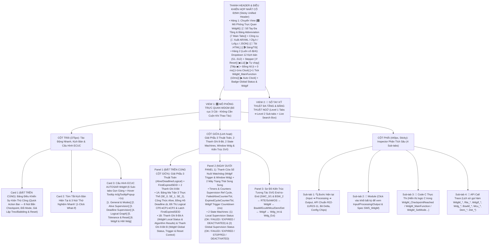
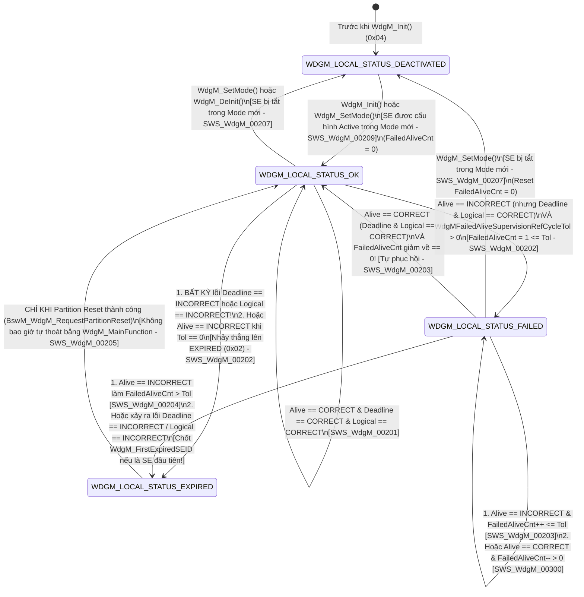

# Tài Liệu Thiết Kế Chi Tiết Trình Mô Phỏng AUTOSAR WdgM (`WdgM_Simulation_design.md`)

> **Trạng thái tài liệu:** Bản thiết kế chi tiết đã cập nhật theo xác nhận `A1`–`A4` của User — Sẵn sàng để User review trước khi triển khai code.  
> **File đích dự kiến xuất bản:** `d:\__Personal\AntiGravity\Simulation\AUTOSAR_WdgM.html` (Ứng dụng Web Tương tác 1 file HTML độc lập, 100% Offline, Pure CSS, có nút tải `.HTML` kèm cấu hình nhúng & xuất code `ARXML / WdgM_Cfg.h / WdgM_Lcfg.c / JSON`).  
> **Chuẩn tham chiếu:** **AUTOSAR Classic Platform R20-11 / R22-11 / R23-11 (`SWS_WdgM`, `SWS_WdgIf`, `SWS_Wdg`, `SWS_BswM`, `SWS_EcuM`, `SWS_Mcu`, `SWS_Os`, `SWS_Dem`, `SWS_Det`, `SWS_Rte`)**, đính kèm mã requirement chuẩn **`SWS_WdgM_xxxxx`** tại từng bước xử lý, Bảng Giải Phẫu 3 Thuật Toán Giám Sát (`Alive / Deadline / Logical Graph`), 2 thanh ghi 8-Bit tương tác, tooltip cấu hình và sổ tay tra cứu đa tầng.

---

## 1. Tổng Quan Định Hướng Thiết Kế Đã Chốt (`A1` – `A4`)

| Hạng mục | Nội dung thiết kế đã xác nhận với User |
| :--- | :--- |
| **1. Bố cục giao diện & Ưu tiên Không Cuộn Trang — Zero-Scroll (`A1`)** | Kết hợp tinh hoa của **`AUTOSAR_DEM.html`**, **`AUTOSAR_CanNM.html`** và **`AUTOSAR_ComM.html`**, tối ưu hóa **Above-the-Fold (Zero-Scroll)** để các khối thao tác và giám sát tần suất cao nhất luôn nằm ngay phần đầu mỗi cột trong khung màn hình:<br>• **Thanh Điều Khiển Hợp Nhất Cố Định (Sticky Unified Header)**:<br>  - **Hàng 1**: Chuyển View `[🎛️ Mô Phỏng Trực Quan WdgM]` \| `[📖 Sổ Tay Đa Tầng & Bảng Abbreviation (7 Main Tabs)]` + Công cụ `[🧾 Xuất ARXML / WdgM_Cfg.h / WdgM_Lcfg.c / JSON]` \| `[💾 Tải .HTML]` \| `[🌗 Sáng/Tối]`.<br>  - **Hàng 2 (Luôn cố định)**: Dropdown chọn 12 Kịch bản (`S1`–`S12`), Stepper (`↺ Reset`, `◀ Lùi`, `▶ Tự chạy`, `Tiếp ▶`), Đồng hồ phần cứng (`t = 0 ms`, `+1ms Clock` cho Deadline, `+1 Tick WdgM_MainFunction (10ms)`, `▶ Auto Clock`) và Badge Trạng thái `Global Status` & `WdgIf Trigger`.<br>• **Bố cục 3 cột hiện đại (Mỗi cột tự cuộn độc lập trong khung Viewport)**:<br>  - **Cột Trái (`375px`)**: Đưa **Card 1: Bảng Điều Khiển Checkpoint & Sự Kiện Thủ Công (`Quick Action Bar` — 8 nút bắn `WdgM_CheckpointReached`, chuyển `WdgMMode`, tạo lỗi & Reset)** và **Card 2: Tóm tắt kịch bản & 3 nút 1-Click What-If** lên trên cùng, tiếp theo là **Card 3: 6 Sub-tabs Cấu hình ECUC WdgM** (hỗ trợ Floating Hover Tooltip `#cfgTooltipPopup` sau `>1s` giống hệt `AUTOSAR_DEM.html`).<br>  - **Cột Giữa (`Linh hoạt`)**: Đưa **Panel 1: Bảng Giải Phẫu 3 Thuật Toán Giám Sát (`Alive / Deadline / Logical Graph`) + `FirstExpiredSEID` + 2 Thanh Ghi 8-Bit Tương Tác** và **Panel 2: Bảng Cửa Sổ Nuôi Watchdog (`WdgIf Trigger Condition`) + 2 Máy Trạng Thái Song Song (`Local Status State Machine` & `Global Status State Machine`)** lên ngay đầu cột giữa; bên dưới là **Panel 3: Sơ Đồ Kiến Trúc Tương Tác SVG End-to-End** (`SWC_0 (SE0) / SWC_1 (SE1) / BSW_Diag (SE2) ↔ RTE/SchM/OS ↔ WdgM ↔ BswM/EcuM/Mcu/Dem/Det ↔ WdgIf ↔ Wdg_Int (MCU) & Wdg_Ext (SBC Window Wdg)`).<br>  - **Cột Phải (`440px, Sticky`)**: Inspector 4 Sub-tabs (`🔍 Bước hiện tại`, `🧩 Module`, `📄 Code C Thực Thi`, `📜 API Call Trace`). |
| **2. Khu vực Giám sát Bit-level & Giải phẫu 3 Thuật toán 2 Tầng (`A2`)** | Đặt **cố định và nổi bật ở đầu Cột Giữa** gồm **2 tầng trực quan hóa**:<br>• **Tầng 1 — Bảng Giải Phẫu Trực Quan 3 Thuật Toán (`Alive / Deadline / Logical Graph`) & Đa Thực Thể (`SE_0 / SE_1 / SE_2`)**:<br>  - Hiển thị trực tiếp công thức kiểm tra **`Alive Supervision`**: $EAI - \text{MinMargin} \le n(AC) \le EAI + \text{MaxMargin}$ tại chu kỳ tham chiếu $SRC$, kèm bộ đếm `FailedAliveSupervisionRefCycleCounter / Tol`.<br>  - Hiển thị trực tiếp đồng hồ đo **`Deadline Supervision`**: $\Delta t = t_{\text{stop}} - t_{\text{start}}$ so với cửa sổ $[T_{\min}, T_{\max}]$ và cờ phát hiện treo `Deadline Timeout Detection`.<br>  - Hiển thị đồ thị luồng điều khiển **`Logical Supervision`**: Ma trận chuyển tiếp `CP_0 (Initial) ➔ CP_1 (Run) ➔ CP_2 (Final)` (Internal Graph) & `SE0_CP1 ➔ SE1_CP0` (External Graph) kèm cờ `ActivityFlag`.<br>  - Ô nhớ đặc biệt **`WdgM_FirstExpiredSEID`** (kèm giá trị đảo bit `~FirstExpiredSEID` chống nhiễu RAM theo `SWS_WdgM_00215`).<br>• **Tầng 2 — 2 Thanh ghi 8-Bit tương tác song song**:<br>  1. **Thanh A (`8-Bit WdgM Local Entity & Supervision Result Byte` — `WdgM_LocalStatusByte`)**: Theo dõi kết quả 3 thuật toán và `WdgM_LocalStatusType` (`SE_ACTIVE_MODE`, `ALIVE_RES_OK`, `DEADLINE_RES_OK`, `LOGICAL_RES_OK`, `GRAPH_ACTV_FLAG`, `LOCAL_DEACTIVATED`, `LOCAL_EXPIRED`, `LOCAL_FAILED`).<br>  2. **Thanh B (`8-Bit WdgM Global Supervision, Trigger & Reset Control Byte` — `WdgM_GlobalControlByte`)**: Theo dõi trạng thái toàn cục & phần cứng (`WDGM_INITIALIZED`, `WDGIF_TRIG_ACTV`, `FIRST_EXP_LATCH`, `PART_RESET_REQ`, `MCU_IMM_RESET`, cùng 3 bit mã hóa `WdgM_GlobalStatusType`: `OK`, `FAILED`, `EXPIRED`, `STOPPED`, `DEACTIVATED`). Cho phép click trực tiếp vào từng bit để giải mã hoặc thử nghiệm! |
| **3. Hệ thống 12 Kịch bản mẫu (`A3`)** | Thiết kế sẵn **12 Kịch bản (`S1`–`S12`)** chia làm 4 nhóm lớn:<br>• **Nhóm 1 (`S1`–`S3`) — Alive Supervision & Tolerance**: Chu trình chuẩn `WDGM_CORRECT` & bơm `WdgIf_SetTriggerCondition()`; Lỗi thiếu xung Alive (`AC < Expected - MinMargin`) vào `LOCAL_STATUS_FAILED` và **tự phục hồi về `OK`** nhờ `FailedAliveSupervisionRefCycleTol`; Lỗi dư xung Alive (`Babbling Task`) hoặc vượt ngưỡng `Tol` ➔ kẹt ở `LOCAL_STATUS_EXPIRED` & chốt `WdgM_FirstExpiredSEID`.<br>• **Nhóm 2 (`S4`–`S5`) — Deadline Supervision & Timeout**: Đo thời gian thực thi hợp lệ ($T_{\min} \le \Delta t \le T_{\max}$); Vi phạm Deadline chạy quá nhanh ($\Delta t < T_{\min}$), quá chậm ($\Delta t > T_{\max}$), hoặc treo không tới `CP_Stop` (`WdgMEnableDeadlineTimeoutDetection = TRUE`) ➔ **Bỏ qua `FAILED`, nhảy thẳng lên `LOCAL_STATUS_EXPIRED`** (`SWS_WdgM_00202`)!<br>• **Nhóm 3 (`S6`–`S7`) — Logical Supervision (Internal & External Graph)**: Giám sát thứ tự thực thi nội bộ (`CP_0 ➔ CP_1 ➔ CP_2`) & bắt lỗi nhảy cóc / vào sai `Initial CP`; Giám sát luồng liên kết đa SWC (`External Graph`: `SE0_CP1 ➔ SE1_CP0`).<br>• **Nhóm 4 (`S8`–`S12`) — Global Status, Hardware WdgIf, Partition/MCU Reset, Mode Switch & DET/DEM**: Leo thang `Global Status` (`OK ➔ FAILED ➔ EXPIRED ➔ STOPPED`) với `WdgMExpiredSupervisionCycleTol`, cắt xung `WdgIf_SetTriggerCondition(0)` & báo `Dem_SetEventStatus(WDGM_E_MONITORING, FAILED)`; So sánh `WdgMImmediateReset = TRUE` (`Mcu_PerformReset()`) vs `BswM_WdgM_RequestPartitionReset()`; Chuyển đổi `WdgM_SetMode(SLOW ➔ FAST ➔ OFF)` trên 2 Watchdog (`Internal MCU` + `External SBC Window Wdg`) & chặn tắt bằng `WdgMDefensiveBehavior`; Lệnh khẩn cấp `WdgM_PerformReset()` & kiểm thử lỗi `DET` (`WDGM_E_UNINIT`, `WDGM_E_PARAM_SEID`, `WDGM_E_CPID`, `WDGM_E_SEDEACTIVATED`). |
| **4. Sổ tay tra cứu đa tầng & Bảng Abbreviation (`A4`)** | **View 2 (`📖 Sổ Tay Kỹ Thuật WdgM & Từ Điển Thuật Ngữ`)** được tổ chức theo cấu trúc **Đa Tầng (Multi-level Tabs)**:<br>• **6 Main Sub-tabs (Level 1) × 4 Chủ đề con (Level 2 Pills/Tabs = 24 chuyên đề)** phân tích sâu kiến trúc WdgM-WdgIf-Wdg, công thức toán học của 3 thuật toán `Alive / Deadline / Logical`, máy trạng thái `Local & Global`, chiến lược phục hồi lỗi & API/ECUC.<br>• **Tab 7 chuyên biệt: `🔤 Bảng Thuật Ngữ & Từ Viết Tắt (Abbreviation Table)`** trình bày dưới dạng bảng chuẩn 4 cột, tích hợp **Search Box tìm kiếm tức thời (Live Search + Highlight `<mark>`)** và 5 nút lọc nhanh theo phân nhóm (`WdgM Core & States`, `3 Supervision Algorithms`, `WdgIf & Hardware Watchdog`, `Reset, Safety & AUTOSAR Stack`). |

---

## 2. Bố Cục Giao Diện 3 Cột Ưu Tiên Zero-Scroll & Hệ Thống Sub-Tabs (UI Wireframe)

Để giải quyết triệt để yêu cầu **"đưa các khối được dùng thường xuyên hơn lên phía trên để người dùng không cần cuộn chuột lên xuống mỗi lần thao tác"**, giao diện được thiết kế theo nguyên lý **Viewport-First (Mọi nút bắn Checkpoint, đồng hồ phần cứng, bảng công thức 3 thuật toán, 2 thanh ghi 8-bit và 2 máy trạng thái đều nằm ngay tầm mắt đầu trang)**:



### Điểm Cải Tiến Đột Phá Về Trải Nghiệm "Zero-Scroll" Cho Module `WdgM`:
1. **Thanh Điều Khiển Hợp Nhất (`Sticky Unified Header`) Với 2 Nút Nhịp Đồng Hồ (`+1ms Clock` & `+1 Tick WdgM_MainFunction 10ms`)**:
   - Trong `WdgM`, **Deadline Supervision** và **Logical Supervision** được tính toán **ngay lập tức tại thời điểm gọi `WdgM_CheckpointReached()`** (cần độ phân giải từng `1 ms`), trong khi **Alive Supervision**, **Deadline Timeout**, **Local/Global Status** và **`WdgIf_SetTriggerCondition()`** được xử lý định kỳ trong **`WdgM_MainFunction()`** (mỗi `10 ms`). Việc đặt cả 2 nút `+1ms Clock` và `+1 Tick MainFunction (10ms)` ngay trên thanh Header cố định giúp người dùng chủ động kiểm thử cả 2 cơ chế từ bất kỳ vị trí nào.
2. **Đưa `Quick Action Bar` (8 nút tác động nhanh) lên vị trí Card 1 (Đầu Cột Trái)** và đưa **Bảng Giải Phẫu 3 Thuật Toán + 2 Thanh Ghi 8-Bit + 2 Máy Trạng Thái** lên đầu Cột Giữa: Khi bấm `CP_0 (Init)`, `CP_1 (Run)`, `CP_2 (Exit)` hoặc `+1 Tick WdgM_MainFunction()`, mắt người dùng nhìn thấy ngay lập tức bộ đếm `AliveCounter` tăng lên, đồng hồ `Deadline Δt` dừng lại so sánh với `[Tmin, Tmax]`, mũi tên `Logical Graph` sáng xanh hay báo đỏ, và sự chuyển đổi của từng Bit trên Thanh A/B mà **không phải cuộn trang**.
3. **Gom 36 tham số ECUC vào 6 Sub-tabs gọn gàng**: Chiều cao Card Cấu hình được giữ gọn cố định (~275px), kèm hộp thoại giải thích nổi `#cfgTooltipPopup` khi hover quá `1000ms` giống hệt file `AUTOSAR_DEM.html`.

---

## 3. Thiết Kế Chi Tiết Panel 1 (Đầu Cột Giữa): Bảng Giải Phẫu 3 Thuật Toán (`Alive / Deadline / Logical`) + `FirstExpiredSEID` & 2 Thanh Ghi 8-Bit Tương Tác

Trong `AUTOSAR WdgM`, trái tim của module là **3 thuật toán giám sát độc lập (`Alive`, `Deadline`, `Logical`)** chạy trên từng **Thực thể được giám sát (`Supervised Entity — SE`)**, sau đó tổng hợp thành **`Local Status`** của từng `SE` và **`Global Status`** của toàn ECU để quyết định có tiếp tục bơm xung nuôi phần cứng Watchdog qua **`WdgIf_SetTriggerCondition()`** hay không. Do đó, Panel 1 ở đầu Cột Giữa được thiết kế gồm **2 phần trực quan hóa liên thông**:

### 3.1. Phần 1A — Bảng Giải Phẫu Trực Quan 3 Thuật Toán Giám Sát, Đa Thực Thể (`SE_0 / SE_1 / SE_2`) & Bộ Nhớ `FirstExpiredSEID`

```text
+-------------------------------------------------------------------------------------------------------------------+
| 🛡️ BẢNG GIẢI PHẪU 3 THUẬT TOÁN GIÁM SÁT WDGM & TRẠNG THÁI THỰC THỂ (`SWS_WdgM_00074`, `00229`, `00252`, `00215`)  |
| Mode: [FAST_MODE (#1)] | Cycle: [10 ms] | FirstExpiredSEID: [ 0x00 (NONE) ] (InvRAM: 0xFF Valid) | WdgIf: [20 ms] |
+-------------------------------------------------------------------------------------------------------------------+
| 1. MA TRẬN ĐA THỰC THỂ GIÁM SÁT (SUPERVISED ENTITIES — Click để chọn SE đang soi trên Thanh A):                   |
|    • [▶ SE_0: SWC_BrakeCtrl (ID=0) ] : Local=[ OK (0x00) ]       | Alive=OK | Deadline=OK | Logical=OK | Tol=0/1  |
|    • [  SE_1: SWC_EngineTrq (ID=1) ] : Local=[ OK (0x00) ]       | Alive=OK | Deadline=-- | Logical=OK | Tol=0/1  |
|    • [  SE_2: BSW_CanDiag   (ID=2) ] : Local=[ DEACTIVATED (04)] | (Tắt trong FAST_MODE - Bật trong SLOW_MODE)    |
+-------------------------------------------------------------------------------------------------------------------+
| 2. GIẢI PHẪU TRỰC QUAN 3 THUẬT TOÁN CỦA THỰC THỂ ĐANG CHỌN (`SE_0: SWC_BrakeCtrl`):                               |
|  +-----------------------+--------------------------------------------------------+--------------+--------------+ |
|  | Thuật toán giám sát   | Công thức & Trạng thái Biến Nội Bộ (Live Inspector)    | Ngưỡng Config| Kết quả      | |
|  +-----------------------+--------------------------------------------------------+--------------+--------------+ |
|  | 🔄 ALIVE SUPERVISION  | • Chu kỳ tham chiếu: SC = [ 2 / 2 ] (SRC = 2 cycles)   | EAI = 2      | [ WDGM_      | |
|  | (Tại CP_0_Init)       | • Số xung nhận được: AC = [ 2 ]                        | Margin: -1/+1|   CORRECT ]  | |
|  | [SWS_WdgM_00074]      | • Kiểm tra: (2 - 1) <= AC(2) <= (2 + 1) ➔ HỢP LỆ [1..3]| Cho phép:1..3| FailCnt: 0/1 | |
|  +-----------------------+--------------------------------------------------------+--------------+--------------+ |
|  | ⏱️ DEADLINE SUPERV.   | • Cặp Checkpoint: [CP_0_Init] ──(Δt)──► [CP_1_Run]     | T_min = 2 ms | [ WDGM_      | |
|  | (CP_0 ➔ CP_1)         | • t_start = 10 ms | t_stop = 14 ms ➔ Δt = [ 4.0 ms ]   | T_max = 8 ms |   CORRECT ]  | |
|  | [SWS_WdgM_00229]      | • Kiểm tra: 2.0 ms <= Δt(4.0 ms) <= 8.0 ms (No Timeout)| TimeoutDet=ON| Không có Tol!| |
|  +-----------------------+--------------------------------------------------------+--------------+--------------+ |
|  | 🕸️ LOGICAL SUPERV.    | • Đồ thị: [CP_0 (Init)] ──► [CP_1 (Run)] ──► [CP_2(Fin)]| InitCP: CP_0 | [ WDGM_      | |
|  | (Internal & External) | • ActivityFlag = [ FALSE ] (Đã hoàn tất tại CP_2)      | Final:  CP_2 |   CORRECT ]  | |
|  | [SWS_WdgM_00252]      | • Last CP: [ CP_2 ] | External Graph: SE0_CP1 ➔ SE1_CP0| Valid Edges  | Không có Tol!| |
|  +-----------------------+--------------------------------------------------------+--------------+--------------+ |
+-------------------------------------------------------------------------------------------------------------------+
```

- **Tính năng tương tác trực tiếp trên Phần 1A**:
  - Người dùng có thể click chọn giữa 3 thực thể (`SE_0: SWC_BrakeCtrl`, `SE_1: SWC_EngineTorque`, `SE_2: BSW_CanDiag`) để soi chi tiết trên Thanh ghi 8-Bit A.
  - Trên dòng **Logical Supervision**, các nút đồ thị `[CP_0] ──► [CP_1] ──► [CP_2]` cho phép **click trực tiếp vào từng Checkpoint** để bắn `WdgM_CheckpointReached(SE_0, CP_x)`! Nếu người dùng cố tình click `[CP_0]` rồi nhảy cóc bấm thẳng `[CP_2]` (bỏ qua `[CP_1]`), cạnh `CP_0 ➔ CP_2` sẽ chớp đỏ báo vi phạm `WDGM_INCORRECT` và đẩy `SE_0` lên thẳng `WDGM_LOCAL_STATUS_EXPIRED`!

### 3.2. Phần 1B — 2 Thanh Ghi 8-Bit Trạng Thái Tương Tác Luôn Hiển Thị Nổi Bật

Ngay bên dưới Phần 1A là **2 Thanh ghi 8-Bit tương tác** theo đúng phong cách chuẩn của `AUTOSAR_DEM.html`, `AUTOSAR_CanNM.html` và `AUTOSAR_ComM.html`:

```text
+-------------------------------------------------------------------------------------------------------------------+
| 🔢 BẢNG GIÁM SÁT BITFIELD 8-BIT WDGM LOCAL & GLOBAL STATUS (LIVE 8-BIT INSPECTOR) [Click vào từng Bit để thử]     |
| Bước #4: WdgM_MainFunction() đánh giá SE_0 đạt chuẩn & bơm WdgIf_SetTriggerCondition(20ms) | A: 0xF0 | B: 0xC0    |
+-------------------------------------------------------------------------------------------------------------------+
| A. THANH GHI 8-BIT TRẠNG THÁI THỰC THỂ CỤC BỘ & 3 THUẬT TOÁN (`WdgM_LocalStatusByte`) — Hex: [0xF0] Bin:[11110000]|
|    Thực thể: [ SE_0: SWC_BrakeCtrl ] | LocalStatus (SWS_WdgM_00358): [ 0x00 - WDGM_LOCAL_STATUS_OK ]              |
|  +-------------+ +-------------+ +-------------+ +-------------+ +-------------+ +-------------+ +-------+ +-----+|
|  | Bit 7 (0x80)| | Bit 6 (0x40)| | Bit 5 (0x20)| | Bit 4 (0x10)| | Bit 3 (0x08)| | Bit 2 (0x04)| |Bit1(2)| |Bit 0||
|  | SE_ACTV_MOD | | ALIVE_RES   | | DEADLN_RES  | | LOGICAL_RES | | GRAPH_ACTV  | | LOC_DEACT   | |LOC_EXP| |LOC_F||
|  |      1      | |      1      | |      1      | |      1      | |      0      | |      0      | |   0   | |  0  ||
|  | Active=TRUE | | Alive=OK    | | Deadline=OK | | Logical=OK  | | Graph Idle  | | Not Deact   | |Not Exp| |OK=00||
|  +-------------+ +-------------+ +-------------+ +-------------+ +-------------+ +-------------+ +-------+ +-----+|
+-------------------------------------------------------------------------------------------------------------------+
| B. THANH GHI 8-BIT GIÁM SÁT TOÀN CỤC, TRIGGER & RESET (`WdgM_GlobalControlByte`) — Hex: [ 0xC0 ] Bin: [1100 0000] |
|    GlobalStatus (SWS_WdgM_00359): [ 0x00 - WDGM_GLOBAL_STATUS_OK ] | ExpiredCycleCnt: [ 0 / 2 ] | Trigger: [20ms] |
|  +-------------+ +-------------+ +-------------+ +-------------+ +-------------+ +-------------+ +-------+ +-----+|
|  | Bit 7 (0x80)| | Bit 6 (0x40)| | Bit 5 (0x20)| | Bit 4 (0x10)| | Bit 3 (0x08)| | Bit 2 (0x04)| |Bit1(2)| |Bit 0||
|  | WDGM_INIT   | | WDGIF_TRIG  | | FIRST_EXP   | | PART_RESET  | | MCU_IMM_RST | | GLB_DEACT   | |GLB_EXP| |GLB_F||
|  |      1      | |      1      | |      0      | |      0      | |      0      | |      0      | |   0   | |  0  ||
|  | Initialized | | Trigger>0ms | | No Latch    | | No PartRst  | | No McuReset | | Mode Active | |No Exp | |OK=00||
|  +-------------+ +-------------+ +-------------+ +-------------+ +-------------+ +-------------+ +-------+ +-----+|
+-------------------------------------------------------------------------------------------------------------------+
```

#### 3.2.1. Giải Mã Chi Tiết Thanh A: `8-Bit WdgM Local Entity & Supervision Result Byte` (`WdgM_LocalStatusByte`)

> **Lưu ý chuẩn AUTOSAR (`SWS_WdgM_00358`)**: Ba bit thấp nhất (**`Bit 2..0`**) của Thanh A ánh xạ chính xác 1-1 với giá trị trả về của kiểu **`WdgM_LocalStatusType`** thông qua API `WdgM_GetLocalStatus(SEID, &Status)`:
> - `000b (0x00)` = `WDGM_LOCAL_STATUS_OK`
> - `001b (0x01)` = `WDGM_LOCAL_STATUS_FAILED`
> - `010b (0x02)` = `WDGM_LOCAL_STATUS_EXPIRED`
> - `100b (0x04)` = `WDGM_LOCAL_STATUS_DEACTIVATED`

| Bit | Mask | Tên Cờ (`WdgM Local Bit`) | Ý nghĩa kỹ thuật & Khi nào bật lên `1` (`0 ➔ 1`) | Khi nào hạ về `0` (`1 ➔ 0`) |
| :-: | :-: | :--- | :--- | :--- |
| **Bit 7** | `0x80` | **`SE_ACTV_MOD`** | Bật lên `1` khi Thực thể giám sát (`SE`) có cấu hình `WdgMLocalStatusParams` được kích hoạt trong `WdgMMode` hiện tại (`SLOW_MODE` hoặc `FAST_MODE` — `SWS_WdgM_00209`). | Hạ về `0` khi chuyển sang `WdgMMode` mà trong đó `SE` này không được cấu hình giám sát (đồng thời bật `Bit 2 LOC_DEACT = 1`). |
| **Bit 6** | `0x40` | **`ALIVE_RES_OK`** | Bật `1` (`WDGM_CORRECT`) khi tại chu kỳ tham chiếu (`SC == WdgMSupervisionReferenceCycle`), số lần gọi Checkpoint Alive `AC` nằm trong dải $[EAI - \text{MinMargin}, EAI + \text{MaxMargin}]$ (`SWS_WdgM_00074`). | Hạ về `0` (`WDGM_INCORRECT`) khi thiếu xung (`AC < EAI - MinMargin` do Task bị treo/chậm) hoặc dư xung (`AC > EAI + MaxMargin` do Task lặp vô tận / Babbling). |
| **Bit 5** | `0x20` | **`DEADLN_RES_OK`** | Bật `1` (`WDGM_CORRECT`) khi khoảng thời gian thực thi $\Delta t = t_{\text{stop}} - t_{\text{start}}$ giữa `CP_Start` và `CP_Stop` thỏa mãn $T_{\min} \le \Delta t \le T_{\max}$ (`SWS_WdgM_00229`). | Hạ về `0` (`WDGM_INCORRECT`) ngay tại `WdgM_CheckpointReached(CP_Stop)` nếu $\Delta t < T_{\min}$ (chạy quá sớm) hoặc $\Delta t > T_{\max}$ (quá hạn), hoặc trong `WdgM_MainFunction()` nếu quá $T_{\max}$ mà chưa thấy `CP_Stop` (`SWS_WdgM_00374`). |
| **Bit 4** | `0x10` | **`LOGICAL_RES_OK`** | Bật `1` (`WDGM_CORRECT`) khi mọi bước đi qua các Checkpoint trong đồ thị điều khiển (`Internal Graph` hoặc `External Graph`) đều bắt đầu đúng `Initial CP`, đi theo đúng cạnh `Transition` hợp lệ và kết thúc tại `Final CP` (`SWS_WdgM_00252`). | Hạ về `0` (`WDGM_INCORRECT`) ngay lập tức trong `WdgM_CheckpointReached()` nếu gọi một CP không phải `Initial CP` khi `ActivityFlag == 0`, hoặc chuyển tới CP không có đường nối hợp lệ từ `CP_prev`! |
| **Bit 3** | `0x08` | **`GRAPH_ACTV`** | Bật lên `1` (`ActivityFlag = TRUE`) ngay khi thực thể chạm vào **`WdgMInitialCheckpoint`** (ví dụ `CP_0_Init`), đánh dấu một chu trình đồ thị logic đang mở (`SWS_WdgM_00273`). | Hạ về `0` (`ActivityFlag = FALSE`) khi thực thể chạm vào **`WdgMFinalCheckpoint`** (ví dụ `CP_2_Exit`), khép lại trọn vẹn 1 vòng kiểm tra đồ thị logic (`SWS_WdgM_00331`). |
| **Bit 2** | `0x04` | **`LOC_DEACT`**<br>*(`0x04 DEACTIVATED`)* | Bật lên `1` khi thực thể ở trạng thái **`WDGM_LOCAL_STATUS_DEACTIVATED (0x04)`** (khi chưa `WdgM_Init` hoặc khi `WdgM_SetMode()` chuyển sang chế độ tắt giám sát cho `SE` này — `SWS_WdgM_00206`). Nếu `SE` gọi `WdgM_CheckpointReached()` lúc bit này bằng `1`, `WdgM` sẽ báo lỗi `DET: WDGM_E_SEDEACTIVATED (0x1F)`! | Hạ về `0` khi `WdgM_Init()` hoặc `WdgM_SetMode()` kích hoạt giám sát cho `SE` (chuyển sang `WDGM_LOCAL_STATUS_OK = 0x00` — `SWS_WdgM_00209`). |
| **Bit 1** | `0x02` | **`LOC_EXP`**<br>*(`0x02 EXPIRED`)* | Bật lên `1` khi thực thể rơi vào trạng thái chết không thể tự phục hồi **`WDGM_LOCAL_STATUS_EXPIRED (0x02)`** do:<br>1. `Alive Supervision == INCORRECT` và `FailedAliveSupervisionRefCycleCounter > WdgMFailedAliveSupervisionRefCycleTol` (`SWS_WdgM_00204`).<br>2. Hoặc **bất kỳ lỗi `Deadline == INCORRECT` hay `Logical == INCORRECT` nào** (vì chuẩn AUTOSAR quy định Deadline & Logical KHÔNG có bộ đếm dung sai, sai 1 lần là nhảy thẳng lên `EXPIRED` — `SWS_WdgM_00202`, `SWS_WdgM_00203`)! | **Không bao giờ tự hạ về `0` trong suốt chu kỳ chạy!** Theo `SWS_WdgM_00205`, một khi `SE` đã vào `EXPIRED`, nó chỉ có thể thoát ra khi ECU Reset hoặc Partition Reset! |
| **Bit 0** | `0x01` | **`LOC_FAILED`**<br>*(`0x01 FAILED`)* | Bật lên `1` khi thực thể ở trạng thái cảnh báo tạm thời **`WDGM_LOCAL_STATUS_FAILED (0x01)`**: Xảy ra khi `Alive Supervision == INCORRECT` nhưng bộ đếm lỗi `FailedAliveSupervisionRefCycleCounter <= WdgMFailedAliveSupervisionRefCycleTol` (vẫn nằm trong ngưỡng dung sai cho phép — `SWS_WdgM_00202`). | Hạ về `0` (quay về **`WDGM_LOCAL_STATUS_OK = 0x00`**) khi các chu kỳ tham chiếu tiếp theo đạt `Alive == CORRECT` làm bộ đếm `FailedAliveSupervisionRefCycleCounter` giảm dần về `0` (`SWS_WdgM_00203`, `SWS_WdgM_00300`), hoặc khi vượt ngưỡng nhảy sang `LOC_EXP (Bit 1 = 1, Bit 0 = 0)`. |

#### 3.2.2. Giải Mã Chi Tiết Thanh B: `8-Bit WdgM Global Supervision, Trigger & Reset Control Byte` (`WdgM_GlobalControlByte`)

> **Lưu ý chuẩn AUTOSAR (`SWS_WdgM_00359`)**: Ba bit thấp nhất (**`Bit 2..0`**) của Thanh B mã hóa chính xác 5 trạng thái của kiểu **`WdgM_GlobalStatusType`** trả về bởi hàm `WdgM_GetGlobalStatus(&Status)`:
> - `000b (0x00)` = `WDGM_GLOBAL_STATUS_OK`
> - `001b (0x01)` = `WDGM_GLOBAL_STATUS_FAILED`
> - `010b (0x02)` = `WDGM_GLOBAL_STATUS_EXPIRED`
> - `011b (0x03)` = `WDGM_GLOBAL_STATUS_STOPPED`
> - `100b (0x04)` = `WDGM_GLOBAL_STATUS_DEACTIVATED`

| Bit | Mask | Tên Cờ (`WdgM Global Bit`) | Ý nghĩa kỹ thuật & Khi nào bật lên `1` (`0 ➔ 1`) | Khi nào hạ về `0` (`1 ➔ 0`) |
| :-: | :-: | :--- | :--- | :--- |
| **Bit 7** | `0x80` | **`WDGM_INIT`** | Bật lên `1` sau khi `WdgM_Init(&WdgM_Config)` khởi tạo thành công các thực thể và đặt chế độ Watchdog ban đầu (`WdgMInitialModeId` — `SWS_WdgM_00135`). | Hạ về `0` khi gọi `WdgM_DeInit()` hoặc khi tắt Checkbox `WdgMInitialized` để kiểm thử báo lỗi `Det_ReportError(WDGM_E_UNINIT = 0x10)`. |
| **Bit 6** | `0x40` | **`WDGIF_TRIG`** | Bật `1` khi `WdgM` đang ở trạng thái an toàn (`OK`, `FAILED`, hoặc đang trong thời gian ân hạn `EXPIRED`) và đều đặn gọi **`WdgIf_SetTriggerCondition(DevIdx, Timeout > 0)`** trong mỗi chu kỳ `WdgM_MainFunction()` để nuôi phần cứng Watchdog (`SWS_WdgM_00223`). | Hạ về `0` ngay khi `Global Status` rơi vào **`WDGM_GLOBAL_STATUS_STOPPED (0x03)`** hoặc `WdgM_PerformReset()`: `WdgM` lập tức gọi **`WdgIf_SetTriggerCondition(DevIdx, 0)`** (hoặc ngừng bơm xung) để phần cứng Watchdog đếm hết hạn và Reset ECU (`SWS_WdgM_00119`, `SWS_WdgM_00223`)! |
| **Bit 5** | `0x20` | **`FIRST_EXP`** | Bật lên `1` ngay tại khoảnh khắc **Thực thể đầu tiên (`SE`) trên ECU chuyển sang `WDGM_LOCAL_STATUS_EXPIRED`**: `WdgM` khóa cứng (Latch) mã ID của thực thể gây lỗi gốc đó vào biến RAM đặc biệt **`WdgM_FirstExpiredSEID`** kèm bản sao đảo bit `~SEID` (`SWS_WdgM_00215`) để sau khi ECU bị Watchdog Reset, phần mềm khởi động lại có thể gọi **`WdgM_GetFirstExpiredSEID(&SEID)`** tìm ra đúng "thủ phạm" đầu tiên! | Chỉ hạ về `0` khi người dùng bấm nút xóa vùng RAM `Clear FirstExpiredSEID (Power-On Reset)` hoặc sau khi đọc và xóa lỗi. |
| **Bit 4** | `0x10` | **`PART_RESET`** | Bật lên `1` khi một `SE` có cấu hình liên kết với `WdgMOsApplicationRef` rơi vào `WDGM_LOCAL_STATUS_EXPIRED`: `WdgM` gọi **`BswM_WdgM_RequestPartitionReset(Application)`** (`SWS_WdgM_00233`) để `BswM / OS` khởi động lại riêng phân vùng OS bị lỗi mà không cần Reset toàn bộ ECU! | Hạ về `0` sau khi phân vùng OS hoàn tất khởi động lại và đưa `SE` đó về lại `WDGM_LOCAL_STATUS_OK`. |
| **Bit 3** | `0x08` | **`MCU_IMM_RST`** | Bật lên `1` khi `Global Status` chạm mức **`WDGM_GLOBAL_STATUS_STOPPED (0x03)`** VÀ tham số **`WdgMImmediateReset = TRUE`**: Thay vì đợi phần cứng Watchdog đếm hết giờ, `WdgM` gọi thẳng **`Mcu_PerformReset()`** để Reset vi điều khiển ngay lập tức (`SWS_WdgM_00134`), hoặc khi ứng dụng gọi **`WdgM_PerformReset()`** (`SWS_WdgM_00133`). | Hạ về `0` sau khi hoàn tất chu trình Reset MCU. |
| **Bit 2..0** | `0x07` | **`GLB_STATUS`**<br>*(`Bit 2: DEACT`)*<br>*(`Bit 1: EXP`)*<br>*(`Bit 0: FAIL`)* | Tổ hợp 3 bit thấp nhất biểu diễn trực tiếp **`WdgM_GlobalStatusType`** (`SWS_WdgM_00214`..`00221`):<br>• `000b (0x00)`: **`WDGM_GLOBAL_STATUS_OK`** (Mọi SE đều `OK` hoặc `DEACTIVATED`).<br>• `001b (0x01)`: **`WDGM_GLOBAL_STATUS_FAILED`** (Có ít nhất 1 SE đang `FAILED`, chưa có SE nào `EXPIRED`).<br>• `010b (0x02)`: **`WDGM_GLOBAL_STATUS_EXPIRED`** (Có ít nhất 1 SE đã `EXPIRED`, và bộ đếm chu kỳ ân hạn `ExpiredSupervisionCycleCounter <= WdgMExpiredSupervisionCycleTol`).<br>• `011b (0x03)`: **`WDGM_GLOBAL_STATUS_STOPPED`** (Khi `ExpiredSupervisionCycleCounter > WdgMExpiredSupervisionCycleTol` hoặc gọi `WdgM_PerformReset()` ➔ Cắt xung Watchdog, báo `Dem_SetEventStatus(WDGM_E_MONITORING, FAILED)`!).<br>• `100b (0x04)`: **`WDGM_GLOBAL_STATUS_DEACTIVATED`** (Khi chưa Init hoặc sau khi gọi `WdgM_DeInit()`). | Dịch chuyển tự động trong mỗi chu kỳ `WdgM_MainFunction()` dựa trên trạng thái tổng hợp của tất cả các `Supervised Entities`. Chú ý: Từ `EXPIRED (010b)` hoặc `STOPPED (011b)` **không bao giờ tự quay lại `OK`** nếu không Reset! |

---

## 4. Phân Tích Xử Lý Từng Module: Input Lấy Từ Đâu, Xử Lý Gì, Output Route Đến Đâu

Mọi khối trên sơ đồ kiến trúc SVG đều có thể **click vào để xem giải thích chi tiết** ở cột phải (Tab `🧩 Module`) và được tổng hợp đầy đủ trong **Tab 1 của Sổ tay**:

| # | Module / Phân khối | Lớp AUTOSAR | 📥 Input lấy từ đâu? | ⚙️ Cách xử lý nội bộ (Processing, State & Timers) | 📤 Output route đến đâu & Hàm API chuẩn (R20-11 / R22-11 / R23-11) |
| :-: | :--- | :--- | :--- | :--- | :--- |
| **1** | **`SWC_BrakeCtrl (SE_0)` & `SWC_EngineTrq (SE_1)`**<br>*(Supervised Application SWCs)* | Application Layer | • Xung kích hoạt Runnable từ `RTE` (`TimingEvent 10ms`, `DataReceivedEvent`).<br>• Nhận thông báo chuyển trạng thái giám sát (`Rte_Switch_localMode` / `globalMode`) từ `WdgM` qua `RTE`. | • **Phân bố các Checkpoint (`CP`) trong thân hàm Runnable**:<br>  - `CP_0 (Init / Start)`: Đặt ở đầu Runnable để vừa báo xung **Alive Supervision**, vừa bấm giờ bắt đầu **Deadline Supervision** ($t_{\text{start}}$), vừa mở đầu đồ thị **Logical Supervision** (`Initial CP`).<br>  - `CP_1 (Run / Step)`: Đặt ở nhánh tính toán chính để kiểm tra thời gian chạy **Deadline** ($t_{\text{stop}} - t_{\text{start}}$) và kiểm tra thứ tự lệnh **Logical Transition** (`CP_0 ➔ CP_1`).<br>  - `CP_2 (Exit / Final)`: Đặt ở cuối Runnable để đóng chu trình **Logical Supervision** (`Final CP`). | • Gọi qua **RTE** xuống **WdgM** (`SWS_WdgM_00263`):<br>`Rte_Call_SE_BrakeCtrl_CheckpointReached(CP_ID)` ➔ `WdgM_CheckpointReached(SEID, CheckpointID)`<br>• Truy vấn trạng thái hoặc yêu cầu Reset khẩn cấp:<br>`Rte_Call_WdgM_GlobalMode_GetGlobalStatus(&Status)`<br>`Rte_Call_WdgM_PerformReset()` |
| **2** | **`BSW_CanDiag (SE_2)`**<br>*(Supervised BSW / CDD Module)* | BSW / CDD Layer | • Xung nhịp từ `SchM` hoặc sự kiện xử lý chẩn đoán nền khi khởi động (`SLOW_MODE`). | • Đại diện cho một module BSW hoặc Complex Driver được `WdgM` giám sát trực tiếp qua C API (không cần đi qua `RTE`).<br>• Được cấu hình **bật giám sát trong `SLOW_MODE (#0)`** nhưng **tự động chuyển sang `WDGM_LOCAL_STATUS_DEACTIVATED (0x04)` khi hệ thống sang `FAST_MODE (#1)`** nhằm minh họa tính năng bật/tắt thực thể theo Mode (`SWS_WdgM_00206`). | • Gọi trực tiếp C API vào **WdgM**:<br>`WdgM_CheckpointReached(2, CP_ID)` |
| **3** | **`RTE` & `SchM`**<br>*(Runtime Environment & BSW Scheduler)* | RTE Layer | • Lời gọi `Rte_Call_*_CheckpointReached()` từ các `SWC`.<br>• Thay đổi `LocalStatus` / `GlobalStatus` từ `WdgM`.<br>• Nhịp đồng hồ `10 ms` từ `AUTOSAR OS`. | • **RTE**: Ánh xạ cổng `WdgM_AliveSupervision` / `WdgM_IndividualSupervision` (hoặc `WdgM_LocalSupervision`) của từng `SWC` thành tham số `SEID` cố định (`Port-Defined Argument Value`) rồi gọi `WdgM_CheckpointReached(SEID, CheckpointID)`. Khi `WdgM` đổi trạng thái cục bộ hoặc toàn cục, `RTE` phát `ModeSwitchEvent` báo cho các `SWC` an toàn biết để chuyển sang trạng thái Safe State.<br>• **SchM**: Gọi định kỳ **`WdgM_MainFunction()`** mỗi `WdgMSupervisionCycle` (`10 ms`) và bảo vệ vùng găng `SchM_Enter_WdgM_WDGM_EXCLUSIVE_AREA_0()` khi cập nhật các bộ đếm giữa ngắt/task `CheckpointReached` và `MainFunction`. | • Gọi định kỳ vào **WdgM**:<br>`WdgM_MainFunction()` [`SWS_WdgM_00159`]<br>• Thông báo Mode lên **SWC**:<br>`Rte_Switch_globalMode_currentMode(GlobalStatus)` [`SWS_WdgM_00197`]<br>`Rte_Switch_mode_SE0_currentMode(LocalStatus)` [`SWS_WdgM_00198`] |
| **4** | **`AUTOSAR OS` & `OsCounter`**<br>*(Operating System & Hardware Timer)* | System Services (OS) | • Xung nhịp phần cứng từ Hardware Timer (GPT / System Tick `1 MHz`).<br>• Yêu cầu khởi động lại phân vùng (`Restart Partition`) từ `BswM`. | • **1. Cung cấp dấu thời gian độ phân giải cao (`Timestamp`) cho Deadline Supervision**: Khi `WdgM_CheckpointReached()` được gọi, `WdgM` gọi hàm **`GetCounterValue(WdgMOsCounter, &TickValue)`** hoặc **`GetElapsedValue()`** của `AUTOSAR OS` (`SWS_WdgM_00373`) để đo chính xác khoảng thời gian $\Delta t = t_{\text{stop}} - t_{\text{start}}$ giữa 2 Checkpoint.<br>• **2. Thực thi `OS Partition Reset`**: Khi một `OS-Application` (chứa `SE` bị `EXPIRED`) nhận lệnh khởi động lại từ `BswM`, `OS` gọi `RestartApplication()` / `TerminateApplication(AppId, RESTART)` để khôi phục riêng phân vùng đó. | • Trả giá trị bộ đếm thời gian cho **WdgM**:<br>`GetCounterValue(CounterID, &Value)`<br>`GetElapsedValue(CounterID, &Value, &ElapsedValue)` |
| **5** | **`WdgM Core Engine`**<br>*(Watchdog Manager)* | System / Safety Services | • Lời gọi `WdgM_CheckpointReached(SEID, CPID)` từ mọi `SE`.<br>• Chu kỳ `WdgM_MainFunction()` từ `SchM`.<br>• Lệnh đổi chế độ `WdgM_SetMode(Mode)` từ `BswM` / `EcuM`.<br>• Giá trị thời gian từ `OsCounter`. | • **1. Xử lý tức thời tại `WdgM_CheckpointReached()`**:<br>  - Nếu `CP` có cấu hình **Alive**: Tăng bộ đếm `AliveCounter++`.<br>  - Nếu `CP` là **Deadline Start**: Lưu dấu thời gian $t_{\text{start}}$. Nếu là **Deadline Stop**: Tính $\Delta t = t_{\text{stop}} - t_{\text{start}}$ và kiểm tra ngay $T_{\min} \le \Delta t \le T_{\max}$ (`SWS_WdgM_00229`).<br>  - Nếu `CP` thuộc **Logical Graph**: Kiểm tra `Initial CP`, `Transition (CP_prev ➔ CP_curr)` và `Final CP` (`SWS_WdgM_00252`).<br>• **2. Xử lý định kỳ tại `WdgM_MainFunction()`**:<br>  - Kiểm tra **Alive Supervision** cho các `SE` chạm mốc `WdgMSupervisionReferenceCycle` (`SWS_WdgM_00074`).<br>  - Kiểm tra **Deadline Timeout** nếu `WdgMEnableDeadlineTimeoutDetection == TRUE` và $(t_{\text{now}} - t_{\text{start}}) > T_{\max}$ (`SWS_WdgM_00374`).<br>  - Cập nhật **`Local Status`** từng `SE` (`OK`, `FAILED`, `EXPIRED`, `DEACTIVATED`), chốt **`WdgM_FirstExpiredSEID`** (`SWS_WdgM_00215`).<br>  - Cập nhật **`Global Status`** (`OK`, `FAILED`, `EXPIRED`, `STOPPED`, `DEACTIVATED`) có xét bộ đếm ân hạn `WdgMExpiredSupervisionCycleTol` (`SWS_WdgM_00216`).<br>  - Tính toán và gọi **`WdgIf_SetTriggerCondition()`** xuống tất cả các Watchdog đang bật! | • Gọi xuống **WdgIf**:<br>`WdgIf_SetMode(DeviceIndex, WdgMode)` [`SWS_WdgM_00135`]<br>`WdgIf_SetTriggerCondition(DeviceIndex, Timeout)` [`SWS_WdgM_00223`]<br>• Gọi sang **BswM, Mcu, RTE**:<br>`BswM_WdgM_RequestPartitionReset(App)` [`SWS_WdgM_00233`]<br>`Mcu_PerformReset()` [`SWS_WdgM_00134`]<br>`Rte_Switch_globalMode_currentMode()`<br>• Gọi sang **Dem & Det**:<br>`Dem_SetEventStatus(WDGM_E_MONITORING / WDGM_E_SET_MODE, DEM_EVENT_STATUS_FAILED)`<br>`Det_ReportError()` |
| **6** | **`WdgIf`**<br>*(Watchdog Interface — ECU Abstraction)* | ECU Abstraction Layer | • Nhận lệnh từ `WdgM`:<br>  - `WdgIf_SetMode(DeviceIndex, WdgMode)`<br>  - `WdgIf_SetTriggerCondition(DeviceIndex, Timeout)` | • **Lớp trừu tượng hóa phần cứng Watchdog**: Giúp `WdgM` điều khiển cùng lúc nhiều bộ Watchdog vật lý khác nhau thông qua chỉ số `DeviceIndex` mà không cần biết chi tiết thanh ghi bên dưới:<br>  - `DeviceIndex = 0` ➔ Định tuyến qua con trỏ hàm tới **`Wdg_30_Int_SetMode()`** / **`Wdg_30_Int_SetTriggerCondition()`** (Internal MCU Watchdog).<br>  - `DeviceIndex = 1` ➔ Định tuyến tới **`Wdg_30_ExtSbc_SetMode()`** / **`Wdg_30_ExtSbc_SetTriggerCondition()`** (External SBC Window Watchdog). | • Định tuyến xuống các **Watchdog Drivers (`Wdg`)**:<br>`Wdg_SetMode(WdgMode)`<br>`Wdg_SetTriggerCondition(Timeout)` |
| **7** | **`Wdg_Int` (Internal MCU Wdg)** & **`Wdg_Ext` (External SBC Window Wdg)**<br>*(Watchdog Drivers)* | MCAL / Complex Drivers | • Nhận `Wdg_SetMode(OFF / SLOW / FAST)` và `Wdg_SetTriggerCondition(Timeout_ms)` từ `WdgIf`.<br>• Nhận nhịp xung phần cứng (`Oscillator / SPI`). | • **Cơ chế `Timeout` (`WdgTriggerConditionValue`)**: Trong AUTOSAR, `WdgM` KHÔNG trực tiếp gõ xung phần cứng, mà truyền vào số mili-giây `Timeout` (ví dụ `20 ms`). Driver `Wdg` sẽ tự nạp bộ đếm phần cứng (hoặc dùng ngắt GPT để gõ chân WDI trong khoảng thời gian `Timeout` đó).<br>• **Window Watchdog (`Wdg_Ext`)**: Trong `FAST_MODE`, Watchdog ngoài kiểm tra cả **Cửa sổ đóng (`Closed Window`: cấm kích quá sớm)** và **Cửa sổ mở (`Open Window`: phải kích trước khi hết giờ)**. Nếu `WdgM` truyền `Timeout = 0` (khi vào `STOPPED`), `Wdg` lập tức ngừng gõ chân phần cứng ➔ kéo chân `NRES` gây Reset toàn bộ vi điều khiển! | • Tác động phần cứng:<br>  - Ghi thanh ghi `WDG_SR` nội bộ MCU.<br>  - Gửi khung lệnh SPI nuôi chip nguồn `SBC / PMIC` ngoài.<br>  - Kéo chân phần cứng **`HW_WATCHDOG_RESET`** nếu `Timeout` đếm về `0 ms`! |
| **8** | **`BswM`, `EcuM` & `Mcu`**<br>*(System Mode, State & MCU Driver)* | System Services & MCAL | • **`BswM / EcuM`**: Theo dõi trạng thái khởi động/chạy/ngủ của ECU; nhận callback `BswM_WdgM_RequestPartitionReset(App)` từ `WdgM`.<br>• **`Mcu`**: Nhận lệnh `Mcu_PerformReset()` từ `WdgM`. | • **1. Điều phối `WdgM_SetMode()` theo pha hoạt động của xe**:<br>  - Khi mới bật nguồn (`Startup`): `EcuM/BswM` khởi tạo `WdgM_Init()` ở **`SLOW_MODE (#0)`** (cửa sổ rộng `50 ms` vì các tác vụ khởi tạo `NvM_ReadAll` chạy lâu).<br>  - Khi vào vận hành bình thường (`RUN`): `BswM` gọi **`WdgM_SetMode(FAST_MODE = 1)`** (cửa sổ hẹp `20 ms` bảo vệ nghiêm ngặt).<br>  - Khi chuẩn bị ngủ (`Shutdown/Sleep`): Nếu cho phép tắt Watchdog, `BswM` gọi `WdgM_SetMode(OFF_MODE = 2)` hoặc `WdgM_DeInit()`.<br>• **2. Xử lý Reset**: `BswM` điều phối khởi động lại phân vùng OS lỗi; `Mcu` thực hiện Software Reset ngay lập tức nếu `WdgMImmediateReset == TRUE` và lưu nguyên nhân `MCU_WATCHDOG_RESET` để đọc lại sau khi khởi động! | • Gọi vào **WdgM**:<br>`WdgM_Init(&WdgM_Config)` [`SWS_WdgM_00151`]<br>`WdgM_SetMode(Mode)` [`SWS_WdgM_00154`]<br>`WdgM_DeInit()` [`SWS_WdgM_00261`]<br>`WdgM_GetFirstExpiredSEID(&SEID)` [`SWS_WdgM_00349`] |
| **9** | **`Dem`**<br>*(Diagnostic Event Manager)* | Diagnostic Services | • Nhận báo cáo lỗi sự kiện phần cứng/hệ thống (`Production Errors / Extended Production Errors`) từ `WdgM`. | • Ghi nhận 2 mã sự kiện chẩn đoán chuẩn của `WdgM` vào bộ nhớ lỗi (kèm FreezeFrame/Snapshot lưu vào `NvM` trước khi ECU Reset nếu còn thời gian ân hạn):<br>  1. **`WDGM_E_MONITORING`**: Báo `DEM_EVENT_STATUS_FAILED` ngay khi `Global Status` rơi vào `WDGM_GLOBAL_STATUS_STOPPED` (`SWS_WdgM_00375`).<br>  2. **`WDGM_E_SET_MODE`**: Báo `DEM_EVENT_STATUS_FAILED` khi `WdgIf_SetMode()` trả về `E_NOT_OK` (`SWS_WdgM_00142`). | • Nhận từ **WdgM**:<br>`Dem_SetEventStatus(WDGM_E_MONITORING, DEM_EVENT_STATUS_FAILED)`<br>`Dem_SetEventStatus(WDGM_E_SET_MODE, DEM_EVENT_STATUS_FAILED)` |
| **10** | **`Det`**<br>*(Default Error Tracer)* | System Services | • Nhận báo cáo lỗi phát triển (`Det_ReportError`) và lỗi runtime (`Det_ReportRuntimeError`) từ `WdgM` (`ModuleId = 13 / 0x000D`). | • Ghi nhận mã API (`ServiceId`) và mã lỗi chuẩn AUTOSAR R20-11/R22-11/R23-11:<br>  - `WDGM_E_UNINIT (0x10)`: Gọi API khi `WdgM` chưa chạy `WdgM_Init()`.<br>  - `WDGM_E_PARAM_CONFIG (0x11)`: Cấu hình truyền vào `WdgM_Init()` không hợp lệ.<br>  - `WDGM_E_PARAM_MODE (0x12)`: Tham số `Mode` truyền vào `WdgM_SetMode()` vượt ngoài dải.<br>  - `WDGM_E_PARAM_SEID (0x13)`: Mã thực thể `SEID` không tồn tại.<br>  - `WDGM_E_INV_POINTER (0x14)`: Truyền con trỏ `NULL_PTR`.<br>  - `WDGM_E_DISABLE_NOT_ALLOWED (0x15)`: Cố tình chuyển Watchdog về `WDGIF_OFF_MODE` khi `WdgMDefensiveBehavior = TRUE` (`WdgMOffModeEnabled = FALSE`)!<br>  - `WDGM_E_CPID (0x16)`: Mã `CheckpointID` không thuộc `SEID` đó.<br>  - `WDGM_E_SEDEACTIVATED (0x1F)`: Gọi `WdgM_CheckpointReached()` cho một `SE` đang ở trạng thái `DEACTIVATED`! | • Hiển thị cảnh báo trực tiếp trên **API Call Trace** & **Inspector**. |

---

## 5. Thiết Kế Chi Tiết 2 Máy Trạng Thái Của `WdgM`: `Local Supervision Status` & `Global Supervision Status` (Panel 2)

Trên Panel 2 của Cột Giữa, sơ đồ máy trạng thái của `WdgM` được hiển thị trực quan đồng thời ở cả **2 cấp độ trạng thái (`Local` cho từng `Supervised Entity` và `Global` cho toàn ECU)**:

### 5.1. Máy Trạng Thái Cục Bộ Của Từng Thực Thể (`Local Supervision Status` — `SWS_WdgM_00201`..`00209`)

> **Điểm mấu chốt theo chuẩn AUTOSAR cần làm nổi bật trên giao diện**:
> - Chỉ có **Alive Supervision** mới được phép đi vào trạng thái cảnh báo tạm thời **`WDGM_LOCAL_STATUS_FAILED (0x01)`** (khi `FailedAliveSupervisionRefCycleCounter <= WdgMFailedAliveSupervisionRefCycleTol`) và **có cơ hội tự phục hồi về `OK`**!
> - Ngược lại, **Deadline Supervision** và **Logical Supervision** KHÔNG có bộ đếm dung sai: hễ vi phạm dù chỉ **1 lần** (`WDGM_INCORRECT`), thực thể sẽ **nhảy thẳng từ `OK` (hoặc `FAILED`) lên `WDGM_LOCAL_STATUS_EXPIRED (0x02)`** và kẹt vĩnh viễn tại đó (`SWS_WdgM_00202`, `SWS_WdgM_00203`)!



### 5.2. Máy Trạng Thái Giám Sát Toàn Cục Của ECU (`Global Supervision Status` — `SWS_WdgM_00214`..`00221`)

```mermaid
stateDiagram-v2
    [*] --> WDGM_GLOBAL_STATUS_DEACTIVATED : Trước khi WdgM_Init() (0x04)

    WDGM_GLOBAL_STATUS_DEACTIVATED --> WDGM_GLOBAL_STATUS_OK : WdgM_Init() thành công [SWS_WdgM_00135]\n-> WdgIf_SetMode(InitialMode)\n-> WdgIf_SetTriggerCondition(Timeout)

    WDGM_GLOBAL_STATUS_OK --> WDGM_GLOBAL_STATUS_DEACTIVATED : WdgM_DeInit() [Khi không có SE nào EXPIRED - SWS_WdgM_00286]
    WDGM_GLOBAL_STATUS_FAILED --> WDGM_GLOBAL_STATUS_DEACTIVATED : WdgM_DeInit() [SWS_WdgM_00286]

    WDGM_GLOBAL_STATUS_OK --> WDGM_GLOBAL_STATUS_FAILED : Có ít nhất 1 SE == LOCAL_FAILED\n(Và KHÔNG có SE nào == LOCAL_EXPIRED) [SWS_WdgM_00217]\n-> Vẫn tiếp tục gọi WdgIf_SetTriggerCondition(Timeout > 0)

    WDGM_GLOBAL_STATUS_FAILED --> WDGM_GLOBAL_STATUS_OK : Tất cả các SE đang FAILED đã tự phục hồi về LOCAL_OK\n(Và không có SE nào EXPIRED) [SWS_WdgM_00218]

    WDGM_GLOBAL_STATUS_OK --> WDGM_GLOBAL_STATUS_EXPIRED : Có ít nhất 1 SE rơi vào LOCAL_EXPIRED\nVÀ WdgMExpiredSupervisionCycleTol > 0 [SWS_WdgM_00215]\n(ExpiredCycleCnt = 1 <= GlobalTol; Chốt FirstExpiredSEID)\n-> Vẫn nuôi WdgIf thêm vài chu kỳ ân hạn để kịp ghi NvM/DEM!

    WDGM_GLOBAL_STATUS_FAILED --> WDGM_GLOBAL_STATUS_EXPIRED : Có ít nhất 1 SE rơi vào LOCAL_EXPIRED\nVÀ WdgMExpiredSupervisionCycleTol > 0 [SWS_WdgM_00219]\n(ExpiredCycleCnt = 1 <= GlobalTol)

    WDGM_GLOBAL_STATUS_EXPIRED --> WDGM_GLOBAL_STATUS_EXPIRED : Còn trong thời gian ân hạn:\nExpiredCycleCnt++ <= WdgMExpiredSupervisionCycleTol [SWS_WdgM_00219]

    WDGM_GLOBAL_STATUS_OK --> WDGM_GLOBAL_STATUS_STOPPED : 1. Có SE == LOCAL_EXPIRED và WdgMExpiredSupervisionCycleTol == 0 [SWS_WdgM_00216]\n2. Hoặc gọi WdgM_PerformReset() [SWS_WdgM_00133]\n3. Hoặc WdgIf_SetMode() thất bại (E_NOT_OK)

    WDGM_GLOBAL_STATUS_FAILED --> WDGM_GLOBAL_STATUS_STOPPED : Có SE == LOCAL_EXPIRED và WdgMExpiredSupervisionCycleTol == 0 [SWS_WdgM_00220]

    WDGM_GLOBAL_STATUS_EXPIRED --> WDGM_GLOBAL_STATUS_STOPPED : Hết chu kỳ ân hạn:\nExpiredCycleCnt > WdgMExpiredSupervisionCycleTol [SWS_WdgM_00220]\n-> Cắt xung: WdgIf_SetTriggerCondition(0) [SWS_WdgM_00223]\n-> Báo lỗi: Dem_SetEventStatus(WDGM_E_MONITORING, FAILED) [SWS_WdgM_00375]\n-> Nếu WdgMImmediateReset == TRUE: gọi Mcu_PerformReset()! [SWS_WdgM_00134]
```

---

## 6. Danh Mục Đầy Đủ 36 Trường Cấu Hình (Checkboxes & Textboxes — 6 Sub-Tabs) & Thiết Kế Hover Tooltip Giống File `DEM`

Ở Cột Trái (Card 3), toàn bộ 36 tham số cấu hình chuẩn ECUC `WdgM` được bố trí thành **Checkboxes, Textboxes, Number Spinners và Dropdowns** chia gọn vào **6 Sub-tabs**.  
Đặc biệt, **mọi ô cấu hình đều gắn thuộc tính `data-cfg-key` và hỗ trợ Floating Tooltip on Hover (`> 1s` delay hoặc click icon `ⓘ`) giống hệt `AUTOSAR_DEM.html`**.

### 6.1. Giao Diện & Cấu Trúc Dữ Liệu Của Floating Config Hover Tooltip (`#cfgTooltipPopup`)

Khi người dùng rê chuột giữ trên một ô cấu hình quá `1000ms` (hoặc bấm vào biểu tượng `ⓘ`), hộp thoại nổi `#cfgTooltipPopup` sẽ xuất hiện cạnh ô cấu hình với bố cục chuẩn của `AUTOSAR_DEM.html`:

```text
+----------------------------------------------------------------------------------------------------+
| 📘 Dung Sai Số Chu Kỳ Tham Chiếu Lỗi Alive Cục Bộ                   [SWS_WdgM_00202 | ECUC_00326]|
| WdgMConfigSet / WdgMMode / WdgMLocalStatusParams / WdgMFailedAliveSupervisionRefCycleTol           |
+----------------------------------------------------------------------------------------------------+
| Xác định số lượng chu kỳ tham chiếu (Reference Cycles) liên tiếp tối đa mà thực thể (SE) được phép |
| bị lỗi Alive Supervision ( giữ ở trạng thái tạm thời WDGM_LOCAL_STATUS_FAILED ) trước khi bị chuyển|
| sang trạng thái chết không thể tự phục hồi WDGM_LOCAL_STATUS_EXPIRED.                              |
+-------------------------------------------------+--------------------------------------------------+
| Dải giá trị cho phép (Range):                   | Giá trị thường dùng (Typical):                   |
| 0 .. 255 (uint8)                                | 1 .. 3 chu kỳ (Đặt = 0 nếu muốn lỗi 1 lần là chết)|
+-------------------------------------------------+--------------------------------------------------+
| 💡 Lưu ý kỹ thuật: Tham số dung sai này CHỈ áp dụng cho Alive Supervision! Đối với Deadline        |
| Supervision và Logical Supervision, chuẩn AUTOSAR quy định dung sai luôn bằng 0 (sai 1 lần là      |
| lập tức nhảy thẳng lên WDGM_LOCAL_STATUS_EXPIRED).                                                 |
+----------------------------------------------------------------------------------------------------+
```

### 6.2. Danh Sách Chi Tiết 36 Trường Cấu Hình Trong 6 Sub-Tabs

#### Sub-tab 1: `1. General & Modes` (`WdgMGeneral` & `WdgMMode` — Cấu hình Chung, Chu Kỳ & Chế Độ Giám Sát)
1. **Checkbox ☑️ `WdgMInitialized` (`WdgM_Init()` State)**: Bật/tắt trạng thái đã khởi tạo module `WdgM` (`SWS_WdgM_00135`; nếu tắt, mọi lời gọi API đều bị từ chối và báo `Det_ReportError(WDGM_E_UNINIT = 0x10)`).
2. **Checkbox ☑️ `WdgMDevErrorDetect` (`ECUC_WdgM_00301`)**: Bật/tắt phát hiện và báo lỗi Development Error qua `Det_ReportError()`.
3. **Checkbox ☑️ `WdgMVersionInfoApi` (`ECUC_WdgM_00303`)**: Cho phép gọi hàm `WdgM_GetVersionInfo(&versioninfo)`.
4. **Checkbox ☑️ `WdgMDefensiveBehavior` (`ECUC_WdgM_00305` / `WdgMOffModeEnabled = FALSE`)**: Khi bật `TRUE` (chế độ phòng vệ an toàn ASIL), `WdgM` **cấm tuyệt đối** việc chuyển phần cứng Watchdog sang `WDGIF_OFF_MODE` trong `WdgM_SetMode()` hoặc `WdgM_DeInit()`, trả về `E_NOT_OK` và báo lỗi `WDGM_E_DISABLE_NOT_ALLOWED (0x15)` (`SWS_WdgM_00031`).
5. **Dropdown `WdgMInitialModeId` / `ActiveWdgMMode` (`ECUC_WdgM_00329`)**: Chọn chế độ hoạt động hiện tại của `WdgM`:
   - `Mode 0: WDGM_SLOW_MODE` (Chế độ khởi động / hậu vận hành: kích hoạt cả `SE_0`, `SE_1`, `SE_2`; cửa sổ Trigger = `50 ms`).
   - `Mode 1: WDGM_FAST_MODE` (Chế độ vận hành chính: kích hoạt `SE_0`, `SE_1`, tắt `SE_2 = DEACTIVATED`; cửa sổ Trigger = `20 ms`).
   - `Mode 2: WDGM_OFF_MODE` (Chế độ ngủ: tắt Watchdog về `WDGIF_OFF_MODE` nếu `WdgMDefensiveBehavior == FALSE`).
6. **Number `WdgMSupervisionCycle` (`ECUC_WdgM_00313`)**: Chu kỳ gọi hàm `WdgM_MainFunction()` tính bằng `ms` (Mặc định: `10 ms`, dải `1 .. 100 ms`).

#### Sub-tab 2: `2. Alive Supervision` (`WdgMAliveSupervision` — Tần Suất Xung Sống & Biên Độ Sai Số)
7. **Checkbox ☑️ `SE0_AliveEnabled` (`WdgMAliveSupervision` cho `SE_0: SWC_BrakeCtrl`)**: Bật/tắt giám sát Alive cho thực thể `SE_0` tại `CP_0_Init`.
8. **Number `WdgMExpectedAliveIndications` ($EAI$ — `ECUC_WdgM_00319`)**: Số lượng xung `CheckpointReached(CP_0)` kỳ vọng nhận được từ `SE_0` trong một chu kỳ tham chiếu (Mặc định: `2` xung).
9. **Number `WdgMSupervisionReferenceCycle` ($SRC$ — `ECUC_WdgM_00320`)**: Số chu kỳ `WdgM_MainFunction()` gom lại thành 1 kỳ kiểm tra Alive cho `SE_0` (Mặc định: `2` chu kỳ = `20 ms`; nghĩa là cứ mỗi `20 ms`, `SE_0` phải báo về chuẩn `2` xung Alive).
10. **Number `WdgMMinMargin` (`ECUC_WdgM_00321`)**: Biên độ dung sai thiếu xung tối đa cho phép so với $EAI$ (Mặc định: `1` ➔ Số xung tối thiểu hợp lệ là $EAI - \text{MinMargin} = 2 - 1 = 1$).
11. **Number `WdgMMaxMargin` (`ECUC_WdgM_00322`)**: Biên độ dung sai dư xung tối đa cho phép so với $EAI$ (Mặc định: `1` ➔ Số xung tối đa hợp lệ là $EAI + \text{MaxMargin} = 2 + 1 = 3$).
12. **Checkbox ☑️ `SE1_AliveEnabled` & Number `SE1_ExpectedAlive` (`SE_1: SWC_EngineTorque`)**: Cấu hình Alive cho thực thể thứ 2 (`SE_1`: Mặc định `EAI = 1`, `SRC = 1`, `Margin = 0/0` — yêu cầu chính xác 1 xung mỗi `10 ms`!).

#### Sub-tab 3: `3. Deadline Supervision` (`WdgMDeadlineSupervision` — Giám Sát Thời Hạn Thực Thi $\Delta t$)
13. **Checkbox ☑️ `SE0_DeadlineEnabled` (`WdgMDeadlineSupervision` cho `SE_0`)**: Bật/tắt giám sát thời gian chạy giữa `CP_0_Init` và `CP_1_Run`.
14. **Dropdown `WdgMDeadlineStartRef` (`ECUC_WdgM_00323`)**: Checkpoint bấm giờ bắt đầu đo thời gian (Mặc định: `CP_0_Init`).
15. **Dropdown `WdgMDeadlineStopRef` (`ECUC_WdgM_00324`)**: Checkpoint bấm giờ kết thúc đo thời gian (Mặc định: `CP_1_Run`).
16. **Number / Textbox `WdgMDeadlineMin` ($T_{\min}$ — `ECUC_WdgM_00311`)**: Thời gian thực thi ngắn nhất cho phép tính bằng `ms` (Mặc định: `2 ms`; nếu $\Delta t < 2\text{ ms}$ ➔ lỗi hoàn thành sớm bất thường do bỏ sót nhánh lệnh!).
17. **Number / Textbox `WdgMDeadlineMax` ($T_{\max}$ — `ECUC_WdgM_00312`)**: Thời gian thực thi dài nhất cho phép tính bằng `ms` (Mặc định: `8 ms`; nếu $\Delta t > 8\text{ ms}$ ➔ lỗi trễ hạn!).
18. **Checkbox ☑️ `WdgMEnableDeadlineTimeoutDetection` (`SWS_WdgM_00374`)**: Khi bật `TRUE`, nếu `SE_0` đã đi qua `CP_0_Init` ($t_{\text{start}}$ đã ghi nhận) nhưng bị treo luôn không bao giờ gọi `CP_1_Run`, thì ngay trong `WdgM_MainFunction()` khi thấy $(t_{\text{now}} - t_{\text{start}}) > T_{\max}$, `WdgM` lập tức bắt lỗi `Deadline = WDGM_INCORRECT` mà không cần đợi `CP_1_Run`!

#### Sub-tab 4: `4. Logical Graph` (`WdgMInternalGraph` & `WdgMExternalGraph` — Đồ Thị Luồng Điều Khiển)
19. **Checkbox ☑️ `SE0_InternalGraphEnabled` (`WdgMInternalGraph` cho `SE_0`)**: Bật/tắt giám sát thứ tự luồng lệnh nội bộ của `SE_0` (`CP_0_Init ➔ CP_1_Run ➔ CP_2_Exit`).
20. **Dropdown `WdgMInitialCheckpoint` (`ECUC_WdgM_00342`)**: Điểm bắt đầu bắt buộc của đồ thị khi `ActivityFlag == FALSE` (Mặc định: `CP_0_Init`).
21. **Dropdown `WdgMFinalCheckpoint` (`ECUC_WdgM_00343`)**: Điểm kết thúc hợp lệ để đóng đồ thị và hạ `ActivityFlag = FALSE` (Mặc định: `CP_2_Exit`).
22. **Textbox `ValidInternalTransitions` (`WdgMInternalTransition` — `ECUC_WdgM_00344`)**: Danh sách các cạnh chuyển tiếp hợp lệ bên trong `SE_0` (Mặc định: `CP0->CP1, CP1->CP2`; có thể sửa thêm `CP1->CP1` nếu muốn cho phép vòng lặp tại `CP_1`).
23. **Checkbox ☑️ `ExternalGraphEnabled` (`WdgMExternalGraph` liên kết `SE_0 ➔ SE_1` — `SWS_WdgM_00271`)**: Bật/tắt đồ thị logic liên thực thể (External Graph), bắt buộc `SE_0` phải đi qua `SE0_CP1` trước rồi mới được phép chuyển giao dữ liệu sang `SE1_CP0` của `SWC_EngineTorque`!
24. **Textbox `ValidExternalTransitions` (`WdgMExternalTransition`)**: Cạnh chuyển tiếp hợp lệ giữa 2 SWC (Mặc định: `SE0_CP1 -> SE1_CP0 -> SE1_CP1`).

#### Sub-tab 5: `5. Tolerance & Reset` (`WdgMLocalStatusParams`, `Global Tol`, `Partition Reset` & `DEM`)
25. **Number `WdgMFailedAliveSupervisionRefCycleTol` (`ECUC_WdgM_00326` cho `SE_0`)**: Số chu kỳ tham chiếu lỗi Alive tối đa mà `SE_0` được giữ ở `WDGM_LOCAL_STATUS_FAILED` trước khi sang `EXPIRED` (Mặc định: `1` chu kỳ; đặt `= 0` sẽ nhảy thẳng từ `OK` sang `EXPIRED`).
26. **Number `SE1_FailedAliveTol` (`ECUC_WdgM_00326` cho `SE_1`)**: Dung sai lỗi Alive của `SE_1` (Mặc định: `0`).
27. **Number `WdgMExpiredSupervisionCycleTol` (`ECUC_WdgM_00328` — Global Grace Period)**: Số chu kỳ `WdgM_MainFunction()` mà toàn ECU được giữ ở trạng thái ân hạn **`WDGM_GLOBAL_STATUS_EXPIRED`** (vẫn nuôi Watchdog để kịp ghi lỗi `DEM/NvM`) trước khi chuyển sang **`WDGM_GLOBAL_STATUS_STOPPED`** cắt xung Watchdog (Mặc định: `2` chu kỳ = `20 ms`).
28. **Checkbox ☑️ `WdgMImmediateReset` (`ECUC_WdgM_00304`)**: Khi bật `TRUE`, ngay khoảnh khắc vào `WDGM_GLOBAL_STATUS_STOPPED`, `WdgM` gọi thẳng **`Mcu_PerformReset()`** để Reset tức thời mà không đợi phần cứng Watchdog đếm hết giờ (`SWS_WdgM_00134`).
29. **Checkbox ☑️ `WdgMPartitionResetEnabled` (`WdgMOsApplicationRef` — `ECUC_WdgM_00341`)**: Khi bật `TRUE`, nếu `SE_0` (thuộc `OsApp_ASILD_Brake`) rơi vào `LOCAL_STATUS_EXPIRED`, `WdgM` gọi **`BswM_WdgM_RequestPartitionReset(OsApp_ASILD_Brake)`** để khởi động lại phân vùng OS đó.
30. **Checkbox ☑️ `WdgMDemEventParameterRefs` (`WDGM_E_MONITORING` & `WDGM_E_SET_MODE`)**: Bật/tắt việc báo cáo lỗi Production Error sang `Dem_SetEventStatus()`.

#### Sub-tab 6: `6. WdgIf & HW Wdg` (`WdgMTrigger`, `WdgIfDevice` & `Window Watchdog`)
31. **Dropdown `WdgMTriggerMode_IntWdg` (`DeviceIndex = 0: Internal MCU Wdg`)**: Chế độ của Watchdog nội bộ trong Mode hiện tại (`WDGIF_FAST_MODE`, `WDGIF_SLOW_MODE`, `WDGIF_OFF_MODE`).
32. **Number `WdgMTriggerConditionValue_Int` (`ECUC_WdgM_00334` — Internal Wdg Timeout)**: Giá trị `Timeout` (tính bằng `ms`) nạp xuống `WdgIf_SetTriggerCondition(0, Timeout)` trong mỗi chu kỳ `WdgM_MainFunction()` (Mặc định: `20 ms` ở `FAST_MODE`, `50 ms` ở `SLOW_MODE`).
33. **Checkbox ☑️ `ExternalWindowWdgEnabled` (`DeviceIndex = 1: External SBC Window Wdg`)**: Bật/tắt bộ Watchdog cửa sổ ngoài chip nguồn (`SBC / PMIC`) giao tiếp qua SPI.
34. **Number `WdgMTriggerConditionValue_Ext` (`External Wdg Timeout`)**: Giá trị `Timeout` nạp xuống `WdgIf_SetTriggerCondition(1, Timeout)` cho Watchdog ngoài (Mặc định: `20 ms`).
35. **Number `WindowWdgClosedWindowMs` (`Closed Window Duration`)**: Khoảng thời gian cửa sổ đóng của Window Watchdog (`0 .. 5 ms` đầu tiên cấm gõ xung quá sớm; cửa sổ mở từ `5 .. 20 ms`).
36. **Checkbox ☑️ `SimulateWdgIfSetModeFail`**: Giả lập phần cứng Watchdog ngoài bị lỗi SPI khiến `WdgIf_SetMode()` trả về `E_NOT_OK` ➔ quan sát `WdgM` lập tức chuyển sang `WDGM_GLOBAL_STATUS_STOPPED` và báo `Dem_SetEventStatus(WDGM_E_SET_MODE, DEM_EVENT_STATUS_FAILED)` (`SWS_WdgM_00142`)!

---

## 7. Thiết Kế Chi Tiết 12 Kịch Bản Chạy Mẫu (`S1` – `S12`)

Mỗi kịch bản được thiết kế để làm nổi bật rõ **sự thay đổi của từng Bit trên 2 Thanh ghi 8-Bit (`WdgM Local Status Byte` & `WdgM Global Control Byte`)**, **Bảng Giải Phẫu 3 Thuật Toán (`Alive / Deadline / Logical Graph`)**, **tác động của các trường Config**, và **luồng gọi hàm API chuẩn AUTOSAR R20-11 / R22-11 / R23-11** giữa các module:

| Mã | Nhóm chủ đề | Tên kịch bản | Luồng xử lý chính, API chuẩn & Các Bit / Config nổi bật | 3 Nút "Thử nghiệm nhanh" (1-Click What-If) |
| :-: | :--- | :--- | :--- | :--- |
| **S1** | **Nhóm 1: Alive Supervision & Tolerance** | **Khởi Tạo `WdgM_Init()` & Chu Trình Giám Sát Chuẩn (`Alive + Deadline + Logical = CORRECT` ➔ Bơm `WdgIf_SetTriggerCondition`)** | • **Pha 1 (`WdgM_Init`)**: `EcuM/BswM` gọi `WdgM_Init(&WdgM_Config)` [`SWS_WdgM_00135`]. Bật **`Bit 7 (WDGM_INIT = 1)`** và **`Bit 6 (WDGIF_TRIG = 1)`** trên Thanh B. `WdgM` gọi `WdgIf_SetMode(0, WDGIF_FAST_MODE)` & `WdgIf_SetTriggerCondition(0, 20)`. `SE_0` và `SE_1` vào `WDGM_LOCAL_STATUS_OK (0x00)` (`Thanh A = 0xF0`); `SE_2` ở `WDGM_LOCAL_STATUS_DEACTIVATED (0x04)`.<br>• **Pha 2 (Chu kỳ 1 — `t = 0..10ms`)**: `SWC_BrakeCtrl (SE_0)` lần lượt gọi `WdgM_CheckpointReached(0, CP_0)` tại `t=2ms` (`AC=1`, `t_start=2ms`, `ActivityFlag=1` bật `Bit 3`), `WdgM_CheckpointReached(0, CP_1)` tại `t=6ms` ($\Delta t = 4\text{ ms} \in [2, 8]\text{ ms}$ ➔ `Deadline = CORRECT`), và `WdgM_CheckpointReached(0, CP_2)` tại `t=8ms` (`ActivityFlag=0` ➔ `Logical = CORRECT`). Tại `t=10ms`, `WdgM_MainFunction()` chạy kỳ 1 (`SC = 1/2`), bơm `WdgIf_SetTriggerCondition(0, 20)`.<br>• **Pha 3 (Chu kỳ 2 — `t = 10..20ms`, Đánh giá Alive tại `SC == SRC`)**: `SE_0` lặp lại chu trình (`AC = 2`). Tại `t=20ms`, `WdgM_MainFunction()` thấy `SC == SRC (2 == 2)` ➔ kiểm tra công thức Alive: $2 - 1 \le AC(2) \le 2 + 1$ ➔ **`Alive = WDGM_CORRECT`** [`SWS_WdgM_00074`], xóa `AC=0, SC=0`, giữ `GLOBAL_STATUS_OK` và tiếp tục nuôi Watchdog! | 1. **Giảm `WdgMTriggerConditionValue_Int` xuống `15 ms`** (quan sát bộ đếm ngược phần cứng Watchdog được nạp lại `15 ms` mỗi chu kỳ)<br>2. **Bật `ExternalWindowWdgEnabled = TRUE`** (xem `WdgM` bơm đồng thời cả `WdgIf(0)` và `WdgIf(1)`)<br>3. **Chuyển `ActiveWdgMMode` sang `SLOW_MODE (#0)`** (xem `SE_2` thức dậy từ `DEACTIVATED` sang `OK`!) |
| **S2** | **Nhóm 1: Alive Supervision & Tolerance** | **Lỗi Thiếu Xung Alive (`AC < EAI - MinMargin`), Chuyển Vào `LOCAL_STATUS_FAILED` & Tự Phục Hồi Về `OK` Nhờ Dung Sai (`FailedAliveTol = 1`)** | • Minh họa cơ chế dung sai độc quyền của **Alive Supervision** (`WdgMFailedAliveSupervisionRefCycleTol = 1`):<br>  1. Trong kỳ tham chiếu đầu tiên (`t = 0..20ms`), do tải CPU cao tạm thời, `SWC_BrakeCtrl (SE_0)` không kịp chạy `CP_0_Init` lần nào (`AC = 0` khi `SC = 2`).<br>  2. Tại `t = 20ms`, `WdgM_MainFunction()` kiểm tra công thức: $AC(0) < EAI(2) - \text{MinMargin}(1) = 1$ ➔ **`Alive = WDGM_INCORRECT`**! Hạ **`Bit 6 (ALIVE_RES: 1 ➔ 0)`** trên Thanh A.<br>  3. Vì `FailedAliveCnt (1) <= WdgMFailedAliveSupervisionRefCycleTol (1)`, `SE_0` chuyển sang **`WDGM_LOCAL_STATUS_FAILED (0x01)`** (bật **`Bit 0 LOC_FAILED = 1`** trên Thanh A [`SWS_WdgM_00202`]) và kéo toàn cục sang **`WDGM_GLOBAL_STATUS_FAILED (0x01)`** (bật **`Bit 0 GLB_FAILED = 1`** trên Thanh B [`SWS_WdgM_00217`]). **Lưu ý**: Trong trạng thái `FAILED`, `WdgM` **VẪN tiếp tục gọi `WdgIf_SetTriggerCondition(20ms)`**!<br>  4. Sang kỳ tham chiếu tiếp theo (`t = 20..40ms`), `SE_0` chạy bình thường trở lại (`AC = 2` ➔ `Alive = CORRECT`, bật lại `Bit 6 = 1`). Bộ đếm lỗi giảm `FailedAliveCnt: 1 ➔ 0` [`SWS_WdgM_00300`] ➔ Cả `SE_0` và `Global Status` **tự động phục hồi hoàn toàn về `OK (0x00)`** (`Bit 0: 1 ➔ 0`)! | 1. **Tăng `WdgMFailedAliveSupervisionRefCycleTol = 2`** rồi cho lỗi 2 kỳ liên tiếp (thấy `FailedAliveCnt` tăng lên `2` rồi giảm `2 ➔ 1 ➔ 0` khi phục hồi)<br>2. **Mở rộng `WdgMMinMargin = 2`** (xem `AC = 0` vẫn được coi là hợp lệ vì $2 - 2 = 0$!)<br>3. **Đặt `WdgMFailedAliveSupervisionRefCycleTol = 0`** (xem mất khả năng tự phục hồi, nhảy thẳng lên `EXPIRED`!) |
| **S3** | **Nhóm 1: Alive Supervision & Tolerance** | **Lỗi Dư Xung Alive (`Babbling Task`: `AC > EAI + MaxMargin`) & Vượt Ngưỡng Dung Sai ➔ Kẹt Ở `LOCAL_STATUS_EXPIRED` & Chốt `FirstExpiredSEID`** | • Minh họa 2 trường hợp khiến Alive Supervision rơi vào trạng thái chết **`WDGM_LOCAL_STATUS_EXPIRED (0x02)`**:<br>  1. **Pha 1 (Babbling / Runaway Task)**: `SWC_BrakeCtrl (SE_0)` bị kẹt trong vòng lặp lỗi hoặc ngắt kích hoạt liên tục, bắn tới **`5` xung `CP_0_Init`** chỉ trong 1 kỳ tham chiếu (`AC = 5 > EAI(2) + MaxMargin(1) = 3`). Tại `t = 20ms`, `WdgM_MainFunction()` bắt lỗi **`Alive = WDGM_INCORRECT (Over-run)`** ➔ `FailedAliveCnt = 1 <= Tol(1)` ➔ vào `LOCAL_STATUS_FAILED (0x01)`.<br>  2. **Pha 2 (Vượt ngưỡng dung sai `FailedAliveCnt > Tol`)**: Ở kỳ tham chiếu thứ 2 (`t = 40ms`), lỗi vẫn tiếp diễn (`AC = 0` hoặc `AC = 5`). Bộ đếm lỗi tăng lên **`FailedAliveCnt = 2 > Tol(1)`** [`SWS_WdgM_00204`]!<br>  3. **Pha 3 (Khóa cứng `EXPIRED` & `FirstExpiredSEID`)**: `SE_0` chuyển sang **`WDGM_LOCAL_STATUS_EXPIRED (0x02)`** (hạ `Bit 0 = 0`, bật **`Bit 1 LOC_EXP = 1`** trên Thanh A). Ngay lập tức, `WdgM` bật **`Bit 5 (FIRST_EXP_LATCH = 1)`** trên Thanh B, chốt cứng **`WdgM_FirstExpiredSEID = 0 (SE_0)`** (kèm `InvSEID = 0xFF`) [`SWS_WdgM_00215`] và đẩy toàn cục sang **`WDGM_GLOBAL_STATUS_EXPIRED (0x02)`** (`Bit 1 GLB_EXP = 1`)! Dù sau đó `SE_0` có chạy đúng lại thì `SE_0` vẫn kẹt vĩnh viễn ở `EXPIRED` [`SWS_WdgM_00205`]. | 1. **Cho `SE_1 (SWC_EngineTrq)` bị `EXPIRED` sau `SE_0`** (kiểm chứng `WdgM_FirstExpiredSEID` vẫn giữ nguyên là `SE_0` không bị ghi đè!)<br>2. **Bắn lại xung Alive đúng chuẩn sau khi đã vào `EXPIRED`** (chứng minh trạng thái `EXPIRED` không thể tự thoát)<br>3. **Tăng `WdgMMaxMargin = 4`** (xem 5 xung Alive không còn bị bắt lỗi Babbling) |
| **S4** | **Nhóm 2: Deadline Supervision & Timeout** | **Giám Sát Thời Hạn `Deadline Supervision` Hợp Lệ ($T_{\min} \le \Delta t \le T_{\max}$) Với Độ Phân Giải Từng Mili-giây Qua `OsCounter`** | • Giải thích chi tiết cơ chế bấm giờ thực thi giữa 2 Checkpoint (`CP_0_Init ➔ CP_1_Run` với $T_{\min} = 2\text{ ms}$, $T_{\max} = 8\text{ ms}$):<br>  1. Tại `t = 2 ms`: `SE_0` gọi `WdgM_CheckpointReached(0, CP_0_Init)`. `WdgM` gọi `GetCounterValue(OsCounter, &Now)` ghi nhận dấu thời gian bắt đầu **`TimestampStart = 2 ms`** [`SWS_WdgM_00228`].<br>  2. Từ `t = 2 ms` đến `t = 7 ms`: Người dùng có thể bấm nút **`+1ms Clock`** để quan sát đồng hồ $\Delta t$ đếm tăng dần (`1ms ➔ 2ms ➔ 5ms`) ngay trên Bảng Giải Phẫu.<br>  3. Tại `t = 7 ms`: `SE_0` hoàn tất tính toán phanh ABS và gọi `WdgM_CheckpointReached(0, CP_1_Run)`. Ngay bên trong hàm này, `WdgM` tính **$\Delta t = 7 - 2 = 5\text{ ms}$**, kiểm tra $2\text{ ms} \le 5\text{ ms} \le 8\text{ ms}$ ➔ đạt chuẩn **`Deadline = WDGM_CORRECT`** (`Bit 5 DEADLN_RES = 1`) [`SWS_WdgM_00229`] và xóa `TimestampStart = 0`! | 1. **Thử bấm `CP_1_Run` đúng tại biên dưới `t = 4 ms` ($\Delta t = 2\text{ ms} = T_{\min}$)** (xem biên bằng vẫn đạt `WDGM_CORRECT`)<br>2. **Thử bấm `CP_1_Run` đúng tại biên trên `t = 10 ms` ($\Delta t = 8\text{ ms} = T_{\max}$)** (vẫn đạt `WDGM_CORRECT`)<br>3. **Gọi `CP_0_Init` 2 lần liên tiếp mà chưa qua `CP_1_Run`** (quan sát xử lý ghi đè/bắt lỗi) |
| **S5** | **Nhóm 2: Deadline Supervision & Timeout** | **Vi Phạm Deadline: Chạy Quá Sớm ($\Delta t < T_{\min}$), Quá Muộn ($\Delta t > T_{\max}$) Hoặc Treo (`Deadline Timeout Detection`) ➔ Nhảy Thẳng Lên `EXPIRED`!** | • Minh họa 3 kịch bản lỗi thời gian thực thi và quy tắc **"Zero Tolerance"** của Deadline Supervision:<br>  - **Nhánh A (Quá muộn $\Delta t > T_{\max}$)**: `CP_0` tại `t = 1ms`, nhưng do bị Task ưu tiên cao chiếm quyền CPU, mãi đến `t = 11ms` mới gọi `CP_1` ($\Delta t = 10\text{ ms} > T_{\max}(8\text{ ms})$). Ngay trong `WdgM_CheckpointReached(0, CP_1)`, `WdgM` hạ **`Bit 5 (DEADLN_RES: 1 ➔ 0)`**!<br>  - **Nhánh B (Quá sớm $\Delta t < T_{\min}$)**: `CP_0` tại `t = 1ms`, nhưng hàm tính toán bị lỗi bỏ qua vòng lặp nên gọi `CP_1` ngay tại `t = 2ms` ($\Delta t = 1\text{ ms} < T_{\min}(2\text{ ms})$) ➔ cũng bị bắt lỗi **`Deadline = WDGM_INCORRECT`**!<br>  - **Nhánh C (Treo không tới `CP_1` — `WdgMEnableDeadlineTimeoutDetection = TRUE`)**: `CP_0` gọi tại `t = 1ms` rồi Task bị treo cứng (Deadlock), không bao giờ gọi `CP_1`. Tại `t = 10ms`, **`WdgM_MainFunction()`** kiểm tra thấy $t_{\text{now}}(10) - t_{\text{start}}(1) = 9\text{ ms} > T_{\max}(8\text{ ms})$ ➔ Tự động bắt lỗi **Deadline Timeout** [`SWS_WdgM_00374`]!<br>  - **Hệ quả chung**: Ở chu kỳ `WdgM_MainFunction()` kế tiếp, `SE_0` **bỏ qua hoàn toàn `LOCAL_STATUS_FAILED` và nhảy thẳng từ `OK` lên `WDGM_LOCAL_STATUS_EXPIRED (0x02)`** (`Bit 1 LOC_EXP = 1`) [`SWS_WdgM_00202`]! | 1. **Chạy Nhánh B: Gọi `CP_1` quá sớm lúc $\Delta t = 1\text{ ms} < T_{\min}$** (xem bắt lỗi Under-run)<br>2. **Chạy Nhánh C: Chỉ gọi `CP_0` rồi bấm `+1 Tick MainFunction` khi `DeadlineTimeoutDetection = TRUE`** (xem `MainFunction` tự bắt lỗi treo!)<br>3. **Tắt `WdgMEnableDeadlineTimeoutDetection = FALSE` rồi treo sau `CP_0`** (so sánh sự nguy hiểm nếu không bật cờ này!) |
| **S6** | **Nhóm 3: Logical Supervision (Internal & External Graph)** | **Giám Sát Đồ Thị Luồng Điều Khiển Nội Bộ (`Internal Graph`: `CP_0 ➔ CP_1 ➔ CP_2`) & Phát Hiện Lỗi Nhảy Cóc / Sai Điểm Vào** | • Bảo vệ chống lỗi nhảy lệch con trỏ lệnh (`Program Counter Glitch` / lỗi phần mềm bỏ qua bước kiểm tra an toàn):<br>  1. Cấu hình đồ thị nội bộ của `SE_0`: **`Initial CP = CP_0`**, **`Final CP = CP_2`**, cạnh hợp lệ duy nhất: **`CP_0 ➔ CP_1`** và **`CP_1 ➔ CP_2`**.<br>  2. **Bước 1**: Khi `ActivityFlag == FALSE` (`Bit 3 = 0`), `SE_0` gọi `CP_0` ➔ Hợp lệ! Bật **`Bit 3 (GRAPH_ACTV = 1)`**, ghi nhận `LastCP = CP_0` [`SWS_WdgM_00273`].<br>  3. **Bước 2 (Tạo lỗi nhảy cóc)**: Thay vì gọi `CP_1` (bước kiểm tra áp suất dầu phanh), phần mềm bị lỗi nhảy thẳng sang gọi **`WdgM_CheckpointReached(0, CP_2)`**!<br>  4. **Bước 3 (Phát hiện tức thời)**: Ngay trong `WdgM_CheckpointReached(0, CP_2)`, `WdgM` tra bảng `ValidInternalTransitions` không thấy cạnh `CP_0 ➔ CP_2` ➔ Hạ ngay **`Bit 4 (LOGICAL_RES: 1 ➔ 0)`** (`WDGM_INCORRECT` [`SWS_WdgM_00252`]). Đến `WdgM_MainFunction()`, `SE_0` **nhảy thẳng lên `WDGM_LOCAL_STATUS_EXPIRED (0x02)`** (`Bit 1 = 1`)! | 1. **Khi `ActivityFlag == 0`, bấm thẳng vào `CP_1` (không qua `CP_0_Init`)** ➔ xem bắt lỗi sai `Initial Checkpoint`!<br>2. **Khi đang ở `CP_0`, bấm lặp lại `CP_0` lần nữa** ➔ xem bắt lỗi không có cạnh tự lặp `CP_0 ➔ CP_0`<br>3. **Thêm cạnh `CP0->CP2` vào ô `ValidInternalTransitions`** ➔ xem đường nhảy tắt `CP_0 ➔ CP_2` trở thành hợp lệ! |
| **S7** | **Nhóm 3: Logical Supervision (Internal & External Graph)** | **Giám Sát Đồ Thị Liên Kết Đa Thực Thể (`External Graph`: `SE_0 (SWC_Brake) ➔ SE_1 (SWC_EngineTrq)` — `SWS_WdgM_00271`)** | • Trong các tính năng an toàn cấp hệ thống (ví dụ ESP/ESC cần can thiệp giảm mô-men xoắn động cơ), luồng dữ liệu bắt buộc phải đi xuyên qua nhiều SWC theo đúng trình tự:<br>  1. Bật `ExternalGraphEnabled = TRUE` với đồ thị liên thực thể: **`SE0_CP0 (Initial) ➔ SE0_CP1 ➔ SE1_CP0 ➔ SE1_CP1 (Final)`**.<br>  2. **Luồng chuẩn**: `SWC_BrakeCtrl (SE_0)` chạy `SE0_CP0` (bật `ExtActivityFlag = TRUE`) ➔ tính toán lực phanh tại `SE0_CP1` ➔ gửi yêu cầu qua RTE sang `SWC_EngineTrq (SE_1)` chạy `SE1_CP0` ➔ hoàn tất giảm mô-men tại `SE1_CP1` (hạ `ExtActivityFlag = FALSE`, cả `SE_0` và `SE_1` đều đạt `Logical = CORRECT`).<br>  3. **Luồng vi phạm thứ tự đa SWC**: Nếu `SWC_EngineTrq (SE_1)` tự ý chạy `SE1_CP0` khi `SE_0` mới chỉ ở `SE0_CP0` (chưa qua `SE0_CP1`), `WdgM` lập tức bắt lỗi **External Graph Transition Incorrect** và đánh dấu `EXPIRED`! | 1. **Chạy trọn vẹn chuỗi chuẩn `SE0_CP0 ➔ SE0_CP1 ➔ SE1_CP0 ➔ SE1_CP1`** (quan sát mũi tên liên SWC sáng xanh trên sơ đồ)<br>2. **Gọi `SE1_CP0` ngay sau `SE0_CP0` (bỏ qua `SE0_CP1`)** (xem bắt lỗi thứ tự giữa 2 SWC)<br>3. **Gọi `SE1_CP0` khi đồ thị External đang đóng (`ActivityFlag = 0`)** |
| **S8** | **Nhóm 4: Global Status, WdgIf, Reset & Mode Switch** | **Chu Trình Leo Thang Toàn Cục (`OK ➔ FAILED ➔ EXPIRED ➔ STOPPED`), Chu Kỳ Ân Hạn `WdgMExpiredSupervisionCycleTol = 2`, Cắt Xung `WdgIf(0)` & Báo Lỗi `DEM`** | • Kịch bản cốt lõi mô tả toàn bộ vòng đời xử lý sự cố của `WdgM` từ lúc phát hiện lỗi đến khi ngừng nuôi Watchdog:<br>  1. **Tại `t = 10ms` (`LOCAL_EXPIRED ➔ GLOBAL_EXPIRED`)**: `SE_0` bị lỗi dẫn đến `WDGM_LOCAL_STATUS_EXPIRED (0x02)`. `WdgM` chốt `WdgM_FirstExpiredSEID = 0` (`Bit 5 = 1`). Vì `WdgMExpiredSupervisionCycleTol = 2 > 0`, `Global Status` chuyển sang trạng thái ân hạn **`WDGM_GLOBAL_STATUS_EXPIRED (0x02)`** (`Bit 1 GLB_EXP = 1`, `ExpiredCycleCnt = 0`) [`SWS_WdgM_00215`]. Trong lúc này, **`Bit 6 (WDGIF_TRIG = 1)` vẫn giữ**, `WdgM` vẫn gọi `WdgIf_SetTriggerCondition(0, 20)` để cho hệ thống thêm `20 ms` quý giá lưu dữ liệu khẩn cấp vào `NvM`!<br>  2. **Tại `t = 20ms` & `t = 30ms` (Đếm ân hạn)**: `ExpiredCycleCnt` tăng `1 ➔ 2` (`<= Tol(2)`), vẫn ở `GLOBAL_EXPIRED`.<br>  3. **Tại `t = 40ms` (`ExpiredCycleCnt = 3 > Tol(2)` ➔ `GLOBAL_STOPPED`)**: Hết thời gian ân hạn! `Global Status` chuyển sang **`WDGM_GLOBAL_STATUS_STOPPED (0x03)`** (bật cả `Bit 1 = 1` và `Bit 0 = 1` trên Thanh B [`SWS_WdgM_00220`]).<br>  4. **Hành động tại `STOPPED`**: Hạ **`Bit 6 (WDGIF_TRIG: 1 ➔ 0)`**, gọi **`WdgIf_SetTriggerCondition(0, 0)`** [`SWS_WdgM_00223`] để cắt xung nuôi Watchdog, đồng thời gọi **`Dem_SetEventStatus(WDGM_E_MONITORING, DEM_EVENT_STATUS_FAILED)`** [`SWS_WdgM_00375`]! | 1. **Đặt `WdgMExpiredSupervisionCycleTol = 0`** (xem `Global Status` bỏ qua `EXPIRED`, nhảy thẳng từ `OK` sang `STOPPED` và cắt xung Watchdog ngay lập tức!)<br>2. **Tăng `WdgMExpiredSupervisionCycleTol = 4`** (kéo dài thời gian ân hạn lên `40 ms`)<br>3. **Tiếp tục bấm `+1 Tick` sau khi vào `STOPPED`** (xem bộ đếm phần cứng Watchdog đếm về `0 ms` và kích hoạt `HW_WATCHDOG_RESET`!) |
| **S9** | **Nhóm 4: Global Status, WdgIf, Reset & Mode Switch** | **Đối Chiếu 2 Chiến Lược Khôi Phục: `OS Partition Reset` (`BswM_WdgM_RequestPartitionReset`) vs `Immediate MCU Reset` (`Mcu_PerformReset` & Đọc Lại `FirstExpiredSEID`)** | • So sánh 2 phương pháp khôi phục lỗi hiện đại trong kiến trúc Multi-Partition AUTOSAR:<br>  - **Nhánh A (`WdgMPartitionResetEnabled = TRUE` — Khôi phục cục bộ không sập ECU)**: Khi `SE_0` (thuộc phân vùng `OsApp_Brake`) rơi vào `LOCAL_STATUS_EXPIRED`, `WdgM` bật **`Bit 4 (PART_RESET = 1)`** trên Thanh B và gọi **`BswM_WdgM_RequestPartitionReset(OsApp_Brake)`** [`SWS_WdgM_00233`]. `BswM` phối hợp với `AUTOSAR OS` khởi động lại riêng phân vùng `OsApp_Brake`, đưa `SE_0` về lại `WDGM_LOCAL_STATUS_OK` trong khi `SE_1 (SWC_EngineTrq)` vẫn chạy liên tục không bị gián đoạn!<br>  - **Nhánh B (`WdgMImmediateReset = TRUE` — Reset toàn bộ MCU tức thì)**: Khi `Global Status` chạm `WDGM_GLOBAL_STATUS_STOPPED`, thay vì đợi phần cứng Watchdog đếm ngược hết giờ, `WdgM` bật **`Bit 3 (MCU_IMM_RST = 1)`** và gọi thẳng **`Mcu_PerformReset()`** [`SWS_WdgM_00134`]!<br>  - **Pha Hậu Reset (Post-Reset Diagnostics)**: Sau khi MCU khởi động lại và gọi `WdgM_Init()`, ứng dụng chẩn đoán gọi **`WdgM_GetFirstExpiredSEID(&SEID)`** [`SWS_WdgM_00349`]. Hàm kiểm tra vùng RAM không xóa (`FirstExpiredSEID == ~InvFirstExpiredSEID`) và trả về chính xác `SEID = 0 (SE_0)`! | 1. **Bật `WdgMPartitionResetEnabled = TRUE` khi `SE_0` bị lỗi** (quan sát `OsApp_Brake` tự khởi động lại và cứu ECU khỏi bị Reset toàn cục!)<br>2. **Bật `WdgMImmediateReset = TRUE` với `GlobalTol = 0`** (xem `Mcu_PerformReset()` nổ ngay tại chu kỳ đầu tiên phát hiện lỗi)<br>3. **Gọi `WdgM_GetFirstExpiredSEID()` sau khi Reset** (xem giải mã `FirstExpiredSEID` và kiểm tra lỗi RAM hỏng nếu `SEID != ~InvSEID`) |
| **S10** | **Nhóm 4: Global Status, WdgIf, Reset & Mode Switch** | **Chuyển Đổi Chế Độ `WdgM_SetMode(SLOW ➔ FAST ➔ OFF)` Trên 2 Bộ Watchdog (`Internal MCU` + `External SBC Window Wdg`) & Phòng Vệ `WdgMDefensiveBehavior`** | • Minh họa cách `WdgM` quản lý đa phần cứng Watchdog theo từng pha vận hành của xe:<br>  1. **Pha Khởi động (`SLOW_MODE = 0`)**: Cả 3 thực thể `SE_0`, `SE_1`, `SE_2` đều Active. `WdgM` đặt `Internal Wdg = WDGIF_SLOW_MODE (50ms)` và `External SBC Wdg = WDGIF_SLOW_MODE (50ms)`.<br>  2. **Pha Vận hành (`WdgM_SetMode(FAST_MODE = 1)`)**: `BswM` gọi **`WdgM_SetMode(1)`** [`SWS_WdgM_00154`]. `WdgM` gọi `WdgIf_SetMode(0, WDGIF_FAST_MODE)` & `WdgIf_SetMode(1, WDGIF_FAST_MODE)`, nạp lại cửa sổ hẹp `20 ms`. Đồng thời, vì `SE_2 (BSW_CanDiag)` không cấu hình trong `FAST_MODE`, `WdgM` tự động chuyển `SE_2` sang **`WDGM_LOCAL_STATUS_DEACTIVATED (0x04)`** (`Bit 7 = 0, Bit 2 = 1`) [`SWS_WdgM_00207`]!<br>  3. **Pha Phòng vệ chống tắt Watchdog (`WdgM_SetMode(OFF_MODE = 2)`)**: Khi phần mềm cố gọi `WdgM_SetMode(2)` để tắt Watchdog về `WDGIF_OFF_MODE` trong lúc **`WdgMDefensiveBehavior = TRUE`**, `WdgM` **lập tức chặn lệnh (`return E_NOT_OK`)** và bắn lỗi **`Det_ReportError(WDGM_E_DISABLE_NOT_ALLOWED = 0x15)`** [`SWS_WdgM_00031`]!<br>  4. **Pha Lỗi phần cứng `WdgIf_SetMode`**: Nếu `SimulateWdgIfSetModeFail = TRUE` (lỗi cáp SPI tới chip SBC ngoài làm `WdgIf_SetMode` trả về `E_NOT_OK`), `WdgM` lập tức nhảy sang **`WDGM_GLOBAL_STATUS_STOPPED`** và báo **`Dem_SetEventStatus(WDGM_E_SET_MODE, FAILED)`** [`SWS_WdgM_00142`]! | 1. **Tắt `WdgMDefensiveBehavior = FALSE` rồi gọi `WdgM_SetMode(OFF_MODE)`** (xem lúc này Watchdog mới được phép tắt về `WDGIF_OFF_MODE`)<br>2. **Bật `SimulateWdgIfSetModeFail = TRUE` rồi bấm đổi Mode** (quan sát `WDGM_E_SET_MODE` báo sang `DEM` và chuyển sang `STOPPED`)<br>3. **Kích xung quá sớm vào `Closed Window (< 5ms)` của External Window Watchdog** |
| **S11** | **Nhóm 4: Global Status, WdgIf, Reset & Mode Switch** | **Lệnh Yêu Cầu Reset Khẩn Cấp Từ Ứng Dụng (`WdgM_PerformReset()`) & Chu Trình Tắt An Toàn (`WdgM_DeInit()`)** | • Minh họa 2 dịch vụ điều khiển đặc biệt của `WdgM`:<br>  1. **Reset khẩn cấp chủ động (`WdgM_PerformReset`)**: Khi một SWC an toàn phát hiện lỗi nghiêm trọng của cảm biến/bộ chấp hành và gọi **`WdgM_PerformReset()`** [`SWS_WdgM_00133`], `WdgM` **bỏ qua mọi bộ đếm dung sai**, lập tức chuyển `Global Status` sang **`WDGM_GLOBAL_STATUS_STOPPED (0x03)`**, bật `Bit 3 (MCU_IMM_RST = 1)`, hạ `Bit 6 (WDGIF_TRIG = 0)` và gọi **`WdgIf_SetTriggerCondition(DevIdx, 0)`** trên toàn bộ các bộ Watchdog để ép phần cứng Reset ngay lập tức (`SWS_WdgM_00232`)!<br>  2. **Tắt `WdgM` an toàn khi ECU đi ngủ (`WdgM_DeInit`)**: Chỉ khi `Global Status` đang ở `OK` hoặc `FAILED` (không có SE nào `EXPIRED`) và `WdgMDefensiveBehavior == FALSE`, lời gọi **`WdgM_DeInit()`** [`SWS_WdgM_00261`] mới được chấp nhận, đưa `Global Status` về **`WDGM_GLOBAL_STATUS_DEACTIVATED (0x04)`** (`Bit 7 = 0, Bit 2 = 1`) và đặt `WdgIf_SetTriggerCondition(0)` trước khi tắt nguồn ECU (`SWS_WdgM_00286`). | 1. **Bấm `WdgM_PerformReset()` ngay khi hệ thống đang `OK`** (xem cắt xung `WdgIf(0)` tức thì không qua `EXPIRED`)<br>2. **Thử gọi `WdgM_DeInit()` khi đang ở `GLOBAL_STATUS_EXPIRED`** (xem `WdgM_DeInit` bị từ chối theo `SWS_WdgM_00286`!)<br>3. **Thực hiện `WdgM_DeInit()` hợp lệ khi đang `GLOBAL_STATUS_OK`** |
| **S12** | **Nhóm 4: Global Status, WdgIf, Reset & Mode Switch** | **Kiểm Thử Bảo Vệ Tham Số & Báo Cáo Lỗi `DET` (`WDGM_E_UNINIT`, `WDGM_E_PARAM_SEID`, `WDGM_E_CPID`, `WDGM_E_SEDEACTIVATED`, `WDGM_E_INV_POINTER`)** | • Kiểm chứng đầy đủ cơ chế phòng vệ của `WdgM` (`WdgMDevErrorDetect = TRUE`, `ModuleId = 13 / 0x000D`):<br>  1. **`WDGM_E_UNINIT (0x10)`**: Tắt `WdgMInitialized = FALSE` (`Bit 7 = 0` trên Thanh B) rồi gọi `WdgM_CheckpointReached()` hoặc `WdgM_MainFunction()` ➔ báo `Det_ReportError(13, 0, ServiceId, 0x10)`.<br>  2. **`WDGM_E_PARAM_SEID (0x13)`**: Truyền `SEID = 99` vượt ngoài số lượng thực thể cấu hình ➔ báo `Det_ReportError(13, 0, 0x0E, 0x13)`.<br>  3. **`WDGM_E_CPID (0x16)`**: Truyền `CheckpointID = 55` không thuộc thực thể `SE_0` ➔ báo `Det_ReportError(13, 0, 0x0E, 0x16)` [`SWS_WdgM_00284`].<br>  4. **`WDGM_E_SEDEACTIVATED (0x1F)`**: Khi đang ở `FAST_MODE` (trong đó `SE_2: BSW_CanDiag` đang ở `WDGM_LOCAL_STATUS_DEACTIVATED`), nếu `SE_2` vẫn gọi `WdgM_CheckpointReached(2, CP_0)` ➔ `WdgM` từ chối và báo lỗi **`Det_ReportError(13, 0, 0x0E, 0x1F)`** [`SWS_WdgM_00319`]!<br>  5. **`WDGM_E_INV_POINTER (0x14)`**: Truyền `NULL_PTR` vào `WdgM_GetLocalStatus(0, NULL_PTR)` hoặc `WdgM_GetGlobalStatus(NULL_PTR)` ➔ báo `Det_ReportError(13, 0, ServiceId, 0x14)`. | 1. **Gọi `WdgM_CheckpointReached(2, CP_0)` cho `SE_2` khi đang ở `FAST_MODE`** ➔ xem lỗi `WDGM_E_SEDEACTIVATED (0x1F)`!<br>2. **Tắt `WdgMInitialized = FALSE` rồi bấm `CP_0`** ➔ xem lỗi `WDGM_E_UNINIT (0x10)`<br>3. **Bắn thử `SEID = 99` hoặc `CPID = 55`** ➔ xem `WDGM_E_PARAM_SEID (0x13)` & `WDGM_E_CPID (0x16)` |

---

## 8. Thiết Kế Bảng Điều Khiển Sự Kiện Thủ Công (Quick Action Bar — Đặt Ngay Đầu Cột Trái)

Đặt ở **Card 1 (Đầu Cột Trái)** để người dùng có thể bấm thao tác bất kỳ lúc nào mà không cần cuộn trang, đóng vai các `SWC (Supervised Entities)`, `SchM / OS Clock` hoặc `BswM / EcuM` để bắn trực tiếp các sự kiện vào `WdgM`:

| Nút điều khiển | Tham số / Hành động | Hiệu ứng trực quan trên Bảng 3 Thuật Toán, 2 Thanh ghi 8-Bit & 2 Máy Trạng Thái |
| :--- | :--- | :--- |
| **`🟢 1. Bắn CP_0 (Init / Alive / Start)`** | `WdgM_CheckpointReached(SelectedSE, CP_0)` | Tăng bộ đếm `AliveCounter++`, lưu dấu thời gian bắt đầu Deadline `t_start = t_now`, và mở đồ thị Logical (`Bit 3 GRAPH_ACTV = 1`)! |
| **`🔵 2. Bắn CP_1 (Run / Deadline Stop)`** | `WdgM_CheckpointReached(SelectedSE, CP_1)` | Tính ngay $\Delta t = t_{\text{now}} - t_{\text{start}}$, so sánh với $[T_{\min}, T_{\max}]$ để cập nhật `Bit 5 (DEADLN_RES)` và kiểm tra cạnh chuyển tiếp `CP_0 ➔ CP_1` (`Bit 4 LOGICAL_RES`)! |
| **`🟣 3. Bắn CP_2 (Exit / Logical Final)`** | `WdgM_CheckpointReached(SelectedSE, CP_2)` | Kiểm tra cạnh chuyển tiếp `CP_1 ➔ CP_2`: nếu hợp lệ thì đóng đồ thị Logical (`Bit 3 GRAPH_ACTV: 1 ➔ 0`); nếu bấm khi đang ở `CP_0` (bỏ qua `CP_1`) sẽ lập tức bắt lỗi nhảy cóc (`Bit 4 = 0`)! |
| **`⚡ 4. Chạy Trọn 1 Vòng Chuẩn (CP0➔1➔2)`** | Tự động thực thi chuỗi `CP_0` ➔ `+4ms` ➔ `CP_1` ➔ `+2ms` ➔ `CP_2` | Giúp người dùng hoàn tất nhanh 1 vòng thực thi hợp lệ của Runnable (`Alive++`, `Δt = 4ms`, `Logical OK`) chỉ bằng 1 cú click chuột! |
| **`💥 5. Giả Lập Lỗi Nhanh (Fault Inject)`** | Dropdown nhỏ chọn lỗi: `[Treo Task (AC=0)]`, `[Babbling (AC=5)]`, `[Trễ Deadline (Δt=12ms)]`, `[Nhảy Cóc CP0➔CP2]` | Bơm trực tiếp lỗi thực tế vào `SE` đang chọn để quan sát ngay sự sụp đổ của từng Bit (`Bit 6 / Bit 5 / Bit 4 ➔ 0`) và quá trình chuyển sang `FAILED` / `EXPIRED`! |
| **`🔄 6. Đổi Chế Độ WdgM_SetMode()`** | Chuyển nhanh giữa `SLOW_MODE (#0)`, `FAST_MODE (#1)`, `OFF_MODE (#2)` | Gọi `WdgM_SetMode(Mode)` ➔ cập nhật `WdgIf_SetMode()`, đổi cửa sổ `TriggerCondition` (`50ms` ↔ `20ms`), bật/tắt `SE_2` (`DEACTIVATED`) hoặc kiểm tra chặn `OFF_MODE`! |
| **`🚨 7. Khẩn Cấp WdgM_PerformReset()`** | Gọi `WdgM_PerformReset()` (hoặc `Clear FirstExpiredSEID`) | Đẩy thẳng `Global Status` sang `WDGM_GLOBAL_STATUS_STOPPED (0x03)`, cắt xung `WdgIf_SetTriggerCondition(0)` và kích hoạt Reset phần cứng tức thời! |
| **`🧹 8. Reset Về OK Mặc Định`** | `WdgM_Init(&WdgM_Config)` | Khởi tạo lại toàn bộ `SE_0, SE_1, SE_2`, đưa `Local` và `Global Status` về `OK (0x00)`, nạp lại `WdgIf (20ms)` và làm mới bảng Trace. |

---

## 9. Cấu Trúc "Sổ Tay Kỹ Thuật AUTOSAR WdgM" Đa Tầng (`📖 Sổ tay tra cứu` — 2 Levels) & Bảng Giải Thích Thuật Ngữ (`Abbreviation Table` + `Search Box`)

Đáp ứng trọn vẹn yêu cầu của User:
- *"Tạo các mục 'sổ tay' để có thể tra cứu thông tin nhanh. Các topic con có thể chia thành nhiều tabs với nhiều level khác nhau."*
- *"Thêm mục abbreviation để giải thích các thuật ngữ dưới dạng bảng, thêm search box để thuận tiện cho việc tìm kiếm thuật ngữ."*

View **`📖 Sổ tay tra cứu & Thuật ngữ`** được thiết kế với **Hệ thống Tabs 2 Tầng (Level 1: 7 Main Tabs ➔ Level 2: 4 Sub-topic Tabs trong mỗi mục = 24 chuyên đề kỹ thuật + Tab 7 Bảng Thuật Ngữ có Live Search Box riêng)**:

### 9.1. Sơ Đồ Phân Cấp 2 Tầng Của 6 Main Tabs Sổ Tay Kỹ Thuật (`Tab 1` – `Tab 6`)

| Tầng 1 (Main Handbook Tabs) | Tầng 2 (Sub-Topic Tabs / Pills bên trong mỗi Tab chính) | Nội dung kỹ thuật trọng tâm được trình bày |
| :--- | :--- | :--- |
| **Tab 1: `1. Kiến Trúc WdgM, WdgIf & Wdg Trong AUTOSAR`** | • **`1.1. Vai Trò Của WdgM Trong Hệ Thống An Toàn Chức Năng (ISO 26262 / ASIL)`**<br>• **`1.2. Kiến Trúc Phân Lớp 3 Tầng: WdgM (Services) ↔ WdgIf (Abstraction) ↔ Wdg (MCAL/SBC)`**<br>• **`1.3. Khái Niệm Supervised Entity (SE), Checkpoint (CP) & Ánh Xạ Cổng RTE`**<br>• **`1.4. Bảng Phân Tích I/O Chi Tiết 10 Module Liên Quan (Input ➔ Processing ➔ Output)`** | • Giải thích tại sao các `SWC` không bao giờ được phép tự gõ chân phần cứng Watchdog, mà phải báo cáo qua các `Checkpoint` để `WdgM` kiểm chứng toàn vẹn trước khi nuôi Watchdog.<br>• Cách `WdgIf` giúp một `WdgM` duy nhất điều khiển đồng thời cả **Internal MCU Watchdog** lẫn **External SBC Window Watchdog**.<br>• Bảng 10 module: **Input từ đâu ➔ Xử lý gì ➔ Output đi đâu & API chuẩn R22-11/R23-11**. |
| **Tab 2: `2. Giải Phẫu 3 Thuật Toán: Alive, Deadline & Logical`** | • **`2.1. Thuật Toán Alive Supervision: Công Thức Toán Học, Reference Cycle & Margin`**<br>• **`2.2. Thuật Toán Deadline Supervision: Đo Δt Qua OsCounter & Deadline Timeout Detection`**<br>• **`2.3. Thuật Toán Logical Supervision: Internal Graph & External Graph (Đa SWC)`**<br>• **`2.4. Bảng So Sánh Khi Nào Dùng Alive, Deadline Hay Logical Supervision?`** | • Phân tích sâu công thức chuẩn `SWS_WdgM_00074`: ý nghĩa của `EAI`, `SRC`, `MinMargin` (bắt lỗi treo/chậm) và `MaxMargin` (bắt lỗi Babbling/lặp vô tận).<br>• Giải thích tại sao cần bật `WdgMEnableDeadlineTimeoutDetection` để bắt trường hợp Task bị treo ngay sau `CP_Start` mà không bao giờ tới được `CP_Stop`.<br>• Phân biệt `Internal Graph` (trong 1 Runnable/SE) và `External Graph` (bảo vệ chuỗi gọi hàm xuyên qua nhiều SWC). |
| **Tab 3: `3. Máy Trạng Thái Local & Global Supervision Status`** | • **`3.1. Máy Trạng Thái Cục Bộ (Local Status: OK, FAILED, EXPIRED, DEACTIVATED)`**<br>• **`3.2. Tại Sao Chỉ Alive Mới Có Dung Sai (FAILED), Còn Deadline & Logical Thì Không?`**<br>• **`3.3. Máy Trạng Thái Toàn Cục (Global Status: OK, FAILED, EXPIRED, STOPPED, DEACTIVATED)`**<br>• **`3.4. Ma Trận Tổng Hợp Trạng Thái (Local-to-Global Aggregation Matrix)`** | • Giải thích quy tắc thiết kế cốt lõi của AUTOSAR: `Alive` có thể bị lệch pha nhẹ giữa 2 đồng hồ nên có `FailedAliveSupervisionRefCycleTol` và trạng thái đệm `FAILED`; trong khi `Deadline` đã có sẵn khoảng $[T_{\min}, T_{\max}]$ và `Logical` là đồ thị cứng nên sai 1 lần là vào thẳng `EXPIRED`!<br>• Vai trò của chu kỳ ân hạn toàn cục `WdgMExpiredSupervisionCycleTol` (giữ ở `GLOBAL_EXPIRED` để kịp ghi `NvM / DEM` trước khi sang `STOPPED`). |
| **Tab 4: `4. Cơ Chế Nuôi Watchdog (WdgIf), Modes & Window Wdg`** | • **`4.1. Bản Chất Của WdgIf_SetTriggerCondition(Timeout) (Khác Gì Với Gõ Xung Trực Tiếp?)`**<br>• **`4.2. Quản Lý Chế Độ WdgM_SetMode (SLOW_MODE, FAST_MODE, OFF_MODE)`**<br>• **`4.3. Nguyên Lý Window Watchdog (Closed Window vs Open Window Trên Chip Nguồn SBC)`**<br>• **`4.4. Cơ Chế Phòng Vệ WdgMDefensiveBehavior (Chặn Tắt Watchdog Trái Phép)`** | • Làm rõ hiểu lầm phổ biến: `WdgM_MainFunction()` không trực tiếp đảo chân GPIO mỗi lần chạy, mà truyền **thời gian sống còn lại (`Timeout` bằng ms)** xuống `WdgIf_SetTriggerCondition()`. Khi vào `STOPPED`, `WdgM` truyền `Timeout = 0` để khóa ngay phần cứng.<br>• Cách phối hợp chuyển đổi `SLOW_MODE` (khi `EcuM Startup` chạy `NvM_ReadAll`) sang `FAST_MODE` (khi vào `RUN`). |
| **Tab 5: `5. Chiến Lược Khôi Phục Lỗi: Partition Reset, MCU Reset & FirstExpiredSEID`** | • **`5.1. Cơ Chế Chốt Thủ Phạm Đầu Tiên: WdgM_FirstExpiredSEID & Double-Inverted RAM`**<br>• **`5.2. Khôi Phục Cục Bộ Với OS Partition Reset (BswM_WdgM_RequestPartitionReset)`**<br>• **`5.3. Reset Toàn Cục: Immediate MCU Reset (Mcu_PerformReset) vs Hardware Wdg Reset`**<br>• **`5.4. Phối Hợp Chẩn Đoán Với DEM (WDGM_E_MONITORING & WDGM_E_SET_MODE)`** | • Giải thích tại sao `WdgM_FirstExpiredSEID` phải được đặt trong vùng RAM không bị xóa khi Reset (`NO_INIT_RAM`) và được lưu kèm giá trị đảo bit `~SEID` để chống nhiễu bộ nhớ khi sập nguồn.<br>• Khi nào nên dùng `OS Partition Reset` (cô lập lỗi QM/ASIL-B mà không làm gián đoạn ASIL-D) và khi nào bắt buộc Reset toàn bộ MCU. |
| **Tab 6: `6. Từ Điển API Chuẩn R23-11, Lỗi DET/DEM & 36 Tham Số ECUC`** | • **`6.1. Bảng Đầy Đủ Các Hàm API Chuẩn Của WdgM & WdgIf (R20-11 / R22-11 / R23-11)`**<br>• **`6.2. Lịch Sử Thay Đổi API Qua Các Bản AUTOSAR (Tại Sao Bỏ WdgM_UpdateAliveCounter?)`**<br>• **`6.3. Bảng Mã Lỗi DET (WDGM_E_*) & Sự Kiện Chẩn Đoán DEM`**<br>• **`6.4. Từ Điển Đầy Đủ 36 Tham Số Cấu Hình ECUC WdgM`** | • Bảng tra cứu đầy đủ chữ ký hàm (Function Prototype), `ServiceId`, tham số vào/ra và mã `SWS_WdgM_xxxxx` của tất cả API.<br>• Giải thích sự tiến hóa từ AUTOSAR 3.x (`WdgM_UpdateAliveCounter`) lên AUTOSAR 4.x / R20-11+ (hợp nhất toàn bộ vào `WdgM_CheckpointReached(SEID, CPID)`).<br>• Bảng tổng hợp toàn bộ container ECUC (`WdgMGeneral`, `WdgMConfigSet`, `WdgMMode`, `WdgMSupervisedEntity`, `WdgMCheckpoint`, `WdgMTrigger`). |

---

### 9.2. Thiết Kế Chi Tiết Tab 7: `🔤 Bảng Giải Thích Thuật Ngữ & Từ Viết Tắt (Abbreviation Table + Live Search Box)`

Đáp ứng yêu cầu: *"Thêm mục abbreviation để giải thích các thuật ngữ dưới dạng bảng, thêm search box để thuận tiện cho việc tìm kiếm thuật ngữ"*, **Tab 7 (`🔤 Thuật Ngữ / Abbreviation`)** được thiết kế với giao diện tra cứu chuyên nghiệp:

```text
+-------------------------------------------------------------------------------------------------------------------+
| 🔤 TỪ ĐIỂN THUẬT NGỮ & TỪ VIẾT TẮT AUTOSAR WDGM (ABBREVIATION & GLOSSARY TABLE)                                   |
+-------------------------------------------------------------------------------------------------------------------+
| [ 🔍 Nhập từ viết tắt, tên thuật ngữ tiếng Anh/Việt hoặc mã SWS để tìm kiếm nhanh... (VD: SE, CP, EAI, SRC, WdgIf)]|
| Bộ lọc nhanh: [ Tất cả (50) ] [ 🛡️ WdgM Core & States (14) ] [ 🧮 3 Thuật Toán Giám Sát (14) ] [ ⏱️ WdgIf & HW Wdg (10) ] [ 🚨 Reset, Safety & Stack (12) ]|
+------------+----------------------------------+-----------------------+-------------------------------------------+
| Từ viết tắt| Tên đầy đủ (English Term)        | Phân nhóm             | Giải thích chi tiết & Vai trò trong WdgM  |
+------------+----------------------------------+-----------------------+-------------------------------------------+
| WdgM       | Watchdog Manager                 | 🛡️ WdgM Core & States | Module BSW thuộc tầng System Services chịu|
|            |                                  |                       | trách nhiệm giám sát độ tin cậy về thời   |
|            |                                  |                       | gian và luồng logic của các SWC/BSW (SE)  |
|            |                                  |                       | trước khi cấp xung nuôi phần cứng Watchdog|
+------------+----------------------------------+-----------------------+-------------------------------------------+
| SE / SEID  | Supervised Entity /              | 🛡️ WdgM Core & States | Thực thể được giám sát (ánh xạ tới 1 SWC, |
|            | Supervised Entity Identifier     |                       | 1 Runnable hoặc 1 module BSW/CDD), chứa   |
|            |                                  |                       | một tập hợp các Checkpoint (CP) và có 1   |
|            |                                  |                       | trạng thái Local Status riêng biệt.       |
+------------+----------------------------------+-----------------------+-------------------------------------------+
| CP / CPID  | Checkpoint /                     | 🛡️ WdgM Core & States | Điểm mốc kiểm tra đặt trong mã nguồn của  |
|            | Checkpoint Identifier            |                       | một SE; khi chạy qua sẽ gọi hàm chuẩn     |
|            |                                  |                       | WdgM_CheckpointReached(SEID, CPID).       |
+------------+----------------------------------+-----------------------+-------------------------------------------+
| EAI        | Expected Alive Indications       | 🧮 3 Thuật Toán       | Số lần gọi Checkpoint Alive kỳ vọng nhận  |
|            | (WdgMExpectedAliveIndications)   |                       | được từ một SE trong đúng 1 chu kỳ tham   |
|            |                                  |                       | chiếu (WdgMSupervisionReferenceCycle).    |
+------------+----------------------------------+-----------------------+-------------------------------------------+
| SRC        | Supervision Reference Cycle      | 🧮 3 Thuật Toán       | Số lượng chu kỳ WdgM_MainFunction() được  |
|            | (WdgMSupervisionReferenceCycle)  |                       | gom lại thành một kỳ đánh giá công thức   |
|            |                                  |                       | Alive Supervision cho một SE cụ thể.      |
+------------+----------------------------------+-----------------------+-------------------------------------------+
| MinMargin /| Minimum / Maximum Alive Margin   | 🧮 3 Thuật Toán       | Biên độ dung sai thiếu xung (-MinMargin)  |
| MaxMargin  | (WdgMMinMargin / WdgMMaxMargin)  |                       | và dư xung (+MaxMargin) cho phép xung     |
|            |                                  |                       | quanh giá trị kỳ vọng EAI.                |
+------------+----------------------------------+-----------------------+-------------------------------------------+
| Deadline   | Deadline Supervision             | 🧮 3 Thuật Toán       | Cơ chế đo khoảng thời gian thực thi Δt    |
| Supervision| (WdgMDeadlineMin / Max)          |                       | giữa CP_Start và CP_Stop, kiểm tra điều   |
|            |                                  |                       | kiện T_min <= Δt <= T_max.                |
+------------+----------------------------------+-----------------------+-------------------------------------------+
| Logical    | Logical Supervision              | 🧮 3 Thuật Toán       | Cơ chế giám sát thứ tự thực thi câu lệnh  |
| Supervision| (Internal & External Graph)      |                       | dựa trên đồ thị các Checkpoint (Initial   |
|            |                                  |                       | CP ➔ Valid Transitions ➔ Final CP).       |
+------------+----------------------------------+-----------------------+-------------------------------------------+
| WdgIf      | Watchdog Interface               | ⏱️ WdgIf & HW Wdg     | Lớp trừu tượng hóa ECU cho phép WdgM điều |
|            |                                  |                       | khiển nhiều bộ Watchdog Driver (Internal  |
|            |                                  |                       | MCU & External SBC) qua DeviceIndex.      |
+------------+----------------------------------+-----------------------+-------------------------------------------+
| SBC /      | System Basis Chip /              | ⏱️ WdgIf & HW Wdg     | Chip nguồn tích hợp bộ Window Watchdog độc|
| Window Wdg | Window Watchdog                  |                       | lập bên ngoài MCU (giao tiếp qua SPI), bắt|
|            |                                  |                       | lỗi cả khi kích quá sớm lẫn quá muộn.     |
+------------+----------------------------------+-----------------------+-------------------------------------------+
```

Danh sách đầy đủ trong Bảng Abbreviation sẽ bao gồm **50+ thuật ngữ chuyên ngành** (`WdgM`, `WdgIf`, `Wdg`, `SE (Supervised Entity)`, `SEID`, `CP (Checkpoint)`, `CPID`, `Alive Supervision`, `AC (Alive Counter)`, `SC (Supervision Cycle Counter)`, `EAI (Expected Alive Indications)`, `SRC (Supervision Reference Cycle)`, `WdgMMinMargin`, `WdgMMaxMargin`, `Babbling Task`, `Deadline Supervision`, `CP_Start`, `CP_Stop`, `WdgMDeadlineMin`, `WdgMDeadlineMax`, `Deadline Timeout Detection`, `OsCounter`, `Logical Supervision`, `Internal Graph`, `External Graph`, `Initial Checkpoint`, `Final Checkpoint`, `Transition`, `Activity Flag`, `WdgM_LocalStatusType`, `LOCAL_STATUS_OK`, `LOCAL_STATUS_FAILED`, `LOCAL_STATUS_EXPIRED`, `LOCAL_STATUS_DEACTIVATED`, `FailedAliveSupervisionRefCycleTol`, `WdgM_GlobalStatusType`, `GLOBAL_STATUS_OK`, `GLOBAL_STATUS_FAILED`, `GLOBAL_STATUS_EXPIRED`, `GLOBAL_STATUS_STOPPED`, `GLOBAL_STATUS_DEACTIVATED`, `ExpiredSupervisionCycleTol`, `FirstExpiredSEID`, `Double-Inverted RAM`, `WdgMMode`, `WDGIF_OFF_MODE`, `WDGIF_SLOW_MODE`, `WDGIF_FAST_MODE`, `TriggerConditionValue`, `Window Watchdog (Closed/Open Window)`, `SBC (System Basis Chip)`, `WdgMDefensiveBehavior`, `WdgMImmediateReset`, `Partition Reset (OS-Application)`, `WDGM_E_MONITORING`, `WDGM_E_SET_MODE`, `ISO 26262 / ASIL`, `RTE / SchM`, `DET / DEM`), hỗ trợ:
1. **Tìm kiếm tức thời (`Live Search Box`)**: Gõ bất kỳ ký tự nào sẽ lọc ngay các hàng khớp trong bảng và tô sáng (`<mark>`) từ khóa tìm thấy.
2. **Lọc theo nhóm chủ đề (`Category Filter Pills`)**: Giúp lọc nhanh theo 4 nhóm kiến thức chuyên sâu.

---

## 10. Kế Hoạch Triển Khai Chi Tiết (Sẵn Sàng Khi User Review & Phê Duyệt)

Sau khi User xem xét tài liệu thiết kế `WdgM_Simulation_design.md` này và yêu cầu triển khai, quy trình thực hiện sẽ gồm 7 bước chuẩn hóa:

| Mã Task | Tên Task | Nội dung thực hiện chi tiết |
| :-: | :--- | :--- |
| **T1** | **Khung HTML & Hệ Thống CSS Sáng/Tối Zero-Scroll (`part1_head.html` & `part2_body.html`)** | Thiết kế giao diện 3 cột tối ưu không cần cuộn trang, Sticky Unified Header (có nút `+1ms Clock` & `+1 Tick WdgM_MainFunction 10ms`), hệ thống Sub-tabs, styling cho Bảng Giải Phẫu 3 Thuật Toán (`Alive / Deadline / Logical Graph` & `FirstExpiredSEID`), 2 Thanh ghi 8-Bit, thanh cửa sổ `Window Watchdog`, sơ đồ SVG, 2 State Machines song song, Bảng Abbreviation và hộp thoại nổi `#cfgTooltipPopup` (Dark Mode & Light Mode, 100% Pure CSS Offline). |
| **T2** | **Cơ Sở Dữ Liệu Module, Bitfield & Config Tooltip (`part3_constants_and_cfg.js`)** | Xây dựng metadata cho 10 module (`MODULES_INFO`), 2 thanh ghi 8-Bit (`WDGM_LOCAL_BITS`, `WDGM_GLOBAL_BITS`), và dữ liệu đầy đủ cho **36 trường cấu hình trong `configTooltipData`** (phục vụ Hover Tooltip `>1s` giống `AUTOSAR_DEM.html`). |
| **T3** | **Engine Mô Phỏng WdgM: Alive, Deadline, Logical, Local/Global State & WdgIf (`part4_engine.js`)** | Lập trình bộ xử lý tức thời `WdgM_CheckpointReached(SEID, CPID)`, bộ xử lý định kỳ `WdgM_MainFunction()`, công thức `Alive Supervision`, bộ đo thời gian `Deadline Supervision` & `Timeout Detection`, đồ thị `Internal & External Logical Graph`, máy trạng thái `Local & Global`, chốt `FirstExpiredSEID` (kèm `~InvSEID`), `Partition Reset` vs `Immediate MCU Reset`, `WdgIf` (Internal + External Window Wdg) và bộ sinh code `ARXML / WdgM_Cfg.h / WdgM_Lcfg.c / JSON`. |
| **T4** | **12 Kịch Bản Mẫu (`S1`–`S12`) & 1-Click What-If (`part4_scenarios.js`)** | Xây dựng chi tiết 12 kịch bản thuộc 4 nhóm chủ đề cùng 36 nút "Thử nghiệm nhanh (1-Click What-If)". |
| **T5** | **Bộ Render Sơ Đồ SVG, Giải Phẫu 3 Thuật Toán, 2 Thanh 8-Bit & Tooltip (`part5_ui_and_exports.js`)** | Render sơ đồ kiến trúc End-to-End SVG có hiệu ứng xung Checkpoint & Trigger, 2 State Machines song song (`Local` & `Global`), Bảng Giải Phẫu 3 Thuật Toán (cho phép click trực tiếp vào các nút `CP_0 / CP_1 / CP_2`), 2 thanh ghi 8-Bit tương tác, thanh tiến trình `Window Watchdog`, Inspector 4 Sub-tabs và sự kiện hover `>1000ms` cho `#cfgTooltipPopup`. |
| **T6** | **Sổ Tay Đa Tầng (6×4 Sub-Tabs) & Bảng Abbreviation + Search Box (`part6_handbook.js`)** | Biên soạn đầy đủ 6 Main Tabs × 4 Level-2 Sub-tabs (24 chuyên đề kỹ thuật chuyên sâu có sơ đồ SVG minh họa) + Tab 7 Bảng Thuật Ngữ (`Abbreviation Table` 50+ mục) kèm ô tìm kiếm tức thời (`Live Search Box`) và bộ lọc phân nhóm. |
| **T7** | **Đóng Gói `Simulation/AUTOSAR_WdgM.html` & Kiểm Thử Tự Động** | Đóng gói thành 1 file độc lập `d:\__Personal\AntiGravity\Simulation\AUTOSAR_WdgM.html` và kiểm thử toàn bộ 12 kịch bản, các Checkbox/Textbox/Dropdown, Hover Tooltip, Sổ tay đa tầng và Bảng Abbreviation. |
