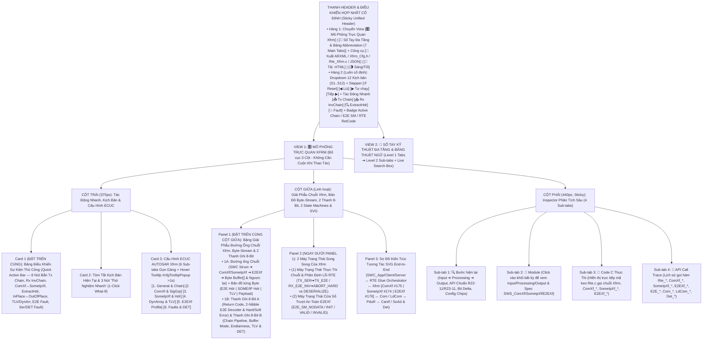
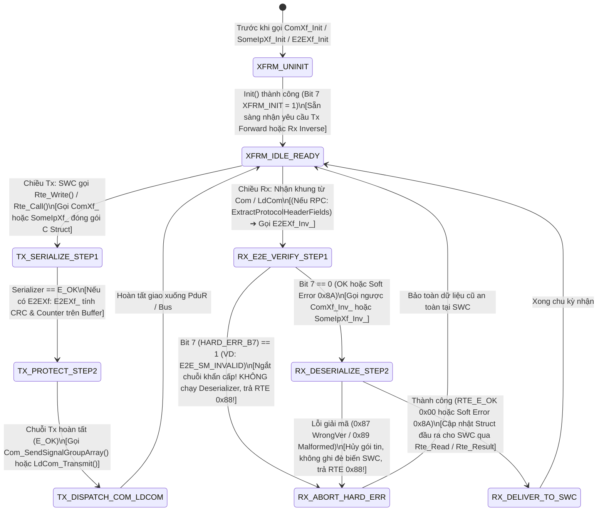
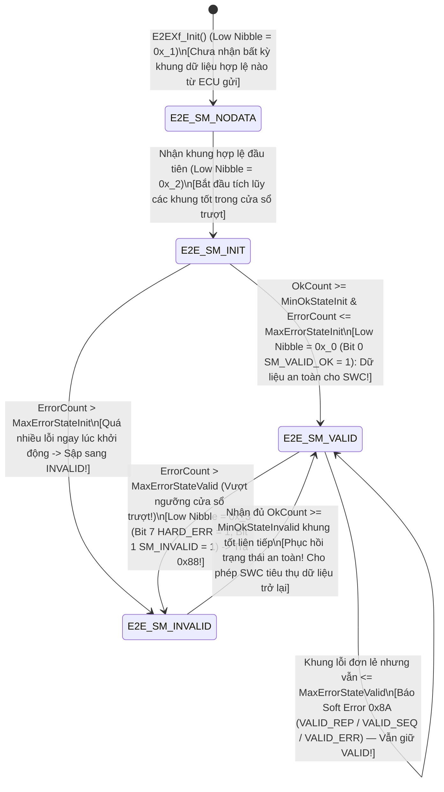

# Tài Liệu Thiết Kế Chi Tiết Trình Mô Phỏng AUTOSAR Xfrm (`Xfrm_Simulation_design.md`)

> **Trạng thái tài liệu:** Bản thiết kế chi tiết đã cập nhật theo xác nhận `A1`–`A4` của User — Sẵn sàng để User review trước khi triển khai code.  
> **File đích dự kiến xuất bản:** `d:\__Personal\AntiGravity\Simulation\03_Services\AUTOSAR_Xfrm.html` (Ứng dụng Web Tương tác 1 file HTML độc lập, 100% Offline, Pure CSS, có nút tải `.HTML` kèm cấu hình nhúng & xuất code `ARXML / Xfrm_Cfg.h / Xfrm_Cfg.c / Rte_Xfrm.c / JSON`).  
> **Chuẩn tham chiếu:** **AUTOSAR Classic Platform R20-11 / R22-11 / R23-11 (`ASWS_TransformerGeneral`, `SWS_ComXf` [ModuleId 175], `SWS_SomeIpXf` [ModuleId 174], `SWS_E2EXf` [ModuleId 176], `SWS_E2E`, `SWS_Rte`, `SWS_Com`, `SWS_LdCom`, `SWS_PduR`, `SWS_SoAd`, `SWS_CanIf`, `SWS_SecOC`, `SWS_Det`)**, đính kèm mã requirement chuẩn **`SWS_Xfrm_xxxxx` / `SWS_ComXf_xxxxx` / `SWS_SomeIpXf_xxxxx` / `SWS_E2EXf_xxxxx` / `SWS_Rte_xxxxx`** tại từng bước xử lý, Bảng Giải Phẫu Đường Ống Chuỗi Transformer (`SWC Complex Struct / C-S Args ➔ Serializer [ComXf / SomeIpXf] ➔ Safety [E2EXf] ➔ Linear Byte Buffer[]` & Ngược lại), Giải Mã `SOME/IP Header (8B/16B)` + `TLV` + `E2E Header (Profile 1/4/5/7)` + `In-Place vs Out-of-Place Buffer`, 2 thanh ghi 8-Bit tương tác, tooltip cấu hình và sổ tay tra cứu đa tầng.

---

## 1. Tổng Quan Định Hướng Thiết Kế Đã Chốt (`A1` – `A4`)

| Hạng mục | Nội dung thiết kế đã xác nhận với User |
| :--- | :--- |
| **1. Bố cục giao diện & Ưu tiên Không Cuộn Trang — Zero-Scroll (`A1.1`)** | Kế thừa tinh hoa của **`AUTOSAR_DEM.html`**, **`AUTOSAR_CanIf.html`** và **`AUTOSAR_Det.html`**, tối ưu hóa **Above-the-Fold (Zero-Scroll)** để các khối thao tác và giám sát tần suất cao nhất luôn nằm ngay phần đầu mỗi cột trong khung màn hình:<br>• **Thanh Điều Khiển Hợp Nhất Cố Định (Sticky Unified Header)**:<br>  - **Hàng 1**: Chuyển View `[🎛️ Mô Phỏng Trực Quan Xfrm (ComXf / SomeIpXf / E2EXf)]` \| `[📖 Sổ Tay Đa Tầng & Bảng Abbreviation (7 Main Tabs)]` + Công cụ `[🧾 Xuất ARXML / Xfrm_Cfg.h / Rte_Xfrm.c / JSON]` \| `[💾 Tải .HTML]` \| `[🌗 Sáng/Tối]`.<br>  - **Hàng 2 (Luôn cố định)**: Dropdown chọn 12 Kịch bản (`S1`–`S12`), Stepper (`↺ Reset`, `◀ Lùi`, `▶ Tự chạy`, `Tiếp ▶`), Bộ kích hoạt nhanh Chuỗi Transformer (`📤 Rte_Write / Rte_Call [Tx Chain]`, `📥 Rte_COMCbk / Rte_Read [Rx InvChain]`, `🔍 ExtractProtocolHeaderFields`, `💥 Inject E2E/Ser Fault`) và Badge Trạng thái `Active Chain (ComXf+E2EXf / SomeIpXf+E2EXf)`, `E2E SM State (VALID / INIT / NODATA / INVALID)` & `RTE Return Code (0x00 / 0x88 / 0x8A)`.<br>• **Bố cục 3 cột hiện đại (Mỗi cột tự cuộn độc lập trong khung Viewport)**:<br>  - **Cột Trái (`375px`)**: Đưa **Card 1: Quick Action Bar (8 nút bắn trực tiếp các luồng API chuẩn của `Xfrm` & `RTE`: `Tx Chain`, `Rx InvChain`, `ComXf ↔ SomeIpXf`, `ExtractProtocolHeaderFields`, `In-Place ↔ Out-of-Place`, `TLV & DynArray`, `Inject E2E Fault`, `Inject Ser/DET Fault`)** và **Card 2: Tóm tắt kịch bản & 3 nút 1-Click What-If** lên trên cùng, tiếp theo là **Card 3: 6 Sub-tabs Cấu hình ECUC Xfrm (`ComXf`, `SomeIpXf`, `E2EXf`, `XfrmImplementationMapping`)** hỗ trợ Floating Hover Tooltip `#cfgTooltipPopup` sau `>1s` giống hệt `AUTOSAR_DEM.html`.<br>  - **Cột Giữa (`Linh hoạt`)**: Đưa **Panel 1: Bảng Giải Phẫu Đường Ống Chuỗi Transformer (`SWC Struct ➔ ComXf/SomeIpXf ➔ E2EXf ➔ Byte Buffer[]`) + Bản Đồ Khung Byte-Stream (`E2E Header` + `SOME/IP Header / TLV / ISignalGroup`) + 2 Thanh Ghi 8-Bit Tương Tác** và **Panel 2: 2 Máy Trạng Thái Song Song (`RTE Transformer Chain & Error Overlay Dispatcher` & `E2EXf State Machine E2E_SMCheck`)** lên ngay đầu cột giữa; bên dưới là **Panel 3: Sơ Đồ Kiến Trúc Tương Tác SVG End-to-End** (`SWC_ADAS / SWC_Brake / SWC_Client / SWC_Server ↔ RTE Glue Code [Transformer Chain Orchestrator] ↔ Xfrm Engine [1. ComXf (#175) | 2. SomeIpXf (#174) | 3. E2EXf (#176) | 4. Custom/SecXf] ↔ Com (ISignalGroup) & LdCom (Large Pdu) ↔ PduR ↔ CanIf / SoAd & Det`).<br>  - **Cột Phải (`440px, Sticky`)**: Inspector 4 Sub-tabs (`🔍 Bước hiện tại`, `🧩 Module`, `📄 Code C Thực Thi (Rte.c / SomeIpXf.c / ComXf.c / E2EXf.c)`, `📜 API Call Trace`). |
| **2. Khu vực Giám sát Bit-level & Giải phẫu Chuỗi Transformer 2 Tầng (`A2.1`)** | Đặt **cố định và nổi bật ở đầu Cột Giữa** gồm **2 tầng trực quan hóa**:<br>• **Tầng 1 — Bảng Giải Phẫu Đường Ống Chuỗi Transformer (`DataTransformation Pipeline`) & Bản Đồ Khung Byte-Stream (`Buffer[0..N]`)**:<br>  - **Chuỗi đối xứng gương (`Symmetric Mirror Chain`)**: Chiều gửi Tx Forward (`SWC Struct` ➔ `Serializer [ComXf / SomeIpXf]` ➔ `Protector [E2EXf]` ➔ `Com / LdCom`) và Chiều nhận Rx Inverse chạy **ngược thứ tự** (`Com / LdCom Byte[]` ➔ `E2EXf_Inv_<id>` ➔ `SomeIpXf_Inv_<id> / ComXf_Inv_<id>` ➔ `SWC Struct`).<br>  - **Bản đồ Bộ nhớ từng Byte trong `Buffer[]`**: Tô màu tách biệt vùng **`E2E Header` (`CRC / Counter / DataID / Len`)**, vùng **`SOME/IP Header` (`RequestId [ClientId+SessionId] / ProtoVer / IfVer / MsgType / RetCode`)**, vùng **`Length Field / TLV Tag (WireType + DataId)`** và vùng **`Serialized Struct Payload`** theo `Big-Endian` vs `Little-Endian`, đồng thời đối chiếu trực tiếp **`In-Place Buffer` (`HeaderShift` dùng chung 1 RAM array)** vs **`Out-of-Place Buffer` (`inputBuf` ➔ `outputBuf`)**.<br>• **Tầng 2 — 2 Thanh ghi 8-Bit tương tác song song**:<br>  1. **Thanh A (`8-Bit Xfrm / E2EXf Return Code, Nibble Decoder & RTE Error Overlay Byte` — `Xfrm_ReturnErrorByte`)**: Theo dõi sự phân định **`Hard Error (Bit 7 = 1, 0x88)`** vs **`Soft Error / OK (Bit 7 = 0, 0x8A / 0x00)`**, giải mã High Nibble của `E2E_PCheckStatus` (`E2E_PRF_B6`, `E2E_SEQ_CRC`, `E2E_REP_ERR`), cờ lỗi tầng Serializer (`SER_ERR_B3`) và 3 bit trạng thái cửa sổ trượt `E2E_SMCheck()` (`SM_NODATA`, `SM_INVALID`, `SM_VALID_OK`).<br>  2. **Thanh B (`8-Bit Xfrm Chain Pipeline, Buffer Mode, Endianness, TLV & DET Status Byte` — `Xfrm_ChainPipelineByte`)**: Theo dõi trạng thái khởi tạo (`XFRM_INIT_OK`), chiều thực thi (`DIR_INV_RX`), công nghệ (`MODE_SOMEIP` vs `ComXf`), chuỗi kết hợp (`E2E_CHAINED`), chế độ đệm (`INPLACE_BUF` vs `Out-of-Place`), thứ tự byte (`BIG_ENDIAN` vs `Little-Endian`), chế độ mở rộng/RPC (`CS_TLV_EXT`) và cờ lỗi `DET` (`DET_ERR_FLG`). Cho phép click trực tiếp vào từng bit để giải mã hoặc thử nghiệm! |
| **3. Hệ thống 12 Kịch bản mẫu (`A3.1`)** | Thiết kế sẵn **12 Kịch bản (`S1`–`S12`)** chia làm 4 nhóm lớn:<br>• **Nhóm 1 (`S1`–`S3`) — Chuỗi `ComXf` (`#175`) + `E2EXf` (`#176`) Trên Mạng CAN / CAN FD Qua `AUTOSAR COM`**: Tuần tự hóa Struct vào `ISignalGroup` qua `ComXf`, `Big-Endian` vs `Little-Endian`, điền `UnusedBitPattern` & gửi qua `Com_SendSignalGroupArray()` (`S1`); Chuỗi kết hợp `ComXf ➔ E2EXf (Profile 05)` trên chiều Tx và `E2EXf_Inv ➔ ComXf_Inv` trên chiều Rx (`S2`); Đối chiếu thực nghiệm `In-Place Buffer` (`HeaderShift = 3B`) vs `Out-of-Place Buffer` (`S3`).<br>• **Nhóm 2 (`S4`–`S6`) — Chuỗi `SomeIpXf` (`#174`) + `E2EXf` (`#176`) Trên Mạng Automotive Ethernet Qua `LdCom / SoAd`**: Tuần tự hóa Struct phức hợp & Mảng động (`Dynamic Radar Object Array`) kèm 8B SOME/IP Header, `LengthField` & `Alignment` (`S4`); Mã hóa mở rộng **TLV (`Tag-Length-Value` / `WireType`)** đảm bảo tương thích tiến/lùi khi nhận thẻ lạ (`Skip Unknown Tag`) (`S5`); Chuỗi bảo vệ gói tin lớn `SomeIpXf ➔ E2EXf (Profile 04 / Profile 07: CRC-32P4)` trên đường truyền Ethernet SOA (`S6`).<br>• **Nhóm 3 (`S7`–`S9`) — Giao Tiếp `Client-Server RPC` Qua `SomeIpXf`, `TransactionHandle` & `ExtractProtocolHeaderFields`**: Gọi hàm từ xa `Rte_Call()` giữa Client & Server qua `Rte_Cs_TransactionHandleType { clientId, sequenceCounter }` (`S7`); Sử dụng hàm chuẩn **`SomeIpXf_ExtractProtocolHeaderFields()`** để bóc tách nhanh `MessageType / ReturnCode` trước khi giải tuần tự hóa (`S8`); Xử lý lỗi nghiệp vụ từ Server trả về `MessageType = ERROR (0x81)` về cho `Rte_Result()` tại Client (`S9`).<br>• **Nhóm 4 (`S10`–`S12`) — Bơm Lỗi `E2EXf`, Lỗi Định Dạng `SomeIpXf`, Phân Biệt `Hard vs Soft Error (0x88 vs 0x8A)` & Hàng Rào `DET`**: Giải phẫu mã trả về 2 Nibble của `E2EXf_Inv` khi lặp khung (`E2E_P_REPEATED = 0x10`) và nhảy bậc đếm (`E2E_P_WRONGSEQUENCE = 0x20`) cùng hành vi `Soft Error (0x8A)` vs sập `E2E_SM_INVALID (0x88)` (`S10`); Bơm lỗi sai `CRC (E2E_P_ERROR = 0x30)` hoặc sai `ProtocolVersion / InterfaceVersion / Truncated Message` (`0x87 / 0x89`) để quan sát cơ chế **Ngắt Chuỗi Khẩn Cấp (`Abort Chain on Hard Error`)** (`S11`); Kiểm thử toàn diện hàng rào **`DET`** trên cả 3 module `SomeIpXf (#174)`, `ComXf (#175)`, `E2EXf (#176)` (`XFRM_E_UNINIT`, `XFRM_E_PARAM`, `XFRM_E_PARAM_POINTER`, `XFRM_E_MALFORMED_MESSAGE`) (`S12`). |
| **4. Sổ tay tra cứu đa tầng & Bảng Abbreviation (`A4.1`)** | **View 2 (`📖 Sổ Tay Kỹ Thuật Xfrm & Từ Điển Thuật Ngữ`)** được tổ chức theo cấu trúc **Đa Tầng (Multi-level Tabs)**:<br>• **6 Main Sub-tabs (Level 1) × 4 Chủ đề con (Level 2 Pills/Tabs = 24 chuyên đề)** phân tích sâu kiến trúc `ASWS_TransformerGeneral`, thuật toán đóng gói bit & Endianness của `ComXf`, cấu trúc khung & TLV/RPC của `SomeIpXf`, các Profile & cửa sổ trượt `E2E_SMCheck` của `E2EXf`, quản lý bộ đệm `In-Place / Out-of-Place` + cơ chế `Hard/Soft Error Overlay`, và bảng tra cứu API/ECUC/DET chuẩn R23-11.<br>• **Tab 7 chuyên biệt: `🔤 Bảng Thuật Ngữ & Từ Viết Tắt (Abbreviation Table)`** trình bày dưới dạng bảng chuẩn 4 cột, tích hợp **Search Box tìm kiếm tức thời (Live Search + Highlight `<mark>`)** và 5 nút lọc nhanh theo phân nhóm (`Xfrm Core & RTE Chain`, `ComXf & SignalGroup`, `SomeIpXf, TLV & RPC`, `E2EXf Safety & SMCheck`, `APIs, Error Codes & ECUC`). |

---

## 2. Bố Cục Giao Diện 3 Cột Ưu Tiên Zero-Scroll & Hệ Thống Sub-Tabs (UI Wireframe)

Để đáp ứng triệt để yêu cầu **"đưa các khối được dùng thường xuyên hơn lên phía trên để người dùng không cần cuộn chuột lên xuống mỗi lần thao tác"**, giao diện được thiết kế theo nguyên lý **Viewport-First (Toàn bộ 8 nút gọi nhanh API/chuỗi `Xfrm`, các nút kích hoạt nhanh Tx/Rx/Header/Fault trên Header, Bảng Giải Phẫu Đường Ống Chuỗi Transformer + Bản Đồ Byte-Stream, 2 Thanh Ghi 8-Bit và 2 Máy Trạng Thái đều nằm ngay trong tầm mắt đầu trang)**:



### Điểm Cải Tiến Đột Phá Về Trải Nghiệm "Zero-Scroll" Cho Module `Xfrm`:
1. **Thanh Điều Khiển Hợp Nhất (`Sticky Unified Header`) Với Các Nút Kích Hoạt Chuỗi & Bơm Lỗi Tức Thời**:
   - Người dùng có thể đứng ở bất kỳ kịch bản nào mà vẫn bấm ngay **`📤 Tx Chain`** (chạy chiều gửi `SWC Struct ➔ Serializer ➔ E2EXf ➔ Com/LdCom`), bấm **`📥 Rx InvChain`** (chạy chiều nhận ngược lại `Com/LdCom ➔ E2EXf_Inv ➔ Deserializer ➔ SWC Struct`), bấm **`🔍 ExtractHeader`** (gọi `SomeIpXf_ExtractProtocolHeaderFields()`), hoặc **`💥 Inject Fault`** để kiểm chứng phản ứng cắt chuỗi khẩn cấp (`Hard Error 0x88`) vs cảnh báo mềm (`Soft Error 0x8A`) ngay lập tức mà không cần cuộn trang!
2. **Đưa `Quick Action Bar` (8 nút tác động nhanh) lên vị trí Card 1 (Đầu Cột Trái)** và đưa **Bảng Giải Phẫu Đường Ống Chuỗi Transformer + Bản Đồ Bộ Đệm `Buffer[]` + 2 Thanh Ghi 8-Bit** lên đầu Cột Giữa: Mọi thay đổi về `Endianness (Big ↔ Little)`, `Buffer Mode (In-Place ↔ Out-of-Place)`, `TLV Encoding`, `E2E Profile`, hay tiêm lỗi CRC/Sequence đều làm các ô byte trong `Buffer[]` đổi màu và đổi giá trị Hex ngay trước mắt.
3. **Gom 36 tham số ECUC vào 6 Sub-tabs gọn gàng**: Chiều cao Card Cấu hình được giữ gọn cố định (~275px), kèm hộp thoại giải thích nổi `#cfgTooltipPopup` khi hover quá `1000ms` giống hệt file `AUTOSAR_DEM.html`.

---

## 3. Thiết Kế Chi Tiết Panel 1 (Đầu Cột Giữa): Bảng Giải Phẫu Đường Ống Chuỗi `Xfrm`, Bản Đồ Bộ Đệm Byte-Stream & 2 Thanh Ghi 8-Bit Tương Tác

Trong `AUTOSAR Classic R20-11 / R22-11 / R23-11`, thuật ngữ **`Xfrm` (AUTOSAR Transformer)** không phải là một hàm đơn lẻ mà là một **kiến trúc ghép chuỗi mô-đun (`DataTransformation Chain` theo `ASWS_TransformerGeneral`)** kết nối trực tiếp giữa **`RTE`** và **`Com` / `LdCom`**, bao gồm 3 trụ cột tiêu chuẩn:
- **`SomeIpXf` (`ModuleId = 174 / 0x00AE`, `SWS_SomeIpXf`)**: Tuần tự hóa dữ liệu C phức hợp (Nested Struct, Union, String, Dynamic Array, TLV) và gắn/bóc tách 8-byte SOME/IP Header cho truyền thông hướng dịch vụ (SOA / RPC / Ethernet).
- **`ComXf` (`ModuleId = 175 / 0x00AF`, `SWS_ComXf`)**: Tuần tự hóa trực tiếp cấu trúc dữ liệu `SWC` thành mảng byte phẳng của một `ISignalGroup` (xử lý `BitPosition`, `Endianness`, `UnusedBitPattern`) để đẩy nguyên khối xuống `AUTOSAR COM` qua `Com_SendSignalGroupArray()`.
- **`E2EXf` (`ModuleId = 176 / 0x00B0`, `SWS_E2EXf`)**: Bọc bảo vệ an toàn chức năng ISO 26262 (`CRC` + `Counter` + `DataID` + `E2E_SMCheck()` theo Profile 01 / 04 / 05 / 07 / 11) phía ngoài dữ liệu đã tuần tự hóa.

4 cơ chế kỹ thuật cốt lõi được phơi bày hoàn toàn trên Panel 1:
1. **Thứ tự thực thi đối xứng gương (`Symmetric Mirror Chain Execution` — `ASWS_TransformerGeneral`)**:
   - **Chiều gửi (`Tx Forward`)**: `SWC DataType` ➔ **Bước 1 (`SERIALIZER`: `ComXf_<id>` hoặc `SomeIpXf_<id>`)** ➔ **Bước 2 (`SAFETY`: `E2EXf_<id>`)** ➔ `Com_SendSignalGroupArray()` / `LdCom_Transmit()`.
   - **Chiều nhận (`Rx Inverse`)**: `Com / LdCom Byte[]` ➔ **Bước 1 (`SAFETY`: `E2EXf_Inv_<id>`)** kiểm tra toàn vẹn trước ➔ **Bước 2 (`SERIALIZER`: `ComXf_Inv_<id>` hoặc `SomeIpXf_Inv_<id>`)** giải mã sau ➔ `SWC DataType`!
2. **Quản lý bộ đệm `In-Place Buffer` vs `Out-of-Place Buffer` (`XfrmBufferComputation`)**:
   - **`In-Place Buffer`**: Toàn bộ các bước trong chuỗi dùng chung 1 mảng `Rte_XfrmBuffer[]`. `SomeIpXf` chừa sẵn khoảng trống `HeaderShift = E2E_HeaderLen` ở đầu mảng để `E2EXf` ghi đè E2E Header vào ngay đầu mảng với **0 lần copy trung gian (`Zero-Copy`)**.
   - **`Out-of-Place Buffer`**: `Step 1` ghi ra `Rte_Buf1[]`, `Step 2` đọc từ `Rte_Buf1[]` và ghi sang `Rte_Buf2[]`.
3. **Mã hóa kết quả 2 Nibble của `E2EXf_Inv` & Cơ chế `RTE Error Overlay` (`0x88 Hard Error` vs `0x8A Soft Error`)**:
   - Theo `SWS_E2EXf_00032` & `ASWS_TransformerGeneral`, hàm `E2EXf_Inv_<id>()` trả về `uint8` gồm **`High Nibble (Bits 7..4)` = `E2E_PCheckStatus`** (`0x0_=OK`, `0x1_=REPEATED`, `0x2_=WRONGSEQUENCE`, `0x3_=ERROR`, `0x4_=NOTAVAILABLE`, `0x5_=NONEWDATA`) và **`Low Nibble (Bits 3..0)` = `E2E_SMState`** (`0x_0=VALID`, `0x_1=NODATA`, `0x_2=INIT`, `0x_3=INVALID`).
   - Theo `SWS_Rte_02595`: Nếu bất kỳ bước nào trả về **`Hard Error` (`Bit 7 == 1`, ví dụ `E_SAFETY_INVALID_*` hoặc `E_SER_MALFORMED_MESSAGE = 0x89`)**, `RTE` **ngắt chuỗi ngay lập tức (`Abort`)**, giữ nguyên giá trị biến cũ của `SWC` và trả về **`RTE_E_HARD_TRANSFORMER_ERROR (0x88)`**. Ngược lại nếu là **`Soft Error` (`Bit 7 == 0`, ví dụ `E_SAFETY_VALID_REP = 0x01`)**, `RTE` vẫn chạy tiếp Deserializer, cập nhật dữ liệu mới cho `SWC` kèm mã cảnh báo **`RTE_E_SOFT_TRANSFORMER_ERROR (0x8A)`**!

### 3.1. Phần 1A — Bảng Giải Phẫu Đường Ống Chuỗi Transformer & Bản Đồ Khung Byte-Stream (`Buffer[0..N]`)

```text
+-------------------------------------------------------------------------------------------------------------------+
| 🧬 BẢNG GIẢI PHẪU ĐƯỜNG ỐNG CHUỖI XFRM & BẢN ĐỒ BYTE-STREAM (`ASWS_TransformerGeneral` | `SWS_SomeIpXf / ComXf / E2EXf`) |
| Chuỗi Active: [SomeIpXf (#174) ➔ E2EXf (#176) P04] | Chiều: [◀ RX INVERSE] | Bộ đệm: [IN-PLACE (Shift=12B)] | E2E: [VALID] |
+-------------------------------------------------------------------------------------------------------------------+
| 1. ĐƯỜNG ỐNG THỰC THI CHUỖI (`Symmetric Mirror Transformer Chain` — Click vào từng khối để xem Buffer trung gian):|
|  [ 📦 SWC C Struct ]  ◀── (Rx Step 2) ──  [ 🌐 SomeIpXf_Inv ]  ◀── (Rx Step 1) ──  [ 🛡️ E2EXf_Inv (P04) ]  ◀── [ 📥 LdCom ] |
|  • Speed: 120.5 km/h                      • Check Proto/IfVer=1/1                   • Len=32, Cnt=0x0007          |
|  • Gear: 4 | Radar[2]                     • Parse Length & TLV                      • DataID=0x1A2B3C4D           |
|  • Ret: RTE_E_OK (0x00)                   • Big-Endian Unpack                       • CRC32=0x9F4A12E1 [PASS ✅]  |
+-------------------------------------------------------------------------------------------------------------------+
| 2. BẢN ĐỒ TỪNG BYTE TRONG BỘ ĐỆM `Rte_XfrmBuffer[0..31]` (Tô màu tách vùng — Click vào ô Byte bất kỳ để soi / sửa):|
|  [00..01: E2E Length=0020] [02..03: E2E Cnt=0007] [04..07: E2E DataID=1A2B3C4D] [08..11: CRC-32P4 = 9F 4A 12 E1]   |
|  ├── VÙNG E2EXf PROFILE 04 HEADER (12 Bytes — Offset 0..11, Sinh/Kiểm tra bởi E2EXf #176) ────────────────────────┤ |
|  [12..15: ReqID=0001 0007] [16..19: Proto=01 | IfVer=01 | MsgType=02 (NOTIF) | Ret=00]                            |
|  ├── VÙNG SOME/IP HEADER (8 Bytes — Offset 12..19, Sinh/Kiểm tra bởi SomeIpXf #174) ──────────────────────────────┤ |
|  [20..21: Speed=04 B5 (BE)] [22: Gear=04] [23: AlignPad=00] [24..27: DynArrLen=00000004] [28..31: Obj0_Dist+Vel]  |
|  └── VÙNG SERIALIZED STRUCT + LENGTH/TLV PAYLOAD (12 Bytes — Offset 20..31, Big-Endian / TLV WireType) ───────────┘ |
+-------------------------------------------------------------------------------------------------------------------+
```

- **Tính năng tương tác trực tiếp trên Phần 1A**:
  - Người dùng có thể click chọn trực tiếp vào **khối E2E Header**, **khối SOME/IP Header** hoặc **ô Byte cụ thể** trong `Rte_XfrmBuffer[]` để lật bit CRC (gây lỗi `E2E_P_ERROR`), đổi `ProtoVer` từ `0x01` thành `0x02` (gây lỗi `E_SER_WRONG_PROTOCOL_VERSION = 0x87`), hoặc đổi `Endianness` từ Big-Endian (`04 B5`) sang Little-Endian (`B5 04`) ngay trên bản đồ bộ đệm!
  - Thanh trạng thái hiển thị rõ sự khác biệt giữa **`In-Place Buffer`** (1 mảng duy nhất dịch địa chỉ con trỏ `Buffer + 12`) và **`Out-of-Place Buffer`** (2 mảng riêng biệt `Rte_Buf_Ser[]` & `Rte_Buf_E2E[]`).

### 3.2. Phần 1B — 2 Thanh Ghi 8-Bit Trạng Thái Tương Tác Luôn Hiển Thị Nổi Bật

Ngay bên dưới Phần 1A là **2 Thanh ghi 8-Bit tương tác** theo đúng phong cách chuẩn của `AUTOSAR_DEM.html`, `AUTOSAR_CanIf.html` và `AUTOSAR_Det.html`:

```text
+-------------------------------------------------------------------------------------------------------------------+
| 🔢 BẢNG GIÁM SÁT BITFIELD 8-BIT XFRM RETURN CODE, NIBBLE DECODER & CHAIN PIPELINE [Click vào từng Bit để thử]     |
| Bước #3: E2EXf_Inv_0x101() phát hiện CRC sai ➔ Trả 0xB3 (0x3_ ERROR | 0x_3 INVALID) ➔ Abort Chain ➔ RTE 0x88!    |
+-------------------------------------------------------------------------------------------------------------------+
| A. THANH GHI 8-BIT MÃ TRẢ VỀ XFRM, 2-NIBBLE E2EXF & RTE ERROR OVERLAY (`Xfrm_ReturnErrorByte`) — Hex:[0xB2] [10110010]|
|    RTE Ret: [ RTE_E_HARD_TRANSFORMER_ERROR (0x88) ] | E2E_PCheck: [ E2E_P_ERROR (0x3_) ] | SM: [ E2E_SM_INVALID ] |
|  +-------------+ +-------------+ +-------------+ +-------------+ +-------------+ +-------------+ +-------+ +-----+|
|  | Bit 7 (0x80)| | Bit 6 (0x40)| | Bit 5 (0x20)| | Bit 4 (0x10)| | Bit 3 (0x08)| | Bit 2 (0x04)| |Bit1(2)| |Bit 0||
|  | HARD_ERR_B7 | | E2E_PRF_B6  | | E2E_SEQ_CRC | | E2E_REP_ERR | | SER_ERR_B3  | | SM_NODATA   | |SM_INV | |SM_OK||
|  |   1 (0➔1🔥) | |      0      | |   1 (0➔1🔥) | |   1 (0➔1🔥) | |      0      | |      0      | |1(0➔1🔥| |  0  ||
|  | Hard Abort! | | No NoData   | | CRC/DataID! | | Combined 0x3| | Ser OK/Skip | | Has Data    | |SM Inv!| |!Val ||
|  +-------------+ +-------------+ +-------------+ +-------------+ +-------------+ +-------------+ +-------+ +-----+|
+-------------------------------------------------------------------------------------------------------------------+
| B. THANH GHI 8-BIT CHUỖI PIPELINE, BỘ ĐỆM, ENDIANNESS, TLV & DET (`Xfrm_ChainPipelineByte`) — Hex:[0xEC] [11101100]|
|    Tech: [ SomeIpXf + E2EXf ] | Dir: [ RX_INV ] | Buf: [ IN_PLACE ] | Order: [ BIG_ENDIAN ] | TLV: [ OFF ] | DET:0|
|  +-------------+ +-------------+ +-------------+ +-------------+ +-------------+ +-------------+ +-------+ +-----+|
|  | Bit 7 (0x80)| | Bit 6 (0x40)| | Bit 5 (0x20)| | Bit 4 (0x10)| | Bit 3 (0x08)| | Bit 2 (0x04)| |Bit1(2)| |Bit 0||
|  | XFRM_INIT   | | DIR_INV_RX  | | MODE_SOMEIP | | E2E_CHAINED | | INPLACE_BUF | | BIG_ENDIAN  | |CS_TLV | |DET_E||
|  |      1      | |      1      | |      1      | |      1      | |      0      | |      1      | |   0   | |  0  ||
|  | Initialized | | Rx InvChain | | SomeIpXf174 | | E2EXf #176  | | OutOfPlace  | | Big Endian  | |No TLV | |NoErr||
|  +-------------+ +-------------+ +-------------+ +-------------+ +-------------+ +-------------+ +-------+ +-----+|
+-------------------------------------------------------------------------------------------------------------------+
```

#### 3.2.1. Giải Mã Chi Tiết Thanh A: `8-Bit Xfrm / E2EXf Return Code, Nibble Decoder & RTE Error Overlay Byte` (`Xfrm_ReturnErrorByte`)

| Bit | Mask | Tên Cờ (`Xfrm Return Bit`) | Ý nghĩa kỹ thuật & Khi nào bật lên `1` (`0 ➔ 1`) | Khi nào hạ về `0` (`1 ➔ 0`) |
| :-: | :-: | :--- | :--- | :--- |
| **Bit 7** | `0x80` | **`HARD_ERR_B7`** | Cờ quyết định ranh giới sống còn theo **`ASWS_TransformerGeneral` & `SWS_Rte_02595`**: Bật lên `1` khi kết quả Transformer là **Hard Error** (`E_SAFETY_HARD_RUNTIMEERROR`, `E_SAFETY_INVALID_*`, `E_SER_MALFORMED_MESSAGE = 0x89`, `E_SER_WRONG_PROTOCOL_VERSION = 0x87`, `E_SER_WRONG_INTERFACE_VERSION = 0x88`). Khi `Bit 7 = 1`, `RTE` **ngắt chuỗi ngay lập tức (`Abort Chain`)**, KHÔNG ghi đè dữ liệu hỏng vào biến của `SWC` và trả về **`RTE_E_HARD_TRANSFORMER_ERROR (0x88)`**! | Hạ về `0` khi chuỗi chạy thành công (`RTE_E_OK = 0x00`) hoặc khi lỗi ở mức **Soft Error** (`E_SAFETY_VALID_REP`, `E_SAFETY_VALID_SEQ`, `E_SAFETY_SOFT_RUNTIMEERROR` ➔ `RTE_E_SOFT_TRANSFORMER_ERROR = 0x8A`, dữ liệu vẫn được giao cho `SWC`!). |
| **Bit 6** | `0x40` | **`E2E_PRF_B6`** | Bit trọng số cao (`Bit 2` của High Nibble `E2E_PCheckStatus`) hoặc cờ phiên bản giao thức `SomeIpXf`: Bật lên `1` khi `E2E` báo **`E2E_P_NOTAVAILABLE (0x4_)`** (không dùng/chưa có dữ liệu) hoặc **`E2E_P_NONEWDATA (0x5_)`** (chưa có khung mới đến trong chu kỳ đọc), hoặc khi `SomeIpXf_Inv` bắt lỗi **`WRONG_PROTOCOL_VERSION / WRONG_INTERFACE_VERSION`**. | Hạ về `0` khi nhận được khung mới hợp lệ (`E2E_P_OK = 0x0_`) hoặc lỗi thuộc nhóm `REPEATED / WRONGSEQUENCE / CRC ERROR`. |
| **Bit 5** | `0x20` | **`E2E_SEQ_CRC`** | Bit trọng số giữa (`Bit 1` của High Nibble `E2E_PCheckStatus`): Bật lên `1` khi bộ kiểm tra `E2E_PxxCheck()` phát hiện **`E2E_P_WRONGSEQUENCE (0x2_)`** (nhảy cóc bộ đếm `DeltaCounter > MaxDeltaCounter`) hoặc khi kết hợp với `Bit 4` tạo thành **`0x3_ = E2E_P_ERROR`** (Sai mã **`CRC`** hoặc sai **`DataID`** hoặc sai độ dài `Length`). | Hạ về `0` khi bộ đếm tuần tự hợp lệ (`DeltaCounter == 1`) và `CRC` khớp hoàn toàn. |
| **Bit 4** | `0x10` | **`E2E_REP_ERR`** | Bit trọng số thấp (`Bit 0` của High Nibble `E2E_PCheckStatus`): Bật lên `1` khi `E2E` phát hiện khung tin bị lặp lại y hệt chu kỳ trước **`E2E_P_REPEATED (0x1_)`** (`DeltaCounter == 0`), hoặc bật cùng `Bit 5` tạo thành **`0x3_ = E2E_P_ERROR`**, hoặc bật cùng `Bit 6` tạo thành **`0x5_ = E2E_P_NONEWDATA`**. | Hạ về `0` khi nhận được khung tin mới có bộ đếm tăng chuẩn xác. |
| **Bit 3** | `0x08` | **`SER_ERR_B3`** | Bật lên `1` khi lỗi phát sinh ngay tại tầng **Serializer / Deserializer (`SomeIpXf` #174 hoặc `ComXf` #175)**: ví dụ `E_SER_MALFORMED_MESSAGE (0x89)` (buffer bị cắt ngắn hơn `LengthField` hoặc cấu trúc TLV hỏng), `E_SER_WRONG_MESSAGE_TYPE (0x8A)`, `E_SER_GENERIC_ERROR (0x81)` hoặc tràn kích thước `BufferLength` ở chiều gửi. | Hạ về `0` khi `ComXf` / `SomeIpXf` tuần tự hóa và giải tuần tự hóa thành công (`E_OK`). |
| **Bit 2** | `0x04` | **`SM_NODATA`** | Bật lên `1` khi máy trạng thái cửa sổ trượt **`E2E_SMCheck()`** đang ở pha khởi động thiếu dữ liệu (**`E2E_SM_NODATA`** hoặc **`E2E_SM_INIT`** — chưa tích lũy đủ `MinOkStateInit` khung đúng liên tiếp kể từ khi bật nguồn ECU). Mã trả về Low Nibble nằm trong dải `E_SAFETY_NODATA_*` hoặc `E_SAFETY_INIT_*`. | Hạ về `0` ngay khi đủ `MinOkStateInit` khung tốt liên tiếp đưa hệ thống lên **`E2E_SM_VALID`**, hoặc khi bị đánh rớt xuống **`E2E_SM_INVALID`**. |
| **Bit 1** | `0x02` | **`SM_INVALID`** | Bật lên `1` khi số lỗi `CRC` / `WrongSequence` trong cửa sổ trượt vượt quá ngưỡng cho phép (`ErrorCount > MaxErrorStateValid`), khiến `E2E_SMCheck()` **sập xuống trạng thái mất an toàn `E2E_SM_INVALID`** (Low Nibble `0x_3`, ép `Bit 7 HARD_ERR_B7 = 1` để bảo vệ `SWC` khỏi dữ liệu sai lệch!). | Hạ về `0` khi nhận đủ `MinOkStateInvalid` khung tốt liên tiếp để phục hồi về `E2E_SM_VALID`, hoặc khi Reset `E2EXf_Init()`. |
| **Bit 0** | `0x01` | **`SM_VALID_OK`** | Bật lên `1` khi toàn bộ chuỗi `Xfrm` thực thi hợp lệ (`E_OK = 0x00`) hoặc máy trạng thái **`E2E_SMCheck()` đang ở trạng thái an toàn `E2E_SM_VALID`** (cho phép `SWC` tin cậy và sử dụng dữ liệu đầu ra; kể cả khi có 1 lỗi thoáng qua nhưng cửa sổ trượt vẫn giữ `VALID` ➔ `Soft Error 0x8A`). | Hạ về `0` khi chưa khởi tạo, đang ở `NODATA / INIT`, khi bị sập xuống `E2E_SM_INVALID`, hoặc khi `SomeIpXf` báo `Hard Error`. |

#### 3.2.2. Giải Mã Chi Tiết Thanh B: `8-Bit Xfrm Chain Pipeline, Buffer Mode, Endianness, TLV & DET Status Byte` (`Xfrm_ChainPipelineByte`)

| Bit | Mask | Tên Cờ (`Xfrm Pipeline Bit`) | Ý nghĩa kỹ thuật & Khi nào bật lên `1` (`0 ➔ 1`) | Khi nào hạ về `0` (`1 ➔ 0`) |
| :-: | :-: | :--- | :--- | :--- |
| **Bit 7** | `0x80` | **`XFRM_INIT`** | Bật lên `1` sau khi các hàm khởi tạo chuẩn **`ComXf_Init()`**, **`SomeIpXf_Init()`** và **`E2EXf_Init()`** (`SWS_ComXf_00018`, `SWS_SomeIpXf_00150`, `SWS_E2EXf_00035`) hoàn tất trong pha `EcuM / BswM`, cấp phát và xóa sạch các vùng biến trạng thái `E2E_PxxCheckState` & `E2E_SMCheckState`. | Hạ về `0` trước khi `Init` hoặc khi người dùng tắt Checkbox `XfrmInitializedState` để kiểm thử lỗi `XFRM_E_UNINIT (0x01)` với `DET`! |
| **Bit 6** | `0x40` | **`DIR_INV_RX`** | Bật lên `1` khi chuỗi đang chạy theo **Chiều Nhận Nghịch Đảo (`Rx Inverse Chain`)**: `Com / LdCom ➔ E2EXf_Inv_<id>() ➔ ComXf_Inv_<id>() / SomeIpXf_Inv_<id>() ➔ RTE ➔ SWC`. | Hạ về `0` khi chuỗi đang chạy theo **Chiều Gửi Thuận (`Tx Forward Chain`)**: `SWC ➔ RTE ➔ ComXf_<id>() / SomeIpXf_<id>() ➔ E2EXf_<id>() ➔ Com / LdCom`. |
| **Bit 5** | `0x20` | **`MODE_SOMEIP`** | Bật lên `1` khi chuỗi đang sử dụng công nghệ **`SomeIpXf` (`ModuleId = 174`)**: Tuần tự hóa Struct, Dynamic Array, String, TLV và gắn 8-byte SOME/IP Header truyền qua **`LdCom ➔ PduR ➔ SoAd`**. | Hạ về `0` khi chuỗi đang sử dụng công nghệ **`ComXf` (`ModuleId = 175`)**: Đóng gói trực tiếp Bit-level vào mảng byte **`ISignalGroup`** truyền qua **`AUTOSAR COM ➔ PduR ➔ CanIf`**. |
| **Bit 4** | `0x10` | **`E2E_CHAINED`** | Bật lên `1` khi `DataTransformation` hiện tại cấu hình **ghép nối tầng an toàn `E2EXf` (`ModuleId = 176`)** (`Profile 01 / 04 / 05 / 07`) bọc bên ngoài khối dữ liệu đã tuần tự hóa bởi `ComXf` hoặc `SomeIpXf`. | Hạ về `0` khi chạy chuỗi Transformer đơn tầng (chỉ `ComXf` hoặc chỉ `SomeIpXf`, `E2EXfActiveProfile = NONE`). |
| **Bit 3** | `0x08` | **`INPLACE_BUF`** | Bật lên `1` khi chuỗi cấu hình **`XfrmBufferComputationMode = IN_PLACE`** (`ASWS_TransformerGeneral`): `RTE` cấp phát đúng 1 mảng `Rte_XfrmBuffer[]`; bước trước dịch con trỏ lùi `HeaderShift` byte để bước `E2EXf` ghi đè header trực tiếp vào đầu mảng mà **không cần `memcpy` toàn bộ payload**! | Hạ về `0` khi dùng **`OUT_OF_PLACE`**: `Step 1` ghi vào `Buf1`, `Step 2` đọc từ `Buf1` và sao chép + gắn header sang `Buf2` riêng biệt. |
| **Bit 2** | `0x04` | **`BIG_ENDIAN`** | Bật lên `1` khi thứ tự byte tuần tự hóa là **Motorola Big-Endian / Network Byte Order** (ví dụ giá trị `0x04B5` được đặt thành `[0x04, 0xB5]` trong `Buffer[]` — bắt buộc cho SOME/IP Header và mặc định phổ biến trên CAN/Ethernet). | Hạ về `0` khi chọn **Intel Little-Endian** (`[0xB5, 0x04]`, thường dùng trong cấu hình `ComXf` theo tín hiệu CAN Intel hoặc SOME/IP Payload Little-Endian). |
| **Bit 1** | `0x02` | **`CS_TLV_EXT`** | Bật lên `1` khi `SomeIpXf` đang xử lý tính năng nâng cao: hoặc **Mã hóa mở rộng TLV (`Tag-Length-Value` + `WireType`)** để tương thích tiến/lùi các trường tùy chọn, hoặc **Giao tiếp Client-Server RPC** kèm **`Rte_Cs_TransactionHandleType { clientId, sequenceCounter }`** & `MessageType = REQUEST/RESPONSE/ERROR`. | Hạ về `0` khi truyền bản tin Sender-Receiver (Fire & Forget `NOTIFICATION`) cấu trúc cố định không bật TLV. |
| **Bit 0** | `0x01` | **`DET_ERR_FLG`** | Bật lên `1` ngay khi `SomeIpXf (#174)`, `ComXf (#175)` hoặc `E2EXf (#176)` phát hiện lỗi tham số/trạng thái và gọi **`Det_ReportError()`** hoặc **`Det_ReportRuntimeError()`** (ví dụ `XFRM_E_UNINIT = 0x01`, `XFRM_E_PARAM = 0x03`, `XFRM_E_PARAM_POINTER = 0x04`, `XFRM_E_MALFORMED_MESSAGE = 0x05`). | Hạ về `0` khi thực hiện một chu trình hợp lệ mới hoặc bấm Reset. |

---

## 4. Phân Tích Xử Lý Từng Module: Input Lấy Từ Đâu, Xử Lý Gì, Output Route Đến Đâu

Mọi khối trên sơ đồ kiến trúc SVG đều có thể **click vào để xem giải thích chi tiết** ở cột phải (Tab `🧩 Module`) và được tổng hợp đầy đủ trong **Tab 1 của Sổ tay**:

| # | Module / Phân khối | Lớp AUTOSAR | 📥 Input lấy từ đâu? | ⚙️ Cách xử lý nội bộ (Processing, Serialization, Safety & Buffers) | 📤 Output route đến đâu & Hàm API chuẩn (R20-11 / R22-11 / R23-11) |
| :-: | :--- | :--- | :--- | :--- | :--- |
| **1** | **`SWC_ADAS`, `SWC_Brake`, `SWC_Client` & `SWC_Server`**<br>*(Application SW-Cs)* | Application Layer (`01_Application`) | • Đọc dữ liệu struct ứng dụng từ `RTE` (`Rte_Read`, `Rte_Result`) hoặc nhận kích hoạt `OperationInvokedEvent` tại Server.<br>• Đọc chi tiết lỗi Transformer qua `Rte_GetTransformerError()` (nếu bật). | • **Tính trong suốt tuyệt đối (`Transformer Transparency`)**: Code C của `SWC` chỉ làm việc trực tiếp với kiểu dữ liệu cấp ứng dụng (`ApplicationDataType`: `RadarObjList_t`, `BrakeCmd_t` gồm `float32`, `struct` lồng nhau, `DynamicArray`), hoàn toàn **không biết** `ComXf`, `SomeIpXf` hay `E2EXf` đang tồn tại bên dưới!<br>• **Phản ứng khi nhận lỗi từ `RTE`**: Nếu `Rte_Read()` trả về `RTE_E_HARD_TRANSFORMER_ERROR (0x88)`, `SWC` giữ nguyên giá trị cũ an toàn; nếu nhận `RTE_E_SOFT_TRANSFORMER_ERROR (0x8A)`, `SWC` quyết định có dùng giá trị mới kèm cảnh báo hay không. | • Gọi qua **RTE**:<br>`Rte_Write_PpRadar_ObjList(&objStruct)`<br>`Rte_Read_RpRadar_ObjList(&objStruct)`<br>`Rte_Call_RpPlanner_CalcPath(inArg, &outArg)`<br>`Rte_Result_RpPlanner_CalcPath(&outArg)` |
| **2** | **`RTE` & `SchM`**<br>*(Runtime Environment — Orchestrator)* | RTE Layer (`02_RTE`) | • Nhận lời gọi `Rte_Write / Rte_Send / Rte_Call` từ `SWC` (Tx Forward).<br>• Nhận callback `Rte_COMCbk_*` / `Rte_LdComCbkRxIndication()` từ `Com` / `LdCom` (Rx Inverse). | • **Nhạc trưởng ghép chuỗi `DataTransformation` (`ASWS_TransformerGeneral`)**:<br>  1. Cấp phát bộ đệm tuyến tính `Rte_XfrmBuffer[]` (tính toán `In-Place` với `HeaderShift` hoặc `Out-of-Place`).<br>  2. **Chiều Tx**: Gọi lần lượt `Step 1 (Serializer)` ➔ `Step 2 (E2EXf Protect)` ➔ đẩy xuống `Com_SendSignalGroupArray` hoặc `LdCom_Transmit`.<br>  3. **Chiều Rx**: Gọi `SomeIpXf_ExtractProtocolHeaderFields()` (nếu là SOA C/S) để định tuyến đúng Client/Server, sau đó chạy **ngược thứ tự**: `Step 1 (E2EXf_Inv)` ➔ Kiểm tra `Bit 7 (Hard Error)` ➔ Nếu `Bit 7 == 0`, gọi tiếp `Step 2 (Serializer_Inv)` ➔ Giao cho `SWC`.<br>  4. **Ánh xạ mã lỗi (`SWS_Rte_02595`)**: Chuyển mã lỗi Transformer sang `RTE_E_SOFT_TRANSFORMER_ERROR (0x8A)` hoặc `RTE_E_HARD_TRANSFORMER_ERROR (0x88)`. | • Gọi tuần tự các hàm **Xfrm**:<br>`<Mip>_<transformerId>(&tx, buf, &len, data)`<br>`<Mip>_Inv_<transformerId>(&tx, buf, len, &data)`<br>`SomeIpXf_ExtractProtocolHeaderFields(...)`<br>• Gọi xuống **Com / LdCom**:<br>`Com_SendSignalGroupArray()` / `LdCom_Transmit()`<br>• Trả về **SWC**: `RTE_E_OK (0x00)`, `0x8A` hoặc `0x88`. |
| **3** | **`ComXf`**<br>*(`ModuleId = 175 / 0x00AF` — COM Based Transformer)* | Services Layer (`03_Services`) | • **Chiều Tx**: Con trỏ `const <DataType>* dataElement` từ `RTE`.<br>• **Chiều Rx**: Mảng byte phẳng `const uint8* buffer` từ `Com_ReceiveSignalGroupArray()` (hoặc `E2EXf_Inv`). | • **Chuyển đổi siêu tốc giữa C Struct và `ISignalGroup` (`SWS_ComXf`)**:<br>  - Sinh mã tối ưu để đặt từng thành phần của `struct` đúng vào **`BitPosition` & `BitSize`** trong mảng byte của I-PDU, tự động đảo thứ tự byte theo **`BIG_ENDIAN` (Motorola)** hoặc **`LITTLE_ENDIAN` (Intel)**, xử lý mở rộng dấu (`SignExtension`) và điền các bit trống bằng **`ComXfFillPattern` (VD `0xFF`)**.<br>  - Giúp `AUTOSAR COM` không phải chạy vòng lặp đóng gói từng tín hiệu nhỏ lẻ! | • Ghi mảng byte phẳng vào `Rte_XfrmBuffer[]` để chuyển sang `E2EXf` hoặc `Com_SendSignalGroupArray()`.<br>• Hàm chuẩn (`SWS_ComXf_00018..00024`):<br>`ComXf_Init(&ComXf_Config)`<br>`ComXf_<transformerId>(buffer, &bufferLen, dataElement)`<br>`ComXf_Inv_<transformerId>(buffer, bufferLen, dataElement)`<br>`ComXf_GetVersionInfo(&versioninfo)` |
| **4** | **`SomeIpXf`**<br>*(`ModuleId = 174 / 0x00AE` — SOME/IP Transformer)* | Services Layer (`03_Services`) | • **Chiều Tx**: `dataElement` (Struct, Dynamic Array, String, C-S Args) + `Rte_Cs_TransactionHandleType` (nếu RPC).<br>• **Chiều Rx**: Mảng byte tuyến tính từ `LdCom` / `E2EXf_Inv`. | • **Tuần tự hóa chuẩn AUTOSAR SOME/IP (`SWS_SomeIpXf`)**:<br>  1. **Gắn/Bóc 8-byte SOME/IP Transformer Header**: `RequestId (ClientId[16] + SessionId[16])`, `ProtocolVersion (0x01)`, `InterfaceVersion`, `MessageType (REQUEST=0x00, NOTIFICATION=0x02, RESPONSE=0x80, ERROR=0x81)`, `ReturnCode`.<br>  2. **Tuần tự hóa cấu trúc động**: Chèn `Length Field (1/2/4 bytes)` cho mảng kích thước thay đổi/chuỗi UTF-8, căn chỉnh địa chỉ (`Alignment Padding 1/2/4/8B`) và đổi `Big/Little-Endian`.<br>  3. **TLV (`Tag-Length-Value`)**: Gắn thẻ 2-byte `[WireType (Bits 14..12) | DataId (Bits 11..0)]`; khi nhận, tự động bỏ qua thẻ lạ nếu `UnrecognizedTlvBehavior = IGNORE_SKIP`!<br>  4. **Kiểm tra hợp lệ**: Bắt lỗi `E_SER_WRONG_PROTOCOL_VERSION (0x87)`, `E_SER_WRONG_INTERFACE_VERSION (0x88)`, `E_SER_MALFORMED_MESSAGE (0x89)`. | • Ghi mảng byte SOME/IP vào `Rte_XfrmBuffer[]` (chừa sẵn `HeaderShift` nếu `In-Place` + `E2EXf`).<br>• Hàm chuẩn (`SWS_SomeIpXf_00150..00171`):<br>`SomeIpXf_Init(&SomeIpXf_Config)`<br>`SomeIpXf_<transformerId>(buffer, &bufLen, dataElement)`<br>`SomeIpXf_Inv_<transformerId>(buffer, bufLen, dataElement)`<br>`SomeIpXf_ExtractProtocolHeaderFields(buffer, bufLen, &msgType, &retCode)` |
| **5** | **`E2EXf` & `E2E Library`**<br>*(`ModuleId = 176 / 0x00B0` — Safety Transformer)* | Services Layer (`03_Services`) | • **Chiều Tx**: Mảng byte đã tuần tự hóa từ `ComXf` hoặc `SomeIpXf` (kèm vùng trống `HeaderShift` nếu `In-Place`).<br>• **Chiều Rx**: Mảng byte nhận từ `Com` / `LdCom` (chứa E2E Header ở đầu hoặc theo `E2EHeaderBitOffset`). | • **Thực thi bảo vệ an toàn ISO 26262 (`SWS_E2EXf`, `SWS_E2E`)**:<br>  1. **Chiều Tx (`E2EXf_<id>`)**: Gọi `E2E_P01Protect` / `E2E_P04Protect` / `E2E_P05Protect` / `E2E_P07Protect`: tăng `Counter`, nhúng `DataID` & `Length`, tính mã kiểm tra `CRC-8 / CRC-16 / CRC-32P4` và ghi vào E2E Header.<br>  2. **Chiều Rx (`E2EXf_Inv_<id>`)**: Kiểm tra `CRC`, `DataID`, tính `DeltaCounter` (`OK`, `REPEATED`, `WRONGSEQUENCE`, `ERROR`), rồi nạp kết quả vào cửa sổ trượt **`E2E_SMCheck()`** (`NODATA ➔ INIT ➔ VALID ⇄ INVALID`).<br>  3. **Đóng gói 2 Nibble (`SWS_E2EXf_00032`)**: Trả về 1 byte kết hợp `[High Nibble: CheckStatus | Low Nibble: SMState]`. | • Đẩy mảng byte đã bọc E2E xuống `Com` / `LdCom`.<br>• Trả mã `Std_TransformerForwardCode` (`0x00..0x83`) lên `RTE` để quyết định chạy tiếp Deserializer hay `Abort Chain`!<br>• Hàm chuẩn (`SWS_E2EXf_00035..00043`):<br>`E2EXf_Init(&E2EXf_Config)`<br>`E2EXf_<transformerId>(buffer, &bufLen, inputBuffer, inputBufLen)`<br>`E2EXf_Inv_<transformerId>(buffer, &bufLen, inputBuffer, inputBufLen)` |
| **6** | **`AUTOSAR COM`**<br>*(`ModuleId = 50` — SignalGroup Array)* | Communication Services (`03_Services`) | • **Chiều Tx**: Mảng byte tuyến tính từ chuỗi `ComXf (+ E2EXf)`.<br>• **Chiều Rx**: I-PDU nhận về từ `PduR_ComRxIndication()`. | • Thay vì xử lý rời rạc từng tín hiệu (`Com_SendSignal`), `COM` dùng API tăng tốc **Signal Group Array (`SWS_Com_00851`, `00854`)**:<br>  - Copy nguyên mảng byte từ `RTE / Xfrm` thẳng vào Shadow/IPDU Tx Buffer của `COM` rồi gửi xuống `PduR`.<br>  - Ở chiều Rx, ngay khi nhận đủ khung mới, kích hoạt `Rte_COMCbk_<SignalGroup>()` để `RTE` gọi `Com_ReceiveSignalGroupArray()` lấy mảng byte đưa vào `E2EXf_Inv ➔ ComXf_Inv`. | • Gọi xuống **PduR**: `PduR_ComTransmit()`<br>• Tương tác với **RTE / Xfrm**:<br>`Com_SendSignalGroupArray(SignalGroupId, BufferPtr)`<br>`Com_ReceiveSignalGroupArray(SignalGroupId, BufferPtr)`<br>`Rte_COMCbk_<SignalGroup>()` |
| **7** | **`LdCom`**<br>*(`ModuleId = 49` — Large Data COM)* | Communication Services (`03_Services`) | • **Chiều Tx**: Mảng byte SOME/IP (hàng chục đến hàng nghìn byte) từ chuỗi `SomeIpXf (+ E2EXf)` thông qua `RTE`.<br>• **Chiều Rx**: Dữ liệu từ `PduR_LdComRxIndication()` / `LdCom_CopyRxData()`. | • Đóng vai trò **ống dẫn nhẹ không bit-packing (`Zero Bit-Packing Overhead`)** chuyên cho dữ liệu lớn & kích thước biến đổi (`SOME/IP` / `ADAS`):<br>  - Chuyển tiếp thẳng con trỏ `PduInfoType { SduDataPtr, SduLength }` giữa `RTE` và `PduR` (hỗ trợ cả IF lẫn TP multi-frame). | • Gọi xuống **PduR**: `PduR_LdComTransmit(Id, &PduInfo)`<br>• Nhận từ **RTE**: `LdCom_Transmit(Id, &PduInfo)`<br>• Callback lên **RTE**: `Rte_LdComCbkRxIndication(Id, &PduInfo)` |
| **8** | **`PduR`, `CanIf` & `SoAd`**<br>*(Routing & Bus Adaptation)* | Services & ECU Abstraction | • I-PDU từ `AUTOSAR COM` (`Com_SendSignalGroupArray`) hoặc từ `LdCom` (`LdCom_Transmit`). | • **`PduR` (`ModuleId = 51`)**: Định tuyến I-PDU từ `COM` xuống `CanIf` (CAN / CAN FD tối đa 64B) hoặc từ `LdCom` xuống `SoAd` (Automotive Ethernet UDP/TCP).<br>• **`SoAd` (`ModuleId = 56`)**: Gắn thêm 8-byte **SOME/IP PDU Header (`ServiceId:16 | MethodId:16 | Length:32`)** ngay phía trước 8-byte Header của `SomeIpXf` để tạo thành **16-byte Full SOME/IP Header** chuẩn trên mạng Ethernet! | • Định tuyến bus CAN / CAN FD:<br>`CanIf_Transmit(CanTxPduId, &PduInfo)`<br>• Định tuyến Ethernet SOA:<br>`SoAd_IfTransmit() / SoAd_TpTransmit()` ➔ `TcpIp` ➔ `EthIf` |
| **9** | **`Det`**<br>*(`ModuleId = 15` — Default Error Tracer)* | System Services (`03_Services`) | • Nhận báo cáo lỗi từ `SomeIpXf (#174)`, `ComXf (#175)` và `E2EXf (#176)`. | • Bắt lỗi Development Error (`Det_ReportError`) & Runtime Error (`Det_ReportRuntimeError`) theo chuẩn `ASWS_TransformerGeneral`:<br>  - `XFRM_E_UNINIT (0x01)`: Gọi hàm biến đổi khi chưa gọi `<Mip>_Init()`.<br>  - `XFRM_E_INIT_FAILED (0x02)`: Con trỏ cấu hình `Init` không hợp lệ.<br>  - `XFRM_E_PARAM (0x03)`: Sai tham số kích thước hoặc ID.<br>  - `XFRM_E_PARAM_POINTER (0x04)`: Truyền `NULL_PTR` vào `buffer`, `bufferLength` hoặc `dataElement`.<br>  - `XFRM_E_MALFORMED_MESSAGE (0x05)` *(Runtime Error)*: Khung dữ liệu nhận bị lỗi cấu trúc/cắt ngắn trong `SomeIpXf_Inv`. | • Hiển thị cảnh báo tức thời trên **API Call Trace**, **Thanh ghi 8-Bit B (`Bit 0 DET_ERR_FLG`)** & **Inspector**. |

---

## 5. Thiết Kế Chi Tiết 2 Máy Trạng Thái Của `Xfrm`: `RTE Transformer Chain` & `E2E_SMCheck` (Panel 2)

Trên Panel 2 của Cột Giữa, 2 sơ đồ máy trạng thái quan trọng nhất quyết định luồng dữ liệu sống còn của chuỗi `Xfrm` được hiển thị trực quan song song:

### 5.1. Máy Trạng Thái Thực Thi Chuỗi Transformer & Phân Định Lỗi Tại `RTE` (`RTE Transformer Chain & Error Overlay` — `ASWS_TransformerGeneral`, `SWS_Rte_02595`)

> **Quy tắc ngắt chuỗi khẩn cấp (`Hard Error vs Soft Error` — `SWS_Rte_02595`)**:
> - Ở **chiều nhận (`Rx Inverse Chain`)**, `E2EXf_Inv` chạy **TRƯỚC** `ComXf_Inv` / `SomeIpXf_Inv`.
> - Nếu `E2EXf_Inv` trả về mã có **`Bit 7 == 1` (`Hard Error`: `0x83 = E_SAFETY_INVALID_ERR`...)**, `RTE` **KHÔNG BAO GIỜ** gọi tiếp `SomeIpXf_Inv / ComXf_Inv`, giữ nguyên biến cũ an toàn của `SWC` và trả về **`RTE_E_HARD_TRANSFORMER_ERROR (0x88)`**!
> - Ngược lại nếu **`Bit 7 == 0` (`Soft Error`: ví dụ `E_SAFETY_VALID_REP = 0x01` hay `E_SAFETY_VALID_SEQ = 0x02`)**, `RTE` vẫn cho phép chạy tiếp `Deserializer` để cập nhật giá trị mới cho `SWC` và trả về **`RTE_E_SOFT_TRANSFORMER_ERROR (0x8A)`**!



### 5.2. Máy Trạng Thái Cửa Sổ Trượt An Toàn `E2EXf` (`E2E_SMStateType` — `SWS_E2E_00340`, `SWS_E2EXf_00032`)



---

## 6. Danh Mục Đầy Đủ 36 Trường Cấu Hình (Checkboxes & Textboxes — 6 Sub-Tabs) & Thiết Kế Hover Tooltip Giống File `DEM`

Ở Cột Trái (Card 3), toàn bộ 36 tham số cấu hình chuẩn ECUC `Xfrm` (`XfrmImplementationMapping`, `ComXf`, `SomeIpXf`, `E2EXf`, `DataTransformation`) được bố trí thành **Checkboxes, Textboxes, Number Spinners và Dropdowns** chia gọn vào **6 Sub-tabs**.  
Đặc biệt, **mọi ô cấu hình đều gắn thuộc tính `data-cfg-key` và hỗ trợ Floating Tooltip on Hover (`> 1s` delay hoặc click icon `ⓘ`) giống hệt `AUTOSAR_DEM.html`**.

### 6.1. Giao Diện & Cấu Trúc Dữ Liệu Của Floating Config Hover Tooltip (`#cfgTooltipPopup`)

Khi người dùng rê chuột giữ trên một ô cấu hình quá `1000ms` (hoặc bấm vào biểu tượng `ⓘ`), hộp thoại nổi `#cfgTooltipPopup` sẽ xuất hiện cạnh ô cấu hình với bố cục chuẩn của `AUTOSAR_DEM.html`:

```text
+----------------------------------------------------------------------------------------------------+
| 📘 Chế Độ Cấp Phát Bộ Đệm Chuỗi (In-Place vs Out-of-Place Buffer)  [ASWS_Xfrm_00034 | ECUC_00012] |
| Rte / DataTransformation / XfrmImplementationMapping / XfrmBufferComputation                       |
+----------------------------------------------------------------------------------------------------+
| Quyết định các module Transformer nối tiếp nhau (ví dụ SomeIpXf ➔ E2EXf) có dùng chung một mảng    |
| bộ nhớ RAM (In-Place) hay cấp phát các mảng trung gian riêng biệt (Out-of-Place) bên trong RTE.    |
+-------------------------------------------------+--------------------------------------------------+
| Dải giá trị cho phép (Range):                   | Giá trị thường dùng (Typical):                   |
| IN_PLACE (Dùng chung 1 Buffer + HeaderShift) /  | IN_PLACE (Khuyên dùng cho Ethernet/CAN-FD để     |
| OUT_OF_PLACE (Dùng riêng InputBuf & OutputBuf)  | tránh tốn CPU memcpy với gói tin kích thước lớn) |
+-------------------------------------------------+--------------------------------------------------+
| 💡 Lưu ý kỹ thuật:                                                                                  |
| • Khi chọn IN_PLACE: Serializer (SomeIpXf/ComXf) ghi dữ liệu bắt đầu từ vị trí lệch HeaderShift   |
|   (VD: +12B cho E2E Profile 04) để bước kế tiếp là E2EXf ghi trực tiếp E2E Header vào đầu mảng!    |
| • Khi chọn OUT_OF_PLACE: An toàn khi độ dài thay đổi phức tạp nhưng tốn RAM và chu kỳ sao chép.    |
+----------------------------------------------------------------------------------------------------+
```

### 6.2. Danh Sách Chi Tiết 36 Trường Cấu Hình Trong 6 Sub-Tabs

#### Sub-tab 1: `1. General & Chain` (`XfrmGeneral` & `DataTransformation` — Cấu Hình Chuỗi & Bộ Đệm)
1. **Checkbox ☑️ `XfrmDevErrorDetect` (`ECUC_Xfrm_00001` — `ASWS_TransformerGeneral`)**: Bật/tắt kiểm tra và báo lỗi Development Error qua `Det_ReportError()` trên cả `SomeIpXf (#174)`, `ComXf (#175)` và `E2EXf (#176)` (`XFRM_E_UNINIT`, `XFRM_E_PARAM`, `XFRM_E_PARAM_POINTER`).
2. **Dropdown `ActiveTransformerChainPreset` (`DataTransformation Chain Architecture`)**: Chọn cấu hình chuỗi Transformer đang mô phỏng:
   - `CHAIN_COMXF_ONLY`: Chỉ `ComXf (#175)` ➔ `AUTOSAR COM` (`Com_SendSignalGroupArray`).
   - `CHAIN_COMXF_E2EXF`: Chuỗi kết hợp `ComXf (#175) ➔ E2EXf (#176)` ➔ `COM` (CAN / CAN FD có bảo vệ an toàn).
   - `CHAIN_SOMEIPXF_ONLY`: Chỉ `SomeIpXf (#174)` ➔ `LdCom` ➔ `PduR ➔ SoAd` (Ethernet SOA thuần).
   - `CHAIN_SOMEIPXF_E2EXF`: Chuỗi kết hợp `SomeIpXf (#174) ➔ E2EXf (#176)` ➔ `LdCom` (Ethernet SOA đạt chuẩn ASIL-D!).
3. **Dropdown `XfrmBufferComputationMode` (`IN_PLACE` vs `OUT_OF_PLACE` — `ASWS_TransformerGeneral`)**: Chọn chiến lược quản lý bộ đệm trong `RTE`: dùng chung 1 mảng `Rte_XfrmBuffer[]` kèm dịch chuyển `HeaderShift` (`IN_PLACE` — Zero-Copy) hay tách riêng `inputBuffer` và `outputBuffer` (`OUT_OF_PLACE`).
4. **Number `XfrmAllocatedRteBufferSize` (`Rte_XfrmBuffer Max Bytes`)**: Kích thước tối đa vùng đệm RAM `RTE` cấp phát cho chuỗi (Mặc định: `128` bytes; thử giảm nhỏ hơn gói tin SOME/IP để kiểm chứng lỗi tràn bộ đệm!).
5. **Checkbox ☑️ `RteForwardSoftErrorToSwc` (`SWS_Rte_02595`)**: Khi bật `TRUE`, các lỗi mức Soft Error (`Bit 7 == 0`, ví dụ `E_SAFETY_VALID_REP`) vẫn cho phép chạy tiếp Deserializer và trả mã `RTE_E_SOFT_TRANSFORMER_ERROR (0x8A)` kèm dữ liệu mới lên `SWC`.
6. **Checkbox ☑️ `XfrmInitializedState` (`<Mip>_Init Status`)**: Trạng thái đã gọi `ComXf_Init()`, `SomeIpXf_Init()`, `E2EXf_Init()` chưa; bỏ tick để thử nghiệm lỗi `XFRM_E_UNINIT (0x01)` với `DET`!

#### Sub-tab 2: `2. ComXf & SignalGroup` (`ComXf` Module #175 — Đóng Gói Struct Tín Hiệu CAN/CAN-FD)
7. **Dropdown `ComXfSignalEndianness` (`ComXfByteOrder` — `SWS_ComXf`)**: Thứ tự sắp xếp byte cho các trường đa byte (`uint16 / int16 / uint32`) trong `ISignalGroup`: `BIG_ENDIAN (Motorola)` vs `LITTLE_ENDIAN (Intel)`.
8. **Textbox `ComXfUnusedBitFillPatternHex` (`ComXfFillPattern` — `0x00 .. 0xFF`)**: Giá trị mẫu điền vào các bit/byte không sử dụng bên trong `ISignalGroup` để đảm bảo dữ liệu trên bus xác định (Mặc định: `0xFF` hoặc `0x00`).
9. **Number `SwcInputVehicleSpeedKmh` (`SWC Struct Field 1: uint16 VehicleSpeed [0.01 km/h]`)**: Giá trị tốc độ xe thực tế từ `SWC` đưa vào đầu chuỗi để `ComXf` / `SomeIpXf` tuần tự hóa (Mặc định: `1205` tức `12.05` hoặc `120.5 km/h`).
10. **Number `SwcInputSteerAngleDeg` (`SWC Struct Field 2: int16 SteerAngle [0.1 deg]`)**: Giá trị góc lái có dấu (`SignExtension` test, mặc định: `-120` = `0xFF88` bù 2!).
11. **Number `SwcInputGearPosition` (`SWC Struct Field 3: uint8 GearPos [0..7]`)**: Giá trị số hộp số 4-bit đóng gói chung byte với các cờ trạng thái (Mặc định: `4`).
12. **Checkbox ☑️ `ComSendSignalGroupArrayEnable` (`SWS_Com_00851` / `00854`)**: Kích hoạt API truyền nguyên khối mảng `Com_SendSignalGroupArray()` / `Com_ReceiveSignalGroupArray()` thay vì gọi lẻ từng tín hiệu.

#### Sub-tab 3: `3. SomeIpXf & Header` (`SomeIpXf` Module #174 — Tuần Tự Hóa SOME/IP & C/S RPC)
13. **Textbox `SomeIpXfServiceAndMethodIdHex` (`ServiceID [16b] : MethodID [16b]`)**: Mã định danh dịch vụ & phương thức SOME/IP được `SoAd` gắn cùng Header (Mặc định: `0x1234:0x8001` cho Event Notification hoặc `0x1234:0x0005` cho RPC Method).
14. **Textbox `SomeIpXfClientAndSessionIdHex` (`RequestID = ClientID [16b] : SessionID [16b]`)**: 4 byte đầu trong 8-byte Header của `SomeIpXf` (kết nối với `Rte_Cs_TransactionHandleType` trong RPC, mặc định: `0x0001:0x0007`).
15. **Number `SomeIpXfProtocolVersion` (`ProtocolVersion [8b]` — `SWS_SomeIpXf`)**: Phiên bản giao thức SOME/IP mong đợi ở Byte 4 của Header (Theo chuẩn AUTOSAR luôn là **`0x01`**).
16. **Number `SomeIpXfInterfaceVersion` (`InterfaceVersion [8b]`)**: Phiên bản giao diện Service Interface mong đợi ở Byte 5 của Header (Mặc định: **`0x01`**).
17. **Dropdown `SomeIpXfMessageType` (`MessageType [8b]` ở Byte 6 của SOME/IP Header)**: Chọn loại bản tin theo chuẩn SOME/IP:
    - `0x00 (REQUEST)`: Yêu cầu gọi hàm RPC từ Client ➔ Server (chờ `RESPONSE`).
    - `0x01 (REQUEST_NO_RETURN)`: Gọi RPC Fire-and-Forget không chờ phản hồi.
    - `0x02 (NOTIFICATION)`: Phát Event / Field Notify từ Sender ➔ Subscriber.
    - `0x80 (RESPONSE)`: Kết quả trả về từ Server ➔ Client.
    - `0x81 (ERROR)`: Thông báo lỗi ứng dụng (`Application Error`) từ Server ➔ Client.
18. **Dropdown `SomeIpXfStructAlignmentBytes` (`Struct Member Alignment`)**: Bước căn chỉnh địa chỉ byte (`1 Byte [No Pad]`, `2 Bytes`, `4 Bytes`, `8 Bytes`) khi tuần tự hóa các trường trong `struct`.

#### Sub-tab 4: `4. Dynamic Array & TLV` (`SomeIpXf` Serialization — Mảng Động, String & TLV Extensibility)
19. **Dropdown `SomeIpXfLengthFieldSize` (`LengthFieldByteSize` — `1B / 2B / 4B`)**: Độ dài trường `Length Field` đặt ngay trước mảng động (`Dynamic Array`) hoặc chuỗi ký tự (`String`) để bên nhận biết kích thước thật trên đường truyền (Mặc định: **`4 Bytes`** theo chuẩn SOME/IP).
20. **Number `SomeIpXfDynamicArrayElementCount` (`DynamicArray RadarObj[N]`)**: Số phần tử thực tế trong mảng động mà `SWC` truyền xuống (dải `0..8`, mặc định: `2` phần tử) — giúp thấy rõ kích thước `Buffer[]` co giãn động theo dữ liệu thực tế!
21. **Checkbox ☑️ `SomeIpXfEnableTlvEncoding` (`Tag-Length-Value Extensibility`)**: Bật/tắt mã hóa mở rộng **TLV**: mỗi thành phần trong struct được gắn thêm thẻ Tag 2-byte `[WireType (Bits 14..12) | DataId (Bits 11..0)]` giúp tương thích giữa các phiên bản ECU khác nhau!
22. **Dropdown `SomeIpXfTlvWireType` (`TLV WireType 0..7` — `SWS_SomeIpXf`)**: Chọn mã kiểu dữ liệu nhúng trong Bit 14..12 của thẻ TLV (`0: 8-bit Base`, `1: 16-bit Base`, `2: 32-bit Base`, `4: Complex Struct / LengthField 8-bit`, `5: LengthField 16-bit`, `6: LengthField 32-bit`).
23. **Dropdown `SomeIpXfUnrecognizedTlvBehavior` (`Xử Lý Khi Gặp TLV DataId Lạ Ở Chiều Rx`)**:
    - `IGNORE_SKIP_UNKNOWN_TAG`: Bỏ qua an toàn các trường mới chưa biết (dựa vào `WireType` để tính bước nhảy độ dài) và giải mã bình thường các trường quen thuộc!
    - `REPORT_MALFORMED_HARD_ERR`: Báo lỗi `E_SER_MALFORMED_MESSAGE (0x89)` nếu gặp thẻ TLV không xác định.
24. **Textbox `SomeIpXfStringEncoding` (`UTF-8 String Field + BOM / Null Terminator`)**: Chuỗi văn bản mô phỏng gửi kèm trong struct SOME/IP (Mặc định: `"RADAR_OK"`).

#### Sub-tab 5: `5. E2EXf Safety Profile` (`E2EXf` Module #176 — Bảo Vệ An Toàn Chức Năng ISO 26262)
25. **Dropdown `E2EXfActiveProfile` (`SWS_E2EXf` / `SWS_E2E` Profile Selection)**: Chọn Profile E2E đang gắn vào chuỗi:
    - `PROFILE_01`: CAN 8B truyền thống (`CRC-8`, 4-bit `Counter`, `DataID` 16-bit).
    - `PROFILE_04`: Ethernet / CAN-FD (`Length 16b`, `Counter 16b`, `DataID 32b`, **`CRC-32P4`** — Header `12 Bytes`).
    - `PROFILE_05`: CAN / CAN-FD gọn nhẹ (`Counter 8b`, **`CRC-16-CCITT`**, DataID ẩn vào CRC — Header `3 Bytes`).
    - `PROFILE_07`: ADAS Large Data (`Length 32b`, `Counter 32b`, `DataID 32b`, **`CRC-64-ECMA`** — Header `20 Bytes`).
    - `NONE`: Không gắn lớp bảo vệ `E2EXf`.
26. **Textbox `E2EXfDataIdHex` (`E2E DataID [16-bit / 32-bit Hex]`)**: Mã định danh duy nhất cho mối nối dữ liệu `E2E` để chống gửi nhầm/lệch cổng (`Masquerading`, mặc định: `0x1A2B3C4D`).
27. **Number `E2EXfHeaderBitOffset` (`E2E Header Bit Offset`)**: Vị trí lệch (theo bit/byte) của E2E Header trong khung dữ liệu (Mặc định: `0` — đặt ngay đầu Buffer đối với `Profile 04/05/07`, hoặc theo offset cấu hình trên `Profile 01`).
28. **Number `E2EXfMaxDeltaCounter` (`MaxDeltaCounter [1..15]`)**: Độ lệch tối đa cho phép giữa 2 bộ đếm `Counter` liên tiếp (Mặc định: `1`; nếu `Delta > MaxDeltaCounter` sẽ báo `E2E_P_WRONGSEQUENCE = 0x2_`).
29. **Number `E2EXfMinOkStateValid` (`E2E_SM MinOkStateInit / MinOkStateInvalid`)**: Số khung hợp lệ tối thiểu để `E2E_SMCheck()` chuyển từ `INIT` hoặc phục hồi từ `INVALID` lên **`E2E_SM_VALID`** (Mặc định: `2`).
30. **Number `E2EXfMaxErrorStateValid` (`E2E_SM MaxErrorStateValid`)**: Số khung lỗi tối đa cho phép trong cửa sổ trượt khi đang ở `VALID` trước khi sập xuống **`E2E_SM_INVALID`** (Mặc định: `1` — tức là lỗi `1` lần vẫn giữ `Soft Error 0x8A`, lỗi lần `2` liên tiếp sẽ sập xuống `Hard Error 0x88`!).

#### Sub-tab 6: `6. Faults & DET` (Giả Lập Lỗi Đường Truyền, Sai Lệch Phiên Bản & Kiểm Thử `DET`)
31. **Checkbox ☑️ `InjectE2ECrcCorruption` (`Corrupt CRC Byte on Bus`)**: Cố tình đảo bit trong vùng `CRC` của `Buffer[]` trước khi đưa vào `E2EXf_Inv` để kích hoạt lỗi **`E2E_P_ERROR (0x3_)`**.
32. **Dropdown `InjectE2ECounterFaultMode` (`Corrupt E2E Sequence Counter`)**:
    - `NORMAL_INC_PLUS_1`: Bộ đếm tăng chuẩn `+1` mỗi lần gửi.
    - `REPEATED_DELTA_0`: Giữ nguyên bộ đếm cũ (`Delta = 0`) ➔ Kích hoạt **`E2E_P_REPEATED (0x1_)`**!
    - `JUMP_SEQ_PLUS_5`: Nhảy cóc bộ đếm `+5` (`> MaxDeltaCounter`) ➔ Kích hoạt **`E2E_P_WRONGSEQUENCE (0x2_)`**!
33. **Dropdown `InjectSomeIpHeaderFault` (`Inject SOME/IP Protocol / Interface / MsgType Error`)**:
    - `NONE`: Header SOME/IP chuẩn xác.
    - `WRONG_PROTOCOL_VER`: Sửa `ProtocolVersion` từ `0x01` thành `0x02` ➔ Kích hoạt `E_SER_WRONG_PROTOCOL_VERSION (0x87)`!
    - `WRONG_INTERFACE_VER`: Sửa `InterfaceVersion` thành `0x99` ➔ Kích hoạt `E_SER_WRONG_INTERFACE_VERSION (0x88)`!
    - `WRONG_MESSAGE_TYPE`: Gửi sai `MessageType` không khớp chiều nhận ➔ Kích hoạt `E_SER_WRONG_MESSAGE_TYPE (0x8A)`!
34. **Checkbox ☑️ `InjectTruncatedBufferBytes` (`Simulate Truncated Message on Bus`)**: Cắt bớt chiều dài `bufferLength` xuống nhỏ hơn kích thước khai báo trong `LengthField` ➔ Kích hoạt **`E_SER_MALFORMED_MESSAGE (0x89)`** + `DET Runtime Error XFRM_E_MALFORMED_MESSAGE (0x05)`!
35. **Checkbox ☑️ `PassNullPtrOrUninitForDetTest` (`Inject NULL_PTR / Uninit for DET`)**: Truyền con trỏ `NULL_PTR` hoặc gọi khi chưa `Init` để kiểm thử hàng rào lỗi **`DET`** (`XFRM_E_PARAM_POINTER = 0x04`, `XFRM_E_UNINIT = 0x01`).
36. **Checkbox ☑️ `E2ESmWindowClearOnReset` (`Reset E2E State Machine Window on Scenario Switch`)**: Tự động xóa cửa sổ trượt `E2E_SMCheck()` về `NODATA` khi Reset kịch bản hoặc giữ nguyên lịch sử đếm để thử nghiệm chuyển tiếp.

---

## 7. Thiết Kế Chi Tiết 12 Kịch Bản Chạy Mẫu (`S1` – `S12`)

Mỗi kịch bản được thiết kế để làm nổi bật rõ **sự thay đổi của từng Bit trên 2 Thanh ghi 8-Bit (`Xfrm_ReturnErrorByte` & `Xfrm_ChainPipelineByte`)**, **Bảng Giải Phẫu Đường Ống Chuỗi Transformer & Bản Đồ Byte-Stream**, **tác động của các trường Config**, và **luồng gọi hàm API chuẩn AUTOSAR R20-11 / R22-11 / R23-11**:

| Mã | Nhóm chủ đề | Tên kịch bản | Luồng xử lý chính, API chuẩn & Các Bit / Config nổi bật | 3 Nút "Thử nghiệm nhanh" (1-Click What-If) |
| :-: | :--- | :--- | :--- | :--- |
| **S1** | **Nhóm 1: `ComXf` (`#175`) + `E2EXf` (`#176`) Trên CAN / `COM`** | **Tuần Tự Hóa Struct Tín Hiệu Với `ComXf` (`ModuleId 175`): Đóng Gói Bit `ISignalGroup`, `Big-Endian` vs `Little-Endian`, `UnusedBitPattern` & `Com_SendSignalGroupArray()`** | • **Pha 1 (`SWC ➔ RTE`)**: `SWC_Brake` ghi struct `BrakeStatus_t { Speed=1205, Steer=-120, Gear=4 }` qua `Rte_Write_PpBrake_Status(&brakeStruct)`.<br>• **Pha 2 (`RTE ➔ ComXf_<id>`)**: `RTE` gọi **`ComXf_Tx_BrakeStatus(buffer, &bufLen, &brakeStruct)`** [`SWS_ComXf_00018`, `00020`]. Vì `MODE_SOMEIP = 0` và `E2E_CHAINED = 0` trên Thanh B, `ComXf` thực hiện đóng gói trực tiếp: chuyển `1205 (0x04B5)` theo **`BIG_ENDIAN` (`Bit 2 = 1`)** vào Byte `0..1`, `Steer (-120 = 0xFF88)` vào Byte `2..3`, đóng gói `Gear = 4` vào 4 bit của Byte `4` và điền các bit trống còn lại bằng **`ComXfFillPattern = 0xFF`** (`0xF4` tại Byte `4`, `0xFF` tại Byte `5..7`).<br>• **Pha 3 (`RTE ➔ COM ➔ PduR ➔ CanIf`)**: `RTE` gọi **`Com_SendSignalGroupArray(ComConf_ComSignalGroup_Brake, buffer)`** [`SWS_Com_00851`] để đẩy nguyên khối 8 bytes xuống `COM ➔ PduR ➔ CanIf` với tốc độ CPU tối ưu! | 1. **Đổi `ComXfSignalEndianness` sang `LITTLE_ENDIAN`** (quan sát ngay Byte `0..1` trên Bản đồ Byte-Stream đảo từ `04 B5` thành `B5 04` và `Bit 2 BIG_ENDIAN` hạ về `0`!)<br>2. **Đổi `ComXfUnusedBitFillPatternHex` từ `0xFF` sang `0x00`** (thấy ngay các byte/bit dự phòng đổi màu thành `0x00`)<br>3. **Chạy ngay chiều nhận nghịch đảo `ComXf_Inv_Tx_BrakeStatus()`** để khôi phục lại giá trị âm `Steer = -120`! |
| **S2** | **Nhóm 1: `ComXf` (`#175`) + `E2EXf` (`#176`) Trên CAN / `COM`** | **Chuỗi Kết Hợp `ComXf ➔ E2EXf (Profile 05)`: Đóng Gói Struct + Bảo Vệ An Toàn CRC-16/Counter Trên Đường Truyền Tx & Xác Thực Ngược `E2EXf_Inv ➔ ComXf_Inv` Trên Rx** | • Minh họa chuỗi chuẩn cho mạng CAN/CAN-FD đạt chuẩn an toàn ASIL (`DataTransformation = ComXf + E2EXf_P05` — **`Bit 4 E2E_CHAINED = 1`** trên Thanh B):<br>  1. **Chiều gửi Tx (`SWC ➔ RTE ➔ ComXf ➔ E2EXf ➔ Com`)**:<br>     - `RTE` gọi **Step 1: `ComXf_Tx_Steer(&buf[3], &len, &steerStruct)`** tuần tự hóa struct thành 5 bytes dữ liệu.<br>     - `RTE` gọi **Step 2: `E2EXf_Tx_Steer_E2E(buf, &len, &buf[3], 5)`** [`SWS_E2EXf_00039`]: tăng `Counter`, nhúng `DataID = 0x1A2B`, tính **`CRC-16-CCITT`** và ghi 3-byte E2E Header (`[CRC_Hi, CRC_Lo, Counter]`) vào `buf[0..2]` ➔ gọi **`Com_SendSignalGroupArray()`** phát ra bus.<br>  2. **Chiều nhận Rx (`Com ➔ RTE ➔ E2EXf_Inv ➔ ComXf_Inv ➔ SWC` — Đảo ngược thứ tự!)**:<br>     - `Com_ReceiveSignalGroupArray()` lấy mảng 8 bytes về `RTE`.<br>     - `RTE` gọi **Step 1: `E2EXf_Inv_Rx_Steer_E2E(&buf[3], &len, buf, 8)`** [`SWS_E2EXf_00040`]: kiểm tra `CRC-16` và `Counter` ➔ **`E2E_SMCheck()`** chuyển lên **`E2E_SM_VALID`** (**`Bit 0 SM_VALID_OK = 1`** trên Thanh A, trả về `0x00`).<br>     - Sau khi xác thực an toàn thành công, `RTE` mới gọi **Step 2: `ComXf_Inv_Rx_Steer(&buf[3], 5, &outStruct)`** trả struct sạch về `SWC`! | 1. **Chuyển `E2EXfActiveProfile` từ `PROFILE_05 (3B)` sang `PROFILE_01 (2B)`** (quan sát E2E Header trên Bản đồ Byte-Stream co lại và dùng `CRC-8 + 4-bit Counter`)<br>2. **Bật `InjectE2ECrcCorruption = TRUE` rồi bấm `📥 Rx InvChain`** (xem `E2EXf_Inv` chặn lại ngay tại Step 1 trước khi gọi `ComXf_Inv`!)<br>3. **Quan sát `E2E_SMCheck` tích lũy từ `NODATA ➔ INIT ➔ VALID`** qua 3 lần bấm `📥 Rx InvChain` liên tiếp! |
| **S3** | **Nhóm 1: `ComXf` (`#175`) + `E2EXf` (`#176`) Trên CAN / `COM`** | **So Sánh Quản Lý Bộ Đệm `In-Place Buffer` (`HeaderShift` Zero-Copy) vs `Out-of-Place Buffer` Trong Chuỗi Transformer Đa Tầng** | • Giải mã bài toán tối ưu hiệu năng bộ nhớ RAM & CPU của **`ASWS_TransformerGeneral`** (`XfrmBufferComputation`):<br>  1. **Chế độ `IN_PLACE` (`Bit 3 INPLACE_BUF = 1` trên Thanh B)**:<br>     - `RTE` chỉ cấp phát **1 mảng duy nhất** `uint8 Rte_XfrmBuf[8]`.<br>     - Khi gọi `ComXf_Tx()`, `RTE` truyền con trỏ **`&Rte_XfrmBuf[3]`** (tức là chừa sẵn `HeaderShift = 3 bytes` ở đầu mảng cho `E2E Profile 05`!). `ComXf` ghi thẳng payload vào `buf[3..7]`.<br>     - Ngay sau đó, `E2EXf_Tx()` nhận chính con trỏ `Rte_XfrmBuf` đó, đọc payload từ `buf[3..7]` để tính CRC rồi ghi đè E2E Header vào `buf[0..2]` — **hoàn toàn 0 lần copy bộ nhớ (`Zero memcpy`)**!<br>  2. **Chế độ `OUT_OF_PLACE` (`Bit 3 INPLACE_BUF = 0`)**:<br>     - `RTE` phải cấp phát **2 mảng tách biệt**: `Rte_Buf1[5]` (chứa output của `ComXf`) và `Rte_Buf2[8]`. `E2EXf` đọc từ `Rte_Buf1`, copy toàn bộ sang `&Rte_Buf2[3]` rồi mới chèn header vào `Rte_Buf2[0..2]`. Tốn gấp đôi RAM và tốn chu kỳ CPU `memcpy`! | 1. **Bấm gạt `XfrmBufferComputationMode: IN_PLACE ↔ OUT_OF_PLACE`** (quan sát sơ đồ phân vùng RAM đổi từ 1 mảng dùng chung sang 2 mảng tách biệt và chỉ số `memcpy Bytes` nhảy lên!)<br>2. **Giảm `XfrmAllocatedRteBufferSize` xuống `6` bytes (< 8B cần thiết)** (xem bước cấp phát bộ đệm báo lỗi tràn!)<br>3. **Đổi sang chuỗi `SomeIpXf + E2EXf Profile 04` ở chế độ `IN_PLACE`** (thấy `HeaderShift` tự tăng lên `12` bytes!) |
| **S4** | **Nhóm 2: `SomeIpXf` (`#174`) + `E2EXf` (`#176`) Trên Ethernet / `LdCom`** | **Tuần Tự Hóa Struct Phức Hợp & Mảng Động (`Dynamic Radar Array`) Bằng `SomeIpXf` (`ModuleId 174`): 8-Byte Header, `LengthField`, `Alignment` & `LdCom_Transmit()`** | • Minh họa sức mạnh của **`SomeIpXf` (`ModuleId = 174`, `Bit 5 MODE_SOMEIP = 1`)** khi xử lý dữ liệu kích thước thay đổi của ADAS/Zonal ECU:<br>  1. **Pha 1 (`SWC_ADAS ➔ RTE`)**: `SWC_ADAS` gửi struct `RadarObjList_t` chứa `HeaderInfo` và mảng động **`RadarObj[N]`** (`N = 2` vật thể hiện tại, có thể thay đổi thành `0..8` ở chu kỳ sau!).<br>  2. **Pha 2 (`RTE ➔ SomeIpXf_<id>`)**: `SomeIpXf` tuần tự hóa thành mảng byte chuẩn SOME/IP:<br>     - **8-byte SOME/IP Transformer Header**: `ClientId=0x0001 | SessionId=0x0007 | ProtocolVer=0x01 | InterfaceVer=0x01 | MessageType=0x02 (NOTIFICATION) | ReturnCode=0x00`.<br>     - **Payload Struct + `LengthField (4B)` + `Alignment Padding`**: Tự động ghi `LengthField = N * sizeof(Obj)` (bằng 4 bytes Big-Endian) ngay trước các phần tử mảng động, căn chỉnh địa chỉ theo **`SomeIpXfStructAlignmentBytes`**. *(Tổng kích thước gói tin tự động co giãn theo `N`!)*<br>  3. **Pha 3 (`RTE ➔ LdCom ➔ PduR ➔ SoAd`)**: `RTE` đẩy thẳng qua **`LdCom_Transmit(Id, &PduInfo)`** ➔ `PduR_LdComTransmit()` ➔ **`SoAd`** (gắn thêm 8B `ServiceID:MethodID + TotalLength` phía trước để thành 16B SOME/IP Header hoàn chỉnh trên mạng Ethernet!). | 1. **Tăng `SomeIpXfDynamicArrayElementCount` từ `2` lên `5` phần tử rồi bấm `📤 Tx Chain`** (xem `LengthField` và tổng độ dài `Buffer[]` tự động phình to chính xác từng byte!)<br>2. **Đổi `SomeIpXfLengthFieldSize` từ `4B` sang `2B` và `StructAlignment` từ `1B` sang `4B`** (xem sự xuất hiện của các byte `AlignPad` trên Bản đồ Byte-Stream!)<br>3. **Chạy `SomeIpXf_Inv` để khôi phục mảng động tại ECU nhận!** |
| **S5** | **Nhóm 2: `SomeIpXf` (`#174`) + `E2EXf` (`#176`) Trên Ethernet / `LdCom`** | **Mã Hóa Mở Rộng `TLV (Tag-Length-Value & WireType)` Trong `SomeIpXf`: Tương Thích Tiến/Lùi (`Forward/Backward Compatibility`) Khi ECU Khác Phiên Bản** | • Giải quyết bài toán thực tế trên xe nâng cấp phần mềm OTA: ECU Phát (bản V2 mới) gửi thêm trường dữ liệu mới (`DataId = 0x0003: ObjectConfidence`), trong khi ECU Nhận vẫn chạy phần mềm V1 cũ chỉ biết `DataId = 0x0001` và `0x0002`!<br>  1. **Khi BẬT `SomeIpXfEnableTlvEncoding = TRUE` (`Bit 1 CS_TLV_EXT = 1`)**:<br>     - `SomeIpXf` gắn trước mỗi trường dữ liệu một **Thẻ Tag 16-bit**: **`Bit 14..12 = WireType`** (quy định độ dài của trường đó: `0=1B`, `1=2B`, `2=4B`, `4/5/6=có LengthField 1/2/4B`) + **`Bit 11..0 = DataId` (`0x0001`, `0x0002`, `0x0003`)**!<br>  2. **Giải tuần tự hóa tại ECU Nhận (phiên bản V1 cũ)**:<br>     - `SomeIpXf_Inv` đọc Tag `0x0001` và `0x0002` ➔ giải mã vào đúng biến trong struct.<br>     - Khi gặp Tag lạ `0x0003`: Nhờ có bit **`WireType`** trong thẻ Tag, `SomeIpXf_Inv` **biết chính xác trường lạ đó dài bao nhiêu byte**! Nếu cấu hình **`UnrecognizedTlvBehavior = IGNORE_SKIP_UNKNOWN_TAG`**, nó nhảy qua an toàn sang trường tiếp theo mà **không làm lệch byte toàn bộ struct phía sau**! | 1. **Bấm gạt `SomeIpXfEnableTlvEncoding: ON ↔ OFF`** (quan sát sự xuất hiện của các cặp byte `[Tag_Hi | Tag_Lo]` màu tím trước mỗi trường dữ liệu trên Bản đồ Byte-Stream!)<br>2. **Đổi `SomeIpXfUnrecognizedTlvBehavior` sang `REPORT_MALFORMED_HARD_ERR`** (xem `SomeIpXf_Inv` lập tức từ chối thẻ lạ `0x0003` và báo `E_SER_MALFORMED_MESSAGE = 0x89`!)<br>3. **Thử đổi `SomeIpXfTlvWireType` giữa `16-bit Base (1)` và `LengthField 32-bit (6)`** |
| **S6** | **Nhóm 2: `SomeIpXf` (`#174`) + `E2EXf` (`#176`) Trên Ethernet / `LdCom`** | **Chuỗi Bảo Vệ Gói Tin Lớn `SomeIpXf ➔ E2EXf (Profile 04 / Profile 07)` Trên Mạng Ethernet SOA (`CRC-32P4 / CRC-64` + `In-Place HeaderShift`)** | • Kết hợp 2 công nghệ lớn nhất của xe tự hành/Zonal: **SOME/IP Ethernet + ISO 26262 Safety E2E Profile 04 / Profile 07** (`Bit 5 MODE_SOMEIP = 1`, `Bit 4 E2E_CHAINED = 1`, `Bit 3 INPLACE_BUF = 1`):<br>  1. **Vị trí Header trong `Buffer[]` (`E2E Profile 04 = 12 Bytes` hoặc `Profile 07 = 20 Bytes`)**:<br>     - Khi `SomeIpXf` chạy trước với `IN_PLACE`, `RTE` đặt `HeaderShift = 12 bytes` (cho P04) hoặc `20 bytes` (cho P07). `SomeIpXf` viết 8-byte SOME/IP Header + Payload bắt đầu từ `Offset 12`.<br>     - Tiếp theo, `E2EXf` tính `CRC-32P4` (hoặc `CRC-64` trên P07) phủ lên toàn bộ dữ liệu `SomeIpXf` và điền `Length`, `Counter`, `DataID (32-bit)`, `CRC` vào `Offset 0..11`.<br>  2. **Chiều Rx tại ECU nhận**: `LdCom` giao mảng byte cho `RTE` ➔ `E2EXf_Inv` xác thực toàn vẹn gói lớn trước ➔ `SomeIpXf_Inv` giải mã struct và mảng động cho `SWC_ADAS`! | 1. **Đổi `E2EXfActiveProfile` giữa `PROFILE_04 (12B Hdr, CRC-32)` và `PROFILE_07 (20B Hdr, CRC-64)`** (xem `HeaderShift` và vùng xanh E2E Header trên Bản đồ Byte-Stream co giãn tức thì!)<br>2. **Bơm lỗi cắt ngắn `InjectTruncatedBufferBytes = TRUE`** (xem E2E Length Check bắt lỗi trước khi chạm tới `SomeIpXf_Inv`!)<br>3. **Tăng `DynamicArrayElementCount` lên `6` và xem trường `E2E Length (16b/32b)` tự cập nhật theo tổng chiều dài!** |
| **S7** | **Nhóm 3: `Client-Server RPC` Qua `SomeIpXf` & `ExtractHeader`** | **Luồng Gọi Hàm Từ Xa `Client-Server RPC` (`Rte_Call` ➔ `REQUEST 0x00` ➔ `Server Runnable` ➔ `RESPONSE 0x80` ➔ `Rte_Result`) & `Rte_Cs_TransactionHandleType`** | • Mô phỏng hoàn chỉnh một cuộc gọi hàm từ xa (RPC) qua mạng Ethernet giữa `SWC_Client` (ECU A) và `SWC_Server` (ECU B) theo **`SWS_SomeIpXf`** & **`SWS_Rte`**:<br>  1. **Phía Client gửi `REQUEST (0x00)`**: `SWC_Client` gọi **`Rte_Call_RpPlanner_CalcPath(inPath, &outPath)`**. `RTE` tạo định danh giao dịch **`Rte_Cs_TransactionHandleType { clientId = 0x0001, sequenceCounter = 0x0007 }`** để lưu vết lời gọi, rồi truyền cho **`SomeIpXf_Tx_CalcPath_Req()`** gắn **`MessageType = 0x00 (REQUEST)`** và **`RequestId = 0x00010007`** gửi qua `LdCom ➔ SoAd`.<br>  2. **Phía Server tiếp nhận & Thực thi**: Server nhận mảng byte, chạy `SomeIpXf_Inv_Rx_CalcPath_Req()`, tách `TransactionHandle` và đánh thức **Server Runnable**. Sau khi tính toán xong, Server gửi lại **`SomeIpXf_Tx_CalcPath_Resp()`** giữ nguyên **`ClientId=0x0001, SessionId=0x0007`** và đặt **`MessageType = 0x80 (RESPONSE)`**, **`ReturnCode = 0x00 (E_OK)`**.<br>  3. **Phía Client đối khớp phiên & Trả kết quả**: Client nhận gói tin, đối chiếu đúng **`SessionId = 0x0007`** đang chờ và trả kết quả `outPath` về cho `SWC_Client` (`Rte_Call` / `Rte_Result`)! | 1. **Đổi `SomeIpXfClientAndSessionIdHex` sang `0x0002:0x000A`** (quan sát `RequestId` trên 8B SOME/IP Header đồng bộ theo cặp Request-Response!)<br>2. **Bật thêm `E2EXf Profile 04` bọc bên ngoài RPC Request/Response** (chứng minh RPC cũng có thể đạt chuẩn an toàn ASIL!)<br>3. **Chuyển `MessageType` sang `0x01 (REQUEST_NO_RETURN)`** (xem phía Server không gửi gói `RESPONSE` trả về!) |
| **S8** | **Nhóm 3: `Client-Server RPC` Qua `SomeIpXf` & `ExtractHeader`** | **Cơ Chế Bóc Tách Nhanh Header `SomeIpXf_ExtractProtocolHeaderFields()` (`SWS_SomeIpXf_00171`): Phân Luồng `REQUEST` / `RESPONSE` / `ERROR` Trước Khi Deserializer** | • Giải thích tại sao `SomeIpXf` cần một hàm đặc biệt không có ở `ComXf`: **`SomeIpXf_ExtractProtocolHeaderFields(const uint8* buffer, uint32 bufferLength, Std_MessageTypeType* messageType, Std_MessageResultType* messageResult)`** [`SWS_SomeIpXf_00171`]:<br>  1. **Vấn đề thực tế**: Khi `LdCom` đưa một mảng byte SOME/IP vào `RTE`, `RTE` chưa biết trước gói tin này mang kết quả bình thường (**`RESPONSE 0x80`** ➔ phải gọi Deserializer cho các tham số `OUT`), hay là một mã lỗi ứng dụng từ Server (**`ERROR 0x81`** ➔ **không có tham số `OUT`**, chỉ chứa mã lỗi ở `ReturnCode`!), hay là một lời gọi mới tới Server (**`REQUEST 0x00`**).<br>  2. **Cách `RTE` xử lý**: Trước khi gọi bất kỳ hàm `SomeIpXf_Inv_*()` nào, `RTE` gọi **`SomeIpXf_ExtractProtocolHeaderFields()`** để liếc nhanh vào Byte 6 (`MessageType`) và Byte 7 (`ReturnCode`) của 8-byte SOME/IP Header (nếu lỗi cấu trúc Header thì báo ngay `E_SER_WRONG_PROTOCOL_VERSION` / `E_SER_MALFORMED_MESSAGE`).<br>  3. Dựa vào `messageType` đọc được, `RTE` rẽ nhánh chính xác tới hàm `SomeIpXf_Inv` tương ứng! | 1. **Bấm nút `🔍 ExtractProtocolHeaderFields()` rồi đổi lần lượt `SomeIpXfMessageType` giữa `REQUEST (0x00)`, `RESPONSE (0x80)` và `ERROR (0x81)`** (xem Inspector vẽ rõ 3 nhánh rẽ tại `RTE`!)<br>2. **Truyền mảng byte quá ngắn (< 8 bytes)** vào `ExtractProtocolHeaderFields()` (xem trả về ngay `E_SER_MALFORMED_MESSAGE = 0x89`!)<br>3. **Thử sai `ProtocolVersion = 0x02`** ngay ở bước `ExtractHeader`! |
| **S9** | **Nhóm 3: `Client-Server RPC` Qua `SomeIpXf` & `ExtractHeader`** | **Xử Lý Lỗi Nghiệp Vụ Từ Server (`Application Error != E_OK`): Server Trả `MessageType = ERROR (0x81)` & Phân Biệt Với Lỗi Hạ Tầng Transformer** | • Làm rõ ranh giới thường bị nhầm lẫn giữa **Application Error (Lỗi nghiệp vụ do Server Runnable trả về)** và **Transformer Error (Lỗi truyền thông/tuần tự hóa)**:<br>  1. Khi Server Runnable thực thi `CalcPath()` nhưng gặp điều kiện nghiệp vụ không hợp lệ (ví dụ `E_PLANNER_NO_ROUTE = 0x01`), Server **không đóng gói tham số `OUT`**. Thay vào đó, `RTE` phía Server gọi `SomeIpXf` tạo gói phản hồi đặc biệt với **`MessageType = 0x81 (STD_MESSAGETYPE_ERROR)`** và ghi mã lỗi nghiệp vụ vào Byte 7 **`ReturnCode = 0x01`** (hoặc mã `0x20..0x5E` theo bảng chuẩn SOME/IP).<br>  2. Tại Client ECU, `SomeIpXf_ExtractProtocolHeaderFields()` phát hiện `messageType == ERROR (0x81)` ➔ `RTE` **bỏ qua việc giải mã các tham số `OUT`**, chỉ trích xuất `ReturnCode` và trả về đúng mã `Application Error` cho `SWC_Client` qua `Rte_Call() / Rte_Result()`. | 1. **Thử thay đổi mã lỗi trả về của Server (`E_OK = 0x00` ↔ `Application Error = 0x01`)** (quan sát `MessageType` tự động đổi giữa `0x80 RESPONSE` và `0x81 ERROR`!)<br>2. **Kết hợp gói `ERROR (0x81)` với `E2EXf_Inv` hợp lệ** (xem `Bit 0 SM_VALID_OK = 1` ở tầng `E2E` nhưng `SWC` vẫn nhận đúng `Application Error`!)<br>3. **So sánh nhanh với trường hợp mất gói/sai CRC (`RTE_E_HARD_TRANSFORMER_ERROR = 0x88`)** |
| **S10** | **Nhóm 4: Bơm Lỗi `E2EXf`, `SomeIpXf`, `Hard/Soft Error` & `DET`** | **Giải Phẫu Mã Trả Về 2-Nibble Của `E2EXf_Inv` Khi Gặp Khung Lặp (`REPEATED 0x10`) & Nhảy Bậc Đếm (`WRONGSEQUENCE 0x20`): Hành Vi `Soft Error (0x8A)` vs Sập `E2E_SM_INVALID (0x88)`** | • Trực quan hóa chi tiết cơ chế **Đóng gói 2 Nibble (`SWS_E2EXf_00032`)** và **Cửa sổ trượt `E2E_SMCheck()`**:<br>  1. **Khung tốt liên tiếp (`E2E_SM_VALID`)**: `E2EXf_Inv` trả về `0x00` (`High=0x0 OK | Low=0x0 VALID`) ➔ **`Bit 0 SM_VALID_OK = 1`**, `RTE` trả `RTE_E_OK (0x00)`.<br>  2. **Lỗi lần 1 (`REPEATED Delta=0` hoặc `WRONGSEQUENCE Delta=+5` khi `MaxErrorStateValid = 1`)**:<br>     - `E2EXf_Inv` trả về **`0x10` (`E_SAFETY_VALID_REP`)** hoặc **`0x20` (`E_SAFETY_VALID_SEQ`)** (`High Nibble` báo lỗi khung `0x1_` / `0x2_`, nhưng `Low Nibble` vẫn bằng `0x_0 = VALID` vì chưa vượt quá `MaxErrorStateValid`!).<br>     - **`Bit 7 (HARD_ERR_B7)` vẫn bằng `0`!** ➔ `RTE` **vẫn cho phép chạy tiếp Deserializer** (`ComXf_Inv / SomeIpXf_Inv`), giao dữ liệu cho `SWC` nhưng gắn cờ **`RTE_E_SOFT_TRANSFORMER_ERROR (0x8A)`**!<br>  3. **Lỗi lần 2 liên tiếp (`ErrorCount = 2 > MaxErrorStateValid = 1`)**:<br>     - Cửa sổ trượt sập xuống **`E2E_SM_INVALID` (`Low Nibble = 0x_3`)** ➔ `E2EXf_Inv` trả về **`0xA3` / `0x93` (`Bit 7 = 1`!)** (bật **`Bit 7 HARD_ERR_B7 = 1`** và **`Bit 1 SM_INVALID = 1`** trên Thanh A!).<br>     - `RTE` **NGẮT CHUỖI NGAY LẬP TỨC**, từ chối cập nhật biến của `SWC` và trả **`RTE_E_HARD_TRANSFORMER_ERROR (0x88)`**! | 1. **Bấm liên tiếp 2 lần `📥 Rx InvChain` khi đang chọn `InjectE2ECounterFaultMode = JUMP_SEQ_PLUS_5`** (theo dõi tận mắt cú chuyển ngoạn mục từ `Soft Error 0x8A` [Lần 1] sang `Hard Error 0x88 + SM_INVALID` [Lần 2]!)<br>2. **Chuyển mode sang `REPEATED_DELTA_0`** (quan sát `Bit 4 E2E_REP_ERR = 1` và Nibble `0x10`)<br>3. **Trả về `NORMAL_INC_PLUS_1` và gửi `MinOkStateValid` khung tốt liên tiếp** (xem `E2E_SM_INVALID` hồi phục về `E2E_SM_VALID`!) |
| **S11** | **Nhóm 4: Bơm Lỗi `E2EXf`, `SomeIpXf`, `Hard/Soft Error` & `DET`** | **Bơm Lỗi Sai Mã `CRC (E2E_P_ERROR = 0x30)` & Lỗi Định Dạng `SomeIpXf` (`Wrong Protocol/Interface Version 0x87/0x88`, `Malformed 0x89`): Cơ Chế Ngắt Chuỗi Khẩn Cấp (`Abort Chain`)** | • Kiểm thử phản ứng bảo vệ hệ thống trước dữ liệu bị hỏng trên bus vật lý hoặc tấn công giả mạo:<br>  1. **Nhánh A — Bơm lỗi `CRC` (`InjectE2ECrcCorruption = TRUE`)**: Khi byte CRC bị đảo bit, `E2EXf_Inv` phát hiện ngay **`E2E_P_ERROR (0x3_)`** (bật cả **`Bit 5 E2E_SEQ_CRC = 1`** lẫn **`Bit 4 E2E_REP_ERR = 1`** trên Thanh A). Khi vượt `MaxErrorStateValid`, `Bit 7 HARD_ERR_B7 = 1` ➔ `RTE` **ngắt chuỗi ngay tại `E2EXf_Inv`** (chặn đứng trước khi `SomeIpXf_Inv` chạm vào payload hỏng!) và trả **`0x88`**. *(Chứng minh tại sao `E2EXf_Inv` luôn phải đứng TRƯỚC `Deserializer` ở chiều Rx!)*<br>  2. **Nhánh B — Bơm lỗi Header / Độ dài tại `SomeIpXf_Inv`**:<br>     - Nếu `ProtocolVersion != 0x01` ➔ `SomeIpXf_Inv` trả **`E_SER_WRONG_PROTOCOL_VERSION (0x87)`** (`Bit 7=1`, `Bit 6=1`, `Bit 3 SER_ERR=1`).<br>     - Nếu `InterfaceVersion != 0x01` ➔ trả **`E_SER_WRONG_INTERFACE_VERSION (0x88)`**.<br>     - Nếu gói tin bị cắt ngắn hơn `LengthField` (`InjectTruncatedBufferBytes = TRUE`) ➔ trả **`E_SER_MALFORMED_MESSAGE (0x89)`** đồng thời báo lỗi Runtime **`XFRM_E_MALFORMED_MESSAGE (0x05)`** lên `DET`! | 1. **Click trực tiếp vào 1 ô Byte trong vùng Payload hoặc CRC trên Bản đồ Byte-Stream để làm sai 1 bit** (xem `E2EXf_Inv` phát hiện tức thì `E2E_P_ERROR`!)<br>2. **Chọn `InjectSomeIpHeaderFault = WRONG_PROTOCOL_VER`** (quan sát mã trả về `0x87` & `Hard Error Abort`!)<br>3. **Bật `InjectTruncatedBufferBytes = TRUE`** (quan sát `E_SER_MALFORMED_MESSAGE = 0x89` và `Bit 0 DET_ERR_FLG = 1` trên Thanh B!) |
| **S12** | **Nhóm 4: Bơm Lỗi `E2EXf`, `SomeIpXf`, `Hard/Soft Error` & `DET`** | **Kiểm Thử Toàn Diện Hàng Rào Lỗi `DET` (`Det_ReportError` & `Det_ReportRuntimeError`) Trên Cả 3 Module `SomeIpXf (#174)`, `ComXf (#175)`, `E2EXf (#176)` & `GetVersionInfo()`** | • Kiểm chứng toàn bộ hệ thống phòng vệ lỗi lập trình và lỗi lúc chạy của họ module `Xfrm` theo `ASWS_TransformerGeneral` (`XfrmDevErrorDetect = TRUE`):<br>  1. **Lỗi chưa khởi tạo (`XFRM_E_UNINIT = 0x01`)**: Tắt `XfrmInitializedState = FALSE` (`Bit 7 XFRM_INIT = 0` trên Thanh B) rồi gọi `ComXf_<id>()` / `SomeIpXf_<id>()` / `E2EXf_<id>()` ➔ Gọi **`Det_ReportError(ModuleId, 0, ApiId, XFRM_E_UNINIT = 0x01)`**!<br>  2. **Lỗi con trỏ rỗng (`XFRM_E_PARAM_POINTER = 0x04`)**: Truyền `buffer = NULL_PTR` hoặc `dataElement = NULL_PTR` hoặc `versioninfo = NULL_PTR` vào `<Mip>_GetVersionInfo()` ➔ Báo **`Det_ReportError(..., XFRM_E_PARAM_POINTER = 0x04)`**!<br>  3. **Lỗi tham số (`XFRM_E_PARAM = 0x03`)**: Truyền `bufferLength` không hợp lệ hoặc vượt quá giới hạn tối đa.<br>  4. **Lỗi Runtime (`Det_ReportRuntimeError` — `XFRM_E_MALFORMED_MESSAGE = 0x05`)**: Xảy ra kể cả khi `XfrmDevErrorDetect == FALSE` trong bản Production khi `SomeIpXf_Inv` gặp bản tin cắt cụt hoặc hỏng cấu trúc!<br>  5. **Truy vấn phiên bản (`GetVersionInfo`)**: Đọc thành công `vendorID`, `moduleID (174 / 175 / 176)`, `sw_major_version`, `sw_minor_version` của từng module Transformer! | 1. **Bỏ tick `XfrmInitializedState` rồi bấm `📤 Tx Chain`** (xem `Bit 0 DET_ERR_FLG = 1` và cả 3 module báo `XFRM_E_UNINIT = 0x01` trên Call Trace!)<br>2. **Bật `PassNullPtrOrUninitForDetTest = TRUE`** (kiểm thử ngay lỗi `XFRM_E_PARAM_POINTER = 0x04`)<br>3. **Tắt `XfrmDevErrorDetect = FALSE` rồi bật `InjectTruncatedBufferBytes = TRUE`** (chứng minh **`Det_ReportRuntimeError(..., 0x05)`** vẫn hoạt động ngay cả trong bản Production!) |

---

## 8. Thiết Kế Bảng Điều Khiển Sự Kiện Thủ Công (Quick Action Bar — Đặt Ngay Đầu Cột Trái)

Đặt ở **Card 1 (Đầu Cột Trái)** để người dùng có thể bấm thao tác bất kỳ lúc nào mà không cần cuộn trang, đóng vai `SWC / RTE / Com / LdCom` và môi trường bus để kích hoạt trực tiếp các luồng xử lý của `Xfrm`:

| Nút điều khiển | Tham số / Hành động | Hiệu ứng trực quan trên Bảng Đường Ống Chuỗi, Bản Đồ Byte-Stream & 2 Thanh ghi 8-Bit |
| :--- | :--- | :--- |
| **`📤 1. Chạy Tx Chain (Forward)`** | `Rte_Write / Rte_Call ➔ <Mip>_<id> ➔ E2EXf_<id>` | Thực thi toàn bộ chiều gửi (Serializer trước, E2EXf sau), cập nhật tức thời từng ô Byte trong `Rte_XfrmBuffer[]` và đẩy xuống `Com_SendSignalGroupArray()` / `LdCom_Transmit()`! |
| **`📥 2. Chạy Rx InvChain (Inverse)`** | `Com/LdCom ➔ E2EXf_Inv_<id> ➔ <Mip>_Inv_<id>` | Thực thi chiều nhận **ngược thứ tự** (`E2EXf_Inv` trước, `Deserializer` sau); kiểm tra `Bit 7 (Hard Error)` để quyết định `Abort (0x88)` hay giao dữ liệu cho `SWC` (`0x00 / 0x8A`)! |
| **`🔄 3. Đổi ComXf ↔ SomeIpXf (+E2E)`** | Chuyển nhanh giữa `ComXf+E2EXf (CAN)` & `SomeIpXf+E2EXf (Eth)` | Chuyển đổi ngay `Bit 5 MODE_SOMEIP` trên Thanh B, tự động cập nhật sơ đồ SVG (`Com/CanIf` vs `LdCom/SoAd`) và cấu trúc phân vùng trên Bản đồ Byte-Stream! |
| **`🔍 4. ExtractProtocolHeaderFields()`** | `SomeIpXf_ExtractProtocolHeaderFields(buf, len, &type, &res)` | Đọc nhanh `MessageType (REQUEST / RESPONSE / ERROR)` & `ReturnCode` từ Byte `6..7` của SOME/IP Header và hiển thị nhánh phân phối tại `RTE`! |
| **`⚡ 5. Đổi In-Place ↔ Out-of-Place & Endian`** | Đảo `BufferMode` (`Bit 3`) hoặc `Big ↔ Little Endian` (`Bit 2`) | Thấy ngay sự dịch chuyển `HeaderShift` dùng chung 1 RAM array vs copy qua 2 mảng, và xem các byte `uint16/uint32` đảo chiều tức thời! |
| **`🏷️ 6. Bật/Tắt TLV & +1 DynArray Obj`** | Bật/tắt `SomeIpXfEnableTlvEncoding` hoặc tăng số phần tử mảng động | Chèn ngay các thẻ Tag 16-bit `[WireType | DataId]` vào `Buffer[]` và co giãn động chiều dài mảng `RadarObj[N]` kèm `LengthField`! |
| **`💥 7. Bơm Lỗi E2E (CRC / Rep / Seq)`** | Menu nhanh: `[❌ Corrupt CRC]`, `[🔁 Repeat Counter]`, `[⏭️ Jump Seq +5]`, `[♻️ Reset SM]` | Tạo ngay lỗi truyền dẫn để quan sát mã 2 Nibble của `E2EXf_Inv`, cú chuyển `Soft Error (0x8A)` ➔ `Hard Error (0x88)` của `E2E_SMCheck()` và cơ chế `Abort Chain`! |
| **`🚨 8. Bơm Lỗi SomeIpXf & Test DET`** | Menu nhanh: `[📛 Wrong ProtoVer]`, `[✂️ Truncate Buf]`, `[🚫 NULL_PTR / Uninit]` | Kích hoạt ngay `0x87 / 0x88 / 0x89` tại `SomeIpXf_Inv` hoặc bắn lỗi `Det_ReportError / Det_ReportRuntimeError` (`Bit 0 DET_ERR_FLG = 1`)! |

---

## 9. Cấu Trúc "Sổ Tay Kỹ Thuật AUTOSAR Xfrm" Đa Tầng (`📖 Sổ tay tra cứu` — 2 Levels) & Bảng Giải Thích Thuật Ngữ (`Abbreviation Table` + `Search Box`)

Đáp ứng trọn vẹn yêu cầu của User:
- *"Tạo các mục 'sổ tay' để có thể tra cứu thông tin nhanh. Các topic con có thể chia thành nhiều tabs với nhiều level khác nhau."*
- *"Thêm mục abbreviation để giải thích các thuật ngữ dưới dạng bảng, thêm search box để thuận tiện cho việc tìm kiếm thuật ngữ."*

View **`📖 Sổ tay tra cứu & Thuật ngữ`** được thiết kế với **Hệ thống Tabs 2 Tầng (Level 1: 7 Main Tabs ➔ Level 2: 4 Sub-topic Tabs trong mỗi mục = 24 chuyên đề kỹ thuật + Tab 7 Bảng Thuật Ngữ có Live Search Box riêng)**:

### 9.1. Sơ Đồ Phân Cấp 2 Tầng Của 6 Main Tabs Sổ Tay Kỹ Thuật (`Tab 1` – `Tab 6`)

| Tầng 1 (Main Handbook Tabs) | Tầng 2 (Sub-Topic Tabs / Pills bên trong mỗi Tab chính) | Nội dung kỹ thuật trọng tâm được trình bày |
| :--- | :--- | :--- |
| **Tab 1: `1. Kiến Trúc Transformer Tổng Thể (ASWS_TransformerGeneral) & RTE Orchestration`** | • **`1.1. Vai Trò Của Xfrm Trong AUTOSAR Classic & Tính Trong Suốt Với SWC`**<br>• **`1.2. Kiến Trúc Ghép Chuỗi Đối Xứng Gương (Symmetric Mirror Chain: Tx vs Rx Inverse)`**<br>• **`1.3. Cơ Chế Mã Keo RTE (Rte.c): Gọi Tuần Tự Transformer & Xử Lý Lỗi Tại Biên SWC`**<br>• **`1.4. Bảng Phân Tích I/O Chi Tiết 9 Module Liên Quan Tới Xfrm (Input ➔ Processing ➔ Output)`** | • Giải thích tại sao `SWC` chỉ làm việc với `ApplicationDataType` còn `ComXf / SomeIpXf / E2EXf` được tách thành các BSW Services độc lập.<br>• Lý do bắt buộc chiều nhận Rx phải chạy **đảo ngược thứ tự** so với chiều gửi Tx (`E2EXf_Inv` chạy **trước** `Deserializer`).<br>• Bảng 9 module: **Input từ đâu ➔ Xử lý gì ➔ Output đi đâu & API chuẩn R22-11/R23-11**. |
| **Tab 2: `2. Giải Phẫu ComXf (ModuleId 175) — SignalGroup Packing & Tối Ưu Hóa COM`** | • **`2.1. ComXf vs Bit-Packing Truyền Thống Trong AUTOSAR COM: Tăng Tốc Với SignalGroupArray`**<br>• **`2.2. Quy Tắc Ánh Xạ BitPosition, BitSize, ByteOrder (Motorola Big-Endian vs Intel Little-Endian)`**<br>• **`2.3. Xử Lý Dữ Liệu Có Dấu (SignExtension) & Điền Bit Không Dùng (UnusedBitPattern)`**<br>• **`2.4. Giới Hạn Kích Thước Khung CAN / CAN FD & Luồng Dữ Liệu ComXf ➔ COM ➔ PduR ➔ CanIf`** | • Giải phẫu cách `ComXf_<transformerId>` đóng gói nguyên một `struct` phức hợp vào mảng byte phẳng để gọi `Com_SendSignalGroupArray()`.<br>• Minh họa từng bit sự khác nhau giữa **Motorola Big-Endian** và **Intel Little-Endian** trên mạng CAN/CAN FD.<br>• Giải thích vai trò `ComXfFillPattern` trong việc đảm bảo không rò rỉ dữ liệu RAM cũ trên bus. |
| **Tab 3: `3. Giải Phẫu SomeIpXf (ModuleId 174) — Serialization, TLV & Client-Server RPC`** | • **`3.1. Giải Phẫu 8-Byte SOME/IP Transformer Header vs 8-Byte SoAd PDU Header (Tổng 16B)`**<br>• **`3.2. Tuần Tự Hóa Struct, Alignment Padding, LengthField (1/2/4B) Cho Mảng Động & String`**<br>• **`3.3. Cơ Chế Mở Rộng TLV (WireType + DataId) & Tương Thích Tiến/Lùi Giữa Các Phiên Bản`**<br>• **`3.4. Giao Tiếp Client-Server RPC, Rte_Cs_TransactionHandleType & ExtractProtocolHeaderFields()`** | • Phân tách rạch ròi: 8 byte đầu (`ServiceID + MethodID + Length`) do **`SoAd`** quản lý, còn 8 byte sau (`ClientID + SessionID + ProtoVer + IfVer + MsgType + ReturnCode`) do **`SomeIpXf`** sinh/kiểm tra!<br>• Bảng 8 giá trị **`WireType`** của TLV và thuật toán bỏ qua thẻ Tag lạ an toàn.<br>• Sơ đồ tuần tự của `Rte_Call ➔ REQUEST ➔ RESPONSE / ERROR ➔ ExtractProtocolHeaderFields`. |
| **Tab 4: `4. Giải Phẫu E2EXf (ModuleId 176) — Safety Profiles, SMCheck & 2-Nibble Return`** | • **`4.1. So Sánh Các Profile An Toàn Phổ Biến: P01 (CAN 8B), P05 (CAN-FD 3B Hdr), P04 (12B) & P07 (20B)`**<br>• **`4.2. Cửa Sổ Trượt Máy Trạng Thái E2E_SMCheck(): NODATA ➔ INIT ➔ VALID ⇄ INVALID`**<br>• **`4.3. Bảng Giải Mã Đầy Đủ 2-Nibble Return Code Của E2EXf_Inv (High: CheckStatus | Low: SMState)`**<br>• **`4.4. Tại Sao E2EXf_Inv Phải Chạy Trước Deserializer Ở Chiều Rx?`** | • Chi tiết cấu trúc từng trường (`CRC`, `Counter`, `DataID`, `Length`) của Profile 01, 04, 05, 07.<br>• Bảng tra cứu đầy đủ toàn bộ mã trả về 8-bit `Std_TransformerForwardCode` (`0x00`, `0x01..0x05`, `0x20..0x25`, `0x40..0x45`, `0x80..0x85`).<br>• Phân tích rủi ro tràn bộ nhớ/giải mã sai nếu không kiểm tra CRC trước khi cấp phát/duyệt mảng động trong `SomeIpXf_Inv`! |
| **Tab 5: `5. Bộ Đệm (In-Place vs Out-of-Place), Lỗi Hard/Soft (0x88/0x8A) & Com/LdCom`** | • **`5.1. Kiến Trúc In-Place Buffer (HeaderShift Zero-Copy) vs Out-of-Place Buffer`**<br>• **`5.2. Cơ Chế RTE Error Overlay: Phân Định Bit 7 (Hard Error 0x88 vs Soft Error 0x8A)`**<br>• **`5.3. Phân Biệt 3 Loại Lỗi: Application Error (0x81) vs Soft Error (0x8A) vs Hard Error (0x88)`**<br>• **`5.4. Chọn Đường Truyền Phù Hợp: AUTOSAR COM (SignalGroupArray) vs LdCom (Large Data Pass-Through)`** | • So sánh chi phí RAM và CPU giữa `In-Place` và `Out-of-Place` qua ví dụ `SomeIpXf + E2EXf Profile 04`.<br>• Lưu đồ quyết định của `RTE` khi nhận mã lỗi từ Transformer: khi nào `Abort Chain`, khi nào giao dữ liệu kèm cảnh báo `0x8A` và khi nào chỉ trả về `Application Error` của Server.<br>• So sánh ranh giới sử dụng `COM` vs `LdCom`. |
| **Tab 6: `6. Từ Điển API Chuẩn R23-11, Cấu Hình ECUC, Mã Lỗi DET & Bẫy Tích Hợp Thực Chiến`** | • **`6.1. Bảng Tra Cứu Đầy Đủ API Chuẩn Của SomeIpXf (#174), ComXf (#175) & E2EXf (#176)`**<br>• **`6.2. Bảng Tham Số Cấu Hình ECUC (DataTransformation, XfrmImplementationMapping, E2EXfConfig)`**<br>• **`6.3. Bảng Mã Lỗi DET (Development & Runtime Errors: XFRM_E_UNINIT..MALFORMED_MESSAGE)`**<br>• **`6.4. 6 Bẫy Lỗi Cấu Hình Thực Tế Thường Gặp Khi Tích Hợp Chuỗi Transformer`** | • Tổng hợp đầy đủ nguyên mẫu hàm C chuẩn R20-11/R22-11/R23-11 kèm Service ID (`SID`) và Module ID (`174, 175, 176`).<br>• 6 lỗi kinh điển trong dự án thực tế: đảo ngược thứ tự chuỗi `Tx` và `Rx` trong ARXML khiến `E2EXf_Inv` tính CRC trên dữ liệu đã giải mã; quên tính `HeaderShift` cho `In-Place Buffer` làm `SomeIpXf` bị `E2EXf` ghi đè mất Header; cấu hình `Com` vẫn gọi `Com_SendSignal()` rời rạc song song với `ComXf`; lệch `Endianness` hoặc `LengthFieldSize` giữa 2 ECU! |

---

### 9.2. Thiết Kế Chi Tiết Tab 7: `🔤 Bảng Giải Thích Thuật Ngữ & Từ Viết Tắt (Abbreviation Table + Live Search Box)`

Đáp ứng yêu cầu: *"Thêm mục abbreviation để giải thích các thuật ngữ dưới dạng bảng, thêm search box để thuận tiện cho việc tìm kiếm thuật ngữ"*, **Tab 7 (`🔤 Thuật Ngữ / Abbreviation`)** được thiết kế với giao diện tra cứu chuyên nghiệp:

```text
+-------------------------------------------------------------------------------------------------------------------+
| 🔤 TỪ ĐIỂN THUẬT NGỮ & TỪ VIẾT TẮT AUTOSAR XFRM & TRANSFORMER STACK (ABBREVIATION & GLOSSARY TABLE)               |
+-------------------------------------------------------------------------------------------------------------------+
| [ 🔍 Nhập từ viết tắt, tên hàm API, thuật ngữ Anh/Việt hoặc mã SWS để tìm nhanh... (VD: TLV, In-Place, 0x88, E2E) ] |
| Bộ lọc nhanh: [ Tất cả (58) ] [ 🔀 Xfrm Core & RTE (12) ] [ 📦 ComXf & SigGrp (10) ] [ 🌐 SomeIpXf, TLV & RPC (14) ] [ 🛡️ E2EXf & SMCheck (12) ] [ 📜 APIs, Errors & ECUC (10) ]|
+------------------+----------------------------------+-----------------------+-------------------------------------+
| Từ viết tắt      | Tên đầy đủ (English Term)        | Phân nhóm             | Giải thích chi tiết & Vai trò       |
+------------------+----------------------------------+-----------------------+-------------------------------------+
| Xfrm             | AUTOSAR Transformer              | 🔀 Xfrm Core & RTE    | Cơ chế chuẩn hóa tại ranh giới RTE  |
|                  | (ComXf / SomeIpXf / E2EXf)       |                       | dùng để tuần tự hóa struct phức hợp |
|                  |                                  |                       | và bọc bảo vệ an toàn dữ liệu Tx/Rx.|
+------------------+----------------------------------+-----------------------+-------------------------------------+
| ComXf            | COM Based Transformer            | 📦 ComXf & SigGrp     | Module (ID 175) đóng gói trực tiếp  |
|                  |                                  |                       | struct SWC vào mảng ISignalGroup    |
|                  |                                  |                       | cho COM (Com_SendSignalGroupArray). |
+------------------+----------------------------------+-----------------------+-------------------------------------+
| SomeIpXf         | SOME/IP Transformer              | 🌐 SomeIpXf, TLV/RPC  | Module (ID 174) tuần tự hóa struct, |
|                  |                                  |                       | mảng động, TLV và gắn 8B Header cho |
|                  |                                  |                       | giao tiếp SOA / RPC trên Ethernet.  |
+------------------+----------------------------------+-----------------------+-------------------------------------+
| E2EXf            | End-to-End Transformer           | 🛡️ E2EXf & SMCheck    | Module (ID 176) bọc/kiểm tra an toàn|
|                  |                                  |                       | ISO 26262 (CRC, Counter, DataID) &  |
|                  |                                  |                       | quản lý máy trạng thái E2E_SMCheck. |
+------------------+----------------------------------+-----------------------+-------------------------------------+
| In-Place Buffer  | In-Place Buffer Computation      | 🔀 Xfrm Core & RTE    | Chiến lược các Transformer dùng     |
|                  |                                  |                       | chung 1 mảng RAM trong RTE kèm độ   |
|                  |                                  |                       | dịch HeaderShift (Zero-Copy).       |
+------------------+----------------------------------+-----------------------+-------------------------------------+
| TLV              | Tag-Length-Value Encoding        | 🌐 SomeIpXf, TLV/RPC  | Kỹ thuật gắn thẻ [WireType|DataId]  |
|                  |                                  |                       | trước từng trường SOME/IP để tự động|
|                  |                                  |                       | bỏ qua trường lạ khi nâng cấp SW.   |
+------------------+----------------------------------+-----------------------+-------------------------------------+
| Hard Error       | RTE_E_HARD_TRANSFORMER_ERROR     | 📜 APIs & Errors      | Lỗi nghiêm trọng (Bit 7=1, 0x88):   |
| (0x88)           |                                  |                       | RTE ngắt chuỗi ngay, giữ nguyên biến|
|                  |                                  |                       | cũ và không giao dữ liệu hỏng cho SWC.|
+------------------+----------------------------------+-----------------------+-------------------------------------+
| Soft Error       | RTE_E_SOFT_TRANSFORMER_ERROR     | 📜 APIs & Errors      | Lỗi nhẹ (Bit 7=0, 0x8A): RTE vẫn    |
| (0x8A)           |                                  |                       | chạy tiếp Deserializer và giao giá  |
|                  |                                  |                       | trị mới cho SWC kèm mã cảnh báo.    |
+------------------+----------------------------------+-----------------------+-------------------------------------+
```

Danh sách đầy đủ trong Bảng Abbreviation sẽ bao gồm **58 thuật ngữ chuyên ngành** (`Xfrm`, `ASWS_TransformerGeneral`, `ComXf (#175)`, `SomeIpXf (#174)`, `E2EXf (#176)`, `DataTransformation`, `DataTransformationSet`, `XfrmImplementationMapping`, `Symmetric Mirror Chain`, `In-Place Buffer`, `Out-of-Place Buffer`, `HeaderShift`, `Transformer Transparency`, `MIP (Module Implementation Prefix)`, `Serializer Class`, `Safety Class`, `Custom Transformer`, `ISignalGroup`, `Com_SendSignalGroupArray`, `Com_ReceiveSignalGroupArray`, `BitPosition & BitSize`, `Motorola (Big-Endian)`, `Intel (Little-Endian)`, `SignExtension`, `ComXfFillPattern / UnusedBitPattern`, `LdCom (Large Data COM)`, `SoAd (Socket Adaptor)`, `SOME/IP (Scalable service-Oriented MiddlewarE over IP)`, `8-Byte SomeIpXf Header vs 16-Byte Full Header`, `RequestId (ClientId + SessionId)`, `ProtocolVersion (0x01)`, `InterfaceVersion`, `MessageType (REQUEST / NOTIFICATION / RESPONSE / ERROR)`, `SomeIpXf_ExtractProtocolHeaderFields`, `Rte_Cs_TransactionHandleType`, `Alignment Padding`, `LengthField (1B / 2B / 4B)`, `Dynamic Array`, `TLV (Tag-Length-Value)`, `WireType (Bits 14..12)`, `DataId (TLV Bits 11..0)`, `E2E Profile 01 / 04 / 05 / 07`, `CRC-8 / CRC-16 / CRC-32P4 / CRC-64`, `AliveCounter / Sequence Counter`, `MaxDeltaCounter`, `E2E DataID`, `E2E_SMCheck()`, `E2E_SMStateType (NODATA / INIT / VALID / INVALID)`, `E2E_PCheckStatusType (OK / REPEATED / WRONGSEQUENCE / ERROR / NONEWDATA)`, `2-Nibble Return Packing`, `RTE_E_HARD_TRANSFORMER_ERROR (0x88)`, `RTE_E_SOFT_TRANSFORMER_ERROR (0x8A)`, `Application Error vs Transformer Error`, `E_SER_WRONG_PROTOCOL_VERSION (0x87)`, `E_SER_WRONG_INTERFACE_VERSION (0x88)`, `E_SER_MALFORMED_MESSAGE (0x89)`, `XFRM_E_UNINIT / XFRM_E_PARAM / XFRM_E_PARAM_POINTER`, `XFRM_E_MALFORMED_MESSAGE (0x05)`), hỗ trợ:
1. **Tìm kiếm tức thời (`Live Search Box`)**: Gõ bất kỳ ký tự nào sẽ lọc ngay các hàng khớp trong bảng và tô sáng (`<mark>`) từ khóa tìm thấy.
2. **Lọc theo nhóm chủ đề (`Category Filter Pills`)**: Giúp lọc nhanh theo 5 nhóm kiến thức chuyên sâu.

---

## 10. Kế Hoạch Triển Khai Chi Tiết (Sẵn Sàng Khi User Review & Phê Duyệt)

Sau khi User xem xét tài liệu thiết kế `Xfrm_Simulation_design.md` này và yêu cầu triển khai, quy trình thực hiện sẽ gồm 7 bước chuẩn hóa trong `Scripts/build_xfrm/`:

| Mã Task | Tên Task | Nội dung thực hiện chi tiết |
| :-: | :--- | :--- |
| **T1** | **Khung HTML & Hệ Thống CSS Sáng/Tối Zero-Scroll (`part1_head_and_styles.html` & `part2_body_structure.html`)** | Thiết kế giao diện 3 cột tối ưu không cần cuộn trang, Sticky Unified Header (có các nút kích hoạt nhanh `📤 Tx Chain`, `📥 Rx InvChain`, `🔍 ExtractHeader`, `💥 Inject Fault`), hệ thống Sub-tabs, styling cho Bảng Giải Phẫu Đường Ống Chuỗi Xfrm + Bản Đồ Byte-Stream tô màu từng vùng, 2 Thanh ghi 8-Bit, 2 State Machines song song (`RTE Chain` & `E2E_SMCheck`), sơ đồ SVG Full Xfrm Stack, Bảng Abbreviation và hộp thoại nổi `#cfgTooltipPopup` (Dark Mode & Light Mode, 100% Pure CSS Offline). |
| **T2** | **Cơ Sở Dữ Liệu Module, Bitfield & Config Tooltip (`part3_constants_and_cfg.js`)** | Xây dựng metadata cho 9 module (`MODULES_INFO`), 2 thanh ghi 8-Bit (`XFRM_RETURN_ERR_BITS`, `XFRM_PIPELINE_BITS`), bảng mã 2 Nibble `E2EXf` & mã lỗi `SomeIpXf`, và dữ liệu đầy đủ cho **36 trường cấu hình trong `configTooltipData`** (phục vụ Hover Tooltip `>1s` giống `AUTOSAR_DEM.html`). |
| **T3** | **Engine Mô Phỏng ComXf, SomeIpXf, E2EXf, E2E_SMCheck & Code Generator (`part4_engine.js`)** | Lập trình đầy đủ logic tính toán thực sự bằng JavaScript cho: `ComXf_<id>` / `ComXf_Inv_<id>` (đóng gói bit `Big/Little-Endian`, `SignExtension`, `FillPattern`), `SomeIpXf_<id>` / `SomeIpXf_Inv_<id>` / `SomeIpXf_ExtractProtocolHeaderFields` (8B Header, Alignment, LengthField, Dynamic Array, TLV Tag + Skip Unknown), `E2EXf_<id>` / `E2EXf_Inv_<id>` (Profile 01/04/05/07 kèm CRC thực & `E2E_SMCheck()`), tính toán `In-Place HeaderShift` vs `Out-of-Place`, ánh xạ `0x88 Hard` vs `0x8A Soft Error`, kiểm tra `DET` và bộ sinh code `ARXML / Xfrm_Cfg.h / Rte_Xfrm.c / JSON`. |
| **T4** | **12 Kịch Bản Mẫu (`S1`–`S12`) & 1-Click What-If (`part4_scenarios.js`)** | Xây dựng chi tiết 12 kịch bản thuộc 4 nhóm chủ đề cùng 36 nút "Thử nghiệm nhanh (1-Click What-If)". |
| **T5** | **Bộ Render Sơ Đồ SVG, Bản Đồ Byte-Stream, 2 Thanh 8-Bit & Tooltip (`part5_ui_and_exports.js`)** | Render sơ đồ kiến trúc End-to-End SVG (`SWC ↔ RTE ↔ ComXf/SomeIpXf/E2EXf ↔ Com/LdCom ↔ PduR ↔ CanIf/SoAd & Det`), 2 State Machines song song, Bảng Giải Phẫu Đường Ống + Bản Đồ Byte-Stream cho phép click chỉnh byte trực tiếp, 2 thanh ghi 8-Bit, Inspector 4 Sub-tabs và sự kiện hover `>1000ms` cho `#cfgTooltipPopup`. |
| **T6** | **Sổ Tay Đa Tầng (6×4 Sub-Tabs) & Bảng Abbreviation + Search Box (`part6_handbook.js`)** | Biên soạn đầy đủ 6 Main Tabs × 4 Level-2 Sub-tabs (24 chuyên đề kỹ thuật chuyên sâu có sơ đồ minh họa) + Tab 7 Bảng Thuật Ngữ (`Abbreviation Table` 58 mục) kèm ô tìm kiếm tức thời (`Live Search Box`) và bộ lọc phân nhóm. |
| **T7** | **Đóng Gói `Simulation/03_Services/AUTOSAR_Xfrm.html` & Cập Nhật Hub** | Đóng gói thành 1 file độc lập `d:\__Personal\AntiGravity\Simulation\03_Services\AUTOSAR_Xfrm.html`, liên kết vào `autosar_modules.json` / `AUTOSAR.html` và kiểm thử toàn bộ 12 kịch bản, các Checkbox/Textbox/Dropdown, Hover Tooltip, Sổ tay đa tầng và Bảng Abbreviation. |
